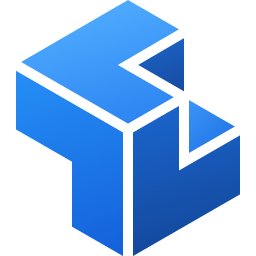

<p align="center">
  
</p>

<h1 align="center">SolidCraft</h1>

<p align="center">
  <strong>An open-source parametric 3D CAD application built in pure Rust.</strong><br />
  Sketch, constrain, and build solids with a parametric feature timeline. Change a dimension
  and watch your model rebuild. Run it on your desktop, in your browser, or let AI agents
  model through the built-in MCP server.
</p>

<div align="center">

[![Download for Windows][badge-windows]][windows-msi]
[![Download for macOS][badge-macos]][macos-dmg]
[![Download for Linux][badge-linux]][linux-appimage]
[![Get it from the Snap Store][badge-snap]][snap-store]
[![Try it in your browser][badge-web]][web-app]

</div>

<p align="center">
  <a href="https://solidcraft.io">Website</a> ·
  <a href="https://solidcraft.io/download">Download</a> ·
  <a href="https://solidcraft.io/app">Try it in the browser</a> ·
  <a href="https://docs.solidcraft.io/">Documentation</a> ·
  <a href="https://www.blacksmith.sh"></a>
  <a href="https://discord.gg/FtU4NQNVDH">Discord</a> ·
  <a href="https://github.com/bherbruck/solidcore">SolidCore</a>
</p>

<p align="center">
  <a href="https://github.com/tangency-labs/solidcraft/actions/workflows/ci.yml?query=branch%3Amain"></a>
  <a href="https://github.com/tangency-labs/solidcraft/releases/latest"></a>
  <a href="https://github.com/tangency-labs/solidcraft/releases"></a>
  <a href="LICENSE"></a>
  <a href="https://discord.gg/FtU4NQNVDH"></a>
  <a href="https://remade.wiki/projects/solidcraft/"></a>
  <a href="https://github.com/tangency-labs/solidcraft/stargazers"></a>
</p>

<p align="center">
  <a href="https://trendshift.io/repositories/296178?utm_source=trendshift-badge&utm_medium=badge&utm_campaign=badge-trendshift-296178" target="_blank" rel="noopener noreferrer"></a>
  <a href="https://trendshift.io/repositories/296178?utm_source=trendshift-badge&utm_medium=badge&utm_campaign=badge-trendshift-296178" target="_blank" rel="noopener noreferrer"></a>
</p>


*A Raspberry Pi 4 case from an empty design: a sketch dimensioned with the board's parameters, extrude, fillet, shell, the rim rounded in one pick, an M2.5 standoff patterned on the 58 × 49 mm hole rectangle, port cut-outs, vent slots, "Pi 4" engraved in DejaVu Sans Bold and a PETG material defined in the design, with its mass in Properties, then height 24 → 32 mm in Parameters and it all rebuilds. 6× playback with the idle pauses cut. [Full video](https://github.com/tangency-labs/solidcraft/raw/refs/heads/main/docs/screenshots/demo.mp4), recorded with the [demo script](examples/demo/record_ui.sh).*

## Download

- **Windows:** the [installer][windows-msi].
- **macOS:** the [disk image][macos-dmg] (Apple silicon and Intel).
- **Linux:** the [AppImage][linux-appimage], or `sudo snap install solidcraft` ([Snap Store][snap-store]).
- **Web:** [try it in your browser][web-app], no install.

ARM64 and 32-bit builds, portable zip, .deb, .rpm, Flatpak and the other packages are on the
[downloads page](docs/downloads.md). The macOS app is signed with a Developer ID and notarized by
Apple. The Windows downloads aren't signed yet: choose **More info**, then **Run anyway** in
SmartScreen. On SolidCraft 0.11 to 0.14, download once by hand; see
[updating](https://docs.solidcraft.io/guide/updates.html#updating-from-011-to-014).

## What works

Early but usable for simple parts: 75 of 76 public reference parts match their analytic or
FreeCAD-computed volume, area, centre of mass and bounding box ([oracle](docs/oracle.md)); the
other is a tracked bug.

- **Sketches and constraints:** lines, arcs, splines, text and more, solved by our own constraint solver, with parameter-driven dimensions.
- **Features:** extrude, revolve, sweep, loft, fillet, chamfer, shell, draft, holes, threads, patterns, mirror, split and combine on an editable parametric timeline.
- **Parameters and configurations** with unit-aware expressions.
- **Assemblies** with joints, motion studies, contact sets, interference and mass properties.
- **Sheet metal** with flanges, hems, fold/unfold and flat patterns, and plastic enclosure features.
- **Files:** STEP, IGES, 3MF, STL, OBJ and glTF in and out where supported, URDF export, `.sc` designs (`.solidcraft` files from earlier releases still open).
- **Desktop app, browser app, headless CLI and MCP server**, all running the same commands.

The full list is in [docs/capabilities.md](docs/capabilities.md) and [docs/features.md](docs/features.md);
status and plans are in [ROADMAP.md](ROADMAP.md). See also [what people built](docs/showcase.md),
[3D mouse support](docs/3d-mouse.md) and the [architecture](docs/architecture.md).

## Build from source

```sh
cargo run --release -p solidcraft -- --sample      # desktop app with a sample part
cargo run --release -p solidcraft-cli -- commands  # the command registry
cargo run --release -p solidcraft-cli -- run examples/bracket.json --out bracket.step
cargo xtask ci                                     # fmt, clippy, tests, icons, assets, layers, wasm
```

More commands, the Windows cross-build and the browser build are in [docs/building.md](docs/building.md).

## AI agents (MCP)

`solidcraft-cli mcp` is a [Model Context Protocol](https://modelcontextprotocol.io) server. Headless it
runs its own design session, or with `--connect` it drives the running app so you can watch.
Claude Code: `claude mcp add solidcraft -- solidcraft-cli mcp`. If a terminal doesn't find
`solidcraft-cli` (older Windows installers don't put it on `PATH`), give its full path (by default
`"C:\\Program Files\\SolidCraft\\solidcraft-cli.exe"`). Tools, access rules and an example session:
[docs/mcp.md](docs/mcp.md).

## Scripts

A script is a JSON list of the same commands the UI runs, executed with `solidcraft-cli run`.
Format and example: [docs/scripts.md](docs/scripts.md). Pages can also be driven through the
[browser command API](docs/browser-api.md).

## Plugins (experimental desktop runtime)

Plugins add separately distributed behaviour without compiling that behaviour into SolidCraft.
The initial runtime loads **WebAssembly components**, explicitly requested by the user. Merely
installing a folder, enabling it in Preferences, or opening a design never executes plugin code.
The interface is experimental (`solidcraft:plugin@0.1.0`); use a plugin built for this API and
review it again after an update. The desktop app and headless CLI use the same commands. Browser
execution, automatic downloads and updates, custom panels, and plugin-defined parametric feature
types are future work.

### Install and inspect

A package is a folder named after its id, containing `plugin.json` and a `.wasm` component.
Preferences > Plugins lists packages under the per-user data folder: `%LOCALAPPDATA%/SolidCraft/plugins`
on Windows, `~/Library/Application Support/SolidCraft/plugins` on macOS, and
`${XDG_DATA_HOME:-~/.local/share}/solidcraft/plugins` on Linux. **Show in folder** opens this location.
You can also inspect and explicitly run a package in another folder. Nothing is downloaded by the host.

A minimal manifest looks like this (the [original box example](examples/plugins/example-box) includes
its Rust source and build instructions):

```json
{
  "id": "example-box",
  "name": "Example box",
  "version": "0.1.0",
  "description": "Create an ordinary editable box from dimensions.",
  "runtime": {
    "api": "solidcraft:plugin@0.1.0",
    "module": "plugin.wasm",
    "entries": ["make"],
    "commands": ["solid.box"],
    "limits": {"fuel": 10000000, "memory_mib": 64, "deadline_ms": 5000}
  }
}
```

Run `plugin.inspect` with `{"path":"/path/to/example-box"}` through the CLI's JSON scripts, MCP
`execute`, or the desktop control channel's `engine.execute`. It reads the manifest and component
without executing them, returning the declared commands, limits and an `approval` SHA-256 hash.
Review the author, code and declared rights before using that hash. Inspection does not approve a
package. Existing metadata-only packages remain listable but cannot run until they declare a runtime.

### Run explicitly

After reviewing the inspected package, execute:

```json
{
  "command": "plugin.run",
  "params": {
    "path": "/path/to/example-box",
    "approval": "<exact approval hash returned by plugin.inspect>",
    "entry": "make",
    "params": {"length": 20, "width": 10, "height": 3}
  }
}
```

For example, save that command in a JSON array and use `solidcraft-cli run commands.json`.
For the running desktop app, send it as the `command` and `params` of a standalone
`engine.execute` request (see [control protocol](docs/control-protocol.md)). The native host runs
it on a worker and keeps the window responsive. Stop or a design change discards the pending
result; the host does not automatically rerun external code. Desktop batches and scripts must send
`plugin.run` separately. Headless CLI scripts may include it as a normal command.

The hash binds **both the exact manifest bytes and the component bytes**, so an updated package
requires a fresh inspection and permission review. It is a content identity, not a signature or an
author's reputation. Agent chat asks before executing external plugin code. MCP and the control
channel keep their existing file scopes: allow the package folder explicitly where needed. Naming
a package never grants access to another folder.

### User resource ceilings

The invocation defaults remain **10,000,000 fuel, 64 MiB of guest memory and 5000 ms**.
The default host ceilings remain **100,000,000,000 fuel and 128 MiB**. A package can declare
larger fuel or memory budgets, but execution is refused until you explicitly raise the host
ceilings and approve that exact package content. `plugin.inspect` is inert and reports the
requested limits, current `host_limits`, `within_host_limits` and any `limits_error` even when
a request is too large.

In the native GUI, open **Preferences > Plugins**, enter **Max plugin fuel** and
**Max plugin memory (MiB)**, then choose **Apply** or **OK**. Enter also accepts both values;
**Cancel** reverts changes since the last Apply and **Restore defaults** resets this page.
The settings persist in your user preferences and do not travel with saved designs.

For standalone CLI or headless MCP sessions, create a UTF-8 JSON file, for example
`plugin-limits.json` containing:

```json
{"max_fuel": 200000000000, "max_memory_mib": 512}
```

Pass it explicitly when starting the process:

```text
solidcraft-cli --plugin-limits plugin-limits.json run inspect-plugin.json --results
solidcraft-cli --plugin-limits plugin-limits.json mcp --headless --allow-path /path/to/plugins
```

Missing fields use the original host ceilings. Connected desktop sessions use the GUI's
preferences; CLI settings cannot override them. Positive integer fuel values up to `u64::MAX`
are accepted without rounding. Guest memory is limited to 4096 MiB by the current Wasm32 ABI;
that technical boundary requires a different runtime ABI to change. Neither setting changes
a package's declared budget, executes it, adds permissions, or retries a failed invocation.
Review its manifest and component, obtain the content approval hash, and explicitly invoke it.
A changed manifest budget requires a fresh approval hash. Keep the selected ceilings within your
machine's available resources; they are limits on guest execution, not total SolidCraft memory
or native CAD work. The independent maximum execution deadline stays 30 seconds.

### Permissions, results and saved designs

A plugin can call only exact built-in command ids listed in its manifest **and** admitted by the
host's policy. Recursive plugin calls, design replacement, file operations, process launches and
network commands are refused. The component receives no WASI imports, filesystem, sockets, clock
or process API; persistent plugin storage is not supported in this first runtime. Inspection
commands can disclose model data, so review them as permissions too. In particular, the optional
`model.mesh` permission exposes the requested body's evaluated vertices and triangles in its owning
component's coordinates (millimetres), with explicit transfer limits. It performs no conversion.

Edits run against an isolated copy of the design. Only a successful call is adopted, as **one Undo
step**. A trap, exhausted fuel, memory limit, invalid result or refused host call discards the
transaction, preserving the previous design and undo/redo history. The host validates produced
native features before accepting them. A plugin that catches a refused host call cannot commit an
earlier partial edit. CPU-heavy guest loops are bounded by fuel and a deadline; the guide explains
the separate cost of compiling a component and executing a granted native command.

The result is ordinary native features: they save, undo, redo and rebuild without the plugin.
Removing the package disables future invocations; it does not remove the features already created.
Changing the plugin's own parameters means another invocation in this first version; there is no
plugin-owned timeline evaluation hook yet. Turn an installed plugin off in Preferences > Plugins
to refuse subsequent desktop calls. Disabling it or changing resource ceilings during a pending
call prevents adoption. CLI
processes have their own session policy and do not read the desktop app's preferences.

See the [runtime and author guide](docs/plugin-runtime.md) for the complete manifest, supported
command boundary, limits, build options, tests and current restrictions.
For step-by-step package checks and expected results, see the [English test guide](docs/plugin-test-guide.md). The existing
[parametric plugin design](docs/plugins.md) remains a separate future phase.

## Contributing

Help is welcome. [CONTRIBUTING.md](CONTRIBUTING.md) covers how to build and test, the code map,
the clean-room and licence rules, and where help is wanted most. Open work is in
[GitHub issues](https://github.com/tangency-labs/solidcraft/issues); chat is on
[Discord](https://discord.gg/FtU4NQNVDH).

## Sponsors

[](https://www.blacksmith.sh)

SolidCraft's continuous integration runs on [Blacksmith](https://www.blacksmith.sh), which
sponsors its CI minutes.

## Disclaimer

The files in this repository are provided as is, without warranty, liability or indemnity, and
Tangency Labs and the contributors accept no responsibility for any harmful or unlawful use of
them: read [DISCLAIMER.md](DISCLAIMER.md).

## Licence

MIT OR Apache-2.0, at your option. Developed under the
[clean-room contribution rules](AGENTS.md); third-party code and assets retain their
documented licences and attribution.

SolidCraft is independent. Behaviour is designed from public documentation, general CAD
conventions and user feedback. Reference tests use analytic values and open-source tools.
SolidCraft is not affiliated with, sponsored by or endorsed by Autodesk, Dassault Systèmes, PTC,
Siemens or any other CAD vendor. Fusion, AutoCAD, Inventor, SolidWorks, Onshape, Creo, Blender and
Tinkercad are trademarks of their respective owners, named only to describe compatibility
(see [NOTICE](NOTICE)).

[badge-windows]: https://img.shields.io/badge/Windows-Download-0078D6?style=for-the-badge&logo=data%3Aimage%2Fsvg%2Bxml%3Bbase64%2CPHN2ZyB4bWxucz0iaHR0cDovL3d3dy53My5vcmcvMjAwMC9zdmciIHZpZXdCb3g9IjAgMCAyNCAyNCIgZmlsbD0id2hpdGUiPjxwYXRoIGQ9Ik0yIDJoOS41djkuNUgyek0xMi41IDJIMjJ2OS41aC05LjV6TTIgMTIuNWg5LjVWMjJIMnpNMTIuNSAxMi41SDIyVjIyaC05LjV6Ii8%2BPC9zdmc%2B
[badge-macos]: https://img.shields.io/badge/macOS-Download-333333?style=for-the-badge&logo=apple&logoColor=white
[badge-linux]: https://img.shields.io/badge/Linux-AppImage-E95420?style=for-the-badge&logo=linux&logoColor=white
[badge-snap]: https://img.shields.io/badge/Snap-Snap_Store-82BEA0?style=for-the-badge&logo=snapcraft&logoColor=white
[badge-web]: https://img.shields.io/badge/Web-Try_in_browser-2EA44F?style=for-the-badge&logo=data%3Aimage%2Fsvg%2Bxml%3Bbase64%2CPHN2ZyB4bWxucz0iaHR0cDovL3d3dy53My5vcmcvMjAwMC9zdmciIHZpZXdCb3g9IjAgMCAyNCAyNCIgZmlsbD0ibm9uZSIgc3Ryb2tlPSJ3aGl0ZSIgc3Ryb2tlLXdpZHRoPSIyIj48Y2lyY2xlIGN4PSIxMiIgY3k9IjEyIiByPSIxMCIvPjxwYXRoIGQ9Ik0yIDEyaDIwTTEyIDJhMTUgMTUgMCAwIDEgMCAyME0xMiAyYTE1IDE1IDAgMCAwIDAgMjAiLz48L3N2Zz4%3D
[windows-msi]: https://github.com/tangency-labs/solidcraft/releases/latest/download/solidcraft-windows-x64.msi
[macos-dmg]: https://github.com/tangency-labs/solidcraft/releases/latest/download/solidcraft-macos-universal.dmg
[linux-appimage]: https://github.com/tangency-labs/solidcraft/releases/latest/download/solidcraft-linux-x86_64.AppImage
[snap-store]: https://snapcraft.io/solidcraft
[web-app]: https://solidcraft.io/app

