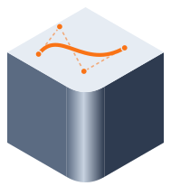
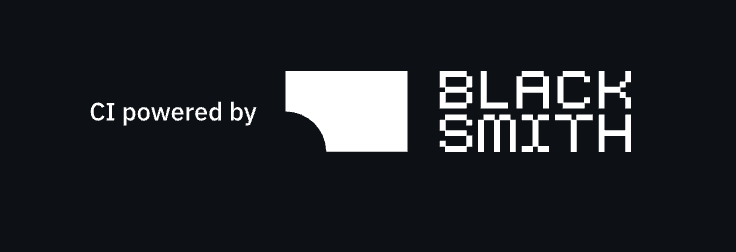

<p align="center"></p>

# solidcore

**📊 Live progress: [tangency-labs.github.io/solidcore](https://tangency-labs.github.io/solidcore/)**: every unit's port status, the upstream-issues log, and the surface/surface intersection corpus scores, regenerated on every merge.

solidcore is a boundary-representation (B-rep) solid modeling kernel in safe Rust. It is based
on NVIDIA's SMLib (from [USD BRep](https://github.com/NVIDIA-Omniverse/usd-brep), Apache-2.0)
and goes its own way from there: it started as a port, and its new constructions, such as the
generic rolling-ball blend ([docs/generic-blend.md](docs/generic-blend.md)), are designed and built
here as clean, procedural constructions that replace the code they supersede. Contributing:
[CONTRIBUTING.md](CONTRIBUTING.md). Design discussion: the
[`#solidcore-dev`](https://discord.com/channels/1560611394934673498/1560631619340214394) channel on Discord.

Solids are exact: shells, faces, loops, edges and vertices bound to analytic and NURBS
curves and surfaces. solidcore's first consumer is **SolidCraft**.

## Scope

In scope: the `SMLib` kernel and the `SM_API` operation layer of upstream — NURBS
math, curve and surface geometry, B-rep topology, intersections, booleans, fillets and
chamfers, offset/shell, sweeps and skins, primitives, healing/stitching, mass
properties and queries.

Out of scope: upstream's OCCT translators, USD/Hydra integration and Python bindings.
See [ATTRIBUTION.md](ATTRIBUTION.md).

Goals: no `unsafe` in the kernel, no panics on bad input, deterministic results, no
global state (one `Kernel` per thread), builds for `wasm32-unknown-unknown`, and exact or
certified geometry. The gate is its own tests, SolidCraft's operation cases and the goldens:
every unit's cases checked against their committed expected outputs (AGENTS.md §1).

## Status

Every SMLib kernel module has a Rust counterpart, and primitive construction is exercised
end to end. Integration remains in progress: deferred paths still limit coverage. The API is experimental (0.0.x).

Use the [live unit results](https://tangency-labs.github.io/solidcore/units/index.html)
for each unit's status and blockers, and the
[primitive checks](https://tangency-labs.github.io/solidcore/solids.html) for whole-solid
results. Per-unit plans and notes live in [`plan/units/`](plan/units/); the generated
checklist is [`PROGRESS.md`](https://tangency-labs.github.io/solidcore/PROGRESS.md) on the site, with handoff notes in
[`plan/STATUS.md`](plan/STATUS.md). The progress site is built by
[`site/build.py`](site/README.md) (`python3 site/build.py` -> `bin/site/`).

## Reference docs

How the kernel's constructions work, the theory behind them and the invariants they keep, with
schematics. Start with the first; each ends with "If you're stuck".

| Doc | What it covers |
|-----|----------------|
| [Definitions and certificates](docs/definitions-and-certificates.md) | A surface is its definition and its B-spline a certified approximation; the certificate; exactness classes; the exact extension; the invariants every construction keeps |
| [The generic blend](docs/generic-blend.md) | Fillets, chamfers, corners and setbacks |
| [The procedural sweep](docs/procedural-sweep.md) | Swept surfaces, their rotation-minimizing frames, threads |
| [Surface-surface intersection](docs/ssi.md) | The SSI pipeline, its exact classes, and what the boolean takes from it |
| [Layers](docs/layers.md) | Which layer each job lives in |

## Layout

| Path                    | Contents                                                     |
|-------------------------|--------------------------------------------------------------|
| `crates/solidcore`      | The kernel library                                           |
| `crates/goldens`        | Every unit's cases, checked against their goldens            |
| `crates/diagnostics`    | `solidcore-diag`: a shaded picture and a tolerance report of one `.smb` body |
| `plan/`                 | Unit list, port order, status, findings                      |
| `site/`                  | Generator for the GitHub Pages progress site                 |
| `upstream/`             | Local clone of usd-brep v1.0.1 at `3fd5b95`, read only (gitignored) |
| `bin/`                  | All build output (gitignored)                                |

## Building

Requires the stable toolchain (pinned by `rust-toolchain.toml`, which also installs
`rustfmt`, `clippy` and the `wasm32-unknown-unknown` target). Cargo output goes to
`bin/` (see `.cargo/config.toml`).

```sh
cargo build -p solidcore
cargo test -p solidcore
cargo fmt --all --check
cargo clippy --workspace --all-targets -- -D warnings
cargo check -p solidcore --target wasm32-unknown-unknown   # wasm check
```

Optional: `export RUSTC_WRAPPER=sccache` to share compilation caches.

### WebAssembly stack size

On `wasm32-unknown-unknown` the Rust stack lives in linear memory **without a guard
page**, so an overflow corrupts memory instead of aborting. solidcore bounds
input-driven recursion, but kernel algorithms (subdivision, intersection, filleting)
still recurse legitimately. Link wasm consumers with a larger stack than the ~1 MB
default, e.g. in the consumer's `.cargo/config.toml`:

```toml
[target.wasm32-unknown-unknown]
rustflags = ["-C", "link-arg=-zstack-size=8388608"]   # 8 MiB, as a native main thread
```

## Goldens

Every unit's cases (`fixtures/<unit>/`, upstream's `TestFiles`, seeded generators) run on
solidcore and are checked against the unit's golden, `crates/goldens/expected/<unit>.jsonl`:
the outputs recorded when it was blessed. CI fails on any changed, added, missing or broken
case. Many cases read upstream's test files, so clone `upstream/` first:

```sh
git clone https://github.com/NVIDIA-Omniverse/usd-brep upstream
git -C upstream checkout 3fd5b95   # v1.0.1; the pin is in scripts/upstream-pin.env
cargo run --profile goldens -p goldens -- --all --goldens --jobs 0   # every unit (CI)
cargo run --profile goldens -p goldens -- --unit <unit id> --goldens   # one unit
cargo run --profile goldens -p goldens -- --unit <unit id> --bless     # record a change on purpose
```

A golden proves a result unchanged, not correct. A change that moves one is blessed and
justified in its pull request: the cases that changed, their numbers, and pictures for
geometry ([crates/goldens/README.md](crates/goldens/README.md)). upstream's C++ is a reading
reference only: nothing here builds, links or runs it.

## Contributing

Contributions go through pull requests, and AI agents are welcome. Useful work includes
connecting ported units, resolving deferred cases, adding operation regressions
and fixing bugs.

1. Check the [live unit results](https://tangency-labs.github.io/solidcore/units/index.html),
   [open issues](https://github.com/tangency-labs/solidcore/issues) and
   [open PRs](https://github.com/tangency-labs/solidcore/pulls). Choose an unclaimed
   unit or a specific completion task: a missing function, back-edge, exact import,
   coverage gap or bug. A passing golden does not prove every branch is exercised.
2. Search PR titles and bodies for the unit, symbols and paths. Claim the specific
   work in a draft PR; initial ports use `port: <unit id>`. A claim covers its stated
   scope, leaving independent tasks in the same unit available. Coordinate overlapping
   functions or shared interfaces in the existing PR before editing them.
3. Describe the intended behavior, affected paths, related PRs and validation, and
   list independent follow-ups others can take. Check the affected units against their
   goldens and justify every golden you bless. CI is the merge gate. See
   [AGENTS.md §4](AGENTS.md#4-pull-requests) for the claim template,
   handoffs and inactivity rules.

To keep parallel PRs from conflicting: edit only your unit's `plan/units/<unit id>.toml`,
and put each finding or upstream issue
in its own new file under `plan/findings/` or `plan/upstream-issues/` (never append to a
shared file). A branch started before the per-unit
split migrates with `git fetch origin && git merge origin/main;
scripts/units-migrate-branch.sh && git commit --no-edit`.

The full rules, style and step-by-step workflow are in [AGENTS.md](AGENTS.md) (point your
agent at it).

## Releasing

`solidcore` is published to crates.io from CI: bump `version` in
`crates/solidcore/Cargo.toml` in a PR, merge it, then push a tag
`solidcore-v<version>` (`.github/workflows/release.yml`, needs the
`CARGO_REGISTRY_TOKEN` repository secret). Only `solidcore` is published;
`goldens` is test-only. It stays at 0.0.x until it is usable end
to end.

## Sponsors

[](https://www.blacksmith.sh)

solidcore's continuous integration runs on [Blacksmith](https://www.blacksmith.sh), which
sponsors its CI minutes.

## Licence

Apache-2.0. See [LICENSE](LICENSE), [NOTICE](NOTICE) and
[ATTRIBUTION.md](ATTRIBUTION.md). solidcore is an independent project, not affiliated
with or endorsed by NVIDIA.
