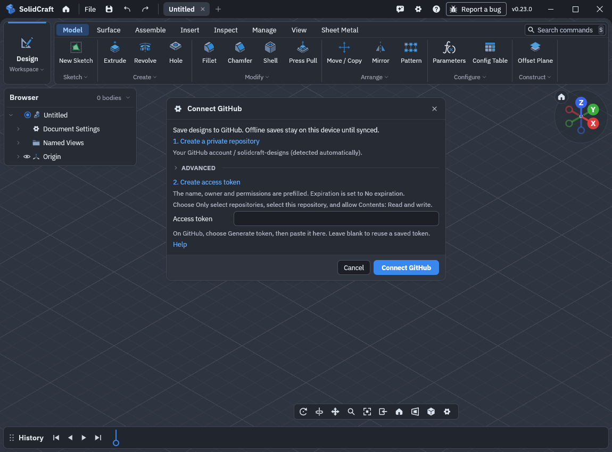
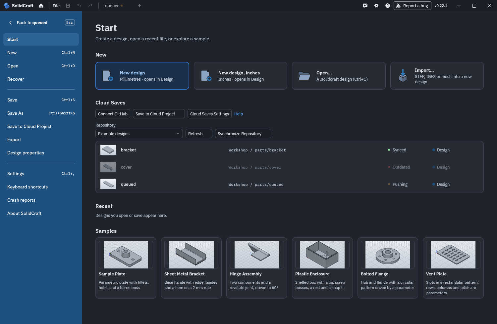
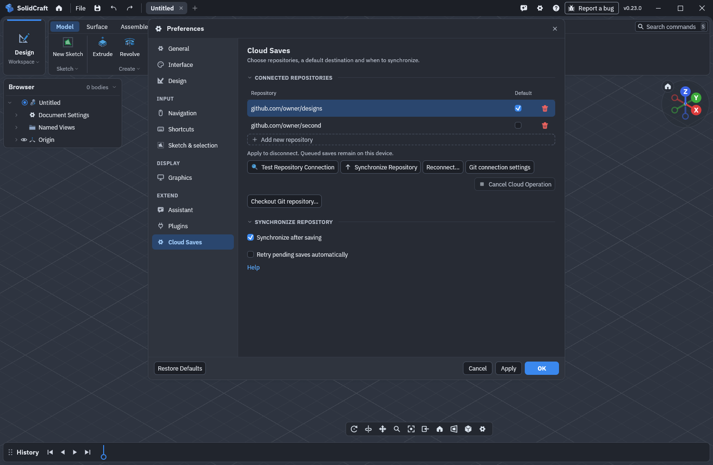

# Cloud Saves

Cloud Saves keeps designs in Git repositories. Each repository can contain project
folders, with parts, assemblies and related documents inside each project.
You can connect more than one repository.

## Connect GitHub

1. On **Start**, find **Cloud Saves** and choose **Connect GitHub**.
2. Choose **Create a private repository**. GitHub opens with the name
   `solidcraft-designs` and private visibility selected. Check these choices and
   create the repository. You can also use a repository you already own.
3. Choose **Create access token**. GitHub opens with the token name, description,
   repository owner, **Contents: Read and write**, and **No expiration** prefilled.
   Choose **Only select repositories**, select this repository, check the permission,
   then choose **Generate token**. GitHub requires you to select the repository yourself.
   An organization policy may require an expiration or approval.
4. Copy the generated token, paste it into SolidCraft, and choose **Connect GitHub**. SolidCraft discovers
   your GitHub account and uses its `solidcraft-designs` repository, checks
   access and write permission, initializes an empty repository, and remembers the
   connection. A desktop connection also creates a local checkout automatically.

To use another repository, expand **Advanced** and enter its `owner/repository`
name or GitHub URL. The token form then also prefills that repository's owner.

An organization may require approval before its token works. A read-only token,
an expired token, a renamed repository or an unavailable keychain produces an error;
correct the problem and retry. Reconnecting the same repository updates that
connection, leaving other connections and their default selection intact.

This guided setup works on desktop and in the browser. Create the token once;
SolidCraft remembers it for future saves, including after a browser restart.

Desktop stores tokens in the operating system's credential store. The browser
keeps them in a separate local credential database. Tokens are never included in
designs or shared repository metadata. Treat a token like a password, and use a
trusted browser profile and device. Desktop reuses the same token for Git over HTTPS.

## Save and synchronize

### Save a local design to cloud

Open your local design, then choose **File → Save to Cloud Project**. The same
action is available in Start's navigation. Choose the repository, project and
design name, then save. SolidCraft leaves the original local file unchanged and
uses the cloud destination for subsequent saves. Use **Save As** to save a native
file again.

### Save in a cloud project

1. On **Start → Cloud Saves**, choose **Save to Cloud Project**. For a new design,
   normal **Save** opens the same picker when a default cloud repository is connected.
2. Choose a repository and a project from the **Project** list. Choose **New…**
   to enter a new project folder, then name the design. For example, project `Robot` and name `bracket` create
   `Robot/parts/bracket` inside the repository. Parts and assemblies use the same
   design representation; you can also store ordinary documents in the project.
3. Choose **Save**. Future saves use this destination even if you change the default
   repository. Native **Save As** creates a `.solidcraft` file and detaches that
   document from its cloud destination.

On **Start**, use the repository selector to browse connected repositories and
click a design to open it. Other open designs and unsaved edits are preserved.
**Refresh** reloads the list; **Synchronize Repository** retries pending saves for
the selected repository. A failed refresh keeps the last displayed list; availability
offline depends on the designs retained by local storage. **Add new repository** connects
another GitHub repository or desktop Git checkout. Additional GitHub setup shows
the repository field and suggests an unused name; you can enter an existing
repository instead. The repository selector switches between all connected
repositories, each with independent credentials and queues.

The picker refuses names already shown in that project. If another device creates
the same name after listing, synchronization preserves a conflict copy. Further
offline saves follow that copy when they synchronize, keeping the competing original
and your sequence of revisions intact. Changing
the active design while the picker is open cancels the choice so it cannot save a
different tab by accident. Saved designs show a small model preview when geometry is
already available. Previews stay available offline after restart; designs without a
preview use the design icon. Open and save an older cloud design once to attach a
preview if its earlier save did not include one.

Saving first records the captured design on this device, then synchronizes it.
If that repository is already synchronizing, your new save is stored locally
immediately and uploads when the current synchronization finishes.
The Start list shows a colored dot and a short status. Pushing and Outdated dots
gently fade in and out:

- **Pushing** (yellow): saved on this device and waiting to upload, or uploading now.
- **Synced** (green): publication is confirmed.
- **Outdated** (red): the repository has changed since the retained copy. Choose
  **Synchronize Repository** before opening it; **Pulling** (yellow) appears while it updates.
- **Available** (blue): a listed design or retained copy whose publication has not been confirmed.
- **Conflict** or **Error** (red): inspect the reported details before continuing.

**Synchronize Repository** uploads queued saves and receives changes to previously
opened designs, including when no saves are waiting. Loading indicators keep the
buttons aligned. Each action stays disabled until its operation finishes.
Opening a cloud design enters the workspace before showing progress, just like
opening a local file. Its parts appear as display meshes become ready.

Cloud-backed document tabs use the usual unsaved-marker position after the name.
Unsaved edits show a white dot; pushing makes it pulse white. A push still waiting
after 30 seconds pulses orange, and a failed save or push shows red. Saved cloud tabs
have no dot, just like saved local files. Hover over a status dot for the repository,
project and status.
Local file tabs retain their usual white unsaved marker.
Edits made while an upload runs remain unsaved until you save again.

If two offline tabs save competing versions, open the design from Home and choose
a local version to inspect. Each choice uses its displayed revision identifier.
Cancel leaves every capture saved; opening a version also keeps all captures.
Synchronization preserves competing edits as separate copies.

Without connectivity, saves stay in the local queue. Keep the same browser profile:
reopening SolidCraft resumes pending saves, and queued or previously confirmed
designs can be opened offline. The browser requests persistent storage; clearing
site data or deleting the browser profile also removes local recovery data and
credentials. Storage errors are reported instead of claiming the save succeeded.
Desktop retains its recovery queue separately from the checkout. Opening a design
from an ordinary checkout also retains a validated local snapshot. That snapshot
can be opened if the checkout is later unavailable. **Available** identifies
a retained checkout copy whose publication has not been confirmed.

The Start list restores these statuses from local records after a restart and
refreshes them after synchronization. A desktop checkout changed by another Git
client is marked **Outdated** when its retained copy differs. That observation survives
restarts and failed refreshes; synchronization must update the copy before the row
can be opened. Queued local work remains accessible offline.

Cancelling synchronization keeps queued designs. When a conflicting design edit
is found, SolidCraft preserves a conflict copy rather than replacing either edit.
Newer storage formats ask you to upgrade before opening or saving.

## Manage connections

Open **Cloud Saves Settings** from Start, or choose **Settings → Cloud Saves**.
The repository table shows a label derived from each remote, such as
`github.com/owner/solidcraft-designs`. Select a row to test or synchronize it,
reconnect with a replacement token, or open its Git settings. Use the **Default**
checkbox to choose the destination for new cloud saves. **Add new repository**
connects another GitHub repository; **Checkout Git repository** configures a desktop
checkout. Progress and cancellation stay in a fixed footer below the actions.

Connection changes take effect when you choose **Apply** or **OK** and local
storage confirms them. A failed Apply keeps the page open so you can retry.
**Cancel** discards changes made since the last successful Apply. Connecting or
reconnecting from this page verifies the repository first, then waits for Apply.

Use the remove button in a repository row, then Apply to disconnect it. Its queued
saves remain on this device; reconnecting the same repository restores access to
them. Existing designs keep their destinations when you change the default.
**Restore Defaults** resets synchronization preferences and preserves connections.

**Synchronize after saving** publishes each locally recorded save in the background.
**Retry pending saves automatically** retries after startup and at regular intervals.
You can also synchronize a selected repository immediately or cancel an active
operation. Cancelling an upload keeps its durable local save.

## Reconnect and desktop Git

Use **Connect GitHub** again with the same repository and a replacement token.
Leave the token field blank to reuse the saved token after a temporary network
failure. A failed replacement does not replace a working connection's credential.

An app-managed checkout is an ordinary Git checkout that a desktop client can use.
SolidCraft commits the files belonging to its save and preserves unrelated staged
and unstaged changes. It waits for external merges or rebases to finish.
Git configuration and signing remain in effect. If no author identity is available,
the app uses `SolidCraft <cloud@solidcraft.invalid>` for that save only.

### Connect an existing checkout

1. Open **Settings → Cloud Saves → Checkout Git repository…**.
2. Name the connection and choose the checkout's top-level folder with **Browse…**.
   Enter the branch currently checked out in that folder.
3. Enter a remote name such as `origin`, an HTTPS or SSH URL, a `file://` URL,
   or a local path. Leave Remote empty to keep revisions only in this checkout.
4. Choose authentication. **System configuration** uses Git's existing credential
   helpers and SSH configuration. **HTTPS** reuses a guided GitHub connection's
   saved token, or the system credential helpers for other connections. For
   **SSH**, choose **System keys and agent** or **Choose key** and browse to the
   private key. An encrypted key can be unlocked in your SSH agent or system prompt.
5. Choose **Test Repository Connection**. Review the fetch and push destinations,
   then choose **Use this connection → Apply**. Failed tests keep your entries for retry.

Select an existing connection and choose **Git connection settings** to edit it.
Changes must pass another test. Cancelling the editor or Preferences preserves the
previous connection. The optional **Git executable** field applies to all connections;
leave it empty to find Git through PATH. Private keys remain on this device.
Do not put tokens into remote URLs.

SolidCraft records the verified destinations. If Git configuration later changes
them, publication pauses and saves remain on this device. Open the connection's
Git settings to test and review its destinations again. Queued saves retain their
captured destination: changing a connection's repository, branch or pinned URLs
does not redirect existing saves. Restore the original connection to publish them.

See GitHub's [token guide](https://docs.github.com/en/authentication/keeping-your-account-and-data-secure/managing-your-personal-access-tokens)
for token expiration, organization approval and revocation.

### Generate an SSH key

In the Git connection editor, choose **SSH → Generate SSH Key**. Enter an optional
passphrase, then choose **Generate SSH Key** again. SolidCraft creates an Ed25519
pair in its local data folder under `cloud/ssh/key-…/`. Existing keys are preserved.
The private key is selected for this connection automatically.

Choose **Copy public key** and add it to your Git host's SSH settings. GitHub
connections also offer **Open host SSH settings**. Choose **Test Repository
Connection**, then **Use this connection → Apply** after the test succeeds.
Generation creates local files immediately; Cancel leaves the pair available
locally while discarding the proposed connection changes.

**Remember passphrase in system keychain** is optional. When enabled, SolidCraft's
OpenSSH helper retrieves the passphrase from the system credential store to unlock
that key. Otherwise, use your SSH agent or system passphrase prompt. Unlocking the
system keychain may be necessary after login. The helper answers only the selected
key's passphrase prompt; host trust and account password prompts remain with system
SSH. A new host may require confirming its identity through your normal SSH tools
before the connection test can succeed.

Private keys and remembered passphrases stay on this device. Keep a secure backup
of keys you need, or register a new public key when moving to another device.
