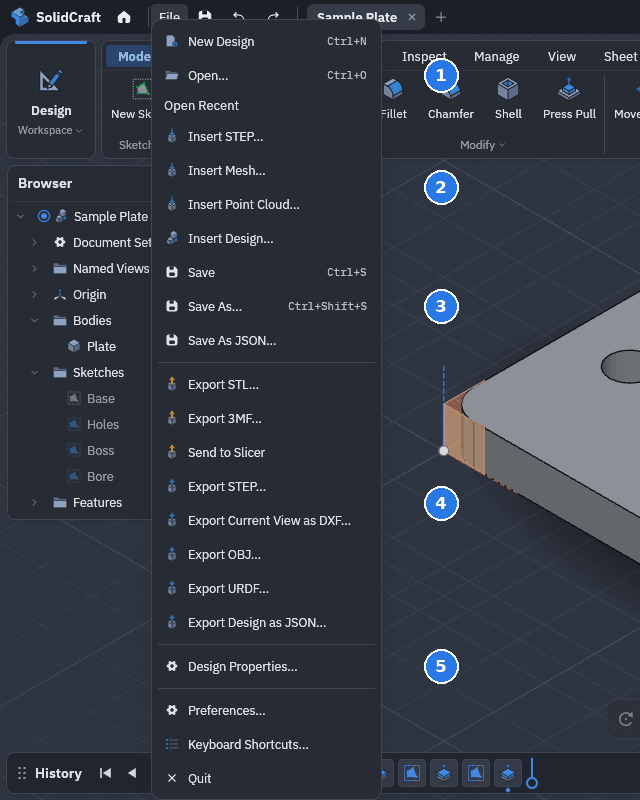
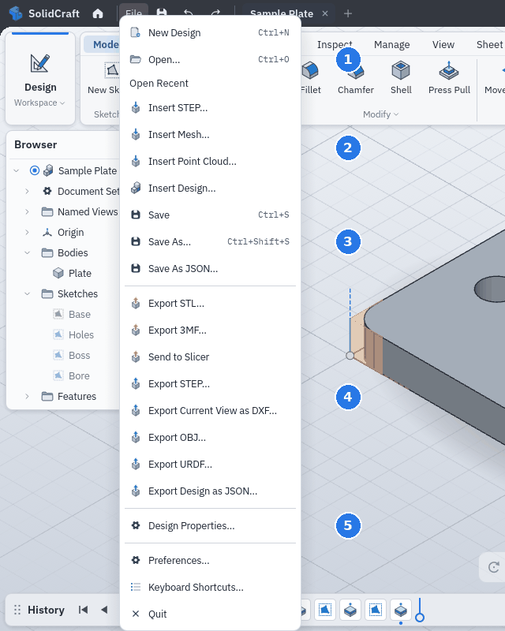

# Import and export

Everything here starts from the **File** menu at the top left.




**1** Open a design (or a STEP, IGES or mesh file as a new one) · **2** Insert a file into the open
design · **3** Save · **4** Export: meshes, STEP, a DXF of the view, URDF, JSON ·
**5** Design properties

| Format | Read | Write |
|---|---|---|
| `.sc` (versioned container or JSON design; `.solidcraft` files from earlier releases still open) | yes | yes |
| `.json` (self-contained plain JSON design) | yes | yes |
| STEP (AP203, AP214, AP242) | solids, assemblies, units, names, colours | AP242 with names, colours and the component tree |
| IGES 5.3 | manifold solids, or trimmed surfaces sewn into solids | manifold solids with names and colours |
| FreeCAD `.FCStd` | sketches and features (Pad, Pocket, Revolution, Groove, Fillet, Chamfer, primitives, Mirrored, patterns), else solids, through cadmpeg | |
| Rhino `.3dm` | solids, through cadmpeg | Rhino 8, through cadmpeg: bodies with flat faces and straight edges exact, others as meshes; names and colours (desktop only) |
| 3MF, STL, OBJ | mesh bodies | yes |
| glTF 2.0 (`.glb`, `.gltf` with its `.bin` files) | mesh bodies in the node tree's components, materials as appearances | `.glb`: placed bodies with their colours, metallic and roughness, in metres with Y up |
| OpenUSD (`.usd`, `.usda`, `.usdc`, `.usdz`), through cadmpeg | mesh bodies in the prim tree's components, materials as appearances; with `geometry: "exact"`, its B-reps as B-rep bodies | each body's mesh, named, with its exact B-rep where cadmpeg's model holds it; looks with metallic, roughness and opacity; the component tree; in metres with Z up |
| 3MF with face tags | as 3MF | each triangle tagged with its B-rep face, exact coordinates |
| URDF | | the assembly as a robot: links with meshes, mass and inertia, joints from the assembly's joints |
| DXF, SVG | into a sketch | sketches and flat patterns as DXF |
| Airfoil coordinates (`.dat`, Selig or Lednicer) | into a sketch, as one spline at the chord you set | |
| PNG, JPEG | canvases and decals | |

**File → Export GLB…** (`file.export` with a `.glb` path) writes one binary glTF file for web viewers,
renderers such as Blender, and game engines. Each body is a node named after it, where the design places
it. Its colour, metallic and roughness become a glTF material, and a face with a look of its own gets that
look. A body with no colour gets the Render workspace's grey. The file is in metres with Y up, as glTF
requires, through one root node. A transparent body or face, and a body that a render setup gives an
image texture or optics, are refused with a message that names the body, since the file would show it
wrongly; leave such a body out with `bodies`. A refused export leaves a file already at the path as it was.

**File → Export OpenUSD…** (`file.export` with a `.usd`, `.usda`, `.usdc` or `.usdz` path) writes an
OpenUSD stage for NVIDIA Omniverse and Isaac Sim, Blender, Apple's tools and other USD viewers. The
extension picks the encoding: `.usda` is text, `.usdc` and `.usd` are binary, and `.usdz` is a package of
one binary file. The design is written straight into cadmpeg's model, which cadmpeg writes as USD. With
no bodies chosen, each component placement is an `Xform` prim named after the occurrence, holding its
component's bodies; a component placed more than once is written once, under the abstract `Prototypes`
prim, and referenced at each placement. Chosen bodies are written where the design shows them, under one
prim named after the design. Each body is a prim named after it, holding its exact B-rep (a `BrepArray`
prim) and the mesh SolidCraft draws it with, made at the export's Mesh quality (`quality`: standard, fine
or finest, as for STL). A mesh body has its mesh alone, and so has a body whose shape cadmpeg's model
cannot hold exactly yet, with a warning naming it. Looks become `UsdPreviewSurface` materials named after them, with their colour,
opacity (a transparent look stays transparent), metallic, roughness and index of refraction; a face with a
look of its own gets that material. The stage is in metres with Z up and says so in its metadata.
With `physics: true`, an export of the whole design also writes OpenUSD physics for a simulator: its
rigid, revolute, slider, cylindrical, planar and ball joints (revolute and slider joints keep their limits;
the others are written without them, with a warning), each grounded placement fixed to the world, each
placement of a component as a rigid body, each component's mass, centre of mass and principal inertia from
its bodies' materials, and a physics scene. Gears between two revolute joints and a rack and pinion become
PhysX gear and rack-and-pinion joints that couple the two joints. PhysX's gears turn opposite ways and its
rack moves with the pinion's turn, so gears that turn the same way (an internal gear, or reversed
gears), a rack that moves against the pinion's turn, other joint kinds, suppressed joints, screws, cams
and other motion links are left out with a warning. With bodies chosen, or a placement that is not rigid, no physics is written, and a
warning says why. With `render_setup: <name>` and a `.usdz` path, the images that render setup gives the
bodies (base colour, roughness, metallic, and a normal map the file can show as the renderer does) go
into the package, on each body's mesh; a `.usda` or `.usdc` file is written without them, with a warning.
With `images: true` and a `.usdz` path, each picture shown on the model (a decal or a placed image) goes
into the package as a body of its own in its component, named after it: a quad lifted 0.2 mm off each
side, its image as its colour and, for a PNG with transparency, its opacity. A hidden picture is not
written; a `.usda` or `.usdc` file, or an export of chosen bodies, leaves the pictures out with a warning.
With `render_setup`, a body the setup gives optics is written as glass, in every encoding: the setup's
index of refraction, and full transmission on the MaterialX OpenPBR shader with the colour 1 mm of the
absorption leaves (a reader of the preview surface alone shows it opaque, and a warning says so).
Collision shapes are not written yet.

**File → Export Rhino…** (`file.export` with a `.3dm` path) writes a Rhino 8 file through cadmpeg, from
the design directly. cadmpeg's Rhino writer does not write assemblies yet, so every body is written where
the design shows it, named after it and in its colour. A body whose faces are all flat and whose edges
are all straight is written as its exact shape; cadmpeg cannot write any other exact shape to Rhino yet,
so a body with round faces is written as its mesh, at the export's Mesh quality, without its name or
colour. A face's own colour is not written. The reply's warnings name each body this applies to.
FreeCAD files cannot be exported yet: cadmpeg only writes back a FreeCAD file it read. Rhino export is
not available in the browser yet.

STEP and IGES are written by SolidCraft's own writers. To compare them with cadmpeg's, turn on
Preferences › General › Export STEP and IGES with cadmpeg (off by default), or pass `writer: "cadmpeg"`
to `file.export` (`writer` applies to STEP and IGES only). cadmpeg then writes the file from the design:
STEP AP242 (edition 1, as SolidCraft's writer declares) with the components and placements, each
body's colour and each face's own colour, but without the bodies' names, and IGES 5.3 with each body where the design shows it,
named and in its colour, as cadmpeg's IGES writer writes no assemblies. The reply's warnings say what
the file leaves out.

Opening a STEP, IGES, FreeCAD or Rhino file creates a design with the file's bodies as a base feature, and
inserting one adds them to the current design. Later features build on them. A FreeCAD file's
sketches and features are rebuilt as SolidCraft features instead, so its dimensions can be edited;
when one cannot be, its bodies come in as a base feature and a warning says why (Preferences ›
General › FreeCAD files turns the rebuild off). Preferences › General › Import with cadmpeg (off
by default) reads STEP, IGES, FreeCAD and Rhino files with cadmpeg straight into B-rep instead of
through SolidCraft's own STEP and IGES readers, to compare the two. Mesh bodies render,
measure, move and export, but solid features need B-rep bodies.

The stand-up offer for STEP and IGES files remembers your answer for unchanged files; Preferences › Design lets you turn this memory off or forget all remembered answers.

Reopening an unchanged STEP or IGES file reuses its untouched import from a local cache,
keyed by the file's SHA-256, import options and application build. It uses the same lossless,
validated model cache as saved designs; a missing, damaged or incompatible entry imports
again. Later edits and stand-up rotations are never stored in it, and your remembered
stand-up answer still applies when you reopen. The cache keeps at most 512 MiB and 500 entries,
removing the oldest first, in SolidCraft's data folder across updates. Preferences › Design ›
**Reuse imports I've opened before** is on by default; turn it off to import every time,
or use **Clear** beside it to remove cached imports without forgetting stand-up answers.

Every imported file (STEP, IGES, 3MF, STL, OBJ, glTF or OpenUSD) comes in as a new component named after the
file, so its bodies never mix with yours. A STEP assembly keeps its structure: its parts and
sub-assemblies become nested components, and a part used several times is one component with an
occurrence for each place. The imported assembly is rigid: moving its component moves everything,
and its parts don't move on their own. Right-click the component and choose **Placement → Unlock Contents** to
joint the parts one by one. Undo removes a whole import in one step.

A glTF file (`.glb`, or `.gltf` with the `.bin` files it names in the same folder) comes in the
same way: its nodes become nested components, a mesh placed several times is one component with
an occurrence for each place, and the whole import is rigid until you unlock it. glTF is in metres
with Y up, so the import is scaled to millimetres and turned to stand Z up (`up: "z"` keeps the
file's axes). Each material's base colour, metal and roughness become the body's appearance, so
the model looks right in Render; textures, skins and animations are not imported. Scaled or
mirrored nodes are baked into their meshes. Compressed meshes (Draco, meshopt) are refused with a
message: save the file uncompressed first.

An OpenUSD file (`.usd`, `.usda`, `.usdc` or `.usdz`) comes in the same way as a glTF file. cadmpeg reads
the stage and composes it within its own layer: variants, internal references, inheritance and instancing.
Each mesh becomes a mesh body, each placed prim a nested component, and a prim placed again with the same
contents another occurrence of one component. Lengths become millimetres from the stage's `metersPerUnit`,
and a stage that says Y is up (or says nothing, as OpenUSD then means Y) is turned to stand Z up
(`up: "z"` keeps its axes). A material's base colour, opacity, metallic and roughness, or else a prim's
constant display colour, become the body's appearance. Scaled or mirrored prims are baked into their
meshes. Invisible prims, NURBS patches, B-rep with no mesh, curves, intrinsic shapes such as `Cube`,
and references to other files are left out with a warning.

With the `geometry: "exact"` parameter (on the `doc.open` and `file.insert_mesh` commands, and the
MCP tools that call them), an OpenUSD file comes in by its exact geometry instead, as a FreeCAD or
Rhino file read with cadmpeg does: each B-rep (a `BrepArray` prim's solids and shells, such as
SolidCraft's own exports carry) becomes a B-rep body of one Import feature, with exact faces and edges
to pick, fillet and measure, and only a mesh with no B-rep beside it becomes a mesh body of that
feature. A mesh that only shows a B-rep (its fallback mesh) is not read a second time, unless that
B-rep cannot be built: the body then comes in as its fallback mesh, with a warning saying why. A
`NurbsPatch` is left out with a warning for now: its boundary is not read. The prim tree becomes the component tree, a part placed again another occurrence of it,
and the stage's up axis stands the import up as for its meshes (`up: "z"` keeps its axes). Each body
takes its material's base colour and opacity. Unlike the mesh import, metallic and roughness are not
carried, a prim placed by a scale or a mirror is left out with the reason rather than baked, and an
invisible prim comes in hidden. The default, `geometry: "meshes"`, is the mesh import above.

A 3MF project saved by a slicer comes in too, also when it keeps its objects in model parts of
their own inside the file (the 3MF Production extension): each object on the build plates becomes
one mesh body, with all its volumes merged where the slicer placed them. Each body is named after
its object: the name in the model, else the one the slicer keeps in its project settings (Bambu
Studio's `Metadata/model_settings.config`), else Mesh1, Mesh2, … Other slicer-only data
(modifier, negative and support volumes, painting, per-object settings) is not read: modifier and
negative volumes come in as ordinary solid geometry.

**File → Export STL…** and **File → Export 3MF…** (also **Save As Mesh** on the Insert tab's Files
panel, and in the right-click menu of a body) open the same dialog with that format chosen; it saves
the selected bodies as STL, 3MF or 3MF with face tags (below) to a file you name, and you can change
the format there.

If a body cannot be meshed, STL, OBJ and 3MF exports still write the other bodies. The toast
names each body that was left out and stays until you dismiss it, and the command's reply lists
them in `skipped`, with the reason for each in `warnings`. If no body can be meshed, the export
fails.

A 3MF has one object per body, so a slicer arranges the bodies of a multi-body part apart on the
bed. Scripts and the control channel can keep each component together: `file.export` or
`file.save_mesh` with `objects: "component"` writes every placed component that holds two or more
bodies as one 3MF object whose parts are those bodies. PrusaSlicer, OrcaSlicer, Bambu Studio and
Cura then load it as one object with a part per body, and each part can take its own filament. The
design's own bodies, and a component with a single body, stay objects of their own.

**File → Send to Slicer** (also on the Insert tab's Files panel, and in the right-click menu of a
body) is the short way: it saves the selected bodies as a 3MF in millimetres, without face tags,
and sends it to a slicer. It always asks which one and pre-selects the slicer you used last time,
so the usual case is one click or Enter. The list shows the slicers found on the computer with their
icons; **Custom…** adds any other program to the top of the list (kept between runs; hover an entry
you added and press Delete to remove it). On Linux only, a program whose desktop entry says it opens
3MF or STL files is listed even if SolidCraft doesn't know it by name. Windows and macOS list the
known slicers only, found in the usual program folders and on `PATH`. It falls back to an STL if the
3MF can't be written. Scripts and the control channel use `file.send_to_slicer`
with a `slicer`, which sends without a dialog. They can start only the slicers in the
list and programs you added under **Custom…**; any other program path is refused, and an AI agent's
request to save a mesh or send it to a slicer asks first and names the slicer.

A body can have a **print face**: the flat face it should lie on in the slicer. Select the face
and press **Ctrl+B** (or **Print Face** in the face's right-click menu); press it again to clear
it. The Send to Slicer window shows the print face of each body being sent in its **Print
face** row. A face you pick there in the viewport becomes the print face of its body, in place
of the one it had; take a face out of the row to clear its body's. Each send then turns a
copy of the body so the print face points down at Z = 0, with its centre of mass over the
origin; the design itself does not move. The face is tinted and outlined in the viewport, and a
copy made with Move/Copy or Mirror keeps it. A print face that is gone or no longer flat is
reported, and the body is sent as it lies. Curved faces and mesh bodies can't be print faces.
Scripts and agents can write the same laid-down copies to an STL or 3MF file without a slicer:
`file.export_stl`, `file.export_3mf`, `file.export` and `file.save_mesh` take
`lay_on_print_faces: true`, and the reply names the bodies that were laid on their print face.
Known limitation: after a shell of a body that is already shelled, no face of that body can be
marked, as no sketch can be attached to one either; this needs kernel work in solidcore.

The list also has a plain **EasyPrint (Printables, in the browser)** row, and it is the one entry
that works in the browser build too. EasyPrint is Printables' slicer, so choosing it uploads the
selected bodies (a 3MF, 100 MB at most) to Printables' servers and opens the model there in your
browser. The link expires after 30 minutes, and you need to be signed in to Printables. SolidCraft
asks once before the first upload and remembers that you agreed. Nothing is uploaded unless you pick
this row. SolidCraft isn't affiliated with Printables. Scripts use `file.open_in_easyprint`, which refuses unless it gets `consent: true`,
and an AI agent's request to use it asks first.

Files sent to a slicer go to a folder only you can
read: `~/.cache/solidcraft/slicer` on Linux, `~/Library/Caches/SolidCraft/slicer` on macOS and
`%LOCALAPPDATA%\SolidCraft\slicer` on Windows. The name stays the same for the same design and
the same bodies, so sending again **replaces the file the slicer has open**: use the slicer's
Reload from disk to pick it up. If Windows won't let the file be replaced because the slicer holds
it, the new copy gets a number (`name-2.3mf`) and the status line says so. Files older than seven days are
deleted the next time SolidCraft starts.

If the slicer is already running, PrusaSlicer, SuperSlicer and Cura load the file in
the open window instead of starting another one (they are started with `--single-instance`).
Other slicers, Bambu Studio and OrcaSlicer among them, are started as they are, so they may open a
second window. You can turn this off in
Preferences → General, except for PrusaSlicer 3.0, whose launcher can't hand a file to a running
window without it. Scripts pass `single_instance: false` to `file.send_to_slicer` or `file.save_mesh`.

PrusaSlicer 2 and 3 behave differently, so SolidCraft reads which one an install is from the
version in its installed metadata (a Flatpak's own files, or the `metainfo` file of a package); it
never runs the program to ask. PrusaSlicer 2 is sent the file with `--single-instance`. PrusaSlicer 3
is started on its own first, SolidCraft waits up to ten seconds for it to be ready, and then sends the
file. If the version can't be read, the command decides: the `slic3r-app-launcher` launcher is
treated as PrusaSlicer 3, and any other entry is left as it is.

Closed meshes can be rebuilt as solids with the `mesh.convert` command (command palette,
scripts and the control channel): a mesh with a constant cross-section as analytic planar and
cylindrical faces, any other closed mesh as the faceted solid its triangles describe.

Use **Surface → Mesh → Reduce Mesh** to create a separate, simpler mesh without changing the
original. Select the mesh body and choose either a retained percentage (greater than 0 and less
than 100) or a positive target triangle count. The status reports the original, target and achieved
triangle counts, including when a run stops above the target. Open boundary edges and original
creases sharper than 30° stay in place. The reduced body inherits the source body's colour
and placement and preserves per-corner normal seams. Reduction does not repair the source.
Smaller targets can remove more detail: the triangle count is not a geometric tolerance.
The reduced body can be selected for Convert Mesh, which still requires a closed mesh within its
triangle limit. The reported count describes the body in the design: mesh exporters that weld
nearby vertices can write a different count. Scripts can call `mesh.reduce` with `body` and
exactly one of `percentage` or `triangle_count`; an optional `name` names the history feature.

The **Mesh** section also contains **Convert Mesh**, **Insert Mesh**, and **Save As Mesh**.
To restore the previous Surface toolbar, enable **Use legacy Surface toolbar** in Layout preferences.
Mesh panel customizations are kept but hidden while the legacy toolbar is enabled.

**File → Export 3MF…** with the format changed to **3MF with face tags** (`file.export` or `file.save_mesh` with `format: "3mf-tagged"`) writes an
ordinary 3MF in which every triangle also names the B-rep face it lies on and every coordinate
is the tessellation's own double-precision value. Meshing and analysis tools can use the tags to
keep a model's faces (for loads, boundary conditions or feature edges); other 3MF readers ignore
them. The format is specified in [`docs/formats/3mf-face-tags.md`](https://github.com/tangency-labs/solidcraft/blob/main/docs/formats/3mf-face-tags.md).

`file.export` with `format: "stla"` (or `file.export_stl` with `ascii: true`) and `solids: "face"` writes an ASCII STL with
one named `solid` block per B-rep face, named by the face's persistent name, so CFD meshers such as snappyHexMesh and
cfMesh make a boundary patch of each. It is command-only for now. The naming rule is in
[`docs/formats/stl-face-solids.md`](https://github.com/tangency-labs/solidcraft/blob/main/docs/formats/stl-face-solids.md).

**File → Export URDF…** (`file.export` with a `.urdf` path) writes the assembly for robot
simulators and ROS: a link per component placement with its mesh, mass and inertia, and the
assembly's joints, so the parts move in the simulator as they do in SolidCraft. The meshes are
written as STL files next to the `.urdf`. See [`docs/urdf.md`](https://github.com/tangency-labs/solidcraft/blob/main/docs/urdf.md).

Saves are atomic: a crash at any moment leaves either the old file or the new one, and the
replaced version is kept as `<file>.bak`. A save keeps the file's permissions, and a design
opened through a symbolic link (a synced folder linked into a project) is saved into the file the
link points to, so the link stays. Unsaved changes in every open tab are autosaved to separate
entries in a recovery folder, and the next launch offers to recover each design. Saving or
closing one tab removes only its recovery entry. Older design files are upgraded on open, and files
from a newer version open with a warning.

**Save** writes a container by default; files named `.json` keep JSON on subsequent saves.
**Save As** offers a container or plain JSON on
desktop; **Save As JSON** is also available in the File menu on desktop and web. Both start
from the name of the open file, or from the design's new name when it was renamed since it
was opened or saved; a new design starts from its own name. Choose
the `.json` extension for plain JSON. **Export Design as JSON** writes an independent,
self-contained copy without changing the current file. Scripts can explicitly pass
`"format": "json"` to `file.save` or `file.save_as` even with a `.sc` name.
Opening detects the format from the contents, so existing JSON designs keep working.
Containers favor fast reading and saving by default. Scripts can request
`"compression": "compact"` when file size matters more than CPU time.

Containers deduplicate identical STEP, mesh and image payloads. Mesh coordinates retain
their original double precision; this is not a conversion to STL. Geometry still rebuilds
from the timeline when opening. When a saved display preview is available, desktop Open
shows it while checking geometry; editing starts after the complete rebuild. Cancelling
keeps the current design. Previews cannot be edited or measured. Scripts can opt in to a disposable geometry
cache with `cache: true` on warm saves; saving never rebuilds cold geometry just to
create one. Ordinary saves and browser downloads default to `cache: false`. An additional display-mesh cache remains opt-in
with `preview: true`. Unsupported or mismatched caches are ignored. Browser opening
still rebuilds synchronously.
Warm saves with explicit `cache: true` can also include a small PNG thumbnail. It travels with the file, so
Home can show the recent design without reconstructing it when no local picture
is available. Missing or incompatible pictures use the usual thumbnail generation.
The default `cache: false` omits the portable thumbnail too.
The repository's `docs/design-container.md` describes limits and encoding details.

Designs are saved in the newest format this version of SolidCraft knows (`"format": "solidcraft/N"`
in the file). It opens designs of every older format and upgrades them as they open. A design
from a newer version opens too, with a notice saying so: what this version can read is read, and
a feature it can't read stays on the timeline with an error saying so, so you can see what is
missing. Saving such a design keeps what this version can't read and the file's format number, so
the newer version finds its work again. Development (nightly) builds save a format number no release
reads yet.

Sketch patterns retain their live direction-line references and placement settings when saved.
Older patterns keep their fixed vector directions and original placement defaults.

Upgrading keeps what a design meant. Designs keep recorded body transfers, explicit 3D curve coordinate
spaces and certified face bindings, alongside semantic configuration styles, associative
free-form offsets and cylindrical emboss selections. Older ownership maps, geometry and
expressions retain their saved meaning. Legacy 3D curves with retained associations receive
their producer's coordinate-space marker without changing any saved points; detached curves
retain world coordinates. A lost cross-component association refreshed by an older build may
need an explicit relink or refresh when its source returns. Loading never guesses a numerical
correction. Association records, coordinate arrays and placements are bounded and checked.

## Airfoil coordinate files

Wing sections are published as plain-text coordinate files (`.dat`): a name line, then `x y`
pairs with the chord running from 0 to 1, in one of two layouts. **Selig** files hold one loop from
the trailing edge over the upper side to the leading edge and back; **Lednicer** files give the two
point counts, then the upper and the lower side, each from the leading edge. `sketch.insert_airfoil`
reads either, told apart by the content (`format` overrides it), and draws the section into a
sketch as one fit point spline through every point of the file, scaled to `chord` in millimetres.
The spline is not closed round: the trailing edge stays sharp, and when the file leaves it open a
straight line closes the gap, so the sketch has one profile to extrude or loft. `pivot` names the
share of the chord that `at` places and `angle` turns about (0.25 for the quarter-chord line),
`flip` mirrors the section across its chord line, and `tolerance` says how close two points must be
to become one. Real files vary, and the reader takes what they do (CRLF, `#` comments, counts
written as `61.0`, a leading edge written twice, an `x` a hair above 1); what it can't read it
refuses with the file's name and line, and never reads a placeholder as 0.

The reply says what came in: the name, the layout, the point count, whether the trailing edge is
open or closed and its gap, how far at most a merged point is from the curve (0 unless points
merged within the tolerance), and how far at most the spline bows from the straight lines between
the file points, which shows an overshoot at the nose as a number. A sketch per section and a loft between them make a
wing. `angle` turns counter-clockwise in the sketch plane, so on the planes below, whose sketch `y`
points up (+Z), a positive angle lowers the leading edge: the usual washout at the tip.

```json
{"commands": [
  {"command": "sketch.insert_airfoil", "params": {"path": "mh45.dat", "chord": 180, "pivot": 0.25, "plane": {"origin": [0, 0, 0], "x_dir": [1, 0, 0], "y_dir": [0, 0, 1]}, "name": "Root"}},
  {"command": "sketch.finish", "params": {}},
  {"command": "sketch.insert_airfoil", "params": {"path": "mh45.dat", "chord": 120, "pivot": 0.25, "angle": 2, "plane": {"origin": [0, 400, 0], "x_dir": [1, 0, 0], "y_dir": [0, 0, 1]}, "name": "Tip"}},
  {"command": "sketch.finish", "params": {}},
  {"command": "solid.loft", "params": {"sections": [{"sketch": "Root"}, {"sketch": "Tip"}], "body_name": "Wing"}}
]}
```

## Opening a file while SolidCraft runs

Opening a design from your file manager, or with `solidcraft part.sc`, while SolidCraft is already
running opens it in that window, as File > Open does, and no second app starts. The two launches
talk through a socket in your settings folder (a named pipe on Windows) that only you can reach;
nothing listens on the network, and only file paths are sent. If the running window does not answer
within a moment, the new launch starts normally. `solidcraft --new-instance part.sc` always starts
a separate app.

## Large files

SolidCraft opens STEP, IGES and the other CAD files it imports up to **512 MB**, and design files
up to **256 MB**. Mesh files (3MF, STL, OBJ, PLY) and point cloud files (PLY, PCD, E57, XYZ, PTS,
ASC) follow the limit for import files: a point cloud file is read up to 1 GB, and more when that
limit is raised.
A larger file is refused before it is read, and the message says how to raise the limit. In the
desktop app you can raise both:

- **Preferences › General › Largest file to open** sets each limit in MB, from its default up to
  16 GB (16384 MB). It is kept between runs; Restore page defaults on the General page puts back 512 MB
  and 256 MB.
- **`--max-file-size SIZE`** at launch (`solidcraft --max-file-size 2GB big-assembly.step`) raises
  both limits for that run only, over the preference, without saving anything. SIZE is a number
  with MB or GB (`2GB`, `1.5GB`, `1500MB`; 1 GB is 1024 MB), at most 16GB. A size below a default
  leaves that limit at its default. A size the app can't read stops it from starting, with the
  reason. `solidcraft-cli` takes the same flag with any command.

Before you raise them:

- **Memory:** a file is read whole, and what is built from it is held in memory beside it. Expect
  several times the file's size in RAM, more for finely detailed parts, and a long open and a slow
  view for an assembly with hundreds of thousands of faces.
- **Saving:** a design keeps the text of a STEP import, compressed. A design that grows past the
  design limit is still saved (and autosaved), and the save says that the file is over the limit and
  how to raise it to open the file again. An import whose compressed text doesn't fit in a design file is refused when
  it is imported; raise the design file limit too, or
  open the file with `--max-file-size`, which raises both. Opening that design again needs the
  same limits.
- **Web app:** the browser version keeps 512 MB and 256 MB: a browser tab can't hold larger files.
  Its Preferences show a note instead of the setting.

The control channel sets the same preference with `ui.prefs {"max_step_file_mb": 2048,
"max_design_file_mb": 1024}`.

## Export file names

**Preferences → Design → Export file name** sets the name that **File → Export**, **Save As Mesh**
and a body's right-click **Export…** offer in the save dialog. The setting is a template. Each
placeholder in it is replaced:

| Placeholder | Replaced with |
|---|---|
| `{design}` | The design's name |
| `{body}` | The exported body's name. When an export holds several bodies, the first one |
| `{source}` | The name, without folder or extension, of the file the exported body was imported from; for a body a later feature made, the design's first import. Without an import, the design's name |
| `{project}`, `{part_number}`, `{revision}`, `{author}`, `{organization}`, `{description}`, `{license}` | That [design property](#design-properties) |

The help icon next to the setting lists the same placeholders. A design property that is not set
is left out. Other text in braces stays as typed.

With `{part_number}_rev{revision}`, a design with part number RV-102 and revision C is offered as
`RV-102_revC.step`. With `{design}-{body}`, the body Base of the design Bracket is offered as
`Bracket-Base.stl`. Characters that file names cannot hold (`/ \ : * ? " < > |`) become `_`. A
name that Windows keeps for a device, such as `CON` or `NUL`, gets a `_` in front. A long name is
cut to 200 characters and 240 bytes, so it fits with its extension. Left empty, File → Export
offers the design's name, and Save As Mesh and a body's Export… offer the body's name. The control
channel sets it with `ui.prefs {"export_name": "{design}-{body}"}`.

## Default folders

**Preferences → Design → Folders** sets where the save dialogs open. Both settings are empty by
default. An empty setting keeps the old behaviour: the dialog opens in the folder you used last, or
in the folder of the open design.

- **Designs folder**: **Save** and **Save As** open here for a design that has never been saved.
  **Save As** for a design that is already saved still opens in that design's folder.
- **Exports folder**: **File → Export**, **Save As Mesh**, drawings and the other files SolidCraft
  saves open here. When you choose another folder in one of these dialogs, the next one opens in
  that folder until you quit or change the setting.

Type a folder or choose one with **Browse…**. **Clear** empties the setting. A folder that no longer
exists is ignored, and the dialog opens in the folder you used last. The web app saves through the
browser, so it has no folder settings. The control channel sets them with
`ui.prefs {"designs_folder": "/home/sam/Designs", "exports_folder": "/home/sam/Prints"}`.

## Design properties

**File → Design Properties…** (also under **Document Settings** in the Browser, and on the
top component's right-click menu, under **Design**) records who made a design and what it is: project, part
number, revision, author, organization, description and licence. **OK** applies the changes as
one undo step. Scripts and agents use the same commands: `document.metadata` reads them,
`document.metadata.set` (`key` and `value`, or `values: {key: value, …}`) and
`document.metadata.remove` (`key` or `keys`) change them. `document.inspect` and the MCP
`inspect_design` tool include them.

Exports carry them where the format has a place for them:

| Format | Written |
|---|---|
| STEP | `author` and `organization` in `FILE_NAME`, `description` in `FILE_DESCRIPTION` (on one line) |
| IGES | `author` and `organization` in the global section |
| 3MF | `project` as `Title`, `author` as `Designer`, `description` as `Description`, `license` as `LicenseTerms` |

The part number and revision have no standard place in these formats and stay in the design.

In the file they are one optional top-level `metadata` object; a design without properties has
none, and is saved exactly as before:

```json
"metadata": {
  "project": "ACME enclosures",
  "part_number": "ACME-1042",
  "revision": "B",
  "author": "Jane Doe",
  "organization": "ACME",
  "description": "Vented case for Raspberry Pi 4",
  "license": "CC-BY-4.0",
  "com.acme.description": { "shop_id": 88123 },
  "org.printfarm": { "slicer_profile": "PETG-0.2", "internal_id": 4 }
}
```

- **SolidCraft's keys are unprefixed** and hold text. Every other unprefixed key is reserved for
  later SolidCraft versions.
- **Other tools keep their data under one reverse-DNS key** of their own (`com.example.tool`:
  two or more dot-separated labels of letters, digits, `-` and `_`), holding an object. A tool
  writes only under its own key and leaves the others alone.
- **SolidCraft keeps every key as it is** through open, edit and save, in both the container
  and plain JSON, and never checks what another tool wrote: a well-known key holding something
  other than text (`"author": 42`) is kept, reads as absent, and never stops the design from
  opening. Typing over it in Design Properties replaces it.
- **Other tools' keys are never exported**; Design Properties lists them read-only.
- **Keep values small**: `document.metadata.set` refuses text over 4 KiB, an object over 64 KiB
  or nested more than 32 levels deep, and more than 256 keys or 256 KiB in all. Binary data
  belongs in a file next to the design.

Design properties are first saved in format 21. Inserting or linking another design doesn't
copy its properties; Save As keeps them. A command script of the design
(`timeline.export_script`) sets them in one step.

## Designs in shared or synced folders

A design kept on a network share or in a synced folder (Dropbox, OneDrive, Syncthing, Google
Drive) can be open on two computers at once. The desktop app watches for two writers:

- **Open elsewhere.** While a design is open, SolidCraft keeps a small lock file next to it,
  `.~<file>.lock` (computer, user, SolidCraft version, when it was opened), refreshes it every
  minute and removes it when the design closes. Opening a design that another SolidCraft has open
  says so: **Open Read-Only** (look at it; Save asks for a new file), **Open Anyway** or
  **Cancel**. A lock not refreshed for three minutes (left by a crash or a lost connection) is
  ignored. Lock files never show in Open or the recent lists, and a design in a folder you can't
  write to still opens.
- **Changed on disk.** SolidCraft remembers the file's size and modification time when it opens
  or saves a design. If another program or computer wrote the file since, Save asks first:
  **Save a Copy** (the default), **Overwrite** or **Cancel**.

Scripts, the CLI and the control channel never get these questions. `doc.open` opens the design
and reports `open_elsewhere` in its result (`read_only: true` opens it read-only), and `file.save`
over a file that changed on disk fails with an error until it is given `overwrite: true`.

## Designs in Git

A design saved as `.json` is plain text, so Git shows what changed in it with no setup. A design
saves as the same text each time, with a short list of numbers such as a point `[40.0, 6.0]` on one
line. Choose `.json` with **Save As** for a design without imported files that you keep in a
repository. A `.json` design keeps an imported STEP file inside it as one very long line, so for a
design with imports, keep the `.sc` container and set up textconv as below. The first save of a
`.json` design written by an earlier version puts its short lists of numbers on one line, so commit
that save on its own.

A `.sc` design or a `.scdwg` drawing is a container (a ZIP file), which Git shows only as changed
binary data. To see its changes as text in `git diff`, `git log -p` and `git show`, have Git run
`solidcraft-cli textconv` on it. Add these lines to the repository's `.gitattributes` and commit
them.

```text
*.sc diff=solidcraft
*.solidcraft diff=solidcraft
*.scdwg diff=solidcraft
```

Then run this once on each computer.

```text
git config --global diff.solidcraft.textconv "solidcraft-cli textconv"
```

Git never runs a program that a repository names, which is why the second step is needed on each
computer. If `solidcraft-cli` is not on your `PATH`, put its full path in the quotes, with forward
slashes. A path with a space needs single quotes of its own inside the double quotes, for example
`"'C:/Program Files/SolidCraft/solidcraft-cli.exe' textconv"`. `git diff --no-textconv` shows the
raw change again. The Snap and Flatpak builds can't read the files Git hands to textconv, so use
the AppImage, a `.deb` or `.rpm` package, or a release download for this.

For a container, textconv prints its `container.json` on one line, then the design or drawing, laid
out as a `.json` save lays it out. Then each other file the container holds, such as an imported
STEP file or the signature log, gets one line with
its size and SHA-256, so a changed import shows as a changed line. The model cache, the preview and
a plugin's own cache are left out, because a save or the plugin writes them afresh. A file textconv
cannot show prints one line with its size and SHA-256 instead, and Git goes on with the rest of the
diff. Web pages that show a repository's changes do not run textconv, so a `.sc` design still shows
as binary there.

## Saving in the web app

In Chrome, Edge and Opera, **Save As** opens your browser's save dialog and writes the
`.sc` file to the folder you choose, and **Open** opens the browser's open dialog.
**Save** then writes back to that same file. The browser remembers the file, so after you
reload the page the first **Save** asks once for permission to write to it, and carries on.
A design you open from your computer saves back to the file you opened.

In Firefox and Safari, which can't write to a folder, **Save** and **Save As** keep designs in
this browser's private storage instead, and the app says so. Clearing the site's data
can remove those designs. Download a copy to keep it outside the browser or move it to
another device.

To get a copy as a download in any browser, choose **File → Download design**. It holds the
current design, including its unsaved changes. In **File → Files in this browser…** (and in
Firefox and Safari, **File → Open**), **Download open design** does the same, and **Download**
beside a stored file gives its last saved contents. Whether a folder chooser appears depends
on your browser's download settings.

Use **Open from computer…** in the same window to open a design from your computer; where the
browser can write to a folder it saves back to that file, otherwise it works on a copy kept
in the browser. Use **Rename** beside a stored file to change its name. Autosave and recovery
stay in the browser's private storage in every browser. Exports such as STEP and STL are
downloaded.

By default, closing or reloading the tab while a design has unsaved changes shows your browser's
own "Leave site?" box. To keep your work instead, turn on **Preferences → General → Saving →
Keep unsaved work in this browser**. SolidCraft then keeps a copy of each open design's unsaved
changes in this browser's private storage, updated about a second after each change and again
when the tab is hidden. Turning it on alone doesn't skip the box: it is skipped only when **Still
ask when the tab closes** is also off and every kept copy is current. A change made in the last
moment before closing can still bring the box up while its copy is written. On your next visit,
SolidCraft asks **Restore unsaved design: <name>, changed <time>?** (one window lists them all when
there are several). **Restore** opens the design with its changes, still unsaved, **Open saved
version** opens its file as last saved, and **Discard** drops the copy. A copy older than the
design's last save isn't offered. Closing a design inside SolidCraft (its tab's ×, **File → Close**
or Ctrl+W) still asks **Save changes to <name>?**, and **Don't Save** drops its copy.
