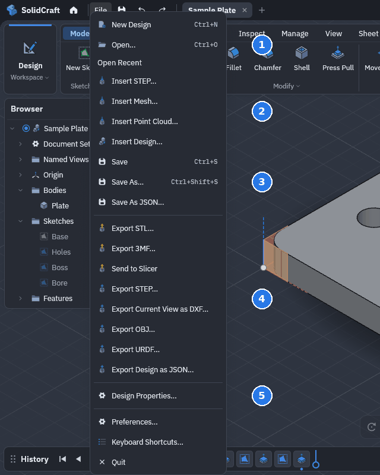

# Import and export

Everything here starts from the **File** menu at the top left.



**1** Open a design (or a STEP, IGES or mesh file as a new one) · **2** Insert a file into the open
design · **3** Save · **4** Export: meshes, STEP, a DXF of the view, URDF, JSON ·
**5** Design properties

| Format | Read | Write |
|---|---|---|
| `.sc` (versioned container or JSON design; `.solidcraft` files from earlier releases still open) | yes | yes |
| `.json` (self-contained plain JSON design) | yes | yes |
| STEP (AP203, AP214, AP242) | solids, assemblies, units, names, colours | AP242 with names, colours and the component tree |
| IGES 5.3 | manifold solids, or trimmed surfaces sewn into solids | manifold solids with names and colours |
| FreeCAD `.FCStd`, Rhino `.3dm` | solids, through cadmpeg | |
| 3MF, STL, OBJ | mesh bodies | yes |
| glTF 2.0 (`.glb`, `.gltf` with its `.bin` files) | mesh bodies in the node tree's components, materials as appearances | |
| 3MF with face tags | as 3MF | each triangle tagged with its B-rep face, exact coordinates |
| URDF | | the assembly as a robot: links with meshes, mass and inertia, joints from the assembly's joints |
| DXF, SVG | into a sketch | sketches and flat patterns as DXF |
| PNG, JPEG | canvases and decals | |

Opening a STEP, IGES, FreeCAD or Rhino file creates a design with the file's bodies as a base feature, and
inserting one adds them to the current design. Later features build on them. Mesh bodies render,
measure, move and export, but solid features need B-rep bodies.

Every imported file (STEP, IGES, 3MF, STL, OBJ or glTF) comes in as a new component named after the
file, so its bodies never mix with yours. A STEP assembly keeps its structure: its parts and
sub-assemblies become nested components, and a part used several times is one component with an
occurrence for each place. The imported assembly is rigid: moving its component moves everything,
and its parts don't move on their own. Right-click the component and choose **Unlock Contents** to
joint the parts one by one. Undo removes a whole import in one step.

A glTF file (`.glb`, or `.gltf` with the `.bin` files it names in the same folder) comes in the
same way: its nodes become nested components, a mesh placed several times is one component with
an occurrence for each place, and the whole import is rigid until you unlock it. glTF is in metres
with Y up, so the import is scaled to millimetres and turned to stand Z up (`up: "z"` keeps the
file's axes). Each material's base colour, metal and roughness become the body's appearance, so
the model looks right in Render; textures, skins and animations are not imported. Scaled or
mirrored nodes are baked into their meshes. Compressed meshes (Draco, meshopt) are refused with a
message: save the file uncompressed first.

A 3MF project saved by a slicer comes in too, also when it keeps its objects in model parts of
their own inside the file (the 3MF Production extension): each object on the build plates becomes
one mesh body, with all its volumes merged where the slicer placed them. Each body is named after
its object: the name in the model, else the one the slicer keeps in its project settings (Bambu
Studio's `Metadata/model_settings.config`), else Mesh1, Mesh2, … Other slicer-only data
(modifier, negative and support volumes, painting, per-object settings) is not read: modifier and
negative volumes come in as ordinary solid geometry.

**File → Export STL…** and **File → Export 3MF…** (also **Save As Mesh** on the Insert tab's Files
panel, and in the right-click menu of a body) open the same dialog with that format chosen; it saves
the selected bodies as STL, 3MF or 3MF with face tags (below) to a file you name, and you can change
the format there.

A 3MF has one object per body, so a slicer arranges the bodies of a multi-body part apart on the
bed. Scripts and the control channel can keep each component together: `file.export` or
`file.save_mesh` with `objects: "component"` writes every placed component that holds two or more
bodies as one 3MF object whose parts are those bodies. PrusaSlicer, OrcaSlicer, Bambu Studio and
Cura then load it as one object with a part per body, and each part can take its own filament. The
design's own bodies, and a component with a single body, stay objects of their own.

**File → Send to Slicer** (also on the Insert tab's Files panel, and in the right-click menu of a
body) is the short way: it saves the selected bodies as a 3MF in millimetres, without face tags,
and sends it to a slicer. It always asks which one and pre-selects the slicer you used last time,
so the usual case is one click or Enter. The list shows the slicers found on the computer with their
icons; **Custom…** adds any other program to the top of the list (kept between runs; hover an entry
you added and press Delete to remove it). On Linux only, a program whose desktop entry says it opens
3MF or STL files is listed even if SolidCraft doesn't know it by name. Windows and macOS list the
known slicers only, found in the usual program folders and on `PATH`. It falls back to an STL if the
3MF can't be written. Scripts and the control channel use `file.send_to_slicer`
with a `slicer`, which sends without a dialog. They can start only the slicers in the
list and programs you added under **Custom…**; any other program path is refused, and an AI agent's
request to save a mesh or send it to a slicer asks first and names the slicer.

A body can have a **print face**: the flat face it should lie on in the slicer. Select the face
and press **Ctrl+B** (or **Print Face** in the face's right-click menu); press it again to clear
it. The Send to Slicer window shows the print face of each body being sent in its **Print
face** row. A face you pick there in the viewport becomes the print face of its body, in place
of the one it had; take a face out of the row to clear its body's. Each send then turns a
copy of the body so the print face points down at Z = 0, with its centre of mass over the
origin; the design itself does not move. The face is tinted and outlined in the viewport, and a
copy made with Move/Copy or Mirror keeps it. A print face that is gone or no longer flat is
reported, and the body is sent as it lies. Curved faces and mesh bodies can't be print faces.
Known limitation: after a shell of a body that is already shelled, no face of that body can be
marked, as no sketch can be attached to one either; this needs kernel work, which is paused.

The list also has a plain **EasyPrint (Printables, in the browser)** row, and it is the one entry
that works in the browser build too. EasyPrint is Printables' slicer, so choosing it uploads the
selected bodies (a 3MF, 100 MB at most) to Printables' servers and opens the model there in your
browser. The link expires after 30 minutes, and you need to be signed in to Printables. SolidCraft
asks once before the first upload and remembers that you agreed. Nothing is uploaded unless you pick
this row. SolidCraft isn't affiliated with Printables. Scripts use `file.open_in_easyprint`, which refuses unless it gets `consent: true`,
and an AI agent's request to use it asks first.

Files sent to a slicer go to a folder only you can
read: `~/.cache/solidcraft/slicer` on Linux, `~/Library/Caches/SolidCraft/slicer` on macOS and
`%LOCALAPPDATA%\SolidCraft\slicer` on Windows. The name stays the same for the same design and
the same bodies, so sending again **replaces the file the slicer has open**: use the slicer's
Reload from disk to pick it up. If Windows won't let the file be replaced because the slicer holds
it, the new copy gets a number (`name-2.3mf`) and the status line says so. Files older than seven days are
deleted the next time SolidCraft starts.

If the slicer is already running, PrusaSlicer, SuperSlicer and Cura load the file in
the open window instead of starting another one (they are started with `--single-instance`).
Other slicers, Bambu Studio and OrcaSlicer among them, are started as they are, so they may open a
second window. You can turn this off in
Preferences → General, except for PrusaSlicer 3.0, whose launcher can't hand a file to a running
window without it. Scripts pass `single_instance: false` to `file.send_to_slicer` or `file.save_mesh`.

PrusaSlicer 2 and 3 behave differently, so SolidCraft reads which one an install is from the
version in its installed metadata (a Flatpak's own files, or the `metainfo` file of a package); it
never runs the program to ask. PrusaSlicer 2 is sent the file with `--single-instance`. PrusaSlicer 3
is started on its own first, SolidCraft waits up to ten seconds for it to be ready, and then sends the
file. If the version can't be read, the command decides: the `slic3r-app-launcher` launcher is
treated as PrusaSlicer 3, and any other entry is left as it is.

Closed mechanical meshes with a constant cross-section can be rebuilt as solids with the
`mesh.convert` command (command palette, scripts and the control channel).

**File → Export 3MF…** with the format changed to **3MF with face tags** (`file.export` or `file.save_mesh` with `format: "3mf-tagged"`) writes an
ordinary 3MF in which every triangle also names the B-rep face it lies on and every coordinate
is the tessellation's own double-precision value. Meshing and analysis tools can use the tags to
keep a model's faces (for loads, boundary conditions or feature edges); other 3MF readers ignore
them. The format is specified in [`docs/formats/3mf-face-tags.md`](https://github.com/tangency-labs/solidcraft/blob/main/docs/formats/3mf-face-tags.md).

**File → Export URDF…** (`file.export` with a `.urdf` path) writes the assembly for robot
simulators and ROS: a link per component placement with its mesh, mass and inertia, and the
assembly's joints, so the parts move in the simulator as they do in SolidCraft. The meshes are
written as STL files next to the `.urdf`. See [`docs/urdf.md`](https://github.com/tangency-labs/solidcraft/blob/main/docs/urdf.md).

Saves are atomic: a crash at any moment leaves either the old file or the new one, and the
replaced version is kept as `<file>.bak`. A save keeps the file's permissions, and a design
opened through a symbolic link (a synced folder linked into a project) is saved into the file the
link points to, so the link stays. Unsaved changes in every open tab are autosaved to separate
entries in a recovery folder, and the next launch offers to recover each design. Saving or
closing one tab removes only its recovery entry. Older design files are upgraded on open, and files
from a newer version are refused with a message.

**Save** writes a container by default; files named `.json` keep JSON on subsequent saves.
**Save As** offers a container or plain JSON on
desktop; **Save As JSON** is also available in the File menu on desktop and web. Both start
from the name of the open file, or from the design's new name when it was renamed since it
was opened or saved; a new design starts from its own name. Choose
the `.json` extension for plain JSON. **Export Design as JSON** writes an independent,
self-contained copy without changing the current file. Scripts can explicitly pass
`"format": "json"` to `file.save` or `file.save_as` even with a `.sc` name.
Opening detects the format from the contents, so existing JSON designs keep working.
Containers favor fast reading and saving by default. Scripts can request
`"compression": "compact"` when file size matters more than CPU time.

Containers deduplicate identical STEP, mesh and image payloads. Mesh coordinates retain
their original double precision; this is not a conversion to STL. Geometry still rebuilds
from the timeline when opening. When a saved display preview is available, desktop Open
shows it while checking geometry; editing starts after the complete rebuild. Cancelling
keeps the current design. Previews cannot be edited or measured. Scripts can opt in to a disposable geometry
cache with `cache: true` on warm saves; saving never rebuilds cold geometry just to
create one. Ordinary saves and browser downloads default to `cache: false`. An additional display-mesh cache remains opt-in
with `preview: true`. Unsupported or mismatched caches are ignored. Browser opening
still rebuilds synchronously.
Warm saves with explicit `cache: true` can also include a small PNG thumbnail. It travels with the file, so
Home can show the recent design without reconstructing it when no local picture
is available. Missing or incompatible pictures use the usual thumbnail generation.
The default `cache: false` omits the portable thumbnail too.
The repository's `docs/design-container.md` describes limits and encoding details.

Designs are saved in the newest format this version of SolidCraft knows (`"format": "solidcraft/N"`
in the file). It opens designs of every older format and upgrades them as they open; a design
from a newer version asks you to update instead of being guessed at. Development (nightly) builds
save a format number no release reads yet.

Sketch patterns retain their live direction-line references and placement settings when saved.
Older patterns keep their fixed vector directions and original placement defaults.

Upgrading keeps what a design meant. Designs keep recorded body transfers, explicit 3D curve coordinate
spaces and certified face bindings, alongside semantic configuration styles, associative
free-form offsets and cylindrical emboss selections. Older ownership maps, geometry and
expressions retain their saved meaning. Legacy 3D curves with retained associations receive
their producer's coordinate-space marker without changing any saved points; detached curves
retain world coordinates. A lost cross-component association refreshed by an older build may
need an explicit relink or refresh when its source returns. Loading never guesses a numerical
correction. Association records, coordinate arrays and placements are bounded and checked.

## Large files

SolidCraft opens STEP, IGES and the other CAD files it imports up to **512 MB**, and design files
up to **256 MB**. A larger file is refused before it is read, and the message says how to raise
the limit. In the desktop app you can raise both:

- **Preferences › General › Largest file to open** sets each limit in MB, from its default up to
  16 GB (16384 MB). It is kept between runs; Restore Defaults on the General page puts back 512 MB
  and 256 MB.
- **`--max-file-size SIZE`** at launch (`solidcraft --max-file-size 2GB big-assembly.step`) raises
  both limits for that run only, over the preference, without saving anything. SIZE is a number
  with MB or GB (`2GB`, `1.5GB`, `1500MB`; 1 GB is 1024 MB), at most 16GB. A size below a default
  leaves that limit at its default. A size the app can't read stops it from starting, with the
  reason. `solidcraft-cli` takes the same flag with any command.

Before you raise them:

- **Memory:** a file is read whole, and what is built from it is held in memory beside it. Expect
  several times the file's size in RAM, more for finely detailed parts, and a long open and a slow
  view for an assembly with hundreds of thousands of faces.
- **Saving:** a design keeps the text of a STEP import, compressed, and the design limit applies
  to the saved file. An import whose compressed text doesn't fit in a design file is refused when
  it is imported, so it never opens and then fails to save; raise the design file limit too, or
  open the file with `--max-file-size`, which raises both. Opening that design again needs the
  same limits.
- **Web app:** the browser version keeps 512 MB and 256 MB: a browser tab can't hold larger files.
  Its Preferences show a note instead of the setting.

The control channel sets the same preference with `ui.prefs {"max_step_file_mb": 2048,
"max_design_file_mb": 1024}`.

## Design properties

**File → Design Properties…** (also under **Document Settings** in the Browser, and on the
top component's right-click menu) records who made a design and what it is: project, part
number, revision, author, organization, description and licence. **OK** applies the changes as
one undo step. Scripts and agents use the same commands: `document.metadata` reads them,
`document.metadata.set` (`key` and `value`, or `values: {key: value, …}`) and
`document.metadata.remove` (`key` or `keys`) change them. `document.inspect` and the MCP
`inspect_design` tool include them.

Exports carry them where the format has a place for them:

| Format | Written |
|---|---|
| STEP | `author` and `organization` in `FILE_NAME`, `description` in `FILE_DESCRIPTION` (on one line) |
| IGES | `author` and `organization` in the global section |
| 3MF | `project` as `Title`, `author` as `Designer`, `description` as `Description`, `license` as `LicenseTerms` |

The part number and revision have no standard place in these formats and stay in the design.

In the file they are one optional top-level `metadata` object; a design without properties has
none, and is saved exactly as before:

```json
"metadata": {
  "project": "ACME enclosures",
  "part_number": "ACME-1042",
  "revision": "B",
  "author": "Jane Doe",
  "organization": "ACME",
  "description": "Vented case for Raspberry Pi 4",
  "license": "CC-BY-4.0",
  "com.acme.description": { "shop_id": 88123 },
  "org.printfarm": { "slicer_profile": "PETG-0.2", "internal_id": 4 }
}
```

- **SolidCraft's keys are unprefixed** and hold text. Every other unprefixed key is reserved for
  later SolidCraft versions.
- **Other tools keep their data under one reverse-DNS key** of their own (`com.example.tool`:
  two or more dot-separated labels of letters, digits, `-` and `_`), holding an object. A tool
  writes only under its own key and leaves the others alone.
- **SolidCraft keeps every key as it is** through open, edit and save, in both the container
  and plain JSON, and never checks what another tool wrote: a well-known key holding something
  other than text (`"author": 42`) is kept, reads as absent, and never stops the design from
  opening. Typing over it in Design Properties replaces it.
- **Other tools' keys are never exported**; Design Properties lists them read-only.
- **Keep values small**: `document.metadata.set` refuses text over 4 KiB, an object over 64 KiB
  or nested more than 32 levels deep, and more than 256 keys or 256 KiB in all. Binary data
  belongs in a file next to the design.

Design properties are first saved in format 21. Inserting or linking another design doesn't
copy its properties; Save As keeps them. A command script of the design
(`timeline.export_script`) sets them in one step.

## Designs in shared or synced folders

A design kept on a network share or in a synced folder (Dropbox, OneDrive, Syncthing, Google
Drive) can be open on two computers at once. The desktop app watches for two writers:

- **Open elsewhere.** While a design is open, SolidCraft keeps a small lock file next to it,
  `.~<file>.lock` (computer, user, SolidCraft version, when it was opened), refreshes it every
  minute and removes it when the design closes. Opening a design that another SolidCraft has open
  says so: **Open Read-Only** (look at it; Save asks for a new file), **Open Anyway** or
  **Cancel**. A lock not refreshed for three minutes (left by a crash or a lost connection) is
  ignored. Lock files never show in Open or the recent lists, and a design in a folder you can't
  write to still opens.
- **Changed on disk.** SolidCraft remembers the file's size and modification time when it opens
  or saves a design. If another program or computer wrote the file since, Save asks first:
  **Save a Copy** (the default), **Overwrite** or **Cancel**.

Scripts, the CLI and the control channel never get these questions. `doc.open` opens the design
and reports `open_elsewhere` in its result (`read_only: true` opens it read-only), and `file.save`
over a file that changed on disk fails with an error until it is given `overwrite: true`.

## Saving in the web app

In Chrome, Edge and Opera, **Save As** opens your browser's save dialog and writes the
`.sc` file to the folder you choose, and **Open** opens the browser's open dialog.
**Save** then writes back to that same file. The browser remembers the file, so after you
reload the page the first **Save** asks once for permission to write to it, and carries on.
A design you open from your computer saves back to the file you opened.

In Firefox and Safari, which can't write to a folder, **Save** and **Save As** keep designs in
this browser's private storage instead, and the app says so. Clearing the site's data
can remove those designs. Download a copy to keep it outside the browser or move it to
another device.

To get a copy as a download in any browser, choose **File → Download design**. It holds the
current design, including its unsaved changes. In **File → Files in this browser…** (and in
Firefox and Safari, **File → Open**), **Download open design** does the same, and **Download**
beside a stored file gives its last saved contents. Whether a folder chooser appears depends
on your browser's download settings.

Use **Open from computer…** in the same window to open a design from your computer; where the
browser can write to a folder it saves back to that file, otherwise it works on a copy kept
in the browser. Use **Rename** beside a stored file to change its name. Autosave and recovery
stay in the browser's private storage in every browser. Exports such as STEP and STL are
downloaded.
