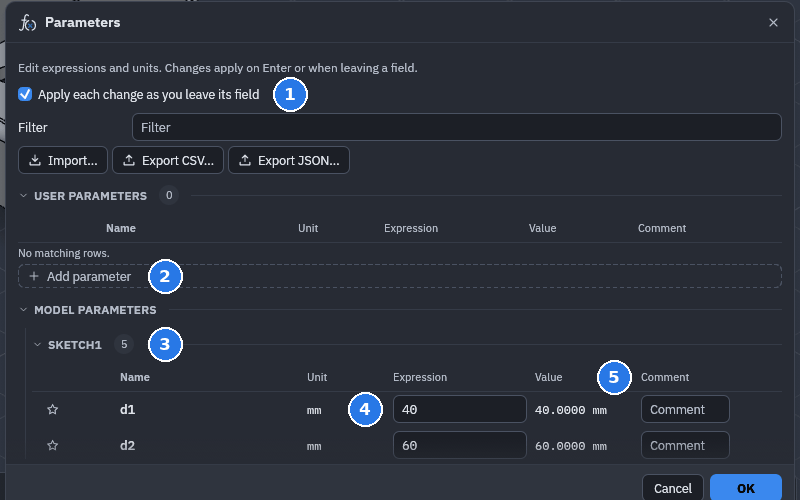
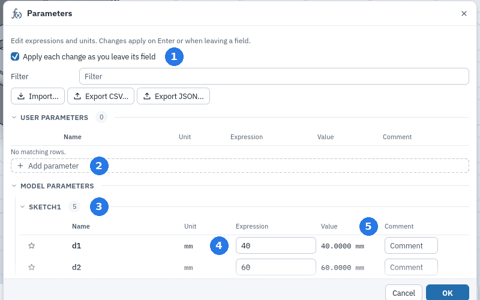

# Parameters and expressions

Every dimension and feature input is a **model parameter** (`d1`, `d2`, …). **User parameters**
are ones you add yourself, with a unit, an expression and an optional comment. Change them in
**Change Parameters** (`parameters.change`). The timeline rebuilds from the first feature that
uses them.

When creating or editing a sketch dimension, its value editor shows its model parameter
name (`d1`, `d2`, …). Click another driving dimension to use its name: when the value is
just a number (such as `10` or `10 mm`) the name replaces it; otherwise it goes in at the
cursor, replacing selected text and keeping what you typed, so typing `10 + ` and clicking
`d1` gives `10 + d1`. Add arithmetic such as `/ 2` to build a dependent dimension. Press **Enter** to apply
the expression or **Escape** to cancel the edit.
Add and edit user parameters through the existing **Change Parameters** command.




**1** Apply each change as you leave its field · **2** User parameters, and **Add parameter** ·
**3** Model parameters, grouped by the sketch or feature they belong to · **4** An expression ·
**5** The value it works out to

## Naming a value as you type it

Any value input can name its value: type `width = 40` (or `#width = 40`) for a dimension, a
value box while drawing a shape (a line's length, a rectangle's width and height, a circle's
diameter: the shape is drawn at that size and its dimension uses the parameter), an extrude
distance, a fillet radius, a hole diameter, a sheet metal rule, a joint's offset and so on.
SolidCraft adds the user parameter `width` with the expression `40`, and the input uses
`width` from then on, so editing it again shows `width`. A bare number reads as it would in that
input (the design's units for a length, degrees for an angle), and the parameter keeps that
unit. The right-hand side can be any expression, such as `width = depth * 2`. The command and
its parameter are one undo step.

Editing a value that already has its own parameter (a dimension's `d7`, a feature input's) with
`height = 12` renames that parameter to `height`, references following, and sets it to 12; no
other parameter is made. When the value is just a parameter's name (`width`), `width = 50` sets
that parameter instead. A name that is already taken, a unit, function or constant name, or a
value that refers to itself is refused with the reason, and nothing changes. A parameter's own
expression and a configuration cell can't define another parameter.

Scripts, the control channel and MCP tools take the same form in any expression parameter
(`"distance": "depth = 15"`); the result names what it made in `defined` (the first name) and
`definitions` (`[{name, expression, unit}]`).

In the MANAGE tab's PARAMETERS section, click **Parameters** to open the user and model
parameter editor. The **Configurations** button in CONFIGURATIONS opens the configuration table;
**Configure** remains in the dropdown for configuring columns.

Press **Enter** in the new parameter's name, expression or comment field to add it.
Valid entries return focus to the name field for the next parameter; invalid entries remain
editable. In expression fields, type a parameter or dimension name for autocomplete,
or press **Ctrl+Space** to open suggestions, including in an empty field.
**Up/Down** selects an autocomplete suggestion,
**Enter/Tab** accepts it, and **Escape** dismisses the suggestions. Accepting a suggestion
does not also submit the parameter. When what you typed is already a complete name
(`width`), longer names such as `width_extra` stay listed without a selection: **Enter**
applies what you typed, and **Up/Down** picks one of them first. A unit right after a number
(`10 mm`) is left alone; anywhere else a unit is a prefix like any other, so `rad` followed by
**Enter** gives `radius`.

With **Preferences › Design › Step values with the arrow keys and the wheel** on (it is off
by default) and no suggestions open, **Up/Down** step a plain number in any value field (a dialog's rows,
the value box beside the geometry, a sketch dimension, a parameter's expression) by 1 in the
unit it is written in: `20 mm` becomes `21 mm`, `2,5 mm` becomes `3,5 mm`. Hold **Shift** for 10
or **Alt/Option** for 0.1. The mouse wheel over the focused field does the same, a step a notch,
and the preview follows each step. An expression such as `width / 2` is left as typed.

Expressions are unit-aware: `2 * width + 5 mm`, `angle / 2`, `sqrt(area)`, `1 in + 3 mm`, using
`+ - * / ^ %`, parentheses, `sin cos tan asin acos atan atan2 sinh cosh tanh asinh acosh atanh sqrt
abs sign min max floor ceil round trunc mod exp ln log log10 pow hypot` (`log` is base 10) and unit
conversion. A number and the unit after it are one value: `10 mm / 2 mm` is 5
and `90 deg / 1 rad` is π/2, and a fraction of numbers before a unit is one value too (`1/2 in`
is half an inch; after a `/` only written without spaces: `1 in / 1/2 in` is 2, while
`width / 10 / 2 mm` divides by 10 and then by 2 mm). A decimal comma works too: `2,5 mm` is
`2.5 mm`, and `-(width-0,5)/2` is `-(width-0.5)/2` (directly in a function's parentheses the
comma separates its arguments, so write `max(2.5, 3)` there). A mixed number is one value, as imperial sizes are written: `2 1/8"` and
`3 7/16 in` are 2.125 in and 3.4375 in (a whole number, a space, then a proper fraction of whole
numbers). A length where an angle is expected (or the other way round) is an
error, not a silent conversion. Cycles are reported with their path (`a → b → a`), renaming a
parameter updates every expression, dimension and feature input that uses it, and a parameter
in use can't be deleted (the error lists its users).

The design's units (Document Settings in the browser: mm, cm, m, in or ft) set how a bare number
or unitless arithmetic expression typed into a length field is read. In an inch design `0.25`
and `1 / 4` mean 0.25 in. A new user parameter given no unit (`parameters.add` or
`parameters.import` without `unit`) is a length in the design's units, as the Parameters dialog
makes it: `40/2` is 20 in. Operation dialogs start with lengths in the design's units, including
secondary distances, wall thicknesses, gaps, offsets and radii. Canvas handles and live sketch
values use the same units as the operation. Angles, counts and scale factors keep their own
units. Preferences selects the default units for new designs; existing designs use their own
Document Settings.

Explicit units override that choice: `2 mm` is still two millimetres in an inch design.
Parameter expressions such as `width / 2` remain driving expressions. Editing a saved feature
preserves its physical size; an existing millimetre expression can still show `mm` so accepting
an unchanged field cannot reinterpret it. Computed sizes and tolerances keep their full
precision when written back into editable fields, independently of display precision.

Parameters export to and import from CSV or JSON (`parameters.export`, `parameters.import`).
**Configurations** (`config.*`) keep a table of rows, each with its own parameter values and
suppressed features, physical materials and body appearances, switched with `config.activate`.
The table's Library picker selects material or appearance values. Choose **Follow material**
to clear an appearance override. Custom looks retain their colour and opacity across
activation, undo and save/reopen. See
[configuration commands and examples](https://github.com/tangency-labs/solidcraft/blob/main/docs/configurations.md).

## Checking a design across a parameter's range

**Parameter Sweep** (`inspect.parameter_sweep`) rebuilds a copy of the design at each of a
parameter's values and reports what no longer holds, so a design meant to be driven by its
parameters (one template, many sizes) can be checked before it is trusted. The design itself is
not changed.

```json
{"command": "inspect.parameter_sweep", "params": {"parameter": "Width", "from": 300, "to": 510, "steps": 21}}
```

`values` lists the values instead (numbers or expressions). For each value it gives the rebuild's
time and what changed from the design as it is now: features that fail (`failed`) or warn
(`warned`), joints whose origin is no longer found (`joints_lost`) or turned over on its own part
(`joints_flipped`, more than 90°), sketch planes that turned over (`sketches_flipped`) and sketch
solves that fail or only hold by flipping a triangle's turn or an offset's side (`sketches_failed`).
`summary` counts the values that show each.
