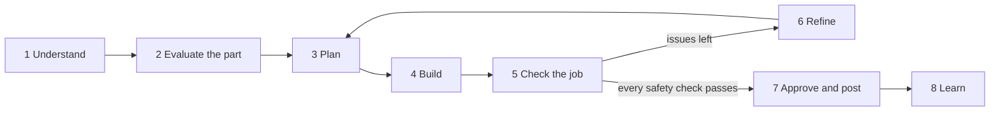

# How the AI evaluates and plans CAM work

This is the design for issue #11348: CAM that an AI assistant drives. It says what the
assistant does at each step of a machining job, which facts and checks SolidCraft gives it,
and how it knows the job is right before anything reaches a machine.

## The idea in one paragraph

SolidCraft measures and checks; the assistant judges and explains; the person decides. The
engine never chooses a machining strategy silently. It reports facts about the part (what
features it has, what can be reached from where, what limits the tools), checks every toolpath
(gouges, collisions, machine limits, material left), and scores a whole job with numbers the
assistant can compare. The assistant uses those facts and its skills to plan the job, builds
it with `cam.*` commands, reads the checks, fixes what they find, and repeats until the job
passes. Then it shows the person the plan, the risks and the run time, and posts only when
they approve.

## The loop



Every step has a command whose result is a notice (`info`, `values`, `issues` with stable
codes and a `suggestion`), so the assistant never has to read prose or guess.

## Machines set the limits

Every step is judged against a machine. The machine decides:
- which directions a setup can cut from (three axes, a 4th axis, five axes);
- whether the part and its stock fit (work area, Z travel, gantry clearance);
- which tools it can hold (collet sizes, tool changer slots, the longest tool under the gantry);
- how fast tools can turn and move (spindle speed range, power, feeds);
- what the program looks like (the post dialect).

So the analysis, the plan and the checks all take the machine: the setup's own, or one named in
the call.

**Known machines are documented as data files, one per machine**, so a person or an assistant
can read them, check them and add new ones without changing code. A machine file holds:
- the machine's numbers, in the same shape a setup stores;
- its ids and aliases;
- the options it can be fitted with (a 4th axis module, a laser);
- the tool kit that suits it;
- for every number, where it came from (the maker's published specification, and the date it
  was checked).

SolidCraft ships the files for the machines it knows (first the Makera Carvera, Carvera Air and
Z1, from their public specifications) and reads them at start. `cam.machine.list` lists them;
**new: `cam.machine.define {file | machine}`** checks a new file and adds the machine.
`docs/cam-machines.md` describes the format. If the CAM core that reaches `main` brings its own
machine models (the open "workholding and machine models in a job" draft, #16053), the Makera
machines become entries in that format instead of a second one.

## How cutting loads are estimated

Feeds and speeds are only safe if the cut they make fits the machine. So for every roughing
operation SolidCraft estimates the load the cut puts on the spindle and on the X and Y drives,
for the job's material (`cam.job.set {material}`), and reports how close it runs to each limit.
The numbers are planning estimates, not measurements: they say how much margin a cut has, so
the person can choose to push it or not.

**The engagement** comes from the operation:

| Operation | Radial width `ae` | Axial depth `ap` |
|---|---|---|
| Adaptive (2D, 3D) | the optimal load (default 20 % of the diameter) | the stepdown (default half the diameter) |
| Pocket, slot | the full diameter: the first ring is a slot | the stepdown |
| Face | the stepover | the stepdown |

`ap` is capped at the flute length (a deeper cut is reported as `tool_too_short`).

**The chip.** With feed `F` (mm/min), spindle speed `n` (rev/min) and `z` flutes, each tooth
takes `fz = F / (n·z)`. Over the engagement angle `φ = acos(1 − 2·ae/D)` the chip is
`h_mean = fz·(1 − cos φ)/φ` thick on average and `h_max = fz·sin φ` at most (`fz` when `φ`
passes 90°). A narrow cut makes a thin chip even at a high feed (chip thinning).

**The force.** The material's specific cutting force rises as the chip gets thinner
(Kienzle): `kc = kc1.1 · h^(−mc)`. The values used are kc1.1 = 700 N/mm² and mc = 0.25 for
aluminium (6061), 150 and 0.3 for plastics, 60 and 0.3 for wood.

**The power.** The removal rate is `Q = ae·ap·F` (mm³/min); the cutting power is
`P = kc(h_mean)·Q / 60 000` W. The spindle gives its rated power at its top speed and about
constant torque below it, so the power available at `n` is `P_rated · min(n, n_max)/n_max`.
The share `P / P_available` is the spindle load.

**The force on the drives.** The tooth at its thickest chip pushes with
`F_t = kc(h_max)·ap·h_max` along the cut, and pushes the tool off the wall with a radial force
about 40 % of that in aluminium; the X and Y drives see `F_t·√(1 + 0.4²)`. It is set against
the machine's `axis_force_n` when the machine file gives one.

**What is reported:**

| Share | Spindle | X/Y drives |
|---|---|---|
| over 100 % | `spindle_overload` (warning): it may stall or chatter | `axis_overload` (warning); on open-loop steppers the steps are lost without notice and the rest of the program is cut out of place |
| 80–100 % | `spindle_margin` (information) | `axis_margin` (information) |

Each issue says the width and depth that cause it, so the planner can narrow the cut, take a
shallower step or slow the feed.

**How well it matches real cuts.** Two hands-on Makera Z1 tests in 6061 (150 W spindle) agree:

| Test | Load estimate | What happened |
|---|---|---|
| 6 mm 3-flute, 12 000 rev/min, 1000 mm/min, 2.5 × 1 mm | 65 % | clean |
| same, 3 × 1 mm | 78 % | stalled twice in one corner |
| same, 3 × 0.8 mm | 64 % | clean |
| 6 mm 1-flute, 4 mm wide, 0.6 mm deep | 41 % | clean |
| same, 1.0 mm deep | 69 % | the spindle slowed |
| same, 1.1 mm deep | 75 % | stalled |

So a stall comes at about 75–80 % of the estimate, and the trouble starts in corners, where an
adaptive path engages the tool more than its nominal width. **The planner keeps the nominal
load at about 50–65 %.** 7075 reached its limit sooner than 6061 at the same estimate and needs
its own, higher cutting force; small cutters (2.5–3 mm) fail from clogged chips and breaking
before they run out of power.

## 1. Understand the job

What the assistant needs before it plans, and where each answer comes from:

| Fact | Source |
|---|---|
| The part: bodies, size, features | the design (`inspect_design`, step 2's analysis) |
| Material | the person (the guide skill asks); default from the tool kit |
| Machine and its options (4th axis, laser) | the person; presets in `cam.machine.list` |
| Stock: size, already square or not | the person; else a relative box around the part |
| Workholding: vise, clamps, tape, chuck | the person, or compared by `cam.workholding` from the part |
| What matters most: finish, accuracy of named features, run time | the person |
| How many parts | the person (one part favours fewer tools; a batch favours run time) |

**New: `cam.job.set {material, workholding, priority, quantity, tolerances}`** keeps these
answers in the design, next to the setups. Every later check reads them: feeds come from the
material, workholding limits which faces can be cut and how hard, and tolerances mark the
features that need a finishing pass. A job without them still works, with stated defaults
reported as `info` issues, so the assistant knows what it assumed.

## 2. Evaluate the part

**New: `cam.analyze {bodies?, machine?, stock?}`**, a machinability report. It is facts only,
no decisions:

- **Features**, each with an id, the faces it covers and its numbers:
  - flat floors and their depths from the top;
  - pockets (open or closed), with depth, narrowest width and smallest inside corner radius;
  - holes, with diameter, depth, through or blind, and whether the size matches a tap drill;
  - bosses and islands with their heights;
  - walls, with height and draft;
  - free-form regions, with their curvature range;
  - edges that are chamfered or filleted.
- **Access.** For each direction a setup could face (+Z, −Z, ±X, ±Y), which faces a 3-axis
  tool reaches. What no direction reaches is an `undercut` (a T-slot, a dovetail).
- **Limits** each feature puts on the tools:
  - the smallest inside corner radius sets the largest tool that finishes it;
  - the deepest narrow feature sets the stick-out and flute length;
  - thin walls limit step-down.
- **Fit.** Does the part fit the machine's work area, and does a stock that size fit?
- **The machine's own limits.** Which access directions its axes allow, the largest shank its
  collets take, the longest tool under its gantry, and the smallest tool its top spindle speed
  can drive at a sensible surface speed.

Issues carry codes the plan acts on:
- `undercut`: needs another setup, the 4th axis, or a special tool.
- `sharp_inside_corner`: no round tool can make it, so ask the designer for a radius.
- `deep_narrow`: needs a long tool, or can't be reached at all.
- `thin_wall`: cut lightly and leave it until late.
- `exceeds_work_area`: the part or stock doesn't fit the machine.
- `needs_second_side`: some faces can only be reached from below.

Much of this already exists inside the CAM crate: the height maps and drop-cutter used for 3D
toolpaths, the boundary code that finds faces and holes, and the stock simulation. Analysis
puts those together in one report.

## 3. Plan

The assistant writes the plan; the engine can propose a starting point.

**New: `cam.plan.propose {}`** turns the analysis into a baseline plan from plain rules. Each
step in it has a `why` and the feature ids it covers:
- the fewest setups that reach every feature;
- tools chosen from the limits;
- workholding first: how the part is held decides the setups, the stock size and the frame or
  web of stock left to hold it until the last cut. `cam.workholding` (built) compares the ways to
  hold the part before any operation is planned: a frame with tabs or sprues, a pin through a
  hole of the part with its boss clamped, a vise on parallel walls, a stub of stock in a vise or
  a rotary chuck. Each is checked against the geometry and costed (hand finishing, setups, stock
  cut only to hold it, how far a part held at one end bends under the cut, how it is found again
  when turned over, the fixture to make); the plan follows the recommended one unless the
  person says otherwise. The web cut follows the part's outline at
  the web's own height (`geometry: {source: silhouette, within_heights: true}`): a part
  narrower there than at its widest would otherwise be cut round in air, and its tabs would
  hold nothing (`tabs_placed` 0, `tabs_unsupported`). A part with no flat waist (a rounded
  or lens-shaped part, its edge at different heights round its outline) has no height where
  a web meets it: leave **sprues** instead. Each is a small box body just outside the outline,
  at the height where the part's edge comes nearest it, named in every setup's `fixtures`.
  A 3D operation keeps clear of a fixture as a solid (`fixture_clearance` about 0.3 mm), only
  at the fixture's own heights, so the stock above a sprue is cut from the top and the stock
  under it by the last cut from below (rest machining, down to the sprue). A sprue must reach
  past the ring cut into the frame: the ring's offset plus the roughing tool's diameter, and
  1 mm more. Put them where the edge is thickest and away from holes; the
  last pass cuts only through the web round the part (`rest_machining`, the web's depth),
  and the sprues are sawn off and filed by hand. Hold the part with tabs or with sprues, not
  both, unless each holds where the other cannot (tabs along a flat stretch of edge, a sprue
  at a rounded tip). Sprues are as small as still hold the part: the fewest (three spread round
  it), the narrowest that takes the finishing load, only as long as the gap to the frame, since
  each is sawn off and filed by hand;
- largest material removal first: a clearing pass with the largest tool the part allows → an
  adaptive rough → flats (flat-area finishing) and verticals (a profile or waterline on faces
  steeper than about 45° to the tool axis) → parallel finishing on the shallow areas only →
  holes → chamfers and engraving. Where a ramp or profile cannot reach a near-vertical face,
  a second parallel pass turned to run along the face finishes it;
- holes milled with a helix (circular) rather than drilled where a cutter fits: a milled hole
  holds its size and position better than a drilled one on a light machine;
- every roughing cut checked against the spindle and the X/Y drives (`spindle_load`,
  `axis_*` issues), with the nominal load kept well under the limit: adaptive paths load the
  tool harder in corners, and a Z1 has stalled at about 80 % of its spindle there.

It is a starting point the assistant improves with its skills, the person's priorities and its
own judgement. It is not the answer.

A plan is data, not prose:

```json
{"setups": [{"name": "Top", "direction": "+z", "workholding": "vise", "origin": "stock top front-left",
   "operations": [{"type": "face", "tool": "6 mm flat", "covers": ["top"], "why": "a known top for every depth"},
                  {"type": "adaptive2d", "tool": "6 mm flat", "covers": ["pocket-1", "pocket-2"], "why": "bulk removal at a steady load"}]}],
 "uncovered": [{"feature": "slot-3", "why": "undercut: needs a T-slot cutter"}]}
```

**New: `cam.plan.apply {plan}`** builds the plan in one call: tools, setups and operations, each
operation's geometry bound to the faces of the features it covers. The result maps each feature
id to an operation id. The coverage map is what makes step 5's checks per feature.

The assistant shows the plan to the person in plain words, one sentence of why per step, and
waits for a go-ahead before building. The `solidcraft-makera-guide` skill already does this for
Makera machines.

## 4. Build

`cam.plan.apply`, or the existing commands one at a time, then `cam.generate`. Operations are a
parametric chain: changing an operation, its tool, its setup or its machine clears the
toolpaths that depend on it. So after any change, the assistant regenerates only what changed.

## 5. Check the job

**New: `cam.evaluate {setup?}`** scores the job. Its checks fall into four groups.

| Group | Checks | Gate |
|---|---|---|
| Safety | gouges (where and how deep), rapid moves through stock or part, holder and spindle collisions, travel, rpm and feed limits, tool reach, a tool the machine can hold | must be zero to post |
| Completeness | per feature: covered or not, material left above its allowance (volume and where), what is knowingly left (an undercut) | every feature covered or explained |
| Quality | scallop height against the target finish, stock to leave consistent before finishing, tolerance features finished last with a light pass | reported against the job's targets |
| Efficiency | cycle time, time cutting air, tool changes, chip load and engagement within the tool's range | compared between variants |

The result is one notice with a score per group and every issue, each with a `suggestion` that
clears it, so the next step is mechanical when it can be. It is deterministic: the same job
gives the same numbers, so two variants can be compared honestly.

Most of the safety and completeness checks already exist and run during generation and
simulation: gouge cells, rapid collisions, machine limits, tool too short, and stock left
after simulation. What's missing:
- leftover material per feature;
- air-cutting time;
- engagement;
- the one score the assistant can compare.

## 6. Refine

The assistant applies suggestions, changes a tool or a strategy, regenerates the stale steps
and checks again. To keep this bounded and honest:

- **Stop when** every safety check passes, every feature is covered or explained, and a further
  change improves run time or finish by less than a few percent.
- **Try a variant** (another roughing tool, another strategy) and keep the better result.
  `cam.evaluate` returns the job's signature, so the assistant can tell which variant each set
  of numbers belongs to.
- **After a few rounds without progress, stop and ask the person**, saying what is still wrong
  and what the choices are (another setup, another tool, a design change such as a corner
  radius). Never post around an unresolved safety issue.

## 7. Approve and post

Before posting, the assistant gives the person a summary:
- the plan, in plain words;
- the run time;
- the tools to load, in order;
- the workholding;
- where to set zero (the setup's origin, and how a Makera probes it);
- what was knowingly left uncut;
- any warnings.

`cam.post` checks the safety gates again and refuses with the issue codes if any fail. After
approval, it writes the program for the machine's dialect.

## 8. Learn

- **Benchmark parts.** A set of test parts, from simple to hard: pockets, islands, slopes,
  triangles, an undercut, a dome and holes, like the test part used so far. Each has the
  checks a good job must pass. `cam.plan.propose` runs on them in the tests, so a change that
  makes the baseline worse fails the build.
- **Assistant evaluations.** The same parts are given to an assistant using the skills. It is
  scored on safety gates passed, features covered, run time, rounds needed, and questions
  asked. This is how the skills improve: change the skill, and the score says whether it
  helped.
- **Shop feedback.** **New: `cam.job.feedback {operation, result}`** records what happened at
  the machine: chatter, a broken tool, a poor finish, or "fine". It adjusts that machine and
  material's feeds for next time, stored with the tool library, not in the design.

## Who does what

| | Engine (`cam.*` commands) | Assistant (skills) | Person |
|---|---|---|---|
| Understand | stores the job's intent | asks the questions | answers, states priorities |
| Evaluate | analysis: features, access, limits | reads it, spots what matters | — |
| Plan | baseline proposal | improves it, explains it | approves |
| Build | builds, generates, regenerates what changed | issues the commands | — |
| Check | every check, one score | reads the issues | — |
| Refine | suggestions per issue | applies them, compares variants, knows when to stop | decides when asked |
| Post | refuses unsafe programs | summarises how to run it | approves, runs the machine |
| Learn | benchmarks, feeds memory | — | reports how the cut went |

## Building on whatever CAM core lands

This layer needs only a few things from the CAM core:
- operations that produce toolpaths;
- a stock simulation;
- per-operation notices.

The CAM core coming to `main` is the open stack of drafts tracked under #2652 (job, stock and
setups #16050, adaptive clearing #16049, 3D roughing and finishing #16031, gouge and holder
checks #16046, workholding and machines #16053, and the rest). The analysis, plan, evaluation
and learning commands sit on top of that core through a small set of functions; they don't
compete with it. Until it lands, they are developed and tested against a full core on the fork
branch `jb69/solidcraft:cam`, and each piece is moved onto the stack's interfaces as they reach
`main`.

## Order of work

0. **Machine files**: the format, the Makera machines and the generic presets as files,
   `cam.machine.define`, and `docs/cam-machines.md`. Analysis and every check read them.
1. **`cam.analyze`**: features, access and limits, with tests on the benchmark parts. Every
   later step needs it.
2. **`cam.evaluate`**: one score over the checks that exist, plus per-feature leftover
   material and air-cutting time.
3. **`cam.job.set`**: the job's intent, read by analysis, evaluation and feeds.
4. **`cam.plan.propose` and `cam.plan.apply`**: the baseline plan and the coverage map.
5. **Skills**: `solidcraft-cam` and the Makera guide are rewritten around the loop above.
6. **Benchmarks and assistant evaluations.**
7. **`cam.job.feedback`.**

Each one is a pull request of its own under #11348, with screenshots of what it shows in the
Manufacture workspace.
