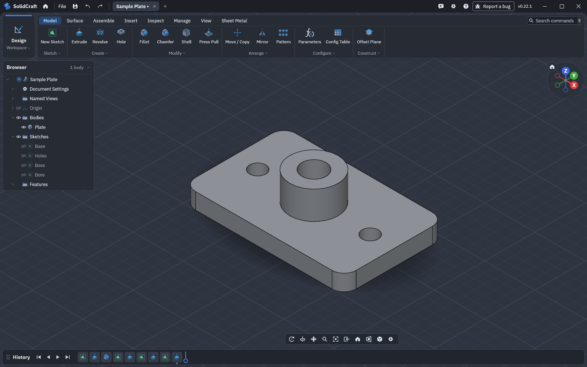

# Rundtur i SolidCraft-vinduet



- **Title Bar (titellinje).** På Windows og Linux fungerer programlinjen som vinduets titellinje. Til venstre findes File-menuen (New, Open, Save, Save As, Export…), Undo og Redo, Home-fanen (startsiden) og en fane for hvert åbent design. Hvert design har sin egen Undo-historik, markering og kameraposition. En prik ved fanen viser ændringer, der ikke er gemt. Til højre findes Report a Bug, Help (?), Preferences (indstillinger, herunder tema) og vinduesknapperne.
- **Toolbar (værktøjslinje).** Til venstre vælges Workspace (arbejdsområde), f.eks. DESIGN. Fanerne SOLID, SURFACE, SHEET METAL, PLASTIC, UTILITIES og SKETCH (mens en skitse redigeres) indeholder paneler med kommandoer. Klik på panelets navn for at se alle kommandoerne. Træk en kommando fra dropdown-menuen til panelets navn eller et tomt område for at tilføje den. En indsættelseslinje viser placeringen. Slip på en eksisterende knap for at indsætte før den. Knapper kan også flyttes mellem paneler, og layoutet gemmes.
- **Browser (designtræ, til venstre).** Viser designets struktur: dokumentindstillinger og enheder, navngivne visninger, origo, emner, skitser, konstruktionsplaner, canvases, joints (ledforbindelser) og komponenter. Øjeikonet viser eller skjuler et element. Radioknappen ved en komponent gør den aktiv. Højreklik på en række for at åbne elementets menu. Rækker kan trækkes ind i grupper og andre komponenter.
- **Viewport (visningsområde).** Klik for at markere, og brug Shift eller Ctrl for at tilføje til markeringen (Preferences › Selection). Træk for at markere med en ramme eller en krydsende markeringsramme. Under skitsering deaktiverer Ctrl/Cmd eller Alt/Option som standard automatisk snapping, mens Shift prioriterer midtpunkter.

  Hvis flere elementer ligger oven på hinanden — f.eks. to linjer, sammenfaldende punkter, en kant foran en flade eller overlappende emner — kan du holde venstre museknap nede i et halvt sekund (langt tryk på touchskærm) eller højreklikke og vælge **Select Other… (vælg andet)**. En liste viser alt under markøren med den skitse, du redigerer, først. Et element fremhæves, når markøren holdes over det. Klik for at vælge det; Shift eller Ctrl tilføjer til markeringen. I en kommandodialog overføres valget til det aktive markeringsfelt. Esc eller et klik uden for listen lukker den. Klik på det samme sted igen uden andre ændringer for at vælge det næste element på listen.

  Musehjulet zoomer omkring markøren, midterknappen panorerer, og højreklik med træk roterer visningen frit (Orbit). Under Preferences kan museprofilen ændres til SolidWorks, Inventor, Alias, Blender, Tinkercad, OpenSCAD eller Touchpad. På en touchpad zoomer knibebevægelse, og rulning med to fingre panorerer, når **Navigation › Two-finger scroll pans** er slået til. Ellers zoomer rulningen som musehjulet. Musehjulet zoomer, mens et eventuelt tommelhjul panorerer vandret.

  Shift + midterknap roterer frit i standardprofilen og Inventor-profilen. I alle profiler kan Ctrl + venstre træk (Cmd på macOS), når trækket begynder på et tomt område, rotere visningen. Ctrl + klik kan stadig tilføje elementer til markeringen. Shift + højre træk snapper til nærmeste standardvisning eller diagonalvisning. Shift udløser ikke snapping, hvis den valgte museprofil allerede kræver Shift for at rotere.

  **Mouse Gestures (musebevægelser)** under Preferences › Navigation er slået fra som standard og fungerer kun med SolidWorks-museprofilen (hvor musehjulet roterer, og Ctrl + musehjul panorerer). Funktionen overtager højre museknap, som derfor ikke længere bruges til Orbit. Hold knappen nede, og bevæg markøren 4 pt for at åbne en ring med værktøjer (280 pt indvendigt og 350 pt udvendigt), også mens et værktøj er aktivt. Vælg et værktøj ved at flytte markøren til dets område. Et højreklik uden bevægelse åbner fortsat den almindelige kontekstmenu.

  Hvert arbejdsområde har egne værktøjer. Under **Customize… (tilpas)** kan du bestemme antal og placering i ringen. Områderne skifter mellem to farvenuancer eller tre ved et ulige antal værktøjer. Den valgfrie radiale kontekstmenu er en separat indstilling, men mens musebevægelser er aktive, bruger de højreknappen i stedet.

  Med **Touchpad** valgt i Preferences › Navigation kan du holde **Shift** nede og bevæge markøren for at panorere eller holde **Alt** (**Option** på macOS) nede for at rotere visningen. Der kræves ingen museknap. Lodret rulning med to fingre zoomer i denne profil, uanset indstillingen for panorering med to fingre. Når du skifter profil, gælder den gemte indstilling igen. Slip modifikationstasten for at stoppe navigationen. Shift + klik og Shift + venstre træk kan stadig bruges til markering. Kombinationer med Shift + Alt eller Ctrl/Cmd starter ikke navigation, der kun bruger markørbevægelser.

  **Axis View (aksevisning)** viser retningerne X, Y og Z med SolidCrafts aksefarver. Klik på enden af en akse for at se langs den. Klik på samme akseende igen for at se fra den modsatte side. Træk i aksevisningen for at rotere omkring visningens centrum; hold Shift for snapping. Top- og bundvisning bevarer retningen fra nærmeste kvarte omdrejning. Husikonet, Home-knappen på navigationslinjen og dobbeltklik med midterknappen i visningen går til Home og tilpasser udsnittet til de elementer, der vises. Under **Navigation › Middle double-click** kan handlingen ændres til Fit, som bevarer visningens retning, eller deaktiveres.

  Højreklik åbner **Marking Menu (radialmenu)** med otte kommandoer omkring markøren samt en menu for elementet under den. Tæt på vinduets nederste eller højre kant åbnes menuen i stedet over eller til venstre for markøren, så den forbliver synlig.

  I skyggelagte visninger skjules certificerede, glatte overgange mellem spline-segmenter på ekstruderede vægge. Rigtige knæk, endefladers konturer og manuelt oprettede opdelinger af flader forbliver synlige. **Wireframe (trådmodel)** viser fortsat kanterne. At skjule en overgang fjerner ikke dens CAD-identitet eller ændrer den eksporterede solid. Vægge med ikke-understøttet eller usikker geometri beholder deres eksisterende kantvisning.
- **Dialogs (dialogbokse)** ligger til højre og viser live preview (forhåndsvisning). De fleste Features har også trækhåndtag og et værdifelt direkte i visningsområdet.
- **Timeline (tidslinje, nederst).** Viser alle Features i rækkefølge. Dobbeltklik for at redigere, træk markøren for at rulle historikken tilbage, og træk en Feature for at ændre rækkefølgen.
- **S Box (S-kommandosøgning).** Tryk S hvor som helst for at åbne kommandosøgning ved markøren. Fastgør dine mest brugte kommandoer øverst.

Under **Preferences** (File › Preferences) kan du ændre tema, standardenheder for nye design, museprofil, visuel stil og automatisk lagring.

**Graphics › Colour Vision (farvesyn)** tilpasser farver, der formidler information, bl.a. skitsetilstande, akser, bukninger, analyser og ikoner. Der findes indstillingerne Protan, Deutan og Tritan for nedsat følsomhed over for henholdsvis rød, grøn og blå. I disse tilstande får flader, der ikke består Draft Analysis og Accessibility Analysis, også et stribet mønster.

Meddelelser og fejl vises i nogle sekunder i statusfeltet nederst til venstre i visningen. Klik på feltet, eller vælg **Help › Messages…**, for at se alle meddelelser fra sessionen. De nyeste vises først, fejl er røde, og hver linje kan markeres. **Copy All (kopiér alle)** kan bruges ved fejlrapporter.

**Help › Keyboard Shortcuts** viser alle genvejstaster. De kan ændres under **File › Keyboard Shortcuts**.

### Colour Themes (farvetemaer)

Under **General › Theme** kan du vælge Dark (mørkt), Light (lyst) og System (følger operativsystemet), de indbyggede Gruvbox-temaer i mørk og lys med hård, normal eller blød kontrast samt importerede temaer. Temaet aktiveres med det samme.

Et tema er en lille JSON-fil, der tager udgangspunkt i farvepaletten Dark eller Light og ændrer navngivne farver:

```json
{
  "format": "solidcraft-theme/1",
  "name": "My Theme",
  "base": "dark",
  "colors": {
    "panel": "#282828",
    "text": "#ebdbb2",
    "accent": "#83a598",
    "viewport_top": "#32302f",
    "viewport_bottom": "#32302f",
    "triad": ["#fb4934", "#b8bb26", "#83a598"]
  }
}
```

Farver angives som \`#rrggbb\` eller \`#rrggbbaa\` for farver med gennemsigtighed. Nogle farver, f.eks. aksevisningens X, Y og Z, angives som en liste. Farver, der ikke er angivet i filen, beholder værdierne fra grundpaletten.

- **Import… (importér)** tilføjer og aktiverer en temafil. Import af en fil med samme navn opdaterer det eksisterende tema. Ukendte farvenavne eller ugyldige farveværdier afvises, og fejlmeddelelsen viser alle problemer.
- **Export… (eksportér)** gemmer det aktive tema som en komplet fil med alle farver. Den er et godt udgangspunkt for dit eget tema.
- **Remove (fjern)** sletter det valgte importerede tema.

Importerede temaer gemmes sammen med dine indstillinger og fungerer derfor også i browserappen. Indstillinger for farvesyn anvendes stadig oven på temaet.

**Navigation › Smooth Wheel Zoom (jævn zoom med musehjul)** er aktiveret som standard. Slå det fra for at behandle hver bevægelse af musehjul eller touchpad med det samme, uden efterfølgende udjævning. Indstillingen er uafhængig af **Animate View Changes (animér visningsskift)**, der styrer animation af aksevisninger, Look At, Home og Fit. Hvis jævn zoom aktiveres midt i en zoombevægelse, træder ændringen først i kraft, når bevægelsen er afsluttet, så ingen resterende zoom afspilles bagefter.

**Navigation › Alias** bruger Alias-genveje til kameraet: Shift + Alt + venstre træk roterer, Shift + Alt + midterste træk panorerer, og Shift + Alt + højre træk zoomer (træk ned for at bevæge dig væk og op for at komme tættere på). Uden Shift + Alt markerer venstre træk fortsat med en ramme eller flytter skitsegeometri.

Nogle Linux-skrivebordsmiljøer bruger selv Alt + træk til at flytte eller ændre størrelse på vinduer. Derfor modtager SolidCraft ikke bevægelsen. Sådan frigøres den:

- **KDE Plasma:** System Settings › Window Management › Window Behavior › Window Actions. Indstil **Modifier Key** til Meta eller None.
- **GNOME:** Kør \`gsettings set org.gnome.desktop.wm.preferences mouse-button-modifier '<Super>'\`, eller sæt Tweaks › Windows › Window Action Key til Super.

Snapping under Shift + Orbit inkluderer kantvisninger på 45 grader og isometriske hjørnevisninger, med en let dæmpet overgang og en lille margin, så visningen ikke flimrer.

I skrivebordsprogrammet gør Ctrl/Cmd + Plus (eller Equals) brugerfladen større, Ctrl/Cmd + Minus gør den mindre, og Ctrl/Cmd + 0 nulstiller til 100 %. Genvejene opdaterer indstillingen for UI-skalering. Skyderen til UI-skalering under Preferences anvender det nye layout, når du slipper den, så brugerfladen ikke flytter sig under trækket.

## Ordliste – engelsk til dansk

Programnavne, knapper og genvejstaster bevares på engelsk i vejledningen, så de kan genfindes i SolidCraft.

| Engelsk udtryk | Dansk forklaring |
|---|---|
| A Tour of the Window | Rundtur i programvinduet |
| Title Bar | Titellinje |
| Toolbar | Værktøjslinje |
| Workspace | Arbejdsområde |
| Browser | Designtræ |
| Viewport | Visningsområde |
| Dialog | Dialogboks |
| Live Preview | Direkte forhåndsvisning |
| Timeline | Tidslinje |
| Feature | Modelleringsfunktion |
| S Box | S-kommandosøgning |
| File | Filer |
| New | Ny |
| Open | Åbn |
| Save | Gem |
| Save As | Gem som |
| Export | Eksportér |
| Undo | Fortryd |
| Redo | Gentag |
| Home | Startvisning / startside |
| Report a Bug | Rapportér en fejl |
| Help | Hjælp |
| Preferences | Indstillinger |
| Selection | Markering |
| Select Other | Vælg andet |
| Snap | Fastgør markøren til geometri |
| Midpoint | Midtpunkt |
| Pan | Panorér / flyt visningen |
| Orbit | Rotér visningen |
| Zoom | Zoom ind eller ud |
| Mouse Preset | Museprofil |
| Mouse Gestures | Musebevægelser |
| Customize | Tilpas |
| Marking Menu | Radialmenu |
| Context Menu | Kontekstmenu |
| Axis View | Aksevisning |
| Fit | Tilpas udsnittet |
| Wireframe | Trådmodel |
| Shaded | Skyggelagt visning |
| Document Settings | Dokumentindstillinger |
| Named Views | Navngivne visninger |
| Origin | Origo |
| Bodies | Emner |
| Sketches | Skitser |
| Construction Planes | Konstruktionsplaner |
| Canvases | Referencebilleder / billedflader |
| Joints | Ledforbindelser |
| Components | Komponenter |
| Colour Themes | Farvetemaer |
| Dark | Mørkt |
| Light | Lyst |
| System | Følg systemet |
| Colour Vision | Farvesyn |
| Protan | Nedsat rødfølsomhed |
| Deutan | Nedsat grønfølsomhed |
| Tritan | Nedsat blåfølsomhed |
| Draft Analysis | Analyse af formslip |
| Accessibility Analysis | Tilgængelighedsanalyse |
| Keyboard Shortcuts | Genvejstaster |
| Copy All | Kopiér alle |
| Import | Importér |
| Remove | Fjern |
| Smooth Wheel Zoom | Jævn zoom med musehjul |
| Animate View Changes | Animér visningsskift |
| UI Scale | Skalering af brugerfladen |
| Two-finger Scroll Pans | Rulning med to fingre panorerer |
| Middle Double-click | Dobbeltklik med midterknappen |
| SOLID | Solidmodellering |
| SURFACE | Overflademodellering |
| SHEET METAL | Pladekonstruktion |
| PLASTIC | Plastemner |
| UTILITIES | Hjælpeværktøjer |
| SKETCH | Skitsering |
