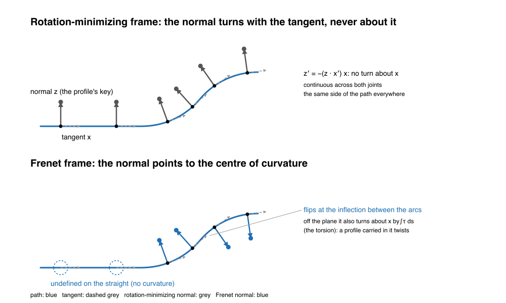
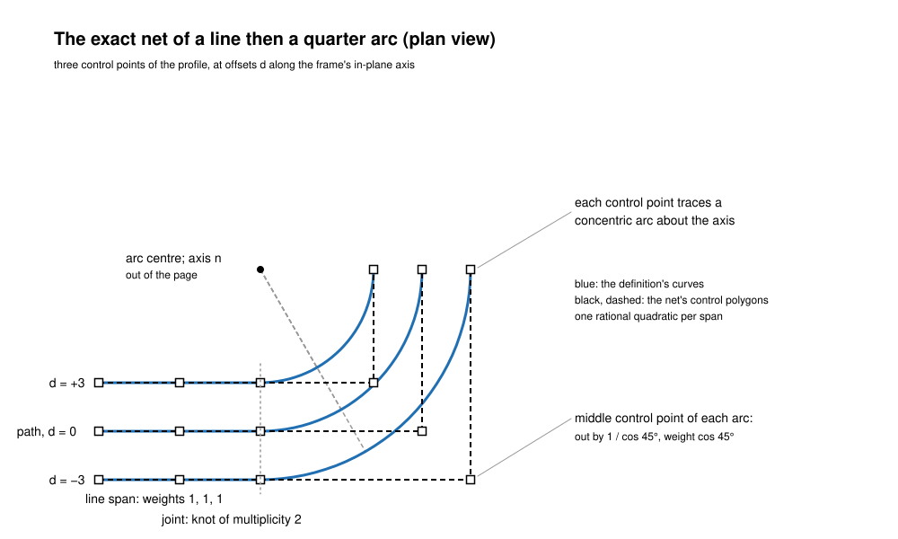
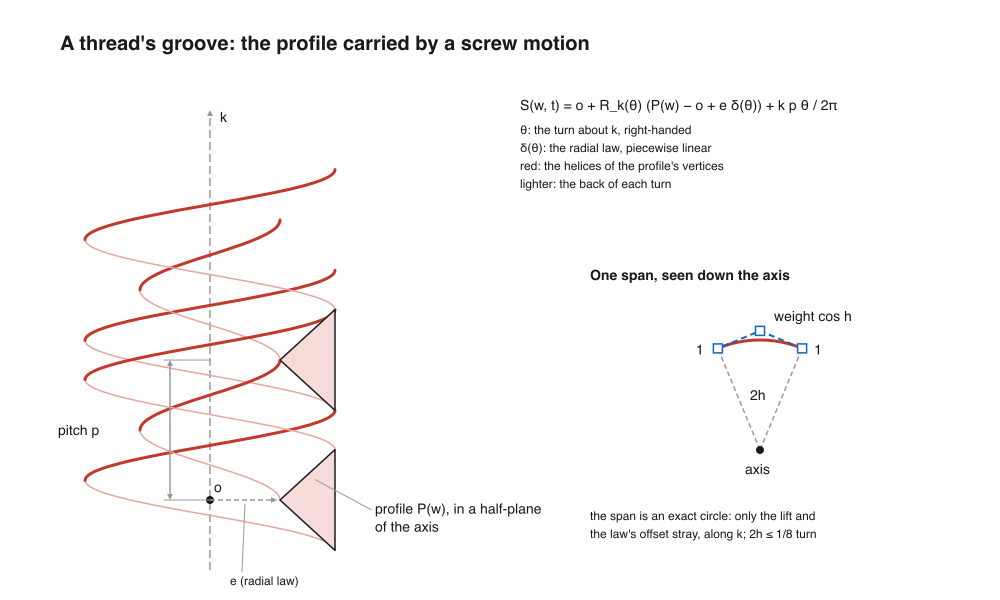

<!-- SPDX-License-Identifier: Apache-2.0 -->

# The procedural sweep

This page describes `ProceduralSweep`, the definition a swept wall keeps beside its B-spline net:
what it is, how it is built and certified, what is exact, what is a ledger entry, and what is open.
It does for sweeps what [generic-blend.md](generic-blend.md) does for the blend, and it is written
for a reader who knows sweeps and rotation-minimizing frames and is new to this code. Numbers in
brackets are references (end of page). Every issue named here is a solidcore issue.

Contents:
1. [Purpose and the one rule](#1-purpose-and-the-one-rule)
2. [Scope](#2-scope)
3. [The construction](#3-the-construction)
4. [The exact classes](#4-the-exact-classes)
5. [The certificate](#5-the-certificate)
6. [Threads as screw sweeps](#6-threads-as-screw-sweeps)
7. [Faces and selection](#7-faces-and-selection)
8. [Invariants](#8-invariants)
9. [Status](#9-status)
10. [If you're stuck](#10-if-youre-stuck)
11. [References](#11-references)

---

## 1. Purpose and the one rule

**A swept surface is its definition: a profile moved along a path in a frame.** The wall's
B-spline is a certified approximation of that definition, kept beside it. The definition S is
evaluated in closed form [4]; the net B carries a stored bound ε with |B − S| ≤ ε proved, never
sampled.

The contract is the procedural blends' (generic-blend.md §2.3): a caller whose `NetScope` asks for
a tolerance at or above ε reads the net, a tighter one reads S. The net serves boxes, the cache,
tessellation and display; S is the surface.

The rules that follow from it, decided on [#2572](https://github.com/tangency-labs/solidcore/issues/2572)
(owner, 2026-11-03):
- **One definition kind.** `ProceduralSweep`, with a motion enum (`Motion::Screw`, `Motion::Path`),
  behind one accessor, `Surface::procedural_sweep()`. No helix-specific surface types.
- **No new spline family.** No extended-Chebyshev (trigonometric) basis for helices [9]: every
  intersection, boolean and tessellation routine would have to learn it, and STEP cannot store it.
  The net stays a NURBS.
- **The definition depends on the path alone.** Never on how the sweep sampled it. A wall whose
  frame has no closed form or certified enclosure yet keeps no definition and gets a ledger entry;
  it never gets a definition that describes whatever the fit happened to build.
- **Nothing is loosened.** A wall is a definition with a proved bound, or a named ledger entry.

## 2. Scope

| sweep | what the wall is | here |
|---|---|---|
| linear (extrusion) | `SurfOfExtrusion` or an analytic surface, exact | out: exact without a definition |
| rotational (revolution) | `SurfOfRevolution`, or a cylinder, cone, sphere or torus (`sweep::analytic_revolution`) | out: exact without a definition |
| along lines and arcs, piece by piece (`sweep::segments`) | each piece the linear or rotational sweep's exact surface | out: exact without a definition |
| along a general path (`curve_sweep`), path of lines and circular arcs | `ProceduralSweep`, `Motion::Path`, exact net (§4) | **in** |
| along a general path, any other span | fitted net, no definition: ledger `path-spline` | **in** (open, §9) |
| along a closed path | fitted net, no definition: ledger `path-closed` | **in** (open) |
| translational (`translational_sweep`) | the exact S(u) + T(v), its net its own definition: ledger `path-translational` | ledger |
| scaled along the path | sections no rigid images of the profile: ledger `path-scaled` | ledger |
| screw (`sweep::screw`: threads, coils) | `ProceduralSweep`, `Motion::Screw`, certified net (§6) | **in** |
| screw, a profile line along the axis | the exact cylinder (a `Cone`): ledger `screw-cylinder` | ledger |
| loft (`create_skin_primitive`) | the B-spline through its sections | out (below) |

A "planar-path" sweep is the general-path case on a path in a plane. There the rotation-minimizing
frame keeps one axis on the plane's normal and needs no rule of its own; the path's spans decide
whether it has a definition, as for any path. A loft is defined by the sections it interpolates
and the skin's own parametrization, so its net is all there is to its definition; there is no
motion of a profile to certify against.

Elsewhere:
- [generic-blend.md](generic-blend.md): the blend's definition, its certificate, and the
  `NetScope` contract this page reuses.
- [definitions-and-certificates.md](definitions-and-certificates.md): the definition kinds side by
  side, the ledger, and what a certificate must prove.
- [ssi.md](ssi.md): intersections, and where a definition is solved on instead of its net.

## 3. The construction

A general-path sweep is

S(w, t) = T(t) + x(t) C_x(w) + y(t) C_y(w) + z(t) C_z(w),

T the path, C the profile in the frame's own coordinates and (x, y, z) the frame at the path's
parameter t (`surface/procedural_sweep/path.rs`). A screw sweep is the same idea with a rigid
screw motion for the frame (§6).

### 3.1 The path

The path is the B-spline `curve_sweep` sweeps along, copied into the definition. It must be a 3D
curve, open (first and last control points more than 10⁻⁹ (1 + |P₀|) apart), and G1 at every
interior knot (the unit tangents from both sides within 10⁻⁸). Each knot span is classified once
(`classify`) as one of:

| span | test | frame on it |
|---|---|---|
| `SpanKind::Line` | 12 samples collinear within 10⁻¹¹ (1 + size), degree ≤ 3 | constant |
| `SpanKind::Arc { axis, radius }` | 12 samples on one circle within the same tolerance, degree ≤ 2 | turns about the axis |
| anything else | refused | no definition (`path-spline`) |

The samples decide only which closed form a span has. By degree they settle it: a polynomial of
degree ≤ 3 through 12 collinear points is that line, and a conic through 12 points of a circle is
that circle. The frame itself is then the exact closed form, not built from the samples.

### 3.2 The frame: rotation-minimizing

*Figure 1. Look at the green normals staying on one side of the path, and the red Frenet normals
vanishing on the straight and flipping at the inflection.*

The frame is a property of the path alone, its rotation-minimizing (parallel transport) frame
[1, 2, 6]: x = T′ / |T′|, z the unit normal that turns with x and no further, y = z × x. It obeys

z′ = −(z · x′) x, equivalently R′ = [ω]× R with ω = T′ × T″ / |T′|²,

started from the unit normal `start_normal` the sweep's trace (`SweepTrace`) began from, projected
square to the first tangent. The angular velocity has no component along x: the frame never turns
about the tangent. The Frenet frame does, by the torsion, and is undefined where the curvature
vanishes [1]; a profile carried in it twists.

**The owner's ruling (#2723 review).** The first draft of slice 2 defined the frame as the
projection rule from the last sampled station, z_i = unit(z_{i−1} − (z_{i−1} · x_i) x_i) [5]. That
is the rotation-minimizing frame's discretisation and converges to it, but a definition built on
it depends on how many points the path was sampled with, which is why walls passed or failed with
the point count. The ruling: the definition's frame is the rotation-minimizing frame of the path,
exact on lines and arcs; on a general spline, the solution of the equation with a certified
enclosure added to the bound, or a ledger entry until that exists. The fitted net still uses the
projection rule (`create_b_vectors`, `nurbs/srf_adv/p4.rs`); the definition does not.

**Its computation** (`PathMotion::frame_side`), in closed form per span:
- **Line:** the frame is the span's start frame (x₀, z₀), with zero rates.
- **Arc** with unit axis n: the frame is the start frame turned about n by the angle the tangent
  has turned, φ = atan2((x₀ × x) · n, x₀ · x), z = R_n(φ) z₀ (Rodrigues). Its rates are
  n × x · φ′ and n × z · φ′, with φ′ = n · (x × x′).
- **Joints:** a span's start frame is the previous span's end frame (`spans_of`): constant across
  a line, turned by the arc's whole tangent turn across an arc. The joints are G1, so the frame
  is continuous.
- **At a joint**, an evaluation takes the derivatives of the span that starts there, or of the
  span that ends there when asked `left` (`frame_side`); a face that ends at a joint reads its own
  side (`SweepRef::joint_side_is_left`).

Because the closed form is a rigid rotation of the span's start frame, the frame is orthonormal
everywhere, to rounding.

### 3.3 The profile

The profile is the B-spline the sweep made from its profile curves (one composite per profile),
copied into the definition with out-of-bounds evaluation off. It is stored in the frame's own
coordinates: C(w) placed by the frame is `Frame::place`, T + x C_x + y C_y + z C_z.

### 3.4 The net and the map

The net's parameter across the sweep is not always the path's t, so the definition carries a
map (`PathMotion::nodes`): pairs (v_k, t_k), both strictly ascending, read by linear
interpolation and held beyond the ends. The face's (u, v) reach the definition's (w, t) through a
second, affine map (`SweepMap`: w = a₀ + b₀ p, t = a₁ + b₁ q, (p, q) = (u, v) or (v, u) when
swapped) that the net's reversals, reparametrisations and swaps move.

There are two nets:
- **Exact** (`PathMotion::create_exact`), for a path of lines and arcs: built from the definition
  itself (§4). Its parameter across the sweep is the path's t; the nodes are the path's joints,
  mapped to themselves.
- **Fitted** (`PathMotion::create`): the net `sweep_scale` skinned. Its parameter across the sweep
  is the skin's chord length: piece k's sections at k + their averaged normalised chord lengths
  (`find_nodes`, `chord_parameters`, replaying the skin's `interp_params`). A net whose domain is
  not [0, piece count] has no definition rather than a loose one.

`curve_sweep` (`primitive/primitive_creation/p3/construct.rs`) tries the exact net first and keeps
it when its bound is at most `ZONE_TOL_3D`; otherwise it keeps the fitted net, with a definition
where `create_path` certifies one. A scaled sweep gets neither.

## 4. The exact classes

*Figure 2. Look at each profile control point tracing a line and then a concentric arc, with the
net's middle control point at the corner of each arc's tangents.*

**Lines and circular arcs give the exact tensor-product NURBS**
([#2740](https://github.com/tangency-labs/solidcore/pull/2740), `PathMotion::exact_net`). On a line
the frame is constant, so each control point C_i of the profile moves along a line. On an arc the
frame turns rigidly about the arc's axis, so each C_i turns on a circle about that axis. A circle
arc of less than half a turn is one rational quadratic [7]. So the net is:

| | across the sweep (u, the path's t) | along the profile (v) |
|---|---|---|
| degree | 2 if any span is an arc, else 1 | the profile's |
| knots | the path's joints, multiplicity 2 inside (degree 2), 3 at the ends | the profile's |
| control points per span | start, middle, end of each C_i's line or arc | the profile's |
| middle point | (a + b) / 2 on a line; on an arc, the start turned by half the span's turn about the axis and moved out by 1 / cos(half) | |
| weights | the path span's own [w₀, w₁, w₂] times the profile's, scaled so consecutive spans share the joint weight | |

The weights are the path span's own (`bezier_weights`, the path refined to Bézier form), so the
net keeps the path's parametrisation and its parameter across the sweep is the path's t. A path of
another degree is taken at weights 1 (its lines at the linear parametrisation); where that does
not hold, the bound shows it. An arc span of half a turn or more is refused.

**A circle along a line or an arc stays the exact cylinder or torus.** A rational circle profile
along a line gives the exact NURBS cylinder; along an arc, the exact NURBS torus. The surface kind
stays a B-spline carrying its definition; `tests/general_path_sweep.rs` checks the definition's
points at RADIUS from the axis or the arc's circle to 10⁻¹² and the net within the bound
(`a_circle_along_a_line_is_the_exact_cylinder`, `a_circle_along_an_arc_is_the_exact_torus`).

**General splines get a fitted net and a ledger entry.** A path with any span that is neither a
line nor an arc keeps the fitted net and no definition (`path-spline`). The certified enclosure
of `create_path` exists for a fitted net of a lines-and-arcs path (it was slice 2's net before
#2740, and it is still the fallback when the exact net's bound passes the zone tolerance).

## 5. The certificate

### 5.1 What it encloses

The bound ε of a wall encloses |B(u, v) − S(w(u, v), t(u, v))| over the face's whole domain, in
model units, through both maps: B at the face's parameters against S at the parameters the maps
give. It holds for whatever map is stored; a wrong map gives a large bound, never a wrong one. ε
is stored as `ProceduralSweep::bound` and read by `SweepRef::bound`, `DefinitionRef::bound` and
`net_answers`.

### 5.2 The path sweep (`PathMotion::certify`)

Every section of the net is the profile's control points moved by one motion, in the same rational
basis R_i(w) (non-negative, summing to 1) for every v. With P_i(v) the net's i-th control column
and S_i(v) = T + R C_i the same point of S,

B − S = Σ_i R_i(w) (P_i(v) − S_i(v)), so |B − S| ≤ max_i max_v |P_i(v) − S_i(v)|.

`NetView::read` checks that the net has this shape: its sections are the profile's control points
(the same knots, degree and count), and its weights are the profile's times one weight per
section. Each f_i = P_i − S_i is then bounded over a cell of v about its middle c, half width h,
by its Taylor expansion:

|f_i| ≤ |f_i(c)| + |f_i′(c)| h + (M_P + M_S) h² / 2,

- M_P bounds |P_i″| over the cell: the second derivative's control points (convex hull); for a
  column rational along the sweep, the quotient rule on N = W P and W (`Column::second_bound`);
- M_S bounds |S_i″|: (dt/dv)² (|T″| + |C_i| (φ″ + φ′²)) on an arc, (dt/dv)² |T″| on a line, with
  φ′ ≤ |T′| / r, φ″ ≤ |T″| / r, and |T′|, |T″| bounded over the path's span from the control
  polygons of the derivatives of N = w P and w, by the quotient rule (`PathBounds`).

Cells never cross a knot of the net, a node of the map or a knot of the path, where P_i″ or S_i″
jump. A cell is halved while its second-order term exceeds the goal, to depth 40 and at most
400 000 cells (`MAX_DEPTH`, `MAX_CELLS`); past the budget the bound is looser, never wrong. The goal
is 10⁻⁸ (1 + size) for the exact net (`EXACT_GOAL`) and 10⁻⁷ (1 + size) for a fitted one
(`FITTED_GOAL`), size the largest coordinate met.

ε = round_up(worst (1 + 2⁻³⁰) + floor), the slack covering the cells' arithmetic in doubles, and
floor = γ₉₆ · 4 (size + reach) (`rounding_floor`, reach the profile's), γ_K = K u / (1 − K u),
u = 2⁻⁵³ [3].

### 5.3 The screw sweep (`ProceduralSweep::certify`)

On a span [t_i, t_{i+1}] with s = 2 (t − t_i) / (t_{i+1} − t_i) − 1, h the span's half angle and
τ = tan(h / 2), the definition reads the angle θ = mid_i + 2 atan(τ s): the angle the net's
rational quadratic arc turns a point to at the same parameter (`turn_at`). So S and B are compared
point for point, and the net's arcs are exact circles. The screw motion at a fixed angle is affine
in the point, so B − S is the same vector for every profile point:
- along k, the lift's error λ E_l(x), λ = |pitch| / 2π, x = τ s, with K = 2 (1 + τ²) atan(τ) / τ
  and E_l(x) = K x / (1 + x²) − 2 atan x: odd, zero at 0 and ±τ, extreme at x*² = (K − 2) / (K + 2)
  (`lift_error_bound`);
- square to k, the radial law's error (D / 2) E_o(x), D the law's largest change across a span,
  E_o(x) = (x (1 − τ²) / τ − A (1 − x²), τ + x² / τ − 2 x A) / (1 + x²), A = atan x / atan τ, its
  largest length by interval branch and bound over [0, τ] to within 10⁻³ relative of a value it
  takes (`offset_error_bound`).

Both are enclosed in rounded interval arithmetic (`Ivl`), never sampled [8]. E_l and K − 2 are
differences of far larger numbers, so each is taken as its own alternating series, which does not
cancel, widened by the first term left out; atan is its alternating series on [0, ½].

ε = round_up(√((λ E_l*)² + ((D / 2) E_o*)²) + floor), floor = G γ_K (A + (R + λ) Θ + R)
(`ProceduralSweep::floor`): K = 2 (p + 3) + 24 operations, A the net's coordinates' size, R the
reach from the axis plus the law's largest offset, Θ the largest station angle, G the profile's
weight ratio over cos h.

### 5.4 After a motion

A rigid motion with a uniform scale moves the definition with its net (`ProceduralSweep::transform`):
ε becomes ε f (1 + 3η) + 12 η (reach + ε) f, f the scale and η how far the placement is from a
rotation, plus the rounding of moving the net (`add_motion_rounding`, as a moved blend's). A scale
that is not uniform leaves no screw or frame motion: the definition is dropped and the net moves
without it (`ProceduralSweep::follows`).

| case | certified bound | largest gap found | source |
|---|---|---|---|
| M10×1.5 groove, 3 turns, tolerance 1.5e-4 | 1.1638e-4 | ≥ 0.99 × bound | #2633 |
| circle along a line | below 1e-9 | 4e-15 | #2723 |
| wire of straights and R2 arcs, fitted net | 2.2e-2 | 2.2e-2 | #2723 |
| the same wire, exact net | 5e-7 | 1e-13 | #2740 |

## 6. Threads as screw sweeps

*Figure 3. Look at the profile carried up one pitch per turn, and in the inset at one span that is
an exact circle, so the net strays only along the axis.*

**The helix and the motion** (`ScrewMotion`, `sweep::screw`). The axis through o along the unit k,
a signed non-zero pitch per turn, and an optional radial law δ(θ) along the unit direction e
square to the axis: piecewise linear through (angle, offset) pairs, held beyond its ends
(`RadialLaw`; a runout, a taper). The definition is

S(w, t) = o + R_k(θ) (P(w) − o + e δ(θ)) + k pitch θ / 2π.

**The profile.** Each profile curve of the thread's section is one wall's profile (`bspline_of`:
an `SmBSplineCurve`, a B-spline, line or conic). Its net (`screw_wall`) is the profile's NURBS
along the profile and, across the turns, each control point's path: the exact rational quadratic
arc of each span (weights 1, cos h, 1) and the lift and offset as the same rational quadratic of
their values at the span's ends and middle. Every point of the net lies exactly as far from the
axis as its profile point, at exactly the angle the arc turns it to; only the lift (and the law's
offset) strays.

**The stations.** Spans turn at most an eighth of a turn (h ≤ `MAX_HALF_ANGLE` = 2π/16), narrowed
until λ E_l and the law's term meet the tolerance asked. A wall is cut at the law's angles, and at
every half turn when any profile line runs along the axis, since that line sweeps an exact
cylinder face (`cylinder_piece`) that cannot turn on itself; that cylinder keeps no definition
(`screw-cylinder`). The stations are the wall's knots across the turns: double inside, triple at
the ends. A wall's first and last stations are the caps' points by construction.

**Offsets from the definition ([#2724](https://github.com/tangency-labs/solidcore/issues/2724),
open).** A screw motion moves a screw surface onto itself and an offset along the normal commutes
with it, so the offset of a screw wall is again a screw sweep about the same axis with the same
pitch: the sweep of its offset section, the curve where the offset surface meets a half-plane
through the axis. Each section point is the wall's point plus d times its true 3D unit normal,
carried back into the half-plane by the motion. Two neighbouring offset walls then meet along a
helix, the screw image of the point where their two sections cross: a 2D curve–curve
intersection, not a 3D surface–surface trace. An offset that closes a groove shows in the 2D
section as a refusal naming the largest offset that fits. Draft
[#2726](https://github.com/tangency-labs/solidcore/pull/2726) builds it, keeping the base profile
with a signed normal offset, since the exact offset section is in general not a rational B-spline.
None of it is on main today: Offset Face treats thread walls as general NURBS faces.

## 7. Faces and selection

**A `ProceduralSweep` is one surface.** It is kept on a `Surface` whose kind stays
`SurfaceKind::BSpline` (the net), as `KeptDefinition::Sweep`; every match on the kind still sees a
B-spline. `Surface::procedural_sweep()` returns a `SweepRef` (definition and net), and
`Surface::procedural_definition()` returns a blend's or a sweep's under one `DefinitionRef`.

How faces relate to it:
- **A screw sweep** makes one wall per profile curve per piece of the turns (cut at the law's
  angles, and at half turns beside a cylinder), each with its own definition: the same motion,
  its own stations.
- **A path sweep** makes one net per composite profile; the face builder may make several faces
  on it (`surface_faces`). Each face's surface is a copy or a piece of the net, and a copy or a
  piece carries the definition, a piece keeping its parameters through the map
  (`Surface::carry_definition`, `split_at`).
- **Edits of the net.** A reversal, reparametrisation or swap moves the map
  (`reparametrize_map`, `swap_map`); a rigid motion with a uniform scale moves the definition
  (§5.4). A piece of another kind, an extension, a mirror, an offset and any other new surface
  keep none.
- **Reading it.** `SweepRef::evaluate_point` and `evaluate` read the net where the innermost
  `NetScope` asks for a tolerance at or above ε, S elsewhere. S gives partials to the first order
  in each parameter; a higher order is refused.

A thread selected as "the thread" is today a set of faces whose walls share one motion; there is
no object above the faces that names them as one thread. Consolidating a multi-turn thread into
one screw wall over its whole length is step 4 of #2724 (tangency-labs/solidcraft#11737).

## 8. Invariants

A reviewer can check each of these against the code and the tests.

1. Every wall face of a sweep is a `ProceduralSweep` or of a kind listed in
   `crates/solidcore/tests/data/sweep_definition_ledger/` (`issue_2572_every_wall_is_a_definition_or_in_the_ledger`,
   `issue_2572_every_path_wall_is_a_definition_or_in_the_ledger`). Every listed kind still appears;
   the ledger only shrinks.
2. The definition's frame depends on the path alone: the same at a parameter for the path given
   with 1×, 2× and 4× its knots (`the_frame_does_not_depend_on_how_the_path_is_sampled`).
3. The frame is continuous across every joint, constant along a line, and turns on an arc with the
   tangent and no more (`the_frame_is_continuous_across_joints_and_does_not_twist_on_a_straight`).
4. The net is within ε of S at parameters off its knots, for every wall, before and after any edit
   that keeps the definition (`deviation`, `check_wall`).
5. ε is an enclosure: interval arithmetic, convex hulls and Taylor remainders, never a maximum of
   samples. A test shows it holds and is not loose (the screw bound at least 0.99 of the largest
   gap found; the lift bound within 10⁻⁶ of dense samples).
6. On a path of lines and arcs the exact net's ε is at most `ZONE_TOL_3D`, or the fitted net is
   kept.
7. S is the closed form: the screw test compares it with a screw surface written out in the test
   to 10⁻¹² relative; the path tests put a circle profile's points at its radius from the path's
   point to 10⁻⁹.
8. S's first and mixed partials match finite differences of its points; at a joint they are the
   one-sided slopes of the face's own side, whether the face is reversed or swapped
   (`the_definitions_partials_at_a_faces_ends_are_its_own_sides`).
9. A scale that is not uniform drops the definition and keeps the B-spline; so do a piece that is
   not a B-spline, an extension, a mirror and an offset (`carry_definition`, the module docs).
10. A closed path, a span neither line nor arc, a vanishing tangent, a joint that is not G1, an
    arc span of half a turn or more, a net whose sections are not the profile's control points and
    a bound not finite are refused with `InvalidInput`; hostile definitions are refused, never a
    panic (`hostile_definitions_are_refused`).
11. A sweep's net is never refitted to "look closer": it is today's wall (screw, fitted path) or
    the definition's exact NURBS (lines and arcs). No tolerance was loosened to admit it.

## 9. Status

| slice | content | where |
|---|---|---|
| 1 | a screw-swept wall is a `ProceduralSweep` with a certified bound | [#2633](https://github.com/tangency-labs/solidcore/pull/2633) |
| 2 | a general-path wall is a `ProceduralSweep`: the rotation-minimizing frame on lines and arcs, the v → t map, the cell enclosure | [#2723](https://github.com/tangency-labs/solidcore/pull/2723) |
| 2b | the net of a lines-and-arcs path built from its definition, exact to rounding | [#2740](https://github.com/tangency-labs/solidcore/pull/2740) |

**Works.** Screw walls (threads of both hands, round wire, runouts, tapers) and walls along open
G1 paths of lines and circular arcs carry their definition and a certified bound; the
lines-and-arcs net is the exact tensor-product NURBS. With the exact net, a lip swept along half
a block's rim lies flush on it and the union builds where the fitted net crossed the rim twice
(#2740, `wr_533_lip_swept_flush_round_a_corner`).

**Ledger entries** (`tests/data/sweep_definition_ledger/`, #2572): `path-spline`, `path-closed`,
`path-scaled`, `path-translational`, `screw-cylinder`.

**Open:**

| issue | topic |
|---|---|
| [#2572](https://github.com/tangency-labs/solidcore/issues/2572) | the rotation-minimizing frame of a general spline path with a certified enclosure; the closed path; the tolerance guard (a sweep that misses its tolerance refuses with the bound it reached, a join gap above the zone tolerance refused) |
| [#2724](https://github.com/tangency-labs/solidcore/issues/2724) | offsetting a screw wall on its definition; walls meeting along a helix; the thread's definition in the record; one wall per thread |

Known limits of what is merged:
- **Nothing in the kernel reads S on its own yet.** Intersections, projections and the model check
  read the net; S is read only by a caller that asks through `Surface::procedural_sweep()`.
- **No record.** solidcore-record has no sweep definition: a wall written and read back is a bare
  B-spline. #2726 carries a draft record for the screw arm.
- **First partials only.** `evaluate_definition` refuses second derivatives.
- **The classification's tolerance.** A span within 10⁻¹¹ (1 + size) of a line or a circle takes
  that closed form; the bound covers B against that definition, not the definition against the
  given path's own rotation-minimizing frame.
- **The ops layer's note is about the fit.** `solidcore_ops::sweep::sweep_placed` routes lines
  and arcs through the exact linear, rotational or piecewise sweeps first; what reaches the
  curve sweep with `SweepFrame::Follow` is a path of other curves, a corner or a closed path, which
  has no definition today.

## 10. If you're stuck

- **A wall has no definition.** Find its kind in the ledger first. If it should have one, check in
  order: is the path closed (`open_path_spans`), is every span a line or an arc (`classify`), is
  every joint G1 (`spans_of`), is the sweep scaled or translational (`curve_sweep`'s match on
  `prepared.scale`), did the exact net's bound pass `ZONE_TOL_3D`, does the fitted net's domain end
  at the piece count (`find_nodes`). Each refusal is an `InvalidInput` with its reason; call
  `ProceduralSweep::create_path_exact` or `PathMotion::create` in a test to read it.
- **The bound is far larger than the gap.** For a path, the cell budget may be spent (raise
  nothing; find why the second-order terms are large: a path span whose |T″| bound from its
  control polygon is loose, or a map with nodes far from the skin's). For a screw, look at D, the
  law's largest change per span. A loose bound is a defect of the enclosure; the remedy is a
  tighter enclosure, never a sampled check.
- **The net is outside the bound.** That is a defect of the certificate or the map, never of the
  test. Check the map first (`definition_parameters` against the net's domain after the edit),
  then the side read at a joint (`joint_side_is_left`), then the cells' cuts.
- **Partials disagree at a joint.** The path's derivatives at a knot come from the span that starts
  there unless `left`; a face ending at the joint must read its own side. The tests
  `the_definitions_partials_at_the_joints_are_right_sided` and
  `the_definitions_partials_at_a_faces_ends_are_its_own_sides` pin both.
- **A thread wall misbehaves in an offset or a boolean.** Today those read the net; see #2724 and
  draft #2726 before building anything on the faces.
- **Before designing.** Read the module docs of `surface/procedural_sweep.rs` and
  `surface/procedural_sweep/path.rs` (they hold the derivations), the review on #2723 (the frame
  ruling), and the literature below. Tests go in `tests/screw_sweep.rs` or
  `tests/general_path_sweep.rs`, gated on values a wrong result changes; no timings.

## 11. References

1. R. L. Bishop. There is more than one way to frame a curve. *The American Mathematical Monthly*
   82(3) (1975) 246–251.
2. R. T. Farouki. *Pythagorean-Hodograph Curves: Algebra and Geometry Inseparable*. Springer
   (2008): rotation-minimizing frames and their rational forms.
3. N. J. Higham. *Accuracy and Stability of Numerical Algorithms*, 2nd ed. SIAM (2002): the γ_K
   forward error bounds.
4. C. M. Hoffmann. A dimensionality paradigm for surface interrogations. *Computer Aided Geometric
   Design* 7 (1990) 517–532: the surface kept as the system that defines it.
5. F. Klok. Two moving coordinate frames for sweeping along a 3D trajectory. *Computer Aided
   Geometric Design* 3(3) (1986) 217–229: the projection rule the fitted net's frame chain follows.
6. W. Wang, B. Jüttler, D. Zheng, Y. Liu. Computation of rotation minimizing frames. *ACM
   Transactions on Graphics* 27(1) (2008) Article 2: the frame, its equation and its computation.
7. L. Piegl, W. Tiller. *The NURBS Book*, 2nd ed. Springer (1997): the rational quadratic circular
   arc, knot insertion, the tensor-product surface and the convex-hull property.
8. R. E. Moore. *Interval Analysis*. Prentice-Hall (1966): the rounded interval arithmetic of the
   enclosures.
9. H. Pottmann, M. G. Wagner. Helix splines as an example of affine Tchebycheffian splines.
   *Advances in Computational Mathematics* 2 (1994) 123–142: the trigonometric basis the ruling
   declines.
