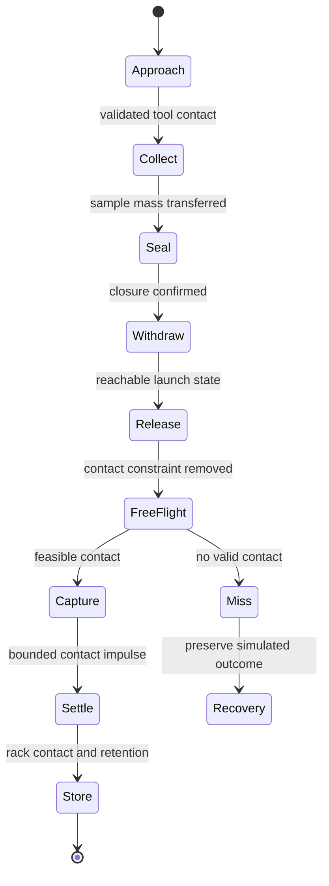

# SELENE: native showcase, lunar stills and future dynamics

## Demonstration objective

Produce a convincing photographed view of SELENE on original procedural lunar terrain, then use the same validated scene as the basis for a future sample-handling animation. The first milestone is a still-image demonstration. The later animation milestone includes collection, closure of a sample container, release, free flight, contact capture and storage.

The [native showcase package](../../assets/render/selene/README.md) now contains the supplied improved source and a reproducible functional derivative: detailed electronics, rolling-element bearings, articulated gripper and suspension, physical-material proxies, PBR appearances and inspection studies. Its [validation record](../../assets/render/selene/VALIDATION.md) states the actual final-build evidence. The lunar scenes and dynamics described below remain a future production contract; they are not implied by the native reconstruction.

## Selected improved source

The selected base is **`SELENE-showcase.solidcraft`**, the improved rover documented by SychPL in Tangency Labs' [mechanism showcase](https://github.com/tangency-labs/solidcraft/pull/1540#issuecomment-6205857321), [motion export PR](https://github.com/tangency-labs/solidcraft/pull/1680) and [motion analysis PR](https://github.com/tangency-labs/solidcraft/pull/1712). It adds grounded modules, split actuator loops, linked wheels, a rack/pinion track, a geared dish, a screw-driven vial cap, inverse-kinematic arm movement and a combined motion study. Those source mechanisms are retained or deliberately adapted in the derivative, with the distinction between source facts and current runtime checks recorded in the native package.

On 2026-10-22 the owner supplied that native file. It matches the author-published blob at `SychPL/solidcraft@32ec1720447e3fcc6bb6cc53a63fb5b39cfa21b9` byte for byte: SHA-256 `1b0df486f30da157db27a33e0b5ed67f13d527d4dfdc6c334717a1df4e5b8677`, 314,452 bytes, native format 23. The [source lock](../../assets/render/selene/source-lock.json) is now `pinned_native`. The earlier unsuccessful search is historical evidence, superseded by this attachment and the author's subsequent commit. [SOURCE.md](../../assets/render/selene/SOURCE.md) preserves the exact lineage and notices.

All ten SELENE catalog scenes now require this improved source or its explicitly reviewed derivative. The original v7 is ineligible as a fallback. The [prepared demo package](../../assets/render/selene/README.md) supplies original appearance recipes, swatches, semantic roles, stage and camera recipes, mechanism acceptance requirements, a future dynamics sequence and developer preparation tools.

## Historical v7 inspection

The following inventory is retained only to explain the previous planning baseline and original attribution. It is not the selected demo model and must not supply active selectors for the improved source.

| Field | Inspected value |
|---|---|
| Repository | [0xlillith/solidcraft-rover](https://github.com/0xlillith/solidcraft-rover) |
| Revision | `b32437915372d32b71419dc8f5143fe22ff1e869` |
| Native file | `models/Rover-v7.solidcraft` |
| File SHA-256 | `fcb08540b1db08325f366fd0ff235f84f66d96406961482736bc097d7248c6d6` |
| File size | 216,036 bytes |
| Native document tag | `solidcraft/15` |
| Units and orientation | Millimeters; SolidCraft Z-up convention |
| Source statistics | 1,395 bodies; 576 sketches; 3,324 history features |
| Assembly inventory | 36 component definitions plus root; 36 occurrences; 17 revolute joints |

These values are observations of the historical v7 source and its published statistics, not a runtime replay. `selene-bindings.json` is explicitly `historical_reference_only`; its component, occurrence, joint and vial references must not be applied to the improved showcase.

The original is an illustrative scientific rover assembly, with wheels, suspension, sampling arm, navigation hardware, solar wings, communications, electronics and sample storage. It is not a certified lunar vehicle. Keep its existing physical dimensions: scaling it into a different class of rover changes the design and would require an explicit derivative with new assumptions.

The native package retains the source repository's attribution with the supplied source and the separately named derivative. In particular, modeled Ubuntu Light lettering has a separate Ubuntu Font Licence 1.0 notice. The author's showcase branch has no separate file-specific license declaration for its additions; the provenance record preserves that distinction.

## Appearance assignment plan

| Assembly region | Appearance goal | Review requirement |
|---|---|---|
| Structure and chassis | Anodized or coated metal with localized exposed edges | Assign coating and substrate separately; preserve original topology. |
| Wheels and suspension | Machined/formed metal, grips and bounded dust accumulation | Respect the actual modeled wheel design; do not imply a flight-qualified replacement. |
| Arm and tool | Directional metal, joint housings, contact surfaces and visible contamination | Verify tangent direction, joint clearance and tool/terrain contact. |
| Avionics and power bay | Solder mask, traces, components, connectors, wires and protective finishes | Use body-level or face-level roles; never paint the whole assembly as one conductor. |
| Solar wings | Cell stack, conductive interconnects, cover layers and support structure | Explicit optical layers and repeated physical scale; no invented efficiency claim. |
| Thermal surfaces | Wrinkled blanket layers and appropriate seams where a derivative adds them | Label added visual equipment; do not replace the engineering geometry silently. |
| Navigation and task lights | Lens, housing, emitter and optical path | One source owner per LED assembly; visible glow alone does not light the terrain. |
| Sample container | Hollow glass, lid, grip, seal and granular contents | Resolve actual wall thickness, closure and medium boundaries. |
| Sample cassette | Rack, grommets, retention surfaces and storage cavity | Distinguish visual contact from verified physical retention. |
| Terrain | Mare/highland regolith concepts, rocks, tracks and excavation patch | Keep feature scale, particle hierarchy and camera distance consistent. |

The material catalog and scene recipes provide concrete concept IDs for these roles. A concept still needs an authored, calibrated appearance and reviewed geometry assignment. Dust is a layered, spatially controlled treatment, not a universal gray paint. Avoid evenly dirty protected surfaces and identical wear on every part.

## Lunar scene rules

For the local dynamics reference use lunar gravity **1.62 m/s²** [SRC-MOON-FACTSHEET]. NASA describes the Moon's very tenuous exosphere and a surface blanket of broken rock and finer material [SRC-MOON-FACTS]. For these surface-scale visual scenes, model atmospheric scattering as absent; that is a rendering approximation, not a claim of literally zero particles.

Use one finite-angular Sun with geometric shadows and no terrestrial sky fill. Terrain and rover surfaces can reflect light into shadow. A real hardware LED can also contribute when enabled and bound. Sunlit lunar scenes do not receive an automatically bright star field. Earth is optional and disabled until site, time, orientation, occlusion and exposure are resolved.

Near the lunar south pole, low solar elevation and surrounding relief can produce long shadows and terrain occlusion even while the Sun is above the geometric horizon [SRC-POLAR-LIGHT]. The proposed south-pole stages are generic procedural scenes. They do not reproduce a named landing site or promise illumination at a particular date.

An approximate solar angular diameter in a recipe is an authored astronomical starting value, not a calibrated site ephemeris. Do not turn a published total solar irradiance into visible RGB or lumens without a declared spectral and photometric model. Do not use a whole-Moon albedo value as a universal regolith base-color setting.

## Still-image sequence

| Shot | Purpose | Initial quality target |
|---|---|---|
| Low-sun hero | Whole rover, terrain contact, long shadows and readable silhouette | Q-006 Lunar Hero Master |
| High-sun material study | Diagnose paint, metal and dusty surface response under a different phase angle | Q-006 |
| Sampling macro | Tool, disturbed regolith and local shadow contact | Q-007 Lunar Sample Macro |
| Sample-vial macro | Glass walls, lid, contents and markings | Q-007; optical dependencies required |
| LED work patch | Task lights in genuine terrain shadow with the Sun still present elsewhere | Q-005 LED Optical Study |
| Cross-slope traverse still | Wheel contact, orientation and terrain scale | Q-006 |
| Editorial promotion | Optional deliberate fill with a visible editorial label and physical comparison | Q-006 with declared fill |

Start with a compact high-detail patch around the rover, a medium-detail surrounding terrain mesh and a distant horizon representation that preserves the needed shadows and parallax. Avoid spreading macro-sized particles across a huge plane. Allocate displacement according to footprint and silhouette importance; retain a stable seed and resource version for each shot.

Before calling a still photorealistic, review ground contact, object scale, geometry thickness, material mapping, energy ownership, indirect light, highlight clipping, raw noise, texture filtering and close crops. Record the camera, exposure, color transform, resource hashes and executor. Review several light/camera directions: one favorable hero angle is insufficient evidence for a reusable material pack.

## Preserve the improved mechanisms and extend the derivative

The improved source already demonstrates substantial kinematic work. Preserve it and verify it through [mechanism-acceptance.json](../../assets/render/selene/motion/mechanism-acceptance.json) before adding motion:

| Existing documented work | Required admission and regression evidence |
|---|---|
| Six-wheel motion-link chain | Resolve exact driver/follower IDs and signs; verify every wheel at several poses. |
| Four split solar actuators and closed loops | Resolve each barrel/rod/pin graph, keep grounding, and compare stroke/tilt relations and stop reasons. |
| Grounded formerly floating modules | Check the actual assembly graph and drive results; a successful command must move the intended geometry. |
| Rack/pinion track, gear and cap screw | Document deliberate changes: the derivative uses a 40 mm track radius, removes the illustrative turret-to-dish gear, and retains the cap's 1.5 mm screw pitch. |
| Arm IK and combined tour | Retain the author study as an explicitly adapted copy, resolve recreated wheel joints and clamp the documented inspection limits. |
| Trace, analysis and animation export | Reuse the existing command surfaces; inspect actual support at the integration revision. |

Inspection of the supplied native file resolves the vial arrangement: the cap at `(53, −22, 179)` has the independent screw joint, while the six complete vessels belong to the sample laboratory. The functional derivative joins each glass wall and bottom. Free-vial grasp and flight still require a new assembly/body-state model. Historical v7 IDs remain ineligible as selectors for the improved source.

Create a named derivative only for changes that the admitted source still needs:

1. An independently addressable complete vial, with separate lid/seal state and an explicit relationship to its contents. The showcase's unscrewing cap alone does not establish a complete free-flight vial.
2. A coherent hollow vessel, valid wall thickness, closure contact and gripper-accessible geometry. Rack grommets and retention hardware remain attached to the rover.
3. Collision proxies separate from detailed render meshes for the vial, arm, rack and terrain.
4. Measured or explicitly synthetic mass, inertia, center of mass, friction and restitution, each with units and provenance. Appearance roughness does not supply these properties.
5. A feasible collection mechanism and route to the container. Review whether the improved tool needs a scoop, a lid actuator or a controlled pour station before adding geometry.
6. Grasp, release, catch and storage events with physical activation criteria, plus continuous contact handling and bounded actuation.
7. Replacement or per-link treatment for rigidly modeled flexible hoses that drift during movement. Hidden source geometry should stay explicitly recorded; hiding it does not validate flexible dynamics.

Native values and study keys use radians and millimeters; the joint commands accept degrees and millimeters. Preserve that boundary. Existing kinematic studies, sampled interference checks and GIF export provide useful authoring and inspection, but they do not implement the future dynamic throw/catch simulation. Every derivative gets its own hash, lineage, reviewed selectors and replay evidence.

## Animation state sequence

During collection, account for disturbed terrain and the mass transferred into the container. For the main acrobatic demo, seal the container before release. An open-container variant must allow sample loss when the computed motion produces it. Releasing a container does not leave it secretly attached to the arm; catching it does not teleport it to a grip frame.

## Ballistics, units and rotation

The CAD document remains in millimeters and radians. A future solver can use SI internally if the boundary converts positions, velocities, accelerations, inertia and forces consistently. For example, `[0, 0, -1.62] m/s²` corresponds to `[0, 0, -1620] mm/s²`. Convert exactly once; a camera scale is not a physics scale.

For an initial velocity and constant local gravity, the vacuum reference is:

`p(t) = p0 + v0 t + 0.5 g t²`.

An analytic fixture with `v0z = 1.8 m/s` reaches a 1 m rise after approximately 1.111111 s and returns to its release height after 2.222222 s. With `vx = 0.27 m/s`, the horizontal range is 0.6 m. These are unit-test values derived from the stated gravity, not a reachable trajectory claim for this small rover.

A more scale-conscious planning candidate is a 0.15 m rise and 0.04 m horizontal displacement at equal release/catch heights. It gives an initial vertical speed of about 0.6971 m/s and a flight time of about 0.8607 s. It remains only a trajectory candidate until arm reach, joint limits, velocities, collision clearance and catch timing are checked. The analytic fixtures store exact input assumptions and computed expectations.

At release, the vial center-of-mass velocity includes the grip's angular motion:

`v_COM = v_grip + omega_grip × r`.

The simulation must also inherit angular velocity and integrate orientation and inertia coherently. A canned spin curve may be an editorial animation, but it does not validate conservation of angular momentum. A catching arm must match a feasible contact location and relative velocity with bounded actuation and contact impulses.

## Regolith and contact levels

| Level | Intended use | Limits to state |
|---|---|---|
| Aggregate contents | Closed-vial still and first rigid-body throw | Total mass/inertia only; no claim of resolved grain rearrangement. |
| Visible particles with simplified mechanics | Spillage and local dust trajectory studies | Particle size, collision model and omitted cohesion must be declared. |
| Calibrated granular model | Scooping, packing and tool/soil interaction | Requires justified contact/cohesion parameters and independent validation. |

Gravity-only ballistic flight is a useful vacuum reference after a dust grain's release; NASA's plume-ejecta work describes such ballistic particle motion [SRC-LUNAR-DUST]. Electrostatic, cohesive or plume forces need explicit additional models when relevant. Do not use atmospheric smoke, drag or wind to make a lunar dust effect look familiar.

Contact roughness, static/dynamic friction and restitution are simulation data, not values inferred from render roughness. Use continuous collision detection for the fast vial, resolve thin-wall proxy issues, and compare smaller solver steps around release and capture. An initial 240 Hz fixed-step candidate is an authored test setting, not proof of adequate convergence. Rendering at 24, 30 or 60 frames per second must not change the physical trajectory.

## Physics approval and production

The future module must pass analytic flight, unit conversion, release-velocity, momentum/energy accounting, contact, joint-limit and time-step checks before the demonstration claims realistic dynamics. Track sample mass through collection, spill, closure and storage. A miss or solver failure remains visible in the result.

After review, bake immutable transforms, deformation/particle states and events with the source model, simulation parameters and solver version. The renderer samples this bake at the requested shutter times. Hash changes invalidate the bake; a render-quality change alone does not rerun or alter physics.

The final animation deliverable should include the approved bake manifest, raw image sequence, finished sequence, representative frame crops, contact/event diagnostics and a short explanation of the chosen simulation approximation. The 36 future requirements are listed in [simulation-requirements.json](simulation-requirements.json).
