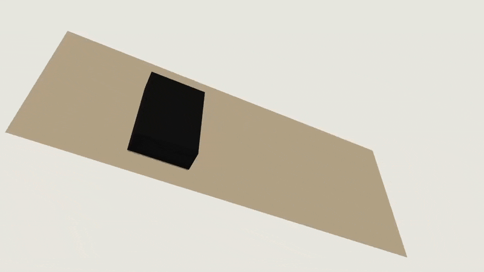

# Built with SolidCraft

*SELENE, a scientific rover built entirely through SolidCraft's MCP server by
[@0xlillith](https://github.com/0xlillith/solidcraft-rover): 3,323 editable timeline steps that
rebuild with no errors, replayed here at 15× speed with the idle moments cut.
[Full video](https://github.com/tangency-labs/solidcraft/raw/refs/heads/main/docs/screenshots/rover-build.mp4)
· [download the editable model](https://github.com/0xlillith/solidcraft-rover/releases/tag/v1.0.0).*

*[BoxInsertDesigner](https://github.com/ShawnMarx/BoxInsertDesigner) by
[@ShawnMarx](https://github.com/ShawnMarx): an AI agent designs 3D-printed board game inserts,
and SolidCraft builds every tray, headless from its CLI, with hand edits in its web app.
Pinned to a release tag and moved along by a daily upkeep job. Shown here at 2.5× speed.
[Full video](https://github.com/tangency-labs/solidcraft/raw/refs/heads/main/docs/screenshots/box-insert-designer.mp4)
· [download a printed insert](https://makerworld.com/en/models/3524093-lorcana-palace-heist-insert#profileId-4028643).*
