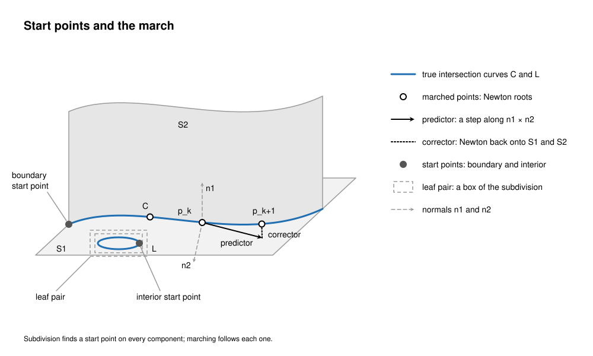
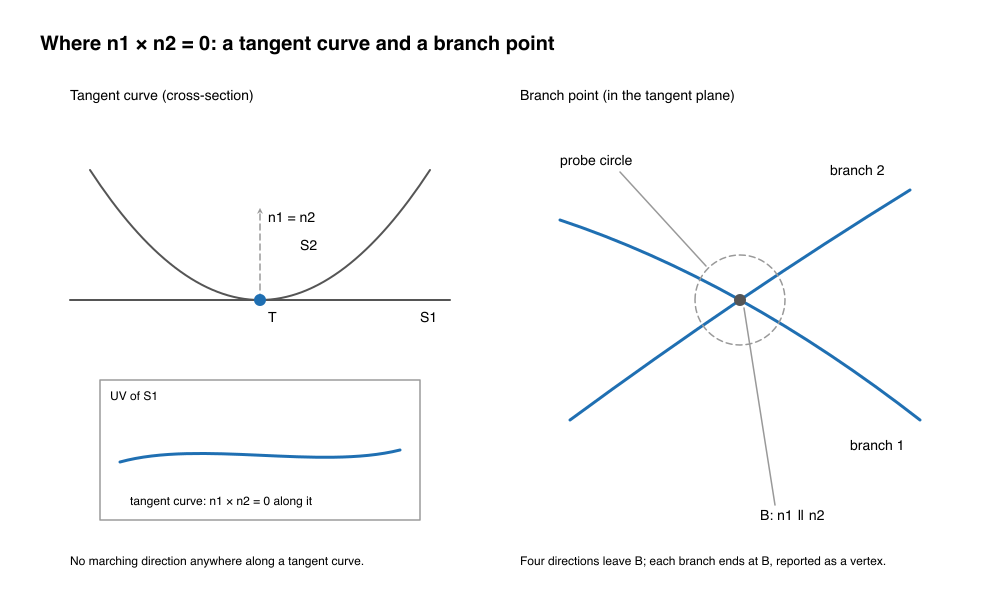
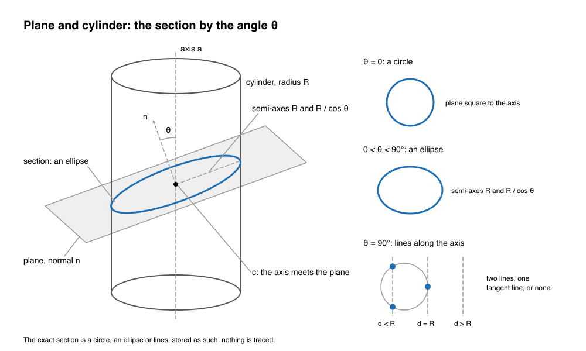

<!-- SPDX-License-Identifier: Apache-2.0 -->

# Surface/surface intersection

This page describes how solidcore intersects two surfaces: the theory the code rests on, the
invariants a change must keep, where each step lives, what is measured and what is open. It is
written for a reader who knows surface intersection and is new to this code, and for anyone stuck on
an intersection bug. Numbers in brackets are references (end of page). Every statement about the code
names the file it was checked in; paths are relative to `crates/`.

There are two implementations today, and [layers.md](layers.md) §2 says one must go:
- **the port**, `solidcore/src/intersect` and the analytic special cases in `solidcore/src/surface`:
  SMLib's intersector carried over unit by unit, with the fork's fixes behind `Kernel::fixes` flags.
  This is what the boolean, the blend and every other caller run today;
- **`ssi`**, `ssi/` with its bridge `solidcore-ssi/`: a method of its own, written without reading
  SMLib, measured against the port on the SSI corpus. Nothing in `crates/solidcore` calls it yet.

Which copy survives is decided from the SSI corpus and the rig, and recorded on the job's issue.

Contents:
1. [Purpose and the one rule](#1-purpose-and-the-one-rule)
2. [Scope](#2-scope)
3. [The pipeline](#3-the-pipeline)
4. [The exact classes](#4-the-exact-classes)
5. [Certification and tolerances](#5-certification-and-tolerances)
6. [Failure modes](#6-failure-modes)
7. [Invariants](#7-invariants)
8. [Status](#8-status)
9. [If you're stuck](#9-if-youre-stuck)
10. [References](#10-references)

---

## 1. Purpose and the one rule

**An intersection curve is exact where its class allows, and a certified exact B-spline otherwise.**
A plane and a quadric, and the quadric pairs with a closed form (§4), meet in a line, a circle or an
ellipse, and that is what is stored. Every other curve is a B-spline whose distance from the true
intersection is bounded by a proof, never by a sample. Nothing is a fit through sampled points that is
then hoped to be close enough. The pcurves (the curve's UV image on each surface) obey the same rule:
an exact rational curve in the surface's parameters where one exists, a certified B-spline otherwise,
built together with the 3D curve rather than projected onto the surface afterwards.

The rule is the target. §5 and §8 say where the code meets it today and where it does not: the exact
classes do; the general curves of both implementations are cubic Hermite interpolants through Newton
points, checked at interior samples, not yet certified.

The other rules follow from that one:
- **Points come from roots.** Every point on a curve is a Newton root of the intersection system, or
  a bracketed root of a field. No point is chosen by thresholding distances at sample points
  (`ssi/README.md`).
- **Regions are dropped only by proof.** A piece pair leaves the search when boxes, slabs or a
  field's coefficients prove it apart, never because a sample missed.
- **A contact that cannot be proved is refused by name**, never approximated (`ssi::Error::Tangent`,
  code `BOOLEAN_TANGENT`).
- **The topology is part of the answer.** A curve ends where two branches cross; a touch point is a
  point; a coincident region is its boundary. A complete point set with the wrong topology is a wrong
  answer (the corpus grades it so, §8).

## 2. Scope

**In.**
- Surface/surface intersection: `Surface::global_surface_intersect` and its analytic special cases;
  the general intersector (`intersect/surface_intersector`, `intersect/adv_surface_intersector`);
  the `ssi` crate and `solidcore-ssi`.
- Curve/surface intersection, as far as SSI uses it: the start points on the natural boundaries are
  boundary curves intersected with the other surface (§3.2). The API entry is
  `intersect::api_intersectors::intersect_curve_surface`, a global solve over the cache trees.
- What the boolean takes from SSI: `topology::face::p3::face_intersect` (classification of each curve
  against both faces) and the topology intersector (`boolean/topology_intersector`), which imprints the
  kept intervals as edges (§3.6).

**Out**, each with its own page:
- The blend's spine and rails, which are an offset/offset intersection traced with the blend's own
  events: [generic-blend.md](generic-blend.md).
- What a stored definition is, how a net is certified against it, and the certificate machinery
  (interval enclosures, the Krawczyk test) that §5 points to:
  [definitions-and-certificates.md](definitions-and-certificates.md).
- Sweeps stored as their definition: [procedural-sweep.md](procedural-sweep.md).
- Ray/body picking (`intersect/ray_tracer`), silhouettes (`intersect/surface_silhouette`) and point
  classification (`intersect/point_class`), which share the solver framework but not the curve
  problem.

## 3. The pipeline

The problem: given S1(u, v) and S2(s, t), find the set S1(u, v) = S2(s, t) inside both domains, as
curves and isolated points, each curve with both pcurves. In four unknowns with three equations the
generic solution is a curve; where the normals n1 and n2 are parallel, the system loses rank and the
curve may stop, branch, or widen into a region [8, ch. 5].

Every method has the same three parts [8, 2]: find at least one point on every component (start
points), follow each component (marching), and handle the points where following fails (tangency,
branch points, coincidence). Subdivision alone is complete but slow and fragments curves; marching
alone is fast and accurate but can miss closed loops. Both implementations subdivide for completeness
and march for accuracy.

*Figure 1. Look at the green start points: one on S1's boundary for C, one inside a leaf pair for the
closed loop L; from each, the march predicts along n1 × n2 and corrects onto both surfaces.*

### 3.1 Dispatch: special cases first

`Surface::global_surface_intersect` (`solidcore/src/surface/surface/p2.rs`) matches on the first
surface's kind. A plane, cone (cylinders are cones of zero semi-angle), sphere or torus tries its
closed form against the other surface's kind first (§4). Each special case returns its curves and a
flag saying whether the general intersector is still needed; when it is, `do_intersection`
(`intersect/surface_intersector/p5.rs`) runs on an `AdvSurfaceIntersector` and resets the output
first. Any other pair, and every B-spline, procedural blend, offset or curve-bounded surface, goes
straight to the general intersector.

`ssi` orders its own paths the same way (`ssi/src/intersect.rs`, `intersect_bodies`): closed forms for
a plane against a sphere or a degree-2 form (`quadric`), then the field path where one side has an
implicit equation (`trace2d`), then subdivision and marching, then local Taylor fields near
tangencies (`taylor`).

### 3.2 Start points

In the port (`do_intersection_with_caches`, `intersect/surface_intersector/p5.rs`):
1. **Boxes.** If the root boxes of the two surface caches' Bézier decomposition trees are apart by
   more than the tolerance, there is no intersection. Otherwise a global solve
   (`SM_SO_INTERSECTION_TEST`) collects the leaf pairs whose patches may meet.
2. **A thin box.** One leaf pair whose box is thinner than twice the tolerance in some dimension goes
   to `grazing_box_process`: a corner pair of the two domains closer than the tolerance, with
   tangents that do not point into each other, is a touching point and ends the search.
3. **Boundary planes.** `do_boundary_plane_test` (`p2.rs`) compares the planar boundaries of the two
   control nets: every sample of each boundary beyond the other's plane proves the surfaces apart;
   a pair just touching is a graze, answered by intersecting the two boundary curves.
4. **Boundary start points.** `find_boundary_start_points` (`p3.rs`) intersects each surface's
   natural boundary curves with the other surface. Each start point is traced (§3.3), backwards too
   when the curve is open and starts along a boundary.
5. **Interior start points.** `find_interior_curves` (`adv_surface_intersector.rs`) takes one
   candidate per intersecting leaf pair from the global solve and traces it when the normals are at
   least 5 degrees apart at the guess and 2 degrees at the solution, and the point is not on a curve
   found already. This is the loop detector of the port: a closed loop is found when some leaf pair
   seeds it.

The 5 and 2 degree thresholds are where interior loops go missing: a small loop between nearly
tangent surfaces has every seed below them. `ssi_low_angle_start_on_probation` (WR-79) traces such
seeds on probation and keeps the trace only as a closed crossing loop larger than twice the tolerance.

In `ssi` (`ssi/src/intersect.rs`, `piece.rs`) completeness is proved instead of seeded:
1. each B-spline is cut into rational Bézier pieces by knot insertion [9];
2. piece pairs are halved until each is **apart** (boxes, or slabs across a normal cone) or
   **loop-free**: their normal cones hold no parallel pair, so no curve closes inside the pair and
   every curve has both ends on the pair's boundary (Sederberg and Meyers's loop test [10]);
3. in a loop-free pair, the boundary curves of each piece are intersected with the other piece:
   those points are the seeds, and they reach every arc.

A pair still neither apart nor loop-free when both pieces are smaller than `Options::resolution`
(1e-5) is a tangency, a coincidence or a degenerate piece at the crossing, and is refused by name
unless the field or Taylor path resolves it (§3.4).

### 3.3 Marching

Port (`intersect/surface_intersector/p3.rs`, `compute_next_point`; `p4.rs`, `trace_curve`):
- **Predictor.** A step along the point's UV tangents, the pullbacks of n1 × n2, clipped to both
  domains. The first step is `100 × approx_tol_3d` (`compute_step_size`, `p1.rs`).
- **Corrector.** `refine_point` (`p1.rs`) solves back onto both surfaces, at the approximation
  tolerance for crossing points and ten times that at tangent and singular points
  (`Surface::local_surface_intersect`, `surface/surface/p11.rs`, with a plane through the guess).
- **Span test.** `test_span_accuracy` (`p1.rs`) accepts the step when the tangent turns by less than
  the angle tolerance and, at five interior parameters, the 3D Hermite span and both UV Hermite spans
  mapped onto their surfaces agree within `approx_tol_3d`. A rejected span halves the step; a span
  well inside both limits (an eighth of the tolerance, a quarter of the angle) grows it by 1.5.
- **End.** The trace stops at a domain boundary, at a through, start or end point it snaps to
  (`test_point`), on reaching a curve already found, or after 5000 points (an error).
- **Output.** `flush_curve` (`p2.rs`) writes the points as a piecewise cubic C0 B-spline in 3D and
  in each UV domain, one knot vector for all three, with the curve type and the largest deviation
  seen.

`ssi` marches each arc of a loop-free pair from its seed to its exit with a predictor along
nA × nB and a Newton corrector held to a plane across the curve; Newton stops at a residual of
`Options::tolerance` (1e-11) scaled by the sine of the angle between the surfaces, with steps of at
most `max_step` (0.02) and turns of at most `max_turn` (0.06 rad). Arcs are oriented along nA × nB
and joined end to start when their ends are within `link` (1e-7). Orientation: with both bodies'
normals pointing out, the part of A inside B is to the left of the curve seen from outside A.
`solidcore-ssi/src/curves.rs` turns the points into one 3D and two UV cubic Hermite curves on one
knot vector, the 3D tangent along n1 × n2 and each UV tangent its pullback through that surface's
Jacobian, and adds points on every knot line crossed and in spans whose measured deviation is over
the tolerance (up to six rounds).

### 3.4 Turning points and singularities

Where n1 ∥ n2 the marching direction n1 × n2 vanishes. The local picture is the difference of the two
surfaces' second fundamental forms in the common tangent plane, read through the two Dupin
indicatrices [15, 8 §5.8]: if the difference is definite the contact is an isolated **touch point**;
if it is indefinite, two branches cross at a **branch point** (both surfaces cross along two curves);
if it is semidefinite, the surfaces may be tangent along a **tangent curve**; if it vanishes
identically, the contact is of higher order or the surfaces **coincide** there.

*Figure 2. Look at where the normals are parallel: along the whole tangent curve (left) there is no
marching direction; at the branch point B (right) there are four, and both branches end there.*

**Port.** `AdvSurfaceIntersector::compute_singularity_point` (`adv_surface_intersector.rs`) classifies
a point with parallel normals from the two Dupin indicatrices: no common direction is a tangent
point, two a tangent curve, more a singularity whose directions are the indicatrices' intersections
(preferring one into both domains at a start, else the one closest to the previous direction).
Equal umbilical curvatures are a coincidence. It runs on start points and on points the corrector
lands on, not on every point the marcher passes, so the base marcher steps straight through a branch
point. The fork's fixes, all off by default:

| flag (record, issue) | what it adds | file |
|---|---|---|
| `ssi_split_curves_at_singular_points` (WR-77, #393) | samples \|n1 × n2\| along each crossing curve, refines each sharp minimum by golden section, and splits the curve where the sine is below 1e-6 and rises above 1e-3 on both sides, more than ten approximation tolerances from its ends | `surface_intersector/singular_splits.rs` |
| `ssi_tangent_curve_tracer` (WR-75, #395) | traces tangent curves the marcher cannot follow: Levenberg-Marquardt on S1 − S2 = 0 with n1 ∥ n2, directions probed on a small circle in the tangent plane; traces crossing branches through tangent contact nodes and reports the nodes | `surface_intersector/tangent_curves.rs`, `tangent_tracer.rs` |
| `ssi_tangent_contact_points` (WR-74, #394) | Newton on a 4 × 4 system (the gap along S2's tangents, S1's tangents against n2) from the leaf pairs the interior search skips, plus the poles; a root is a touch point when the gap is below 1e-7 of the tolerance and the normals agree to 1e-4 rad | `adv_surface_intersector/tangent_contacts.rs` |
| `ssi_trace_tangent_curves_once` (WR-76, #392) | one start point per cluster of tangent boundary start points, so an open tangent curve is traced once | `surface_intersector/p5.rs` |
| `ssi_no_reverse_of_empty_trace` (WR-80, #391) | does not reverse and retrace an empty trace | `p5.rs`, `adv_surface_intersector.rs` |
| `ssi_singular_start_inside_direction` (WR-512) | a curve starting at a singularity leaves along a direction into both domains | `adv_surface_intersector.rs` |
| `ssi_pole_point_keeps_its_tangent` (WR-550) | a point at a pole keeps its exact limit tangent when stepping back | `surface_intersector/p1.rs` |

**`ssi`, the field path** (`ssi/src/trace2d.rs`, `field.rs`). Where one patch lies on a surface with
an implicit equation f (an analytic surface, or a B-spline patch whose exact implicit form
`algebraic.rs` finds, §5), the intersection is the zero set of g = f(P(s, t)) on the other patch's
own parameters. On a rational piece, g is a tensor Bernstein polynomial, W^k f(X / W), with the sign
of f [3]. Each piece's square is cut into cells:
- g of one sign: no intersection there, proved by the coefficients;
- ∂g/∂t of one sign: the zero set is a graph t(s), each point a bracketed root, so a trace cannot
  jump branches (and alike with s and t swapped);
- neither: the cell may hold a critical point of g. When the Hessian's determinant has one sign over
  the cell and ∇g winds once round its boundary, the cell holds exactly one nondegenerate critical
  point: an extremum at zero is a touch point, a saddle at zero is a branch point;
- where g is convex along one parameter's lines, or its third or fourth derivative along them has
  one sign, the curve of its extrema is a tangent curve, two branches, or none, proved on its chords;
- otherwise the cell is halved, down to the resolution, where nothing proved is refused.

Where neither patch has an implicit form, `taylor.rs` builds a local field: the separation λ(s, t) of
A from B along a fixed direction, a Taylor polynomial with proved bounds on its value's, gradient's
and Hessian's errors, read by the same cell tests. The polynomial proves; every point is still solved
on the surfaces themselves.

`ssi` joins branches straight through their crossings and reports the crossings as vertices beside
the curves (`Intersection::vertices` in `solidcore-ssi`); a B-rep builder splits its edges there.

### 3.5 Closed loops and coincident regions

A closed loop has no boundary start point. The port finds it from a leaf pair's seed (§3.2, step 5)
and closes the trace when it returns to its own start. `ssi` cannot miss it: in a loop-free pair a
loop cannot close, so subdivision halves until every loop crosses some pair's boundary and is seeded
there.

Coincident patches share a region, and the region's boundary is the intersection
(`TsectCurveType::RegionBoundary`). The port answers parallel coincident planes, coaxial surfaces of
revolution and parallel cylinders in their closed forms (§4); a general coincident pair leaves the
marcher with parallel normals everywhere. `ssi/src/coincide.rs` reads coincidence off the composed
field (every coefficient zero), then builds the boundary from each patch's edges inside the other,
deciding inside by inverting each edge point onto the other patch and comparing parameters, never
distances. In the boolean, faces known coincident are handled before SSI: `face_intersect` runs the
coincidence check first and returns the faces' own edge curves trimmed to each other.

### 3.6 What the boolean takes from SSI

`face_intersect` (`topology/face/p3.rs`) calls `global_surface_intersect_with_context` over the two
faces' UV domains with the curve angle tolerance, then for each curve:
- a degenerate curve (a touch point) is classified at its point on both faces and kept as a point when
  it is on or inside both;
- every other curve is classified on each face (`curve_on_classify_mut`), with its UV curve when SSI
  gave one, and the intervals inside or on both faces are kept.

The topology intersector (`boolean/topology_intersector/p1.rs`, `face_face_intersect`) imprints each
kept interval as an edge in each face and glues the two. The boolean consumes the 3D curves, the UV
curves (which become the imprinted edges' trims, #489), the curve types and the points. It does not
read `deviations`. A curve from a closed form has no UV curves (`surface/cone/p3.rs`, `add`: `None`
on both sides, deviation 0); its trims are made later by dropping the 3D curve onto each surface
(`Surface::drop_curve`, `intersect/surface_drop_lib`), which traces and fits a cubic within the drop
tolerance. So an exact edge can carry fitted trims; §4 lists the exact pcurves that replace them.

## 4. The exact classes

A pair of natural quadrics (plane, sphere, circular cylinder and cone) meets in a curve of degree at
most 4, and in conics and lines for the configurations that are classically degenerate: a plane with
any quadric, coaxial quadrics, parallel cylinders, and equal cylinders with meeting axes [13, 14].
These are the pairs solved in closed form; every other pair is traced.

| pair | configuration | result | code |
|---|---|---|---|
| plane/plane | not parallel | a line, or its segment in both domains | `surface/plane/p2.rs`, `Plane::intersect_with_plane` |
| plane/plane | parallel apart; coincident | nothing; the general intersector (coincident) | same |
| plane/cylinder | parallel to the axis | two lines, one tangent line, or nothing, from \|d\| against R | `surface/cone/p3.rs`, `Cone::intersect_with_plane` |
| plane/cylinder or cone | square to the axis | a circle | same, `Plane::make_new_plane_ellipse` |
| plane/cylinder | oblique | an ellipse | same |
| plane/cone | oblique, steeper than the semi-angle | an ellipse | same |
| plane/cone | through the apex, along the axis | two lines | same |
| plane/cone | parabola or hyperbola section, or parallel off-axis | the general intersector | same |
| plane/sphere | \|d\| < R | a circle; a touch point at \|d\| = R | `surface/sphere.rs`, `Sphere::intersect_with_plane` |
| sphere/sphere | not concentric | a circle, or a touch point | `Sphere::intersect_with_sphere` |
| sphere/cone | centre on the cone's axis | circles of the cone | `Sphere::intersect_with_cone` |
| cylinder/cylinder | parallel axes | lines from the circle/circle section | `Cone::intersect_with_cone` |
| cylinder/cylinder | equal radii, axes meeting | two ellipses | same |
| plane/surface of revolution | plane through the axis; square to it | the generator rotated in; circles | `surface/surf_of_revolution/p1.rs` |
| revolution/revolution | same axis, planar generators | circles at the generators' intersections | `surf_of_revolution/p3.rs` |
| plane/extrusion, extrusion/extrusion or cylinder | extrusion parallel to the plane or to the other | lines along the extrusion | `surface/surf_of_extrusion/p2.rs` |
| plane/torus | square to the axis; through it | circles; meridian circles | `surface/torus.rs` (plane side: `plane_first_torus_section_exact`, WR-721) |

How each is made exactly: the curve's defining data (a centre, axes and radii, or a line's points)
are computed from the two surfaces' frames, and the curve is stored as its rational form (an
`Ellipse`, a circle or a line), then trimmed to the domains. Nothing is sampled.

*Figure 3. Look at the angle θ between the axis and the plane's normal: it alone decides whether the
exact section is a circle, an ellipse with semi-axes R and R / cos θ, or lines along the axis.*

**Plane/cylinder in detail** (`Cone::intersect_with_plane`). With a the axis, n the plane's normal and
θ their angle:
- θ within `100 · EFF_ZERO · 360` of 90° (plane parallel to the axis): d is the distance from the
  axis to the plane. |d| > R + tol gives nothing; |d| ≥ R, or two lines closer than the tolerance,
  is one `Tangent` line; otherwise two `Crossing` lines at ±√(R² − d²) across the axis, each kept if
  its angle lies in the cylinder's sweep. With `cylinder_plane_tangent_within_tolerance` (WR-510,
  #1525), |d| > R − zone tolerance of either face is also tangent, so a plane a hair off a wall does
  not cut it in two lines microns apart.
- θ near 0 (plane square to the axis): the circle of radius R about the axis point on the plane.
- otherwise: the ellipse, centre where the axis meets the plane, built from the two generator lines
  in the plane spanned by a and n.

**`ssi`'s closed forms** (`ssi/src/quadric.rs`). A plane and a sphere meet in the circle about the
foot of the centre of radius √((R − |d|)(R + |d|)), d a compensated dot product, so the difference
R − |d| is exact where they are close [16] and a loop of radius 1e-7 keeps its radius
(`c7_tiny_loop_sphere_1e-7`). A plane and a patch whose exact implicit form has degree 2 meet in the
conic of the form restricted to the plane; where that conic's quadratic part is definite it is an
ellipse, sized from one evaluation of the form at its centre, told from rounding by the form's own
bound (`c7_tiny_loop_parab_1e-7`). Other conics take the field path.

**Exact pcurves.** A plane section on a cylinder has an exact UV curve: on one rational quadratic
segment of the cylinder's circle, s / (1 − s) is a ratio of affine functions of the point, so a
rational curve of degree p on the cylinder has a rational parameter s(t) of degree p and an axial
height that is a polynomial over its weight. `surface_drop_lib/cylinder_section.rs` builds it in the
curve's own parameter with twice its degree (`cylinder_plane_section_trims_exact`, WR-680, #2109;
retiring the flag is #2331). On a plane every curve's UV image is the same curve in the plane's frame.
Other exact pcurves (sphere, cone, torus sections) are open work.

## 5. Certification and tolerances

### 5.1 What is certified today

| object | port | `ssi` |
|---|---|---|
| a closed-form curve (§4) | exact by construction, deviation 0 | exact by construction |
| a point on a traced curve | a Newton root within `approx_tol_3d` | a Newton root within 1e-11 × sine of the angle, or a bracketed root of the field |
| "no intersection here" | box and boundary-plane tests | boxes, slabs, normal cones, field coefficients of one sign |
| "this cell has one touch or crossing" | not proved | Hessian sign plus gradient winding (degree theory) |
| a tangent curve | not proved | the field's valley proved on its chords |
| an implicit form for a B-spline | none | composed with every piece, every coefficient within 1e-11 of the terms' scale (`algebraic::PROOF`) |
| the curve between its points | five interior samples per span (`test_span_accuracy`) | `solidcore-ssi` measures the deviation at its points and three interior points a span; "not yet a proved bound" (its README) |

So both implementations prove where the curve is (the points) and `ssi` proves the topology, but
neither proves the B-spline between its points. The certificate the one rule asks for is the one the
blend's net carries ([generic-blend.md](generic-blend.md) §2.4,
[definitions-and-certificates.md](definitions-and-certificates.md)): the curve's error against the
intersection, known at the span's grid points to machine precision and bounded between them by the
interpolation remainder with derivatives enclosed over the span box, with the root's existence and
uniqueness in the box proved by the Krawczyk test [7]. The intersection curve is a definition in
Hoffmann's sense [6]: the system S1(u, v) − S2(s, t) = 0 with a normalizing equation, evaluated on
demand. A sampled check is not a certificate; where interval bounds over-estimate, the remedy is a
tighter enclosure, never a sample.

### 5.2 Tolerances

| name | value | where | used for |
|---|---|---|---|
| `zone_tol_3d` | 1e-5 | `Kernel::tolerances` (`kernel.rs`), `geom/tol.rs` | points closer than this are one point; the B-rep's base tolerance |
| `xsect_tol_3d` | 2e-5 | same | default gap and intersection tolerance |
| `approx_tol_3d` | 5e-6 | same | default curve approximation tolerance; the corrector's and the span test's tolerance |
| `ang_tol_deg` | 0.5° | same | the span test's turn limit by default |
| `EFF_ZERO`, `EFF_ZERO_SQRT` | 1e-12, 1e-6 | `math.rs` | zero tests; the closed forms' tolerance when none is given |
| a face's tolerance | per face | the B-rep | plane boxes in the closed forms are expanded by it (`PlaneOwner`) |
| interior seed angles | 5°, 2° | `adv_surface_intersector.rs` | below them a leaf pair's seed is skipped |
| corpus approximation tolerance | 1e-6 | `difftest --ssi-corpus` | the tolerance passed to both engines |
| corpus accuracy tolerance | 1e-5 (10 × tol) | `difftest/src/ssi/score.rs` | a curve farther than this from an exact surface is `INACCURATE` |
| `ssi` Newton | 1e-11 | `ssi::Options::tolerance` | residual, scaled by the sine of the angle |
| `ssi` link, resolution | 1e-7, 1e-5 | `ssi::Options` | arc ends joined; pieces below this unresolved are refused |
| `ssi` field band | 1e-14 of the field's scale | `trace2d.rs`, `CLEAR` | a value within it is zero to rounding |
| `ssi` implicit form | 1e-13, 1e-11 | `algebraic.rs`, `EXACT`, `PROOF` | least singular value at rounding; proof by composition |

The zone tolerance is the B-rep's: two points, edges or faces within it are one. An intersection
curve must lie within the tolerance of both faces it joins, and its edge's tolerance grows to its
largest deviation; a curve whose own error is a large fraction of the zone tolerance leaves no margin
for the edges and vertices built on it (the gaps of #2537 and #2538 are 7e-6 to 1e-5 against
tolerances of 7.5e-6). That is why the general curve's bound should sit far below the zone tolerance,
and why the approximation tolerance is half of it.

## 6. Failure modes

| mode | what goes wrong | port today | `ssi` | open |
|---|---|---|---|---|
| tangent curve | n1 × n2 = 0 along it; the marcher has no direction | collapses to its end points (#395); fixed with `ssi_tangent_curve_tracer` | a proved valley of the field, or of a Taylor field | flag on by default |
| touch point inside both faces | no boundary start, normals within 5° at every seed | missed (#394); found with `ssi_tangent_contact_points` | a proved extremum of g at zero | flag on by default |
| branch point | the marcher steps straight through; one curve where two end | wrong topology (#393); split with `ssi_split_curves_at_singular_points` | a proved saddle; branches joined through it, vertex reported | #393 |
| small loop, nearly tangent | every seed below the 5°/2° thresholds | missed (#396); found with `ssi_low_angle_start_on_probation` | loop-free pairs cannot hide it; closed form for plane/sphere and degree-2 | flag on by default |
| small circle taken as a point | gap to tangency within tolerance though the circle is not | sphere circles up to √(2R tol) collapsed; fixed with `sphere_small_circle_not_touching` (WR-79) | the radius from √((R − \|d\|)(R + \|d\|)) | #2412 (the boolean with it on) |
| coincident faces | normals parallel everywhere | closed forms for planes, coaxial revolutions, parallel cylinders; else the boolean's coincidence check before SSI | region boundary from the field's zero coefficients | |
| near-coincident strip | two planes within tolerance across a strip; the crossing is fixed only to tol / sin θ | `boolean_coincident_strip_drops_crossing` (WR-614) | patches 1e-8 apart, separating only at second order: refused (`y23_fig1d_two_quads`) | |
| grazing | boxes just touch; a boundary meets the other surface tangentially | `grazing_box_process`, `do_boundary_plane_test` | the pair is apart or refused | |
| plane a hair off a cylinder wall | two lines microns apart instead of one tangent line | WR-510, `cylinder_plane_tangent_within_tolerance` | | flag on by default |
| near-miss seam | an intersection runs within tolerance of a closed surface's seam | the curve and its trims end near but not on the seam: `SmFace::Test #36` "Face Near missing Seam", or `make_faceuse` 1001 | curves split at the seam by `solidcore-ssi` | #2538, #2537, cause not traced |
| curve across a pole | the UV coordinate along a collapsed edge names no point | `ssi_pole_point_keeps_its_tangent` | split at the pole; placed by its approach; the pole divided out of the field | |
| empty trace reversed | `SM_ERR_NULL_POINTER` | `ssi_no_reverse_of_empty_trace` (#391) | | #391 |
| trace that never ends | 5000 points, or a creeping boundary trace | an error at 5000; `ssi_start_loop_trace_budget` bounds all start points | `Error::Unfinished` at 100,000 steps; pair budget 2,000,000 | |

**Refusals.** `ssi` refuses by name: `BOOLEAN_TANGENT` (a contact it cannot prove), `BAD_PATCH`,
`MARCHING_STALLED`, `EXIT_DIVERGED`, `ARC_UNFINISHED` (`ssi/src/lib.rs`). A refusal names where. The
port returns `SolidError` statuses; a refusal there is an error code, and an unported callee is
`SolidError::Unported`, which difftest scores as `DEFERRED`, never as a result.

**Near-miss seams (#2538, #2537).** A box cut by a cylinder tilted 4° whose axis lies in a box face, or
whose end cap is bisected by a face, fails the B-rep check with `SmFace::Test #36` or a 1001 in
`make_faceuse`; turning the cylinder's seam away from the material, the mirror image, or a cylinder
1 µm longer builds. The intersection curves pass within the zone tolerance of the cylinder's seam
line and of the cap's edge. The cause has not been traced; the place to look is where the
intersection's curve meets the seam (§3.6: the curve's trims and the seam split) rather than the
check. Whatever the fix, an intersection curve crossing a closed surface's seam must be split on the
seam with both pieces' trims in the domain, which `solidcore-ssi` does and the port leaves to the
drop.

## 7. Invariants

A reviewer can check each of these on a change to SSI.

1. A pair of §4 is answered in closed form: the 3D curve is a line, circle or ellipse stored as
   such, with deviation 0.
2. No point of an output curve is chosen by thresholding distances at sample points; every point is a
   root of the intersection system or a bracketed root of a field.
3. No region is dropped except by a proof: disjoint boxes or slabs, a field of one sign, a boundary
   plane test.
4. Every output curve lies within its reported deviation of both surfaces, and its UV curves map onto
   its 3D curve within that deviation.
5. The 3D curve and its UV curves share one parameter and one knot vector.
6. Every UV curve stays inside its surface's domain; a curve crossing a closed surface's seam is split
   there.
7. A curve ends at every branch point it reaches, and the branch point is reported as a point.
8. A touch point is a degenerate curve of type `Touching` (or an isolated point), never dropped and
   never a short curve.
9. Every closed component is found: a loop inside both domains has a seed, or its absence is proved.
10. Coincident regions come back as their boundary, typed `RegionBoundary` or `Coincident`.
11. No curve is reported twice, and no degenerate curve lies on another curve.
12. A contact that cannot be resolved is refused by name with where; nothing is approximated to get
    past it.
13. The same input gives bit-identical output, independent of thread count.
14. A change's tests check values a wrong result changes: corpus verdicts, distances to the exact
    curve, counts of curves and points, exact volumes in the boolean. Never timings.
15. A change to ported code that is not a fix keeps difftest parity bit for bit on its
    `intersect.*` units; a fix changes the default result and lists what changed (AGENTS.md §4b).

## 8. Status

**The SSI corpus.** `difftest --ssi-corpus` scores the engines on jyviko's corpus
([ssi-corpus](https://github.com/jyviko/ssi-corpus), commit `b04c8a6`): 119 cases (planes,
quadrics, tori, B-spline and NURBS pairs, 25 from Yang, Jia and Yan [12]), each with the dense exact
intersection and its topology, at approximation tolerance 1e-6 (`crates/difftest/README.md`).

| engine | pass (of 119) | not passing | source |
|---|---|---|---|
| C++ reference (SMLib 1.0.1, pinned) | 81 | 25 incomplete, 11 wrong topology, 2 error | `reports/ssi-corpus.json` (2026-10-22) |
| the port, default flags | 78 | 21 incomplete, 10 wrong topology, 1 error, 9 deferred | same; parity with the C++ 110 of 110 compared |
| `ssi`, points as marched | 118 | 1 refused (`y23_fig1d_two_quads`) | `crates/ssi/README.md` |
| `solidcore-ssi`, B-spline curves | 118 | the same refusal | `crates/solidcore-ssi/README.md` |

The port's column is the pinned behaviour: its fixes (§3.4, §6) are off in the corpus run. The one
case no engine passes, `y23_fig1d_two_quads`, is two patches 1e-8 apart that separate only at second
order in places, below the 4.4e-13 their degree-9 form is exact to.

**Port units.** The difftest units are `intersect.surface_intersector_p1` to `_p5`,
`intersect.adv_surface_intersector`, `intersect.surface_tracer`, `intersect.surface_drop_lib_p1` to
`_p3`, `intersect.surface_drop_curve`, `intersect.curve_class_p1` to `_p9`, `intersect.point_class`,
`intersect.topology_solver_p1` and `_p2`, `intersect.api_intersectors`, `intersect.ray_tracer`,
`intersect.surface_silhouette` (`plan/units/`), and `boolean.topology_intersector_p1` to `_p3` for the
boolean's side.

**Open issues.**

| issue | topic |
|---|---|
| [#17](https://github.com/tangency-labs/solidcore/issues/17) | the corpus and the measured gaps of the upstream intersector |
| [#391](https://github.com/tangency-labs/solidcore/issues/391) | an empty trace reversed (`SM_ERR_NULL_POINTER`); fix behind a flag |
| [#393](https://github.com/tangency-labs/solidcore/issues/393) | curves not split at singular crossing points; fix behind a flag |
| [#395](https://github.com/tangency-labs/solidcore/issues/395) | tangent and high-order contact curves missed or collapsed; fix behind a flag |
| [#1552](https://github.com/tangency-labs/solidcore/issues/1552) | how `solidcore-ssi` is wired into the kernel |
| [#2331](https://github.com/tangency-labs/solidcore/issues/2331) | exact UV trims of plane sections on a cylinder by default |
| [#2412](https://github.com/tangency-labs/solidcore/issues/2412) | with WR-79 on, a sphere a hair through a box face gives volume 0 or an open body |
| [#2479](https://github.com/tangency-labs/solidcore/issues/2479) | pcurves end one ulp past their face's domain |
| [#2537](https://github.com/tangency-labs/solidcore/issues/2537) | a tilted cylinder whose cap is bisected by a box face is refused (#36) |
| [#2538](https://github.com/tangency-labs/solidcore/issues/2538) | a notch cylinder along a slanted box edge fails (1001, #36) |

**Work that has no issue yet**, to be filed before it is claimed: a certified bound for general
intersection curves (§5.1); exact pcurves for sphere, cone and torus sections; the merge of the two
implementations ([layers.md](layers.md) §2, step 4 of its order).

## 9. If you're stuck

- **Reproduce at the surface level first.** Pull the two faces' surfaces and domains out of the
  failing operation and call `Surface::global_surface_intersect` on them alone. A boolean failure
  whose intersection is right is a classification or imprint bug (§3.6), not an SSI bug.
- **Run the same pair through `ssi`.** `solidcore_ssi::intersect` takes the same inputs
  (`Engine::Ssi`, `Engine::Port`). If `ssi` gets it and the port does not, compare curve counts,
  types and end points; if both disagree with your expectation, check the expectation.
- **Check the class.** Is the pair in §4? Then a traced curve is the wrong path: find why dispatch
  missed the closed form (a NURB that lost its analytic identity, a cone that is really a cylinder,
  a frame off by rounding).
- **Look at n1 × n2 along the curve.** Near zero anywhere means §3.4: a tangency, a branch point, a
  coincident patch. Most wrong-topology results are here.
- **Look at the seam and poles.** A curve within the zone tolerance of a closed surface's seam, or
  through a pole, is §6's near-miss seam or pole row.
- **Check the flags.** The port's fixes are off by default; SolidCraft runs with most of them on. A
  result that differs between the two is usually a flag (`UpstreamFixes::flags` lists them).
- **Use the corpus.** `difftest --ssi-corpus 'c3_*'` runs a class; the per-case JSON in
  `reports/` has each verdict's distances and topology signature. Add a corpus-style case for your
  pair when none exists.
- **Read the literature before designing.** The survey chapters of [8] and the papers below cover
  nearly every failure here.
- **Fix the cause.** No retry with a smaller step, no second method tried after the first fails, no
  loosened tolerance. A failure that several cases share has one cause.

## 10. References

Titles, venues and years are given as the project's reading notes record them.

1. R. E. Barnhill, S. N. Kersey. A marching method for parametric surface/surface intersection.
   *Computer Aided Geometric Design* 7(1–4) (1990) 257–280. doi:10.1016/0167-8396(90)90035-P
2. R. E. Barnhill, G. Farin, M. Jordan, B. R. Piper. Surface/surface intersection. *Computer Aided
   Geometric Design* 4 (1987) 3–16.
3. R. T. Farouki. The characterization of parametric surface sections. *Computer Vision, Graphics,
   and Image Processing* 33 (1986) 209–236.
4. F. N. Fritsch, R. E. Carlson. Monotone piecewise cubic interpolation. *SIAM Journal on Numerical
   Analysis* 17(2) (1980) 238–246.
5. T. A. Grandine, F. W. Klein IV. A new approach to the surface intersection problem. *Computer
   Aided Geometric Design* 14(2) (1997) 111–134.
6. C. M. Hoffmann. A dimensionality paradigm for surface interrogations. *Computer Aided Geometric
   Design* 7 (1990) 517–532. doi:10.1016/0167-8396(90)90013-H
7. R. E. Moore. A test for existence of solutions to nonlinear systems. *SIAM Journal on Numerical
   Analysis* 14 (1977) 611–615. doi:10.1137/0714040 (with R. Krawczyk, *Computing* 4 (1969),
   and A. Neumaier, *Interval Methods for Systems of Equations*, Cambridge (1990)).
8. N. M. Patrikalakis, T. Maekawa. *Shape Interrogation for Computer Aided Design and Manufacturing*.
   Springer (2002).
9. L. Piegl, W. Tiller. *The NURBS Book*, 2nd ed. Springer (1997).
10. T. W. Sederberg, R. J. Meyers. Loop detection in surface patch intersections. *Computer Aided
    Geometric Design* 5(2) (1988) 161–171.
11. T. W. Sederberg, T. Nishita. Curve intersection using Bézier clipping. *Computer-Aided Design*
    22(9) (1990) 538–549.
12. J. Yang, X. Jia, D.-M. Yan. Topology guaranteed B-spline surface/surface intersection. *ACM
    Transactions on Graphics* 42(6), article 211 (2023).
13. J. R. Miller, R. N. Goldman. Geometric algorithms for detecting and calculating all conic sections
    in the intersection of any two natural quadric surfaces. *Graphical Models and Image Processing*
    57(1) (1995) 55–66.
14. J. Levin. A parametric algorithm for drawing pictures of solid objects composed of quadric
    surfaces. *Communications of the ACM* 19(10) (1976) 555–563.
15. M. P. do Carmo. *Differential Geometry of Curves and Surfaces*. Prentice-Hall (1976): the second
    fundamental form and the Dupin indicatrix.
16. P. H. Sterbenz. *Floating-Point Computation*. Prentice-Hall (1974): the exact difference of
    close floating-point numbers.
17. G. A. Kriezis, N. M. Patrikalakis, F.-E. Wolter. Topological and differential-equation methods
    for surface intersections. *Computer-Aided Design* 24(1) (1992) 41–55.
