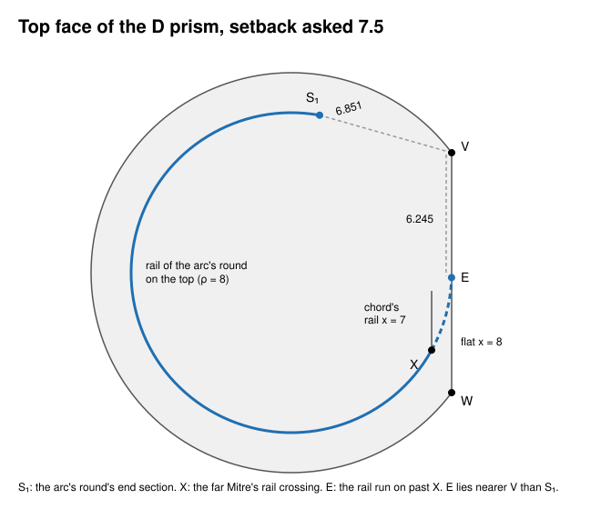
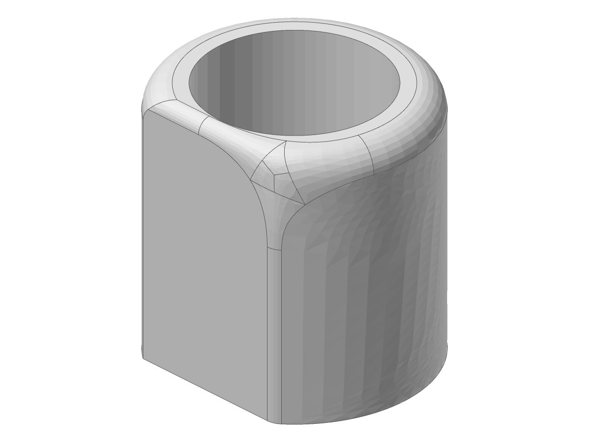
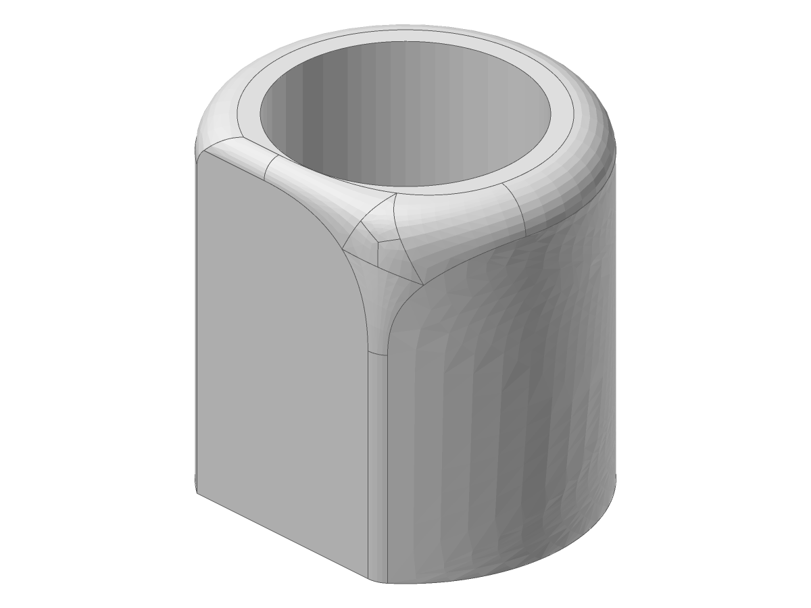

# blend.blend_corner: a setback's end section had the corner on the wrong side past a far Mitre (2026-11-08)

Unit: `blend.blend_corner` (`gather_ends` in `blend_corner/setback.rs`). Case: the D prism of
`tests/issue_2343_curved_setback.rs` (R 10, flat x = 8, H 20, bored R 6.9 or not), its top
corner V = (8, 6, 20) where the chord, the upright and the arc are rounded 1, 1.5 and 2, a
setback asked there. At the chord's far vertex W = (8, -6, 20) the chord's and the arc's rounds
turn at the unrounded upright, a Mitre whose rails cross at X = (7, -sqrt 15, 20).

**Cause.** `gather_ends` (from the fork's `gather` in `BuildSetBackFill`) put the corner on the
side of each round's end section whose rail end lies nearer V. The arc's exact round is a torus
extended past its trace by a quarter of the turn its circle leaves open, so its rail runs on past
X and comes back round toward V. Asked 7.5, the rail on the top ends at E = (7.996, -0.245, 20),
6.245 from V, while the end section S1 = (1.411, 7.875, 20) lies 6.851 from V: the corner was put
on E's side, and `round_jets` refused "a round's end section lies outside its rails' interval",
naming no size. By hand the flip comes at asked 6.893; measured, 6.88 builds and 6.9 is refused,
bored or not.

*The top face at asked 7.5: the arc round's rail on the top runs from its end section S1 the
long way round to the far Mitre's crossing X and on to E, nearer V than S1.*

**Fix.** The corner's side is where the round's edge runs on to V: the rail's direction at the
end section against the edge's, turned toward V, in the frame `CalcSetBackVert` places the
setback vertex in. Asked 7.5 (bored) and 9 to 9.85 (plain) build, `check_brep` Level 2 clean.

**The rails' reach.** Past that, the far Mitre cuts the chord's round where its top rail meets
X: 6 + sqrt 15 = 9.873 along the chord from V, short of the chord's 12. With the side alone,
asked 9.9 to 11.9 reached the fill and failed later trimming the rails ("Unable to Trim Rail
Curve"), naming nothing. Each rail's far vertex (processed, not the corner's own) is now set
square onto its edge and measured from V. The bound is open (a setback at the cut leaves
the round no length past its end section), so the reach is the least cut less the fit margin,
a thousand of the edge's tolerances: 9.863 here. A setback that with its ease passes it is
refused as `SetbackTooLong`, naming it less the ease; asked that size, the plain prism builds.
The bored one is refused there by the bore, not by the rails.

| asked, bored R 6.9 | before | after |
|---|---|---|
| 6.88 | builds | builds |
| 7.5 | refused, no size | builds |

Both pictures: `solidcore-diag FILE.smb --binary --view -135,-30`.

**Not covered.** The room `set_backs` gives each edge is still its length less the far end's
claim: the topology does not know the far corners' cuts yet, so an asked setback at or past 12
here names 12, one between 9.863 and 12 names 9.863. A far vertex placed after the corner's
fill is not measured. A grown setback (beside a curved face, not
certified at the one asked) that passes the rails is a trial not placed, so the growth refuses
naming none. No case has a far cut on an arc's rail, where the edge's arc length matters.
