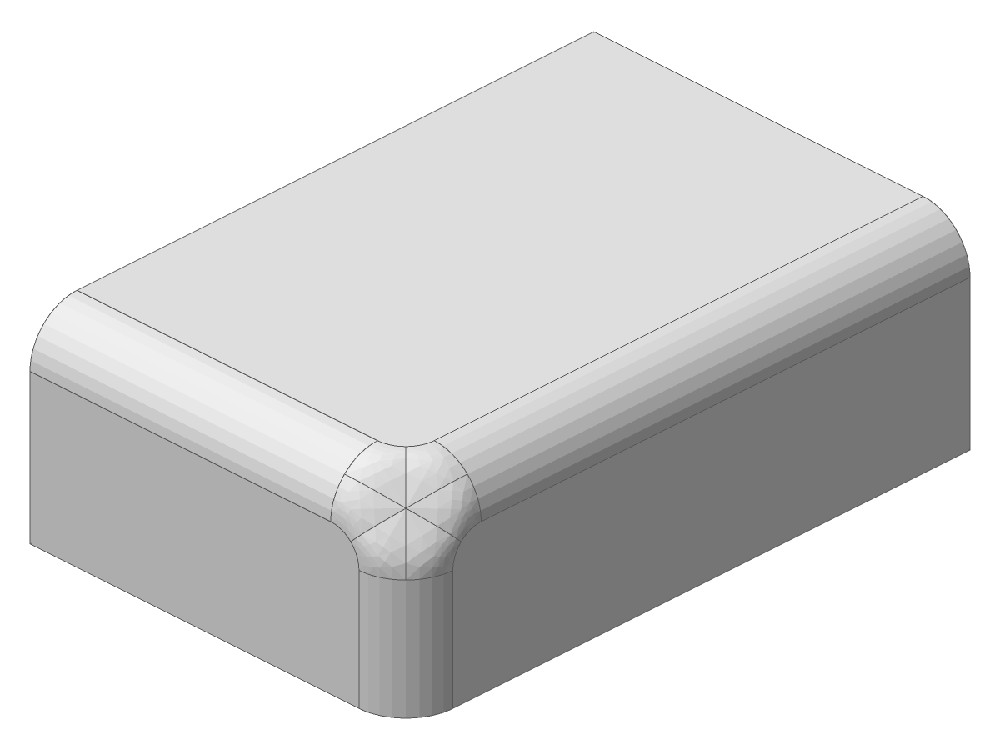
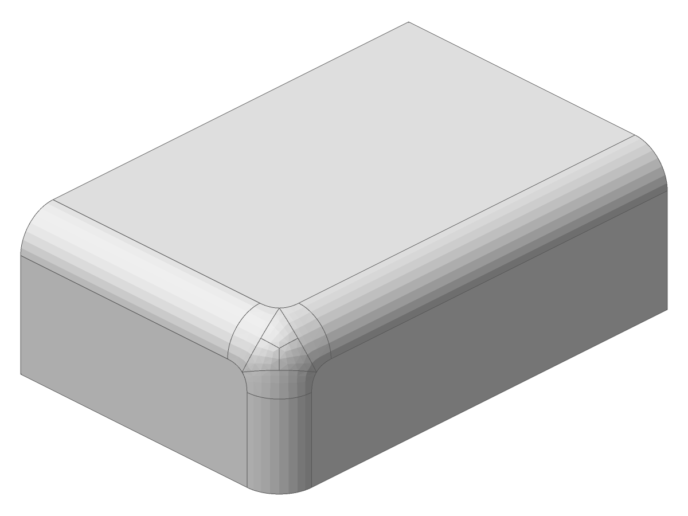

# blend.blend_corner: a vertex marked set back between planes is the Setback, not the N x N patch (2026-11-07)

Unit: `blend.blend_corner` (`classify_setback`), with `blend.fillet_executive`'s session
(`create_corners`, `do_filleting`). Case: the goldens' `real-box-high-corner-setback-eight`
in `blend.fillet_executive_p3`, a 60 x 40 x 20 box whose three edges at (60, 40, 20) are
rounded r 5, that vertex marked with `add_set_back_vertex` and its corner set back 8 with
`set_corner_setback`, the default kernel.

**Before.** With the setback measured from the set-back vertex, the corner was the N x N
corner, its patch filled by `N_FillNSidedHole`: the patch meets the rounds up to 4.71
degrees off tangent, edge tolerance 5.17e-5, volume 47325.94.

**After.** The corner is the blend corner's Setback with its certified fill: every seam
0.0000 degrees, edge tolerance 4.0e-5, volume 47369.84, inside the closed-form bounds
[47271.98, 47384.89] of the kernel case `ladder/07-fillets/013-corner-setback`. The picture
is the body `set_set_back_fill` builds on the same box; the marked vertex's body is the same
bit for bit (`issue_2365_nxn_setback_corners.rs`, `ladder_013_corner_setback_builds_its_setback`).

Both pictures: `solidcore-diag FILE.smb --view -135,-30`.

**Continuity.** The fill is G1 beside circular rounds, not G2: across each round's end
section the patch's normal curvature is 0.0733 against the round's 0.

**Not covered.** A marked vertex beside a curved face stays the N x N corner. An r 3 corner
set back 3.5 is now refused (`NoRoom`), naming 3.5595, the least setback whose fill is
certified convex; the N x N corner built an uncertified patch there.
