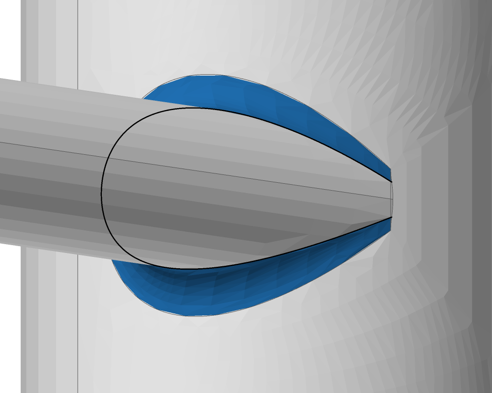
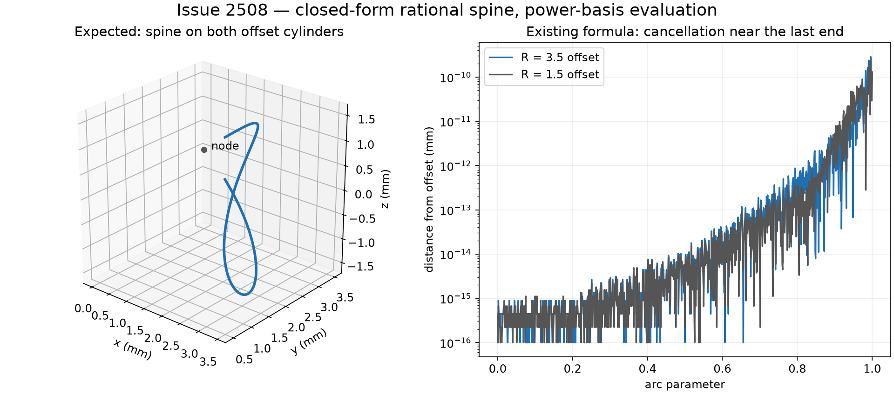

# blend.fillet_exact: construct the nodal quartic in its segment's Bernstein basis (2026-11-06)

Issue #2508; PR #3022. Base: `d3cc2f0aad36ee7d687d051056e342f113865dfd`.
Units: `blend::fillet_exact::rational`, its `blend.fillet_solver_p4` and
`blend.fillet_geom_p3` callers, and exact-round definition retention.

## Input and failure

The existing regression joins an R3 cylinder about z with an R1 cylinder along x
whose axis is at y = 2 and whose end is x = 0.5, and rounds their concave edge at
r = 0.5. The centre line belongs to the R3.5 and R1.5 offsets, touching at
(0, 3.5, 0). Its geometric definition is rational, without fitting or iteration.

Main's round passes its existing 1e-9 mm sampled bar but cannot keep a zero-bound
definition: the spine's Bernstein identity on its offsets fails. Main's direct
spine test measures 1.2963230489049238e-10 mm off its offsets, compared with
`gamma(64) * 3.5 = 2.4868995751603683e-14` mm for its rounding check. The new
definition regression also fails on main: zero exact definitions, expected one.

The actual body's measurements, using the existing `off_ball` helper:

| Measured quantity | Main | Direct Bernstein construction |
| --- | ---: | ---: |
| Maximum sampled ball error, mm | 8.821289254612452e-10 | 6.6058269965196814e-15 |
| Maximum sampled rail error, mm | 8.411107366157466e-10 | 6.217248937900877e-15 |
| Round faces | 1 | 1 |
| Level-2 validity | clean | clean |
| Exact-round definition | absent | NodalQuartic, bound 0 |

Distances are diagnostics, not certificates. Exactness is checked by the existing
coefficient identities on both offset quadrics and on the canal surface; those
identities and their rounding bounds are unchanged. The original 1e-9 mm
ball/rail and endpoint-match bars, and the area tolerance for fitted end trims,
are unchanged. The offset-distance test is strengthened to its rounding bound.

## Cause and construction

`nodal_quartic` expanded the homogeneous quartic into global power coefficients.
`power_to_bernstein` then evaluated Taylor sums to recover each segment. Near the
last end the weight is much smaller than the terms used to form or evaluate it;
conversion cannot recover accuracy already lost in its coefficients.

The replacement uses the same rational cone construction. Let C = A2 - k A1,
g = A1 q + b1, and v0 a cone ray tangent to a branch at node q. For an interpolated
direction w, the cone direction is

`V(w) = (w.C.w) v0 - 2 (v0.C.w) w`.

Its symmetric bilinear polar form is

`P(u,v) = (u.C.v) v0 - (v0.C.u) v - (v0.C.v) u`.

On a segment whose endpoint directions are u and v, the quadratic Bernstein
controls are exactly `P(u,u), P(u,v), P(v,v)`. Bernstein products then give

`W = V.A1.V`, `G = g.V`, `M = q W - 2 G V`.

Thus M/W is the same rational quartic. The code no longer forms power
coefficients; branch and extension sign checks evaluate the cone direction
directly. Segment count, branch choice, extension policy, weight normalization,
positive-weight subdivision and the round's row construction are preserved.
The former arithmetic and the nodal definition exclusion are removed.

This implements the numerical prescription in Tsai and Farouki, *Algorithm 812:
BPOLY*, ACM TOMS 27 (2001), §§1, 3.3, 4.2,
[doi:10.1145/383738.383743](https://doi.org/10.1145/383738.383743).
The rational blend classification is already documented in `generic-blend.md`
§4. No new compatibility flag, retry, fitted spine or relaxed certificate is added.


Nearly equal positive and negative power terms amplify coefficient-rounding error
in the residual weight; the local Bernstein construction avoids that expansion.
[Editable VectorCraft source](blend.fillet_exact--2508-nodal-bernstein/cancellation-mechanism.vectorcraft),
drawn with VectorCraft 0.22.0 and exported as SVG with live Helvetica text
(`outlineText: false`) after inspecting its rendered preview.

## Evidence and reproduction

The direct spine regression now checks all 16 segments against both quadric
identities. Another test checks 96 combinations of scales 1e-3/1/1e3, rotation
and translation, two radius pairs, support order, parameter direction and branch
base: 1,536 segment identities. The integration regression certifies the whole
round at zero, rebuilds its JSON record bit for bit, reverses, swaps and
reparameterizes its net, and rejects records with a moved support or spine.
The neighboring conic and other exact-round tests retain their expectations.

The pictures are the actual body drawn by `solidcore-diag` from the same view before and
after: azimuth -140°, elevation 10°; the close frame is centred at (2, 2, 0) with
width 6 mm. The round is highlighted and meshed by `solidcore-tess`.
The discrepancy is subnanometre, so the pictures identify the affected round;
the geometric identities establish the correction.

| Before | After |
| --- | --- |
|  |  |

The original two-cylinder power-coefficient construction is also reproduced in
`conditioning.py`, with a 70-digit evaluation of those same rounded coefficients.
That control still misses the offsets by about 1.2e-10 mm, isolating coefficient
formation as well as evaluation. It is an independent arithmetic diagnostic,
not a native-kernel comparison or a certificate.



Scope boundary: #3020's unequal-chamfer `round_rows` changes and #2791's N-D
solver changes are independent. No C++ is built or run, and no merged finding is
edited. The current definition ledger contains only the independent offset kind;
it has no nodal-quartic entry to delete.

## Compatibility with the corrected N-D solver

In a separate detached checkout of #2791 at
`f642c4eedef1736a42ddcfc3d65728b83d736ed4`, applying only this change's two
production files makes its previously failing exact-nodal ball test pass. Its
four-test integration target passes completely when its obsolete definition
exclusion assertion is replaced by the expected one retained exact definition;
that assertion runs the existing zero-bound and JSON round-trip checks too.
The corrected traced-round geometry test is preserved and passes. No solver
source or published #2791 branch is changed by this compatibility check.
Its measured ball and rail errors are respectively 1.504352198367087e-14 mm
and 1.4210854715202004e-14 mm; Level-2 validity is clean.

## Integration base

The change is rebased onto main
`b34bb3e376c4f9c49238373d7b6bd30c8b4534b2`, including the merged unequal-chamfer
correction. Its `round_rows` signature, two radii and contact construction are
unchanged by this diff. Rerunning the measurements and the render on this base with the nodal
correction reproduces the corrected measurements above exactly, and the close
render is byte-identical to the attached after image. The earlier base named at
the top remains the control for the tests-first failures and before measurements.

## Final validation

The final integration base is
`4926f2859e97018a97c903e4fa64a3268febfe8e`, including the subsequent Join-offset
refusal and Part 21 reader merges. Validation used six build jobs and eight test
processes, as authorized by the machine's user, with `nice -n 10` and upstream
fixtures required (`SOLIDCORE_REQUIRE_UPSTREAM=1`).

- Complete workspace nextest run on the preceding b34bb3e37 integration:
  **6,524 passed, 98 ignored**, plus workspace doctests, fmt, strict workspace
  clippy and wasm check, all passing.
- After the final rebase: **3,621 kernel unit tests passed** (four ignored),
  **28 exact-round and Join-chamfer integration tests passed**, all
  `solidcore-record` tests passed (37 tests, one ignored), and the four selected
  ops chamfer regressions passed.
- On that final base, fmt, `cargo clippy --workspace --all-targets -- -D warnings`,
  `cargo check -p solidcore --target wasm32-unknown-unknown`, record identifiers,
  frozen archives, diff whitespace and the panic-site inventory against the base
  all passed.
- The nodal kernel case was run separately with `kernel_cases --exact --ignored`
  and `KERNEL_CASES_CASE=cov-fillet-exact-cylinders-touching-at-a-point-r1`:
  one case passed, no known failure.
- Rebuilt diagnostics and reran the measurements on the final base. Both corrected
  errors above are unchanged, Level-2 validity is clean, and the close render is
  byte-identical to the committed after image.

The affected goldens were checked again after the final rebase, without blessing
or changing any expected output:

```text
PASS blend.fillet_solver_p4 cases=651 changed=0 added=0 removed=0 broken=0 known_failing=0
PASS blend.fillet_geom_p3 cases=325 changed=0 added=0 removed=0 broken=0 known_failing=0
PASS blend.fillet_executive_p3 cases=798 changed=0 added=0 removed=0 broken=0 known_failing=3
goldens: 3 unit(s), 3 passed, 0 failed
```

The three existing known failures remain visible: the two teardrop cases and
the high-corner setback-eight case. This change neither removes nor blesses them.

## Review follow-up: sphere and cone supports (2026-11-07)

CodeRabbit and the maintainer requested coverage of the other quadric kinds the
nodal classifier accepts. The follow-up is based on main
`99ed57c4d4f4cd77d942ac6cd2e4d09f612acb20` and adds regression coverage,
documentation and shared construction helpers. The extraction preserves the
construction's arithmetic and traversal.

Four fixtures have independently derived intersection points:

| Offsets | Equations / placement | Node |
| --- | --- | --- |
| Sphere/cylinder | `(x+2)^2+y^2+z^2=16`, `x^2+y^2=4` | `(2,0,0)` |
| Sphere/cone | `(x+2)^2+y^2+(z-6)^2=32`, `x^2+y^2=z^2` | `(2,0,2)` |
| Cylinder/cone | `(x-1)^2+(z-3)^2=2`, `x^2+y^2=z^2` | `(2,0,2)` |
| Cone/cone | The same z cone and a 45-degree cone with apex `(2,-4,2)` and axis `(-1/2,1/sqrt(2),1/2)` | `(2,0,2)` |

The cone axes in the last row are skew, so this exercises the singular quartic,
rather than the two-conic class. Each test explicitly checks `NodalQuartic`.
The endpoint formulas follow the equations above, independently of the polar
construction; the last uses `l=z+x`, `h=z-x`, so `lh=y^2` and
`l(l-4)^2=2 sqrt(2) y^2(y+4)`, with parameter `t=(l-4)/y`.

The new identity test verifies **512 additional segments**: four pairs, both
support orders, both branch charts, both parameter directions and 16 segments.
The round test classifies actual analytic support surfaces and calls the same
`NodalArc::segments` and `rational_spine_parts` helpers as the solver: all 16
segments, the midpoint weight sign, endpoint-weight normalization, bounded
positive-weight subdivision, row assembly, knot placement, rails and leader.
There is no separate test assembly. It then exercises `keep_round_if_proved`,
the zero-bound certificate and JSON rebuild. It verifies **64 retained definitions**: four
pairs, both support orders, four normal-sign pairs and two common contact
directions. With `side_i` the normal sign and `d=+1` or `-1`, the feasible contacts
are `contact_i=d*side_i`, and the signed support offsets are `-r*contact_i`;
`r=1/8`. Independent samples check the ball radius and both rails on their faces.
This also reaches the contact-row branch for two cones. The existing full-body
pipe regression continues to cover the complete fillet operation. Independent
endpoint-correspondence checks exclude a constant node that would satisfy both
quadric equations vacuously; they keep the original nodal test's endpoint bar.

Validation of the shared production path was run at code revision
`f2208043ef64697e45965f2d9007795d11b71817`, on the `99ed57c4d` base above.
The following commit adds only this record update and the figure; it changes
no checked Rust or Python code. The earlier full-workspace results in the
previous section belong to their explicitly named older bases.

- Optimized kernel unit suite: **3,627 passed, four ignored**, including both
  new tests and all 64 full-construction definition checks.
- Existing exact-round integration targets: **24 passed**.
- Fmt, strict workspace/all-target clippy, wasm, panic-site inventory against
  `99ed57c4d`, record IDs, frozen archives and diff whitespace: pass.
- The three affected goldens: **1,774 cases, zero changed/added/removed/broken**.
  No expected output or threshold was changed.

```text
PASS blend.fillet_solver_p4 cases=651 changed=0 added=0 removed=0 broken=0 known_failing=0
PASS blend.fillet_geom_p3 cases=325 changed=0 added=0 removed=0 broken=0 known_failing=0
PASS blend.fillet_executive_p3 cases=798 changed=0 added=0 removed=0 broken=0 known_failing=4
goldens: 3 unit(s), 3 passed, 0 failed
```

All four known failures already occur in this base: the earlier three and
`stubs4-delete-edge-sphere_diff_3cylinders-e2-r0.5` (issue #3053).

The missing test/helper docstrings are added as requested by CodeRabbit; its
review of `666a05b6a` reports **100% documentation coverage**. At that revision,
both Python scripts' executable syntax trees were identical to `9e47df04a`
after removing docstrings.
