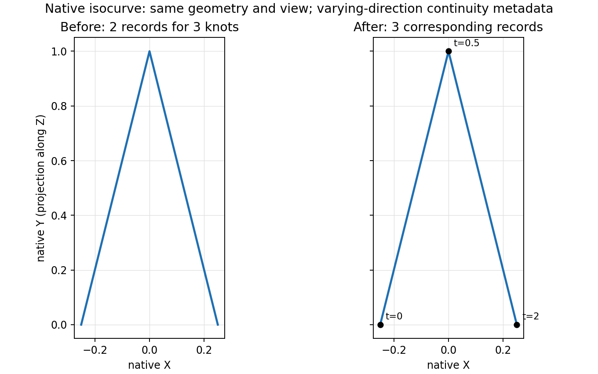

# Iso-curve continuity follows the varying coordinate

Issue: #3113. Unit: `curve.iso_curve`.

A constant-U curve evaluates `S(u0,t)` and its knots already come from V, but its
continuity dispatcher queried U. For a native tensor with two distinct U knots
and three distinct V knots, this returned two continuity entries for three curve
knots. The public projected point solver then returned code1006 before solving
the geometry. Transposing the tensor exposes the same defect for constant V.



The same native constant-U geometry is plotted in both panels; its degree-one
pieces are straight between the evaluated knot points. The corrected dispatcher exports three corresponding records; the before and after
evaluator exports contain identical native points. This is a native-geometry plot,
not a VectorCraft schematic. [Evaluator export](diagnostics/iso_continuity_native_plot.rs),
[before data](diagnostics/iso_continuity_native_plot.json),
[after data](diagnostics/iso_continuity_native_plot_green.json), and
[plot script](diagnostics/iso_continuity_plot.py) reproduce it.

## Definition and scope

For a tensor B-spline, fixing u combines the control rows at u0 and leaves a
B-spline in v, with the V knot vector. Fixing v leaves the corresponding U curve.
This is the parametric-line construction in Patrikalakis, Maekawa and Cho,
[Shape Interrogation for Computer Aided Design and Manufacturing, §1.4.4](https://web.mit.edu/hyperbook/Patrikalakis-Maekawa-Cho/node19.html).
Equivalently, `d S(u0,t)/dt = S_v(u0,t)` and `d S(t,v0)/dt = S_u(t,v0)`.

The fix shares one varying-direction selection between `knots` and
`calculate_continuities`; it preserves the evaluator's existing U-versus-other
branch convention. It does not change surface continuity classification, angular
thresholds, the curve evaluator or projected-root accuracy. Surface-level labels
remain inherited metadata, not a new exact-smoothness certificate.

No dedicated isocurve reference document covers this dispatcher; the module's
contract, the unit record, the definition/layer invariants and the tensor-product
construction above determine the coordinate. Fresh issue and open/draft/merged PR
searches found no overlapping claim. #1965 repairs UV iso-line construction and
#944 hardens the reader. The projected defining-join construction in #2840/#2968
and the All enumeration question #3111 remain separate.

## Direct regressions

The native patch has degrees(1,1). Along its fixed coordinate it has knots
`[0,0,1,1]`; along the varying coordinate, `[0,0,.5,2,2]`. Its two fixed-direction
rows have Z=0 and Z=1, and their common XY polyline has a corner at t=.5.
Both fixed directions are tested by transposing the same tensor definition.

- The sharp corner uses XY `(-.25,0),(0,1),(.25,0)`. Its three curve knots must
  have continuity entries `[Discontinuous,C0,Discontinuous]`. Projected distance
  from the origin along Z has exact maximum1 at t=.5: each affine side's norm
  is convex, and the other endpoints have norm.25. Single and All public queries are tested
  with zero retention slack for successful traversal and admissible native parameters.
  This dispatcher regression does not certify the separate generic solver's maximum.
- The original shallow corner uses `a=1/1024`, `d=1/524288`, and XY
  `(-a,1-d),(0,1),(a,1-d)`. Its continuity list must also have three entries.
  This test does not prescribe an angular label as an exact smoothness proof;
  the separate defining-join work handles that issue.

Before the fix, all three public tests fail against the existing parent kernel:
sharp metadata is `(CInfinity,[Discontinuous,Discontinuous])`; shallow metadata
has length2; the public projected query returns1006. The regression command is
`cargo test -p solidcore --test iso_curve_continuity` (the initial red used a
standalone test binary linked to the already-built parent kernel, without changing
its Cargo target). No C++ behavior is claimed or needed for this direct proof.

The corrected dispatcher passes both metadata regressions. On the main-based
kernel, the sharp public query now succeeds for both directions and request modes,
but returns `t=0.4999999999995149`, with native projected value
`0.9999999999990298`, instead of the exact corner `(t,value)=(.5,1)`.
The new public regression therefore checks the list-mismatch contract: successful,
nonempty output and admissible native parameters. It introduces no accuracy
threshold and makes no maximum certificate claim. The separate defining-boundary
construction in #2840 owns this solver behavior; a stacked validation is pending.

Affected goldens, wasm and broader integration checks remain pending
at this draft checkpoint. No expected output or tolerance has been changed.

The final three public regressions also pass as a standalone test binary linked to
the freshly rebuilt corrected kernel. The native plot exporter is compiled against
each kernel and the plot script checks that the native points are identical before
labeling the second panel as After. The normal Cargo run also passes all three public tests, eight existing private
IsoCurve tests, and strict library/tests Clippy. Changed Rust files pass rustfmt.
Full workspace `cargo fmt --all --check` encounters Windows command-length error
206 before formatting, so that workspace check remains for Linux.


## Independent continuity-cohort audit

The current runner has 120 continuity queries: 88 generated and 32 fixture inputs.
A standalone public-API replay against the corrected native kernel finds 99
corrected records (77 generated, 22 fixture) and 21 unchanged controls, with no
new refusal. Every old record matches the fixed coordinate's knot metadata;
every corrected record matches the varying coordinate.

For each clamped tensor, an interior knot of multiplicity `m` in degree `p`
guarantees `C^(p-m)` continuity in that coordinate. The independent checker uses
only the defining degrees and knot multiplicities, without calling a solver.
All observed interior labels equal those guaranteed orders, capped at the API's
third-derivative category; the two endpoint entries are discontinuous, and no
interior knot gives the API's `CInfinity` minimum. This verifies dispatch metadata,
not whether a specialized geometric slice can be smoother than the guarantee.
The U-versus-other enum convention is preserved exactly as used by evaluation.

[Frozen native inputs and before/after records](diagnostics/iso_continuity_native_records.jsonl),
[public-API replay](diagnostics/iso_continuity_native_audit.rs), and
[independent checker](diagnostics/iso_continuity_check.py) reproduce the audit.
The generated inputs use the runner's unchanged per-case RNG seeds; fixture SMS
files are expanded to their native tensor definitions. The public replay prints
one record per input and the checker can compare a fresh capture using `--native`.

```
python plan/findings/diagnostics/iso_continuity_check.py
# Compile iso_continuity_native_audit.rs with rustc --edition=2021, linking the
# corrected solidcore rlib and its serde/serde_json dependency rlibs.
# Run that executable with iso_continuity_native_records.jsonl as its argument.
python plan/findings/diagnostics/iso_continuity_check.py --native native-replay.jsonl
```

Both checks report `120 continuity records verified; 99 corrected, 21 unchanged`.
This is an independent expected-delta audit, not a replacement for the full 2,874
case golden runner. At that historical checkpoint no expected golden record had
been edited; the full-run migration below supersedes that pending state.

## Full native runner and golden migration

Readiness validation merges main `7a593124c9` into the published branch as
`87e2d87e6`, without rewriting published history. The full native runner at that
revision reports exactly 99 changed records among 2,874 cases, with no added,
removed, broken or known-failing cases. A separate capture of every actual runner
output agrees with all 120 frozen continuity records above: 99 corrections and
21 unchanged controls. The other 2,754 cases are structurally identical to the
baseline, giving 2,775 unchanged records overall. Status, error, deferral and
topology fields are unchanged throughout.

The 99 corrections comprise 77 generated cases and 22 fixture cases. In 92 the
continuity-list length changes; the other seven change the inherited labels or
minimum continuity without changing the length. Every changed value is the
varying-coordinate degree/multiplicity result independently checked above. The
frozen records retain each exact old and new array; no geometry, tolerance or
solver-accuracy expectation is changed.

Only those 99 expected records are migrated. The subsequent full-unit check is:

```text
PASS curve.iso_curve cases=2874 changed=0 added=0 removed=0 broken=0 known_failing=0
goldens: 1 unit(s), 1 passed, 0 failed
```

The checker also accepts `--baseline BEFORE.jsonl --goldens ACTUAL.jsonl` to
verify the full-unit delta, requiring exactly the 99 independently justified
changes and exact preservation of every other record. `BEFORE.jsonl` can be
obtained from main `7a593124c9`'s expected file; `ACTUAL.jsonl` is a fresh runner
capture. This gate proves the dispatcher correction and unchanged other outputs;
it does not certify the separate generic projected solver's near-corner answer.

Linux validation on the integrated `87e2d87e6` kernel also passes full workspace
formatting, all three public IsoCurve continuity regressions, all eight private
IsoCurve tests, the `wasm32-unknown-unknown` kernel check, and strict workspace
Clippy with all targets (`-D warnings`). The golden migration and checker update
change no kernel bytes from that validated revision. Hosted CI and maintainer
review remain separate gates.
