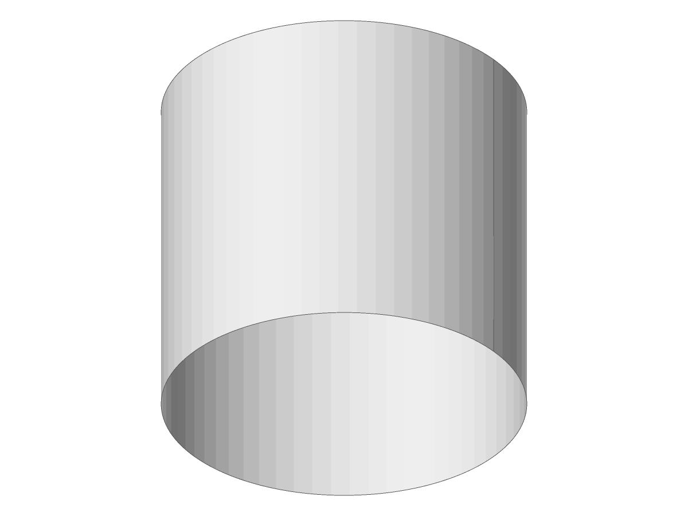

# A natural face on a swapped cylinder builds the face of the unswapped one

- **Unit:** `query.face_p4`, its generated cases gen0141, gen0148, gen0153 and gen0172: a
  canonical cylinder (`Cone::create_canonical_cylinder` at the default placement) turned round
  by `Surface::swap_uv`, and a natural face made on it
  (`topology::brep::p8::create_face_in_region_from_surface`).
- **Before (main, with `SwapUV` re-deriving the cylinder from its transposed net):** each build
  fails with `build_failed: 1001`; there is no body to draw.
- **After (`SwapUV` keeps the cylinder's definition, WR-701):** each builds one face and the
  unit's loop queries run (status 0). The four bodies were written as `.smb` from the unit's
  builder and drawn with `solidcore-diag` (scratch run at 22630fe94). Built from the same
  cylinder **unswapped**, each draws the same way:
  - gen0153 (scale 1000): the picture beside this file, `gen0153.png`, byte for byte the same
    PNG for the swapped and the unswapped cylinder; the reports list the same three edges (one
    seam of length 2461.26, two circles of 8389.47) at tolerance 1e-7.
  - gen0141, gen0148, gen0172: `solidcore-diag` stops at the conversion to the record, swapped
    and unswapped alike, with "a conic's NURBS is off its own frame and radii" for an edge
    circle; so this comes from the edge circles the unit's builder makes on a canonical
    cylinder, not from the swap.
- **check_brep:** the unit's faces carry no pcurves, so every natural face of the unit reports
  "Bad Edge fails ValidateGeometry" lines; the four swapped cylinders report the same kind as
  the unit's unswapped cylinders did on main.

