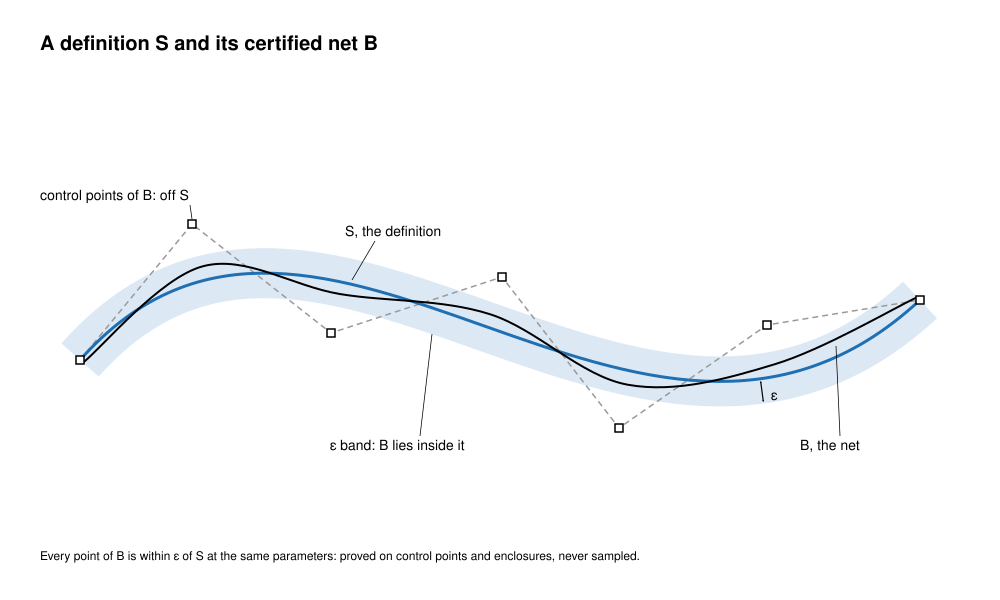
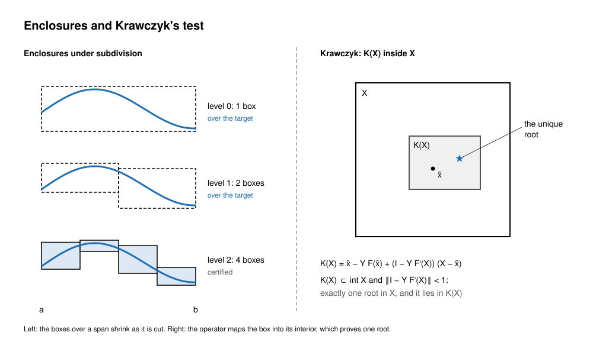
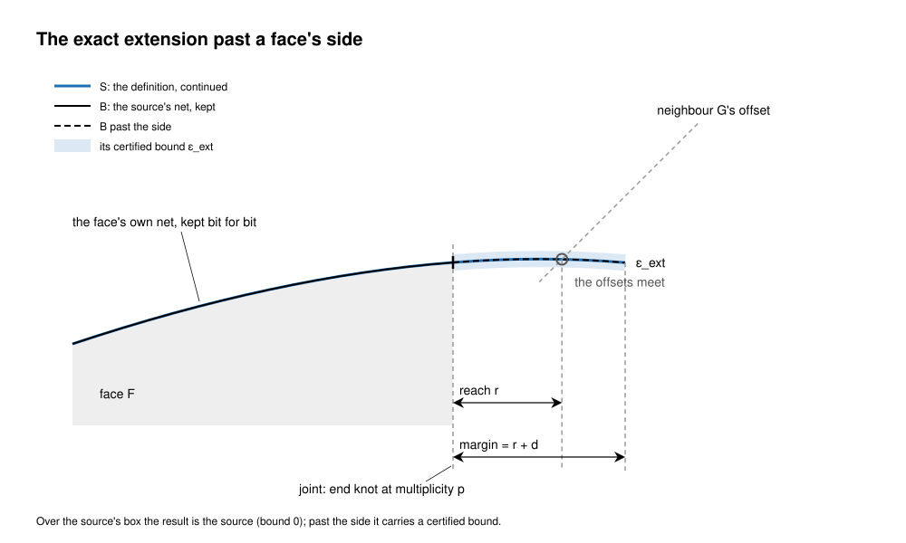

<!-- SPDX-License-Identifier: Apache-2.0 -->

# Definitions and certificates

This page is the foundation every exact construction in the kernel rests on: what a surface is,
how its B-spline is made from that, and what proves the two agree. It is written for a reader who
knows NURBS and interval arithmetic and is stuck on a case: it gives the theory, the invariants a
reviewer checks, and where each piece lives in the code. Numbers in brackets are references (end of
page). Every name below is a name in `crates/solidcore/src` on main; a path without a crate is
relative to it.

Contents:
1. [Purpose and the one rule](#1-purpose-and-the-one-rule)
2. [Scope](#2-scope)
3. [From S to B](#3-from-s-to-b)
4. [The certificate](#4-the-certificate)
5. [Exactness classes](#5-exactness-classes)
6. [The exact extension](#6-the-exact-extension)
7. [Invariants](#7-invariants)
8. [If you're stuck](#8-if-youre-stuck)
9. [References](#9-references)

---

## 1. Purpose and the one rule

**A surface is its definition S.** S is what the surface is, mathematically: a rolling-ball round
between two supports, a profile carried by a screw motion, a patch of a corner ball's sphere, a
face continued past its side by its own polynomial. S is evaluated on demand from a small set of
data, never eliminated into a single closed form [5].

**Its B-spline B is a certified approximation of S, never the truth.** B (the net) serves
bounding boxes, the surface cache, tessellation, display and a solver's first guess. It is stored
beside S with a bound ε, and ε is proved: every point of B lies within ε of S at the same
parameters. Where B is S exactly (a plane, a quadric's rational form, an exact round), ε is 0 and
the proof is an identity checked on control points.

The other rules follow from that one:
- a check that samples points is not a certificate [3]; a bound is enclosed, never estimated;
- a construction that cannot be proved within its bound is refused, naming the size that would
  build; a tolerance is never widened to let it pass;
- final answers (intersection points, projections, the model check, continuity grading) are
  solved on S; B is never an operand whose error stacks under later operations [4, 6];
- "exact to rounding" is enough: bounds are gated at part scale, and nothing chases below about
  1e-10 at tens of millimetres (§5).

## 2. Scope

This page covers what is shared: the definition contract, the S → B construction for each kind,
the certificate and its enclosures, rounding bounds, the exactness classes, and the exact
extension of surfaces.

| topic | where |
|---|---|
| the rolling-ball blend: spine, rails, sections, corners, refusals | [generic-blend.md](generic-blend.md) |
| swept walls (screw and path motions) in depth | [procedural-sweep.md](procedural-sweep.md) |
| surface/surface intersection, and how it reads S | [ssi.md](ssi.md) |
| which layer owns which job | [layers.md](layers.md) |

Here the blend and the sweep appear only as definitions with a net and a bound; how their
geometry is built is in their own pages.

## 3. From S to B

*Figure 1. Look at the net B staying inside the pale ε band around the definition S, though it crosses S and its control points lie far off it.*

### 3.1 The kinds

Every face whose surface has a definition reaches it through one accessor:
`Surface::procedural_blend()` (`surface/surface/p2.rs`), which returns a `BlendRef`, and
`Surface::procedural_sweep()`, which returns a `SweepRef`. A definition that rides on a surface of
another kind is a `KeptDefinition` (`surface/procedural_blend.rs`). The check that a blend made
only definitions is `blend::definition_check::is_definition`, which is
`procedural_blend().is_some()`.

| kind | S | B | ε | code |
|---|---|---|---|---|
| analytic surface or curve | plane, cylinder, cone, sphere, torus, circle, line | its rational form on quarter arcs | 0 | `eval::form`, `surface::implicit` |
| exact round | a round of an exact class (§3.3) | that class's analytic or rational surface | 0 | `surface::procedural_blend::exact::ExactRound` |
| procedural blend | two supports, sides, radius or law, order, thumbweight, leader, seeds | Hermite rows along s, exact section across | certified | `surface::procedural_blend::ProceduralBlend` |
| corner face | Ball, Swept, End, Setback or Mixed, each by its construction | the construction's patch | 0, or the rule's | `surface::procedural_blend::corner::CornerDefinition` |
| swept wall | a profile carried by a screw or path motion | the sweep's rational B-spline wall | certified | `surface::procedural_sweep::ProceduralSweep` |
| drafted face | a face turned by its draft angle about its hinge | the drafted plane or cone | as stated | `offset::draft::DraftDefinition` |
| extension | a surface continued past its side (§6) | the source's net, kept, plus the extension | 0 over the source, a bound past it | `surface::extend` |

`BlendRef` has four variants, `Procedural`, `Exact`, `Corner` and `Draft`; `KeptDefinition` has
`Round`, `Corner`, `Sweep` and `Draft`. A corner face, an exact round or a drafted face keeps its
own surface kind (a torus stays a torus, so every match on the kind still sees it) and carries its
definition beside it.

The blend definitions are opt-in today: `UpstreamFixes::fillet_round_as_definition` (with
`fillet_gn_section_generator`) builds and reads them, and every `UpstreamFixes` flag is off by
default (`kernel.rs`). Tests turn them on (`UpstreamFixes::all`).

### 3.2 Exact nets: lines, arcs and quadrics

Where S is rational, B is S. `eval::form` builds the NURBS form of every analytic kind on rational
quadratic quarter arcs laid on the frame's quarter grid [16, A7.1]: quarter q runs from qπ/2 to
(q+1)π/2, and an angle θ in it has form parameter q + u in closed form (`eval::form::param`,
`eval::form::angle`). Every form on one frame has the same parameter at the same angle, so a
circle edge and its cylinder agree along it and the pcurve is a straight line in (u, v). A
cylinder or cone is the arcs times a degree-1 line, a sphere the arcs times arcs of latitude, a
torus the arcs times the arcs of its tube.

A form kept beside its analytic label is proved to be on it, not assumed:
`surface::implicit::lies_on` composes the analytic surface's implicit equation (`Implicit`:
plane, cone, sphere, torus) with the net in homogeneous coordinates, which gives a polynomial in
Bernstein form on each Bézier patch. The patch lies on the surface exactly when every coefficient
vanishes, and each coefficient is checked against the rounding of computing it (§4.4).
`AnalyticSupport::check` refuses a form moved off its label.

### 3.3 Exact rounds

Fixed-radius rolling-ball rounds of the configurations Dahl and Krasauskas classify are rational
[2, 12]. `ExactClass` (`surface/procedural_blend/exact.rs`) names them: `Line` (the cylinder about
a straight spine), `Circle` (the section turned about a common axis), `Point` (a piece of the
ball), `Chord` (a chamfer between planes: the plane through the feet), `Conic`, `ConicPair` and
`NodalQuartic` (canal surfaces on those spines). `ExactClass::of_spine` maps the classifier's
`BlendSpine`; `BlendSpine::Traced` has no exact class and is built as a procedural blend.

An exact round stores bound 0 and is re-certified by an identity: the supports classified again
give the same class, and the net lies on that class's surface derived from the supports alone
(`surface::implicit::check_exact_net` with an `ExactNetCheck`). The definition is a set's, not a
parametrisation's: the net reversed, swapped, split or trimmed is still on S, so those edits
carry it.

A round of the `Circle` class is certified on its own torus. The class is read within the body's
tolerance, so supports only that close to it (a plane 1e-13 off square to a cylinder's axis, as a
record can carry them) have no torus that touches both exactly, and the round the solver builds,
tangent to the supports as they are, lies on a torus of its own. Its definition is that torus: the
torus of the net's own form (`own_torus`: a revolution's axis and generating arc, or a torus's
label), which the form is proved to lie on (`lies_on`), at bound 0; and the distance from it to the
class's torus derived from the supports, stated (`ExactRound::supports_distance`: the axes' angle
times the reach, the centres' distance and the radii's differences) and refused past the tolerance
the class was read within. Supports exactly of the class give a distance at rounding. The supports
are never moved to fit.

### 3.4 The blend definition

`ProceduralBlend` holds the net (`net`, a `BSplineSurface`) and the definition
(`BlendDefinition`): the two supports by value, the ball's side of each, the offsets or the radius
law, the section's order (0 chord, 1 the ball's circle, 2 to 4 Gⁿ), the thumbweight, the leader,
the seeds, the bound, and the map from the net's parameters to the definition's. A support may
itself be a blend, at most `BLEND_MAX_DEPTH` (3) deep.

S is evaluated by solving one station per point (Newton from the seeds; the stop is
`station::STATION_STEP` = 1e-12 relative in each foot parameter) and the section in closed form
along it; derivatives come order by order from the implicit function theorem
(`ProceduralBlend::evaluate_definition`). B is built span by span: along s, the cubic Hermite
interpolant of the section's rows at two stations; across, the section's exact rational form.
Stations stand at the rails' and leader's knots and wherever a foot crosses a support's knot line
(`blend/fillet_section/section.rs`). Knots are inserted until each span's bound is at most a tenth
of the zone tolerance (`target = 0.1 * tol`).

### 3.5 Corner definitions

`CornerDefinition` (`surface/procedural_blend/corner.rs`) has one variant per corner kind
(`CornerKind`), each defined by its construction:

| variant | S | B, ε | re-certified by |
|---|---|---|---|
| `Ball(BallDefinition)` | the corner ball's sphere, bounded by its three sections | a `BallPatch`, 0 | `eval::sphere` on the net and every loop curve (§4.6) |
| `Swept(SweptDefinition)` | the rounds' end section revolved about the side edge | an exact torus, 0 | `lies_on`, and the torus derived from the definition being the net's |
| `End(EndDefinition)` | the support face (or its extension), bounded by the patch's loop | that face's form, 0 | `lies_on` on the support |
| `Setback(SetbackDefinition)` | the fill rule on the rounds' end jets and the faces | the rule's patch, 0 | running `blend_setback::fill_hole` again: the net must be its patch, number for number |
| `Mixed(MixedDefinition)` | the bicubically blended Coons patch of four sides and ribbons | the rule's patch, within the construction's tolerance | the rule run again on the sides |

`CornerDefinition::recertify(k, net)` dispatches to these; `CornerDefinition::transform` moves the
definition with its net.

### 3.6 Sweep definitions

`ProceduralSweep` (`surface/procedural_sweep.rs`) keeps a profile and a `Motion`. A screw motion
(`ScrewMotion`, optionally with a `RadialLaw`) turns the profile about an axis and lifts it in
closed form; the net's spans turn at most `MAX_HALF_ANGLE` (π/8 half angle, an eighth of a turn per
span). Because the motion at a fixed angle is affine in the point, B − S is the same for every
profile point, and the bound reduces to two scalar functions of the span's half angle, the lift's
error and the offset's (`lift_error_bound`, `offset_error_bound`), each enclosed in rounded
interval arithmetic (`atan` by its alternating series with its remainder), never sampled.
`ProceduralSweep::certify` returns `sqrt((λ E_l*)² + (D/2 E_o*)²)` plus `ProceduralSweep::floor`.

A path motion (`procedural_sweep::path::PathMotion`) carries the profile in the path's
rotation-minimizing frame [1, 17], in closed form on line and arc spans. Its net is fitted by the
sweep, and stands only with its certificate: |B − S| is a convex combination of the control
points' errors, each bounded over cells by a Taylor expansion with second derivatives from control
polygons. A spline or closed path has no definition yet. Details are in
[procedural-sweep.md](procedural-sweep.md).

### 3.7 Who reads S, who reads B

`NetScope` (`surface/procedural_blend.rs`) decides, per kernel, whether a definition answers an
evaluation with its net. `NetScope::new` takes any net (meshing, display, the surface cache, a
solver's first guess); `NetScope::within(k, tol)` takes a net whose bound is at most `tol`;
`NetScope::exact` asks for S. `ProceduralBlend::net_answers` is `tolerance >= bound`. Scopes nest
and the innermost decides; a definition's own station solve evaluates its supports exact, so S
stays exact to rounding inside any scope. `SweepRef` follows the same contract.

## 4. The certificate

*Figure 2. Look at the boxes tightening level by level until they certify, and at K(X) lying strictly inside X, which proves the one root.*

### 4.1 What a certificate proves

A certificate for a net is a number ε and a proof that |B(p) − S(p)| ≤ ε at every parameter p of
the net's domain, through the map to the definition's parameters. A bound at the same parameters
gives both directions of the Hausdorff distance: every point of B is within ε of a point of S, and
every point of S of the face is within ε of a point of B. It is a statement about the exact real
numbers of S and B, with every rounding of computing either inside it.

What it does not prove: anything about a point outside the domain (an extension is certified on
its own, §6), or about S itself being well defined beyond the stations solved (that is the station
solve's existence proof, §4.3).

### 4.2 Enclosures

An enclosure is an interval guaranteed to contain a quantity. The kernel uses three kinds:

- **Rounded interval arithmetic.** `blend::fillet_section::interval::Ivl` is a closed interval
  whose every operation is widened outward past its rounding (`round_down`, `round_up` move a
  result by twice its rounding error). An undefined result (a division by an interval holding 0, a
  NaN) is the whole line, which no test passes [9, 10, 11].
- **Bernstein bounds.** A polynomial or rational piece in Bernstein form lies in the convex hull of
  its control points when its weights are positive [18, 16]. Bounds on B, on a difference of two
  nets, and on derivatives come from control nets: for two rational Bézier patches with points
  P_i, Q_i and weights w_i, v_i, |B − H| ≤ max |P_i − Q_i| + max |Q_i − c| · max |w_i v_j − v_i w_j|
  / (min w · min v) for any point c (`blend::fillet_section::recertify::net_distance`).
- **Taylor forms.** Where plain intervals over-estimate, a function is enclosed by its Taylor
  coefficients over the box with a remainder; the blend's certificate carries the feet's series to
  order 4 in s and n in the section parameter (`blend::fillet_section::series`, `tay`), and uses the
  centred form where one order more is held (`definition_box`). The remedy for an over-estimate is a
  tighter enclosure [8, 10], never a sampled check.

Each enclosure is cut at knots: a polynomial piece is exact only on its own span, so a box across a
knot line is enclosed piece by piece and hulled (`certificate::nurbs_partials_over_box`).

### 4.3 Existence and uniqueness: Moore and Krawczyk

A definition is usually implicit: a station is the root x of F(x; s) = 0 (the feet on both
supports, given s). Enclosing S over a span needs the root over the whole span, proved to exist and
to be the only one in its box. With x̃ the box X's midpoint and Y an approximate inverse of
F′(x̃), Krawczyk's operator [7] is

K(X) = x̃ − Y F(x̃) + (I − Y F′(X)) (X − x̃).

Moore's test [9, 10]: if K(X) ⊆ X, X holds a root; if K(X) lies in the interior of X and
‖I − Y F′(X)‖ < 1, the root in X is unique and lies in K(X).

`blend::fillet_section::certificate::gn_enclose_over` runs this on the four foot parameters for
every s in the span at once: the box starts from the hull of the guesses at the span's ends, the
Jacobian is enclosed over the box, Y is the inverse of its midpoint (`inverse4`), and q is the row
norm of I − Y F′(X) rounded up. When K(X) is strictly inside X and q < 1 the box is proved and
intersected with K(X). When q < 1 but K(X) is not inside, the next box is sized from the
contraction (radii (I − |C|)⁻¹ d, padded by half). When q ≥ 1 the span is too long for one
preconditioner and nothing is proved. At most 8 Krawczyk steps run; there is no recursion.
`gn_enclose` is the same with the faces' polynomial pieces chosen at the span's middle.

The Ball corner's centre uses the same test in three unknowns (`blend::blend_corner::ball`, private
`ball_certified_root`): Newton from the origin on the three offset quadrics, then Krawczyk on a box
about the iterate. The quadrics' gradients are affine, so the Jacobian over the box is the
iterate's plus 2A times the box, exactly.

### 4.4 Rounding: Higham's γ_k

Every certified bound includes the rounding of computing it. The one copy is
`nurbs::math::gamma(n)`, Higham's γ_n = n u / (1 − n u) with `nurbs::math::UNIT` = u = 2⁻⁵³: the
relative error bound of a chain of n rounded operations in the standard model [14, §3]. A bound is
written as the operations it counts:

| where | count | what it bounds |
|---|---|---|
| `eval::collapse` (private `de_boor`) | γ_(12p+4) of the largest coordinate | de Boor's p levels, three operations for each coefficient and four for each convex combination |
| `eval::sphere` (`Coefficient::finish`) | γ_(8 + 8·degree + terms) | a Bernstein coefficient of \|H − CW\|² − R²W² |
| `blend::fillet_section::recertify::precision_floor` | G (D + γ_K M), K = 2(n + 1) + 6 | the net's rows from the stations |
| `surface::procedural_sweep::ProceduralSweep::floor` | G γ_(2(p+3)+24) (A + (R + λ)Θ + R) | the sweep's net and evaluation |
| `surface::implicit::lies_on` | γ_K, K = 4d(p + 1)(q + 1) + 16 | an implicit equation's Bernstein coefficient |

In `precision_floor`, D is the stations' term (a foot within L_u η_u + L_v η_v of its root,
η = `STATION_STEP` (1 + max |knot|), L the support's derivative bounds), M the net's size about the
centre of its box and G its weight ratio. The bound is taken in the round's own frame: the round is
moved by minus the centre of its net's box before it is certified, so the floor follows its size,
not its distance from the origin. At part scale (a round and knots of tens of millimetres) it is
about 1e-10, nearly all of it the stations' term; the rows' is about 1e-14.

### 4.5 Accepting a span, and what a refusal means

`blend::fillet_section::certificate::gn_certify_span` certifies one span between two stations
against a target. It tries levels 0 to 6: at level L the span is cut into 2^L pieces, each piece's
end stations solved, each piece enclosed (§4.3) and its Hermite remainder bounded by
h⁴/384 · max |c''''|. A level whose bound is under the target certifies the span. Once the least
possible value at the pieces' middles is over the target no finer level helps, and the bound so far
is returned so the caller halves the span (`section.rs`, #2312).

A refusal is a statement about the construction, not a failed tolerance: no net with these spans
is proved within ε of S. The caller refines (more stations) or refuses the operation, naming the
cause and, where one exists, the size that builds. A refused net is never kept with a larger ε.

Re-certification runs the same proof on a stored net. `ProceduralBlend::recertify`
(`blend::fillet_section::recertify::recertify`) solves each span's stations again from the
definition, rebuilds the span's Hermite rows H, bounds |B − H| on the net's piece by control nets
and |H − S| by `gn_certify_span`, and refuses the net where the sum with one floor passes ε, where
a piece runs across a station, or where a foot crosses a support's knot line between two stations.
`recertify_faces` does this for every blend face of a body, as a body rebuilt from a record must be
before its faces are operands.

### 4.6 Worked example: a patch on a sphere

`eval::sphere::surface_on_sphere` decides whether a NURBS surface lies on the sphere of centre C
and radius R, on its control points alone.

1. **The identity.** With homogeneous control points (H, W), the surface is on the sphere exactly
   when F = |H − CW|² − R²W² vanishes identically. F is a polynomial spline of twice the degree in
   each parameter.
2. **Bézier pieces.** Each interior knot is raised to the degree by Boehm insertion (private
   `cuts`, `insert`) [15]. On each piece F is in Bernstein form, and it vanishes exactly when every
   coefficient does: the decision is on coefficients, never at sample points, and no weight is
   divided out.
3. **Each coefficient** (i, j) is a sum of binomial-weighted products of the piece's homogeneous
   points (`Coefficient::add`), divided by C(2p, i) C(2q, j).
4. **Its rounding** is bounded term by term: each h = H − CW carries the inputs' errors (the knot
   insertions, γ_6 per pass of the largest coordinate) and its own two roundings; the products,
   sums, binomials and division add γ_(8 + 8·degree + terms) of the terms' magnitudes
   (`Coefficient::finish`).
5. **Acceptance.** A coefficient is zero when |f| ≤ `ON_SPHERE_REL_TOL` (R max W)² + e, both finite
   (private `within`). The geometric part is at the sphere's own size, the same wherever the sphere
   is; the fork's (R + |C|) form grew with the centre's distance and, at |C| = 1e5 and R = 3,
   admitted a net millimetres off.
6. **Refusal.** The first coefficient off the sphere is named with its value and bound
   (`EvalError::Invalid`); a non-finite point or a non-positive weight is `Unevaluable`. A NaN never
   passes: every test is written to accept.

`curve_on_sphere` is the same for a curve. `BallPatch::is_on_sphere` and
`BallPatch::is_curve_on_sphere` (`surface/ball_patch.rs`) call them, and the Ball corner's
`CornerDefinition::recertify` checks the net and every loop curve with them. The tests are in
`eval/sphere.rs` (`a_great_circle_arc_is_on_its_sphere_near_and_far`,
`hostile_numbers_are_refused`) and `tests/wr697_ball_patch.rs`.

## 5. Exactness classes

Every face is in one of three classes:

| class | meaning | ε | kinds |
|---|---|---|---|
| **exact** | B is S; proved by an identity on control points | 0 | analytic forms; `ExactClass` rounds and chamfers between planes; `BallPatch`; Swept, End and Setback corners; Natural extensions of analytic kinds and ball patches |
| **certified** | B is within a proved ε of S | > 0, stored | `ProceduralBlend` (traced spines, Gⁿ sections, radius laws, rounds on rounds); `ProceduralSweep`; Mixed corners (the construction's tolerance); B-spline extensions past a side (§6) |
| **refused** | no B is proved within the bound | none | the construction returns a typed error naming the cause and, where one exists, the size that builds |

There is no fourth class. A face that is none of these (a bare NURBS a blend made) is a defect, and
`blend::definition_check::bare_blend_faces` lists it. The kinds still bare are named in the ledger
`crates/solidcore/tests/data/blend_definition_ledger/` (today `offset.md`: the offset of a round is
an offset surface of its net, #2487), which only shrinks; `tests/issue_2489_blend_faces_are_definitions.rs`
fails on a bare kind not listed, or a listed kind that no longer appears.

**Exact to rounding is enough.** The floors of §4.4 are the rounding of computing the numbers at
part scale. A gate compares with them, or with a closed form, at part scale; it never asks for
less than the floor (no gate below about 1e-10 at tens of millimetres), and it never chases a
residue the floor already explains. Where two results differ inside the floor, they agree.

## 6. The exact extension

*Figure 3. Look at the joint: left of it the face's own net is kept, right of it the extension carries its bound, and it reaches past where the neighbour's offset meets it by one offset distance.*

### 6.1 The construction

`Surface::extended_by_distance` (`surface/extend.rs`) continues a surface `distance` past one side
of its face box. It replaces upstream's extension, which estimated its distance, fitted the
extension by least squares and removed knots within a tolerance, moving the source's own part; that
code is not ported. The surface's B-spline form (an analytic kind's only once proved on its label)
is worked on its homogeneous net, one row along the extended direction at a time, as one of four
`Continuity` kinds:

| `Continuity` | construction | across the side |
|---|---|---|
| `Natural` | the boundary span's polynomial continued on the homogeneous rows: a conic stays on its conic | the surface itself |
| `Tangent` | the boundary piece mirrored: L C(b − s), L the linear map of R⁴ fixing the lifted mirror plane | C1 |
| `Curvature` | the Tangent mirror with its second row solved from the C2 condition, in closed form | C2: curvature continuous |
| `Ruled` | each row continued by the homogeneous line H_n + sD, one ρ for every row, degree-elevated to one span; past the reach of rows whose end weight ratios differ, the ruled surface S + s S_u in the form (HW + s(H_u W − H W_u), W²) | C1, straight in s |

### 6.2 The joint

The source's net and knots are kept bit for bit. The end knot stays at multiplicity p as the joint,
and the extension's spans follow it; no knot is removed. So over the source's box the result is the
source (`Extended::source` = 0, proved), and a face keeps its trims on it. The one exception is
`Ruled` past the reach of rows whose end weight ratios differ (a variable round's sections): one ρ
leaves such a row's line ending at a finite point, so an ask it cannot reach takes S + s S_u, of
degree 2q along the side, and the source is written in the same form, its homogeneous points times W. It is the same surface
with the same parameters, so a face keeps its trims, and `Extended::source` is the rounding bound of
that product, not 0.

Every weight of the result is positive, which proves w > 0 on it. For `Curvature` the homogeneous
surface is C2 across the side, so the surface is curvature continuous where w > 0 (test
`curvature_is_curvature_continuous_across_interior_knots`, `surface/extend/tests.rs`).

### 6.3 The distance and its refusals

The extension parameter is solved (bracketed, then Illinois false position) so that the length
across the side at its middle is the distance. That length is measured, not estimated:
`Surface::length_across_side` (`surface/side.rs`) returns an `Across`, a certified `Bracket` with
its truncation and rounding parts. The solve stops when the enclosure is within
max(1e-9 d, its own width) of d, with the truncation part at most 1e-9 d and the rounding part at
most 1e-6 d. `Extended::extension` is the extension's own certified bound against its construction.

An extension that cannot be made exactly is refused with `SolidError::ExtendRefused` and an
`ExtendRefusal`, naming a distance that works: `WeightVanishes` (a weight would not be positive),
`PastPole`, `PastApex`, `OverATurn`, `NotExact` (the length could not be measured to the stop).

### 6.4 Extended by the definition

- **Analytic kinds.** `Natural` on a plane, cone, sphere or torus is the same analytic widened
  (`Surface::continued`, `surface/continued.rs`), its label exact, ε 0.
- **Procedural blends** (`surface/extend/blend.rs`) are extended by S, not B. Across the section,
  the chord or circle continued is the same chord or circle; the net is continued Natural, and its
  distance from S past the old range grows in closed form by Chebyshev's extremal property [13]:
  |S − B|(t) ≤ ε T_m(x) (max W max V)/(min W min V), m the sum of the section's and the net's
  degrees. Along the spine, the definition gains a new station and the net gains one span of the
  construction's, certified by `gn_certify_span` and joined at multiplicity 3.
- **Ball patches** (`surface/extend/ball.rs`) continue their own net Natural; the identity
  |H − Cw|² = R²w² is polynomial, so it holds on the continuation, and the result is certified on
  the sphere.

`Surface::extended_sides` (`surface/extend/sides.rs`) extends several sides in turn, each on the
box the sides before it left, and reports a `SideExtension` per side: a closed direction, a
collapsed side (a pole or apex), an unbounded plane side or a revolution's side round its axis is
left and said so.
A side refused as `NotExact` with no distance named (it stands far out on the sides before it) is
refused naming the longest of d/2ⁱ at which every side extends.

### 6.5 A caller keeping its face's own net

A caller that keeps a face's UV trims on the extended surface needs the face's own parameters,
not a re-parametrised analytic. `Surface::extended_sides_keeping_parameters` extends a plane too by
its own net (a B-spline on the plane's parameters), as cones, spheres and tori always are, so the
face's trims still land on it. `extended_sides` widens a plane as a plane, keeping its kind for a
caller that intersects with it. The offset executive takes the keeping form with `Ruled`
(`offset/offset_executive/p1.rs`, `get_create_extended_surface`).

### 6.6 The derived reach

How far to extend is derived from the geometry, not a chosen multiple. For an offset,
`offset::offset_executive::reach::extension_reach` computes how far past its face each offset face's
surface must reach for its neighbours' offsets to meet it: at an edge between F and G with unit
normals n_F, n_G (c = n_F · n_G) and offsets d_F, d_G, the meeting's foot lies past the edge by
r = β (n_G · m), β = (d_G − c d_F)/(1 − c²), which is d cot(α/2) for equal offsets (α the sector
angle). The face's reach is the largest along its edges and at its corners.
`record_extension_reach` adds one offset distance, so each meeting crosses the extended surface's
side rather than touching it.

A local operation still extends by upstream's 2.5 radii of the bounding sphere
(`topology/brep/local_operation.rs`, `set_extension_bound`): beside faces that do not move, a
derived reach is zero and the operation has no offset to add past it.

### 6.7 Curves

Curve extension on main is still upstream's `Curve::extend_by_dist` (`nurbs/crv_adv`,
`N_CrvExtendByDist`), whose `Cmax` case fits its length and removes knots again. An exact curve
extension by arc length is open work; until it lands, a curve extension is not in the exact class.

## 7. Invariants

A reviewer checks each of these on a change that touches a definition, a net or a bound:

1. **A face's B is certified against its S.** Every face with a definition has a stored ε and a
   proof: an identity for ε = 0, an enclosure otherwise. No net is stored with an estimated bound.
2. **S answers final questions.** Intersection points, projections, the model check and continuity
   grading read S, or B only inside a `NetScope` that asks for at least ε.
3. **A refusal names the size that fits.** A construction that cannot be certified returns a typed
   error with the cause and, where one exists, the largest size that builds (`FitSize`,
   `ExtendRefusal`'s distance), computed from the cause's geometry, never by building again.
4. **No uncertified fit, no tolerance widened.** A net may come from a fit only where it is then
   certified against S (the path sweep); a failed certificate refines or refuses, never raises ε
   or loosens a test's expectation.
5. **Every bound includes its rounding,** as γ_k of the operations it counts (`nurbs::math::gamma`),
   taken in the object's own frame so it follows the object's size.
6. **No sampled certificate.** Decisions are made on control points, Bernstein coefficients or
   interval enclosures; a check at sample points proves nothing.
7. **NaN refuses.** Every acceptance test is written to accept, so a comparison with NaN fails, and
   a non-finite input is a typed error.
8. **Records are files.** A definition persists as plain data: the database type
   (`PROCEDURAL_BLEND_TYPE`, `ProceduralBlend::read_from_db`) and the serde records of
   `surface::procedural_blend::record` (`ProceduralBlendRecord`, `ExactRoundRecord`,
   `CornerRecord`), every number as stored. `convert::rebuild`, `exact_rebuild` and
   `corner_rebuild` make the definition exactly and certify the net again before it is an operand.
9. **A record rebuilds bit for bit.** Written, read back and rebuilt, a definition evaluates as the
   one written; evaluation is a pure function of the definition, and the station memo keys a
   definition by its identity (`DefinitionIdentity`), so two threads agree with one bit for bit.
10. **Motions move the definition.** A transform moves S with B and adds its rounding to ε;
    a motion a definition cannot follow (`KeptDefinition::follows`: a sweep under a non-uniform
    scale) drops it rather than keep a wrong one.
11. **An extension keeps its source.** Over the source's box the extended surface is the source,
    net and knots bit for bit; `Ruled` past the reach of rows whose end weight ratios differ keeps
    the surface and parameters within `Extended::source` (§6.2).
12. **Bounded work.** Certificates run fixed loop counts (8 Krawczyk steps, levels 0 to 6, budgets
    on cells and mirror steps) with no recursion, and poll the kernel's cancel token.

## 8. If you're stuck

**A net is refused on recertify.** Run `ProceduralBlend::recertify` and read which term failed:
|B − H| (the stored net is not its rows: was it edited, cut across a station?), |H − S| (the span's
certificate), or the floor. Compare ε with `ProceduralBlend::precision_floor`: a floor near ε means
the round is far from its frame's centre or its weights are badly spread.

**A span does not certify.** Find which step proves nothing in `gn_enclose_over`: q ≥ 1 means the
span is too long for one preconditioner (more stations); K(X) never inside X means the box is too
small or the root is near-singular (an event of the trace: [generic-blend.md](generic-blend.md)
§3). Check whether a foot crosses a support's knot line inside the span.

**A coefficient is "off the sphere" or off its quadric.** The error names the piece, the
coefficient, its value and its bound. A value just past its bound at a large coordinate is a
rounding term undercounted (§4.4); a value far past it is a net that is not on the surface.

**An extension is refused.** `WeightVanishes` and `NotExact` name a distance that works; ask for
it to see the extension, and look at the weight ratio across the side (`Ruled` past both forms'
reach, or where the product form has no B-spline).

**What to measure.** Distances to S (not to B), exact volumes, seam angles, counts of spans,
stations and Newton steps (`BlendCounts`, machine independent). Never timings.

**Tests that pin each part:**

| part | tests |
|---|---|
| the blend definition, its record and rebuild | `tests/wr698_procedural_blend_definition.rs` (`a_definition_goes_to_data_and_back_bit_for_bit`, `a_net_off_its_definition_is_refused_on_rebuild`, `evaluating_on_two_threads_equals_one_bit_for_bit`) |
| the Gⁿ certificate | `blend/fillet_section/certificate.rs` tests (`two_plane_span_bound_is_zero`, `cylinder_plane_span_bound_is_the_closed_form`, `a_box_across_a_knot_line_is_enclosed_piece_by_piece`); `tests/issue_2690_uv_bound_stretched_face.rs` |
| exact rounds | `tests/wr669_exact_round_classes.rs`, `wr669_exact_conic_rounds.rs`, `wr669_exact_nodal_quartic_round.rs` |
| corners as definitions | `tests/wr697_ball_patch.rs`, `wr697_swept_turn.rs`, `wr697_end_and_join.rs`, `issue_2343_curved_setback.rs`, `issue_2360_mixed_corner.rs` |
| the sphere certificate | `eval/sphere.rs` tests |
| the screw sweep's bound | `surface/procedural_sweep.rs` tests (`the_lift_error_bound_is_its_maximum`, `the_offset_error_bound_holds_and_is_tight`); `tests/screw_sweep.rs` |
| every blend face a definition | `tests/issue_2489_blend_faces_are_definitions.rs` and its ledger |
| the exact extension | `surface/extend/tests.rs` |

## 9. References

1. R. L. Bishop. There is more than one way to frame a curve. *The American Mathematical Monthly*
   82(3) (1975) 246–251.
2. H. E. I. Dahl, R. Krasauskas. Rational fixed radius rolling ball blends between natural
   quadrics. *Computer Aided Geometric Design* 29 (2012) 691–706.
3. Filkins, Tuohy, Patrikalakis. *Engineering with Computers* 9 (1993) 49–62.
   doi:10.1007/BF01198253
4. C. M. Hoffmann. The problems of accuracy and robustness in geometric computation. *IEEE
   Computer* 22(3) (1989).
5. C. M. Hoffmann. A dimensionality paradigm for surface interrogations. *Computer Aided
   Geometric Design* 7 (1990) 517–532.
6. D. J. Jackson. Boundary representation modelling with local tolerances. *ACM Symposium on
   Solid Modeling* (1995).
7. R. Krawczyk. Newton-Algorithmen zur Bestimmung von Nullstellen mit Fehlerschranken.
   *Computing* 4 (1969) 187–201.
8. K. Makino, M. Berz. Taylor models and other validated functional inclusion methods.
   *International Journal of Pure and Applied Mathematics* 4 (2003).
9. R. E. Moore. A test for existence of solutions to nonlinear systems. *SIAM Journal on
   Numerical Analysis* 14(4) (1977) 611–615.
10. A. Neumaier. *Interval Methods for Systems of Equations*. Cambridge University Press (1990).
11. R. E. Moore, R. B. Kearfott, M. J. Cloud. *Introduction to Interval Analysis*. SIAM (2009).
12. M. Peternell, H. Pottmann. Computing rational parametrizations of canal surfaces. *Journal of
    Symbolic Computation* 23 (1997) 255–266.
13. T. J. Rivlin. *Chebyshev Polynomials*, 2nd ed. Wiley (1990).
14. N. J. Higham. *Accuracy and Stability of Numerical Algorithms*, 2nd ed. SIAM (2002).
15. W. Boehm. Inserting new knots into B-spline curves. *Computer-Aided Design* 12(4) (1980)
    199–201.
16. L. Piegl, W. Tiller. *The NURBS Book*, 2nd ed. Springer (1997).
17. W. Wang, B. Jüttler, D. Zheng, Y. Liu. Computation of rotation minimizing frames. *ACM
    Transactions on Graphics* 27(1) (2008).
18. G. Farin. *Curves and Surfaces for CAGD: A Practical Guide*, 5th ed. Morgan Kaufmann (2002).
