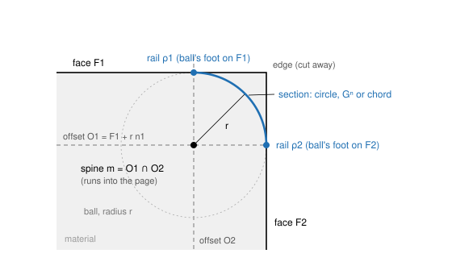
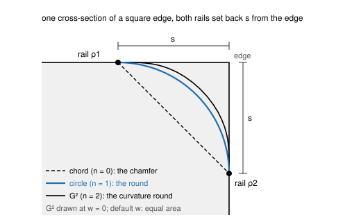
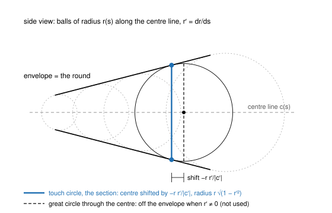
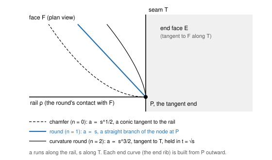
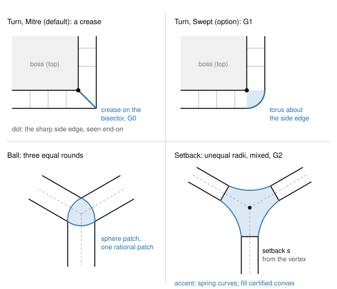
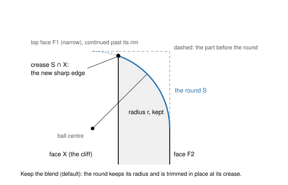
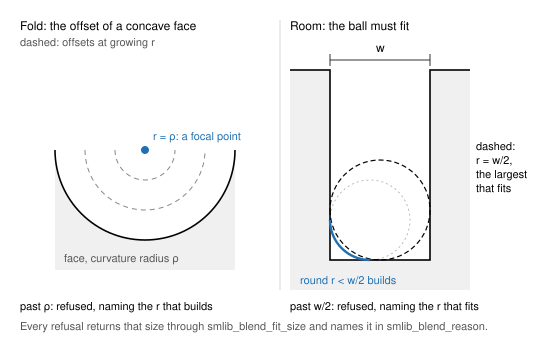

<!-- SPDX-License-Identifier: Apache-2.0 -->

# The generic rolling-ball blend

This page describes the blend that is replacing SMLib's fillet code step by step: what it builds,
how, why it is built that way, what is merged, and what is open. It is written for a reader who
knows blending surfaces and is new to this code. Numbers in brackets are references (end of page).
This is solidcore's design page for the blend. The construction began in the SolidCraft fork of
SMLib, whose construction ended on 2026-11-02 (v1.1.0-alpha); solidcore is based on SMLib and
carries the blend forward on its own path (§9). Every issue named here is a solidcore issue; each
links back to where its work started.

Contents:
1. [Purpose and the one rule](#1-purpose-and-the-one-rule)
2. [The construction](#2-the-construction)
3. [Events of the trace](#3-events-of-the-trace)
4. [The exact classes](#4-the-exact-classes)
5. [Design decisions that shape behaviour](#5-design-decisions-that-shape-behaviour)
6. [Status](#6-status)
7. [Case gallery](#7-case-gallery)
8. [For contributors](#8-for-contributors)
9. [Where it comes from, and how cases are reported](#9-where-it-comes-from-and-how-cases-are-reported)
10. [References](#10-references)

---

## 1. Purpose and the one rule

**One construction for every pair of faces.** A round, a curvature-continuous round and a chamfer
of any edge, between faces of any kind, are built by the same steps: a spine, two rails, a section,
and the events met along the way. Corners, ends and overflows are events of that one trace, not
separate algorithms chosen by the shape of the input.

**Failures are fixed in that construction.** A case that fails is a defect of the construction,
fixed where the construction is wrong. It is never fixed by a point solution for that case, a
fallback to the old code, or a chain of methods tried in turn until one returns something. The old
fillet code had all three: an analytic try-chain for the surface, fourteen vertex kinds and twelve
corner classes chosen by edge counts, and a march into tangent points. Each step of the rework
deletes one of them.

The other rules follow from that one:
- every result is exact or certified (§2.4); nothing is fitted and then hoped to be close enough;
- a blend that cannot be built is refused with the size that would build (§3.5); the user's
  geometry is never changed silently;
- the design is grounded in the published literature, cited here.

The order of the work follows the survey's own order of the problem [46]: spine and rails, then
section, then vertex blends.

## 2. The construction

*Figure 1. One cross-section of a round between faces F1 and F2: the offsets O1 and O2 meet in the
spine m; the ball of radius r centred on m touches each face at its rail; the section joins the rails.*

### 2.1 Spine and rails

Take a blend of edge e between faces F1 and F2, with outward normals n1, n2 and radius r, constant
or a law r(t).

- **Spine.** m = O1 ∩ O2, where Oi = Fi + r·ni is face i offset towards the blend [6, 37]. With a
  radius law the offsets move with r(t); the spine is defined implicitly and traced by marching with
  the law [7]. The solver's existing station solve (Newton on both offsets) is kept; what changes is
  what is made from its points.
- **Rails.** ρi(t) = m(t) − r(t)·ni at the foot point: the ball's feet. A spine point's parameters
  on Oi are its foot's parameters on Fi, so the rails cost no further solve. The rails are all the
  rolling ball fixes [6, 14].
- **Cut.** Each face is trimmed on its rail. The pcurve is the spine's parameters on the offset.
- **Chamfer.** The same construction with the contacts at the setback distances, joined by the chord. The
  offsets are constant along an edge, converted from its sizes at one wedge; edges of one size on a
  tangent chain are one chamfer, so their rails meet: measured at the wedge of its edges between
  planes, where the sizes then hold all along, else at the narrowest wedge of their middles, moved
  up as far as unequal sizes need so that no station folds at the widest wedge, enclosed along
  each edge. Where the wedge varies the sizes hold only where it was measured.

Every geometric quantity downstream (rails, sections, events, corner boundaries) is built from the
same exact spine points.

### 2.2 The section

The section joins the two rails. It is one of three kinds, chosen by its order n:

| n | section | surface |
|---|---|---|
| 0 | the chord | the chamfer |
| 1 | the circle of the ball between the rails | the exact canal surface, the envelope of the balls [35] |
| 2 to 4 | the Gⁿ section | Hartmann's blend between the rails [14, 17] |

*Figure 2. The section family on one cross-section, both rails set back s: chord (n = 0), circle
(n = 1), order-2 section (n = 2, drawn without thumbweight).*

**The circle (n = 1)** is the default round. It is stored as an exact rational circle: the rational
quadratic arc with middle weight cos(θ/2), θ the angle between the contact normals [6, 7]. It is
never an approximated arc.

**The Gⁿ section (n ≥ 2)** is Hartmann's construction [14, 17]: two curves, one on each face from
its rail towards the edge, blended by f(t) = (1 − t)ⁿ⁺¹ / ((1 − t)ⁿ⁺¹ + tⁿ⁺¹). The first n
derivatives of f vanish at both ends, so the section has Cⁿ contact with each face along its rail,
hence Gⁿ. Its n = 1 member is not the circle, so the circle stays the order-1 section and Hartmann's
family is used from n = 2 up. Two parameters shape it:
- **Thumbweight w** [17, 46], the fullness. Its default is **equal area**: at each station, the w at
  which the section removes the same cross-section area as the circle of that radius would there
  ((1 − π/4) r² at a square edge). Each station takes its own w from its own wedge angle, so the
  curvature round removes about the same material as the round of the same radius everywhere along
  the edge.
- **The faces' order-n jets.** The section is built from curves on each face whose first n − 1
  coefficients are the feet's and whose n-th is fixed by the face's n-th order data in the normal
  direction only (the tangential part is free under reparametrization [10]). So a Gⁿ round needs a
  Cⁿ face, not Cⁿ⁺¹: a G2 round is continuous on a cubic B-spline face, and the span certificate
  holds across its knot lines.

The section's contact order with its face is n + 1 in general, and n + 2 between planes. That order
gives the tangent-end laws of §3.1.

A **variable round** is the union of its balls (Figure 3). The ball touches the envelope along the
circle in the plane through the rails square to the centre line's tangent c′, not along the great
circle: its centre is shifted by −r r′/|c′| along the centre line and its radius is
r √(1 − r′²/|c′|²) [35, 7, 29]. The great-circle section is off the envelope whenever r′ ≠ 0 and can
cut through the balls [29]. The envelope is real only where |c′| > |r′| [35].

*Figure 3. A variable round is the envelope of its balls. The section is the touch circle (accent),
shifted from the ball's centre; the great circle (dashed) is not on the envelope.*

### 2.3 The round stored as its definition

A blend face is stored as the system that defines it, following Hoffmann's dimensionality paradigm
[21]: more unknowns and simple equations, nothing eliminated, evaluated on demand [1, 41]. The class
is `SmProceduralBlend`, which derives from `SmBSplineSurface` the way the analytic surfaces carry
their identity on a net. It holds:

| field | content |
|---|---|
| supports S1, S2 | the support faces' surfaces, by value; a support may itself be a definition, nested to depth 3 |
| sides | ±1, the ball's side of each support |
| law | constant r, or a curve r(s) over the leader's parameter |
| order, thumbweight | n (1 circle, 2 to 4 Gⁿ) and w |
| leader | the centre line the stations are solved in; it fixes the u parameter |
| seeds | the stations' parameter curves, to start Newton |
| ε | the bound of the certified net |

Evaluation solves one station per point (Newton from the seeds, then derivatives order by order by
the implicit function theorem) and the section in closed form along it. The Jacobian is singular
exactly at the events of §3, so a definition never evaluates through an event silently.

The net B is a certified approximation of the definition S, kept beside it. B serves bounding boxes,
the surface cache, tessellation and display; final intersection points, projections, the model check
and continuity grading are solved on S. B is never an operand, so error does not stack under later
booleans: every edge on a blend face lies within its own tolerance of S, however many operations
follow [22, 20]. Only export flattens to B and carries ε, once.

**Kept as data ([#2388](https://github.com/tangency-labs/solidcore/issues/2388)).** A round
outlives the kernel's body as plain data, `surface::procedural_blend::record`: its supports by
value (a support as its NURBS form, the one its stations are solved on, labelled with its kind:
plane, cylinder, cone, sphere, torus or free; a round on a round as its own record, three deep at
most), sides, radius or law, order, thumbweight, leader, seeds, ε, the
map from the net's parameters, and the net, every number as stored. The record holds no maths and
moves into `solidcore-record` as it is (`docs/layers.md`). The record keeps no analytic parameters:
rebuilding derives a labelled support's analytic surface from its form (its corners for a plane,
the circles of its rational quadratic rows for a surface of revolution: exact, as rational NURBS
represent these surfaces exactly), refusing a form whose implicit equation does not vanish on it,
coefficient by coefficient on each Bézier patch, naming the face. Rebuilding is exact, and the
net is certified again (§2.4) before the round is an operand; a net not proved within ε is
refused, naming its face. Evaluating S is a pure function of the definition: the station memo
keys a definition by its own identity, never by a kernel's count, so kernels on other threads
evaluating the same rounds agree with one kernel bit for bit.

Rounds of the exact classes (§4) are stored as their analytic or rational surface, with no
definition.

### 2.4 Certification

"Within tolerance at the span midpoints" is a sampled check, not a certificate [11]. The net is
certified per span instead: the error e = S − B is known to machine precision on the span's grid,
and between grid points it is bounded by the interpolation remainder with second derivatives
enclosed rigorously, S's from interval evaluation over the span box. Existence and uniqueness of the
station's root over the span box are proved by Moore's interval test on the Krawczyk operator
[32, 28, 33]: K(X) ⊆ X proves a root in X, and K(X) ⊆ X with ‖I − Y F′(X)‖ < 1 proves it unique.
Knots are inserted until the bound reaches a tenth of the zone tolerance. The bound stored as ε is
the achieved one, plus how far the stored net is from the Hermite rows it was made of (its control
points are divided out of the rows and rounded), plus three floors E, a forward error bound of
computing the rows (two floors cover rows computed again, one the rows the net was made of):

E = G (D + γ_K M), γ_K = K u / (1 − K u), u = 2⁻⁵³,

- D, the stations: Newton stops once its last step in each foot parameter x is at most
  10⁻¹² (1 + |x|); converging quadratically, the root is within that step, so a foot is within
  L_u η_u + L_v η_v of it in space, η = 10⁻¹² (1 + max |knot|) of the support, L its derivative
  bounds (the degree times the largest control point difference over its knot span, times the
  square of the weights' ratio when rational [48]); the jets and the centre move with the feet to
  first order;
- γ_K M, the rows: a control point of the net is a sum of at most 2(n + 1) products of the section's
  coefficients with the jets, a Hermite point (two operations), its division by its weight and the
  weight's scale (two): K = 2(n + 1) + 6 operations on coordinates of at most M, the net's size about
  the centre of its box (the round's own frame, below);
- G = w_max / w_min of the net: a homogeneous error divided by the weight.

E does not depend on where the round lies. At part scale (a round and knots of tens of millimetres)
it is about 10⁻¹⁰, all but 10⁻¹⁴ of it the stations' term: exact to rounding. A transform scales the
bound and adds the motion's rounding where the round now lies (six operations per homogeneous
coordinate, on its coordinates there). Where plain
intervals over-estimate, the remedy is a tighter enclosure [3, 4, 31], never a sampled check.

**Certified again.** A round rebuilt from its record proves its net within ε anew
(`blend::fillet_section::recertify`), as the Ball's sphere patch is checked to lie on its sphere.
The stations are the seeds' knots. On each span between two stations the stations are solved again
from the definition and the span's Hermite rows H rebuilt, as the construction builds them; the
certificate bounds |H − S| on the span, asked for what ε leaves; and |B − H| on each piece of the net
over the span is bounded by the two rational Bézier patches' control nets [48]: with points P_i, Q_i
and weights w_i, v_i, |B − H| ≤ max |P_i − Q_i| + max |Q_i − c| · max |w_i v_j − v_i w_j| / (min w ·
min v) for any point c. A net cut or reparametrized after it was built is a piece of the same
Hermite net, cut in homogeneous coordinates before the nets are compared. All of it is taken in the
round's own frame: the round (supports, leader, net) is moved by minus the centre of its net's box,
which rounds each coordinate once by at most u |x − c|, so the certificate's enclosures, |B − H| and
the floor follow the round's size and not its distance from the origin; a round moved, patterned or
mirrored is certified again within its bound. The net is refused where
the sum with one floor passes ε, where a piece runs across a station, or where a foot crosses a support's knot line
between two stations (the construction puts a station there).

## 3. Events of the trace

The spine runs until it meets something known exactly. Each meeting is an event; each event is a
root of a scalar or a small system along the trace, solved where it is well conditioned.

| the spine meets | event | result |
|---|---|---|
| an end face's offset: the ball touches the end face E | End | the blend ends on E; its end curve is S ∩ E |
| an end face tangent to F along a seam T | tangent end | the end curve built outward from P (§3.1) |
| another spine | corner | Turn, Join, Ball, Roll-over or Setback (§3.2) |
| its face's boundary: the rail reaches a rim | overflow | the blend kept and trimmed at its crease (§3.4) |
| a face that cannot hold the ball | fold or room | refused, naming the size that fits (§3.3, §3.5) |

### 3.1 The tangent end

Where an end face E runs tangent into the rail's face F along a seam T, both normals agree at the
rail's end P, and marching into P fails (the intersection residual's Jacobian vanishes there). So P
is solved as an event: the rail crossing T in F's parameters, a transversal curve–curve intersection
solved by Newton from the bracketing stations.

In coordinates at P, a along the rail and s along T, E stands off F by ½ Δκ a² and the section by
c sᵏ with k = n + 1. The end curve therefore follows **a ∝ s^(k/2)**:

| order | end curve at P |
|---|---|
| chamfer, n = 0 | a conic tangent to the rail |
| round, n = 1 | a straight branch of the node at P, from the second-order tangent cone |
| curvature round, n = 2 | tangent to T, curvature growing as s^(−1/2) |

*Figure 4. The end curve leaves P with a ∝ s^(1/2), s, s^(3/2) for the chamfer, the round and the
curvature round. Each is built from P outward, never marched into P.*

No regular parametrization has unbounded curvature, so the order-2 end is held in t = √s: the end
curve and the round's end patch are B-splines in t with zero speed at P. In the regularized chart
v = t², a = α tᵏ, the end condition becomes ĝ(α, t) = ½ Δκ α² − c + O(t), regular at t = 0 with the
simple root α* = ±√(2c/Δκ), so Newton converges quadratically down to P. The tangent-end vertex is
first class: curve-dropping and face orientation take the first non-zero derivative there, and the
model check accepts the s^(−1/2) curvature growth at that vertex only. Where E osculates F (Δκ = 0),
the end is refused. A round fading to nothing (its two contacts merging) is singular in the round's
own system and is refused until its own chart is derived.

### 3.2 Corners

One class, `SmBlendCorner`, classifies every blended vertex once and builds one of these events. It
never returns "no kind": a configuration the table does not name is a Setback.

| event | when | construction |
|---|---|---|
| **End** | one blend ends at the vertex | the end rib on the end face, S ∩ E; a tangent side is the tangent end of §3.1 |
| **Join** | two blends meeting G1 and continuing each other, or one closed blend meeting itself G1, every other edge at the vertex tangent, its faces meeting so closely that the two balls are one within the corner's tolerance (faces meeting at an angle a put balls of radius r a distance r a apart), so an upright edge a degree or two off tangent between them makes a Turn | one shared section |
| **Turn** | two blends sharing a face, turning at a sharp unrounded side edge (a boss base, a pocket's floor or rim; also blends meeting G1 where a side edge between their faces is sharp, such as a ruled loft's side edge at its rim), or one closed blend meeting itself at an angle (a teardrop's tip) | **Mitre** (default) or **Swept** (option) |
| **Ball** | three equal rounds of one convexity at a vertex of three faces, the vertex not set back | the corner ball's sphere |
| **Chamfer** | every edge at the vertex chamfered, each chamfer a plane between two planes | **Mitre** (default): the chamfer planes run on to their common point; or **Facet** (option): one plane through the rails' crossings |
| **Roll-over** | a convex round and a concave round sharing a face at the vertex, with no crossing to mitre on, every other edge at the vertex unblended | the convex round ends as it would alone; the concave round rolls over the convex round's surface and end face, and any overflow is trimmed at the crease (§3.4). The order is fixed by convexity, convex first, so the result does not depend on the order of selection. Every face is exact: the corner is a `Circle`-class torus where the convex round is a cylinder square to the end face, otherwise a procedural blend; the crease is certified with its pcurve (designed in SolidCraft #10876, built in SolidCraft #16286). Until SolidCraft #16286 lands, this corner is refused with a typed Unsupported (SolidCraft #16005) |
| **Setback** | every corner not named above: unequal radii, four or more blends, mixed convexity with every edge rounded, any corner where G2 is selected, and three equal constant rounds of one convexity between planes at a vertex set back by a given distance (marked set back with no distance, such a vertex stays the N x N corner; a marked corner of rounds the Setback does not take, such as variable rounds or G1 rounds of mixed convexity, keeps the N x N corner's uncertified patch. A marked corner beside a curved face keeps that patch too until the curved Setback is the default; the design makes it a Setback, and SolidCraft #13832 step 4 implements that) | the setback hole and its certified fill: convex at a corner of one convexity, a saddle with a certified normal at a mixed one |

*Figure 5. Corner events. Mitre: the rounds run on and are cut on their crossing, a crease on the
bisector. Swept: the section revolved about the side edge. Ball: one rational patch on the corner
ball's sphere. Setback: the rounds stop short and a 2n-sided hole is filled.*

- **Mitre.** Each round runs on to the other and both are trimmed on their crossing. A closed
  round meeting itself at an angle is split in two at the corner and its ends are mitred the same
  way: the mitre runs from where its rail crosses the side edge to where it meets itself on the
  face the ends share. Two equal cylinders meet in a planar conic on the bisector plane, built
  exactly. The seam is G0 by construction and graded G0.
- **Swept.** Each round ends on its own section in the plane through the side edge square to its
  edge; the section is revolved about the side edge through the corner's turn. Between planes at a
  straight side edge this is an exact torus segment (a horn torus touching the axis at the side
  vertex), G1 to both rounds. It is the ball kept touching the side edge: the offset of an edge is a
  cylinder about it, so the spine there is a circle and the envelope a torus [37, 6, 18, 8]. A ball
  cannot pass a sharp concave side edge, so Swept there is refused, naming the corner radius that
  would let it pass (R ≥ r).
- **Ball.** Three equal rounds at three faces end on the corner ball's sphere [37, 6]. The corner
  face is always one rational patch exactly on the sphere, of degree (4, 2) by stereographic
  construction [8], with no analytic sphere special case: one code path.
- **Chamfer.** Where every edge at the vertex is chamfered and every chamfer is a plane, the
  chamfer planes close the corner exactly. The Mitre runs each plane on until it meets the others:
  three meet at one point M (a 3x3 solve), pairwise along the exact lines from the rails' crossings
  X_i to M, with no corner face. The Facet cuts the corner off with the plane through the X_i; its
  edges are the chamfers' end sections. Validity is sign tests on linear forms at the part-scale
  rounding gate. A mitre point outside the corner is refused, naming the largest size of the
  too-wide chamfer that keeps it inside. Four or more chamfers build the facet where their
  crossings are coplanar (their mitre is refused, naming why); where they are not, the corner is a
  patch whichever type was asked: the chamfers stop at their crossings and n bilinear
  quadrilaterals round the crossings' centroid close the skew polygon of their end sections, G0
  to each other and to each chamfer (at four sides, the one bilinear patch of the crossings).
  Chamfer planes so nearly coplanar
  that the points where they meet are not determined to the part's rounding are refused, naming
  that. The corner keeps its definition: its chamfers and the points they meet in (opt-in, WR-716).
- **Setback** [44, 43]. Each blend stops at a setback distance from the vertex. The hole has 2n
  sides: n profile curves (the blends' end sections) alternating with n spring curves on the faces.
  Plain trimlines that simply meet give poor shapes for unequal radii, edges far from 90° and
  convex–concave mixes [44]. The fill:
  - follows the setback split: one setback patch per blend plus an n-sided interior region. The
    central split of the 2n-sided hole has a twist incompatibility for 2n = 6, 8, 10; the setback
    split does not [44];
  - takes its boundary rows exactly from the rounds' end jets; each setback patch meets the
    interior through a connecting map, which is Gᵏ exactly [13];
  - makes the interior one polynomial map of a regular n-gon, so its parts meet each other as one
    surface and there is no vertex-enclosure condition at the centre [47, 12];
  - is chosen as the least thin-plate energy among the fills that meet every condition exactly, and
    certified convex: at a convex corner the fill stays inside the rounds' prisms with K ≥ 0
    (mirrored at concave corners). Convexity is required because rounding a convex body with
    constant balls is an opening by a ball, which keeps it convex;
  - uses no least squares and no averaging.

  The default setback is the larger of 1.5 r and the contact-line minimum plus 0.25 r. Where that
  does not certify, the automatic setback grows to the smallest common scale that certifies, up to 2×.
  That scale is found by bisecting in steps of a thousandth, within a fixed budget of attempts, and
  the search assumes certification is monotone in scale (every scale above one that certifies
  certifies too). That assumption is checked on a grid of cases, not proved; replacing the budgeted
  search with a proved rule is open work. A setback the user gives explicitly that
  does not fit or does not certify is refused, naming the size that does. Beside a curved
  face each spring curve must also stay inside its trimmed face, kept clear of the face's
  other edges on the control points of both. A setback that takes one off is refused,
  naming the largest common scale that keeps every one on (where none at or above the
  rails' crossing does, no setback builds): found by the same bisection, then halved in its
  last thousandth down to the corner's tolerance. That search assumes
  a spring curve on its face stays on it at every smaller setback; this too is checked on
  cases, not proved. The size it names is always one the check itself found clear, so a
  failure of the assumption can only make it smaller than need be. No uncertified fill is ever
  returned.

  **Mixed convexity** (convex and concave edges at one vertex, every edge rounded with the
  curvature section between planes): the same 2n-sided hole and the same order-2 fill, with a
  finite spring curve on every face, the faces between a convex and a concave round included
  (owner, 2026-11-13). Each round removes a strip of each of its faces whatever its convexity,
  so the concave and convex ends never touch and the spring keeps them apart. The fill is a
  saddle there and cannot be certified convex; it carries the certificate any convexity mix
  has instead:
  - its normal is regular and to the material's side: on every patch `N . d` is certified one
    sign, away from zero, by interval enclosure of its Bernstein form, d the outward normal of
    the patch's round (an interior part: the corner's, the faces' outward normals summed), one
    sign over the whole fill. This certificate replaces a sampled fold check for every order-2
    fill;
  - it stays off the faces' kept parts. A face between two rounds of one convexity keeps the
    half-space test above. A face between a convex and a concave round has no side the fill
    keeps to: at a convex edge meeting concave ones the fill dips under the faces' planes
    regardless of representation [44], inside the rounds' strips. There every piece of the fill is
    certified one of three ways: beside a spring half, its projected cross derivative points
    into the hole; elsewhere, its projection lies on the vertex's side of the rails bounding the
    kept part (both rails where the face's angle at the vertex is reflex); at the base point, on
    the hole's side of the spring's tangent. A piece certified none of these ways after the
    fixed number of halvings refuses the corner.

  A mixed corner whose fill is G1 (no saddle certifies convex), or which lies beside a curved
  face (its kept parts have no test yet), is not set back.

**Corners in a radius law.** A law with a corner (r continuous, r′ not) is a corner of the union of
balls. At a dip the corner ball's sphere zone between the two sides' touch circles lies on the
round, G1 to both sides; it is built as an exact rational biquadratic patch. At a peak the two
sides' envelopes cross and each ends on the crossing curve, a crease.

### 3.3 Folds and room: the checks

The checks are Lukács's, stated exactly [29, 30]:
1. **Each face locally encloses the ball.** At every contact, h_i(r) = (E − rL)(G − rN) − (F − rM)² > 0,
   with (E, F, G) and (L, M, N) the face's fundamental forms. h_i = 0 means r is a principal radius
   of curvature there (a focal point) and the offset degenerates.
2. **No local self-intersection.** Every point of the section arc is progressive (f_tt > 0), Lukács's
   condition (4.28).
3. **Variable rounds use the envelope**, never the great-circle sweep (§2.2).

A transversality check (spine against the Voronoi surface) was built and then shown redundant with
the station solve: it can fire only where the two offsets are tangent, where the solve already finds
no section. It was deleted.

A blend past a check is refused, naming the radius where the check first fails. It is never built
folded and never trimmed back.

### 3.4 Overflow: trimmed at the crease, in place

Where a rail reaches the rim of its face (a cliff), the blend is kept and the sharp edge moves: the
blend is built on its faces continued past the rim and trimmed along its crease with the face beyond,
S ∩ X. For a plane X the crease is exact (a line on a cylinder, a conic on a cone); otherwise it is
certified. This replaces building a blend and subtracting the overflow afterwards.

*Figure 6. Keep the blend: the round keeps its radius and is trimmed in place at its crease with the
continued cliff face, so the rim moves down.*

Keeping the edge instead (the ball rolling on the rim, the spine continuing as the other offset
meeting the rim's pipe) is a possible future option, never the default.

Concave overflow is designed to keep the cliff edge instead: the added material is trimmed flush
with the cliff faces continued, so it never passes the cliff, the default of T-FLEX on Parasolid
[52]. This is the Roll-over's trim (§3.2), and SolidCraft #16286 builds it; until it lands, no
concave overflow is trimmed this way. Convex overflow still moves the sharp edge.

A round bigger than the wall it rolls on ends on the body's outline (#2541, opt-in
`fillet_round_ends_on_outline`, WR-730). This applies where the round on the continued wall
would pass inside the wall's rim, cutting into the material beyond the face it leaves. The
ball then touches the rim and stays tangent to the face it keeps. It rolls on the surface
tangent to it along the rim: the wall's plane turned about the rim, or its cylinder leaned
into a cone. Where the kept face is too narrow as well, the ball touches both rims.

This is built for a lone round along a straight edge between planes, or along a circular
edge between a plane square to its axis and a coaxial cylinder
(`crate::blend::fillet_outline`). A round that passes the rim within the tolerance, or
whose rail stays on its wall, is trimmed at its crease as above.

### 3.5 Refusals name the size that fits

*Figure 7. Two refusal causes. Fold: the offset collapses at the face's curvature radius. Room: the
ball must fit between the faces.*

Every refusal (no room, fold, too large, overflow that cannot be trimmed, a setback that does not fit)
returns the largest size that builds, computed from the cause's own geometry: in closed form where
one exists, else by solving that cause's geometry, never by building again. Where the cause's bound is
open (a size at it would leave a face or an edge of no extent), it is the bound less a thousand of the
edge's tolerances. The fillet session returns it next to the reason: `fit_size()` gives a `FitSize`, the size and
its `FitKind` (a radius, a setback or a setback scale; `blend::fillet_executive`).

Each cause is decided from its own geometry, before the construction that it would make fail
(#2401):
- **A polygon face taken whole.** A plane face bounded by straight edges, every one blended, is taken
  whole once the balls reach its deepest point (`NoteFitOfPolygonsTakenWhole`'s bound). This is
  judged before the corners and the trace, whose rails would have no length. The refusal names
  that depth, open.
- **A collapsed offset.** A ball as wide as a face it rolls on (a cylinder or sphere of its radius,
  with the ball inside) has its offset of that face collapsed onto the axis or centre, so its centre
  is fixed. The zone it sweeps ends in a section of the ball only where the plane through an end of
  the edge, square to it, holds that centre. A tray's seam and a cornered block's rim hold it at
  both ends and build. The middle edge of an arc's tangent chain, rounded at its round's radius,
  does not: refused, naming that radius, open. A larger ball that does not fit that face names it
  open the same way. An end where the chain runs on into another blended edge closes the zone:
  the Join there places the next round's section through the centre,
  and the piece is the ball's triangle (#2403). So the same middle edge in a chain with the
  upright and the arc's top edge builds at that radius.
- **An open end of an overflow.** An overflow's open end whose end face does not cut the blend,
  and a trimmed blend that keeps no length where no corner takes any, names where the blend stays
  on its faces (`LargestSizeOnItsFaces`, open).

The application shows the refusal and offers that size; it does not search by retrying builds.

## 4. The exact classes

Exact rational fixed-radius rolling-ball blends exist for exactly the configurations Dahl and
Krasauskas classify [9]; everything else gets the certified spine. One
classification replaced the old try-and-fall-through chain.

| faces | spine | surface, minimal bidegree |
|---|---|---|
| plane/plane | a line | the cylinder |
| plane/cylinder, plane square to a coaxial cylinder's axis, coaxial pairs | a circle | the torus |
| plane/cone at any angle (plane/cylinder as a limit) | a conic or a line | (4, 2) [9, Thms 6, 8, 9] |
| two cones with two touching points | a pair of conics | (6, 2) [9, Thms 16–18] |
| two cones or cylinders with one touching point | a singular quartic | (12, 2) [9, Thms 19–21] |
| cone/sphere (sphere/cylinder) with one touching point | a singular quartic | (8, 2) [9, Thm 22] |
| a round of the ball's radius (its offset collapsed onto its spine, a line or a circle) and a face whose offset crosses that spine (solidcore #2403) | a point | the ball's triangle, (4, 2) |

A rational spine with a rational radius gives a real rational canal surface [35, Thm 5.1], and a
rolling ball on a surface with rational offsets along a rational rail is rational [35, §4]; minimal
degrees with the two rails as boundary are in [27], and the variable-radius cylinder and cone cases
in [24]. A pair whose offsets happen to touch at one radius is not taken as exact unless proved for
that radius. Between planes, the Gⁿ section is rational too (the feet are linear), and a Gⁿ section
with rotational symmetry is that section revolved; both are stored as rational surfaces.

## 5. Design decisions that shape behaviour

Each line is a decision the code holds to. Where common CAD practice is documented, the comparison is
given.

- **Default round: the circular G1 round.** The curvature round (G2) and orders up to 4 are
  selectable, never the default. Matches common CAD practice.
- **Round sections are exact rational circles**, not approximated arcs; expectations moved with
  them are re-derived, not loosened.
- **G2 shape: equal-area thumbweight per station**, with no user shape factor. Common CAD practice
  either offers a shape factor or fixes an undocumented shape.
- **Turn corners: Mitre by default, Swept as an option**; Swept at a sharp concave side edge refused
  with the radius that would pass. A crease by default with a rounded turn as an option matches the
  documented practice of most systems.
- **Three or more rounds of unequal radii at a vertex: Setback with a certified convex fill by
  default.** Common practice offers setback corners as an option the user sets up.
- **Default setback: max(1.5 r, contact-line minimum + 0.25 r)**, grown automatically to the
  smallest scale that certifies; an explicit setback that does not fit is refused, naming the size.
  Common practice has the user enter it.
- **Mitre creases are graded G0.**
- **Ball corners are one rational patch on the sphere**, box corners included.
- **Overflow keeps the blend and moves the sharp edge**, matching the constant-radius overflow mode
  common CAD practice offers; keeping the edge is a future option. Concave overflow is designed to
  keep the cliff edge (§3.4; SolidCraft #16286 builds it).
- **A convex and a concave round meeting with the other edges sharp are designed to roll over,
  convex first** (§3.2; SolidCraft #16286 builds it, and until it lands the corner is refused with
  a typed Unsupported, SolidCraft #16005).
  The two orders give different solids, because rounding is an opening and filleting a closing and
  the two do not commute [37]; so the order is fixed by convexity, never by selection, and the other
  order is never tried. Convex first is T-FLEX's documented default and NX's recorded default,
  both on Parasolid [49, 50], and Creo's round-only transitions wrap one round around another
  the same way [51].
- **A boss or cut standing inside a round's band is kept** (its walls carried down to the round),
  as the "keep features" option of common practice; letting the round take it is a future option.
- **A partly selected tangent chain** rounds exactly the selected edges and ends at the smooth vertex
  with a real End.
- **Folds are refused, never trimmed**, naming the radius.
- **The user's geometry is never changed without consent**: no silent shrink, no auto-fit.
- **The round is stored as its definition** with a certified net.
- **No Chebyshev or Müntz bases for blends**: B-splines, in t = √s at a tangent end.
- **Parallel structure, serial for now**: chains, spines, stations, spans and corners are pure
  functions over immutable inputs with results in a fixed order, so the output is bit-identical
  whatever the thread count once threading is switched on.

## 6. Status

The rework lands in seven steps, each behind tests committed failing first.

| step | content | issue |
|---|---|---|
| 1 | the tangent end as an event; the end rib built outward, order 2 in t = √s; the march into P deleted | [#2243](https://github.com/tangency-labs/solidcore/issues/2243) |
| 2 | one classification of the exact rounds, each built as its rational surface; the try-chain deleted | [#2244](https://github.com/tangency-labs/solidcore/issues/2244) |
| 3 | one Gⁿ section generator (chord, circle, curvature) certified per span; variable rounds as the union of their balls | [#2250](https://github.com/tangency-labs/solidcore/issues/2250), [#2312](https://github.com/tangency-labs/solidcore/issues/2312), [#2318](https://github.com/tangency-labs/solidcore/issues/2318) |
| 4 | corners: Turn (Mitre, Swept), Join, Ball, End [#2273](https://github.com/tangency-labs/solidcore/issues/2273); Setback with its certified convex fill [#2310](https://github.com/tangency-labs/solidcore/issues/2310); the Ball on curved faces and the old corner code deleted [#2342](https://github.com/tangency-labs/solidcore/issues/2342); the End at a smooth vertex [#2358](https://github.com/tangency-labs/solidcore/issues/2358); mixed convexity [#2360](https://github.com/tangency-labs/solidcore/issues/2360); four or more rounds and open setbacks [#2359](https://github.com/tangency-labs/solidcore/issues/2359) | see each |
| 5 | fold and room checks, exact; refusals that name the size that fits | [#2273](https://github.com/tangency-labs/solidcore/issues/2273); remaining classes [#2401](https://github.com/tangency-labs/solidcore/issues/2401) |
| 6 | overflow trimmed at the crease, in place | [#2273](https://github.com/tangency-labs/solidcore/issues/2273) |
| 7 | the round stored as its definition, with a certified net; a round on a round; the Ball's sphere patch kept with its definition | [#2273](https://github.com/tangency-labs/solidcore/issues/2273), [#2298](https://github.com/tangency-labs/solidcore/issues/2298), [#2357](https://github.com/tangency-labs/solidcore/issues/2357); kept through the record [#2388](https://github.com/tangency-labs/solidcore/issues/2388) |

The code is in `crates/solidcore/src/blend`: `blend_corner` (classification and the corner events:
`ball`, `mixed`, `setback`, `swept`), `fillet_section` (the Gⁿ section generator, its definition and
certificate), `fillet_solver` (the trace and the §3.3 checks), `fillet_overflow` (the crease trim),
`fillet_exact` (the exact classes) and `blend_setback` (the setback fill); the definition's surface is
`crates/solidcore/src/surface/procedural_blend.rs`.

**Open work**, each a solidcore issue to claim:

| issue | topic |
|---|---|
| [#2400](https://github.com/tangency-labs/solidcore/issues/2400) | delete the old corner hierarchy |
| [#2361](https://github.com/tangency-labs/solidcore/issues/2361) | several concave rounds at one vertex; mixed corners with every edge blended |
| [#2343](https://github.com/tangency-labs/solidcore/issues/2343) | the Setback beside curved faces. SolidCraft [#13832](https://github.com/tangency-labs/solidcraft/issues/13832) carries it in steps: [#16327](https://github.com/tangency-labs/solidcraft/pull/16327) (step 1), [#16331](https://github.com/tangency-labs/solidcraft/pull/16331) (step 2), [#16328](https://github.com/tangency-labs/solidcraft/pull/16328) (step 4), and the ledge corner's Roll-over [#16286](https://github.com/tangency-labs/solidcraft/pull/16286) (under [#10876](https://github.com/tangency-labs/solidcraft/issues/10876)); step 3 (the cylinder's free coefficient) and step 5 (four or more rounds, and the cone grown or placed) are queued |
| [#2344](https://github.com/tangency-labs/solidcore/issues/2344) | the least certifying setback scale; streamed QP rows |
| [#2345](https://github.com/tangency-labs/solidcore/issues/2345) | chamfers meeting at a vertex |
| [#2346](https://github.com/tangency-labs/solidcore/issues/2346) | a G2 setback fill beside circular rounds |
| [#2347](https://github.com/tangency-labs/solidcore/issues/2347) | the G2 setback fill held convex |
| [#2348](https://github.com/tangency-labs/solidcore/issues/2348) | four blends over three faces |
| [#2349](https://github.com/tangency-labs/solidcore/issues/2349) | a closed edge meeting itself at an angle |
| [#2356](https://github.com/tangency-labs/solidcore/issues/2356) | a smooth Gⁿ interior on faces of finite smoothness |
| [#2401](https://github.com/tangency-labs/solidcore/issues/2401) | size the remaining refusal classes; refuse the collapsed offset |
| [#2402](https://github.com/tangency-labs/solidcore/issues/2402) | a round on a definition face; the fading end |
| [#2403](https://github.com/tangency-labs/solidcore/issues/2403) | a tangent chain over an earlier round's curved end curve fails |
| [#2404](https://github.com/tangency-labs/solidcore/issues/2404) | building near a refusal's size bound fails |
| [#2405](https://github.com/tangency-labs/solidcore/issues/2405) | follow-ups: refitted frames, exact plane∩cylinder/torus edges, pcurves, untested paths |
| [#2406](https://github.com/tangency-labs/solidcore/issues/2406) | a rail that rolls over a tangent edge before a smooth-vertex End |
| [#2388](https://github.com/tangency-labs/solidcore/issues/2388) | the definition kept through SolidCraft's record: a reopened or split round is solved on S |

## 7. Case gallery

The case gallery shows every fillet and chamfer case of the kernel corpus
(`crates/solidcore/tests/kernel_cases/fillets/`) with its render and its status: passes, refused as
the case expects, or known failing with its reason. It is the site's
[Kernel cases page](https://tangency-labs.github.io/solidcore/cases.html), which `site/build.py`
generates from the case entries, the renders beside them and `known_failing.json`; this page keeps
nothing about any case.

## 8. For contributors

- **Read first.** Read this page and [CONTRIBUTING.md](../CONTRIBUTING.md).
- **Claim first.** Pick an open issue from §6, say on it that you are taking it, and keep one topic
  per pull request.
- **Tests first.** Commit the failing test before the fix, in the area's existing test file under
  `crates/solidcore/tests` (or the known-failing list it joins), gated on values a wrong result
  would change: exact volumes, distances to the exact surface, seam angles, counts of faces and
  spans. Timings are machine-dependent and are never gates.
- **Root causes only.** Find why the construction is wrong and fix that. No special case for the
  failing input, no fallback to old code, no try-chain, no loosened expectation. Several failing
  corner cases usually share one cause; fix the cause.
- **Literature first.** Before designing a construction or a fix, check the literature; most of
  these problems have a published analysis. This page's bibliography is where references live; code
  comments and commit messages describe what the code does, not which paper it came from.
- **Exact or certified.** Every surface and curve you add is exact (analytic or rational) or
  certified against its definition with a stored bound. A sampled check is not a certificate.
- **Refuse with a size.** A new refusal returns the largest size that builds (`FitSize`), or
  says why there is none.
- **Every commit builds**, and the tests it touches pass or are listed known-failing with a reason.
- **Delete what the new construction replaces** in the same step, once nothing calls it.

## 9. Where it comes from, and how cases are reported

**Origin.** The blend was designed and first built in the SolidCraft fork of SMLib (2026-10 to
2026-11-02, v1.1.0-alpha), where its constructions replaced SMLib's fillet code. solidcore is based on
SMLib and continues from there on its own path: new construction is designed on its solidcore issue
and lands here. A step brought over from the fork unchanged keeps the fork's results bit for bit;
a step written or changed in solidcore sets its own baseline, graded by closed forms, geometric
checks and invariants, with the fork's numbers at most a cross-check. The issues below link back to
where each step started.

**The new construction replaces the old one; the old code is deleted.**
- A step lands as the default, with no `UpstreamFixes` flag (`AGENTS.md` §4b): the cases whose
  results change are listed in its pull request with why the new result is right.
- The old path is deleted in the same change, along with the flags and patches made to it. Nothing
  is kept as a fallback.
- Don't extend an old path; improve the construction that replaces it. Where the old path is still
  reached, bring over what changes behaviour now and name the pending deletion in the pull request.

**Order and claims.** Bring the steps over in order: each deletes code the next assumes gone. Claim
the issue before starting, keep the step's tests, and keep one topic per pull request. Coordination
is on [#2243](https://github.com/tangency-labs/solidcore/issues/2243).

**Cases are reported as they resolve, with images.** The [case gallery](#7-case-gallery) shows every
fillet and chamfer case with its state: passes, refused as expected, or known failing (with its
reason). When a pull request makes a case pass, or turns a known failure into a correct refusal, it
updates the case's entry (its expectation, and its `gallery_note` where the gallery needs to say
more), its line in `known_failing.json` and its render
(`crates/solidcore/tests/kernel_cases/<area>/<case>.jpg`) in the same pull request, never this page.
The render shows the case's issue: the view is chosen for it (the corner, the seam, the edge's end,
the spot refused or fixed), framed close on that region, with an inset of the whole part where it
helps. Not a fixed angle on the bounding box. A case whose state changes without a new render is not
accepted. A known failure keeps its reason until it passes.

| issue | step or topic |
|---|---|
| [#2243](https://github.com/tangency-labs/solidcore/issues/2243) | step 1: the tangent end as an event of the trace |
| [#2244](https://github.com/tangency-labs/solidcore/issues/2244) | step 2: one classification of the exact rounds; the try-chain deleted |
| [#2250](https://github.com/tangency-labs/solidcore/issues/2250) | step 3: one Gⁿ section generator; variable rounds as the union of their balls |
| [#2273](https://github.com/tangency-labs/solidcore/issues/2273) | steps 4 to 7: Ball and End/Join corners, fold and room checks with fit sizes, overflow in place, the round as its definition |
| [#2298](https://github.com/tangency-labs/solidcore/issues/2298) | a round on a round built as its definition |
| [#2310](https://github.com/tangency-labs/solidcore/issues/2310) | the Setback, certified convex and grown to fit |
| [#2312](https://github.com/tangency-labs/solidcore/issues/2312) | a Gⁿ certificate span no level can certify is halved at once |
| [#2318](https://github.com/tangency-labs/solidcore/issues/2318) | equal-area sums and thumbweights solved once each |
| [#2342](https://github.com/tangency-labs/solidcore/issues/2342) | the Ball on curved faces; old corner code deleted; the seam-angle measure |
| [#2357](https://github.com/tangency-labs/solidcore/issues/2357) | the Ball's sphere patch with its definition; a definition record for faces |
| [#2358](https://github.com/tangency-labs/solidcore/issues/2358) | the End at a smooth vertex; the side edge across a seam's vertex |
| [#2359](https://github.com/tangency-labs/solidcore/issues/2359) | four or more rounds at a vertex; open setbacks |
| [#2360](https://github.com/tangency-labs/solidcore/issues/2360) | the Mixed corner |
| [#2362](https://github.com/tangency-labs/solidcore/issues/2362) | clean under strict warnings |
| [#2363](https://github.com/tangency-labs/solidcore/issues/2363) | tests gated on counted work, not time |

## 10. References

Titles, pages or DOIs are given only where the project's reading notes record them; an entry without one is incomplete, not unpublished.

1. R. E. Barnhill, G. Farin, Q. Chen. Constant-radius blending of parametric surfaces. *Computing Suppl.* 8, Springer (1993) 1–20. doi:10.1007/978-3-7091-6916-2_1
2. R. E. Barnhill, S. N. Kersey. A marching method for parametric surface/surface intersection. *Computer Aided Geometric Design* 7(1–4) (1990) 257–280. doi:10.1016/0167-8396(90)90035-P
3. Bühler. On validated enclosures of parametric objects (title, venue and year not recorded). doi:10.1145/584458.584479
4. Bühler, Barth. On validated enclosures of parametric objects (title, venue and year not recorded). doi:10.1007/978-1-4757-6484-0_15
5. B. K. Choi. *Surface Modeling for CAD/CAM*. Elsevier (1991).
6. B. K. Choi, S. Y. Ju. Constant-radius blending in surface modelling. *Computer-Aided Design* 21(4) (1989) 213–220. doi:10.1016/0010-4485(89)90046-8
7. J.-H. Chuang, C.-H. Lin, W.-C. Hwang. Variable-radius blending of parametric surfaces. *The Visual Computer* 11 (1995) 513–525. doi:10.1007/BF02434038
8. H. E. I. Dahl. Piecewise rational parametrizations of canal surfaces. *Mathematical Methods for Curves and Surfaces 2012*, LNCS 8177, Springer (2014) 88–111. doi:10.1007/978-3-642-54382-1_6
9. H. E. I. Dahl, R. Krasauskas. Rational fixed radius rolling ball blends between natural quadrics. *Computer Aided Geometric Design* 29 (2012) 691–706. doi:10.1016/j.cagd.2012.06.008
10. DeRose. Technical report UCB/CSD-86-255, University of California, Berkeley (1985).
11. Filkins, Tuohy, Patrikalakis. *Engineering with Computers* 9 (1993) 49–62. doi:10.1007/BF01198253
12. J. A. Gregory, J. M. Hahn. A C² polygonal surface patch. *Computer Aided Geometric Design* 6(1) (1989) 69–75. doi:10.1016/0167-8396(89)90007-1
13. Hahn. Geometric continuous patch complexes. Brunel University technical report TR/05/87 (1987).
14. E. Hartmann. Gⁿ-blending with rolling ball contact curves. *Proc. Geometric Modeling and Processing 2000*, IEEE (2000) 385–389. doi:10.1109/GMAP.2000.838269
15. E. Hartmann. Numerical parameterization of curves and surfaces. *Computer Aided Geometric Design* 17(3) (2000) 251–266. doi:10.1016/S0167-8396(99)00050-3
16. E. Hartmann. Implicit Gⁿ-blending of vertices. *Computer Aided Geometric Design* 18 (2001) 267–285.
17. E. Hartmann. Parametric Gⁿ blending of curves and surfaces. *The Visual Computer* 17(1) (2001) 1–13. doi:10.1007/PL00013398
18. E. Hartmann. Gⁿ-continuous connections between normal ringed surfaces. *Computer Aided Geometric Design* 18 (2001) 751–770.
19. G. J. Hettinga, J. Kosinka. Multisided B-spline patches over extraordinary regions. *STAG 2020*, Eurographics (2020). doi:10.2312/stag.20201235
20. Hoffmann. The problems of accuracy and robustness in geometric computation. *IEEE Computer* 22(3) (1989). doi:10.1109/2.16223
21. Hoffmann. A dimensionality paradigm for surface interrogations. *Computer Aided Geometric Design* 7 (1990) 517–532. doi:10.1016/0167-8396(90)90013-H
22. Jackson. Boundary representation modelling with local tolerances. *ACM Symposium on Solid Modeling* (1995). doi:10.1145/218013.218067
23. S. K. Jaiswal, A. Ghosal, B. Gurumoorthy. An efficient algorithm for circular blending of edges. *ASME DETC 2001*, DETC01/DAC-21065 (2001).
24. M. Kazakevičiūtė, R. Krasauskas. Blending cylinders and cones using canal surfaces. *Nonlinear Analysis: Modelling and Control* 5 (2000) 77–89.
25. K. Kim, G. Elber. A symbolic approach to freeform parametric surface blends. University of Utah technical report (1995).
26. Kos, Martin, Várady. *Computer Aided Geometric Design* 17 (2000). doi:10.1016/S0167-8396(99)00043-6
27. R. Krasauskas. Minimal rational parametrizations of canal surfaces. *Computing* 79 (2007) 281–290. doi:10.1007/s00607-006-0204-0
28. Krawczyk. *Computing* 4 (1969). doi:10.1007/BF02234767
29. G. Lukács. Differential geometry of G1 variable radius rolling ball blend surfaces. *Computer Aided Geometric Design* 15 (1998) 585–613. doi:10.1016/S0167-8396(98)00006-5
30. G. Lukács, T. Hermann, T. Várady. Continuity and self-intersections of variable radius rolling ball blend surfaces. *Product Modeling for Computer Integrated Design and Manufacture*, IFIP (1997) 369–370. doi:10.1007/978-0-387-35187-2_31
31. Makino, Berz. *International Journal of Pure and Applied Mathematics* 4 (2003).
32. Moore. *SIAM Journal on Numerical Analysis* 14 (1977) 611–615. doi:10.1137/0714040
33. Neumaier. *Interval Methods for Systems of Equations* (1990). doi:10.1017/CBO9780511526473
34. N. M. Patrikalakis, T. Maekawa. *Shape Interrogation for Computer Aided Design and Manufacturing*. Springer (2002).
35. M. Peternell, H. Pottmann. Computing rational parametrizations of canal surfaces. *Journal of Symbolic Computation* 23 (1997) 255–266. doi:10.1006/jsco.1996.0087
36. K. Qin, Y. Li, C. Deng. Blending Bézier patch for multi-sided surface modeling. *Computer Aided Geometric Design* 105 (2023) 102222. doi:10.1016/j.cagd.2023.102222
37. J. R. Rossignac, A. A. G. Requicha. Constant-radius blending in solid modeling. *Computers in Mechanical Engineering* 3 (1984) 65–73.
38. P. Salvi. A circular parameterization for multi-sided patches. arXiv:2305.07534 (2023).
39. P. Salvi, T. Várady. G2 surface interpolation over general topology curve networks. *Computer Graphics Forum* 33(7) (2014) 151–160. doi:10.1111/cgf.12483
40. M. A. Sanglikar, P. Koparkar, V. N. Joshi. Modelling rolling ball blends for computer aided geometric design. *Computer Aided Geometric Design* 7(5) (1990) 399–414.
41. Stroud. *Boundary Representation Modelling Techniques*. Springer (2006). doi:10.1007/978-1-84628-616-2
42. T. Várady, C. M. Hoffmann. Vertex blending: problems and solutions. *Mathematical Methods for Curves and Surfaces II*, Vanderbilt University Press (1998) 501–527.
43. T. Várady, A. P. Rockwood. Vertex blending based on the setback split. *Mathematical Methods for Curves and Surfaces*, Vanderbilt University Press (1995).
44. T. Várady, A. Rockwood. Geometric construction for setback vertex blending. *Computer-Aided Design* 29(6) (1997) 413–425. doi:10.1016/S0010-4485(96)00070-X
45. T. Várady, A. Rockwood, P. Salvi. Transfinite surface interpolation over irregular n-sided domains. *Computer-Aided Design* 43 (2011) 1330–1340. doi:10.1016/j.cad.2011.08.028
46. J. Vida, R. R. Martin, T. Várady. A survey of blending methods that use parametric surfaces. *Computer-Aided Design* 26(5) (1994) 341–365. doi:10.1016/0010-4485(94)90023-X
47. X. Ye, H. Nowacki. Ensuring compatibility of G²-continuous surface patches around a nodepoint. *Computer Aided Geometric Design* 13(9) (1996) 931–949.
48. G. Farin. *Curves and Surfaces for CAGD: A Practical Guide*, 5th ed. Morgan Kaufmann (2002): rational Bézier patches, their convex hull and subdivision.
49. Siemens. *NX Open .NET reference*, NX 12: `EdgeBlendBuilder` (blend order, roll-over and overflow options). https://docs.plm.automation.siemens.com/data_services/resources/nx/12/nx_api/custom/en_US/nxopen_net/class_n_x_open_1_1_features_1_1_edge_blend_builder.html; a recorded journal with the default settings: https://nxjournaling.com/node/1776
50. Top Systems. *T-FLEX CAD 17 help*: edge blend order and blending at vertices. https://tflex.com/help/eng/T-FLEX%20CAD/17/14_edgeblend_additional_order.htm, https://tflex.com/help/eng/T-FLEX%20CAD/17/14_edgeblend_theory_order.htm
51. PTC. *Creo Parametric 9.0 help*: round transition types. https://support.ptc.com/help/creo/creo_pma/r9.0/usascii/part_modeling/part_modeling/Round_Transition_Types.html
52. Top Systems. *T-FLEX CAD 17 help*: overflow processing of edge blends. https://tflex.com/help/eng/T-FLEX%20CAD/17/blendedges_overflowprocessing.htm
