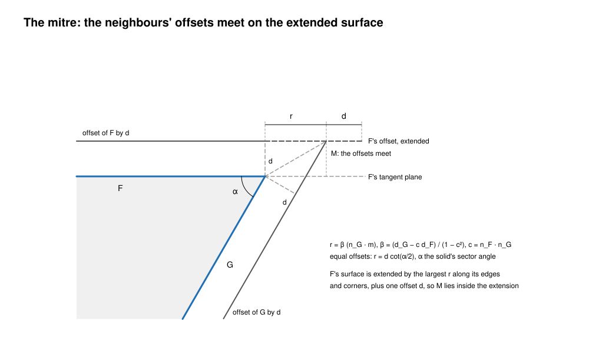

<!-- SPDX-License-Identifier: Apache-2.0 -->

# Offset and shell

This page describes how solidcore offsets a face, a sheet or a solid, and how it shells and
thickens: the theory the code rests on, what each surface kind's offset is, when an offset
folds and what is refused, the stages of the construction and which of them exist, and the
local operations (moving faces, drafts). It is written for a reader who knows offset surfaces
and is new to this code, and for anyone stuck on an offset that fails or builds a bad body.
Numbers in brackets are references (end of page). Every statement about the code names the
file it was checked in; a path without a crate is relative to `crates/solidcore/src`.

Contents:
1. [Purpose and the one rule](#1-purpose-and-the-one-rule)
2. [Scope](#2-scope)
3. [The offset of each kind](#3-the-offset-of-each-kind)
4. [Folds, collapses and the largest wall](#4-folds-collapses-and-the-largest-wall)
5. [The construction](#5-the-construction)
6. [Local operations: moved faces and drafts](#6-local-operations-moved-faces-and-drafts)
7. [Shell and thicken](#7-shell-and-thicken)
8. [Invariants](#8-invariants)
9. [Status](#9-status)
10. [If you're stuck](#10-if-youre-stuck)
11. [References](#11-references)

---

## 1. Purpose and the one rule

**The offset of a face is the offset of its definition S, never of its net B.** For a face on
S(u, v) with unit normal n, the offset by d is O = S + d n [2, 3, 12]. Where S is an analytic surface
or a stored definition, O is built from S: a plane moves, a cylinder's radius changes, a round's
ball grows. Where S is a B-spline, S and B are the same surface and O is the offset of that
surface, approximated by a net certified against O at every parameter. The contract is
[definitions-and-certificates.md](definitions-and-certificates.md): a result is exact, certified
within a stored ε, or a typed refusal that names the size that builds.

The other rules follow from that one:
- an offset that would fold or collapse is refused before anything is built, naming the radius
  that bounds the wall; it is never built folded and repaired afterwards (§4);
- the neighbours' offsets meet on surfaces extended by a reach derived from the geometry, never by
  a fixed multiple of the distance (§5.2);
- shell and thicken are an offset followed by a boolean or a stitch, carried at the input body's
  tolerance (§7).

§3 and §9 say where the code meets the rule today and where it does not: a round whose offset is
taken from its net, and a revolved B-spline generator offset by a fit.

## 2. Scope

**In.** The offset of each surface kind (`Surface::create_offset_surface` and the kinds'
overrides; `surface/procedural_blend/offset.rs` for blends); the construction's first stage
(`offset/construction/`); the executive (`offset/offset_executive/`,
`offset/offset_geometry_creation.rs`); the room test (`offset/wall_room.rs`); moving faces, drafts
and the local operation (`offset/offset_faces.rs`, `offset/draft.rs`,
`topology/brep/local_operation.rs`); the refusals (`error/offset.rs`); and the workflows of
`crates/solidcore-ops/src/offset.rs` (shell, offset faces, thicken, offset sheet, draft).

**Out**, each with its own page:
- What a definition is, how a net is certified, the exact extension and its reach in full:
  [definitions-and-certificates.md](definitions-and-certificates.md) §6.
- Rounds and their overflow, whose spine is an offset/offset intersection:
  [generic-blend.md](generic-blend.md).
- The intersections the mitres and the boolean run on: [ssi.md](ssi.md).
- Which layer owns the recipes: [layers.md](layers.md) (the offset and shell recipes are ops',
  the geometry is the kernel's).

## 3. The offset of each kind

`Surface::create_offset_surface` (`surface/surface/p1.rs`) dispatches on the definition first,
then on the kind. A signed distance is along the surface normal; a face use opposite its surface
negates it (`OffsetGeometryCreation::faceuse_offset_with_backend`, `offset/offset_geometry_creation.rs`).

| kind | what the code builds | class | file |
|---|---|---|---|
| plane | the plane moved by d along its normal | exact | `surface/plane/p2.rs` |
| cylinder, cone | radii changed by d cos(semi-angle), origin moved by −d sin(semi-angle) along the axis, each net row moved by its generator's offset; a cone whose one radius passes zero is cut at its new apex; both radii below the tolerance: no surface | exact | `surface/cone/p2.rs` |
| sphere | radius r ± d, the net scaled about the centre; below the tolerance: no surface | exact | `surface/sphere.rs` |
| torus | minor radius ± d, the net scaled and moved back to keep the major radius; below the tolerance: no surface | exact | `surface/torus.rs` |
| ball patch | the net scaled about the sphere's centre | exact | `surface/ball_patch.rs` |
| surface of revolution | the generator offset in its plane and swept again: a line or circle stays a line or circle; a B-spline or conic generator is offset by `create_simple_offset` within the approximation tolerance | exact for lines and arcs; **fitted, not certified**, otherwise | `surface/surf_of_revolution/p2.rs` |
| extrusion, B-spline, curve-bounded, STEP | an `OffsetSurface`: S + d n of a copy of the surface, evaluated on demand (`base_create_offset_surface`); the extrusion's own override is not ported (commented out upstream) | exact as a definition; its net is §3.2's | `surface/surface/p1.rs`, `surface/offset_surface.rs` |
| round of the ball's circle, one radius | the round of radius r + τd on the supports offset by σᵢd, the same spine, leader and seeds; its net built on the stations and certified; r + τd ≤ 0: collapsed | certified | `surface/procedural_blend/offset.rs` |
| round of an exact class | its kind's exact offset (a cylinder of r to a cylinder of r ± d) carrying the definition of the new radius, re-certified by identity | exact | same |
| chamfer between planes | the plane offset as a plane; no definition kept | exact | `surface/surface/p1.rs` |
| Gⁿ round (order ≥ 2), radius law, round on a B-spline support | the offset surface of the face, as an extrusion's | see §3.2 | `surface/procedural_blend/offset.rs` |
| corner face, drafted face | the offset of the face's own surface kind; a drafted face's surface is its plane or cone, so the offset is exact; a corner keeps no definition | as its kind | `surface/surface/p1.rs` |

τ is +1 where the round's normal points away from the ball's centre and −1 where it points at
it; it is read off the round's principal curvature −τ/r across its section (`ball_side`). For a
cylinder, sphere or torus the offset in the code is the parallel surface of the closed form; the
classical result that the offsets of natural quadrics and tori are again of their kind is what
makes this class exact [2, 3].

### 3.1 The certified offset of a B-spline

S1 of the construction (`offset/construction/sheets.rs`, `certified_offset`) approximates
O = S + d n of a rational B-spline S by a bicubic B-spline G. G interpolates exact points of O at
the Greville abscissae of its knots [11]: S's breakpoints, each interior one taken as many times
as keeps G as smooth as n (a joint at multiplicity p is a crease unless `joint_meets` proves it
tangent continuous), plus knots inserted where the bound is too large. With S = P / w and the
homogeneous tangents A_u = P_u w − P w_u, A_v, and D′ = G w − P, all exact Bernstein polynomials
(`bernstein.rs`), the module bounds on every Bézier patch of the common refinement:
- e = |G − S|² − d², from the coefficients of D′·D′ − d²w² over w²;
- the tangential part τ of G − S, |τ|² = T / (|A_u × A_v|² w²);
- that G − S lies on the side d names, sign(d) D′·(A_u × A_v) > 0.

Then |G − O| ≤ |τ| + (|e| + |τ|²) / |d| at every parameter, Elber and Cohen's bound [4]. A patch
over the tolerance is halved where that helps most and G is interpolated again: at most
`MAX_ROUNDS` (14) rounds and `MAX_SPANS` (2048) spans a direction, the cancel token polled each
round. A bound not reached is `SolidError::NotConverged`.

### 3.2 Where the implicit offset becomes a net

An `OffsetSurface` face stays implicit through the plain offset (`offset_brep`,
`offset_executive/p2.rs`). The shell replaces it with a net before its boolean
(`OffsetExecutive::replace_implicit_offsets`, `offset_executive/p1.rs`): `certified_offset`
within the shell's tolerance, in the base's parametrisation. It takes the base through
`with_nurb(..).gw_nurb()`, the base's net. For a B-spline face that is
S. For a Gⁿ round, a radius law or a round on a B-spline support, it is B, so the shell's offset of
such a round is the offset of its net. That breaks the one rule, and the ledger
`crates/solidcore/tests/data/blend_definition_ledger/offset.md` lists it. The net also
drops its bound: the face gets `BSplineSurface::from_nurb(made.surface, false)`, a bare net with no
stored ε (`p1.rs`). Both are open (§9).

## 4. Folds, collapses and the largest wall

*Figure 1. Look at the cusp: at d = 10 the offset touches the focal curve at the apex's centre of
curvature, and every larger distance crosses it and folds. The case is the test
`parabola_fold_is_refused_naming_its_apex_radius`.*

### 4.1 The theory

The offset is a regular surface where det(I − d W) ≠ 0, W the shape operator of S: with principal
curvatures k₁, k₂ along n, where (1 − k₁d)(1 − k₂d) ≠ 0 [1, 3, 13]. Where it is positive the offset
keeps S's orientation; where it is negative the offset is regular but turned inside out, its normal
reversed. The certificate checks positivity, the condition for a wall that keeps its side. Where it vanishes, d is a
principal radius of curvature and the offset point is on the focal surface (the evolute of a curve
in the plane) [8, 9]. Past it the offset runs back over itself: the parallel of a curve develops
cusps and a swallowtail where it crosses the evolute, and the surface's offset folds the same way
[8, 10]. Two cases are told apart:
- **collapse**: |d| equals a radius of curvature the face attains over a region, as a round inset
  by its radius, whose offset is its spine (a line or a point);
- **fold**: |d| passes the least radius of curvature on the displaced side. Where the curvature
  varies across the face, the offset meets the focal surface inside the face and crosses itself
  (Figure 1). Where it is constant (a cylinder inset past its radius), the offset is a regular
  cylinder turned inside out, which bounds no wall on the side it should.

Either way the largest wall that builds is bounded by the least radius of curvature on the side
the offset moves to. A wall on the other side (away from the centre of curvature) never folds
from curvature alone; its offsets can still meet each other globally, which is the arrangement's
job (§5.1).

### 4.2 What the code refuses

| refusal | when | what it names | checked | file |
|---|---|---|---|---|
| `OffsetFailure::Collapses` | a NURB-based face's least radius on the displaced side is within the input's tolerance of \|d\| | the face, the distance and the radius | always, before the face's offset is built | `offset_executive/p2.rs`, `refuse_singular_offset`; `sheets.rs`, `proved_singular` |
| `OffsetFailure::Folds`, `NotCertified` | the offset of a NURB-based face is not certified regular over its parameter box; `NotCertified` when no radius on the displaced side bounds the wall | the face, the distance and, for `Folds`, `largest`, the least radius on the displaced side | always but in the local operation, after the collapse test | `p2.rs`, `refuse_folding_offset`; `sheets.rs`, `certify_regular` |
| `DistanceUnresolved`, `ToleranceUnresolved` | \|d\| below the input's tolerance; an approximation tolerance in (0, 1e-12] | the distance and the tolerance | always | `p2.rs`, `check_resolvable` |
| `OffsetFailure::WallsTouch`, `LoopsCross` | an offset face's loops touch or cross | the face | per their flags | `error/offset.rs` |
| `OffsetFailure::EdgeVanishes` | a vertex moves to or past its edge's end and the edge cannot be squeezed out | the original edge, or the face when available | during loop-gap closure | `offset_executive/step_gaps.rs` |
| `OffsetFailure::LoopGapUncertified` | the loop-gap solve could not establish a boundary within tolerance | the original input face, when available | always | `offset_executive/step_gaps.rs` |

The static `offset_brep` entry point reports an ordinary failure of `do_solid_offset` with
status `SM_ERR` and retains the stage's original error as its cause
(`collapse_offset_status`, `offset_executive/p2.rs`). Callers can inspect
`SolidError::cause` or `root_cause` for a typed reason when the stage supplies one; not every
earlier failure has an `OffsetFailure`. The post-construction manifold gate instead reports
`OffsetFailure::Unsound` directly. A refusal before that gate does not assert that the
unbuilt result was non-manifold.

**The regularity test** (`certify_regular`) multiplies det(I − d W) out in homogeneous forms:
Q = X⁴ − d w² X H + d² w⁴ K, with X² = |A_u × A_v|² and H, K built from the first and second
fundamental forms' homogeneous coefficients. Since A_u × A_v carries a factor w, the bracket
X′⁴ − d X′ H′ + d² w² K′ of the same sign is what is bounded, four times deg w lower in each
parameter. Each patch's bound is subdivided into quarters on an explicit stack, at most
`MAX_REGULARITY_PATCHES` (20,000); a patch whose middle value is negative is a fold, and a
budget run out is refused too, since a face not proved regular is not built. A pole (a normal that
vanishes) never certifies, so it is refused the same way.

**The size named.** `largest` (`largest_wall`) and the collapse radius (`least_radius`) are the
least radius of curvature on the displaced side, found on a 9 × 9 grid of each patch and refined by
a pattern search. The radius is one the surface attains, so it is at least the true least radius;
it is not an enclosure, and a wall at exactly `largest` is not proved to build. That makes the
named size an estimate in the sense of definitions-and-certificates.md §7, invariant 3, and
certifying it is open.

**The analytic kinds** never reach these tests: a closed-form radius moved to zero or past it gives
no surface (§3; `Surface::offset_collapses`), an `SM_ERR` with `offset_missing_surface_fails`, not
a refusal by name. `SheetClass` (`Regular`, `Inverted`, `Spine`, `sheets.rs`) names the three cases
but nothing outside its tests calls it yet.

**A fold that is not refused.** The local operation runs neither test: a folding B-spline face is
built there, its offset face comes out inside out and the executive's lamina-edge test takes it
away, as upstream does (`offset_face_prefix`, `p2.rs`).

**In ops**, `Folds` becomes `Error::WallFolds { largest }` (`solidcore-ops/src/offset.rs`,
`offset_refused`), the touching walls and the vanishing edge their own errors, and every other
named reason a named `OffsetRefusal` with the face it names: `Collapses` passes on the distance
and the radius. `OffsetFailure` is `#[non_exhaustive]`, so ops matches it with a wildcard: a
reason ops does not name yet takes the error of its class where that has one (walls that touch,
a fold, a vanishing edge); it and the routines' phrase causes (`OffsetFailure::is_phrase`)
otherwise arrive as the transitional `OffsetRefusal::Phrase`, with the kernel's class, whether it
is a defect (`OffsetFailure::is_defect`) and the kernel's words. In the sheet offset and the
symmetric thicken, a refusal `offset_brep` returns before its executive runs (such as
`DistanceUnresolved`) and the
merge check's `Unsound` reach ops with their reasons; what the executive itself fails with is
wrapped in a failure of its own (`collapse_offset_status`), so ops sees no offset reason there and
passes the kernel's status. That mapping is open.

### 4.3 Room for an inward wall

Before an inward shell or faces moved inward, ops asks `shell_wall_room` (`offset/wall_room.rs`)
for a witness: a point inside the solid farther than the wall plus max(10 tol, 1e-3 wall) from
every offset face, found from 5 × 5 samples per face and certified by lower bounds on the face
distances (`face_distance_lower_bound`). No witness (`WallRoom::NotShown`) is `Error::NoRoom` in
ops, so a body with room that no sample finds is refused.

## 5. The construction

*Figure 2. Read each row left to right: row 1 is the design in `offset/construction.rs`, of which
only S1 exists; row 2 is what runs, with S1 called from inside it.*

### 5.1 The five stages

`offset/construction.rs` states the construction that is to replace the executive for shell,
offset and thicken:

| stage | what it does | today |
|---|---|---|
| S1 | each face's offset sheet, exact (§3) or certified (§3.1), with its regularity proved (§4) | built: `construction/sheets.rs`; run inside the executive |
| S2 | mitres: each sheet extended by the reach and cut against its neighbours' | open as a stage; the executive's mitre (§5.2) does this job today |
| S3 | the arrangement of all the sheets: their intersections cut space into cells | open |
| S4 | the cavity rule: a cell is kept by its winding number with respect to the offset sheets | open |
| S5 | extraction: the kept cells' boundary as the result's faces | open |

S3 and S4 follow offsetting by winding numbers [7] and solid offsetting as a set operation [5, 6]:
the sheets cut space into cells, each cell has a winding number with respect to the oriented
sheets, and the result is the cells whose number passes the rule. Local folds and global
self-intersections [10] are then one case, with no loop test. The rule, its ties at coincident
sheets and its certificate are not designed in the code yet.

### 5.2 Mitres and the reach, as they run today

*Figure 3. Look at M: F's offset must reach r past F's side to meet G's, and the extension goes d
further so the meeting crosses the extended surface's side instead of touching it.*

With `extend_convex_edges` (set by every ops call, `offset_options`), the executive extends each
face's surface and intersects neighbouring offsets instead of filling convex edges with rounds
(`do_solid_offset` dispatches to `do_extended_offset`, `offset_executive/p2.rs`):
- **The reach** (`offset_executive/reach.rs`, `extension_reach`): Figure 3's r on the tangent
  planes, with d_G = 0 for a face that does not move, solved for both edges at a corner, sampled
  at 8 intervals an edge; the largest, plus one offset (`record_extension_reach`, `p1.rs`). It is
  a first-order margin, not a certificate.
- **The extension** (`get_create_extended_surface`, `p1.rs`) is the exact extension
  `extended_sides_keeping_parameters` with `Continuity::Ruled` on every side
  (definitions-and-certificates.md §6.5): analytic kinds and ball patches as themselves, a
  procedural blend by its definition, an offset surface as the offset of its extended base. It
  meets its distance at the middle of each side, so where a B-spline's rows narrow along a side
  (`shortest_across`, `reach.rs`: a bound from the two rows' control points, over the side's
  stations on the face's box) it is asked again, scaled by the shortest length. Past the box's
  corners, where the rows go on narrowing, it stays the first-order margin above, not a
  certificate of the reach. A surface that refuses the longer ask keeps the first extension.
- **The mitre** (`OffsetGeometryCreation::mate_edges`, `offset_geometry_creation.rs`) intersects
  the two extended offsets at a quarter of the body's tolerance and 20°, keeps the intersection
  curve whose trimmed midpoint is nearest the original edge's, trims it and gives it to both offset
  edge uses. With `offset_analytic_mate_edges` a marched piece lying on an exact line or conic of
  the two surfaces is replaced by that curve.
- **The merge** joins the offset faces into one body. An inset keeps every finite region unless
  `offset_keep_cavity_regions` is on; then `cavity::is_cavity_region` keeps a region whose face
  has the input's face one wall behind it (a point solve along the normal). This is a local test,
  not S4's winding number.

Without `extend_convex_edges` the rounded offset closes convex edges with cylinders and vertices
with spheres (`edgeuse_offset`, `vertex_offset`, `offset_geometry_creation.rs`).

## 6. Local operations: moved faces and drafts

**The local operation** (`topology/brep/local_operation.rs`, `local_operation`) gives each named
face a new surface and every other face a copy of its own, then rebuilds the body with the extended
offset (§5.2) as `OffsetOperation::LocalOperation`. Its extension is upstream's 2.5 radii of the
bounding sphere (`set_extension_bound`), not the derived reach: beside faces where nothing moves
the reach is zero and the meetings would touch their surfaces' sides. The executive's offset
distance there is half that radius, unused by the faces, which take their given surfaces
(`face::build_local`, `offset_executive/face.rs`); the fold and collapse checks are skipped for it
(`offset_face_prefix`, `p2.rs`).

Every face is rebuilt and every edge is made again by the mitre, including an edge between two
faces that did not move, which is the intersection of the same two surfaces again. No path in
`local_operation.rs` or the executive keeps such an edge as it was; keeping the edges between
unmoved faces, so the operation changes nothing it does not move, is open.

**Tangent edges.** An edge whose faces were tangent in the input is extended and trimmed along its
old line, unless the reach proves that the new surfaces, a plane and a quadric, cross in every
normal section of the edge (`LocalReach::crossing`, `local_extension_reach`). The plane then cuts
the quadric on both sides of the old edge, about √(2rδ) away for a round of radius r moved by δ,
so the nearest midpoint decides nothing: the mitre keeps the cut on the curved face's side, where
the plane is extended past its edge. An edge mated next to such a tangent edge, once that one is
mated, ends at its new vertex (a lamina edge still ends at its vertex's image); where that vertex
is not on the edge's curve, the mate is refused (`OffsetFailure::TangentEndOffCurve`).

**A given surface's side.** A face's new surface is turned to face the way its old one did by
comparing the two normals. Upstream reads the new normal at the middle of the new surface's
domain; for a full cylinder given to a round that point is across the axis, where the normal
opposes the old round's though both face out, and the round came back inside out. The new normal
is read where the new surface passes nearest the old face's middle (the domain middle when that
drop fails or there is no normal at the nearest point, as at a cone's apex).

**Moving faces** (`offset/offset_faces.rs`, `OffsetFacesExecutive`): the tangent blends on the
named faces are taken off, the faces moved by a local operation onto their offset surfaces, and the
blends put back (`take_off`, `move_faces`, `reblend`); refusals are `OffsetFacesRefusal`. "Moved no
face" is decided by dropping nine points of each face onto the new surfaces, a sampled test.

**Drafts** (`offset/draft.rs`, `draft_surface`): a plane parallel to the pull turns about its
line on the neutral plane until it makes the draft angle with the pull; a cone or cylinder about the
pull moves each control point radially, keeping its parameters. The hinge, the lean and a cone's
sense are proved in rounded interval arithmetic or refused (`DraftRefusal`). The result is a plane
or cone with a `DraftDefinition` (bound 0, re-certified by `lies_on`), applied by the local
operation (`solidcore-ops/src/offset.rs`, `draft`).

## 7. Shell and thicken

A shell is the solid offset [5] combined with the original by a boolean [6].
`OffsetExecutive::shell_brep` (`offset_executive/p2.rs`) is that offset followed by a boolean or a
stitch:

1. **Guard.** `check_shell_radius` refuses |d| < 2 × the input's tolerance.
2. **Offset.** `run_shell_offset` offsets every face but the open ones (`shell_faces`, copied
   unmoved) into a new body.
3. **Implicit offsets** are replaced by nets (§3.2), certified within the input's tolerance at
   every parameter.
4. **A sheet** (the input is no manifold solid, `create_offset_solid`) is merged with the offset
   and stitched: from a tenth of the input's tolerance, ×10 per pass, at most four passes and never
   past |d| / 2. With `merge_sheet_side_walls` the side walls of a thickened sheet's coplanar edges
   become one face.
5. **A solid** goes to `shell_difference`: an inset is the input minus the offset, an outset the
   offset minus the input, by the manifold boolean configured with the input's tolerance and 20°
   (`configure_operands`).

Ops (`solidcore-ops/src/offset.rs`) calls this as `SmApiShellBrepFull` with convex edges extended,
results merged, the offset solid made and the sheet's side walls merged. `thicken` with
`symmetric` first offsets the sheet by −t/2 (`offset_brep_simple`), then shells it by t.
`offset_sheet` is `offset_brep_simple` alone. A result is put in place only once it meets the
expectation (`finish`, a closed solid for a thicken).

**The body tolerance is the input's.** The executive's approximation tolerance is the input's
B-rep tolerance (`configured_executive`, `p2.rs`), the offset body is allocated with it
(`allocate_offset_brep`), the merge B-rep takes the original's, the implicit offsets are certified
within it, and the shell's boolean runs at it. Edge and vertex tolerances only grow from
there: with `offset_edges_keep_source_tolerance` an offset edge takes at least its source edge's
tolerance (`keep_source_tolerances`, `p1.rs`). An offset never makes a body tolerance of its own.

## 8. Invariants

A reviewer checks each of these on a change to offsets or shells.

1. **The offset of S.** A face's offset is built from its definition: a closed form for the
   analytic kinds, the round of the moved radius for a round, S + d n otherwise. A change never
   offsets a net where a definition exists; the ledger `blend_definition_ledger/offset.md` only
   shrinks.
2. **Exact or certified.** An analytic offset is exact; a net standing for S + d n is certified at
   every parameter (`certified_offset`), never fitted and checked at samples. The revolved
   generator's fit (§3) and the round offset as its net (§3.2) are known exceptions, not
   precedents.
3. **No folded body.** A face whose offset folds or collapses is refused before its offset is
   built, naming the face, the distance and the radius; it is never built and trimmed.
4. **Typed refusals.** A refusal should name its entity and size in `OffsetFailure` and pass
   through ops; today only `Folds` passes its size through ops (§4.2), and some earlier
   failures have no typed offset reason.
5. **The reach is derived.** A face's extension is its reach plus one offset, from its edges'
   geometry (`extension_reach`); a new fixed multiple of the distance is a regression. The local
   operation's 2.5 radii is the one exception, stated in its code.
6. **The input's tolerance.** The offset body, the shell's net replacements and the shell's
   boolean run at the input body's tolerance; tolerances only grow.
7. **Bounded work.** Certificates and searches run fixed budgets (14 rounds, 2048 spans, 20,000
   patches, 2048 room samples, 48 climbing steps) over explicit stacks, and poll the cancel token.
8. **Tests gate on values a wrong result changes:** exact volumes (the tube formula
   20 (t L ∓ t² π/4) for the parabolic sheet, closed forms for the cup, the sphere and the torus),
   the named radius, distances to the exact offset, face and edge counts. Never timings.

## 9. Status

**Flags.** S1 has none: the certified nets and the fold refusal are the default. The other
offset fixes named here are off by default (`kernel.rs`); AGENTS.md §4b asks for them to be turned
on and their old paths deleted. The collapse and fold refusals are on for every offset but the
local operation.

**Tests.**

| part | tests |
|---|---|
| S1: certified offset, regularity, collapse | `offset/construction/sheets.rs` tests (`parabola_folds_past_its_apex_radius`, `rational_cylinder_folds_inside_its_radius`, `a_round_offset_by_its_radius_is_proved_to_collapse`) |
| S1 in the shell | `tests/issue_2350_shell_offset_construction.rs` (`parabola_thickens_to_its_certified_offset`, `parabola_fold_is_refused_naming_its_apex_radius`, `analytic_shells_keep_their_closed_forms`) |
| the collapse and fold refusals | `tests/offset_shell_extrusion_extend.rs` (`inset_by_the_rounds_radius_is_refused_naming_why`, `inset_past_face_2s_radius_is_refused_naming_its_largest_wall`); `tests/offset_fillet2_rounded_outset.rs`; `tests/hang_51_extrusion_old_offset.rs` |
| rounds offset by their definition | `tests/wr669_exact_round_classes.rs` (`a_box_round_offsets_to_the_round_of_r_plus_d_on_the_offset_faces`, `the_offset_of_a_circle_round_is_its_round_of_r_plus_minus_d`); `tests/wr698_gn_round_is_its_definition.rs` (`the_offset_of_a_round_is_the_offset_of_its_definition`) |
| the reach | `offset/offset_executive/reach.rs` tests (`signed_reach_is_the_foot_of_the_offsets_meeting`, `an_unmoved_face_is_met_where_it_stands`) |
| the room test | `offset/wall_room.rs` tests (`an_open_block_has_room_up_to_its_half_width`, `a_witness_that_does_not_certify_is_passed_over`) |
| drafts | `offset/draft.rs` tests (`a_side_turns_about_its_line_on_the_neutral_plane`, `a_draft_goes_through_its_record_and_certifies_again`) |
| the ops recipes | `crates/solidcore-ops/src/offset/tests.rs` |

**Open work**, to be filed as issues before it is claimed:
- S2 to S5 of §5.1: the mitre as a stage, the arrangement, the winding-number cavity rule and
  extraction; then the executive's path is deleted.
- The shell's offset of a Gⁿ round, a radius law or a round on a B-spline support from S, not B
  (§3.2; the ledger's one entry).
- The certified net's bound stored with the face, as a definition with ε (§3.2).
- The revolved B-spline or conic generator's offset certified (§3).
- The named `largest` and collapse radius enclosed, not sampled (§4.2).
- `SheetClass` used: an inverted analytic sheet refused by name (§4.2).
- `Collapses` mapped through ops with its radius (§4.2).
- Edges between unmoved faces kept by the local operation (§6).

## 10. If you're stuck

- **Reproduce at the face.** Take the failing face's surface and call `create_offset_surface`
  (`primitive/api_surface_ops.rs`, `create_offset_surface`) or `certified_offset` on it alone. A
  face whose offset is right puts the defect in the mitre, the merge or the boolean.
- **Look up the kind in §3.** A plane, cone, sphere or torus whose offset is not its closed form
  means dispatch missed the kind (a NURB that lost its analytic label: `copy_and_add_analytics`).
  An `OffsetSurface` on a round means the round has no definition the offset can read.
- **Compare d with the radius.** Find the least radius of curvature on the displaced side
  (`proved_singular` returns it). A distance at it is a collapse, past it a fold; neither is a
  mitre bug.
- **Check the reach.** A mitre that misses (`mate_edges` finds no curve to trim) on a face with a
  sharp sector angle: print `extension_reach` for the face; a meeting outside the extension, or
  one that only touches its side, is the cause. A local operation uses its fixed bound instead.
- **Check the side and the regions.** A face use opposite its surface negates the distance
  (`faceuse_offset_with_backend`). An inset that keeps a sliver region: with
  `offset_keep_cavity_regions` off, every finite region of the merge is kept (§5.2).
- **Look at the tolerances.** Edge tolerances far above the body's after an offset mean a face
  was built across a collapse or a fold; run `cargo run --release -p diagnostics -- FILE.smb --out
  DIR` and read the large-tolerance edges.
- **Read the literature before designing.** Farouki [1] and Maekawa's survey [2] for regularity
  and approximation, Elber and Cohen [4] for the bound, Forsyth [6] and Chen and McMains [7] for
  solids and the cavity rule.
- **Fix the cause.** No retry at another distance, no second method after the first fails, no
  widened tolerance. Several failing shells usually share one fold, one reach or one sign.

## 11. References

1. R. T. Farouki. The approximation of non-degenerate offset surfaces. *Computer Aided Geometric
   Design* 3(1) (1986) 15–43. doi:10.1016/0167-8396(86)90022-1
2. T. Maekawa. An overview of offset curves and surfaces. *Computer-Aided Design* 31(3) (1999)
   165–173. doi:10.1016/S0010-4485(99)00013-5
3. N. M. Patrikalakis, T. Maekawa. *Shape Interrogation for Computer Aided Design and
   Manufacturing*. Springer (2002), ch. 11 (offsets; Eq. 11.28). doi:10.1007/978-3-642-04074-0
4. G. Elber, E. Cohen. Error bounded variable distance offset operator for free form curves and
   surfaces. *International Journal of Computational Geometry and Applications* 1(1) (1991)
   67–78. doi:10.1142/S0218195991000062
5. J. R. Rossignac, A. A. G. Requicha. Offsetting operations in solid modelling. *Computer Aided
   Geometric Design* 3(2) (1986) 129–148. doi:10.1016/0167-8396(86)90017-8
6. M. Forsyth. Shelling and offsetting bodies. *Proc. Third ACM Symposium on Solid Modeling and
   Applications* (1995) 373–381. doi:10.1145/218013.218088
7. X. Chen, S. McMains. Polygon offsetting by computing winding numbers. *Proc. ASME IDETC/CIE
   2005*, DETC2005-85513 (2005) 565–575.
8. J. W. Bruce, P. J. Giblin. *Curves and Singularities*, 2nd ed. Cambridge University Press (1992):
   evolutes, parallels and their cusps.
9. I. R. Porteous. *Geometric Differentiation*, 2nd ed. Cambridge University Press (2001): focal
   sets and ridges.
10. J. Wallner, T. Sakkalis, T. Maekawa, H. Pottmann, G. Yu. Self-intersections of offset curves
    and surfaces. *International Journal of Shape Modeling* 7(1) (2001) 1–21.
11. L. Piegl, W. Tiller. *The NURBS Book*, 2nd ed. Springer (1997): interpolation at the Greville
    abscissae, knot insertion. doi:10.1007/978-3-642-59223-2
12. B. Pham. Offset curves and surfaces: a brief survey. *Computer-Aided Design* 24(4) (1992)
    223–229.
13. M. P. do Carmo. *Differential Geometry of Curves and Surfaces*. Prentice-Hall (1976): parallel
    surfaces and the shape operator.
