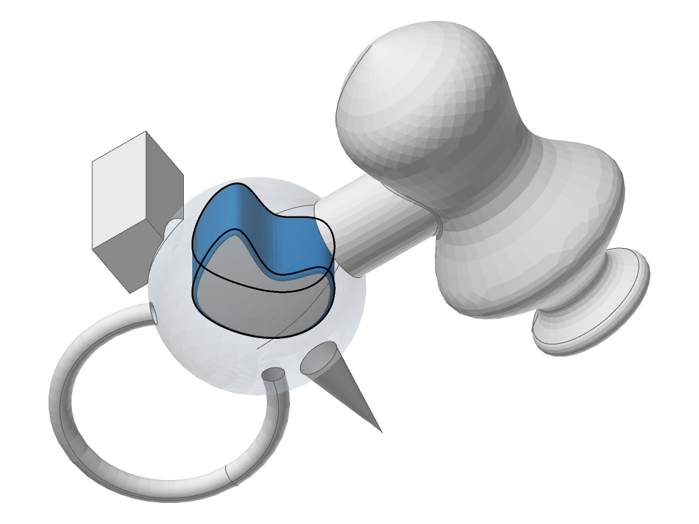

<!-- SPDX-License-Identifier: Apache-2.0 -->

# Validity and tolerances

This page describes what a valid body is in solidcore, how the B-rep stores it, what its tolerances
mean, how a body read from a file is healed, and when a tolerance may grow. It is written for a
reader who knows boundary representation and is new to this code, and for anyone stuck on a body
that fails the check, or on a result whose tolerances came back large. Numbers in brackets are
references (end of page). Every statement about the code names the file it was checked in; paths
are relative to `crates/`.

Contents:
1. [Purpose and the one rule](#1-purpose-and-the-one-rule)
2. [Scope](#2-scope)
3. [The data model](#3-the-data-model)
4. [What valid means](#4-what-valid-means)
5. [Tolerances](#5-tolerances)
6. [Seams, poles and closed surfaces](#6-seams-poles-and-closed-surfaces)
7. [Healing](#7-healing)
8. [When a tolerance may grow](#8-when-a-tolerance-may-grow)
9. [Invariants](#9-invariants)
10. [Status](#10-status)
11. [If you're stuck](#11-if-youre-stuck)
12. [References](#12-references)

---

## 1. Purpose and the one rule

**A tolerance is a bound on where the exact boundary is.** A body is a tolerant model [6, 9]: each
vertex, edge and face carries its own tolerance, and the stored geometry stands for an exact solid
whose boundary lies within those tolerances of it. A vertex's tolerance τ_v is the radius of a ball
about its point, an edge's τ_e the radius of a tube about its curve, a face's τ_f the half-width of a
band about its surface. The body is valid when one exact solid fits inside all of them at once and
its topology is the stored one.

The rule this page settles (§8): **a tolerance grows only to a bound, never to a sample.** In
imported data it may grow to cover an enclosed gap between the data's own curves and surfaces, with
the growth recorded; in a construction it is set from the faces' certified ε and the curve's proved
deviation. A measured gap beyond what the construction proves means the construction is wrong, and
the result is refused or its curve recomputed from its surfaces. This is the rule of
[definitions-and-certificates.md](definitions-and-certificates.md) §1 ("a tolerance is never widened
to let a result pass") applied to the local tolerances of the B-rep.

## 2. Scope

**In.** The arena data model (`solidcore/src/topology.rs`); the validity check
(`solidcore/src/topology/brep/validation`, `solidcore-ops/src/check.rs`); the solid test
(`solidcore/src/topology/brep.rs`, `is_outward_solid`) and the result contract of ops
(`solidcore-ops/src/body.rs`, `finish`); the arena integrity check
(`solidcore/src/topology/integrity.rs`); the tolerance model (`solidcore/src/geom/tol.rs`); read-time
healing (`solidcore/src/topology/brep/p10.rs`, `solidcore/src/heal`); stitching
(`solidcore/src/heal/stitch`).

**Out**, each with its own page: how a face's net is certified against its definition
([definitions-and-certificates.md](definitions-and-certificates.md)); how an intersection curve is
traced and how far it is from both surfaces ([ssi.md](ssi.md) §6); how the boolean imprints and
glues ([booleans.md](booleans.md)); offsets and shells ([offset-and-shell.md](offset-and-shell.md)).

## 3. The data model

`Brep` (`solidcore/src/topology.rs`) holds one `Arena` per entity kind, addressed by typed ids:
`ShellId`, `FaceId`, `LoopId`, `EdgeId`, `VertexId`, `RegionId` and the use ids `FaceuseId`,
`LoopuseId`, `EdgeuseId`, `VertexuseId`. An arena appends; a removed item leaves its slot empty for
good, so ids are never reused and iteration is insertion order, which keeps results deterministic.
There are no pointers, `Rc` or `RefCell` graphs. The edge and edge-use arenas are copy-on-write
(`Shared`), so a query can snapshot a body cheaply.

The topology is Weiler's radial-edge structure [10, 11], the one SMLib uses:

| entity | carries | its uses |
|---|---|---|
| region | its shells, a void flag | the infinite region is first |
| shell | its face uses (or a wire or a vertex) | `ShellType` |
| face | a surface, a UV domain, its loops (outer first), `tolerance` | two face uses, one per side, mates of each other |
| loop | its edges in order | a loop use in each face use, mates |
| edge | a curve, an interval on it, its two vertices (one when closed), `tolerance` | edge uses in radial order round the edge |
| vertex | a point, `tolerance` | vertex uses, one per edge use end or vertex loop |

An edge use is one side of one face seen along the edge: it has an orientation (`Same` or
`Opposite` to the edge), counter-clockwise and clockwise neighbours in its loop use, a mate (the same
face's other side) and its UV trim curve, the pcurve, in the face's surface parameters, on the
edge's own parameter interval. A manifold edge, between two faces, has four edge uses
(`topology::edge::is_manifold`); a lamina edge bounds one face; a spine has six or more. The gap
caches the healer and the check read live on the uses (`Edgeuse::max_edge_face_gap`,
`Vertexuse::vertex_face_gap`, and the others in `heal/gap.rs`).

Some fields are the port's caches of what upstream reads through the uses: `Edge::vertices`,
`Face::shell`, `Face::loops`, `Loop::face`, `Loop::edges`, `Shell::faces`. Inside an operation the
uses are the truth; `Brep::refresh_cached_topology` rewrites the caches before an operation returns,
and `topology::integrity::check` proves they agree and that no live record names a dead one.

## 4. What valid means

A solid is a bounded regular set whose boundary is a closed, orientable 2-manifold [8, 7]; in a
B-rep that becomes conditions on the uses and on the geometry. Validity has four layers, each a test
the code runs:

1. **Integrity** (`topology/integrity.rs`, `check`): every id a reachable record holds names a live
   record, and every cached field equals its derivation. Not upstream; for tests and debugging.
2. **Pointers** (`brep/validation/pointers.rs`, `validate_pointers`, upstream
   `SmBrep::ValidatePointers`): the use links are consistent (a loop use's counter-clockwise walk
   closes, a mate's mate is itself, an owner lists what names it), walked with a 100,000-step bound.
3. **`AssertValid`** (`brep/validation/assert_valid.rs`): the whole-body check, below.
4. **A solid** (`topology/brep.rs`, `is_outward_solid`): `is_manifold_solid` (at least two regions,
   no shell vertices, every edge manifold), the pointer check clean, `AssertValid` at level 0 true, no
   unsure region, and the volume proved positive by its certified enclosure (`mass/enclosure.rs`,
   `volume_sign`); a sign the enclosure leaves undecided is not a solid. The volume's sign
   catches a body turned inside out; the pointer check catches faces flipped without their uses.

`check_brep` runs the pointer check and, when it reports nothing, `AssertValid`. Ops exposes it as
`Body::check` (`solidcore-ops/src/check.rs`) at three levels: `Basic` (level 0, topology),
`Geometry` (level 1) and `All` (level 2, the slow geometric tests); each failed test is one line
`<type>::Test #<n> <name>: <message>`, and warnings (`SmBrep` test 21) are not failures. Every
operation's result in ops passes `finish` (`solidcore-ops/src/body.rs`): a result with no faces is
`Error::Empty`, and a solid input whose result fails `is_outward_solid` is `Error::NotSolid`. A
boolean's result is checked with `is_outward_touching_solids` instead, which allows solids that touch
along an edge or at a vertex, and the boolean returns `None` for an empty result
([booleans.md](booleans.md) §3).
`finish` runs level 0, so the tolerance tests of level 2 are not part of the result contract.

The tests that decide each property, by the test numbers the check reports:

| property | test | where | level |
|---|---|---|---|
| 2-manifold at an edge | four edge uses, loop uses (`is_manifold`); radial angles increase round the edge (Edge 9, 10) | `assert_valid/edge.rs` | 0 |
| use orientation | edge uses alternate Same, Opposite round the edge (Edge 14); a radial pair and a mate pair have different orientations (Edgeuse 23, 24); a radial pair's normals point into their sector (Edgeuse 10) | `assert_valid/edge.rs` | 0 |
| uses belong together | a radial pair is in one shell, a mate pair on one face (Edgeuse 8, 22) | `assert_valid/edge.rs` | 0 |
| pcurves | a trim's interval is the edge's (Edgeuse 25, 26), it does not jump across a periodic boundary (Edgeuse 7), has length (11), does not dog-leg at a pole (20); a radial pair's trims give one binormal point (27) | `assert_valid/edge.rs` | 0 |
| loops | edge ends close within the edge zones or meet one shared vertex within their local zones (Loopuse 5); inner loops nest in the outer one, loops are disjoint in UV and share no vertex (Face 37, 38, 39) | `assert_valid/loops.rs`, `face.rs` | 0 |
| an edge is not smaller than its tube | curve length ≥ τ_e (Edge 7) | `assert_valid/edge.rs` | 0 |
| edge ends at its vertices | \|C(t_end) − P_v\| ≤ τ_e + τ_v (Edge 16, 17) | `assert_valid/edge.rs` | 0 |
| edge on its faces | the largest edge/face gap ≤ τ_e + τ_f (Edge 13) | `topology/edge/edge_form.rs` | 2 |
| vertex on its faces | face gaps and the solved corner within the vertex's local tolerance, floored at the body's intersection tolerance (Vertex 1) | `assert_valid/vertex.rs` | 2 (report) |
| the tolerance pass | vertex/edge and vertex/face gaps ≤ τ_v / 2, edge/face gap ≤ τ_e (`SmBrep` list 2, tests 0 to 4) | `assert_valid/brep.rs`, `validate_and_update` | 0 |
| seams and poles | §6 | `assert_valid/face.rs`, `vertex.rs` | 0 and 2 |
| closed shells | a region's outer shell is a closed face-use shell (Brep 10, 11), its inner shells lie inside it (Brep 12), every region is reached across face uses (Brep 18, 19) | `assert_valid/brep.rs` | 0 |
| no coincident topology | no two vertices, edges or faces coincide (`contains_coincident_topology`) | `validation/coincidence.rs` | 0 |

A shell is closed (`Shell::is_closed`, `topology/shell.rs`) when a face use's mate lies in another
shell: in the radial-edge structure the two sides of a closed shell's faces belong to the shells of
two different regions.

## 5. Tolerances

### 5.1 The model

*Figure 1. Look at the gap g_1 across the edge: the tube about C reaches S1's band because g_1 is at
most τ_e + τ_f, which is Edge test 13; along the edge, the exact edge stays in the tube and its ends
in the vertex balls.*

Three scales live in the body (`topology.rs`):
- **the body's zone tolerance**, `Brep::tolerance` (upstream `m_sThisZoneTol3d`), from which a face
  takes its own (`calc_face_zone_tol_3d` returns it). Two points closer than it are one point;
- **the local tolerances** `Face::tolerance`, `Edge::tolerance`, `Vertex::tolerance`, which the
  formula of §5.2 floors at the body's, and nested: `topology::edge::set_tolerance` with its
  default cascade grows the edge's vertices to it, and `Fix_TolSizes` floors each vertex at its
  largest edge tolerance, so τ_v ≥ τ_e at both ends;
- **the derived tolerances** (`geom/tol.rs`): the intersection tolerance of two entities is the sum
  of their zone tolerances (`xsect_tol_3d_from_zones`); the system's is twice the zone tolerance and
  its approximation tolerance half of it. The kernel's defaults are zone 1e-5, intersection 2e-5,
  approximation 5e-6 (`Kernel::tolerances`; [ssi.md](ssi.md) §6.2 lists the rest).

The default zone tolerance follows the model's size class (`size_estimate_to_zone_tol_3d`): 1e-5 for
a size between 0.5 and 500, 1e-4 up to 5e4, 1e-6 down to 0.005, and so on by factors of 100 in
size. Vertex tolerances must be finite and at least the body's tolerance (allowing the check's 1%
rounding margin). There is no upper ratio between a vertex's local tolerance and the body's:
an imported corner's gap does not change the accuracy of unrelated topology. Geometric gap checks
still apply. The pointer check retains legacy upper ratios of 1000 for faces and edges
(`validation/pointers.rs`); the separate Edge tests 5, 6 are obsolete, and Face tests 25, 26 and 30
are not run (`assert_valid/face.rs`).

### 5.2 What an edge's tolerance must cover

An edge e between faces F1 and F2 stands for the exact curve S1 ∩ S2 over its interval. Its stored
curve C is one representation of it, the pcurves p1, p2 two more. The tube is consistent with the
faces when every point of C is within τ_e + τ_fi of S_i (Figure 1), which is what Edge test 13 checks
per face. The code's formula for an edge's tolerance from its gaps is
(`geom/tol.rs`, `calc_gap_zone_tol`):

τ_e = max(τ_0, max τ_f, 1.1 · g_ee / 2, 1.1 · g_ef − τ_0),

with τ_0 the zone tolerance, g_ef the largest edge/face gap over the edge's uses, g_ee the largest
gap between an edge use's end and its loop neighbour's start, and 1.1 the gap gain
(`TOL_GAP_GAIN`). The last term is test 13 solved for τ_e with a 10% margin; the third makes two
neighbouring tubes overlap across their gap. A vertex's tolerance has the same form with its
vertex/edge and vertex/face gaps and the largest τ_e at it.

Where the faces carry definitions, the distances compose. With B_i certified within ε_i of S_i
([definitions-and-certificates.md](definitions-and-certificates.md) §4) and C proved within δ of
S1 ∩ S2, C lies within δ + ε_i of the net B_i, and the gap any check measures against the net is
bounded by that sum. So **an edge's deviation bound in a constructed body is δ + max ε_i, known
before any gap is measured**, and its stored tolerance is that bound, raised to the body tolerance
where it is smaller (§5.1, invariant 5). A measured gap larger than the bound is evidence against
the construction, not a quantity to cover (§8).

The gaps themselves are measured, not enclosed. `calc_max_edge_face_gap`
(`topology/edgeuse/p1.rs`) takes the largest of 20 samples of the distance from C to the face's
surface (`GapFunction::crv_srf`, `heal/gap.rs`); a vertex/face gap is the distance from the vertex to
its projection on the surface (`topology/vertexuse.rs`, `calc_vertex_face_gap`). The pcurve does not
enter the edge/face gap: the labelled "Edge/UVTrimCurve" and "UVTrimCurve/Vertex" tests of
upstream's tolerance list (tests 5 to 7) are not evaluated, and `EdgeFaceTrimCurveGap` has no caller.

## 6. Seams, poles and closed surfaces

A closed surface (a cylinder or cone in U, a sphere in U with its V ending at the poles, a torus in
both U and V) has a seam where its parameter wraps; a
sphere or cone has poles where a whole parameter line is one point. The B-rep makes both explicit:
- **a seam is an edge.** A face that crosses its surface's seam must carry a seam edge there, used
  twice by the same face with two UV trims at the two ends of the period
  (`topology::edge::is_seam_of_surface`). Face test 31 reports a missing seam edge, 29 a boundary
  that crosses the seam, 36 an edge within tolerance of the seam that is not on it (a near miss);
  Vertexuse 5 a vertex sector that contains an unmarked seam. These run through
  `has_seam_problem_in_brep_mut`, reported at level 2;
- **a pole is a vertex.** A pole inside a face must be marked by a vertex (Face 24), and a trim must
  not turn along the collapsed boundary near it (Edgeuse 20, `has_dog_leg_near_pole`);
- **a trim never jumps** across a periodic boundary (Edgeuse 7, `assert_no_periodic_jump_of`).

The healer's seam steps (§7.2) repair the same three: `fix_move_seam` turns a face's seam away from
its boundary, `fix_split_edges_at_seam` splits boundary edges at interior poles and then at the U and
V seams, `fix_split_face_at_seams` inserts the missing seam edges.

## 7. Healing

### 7.1 On read

`make_topology_from_data` (`topology/brep/p10.rs`) builds the body from a file's records. It first
sets the body's tolerance from the data (`zone_tolerance`): the stored zone tolerance clamped to
[1e-8, 1e-4] times the vertices' size, or 1e-5 times that size when none is stored. Then, when the
data's healer version is below `HEALER_VERSION` (10) and the healer is enabled, it runs
`heal_brep(HealerOpType::All)` (`heal_made`); upstream's read heals the same way.

### 7.2 The sequence

`HealData::heal_targets` (`heal/heal_data/p3.rs`) runs, in order: cache the edge, vertex and face
properties and gaps; `Fix_TolSizes`; find and merge coincident vertices; squeeze degenerate faces and
edges; the coincident-edge and missed-intersection steps; `Fix_UncontainedEdges`; `Fix_BadGaps`; the
face properties again; the seam steps of §6; split bad sheets into regions; the seam split of faces;
make the UV trim curves (and adjust edge and vertex tolerances to the gaps they measure,
`heal_data/p1.rs`); fix the infinite region.

**`Fix_TolSizes`** (`heal/heal_data/p2.rs`, `fix_tol_sizes`):
1. The model size is the longest target edge's length (50 when there is none), snapped to the
   centre of its size class (50 for 0.5 to 500, 5000 up to 5e4, 0.05 down to 0.005, and so on).
2. The body's tolerance is that class's zone tolerance.
3. Every face whose tolerance differs from the computed one takes the body's tolerance.
4. Every edge whose tolerance differs from the one its gaps call for (`bad_small_zone_tol_3d` or
   `bad_large_zone_tol_3d`, either direction past `EFF_ZERO`) is re-measured with the formula of
   §5.2, its faces' largest tolerance as the floor, and set without the only-grow guard: a stored
   tolerance larger than its gaps need shrinks.
5. Vertices the same way, the largest edge tolerance at each as the floor.

The original tolerances are kept in the healer's properties (`orig_zone_tol_3d`) for the call, not
on the body.

**What upstream leaves unimplemented**, ported as such: `Fix_BackPointers` runs no repair;
`Cache_CoinEdges` and `Cache_MissedEdgeXSects` find nothing, so `Fix_CoinEdges` and
`Fix_MissedEdgeXSects` never act; `Fix_UncontainedEdges` clamps only the healer's cached interval,
not the body; `fix_bad_gaps` does nothing; `Fix_BadLoops` is disabled. A gap the formula covers stays
in the body as a large tolerance; no step closes it by moving geometry.

### 7.3 Stitching and gap repair

Stitching joins faces whose boundaries coincide within a stitch tolerance (`heal/stitch`), the sewing
problem of [1, 2]. `Stitch::do_stitching` (`stitch/p2.rs`) sorts the vertices along (1, 1, 1),
glues each pair within the stitch tolerance (moving the kept vertex to the midpoint when the gap is
over half the deleted vertex's tolerance), splits edges where a vertex lands inside them, and glues
coincident edges that share both vertices and lie within the larger of the stitch tolerance and the
summed edge tolerances. After a glue the kept vertex's tolerance rises to the larger of its own and
1.001 times the glued gap (`geom::tol::update_object_tolerance`). `stitch_into_solid` starts at a
tenth of the body's tolerance and doubles it while lamina edges remain, up to 1/200 of the box
diagonal; the result is a solid when no lamina edge is left and there is more than one region.

`validate_and_update_tolerances` (`assert_valid.rs`) is the other gap repair: it grows a vertex
whose gap is over its tolerance to twice the gap, and an edge whose edge/face gap is over its
tolerance to twice the gap when the gap is under 1/800 of the box diagonal; tolerances only grow.
The offset executive calls it (`offset/offset_executive/p2.rs`); with `validate_only` it is the
tolerance pass of `AssertValid`.

### 7.4 Worked example: `nurb_fillet.smb`

`upstream/TestFiles/pt_TestFiles/Solids/nurb_fillet.smb` holds a sphere with a wavy pocket cut into
it: an extruded wall (face 17, a surface of extrusion) meets the sphere (face 5) along edges 13 and
14 and a B-spline floor (face 18) along edge 43. The file has healer version 0 and zone tolerance
1e-4, so reading it heals it.

*Figure 2. Look at the pocket in the sphere: the thick loops are the three edges whose tolerance
healing set to millimetres' worth of gap. Drawn by `cargo run --release -p diagnostics --
nurb_fillet.smb --out DIR --highlight 17,18 --see-through 5 --edges-above 1e-3 --view -35,55`.*

`Fix_TolSizes` takes the body's tolerance to 1e-5 (the longest edge, 20.3, is in the 0.5 to 500
class). The three pocket edges, measured with `max_edge_face_gap` and by evaluating C against each
face's surface along its pcurve at 2,000 points:

| edge | faces | stored τ_e | largest edge/face gap (20 samples) | healed τ_e = 1.1 g − 1e-5 |
|---|---|---|---|---|
| 14 | sphere 5, wall 17 | 6.15e-3 | 6.62e-3 on the sphere | 7.27e-3 |
| 43 | wall 17, floor 18 | 6.81e-3 | 3.56e-3 on the wall | 3.90e-3 |
| 13 | sphere 5, wall 17 | 4.71e-3 | 3.23e-3 on the sphere | 3.55e-3 |

The stored curves lie up to 6.6e-3 off the sphere and 3.6e-3 off the extruded wall, while edge 43's
curve is on the floor to 1e-14. Each pcurve follows C's foot on its surface: |C(t) − S(p(t))| along
the pcurve matches the projection gap on the sphere and the floor. The two pcurves' images, measured
directly at the same parameter, are 7.32e-3 apart on edge 14 (3.56e-3 on 43, 3.23e-3 on 13): the
faces' trimmed boundaries do not meet, and the tube is what joins them. The healed body passes every gap test at every level; its check
fails only on a surface discontinuity and curve kinks. Healing re-measured these tolerances in both
directions (43 and 13 shrank, 14 grew) and closed no gap. The construction §8 asks for here is the
edge recomputed on the sphere and the wall's intersection, which no healer step does.

## 8. When a tolerance may grow

![The decision for a gap g: (1) a gap between an entity and what it bounds; (2) if this kernel did not build the result (imported data), ask whether g is enclosed; (3) if it is, grow τ to cover g and record the old τ and g; (4) if it is not, enclose g first, since the healer samples it today; (5) if this kernel built the result, ask whether g is at most ε1 + ε2 + δ, each proved; (6) if it is, set τ to that bound with its certificate; (7) if not, the construction is wrong: refuse, or recompute C on S1 ∩ S2. In every branch τ grows only while its tube stays clear of every entity it does not bound.](validity-and-tolerances/tolerance-growth.svg)

*Figure 3. Look at the two questions: whether the kernel built the result decides what may justify
a tolerance, a bound on imported data or the certificate of a construction.*

The local-tolerance model grows a tolerance to cover a deviation [6]; the certificate rule says a
tolerance is never widened to let a result pass. They agree once a tolerance is read as what §1
says it is: a claim that the exact boundary lies within τ. A claim is sound exactly when τ bounds
the distance from the stored entity to the exact one. Three consequences follow.

**What justifies the bound depends on whether an exact object exists apart from the data.** In
imported data there is none: the file's curves and surfaces are all there is, the exact solid is
whichever one fits inside the tolerances, and the gap between the data's own curve and surface is
the data's error. Covering it with τ states that error; nothing better can be recomputed without
choosing new geometry. In a construction the exact object is known: S1 ∩ S2 of the faces'
definitions. The bound is then δ + ε_i (§5.2), proved by the construction before anything is
measured. A measured gap above it shows that C is not within δ of S1 ∩ S2, or a net not within ε of
its S: the certificate is false and the result wrong. Growing τ there turns a wrong curve into a
claim the body makes about itself, which every later operation inherits [3, 4]. The result is
refused by name, or C is recomputed from the surfaces' intersection.

**A bound must be a bound.** A sampled gap is a lower estimate of the largest gap; covering it with
a 10% margin is not a proof that the tube contains the exact curve. Where the gap is the
justification (imported data), it must be enclosed, as a certificate is
([definitions-and-certificates.md](definitions-and-certificates.md) §4.2), and the growth recorded
with the old tolerance and the gap.

**A tube must stay clear of what it does not bound.** A tolerance region that reaches an entity the
entity is not incident to merges topology that the body says is separate [9, 5]: an edge whose
tube covers its own length (Edge 7), two vertices or edges that coincide within tolerance
(`contains_coincident_topology`). Past that size the stored topology no longer has one meaning, and
no growth is valid whatever the gap.

**Where the code stands.** Today's growth paths are measured, not proved: `Fix_TolSizes` and
`validate_and_update_tolerances` take 20-sample gaps; the boolean's imprint grows vertex, edge and
face tolerances to the distances it measures (`boolean/topology_intersector/p1.rs`, `p2.rs`, through
`update_object_tolerance`); the stitch grows vertices to the glued gap. None records the growth on the
body, and none distinguishes imported data from a construction. Each is open work under this rule.

## 9. Invariants

A reviewer can check each of these on a change to the topology, the check, the healer or a
tolerance.

1. Topology is arenas and typed ids; a removed id is never reused, and iteration is insertion order.
2. The use links are the truth; the cached fields equal their derivation after every public
   operation (`integrity::check`).
3. A manifold edge has four edge uses, alternating Same and Opposite, radially ordered; a mate pair
   is on one face, a radial pair in one shell, each pair of opposite orientations.
4. A pcurve shares its edge's interval, stays inside its surface's domain, never jumps a period, and
   a seam crossed by a face is an edge of it.
5. τ_v ≥ τ_e at both ends of an edge; every local tolerance is at least the body's (not checked
   today, §10).
6. Every gap is within its tolerances: edge/face ≤ τ_e + τ_f, an edge's ends ≤ τ_e + τ_v. At a
   shared vertex, a loop's endpoint gap is bounded by τ_e1 + τ_e2 + 2τ_v, provided both endpoints
   meet that same vertex within their own edge and vertex zones.
7. No tube or ball reaches an entity it does not bound: an edge is longer than its tolerance, and no
   two entities coincide.
8. A solid result is one closed manifold, valid at level 0, facing out (positive volume); a
   boolean's may be closed solids that touch along an edge or at a vertex.
9. A constructed result's tolerances come from its certificates (§8); a measured gap past them is a
   refusal or a recomputed curve, never a larger tolerance.
10. Imported data may be given larger tolerances only to an enclosed gap, recorded.
11. A check is a function of the body: running it twice gives the same report, and the
    validate-only pass changes nothing (`validate_only`).

## 10. Status

**Built.** The arena model and its integrity check; the pointer check and `AssertValid` with the
tests of §4, at three levels, reported through ops; the solid test and the ops result contract;
read-time healing with `Fix_TolSizes`, the degenerate and coincident-vertex fixes, the seam and pole
fixes, the sheet and region fixes; stitching (`api_stitch`, `stitch_into_solid`, `stitch_into_shell`)
and the tolerance pass.

**Open.**
- Gaps are sampled (20 samples), not enclosed; every growth path of §8 rests on them.
- No growth is recorded on the body, and imported data and constructions grow by the same code.
- Constructed edges do not carry their δ, so a construction's tolerance cannot be set from its
  certificate yet; the general intersection curve is not certified ([ssi.md](ssi.md) §6.1).
- The pcurve is not measured against its edge: upstream's Edge/UVTrimCurve tests are not evaluated.
- Edge test 13 checks each face separately; the joint condition (one point within the tube and both
  bands) is not checked.
- No step closes a gap by recomputing geometry: `fix_bad_gaps` is empty, the coincident-edge and
  missed-intersection steps are not implemented upstream.
- Vertex tolerances have no upper ratio to the body's; faces and edges retain the pointer
  check's legacy ratio of 1000. The separate Edge tests 5, 6 are obsolete; Face 25, 26, 30 are not run.

## 11. If you're stuck

- **Draw the body first.** `cargo run --release -p diagnostics -- FILE.smb --out DIR` draws it with
  its large-tolerance edges over everything and writes every face's and edge's tolerance to JSON;
  `--highlight` and `--see-through` take face indices.
- **Run the check at level 2** (`Body::check(CheckLevel::All)`), and read the test numbers against
  §4. A level 0 failure is topology; a gap failure is §5; a seam or pole test is §6.
- **A tolerance came back large.** Find which term of §5.2 set it: the edge/face gap on which face,
  or a loop gap. Then decide by §8: imported data, or a construction whose curve is off its surfaces.
  For a construction, measure the curve against both surfaces' definitions, not against each other.
- **A valid-looking body is `NotSolid`.** Check `is_manifold_solid` (a lamina or non-manifold edge, a
  shell vertex), then the volume's sign (a body inside out), then an unsure region.
- **A healed file differs from the stored one.** `Fix_TolSizes` resets the body's tolerance to the
  longest edge's class and re-measures edges both ways; compare against the file's stored tolerances
  (`BrepData::edges`, `zone_tol_3d`) before calling it a regression.
- **Fix the cause.** No retry with a larger tolerance, no second stitch at a looser one to make a
  case pass. A gap that several cases share has one construction behind it.
- **Read the literature before designing.** Jackson [6] for the model, Segal [9] and Fang,
  Brüderlin and Zhu [5] for keeping tolerant topology consistent, Barequet's papers [1, 2] for gap
  repair.

## 12. References

1. G. Barequet, M. Sharir. Filling gaps in the boundary of a polyhedron. *Computer Aided Geometric
   Design* 12(2) (1995) 207–229.
2. G. Barequet, S. Kumar. Repairing CAD models. *Proceedings of IEEE Visualization '97* (1997)
   363–370.
3. C. M. Hoffmann. The problems of accuracy and robustness in geometric computation. *IEEE
   Computer* 22(3) (1989) 31–41.
4. C. M. Hoffmann. *Geometric and Solid Modeling: An Introduction*. Morgan Kaufmann (1989).
5. S. Fang, B. Brüderlin, X. Zhu. Robustness in solid modelling: a tolerance-based, intuitionistic
   approach. *Computer-Aided Design* 25(9) (1993) 567–576. doi:10.1016/0010-4485(93)90072-V
6. D. J. Jackson. Boundary representation modelling with local tolerances. *Proceedings of the Third
   ACM Symposium on Solid Modeling and Applications* (1995) 247–254.
7. M. Mäntylä. *An Introduction to Solid Modeling*. Computer Science Press (1988).
8. A. A. G. Requicha. Representations for rigid solids: theory, methods, and systems. *ACM Computing
   Surveys* 12(4) (1980) 437–464. doi:10.1145/356827.356833
9. M. Segal. Using tolerances to guarantee valid polyhedral modeling results. *Computer Graphics
   (SIGGRAPH '90)* 24(4) (1990) 105–114.
10. K. Weiler. *Topological Structures for Geometric Modeling*. PhD thesis, Rensselaer Polytechnic
    Institute (1986).
11. K. Weiler. The radial edge structure: a topological representation for non-manifold geometric
    boundary modeling. In M. J. Wozny, H. W. McLaughlin, J. L. Encarnação (eds.), *Geometric
    Modeling for CAD Applications*. North-Holland (1988) 3–36.
