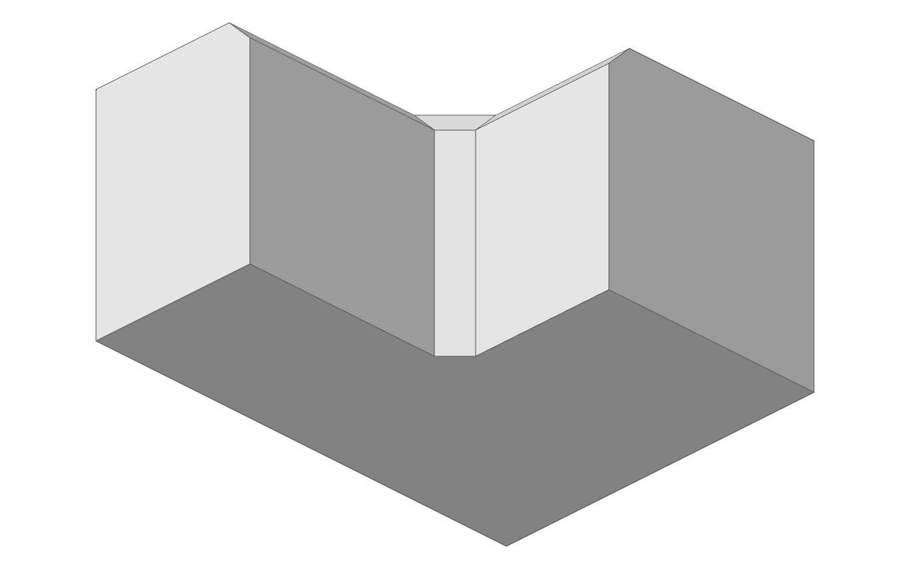

# blend.blend_corner: three chamfers of both convexities at one vertex are mitred (2026-11-27)

Unit: `blend.blend_corner` (the chamfer event, `blend_corner/chamfer.rs`). Case: the L block of
`solidcore-ops/tests/blend_chamfer_corner.rs` (the 40 x 30 x 20 box less the notch `x > 20,
y > 15`), its inside top vertex V = (20, 15, 20), where the upright edge is concave and the two
top edges are convex, all three chamfered 2. The same corner with material and space exchanged
is a pillar's foot on a plate (one convex edge, two concave).

**Before.** `classify_chamfer` found the event's configuration (straight edges, planar faces,
constant widths) but for the convexities and returned `MixedConvexity`; the session refused the
bevel at V ("chamfers of convex and of concave edges meet at the vertex; their mitre is not
built yet"). Through `solidcore-ops`, which mitres chamfer corners, there was no body. A session
without bevels kept the pinned corner patch instead: 12 faces, one of them a patch over the
concave chamfer's end.

**Cause.** At such a vertex one face's angle is reflex: the face between the two chamfers of one
convexity (the L block's top, 270 degrees at V). `chamfer_planes` took each rail's direction into
its face as towards the face's other edge. On the reflex face that points out of the face, into
the notch, so the two convex chamfers' planes were not the chamfers'. The tests of the mitre
were those of a corner of one convexity too.

*The top face seen from above. Each convex chamfer's rail on the top lies on the far side of its
edge from the other edge, and the two cross at X. The rails taken before lie in the notch. The
three mitre lines run from the crossings X to M, which lies over the concave chamfer's wedge.*

**The construction.** A convex chamfer takes the material on V's side of its plane; a concave
one adds the wedge on V's side of its plane. Near V the result is the faces' material with the
odd chamfer's wedge added and the pair's wedges taken off, the pair's planes run on over the odd
chamfer's wedge (with material and space exchanged where the odd chamfer is the convex one). It
is the same solid whether the odd chamfer or the pair is made first. The three planes meet at M,
and the mitre lines are the convex mitre's, `X_i`-`M`. Two things differ:

- The mitre line between the pair is a crease of the other convexity than their edges (a valley
  between two convex chamfers). So a mitre line lies on the result's boundary where its crossing
  is on V's side of the third chamfer, the opposite sign to a corner of one convexity
  (`MitreForms`).
- M lies between the odd chamfer's rails, and past the pair's rails on the odd chamfer's faces.
  The pair's surfaces end at their rails, so they are continued to M, exactly and on their own
  parameters (`Surface::extended_by_distance`, Natural), once their rails are trimmed
  (`continue_chamfer_surfaces`).

With one setback on both faces at right angles, M is between the odd chamfer's rails while the
pair's sizes differ by less than the odd chamfer's. Past that the too-wide chamfer is refused
with its fit. A Facet asked at such a corner is refused.

**Volumes.** In V's frame (`u = x - 20`, `v = y - 15`, `w = 20 - z`), sizes c (upright), a
(along x), b (along y): the wedge adds `10 c^2`; the pair's planes `v = w - a`, `u = w - b` take
what is above both, of the L and of the wedge, down to M at `w = (a + b + c) / 2`.

| sizes c, a, b | before | after | by hand |
|---|---|---|---|
| 2, 2, 2 | refused (no bevels: the pinned patch, 12 faces) | 17962.6667, 11 faces | `18000 - 15 s^2 / 2 - 11 s^3 / 12` |
| 3, 1, 2 | refused | 18041, 11 faces | `18000 + 90 - 49` |
| 0.5, 1, 2 | refused | refused, the chamfer of 2 fits up to 1.5 | `b < a + c` |

The derivations are in the tests' comments (`an_l_block_s_inner_corner_of_three_chamfers_is_mitred`,
`chamfers_of_both_convexities_at_a_vertex_are_mitred`).

**Pictures.** The session result at sizes 2, 2, 2, the Mitre asked, without bevels set (the one
path that built a body before):

Both pictures: `solidcore-diag FILE.smb --view 225,30 --size 1280x800`.

**Literature.** Searched: vertex blends and chamfers at vertices of mixed convexity in B-rep
modellers. Read: the T-FLEX CAD 16 help page "Blending Edges", which names the configuration
(two edges of one convexity and one of the other at a vertex) and gives an order of processing
(convex first or concave first), not the chamfer's shape there. Found but not readable when this
was written: T. Várady and C. M. Hoffmann, "Vertex Blending: Problems and Solutions"
(Mathematical Methods for Curves and Surfaces II, 1998, pp. 501-527); T. Várady and A. Rockwood,
"Geometric construction for setback vertex blending" (1997); J. Vida, R. Martin and T. Várady,
"A survey of blending methods that use parametric surfaces" (1994); the ACIS blending
component's documentation. Those are about smooth vertex blends, which `docs/generic-blend.md`
§3.2 follows for rounds. No source was found for the planar mitre of chamfers at a vertex of
mixed convexity; the construction above is this project's own, as the chamfer event's mitre of
one convexity is.

**Not in this change.** Two chamfers of both convexities with the third edge at the vertex
unchamfered (the ported 3x2 mixed corner, which fails stitching for chamfers); curved faces or
edges at the vertex; four or more chamfers of both convexities.
