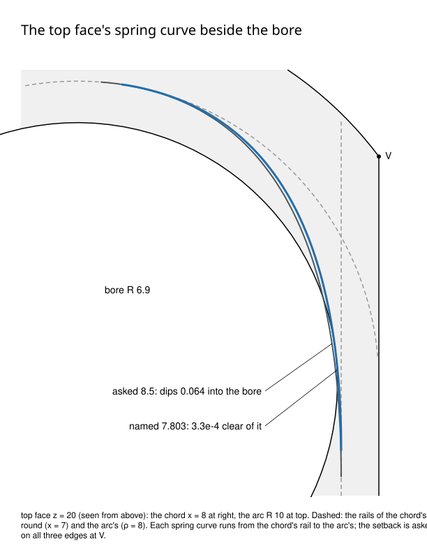

# A Setback's spring curve leaving its trimmed face (the bored D prism)

*Look at where the two spring curves pass the bore below the arc's rail: the asked one crosses it, the named one stays on the face.*

**Case.** `issue_2343_curved_setback::bored_d_prism_spring_curve_leaving_the_top_names_the_setback_that_keeps_it`:
the D prism (R 10, flat x = 8, H 20) bored about its axis (R 6.9), its top corner V = (8, 6, 20)
rounded 1 (chord), 1.5 (upright) and 2 (arc), every fix but `geometric_g2_continuity`, a setback
asked at V.

**Closed form.** The top is a plane, so its spring curve is the parabola (P, X, Q): P on the chord's
rail x = 7, `s` along the chord from V; Q on the arc's rail rho = 8, `s` along the arc; X where the
rails' tangents cross. Its least distance from the axis falls below the bore's 6.9 from s = 7.8068.

**Measured on main** (f503e95c1, the probe in the test file's shape, `--profile goldens`):

| asked | result | spring's least rho |
|---|---|---|
| rule (2.377, 3.0, 2.375) | builds, Level 2 clean, 14 faces | 7.88 |
| 7.5 | builds, Level 2 clean | 6.925778 |
| 7.8 | builds, Level 2 clean | 6.900596 |
| 8.0 to 9.5 | refused late, "a round kept round a feature does not close on the body", no size | (into the bore) |

**After the change.** Asked 8.5 is refused as `SetbackTooLong` at V naming 7.803 (0.918 x 8.5 on the
grid of thousandths; closed form: 3.3e-4 clear of the bore, the next grid step 4.1e-4 into it), and
7.803 asked builds, graded as the other curved Setbacks (Level 2 clean, G1 seams, patches on the
material's side, their definitions re-certified).

The spring curves the check makes (`setback::corner_springs`) agree with the edges the fill
builds to at most 4.5e-12 at every corner of `issue_2343_curved_setback.rs` (planes, cylinders,
cones and a sphere; a one-off comparison, not committed).
