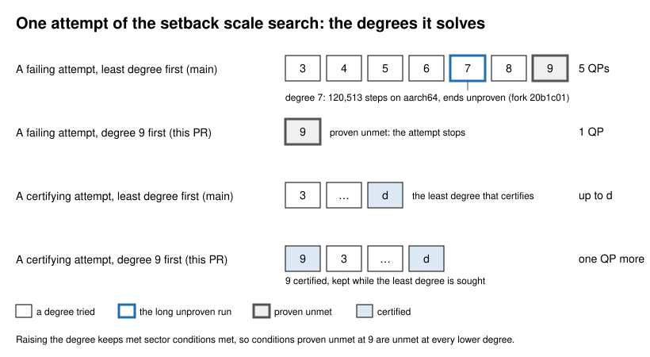

# blend.blend_setback: the scale search's attempts fill degree 9 first, as the corner's fill does (2026-11-07)

- **Unit:** the setback fill (`blend::blend_setback`, no plan unit); its scale search `certified_scale` (`blend_setback/scale.rs`) and the degree loop of `graph_gk` (`blend_setback/graph.rs`).
- **Problem (tangency-labs/solidcraft#13739):** `thousandth_scales_and_attempt_budget` took 129,085 QP steps on aarch64 for its first corner (rounds 2, 3, 4; setbacks 4.5, 4.75, 6), against a budget of 25,000 and 9,347 on x86-64; scale, attempts and QP count were right.
- **Cause:** each attempt of the search fills its model with `Probe { fill: true }`, and `graph_gk` tried that probe's degrees from 3 up to 9, while the corner's own fill tries 9 first and stops where 9 proves the sector conditions unmet (tangency-labs/solidcraft#13831(b) as ruled; the streamed rows of tangency-labs/solidcore#2783 kept the probe's order). A failing attempt so solved five programmes where one decides. On aarch64 one of them, of degree 7, took 120,513 of the 129,085 steps and ended unproven before degree 9 proved the conditions unmet (tangency-labs/solidcraft#13831's brief, the fork's 20b1c01, which counts there as main does).

*Look at the second row: a failing attempt now stops at degree 9's proof. A certifying attempt solves degree 9 first, one programme more.*

- **Change:** one degree order for the fill and the search's probe: 9 first, a certified 9 kept while the least certifying degree is sought, stop on 9's proof.
- **Why the verdict is the same:** conditions met at degree d are met at d + 1 (a height function of degree d is one of degree d + 1, and the raised Bernstein coefficients of `l`, `m`, `n` are convex combinations of the old), so conditions proven unmet at 9 are unmet at every lower degree.
- **Where it can differ: the fold refusal and the loop's errors.** `patch_curvatures` refuses the fill as folding where the sign of the projection's `o` is not certified, at the first degree that reaches it. A sign certified at a lower degree stays certified at 9 (its raised coefficients are convex combinations), so a fold at 9 is a fold below; the converse is not shown. Where a lower degree's sign fails and 9's holds, the old order refused the attempt, and so the corner, while the new one goes on to the programmes. The loop's errors are met in the new order too: where degree 9's programme or certificate fails with an error, or its solution's nets leave the faces (`nets_at`, SM_ERR), an attempt now ends there, where the old order may have certified a lower degree first; and the converse. The corner's own fill already meets them in this order. No such corner is known: the scale tests and `setback_monotone_grid` (17 corners, each on its grid of scales) give every verdict and scale as before.
- **Not changed: the curved fill.** Beside a curved face the fill keeps its own loop, least degree first (`curved.rs`); its conditions and its growth's trials are another construction, and degree raising is not argued there.
- **Counts (x86-64, `cargo test --profile goldens -p solidcore --lib blend_setback::scale::tests -- --nocapture`), QPs and steps before → after:**
  - rounds 2, 3, 4 (1.056): 35 → 22, 9,347 → 6,537;
  - rounds 1, 1.5, 2 (1.056): 35 → 26, 10,137 → 8,089;
  - upright held at 4.5 (1.046): 39 → 21, 12,635 → 8,194;
  - asked 4.25 (1.110): 34 → 30, 8,025 → 7,150;
  - r 5 set back 8 (1): 2 → 3, 4 → 22 (degree 9 first costs a certifying attempt one programme);
  - every edge held (refused): 10 → 2, 2,590 → 1,324.
  - "Before" is main at a445bdaac, "after" the change on it; the "after" counts equal the fork's 3843ddb on x86-64.
- **Open:**
  - Step counts stay platform-dependent: only libm differs by target on this path, as far as read (the fan's `cos`/`sin`, the kernel direction's `atan2`, the Givens rotations' `hypot`); the fork's 3843ddb counts 6,425 steps for the first corner on aarch64 against 6,537 here.
  - An attempt whose degree 9 ends unproven still tries 3 to 8, so a long unproven dual run like the degree-7 one stays reachable.
  - The feasibility and margin probe modes are unused (tangency-labs/solidcraft#13831(b): "probes deleted").
- **State:** fixed in the search's order; the aarch64 counts after the change are unmeasured here.
