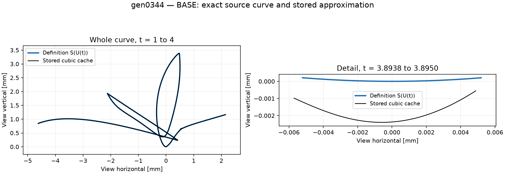
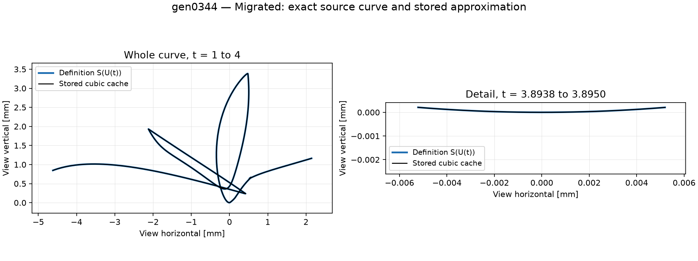

# curve.crv_on_surf: gen0344 changes an approximation cache outside the queried interval (2026-11-09)

- Unit: `curve.crv_on_surf`, generated case `gen0344`, seed `7770047198091881206`.
- PR: SolidCraft #14102, replacing solidcore #2791; review comment
  [4513288383](https://github.com/tangency-labs/solidcraft/pull/14102#discussion_r4513288383).
- Before: `f9ed9a90b453517d83e787169887c180e17656fd`.
- After: `94ae5e1806a59af4322ec50fd81af232161a363f`.
- This supplies the operation and geometric evidence for the `gen0344` row in
  [the original default-change record](geom.local_solve_nd--goldens-default-2026-11-06.md).

## The operation and the changed fields

The [complete input](curve.crv_on_surf--gen0344-cache-geometry-2026-11-09/inputs.json)
contains one operation:

```json
{"op":"drop","a":1.6945858245489083,"b":3.243688129013577,
 "point":[-1.9701455729075308,1.0722580903708865,0.5330470153759967],
 "vec":null,"tol":0.0,"guess":null,"solver_op":0}
```

This calls `CrvOnSurf::drop_point` with `SolverOperation::Minimize`. Without a supplied
guess it first builds a B-spline approximation to choose a starting parameter, then
runs the point solve on the actual curve. The runner writes the drop result followed
by the curve's complete cache, UV curve and surface state.

| Decoded field | Before | After |
| --- | ---: | ---: |
| operation status | 0 | 0 |
| drop success | false | false |
| returned parameter | 3.243688129013577 | 3.243688129013577 |
| returned distance | 3.1935980469430203 | 3.1935980469430203 |
| cached break, index 6 | 3.8951021382285997 | 3.8951021382285993 |
| cached approximation degree | 3 | 3 |
| cached approximation control points | 418 | 421 |
| cached approximation knots, including multiplicities | 422 | 425 |
| stored achieved gap | 0.009682821860461372 | 0.009682821860461372 |
| raw output length | 2268 | 2283 |

The drop's four output values are bit-identical. Status 0 means the call returned
`Ok`; the separate `success=false` means it did not report a successful projection.
The owner, UV domain, break count, cache flags, stored gap and parameterization flag
are also unchanged. The complete 147-value tail encoding the source UV curve and
surface is bit-identical. Only one cached break and the cached approximation change.

The changed block sums are therefore summaries of a differently sized cache, not
coordinates or an improved drop result. The full raw before/after outputs reproduce
every corresponding committed golden block exactly. All 2268/2283 raw values are
finite; arithmetic on finite `NOW`/`NOZ` sentinels near `-f64::MAX` overflows in some
block summaries.

The break list comes from `uv_discontinuity_intervals`, through
`CrvOnSurf::knots_with_status`. The moved break is the UV curve's crossing of the
surface knot line `v=0.4375`. Independent exact-rational evaluation gives the crossing
inside
`[3.89510213822859953885997400306835208039181543270995498397276694686068205289489679208042149,
3.89510213822859953885997400306835208039218277469458694881900717702856400466921512506691277]`.
The before and after breaks lie on opposite sides, one floating-point step apart.
Their exact `v-0.4375` residuals are respectively about `-1.379e-16` and `1.637e-16`.
Those breaks feed the existing adaptive Hermite approximation. Its knot placement
and control points change around the crossing.

## Check against the definitions

The definition is `C(t)=S(U(t))`: the supplied nonrational cubic UV B-spline composed
with the supplied nonrational surface of degree `(3,1)`. The surface has one span in
`u` and four linear spans in `v`. Neither definition changes.

An independent calculation treats every stored input float as its exact binary
rational. On each UV knot span, polynomial de Boor evaluation yields the UV curve.
Composing each applicable surface piece gives a polynomial of degree at most 12.
The cached curve is cubic on each of its knot spans. Their difference is converted
to Bernstein form on each common cell. The largest norm of its Bernstein control
vectors bounds every point by convexity. Where the UV curve crosses a surface knot
line, every applicable surface piece is enclosed. Cells subdivide only to tighten
that enclosure; samples do not decide acceptance.

| Checked domain | Before upper bound on `\|B(t)-S(U(t))\|` | After upper bound |
| --- | ---: | ---: |
| requested drop interval `[1.6945858245489083,3.243688129013577]` | 4.9558355951395086e-6 | 4.9558355951395086e-6 |
| whole cached interval `[1,4]` | 0.009877649569016454 | 0.009877649569016454 |

The requested-interval proof uses 27 cells, one subdivision and no ambiguous surface
piece. The whole-interval proof uses 146 cells, at most two subdivision levels, and
explicitly includes the five cells whose enclosure reaches more than one surface
piece. The [certificate data](curve.crv_on_surf--gen0344-cache-geometry-2026-11-09/bernstein-certificate.json)
retains the exact rational squared upper bounds.

An exact comparison of the two cached piecewise polynomials also proves that they
are identical throughout the requested drop interval. Their differences are confined
to `[3.8756126132562025,3.9073851893762397]`, outside that interval. This comparison
uses coefficient identities, not a finite set of matching sample points.

At the returned parameter, the independently evaluated definition is approximately
`(1.1949430271064711,1.0305176070873374,0.10932497021556855)`. Its distance from the
input point is `3.19359804694302045748987648186477136...`; the returned float differs
by `-1.6089462615274562e-16`, consistent with rounding. Because the drop reports
failure, this check makes no assertion that its parameter is a global minimum.

## Existing limitation of the whole cache

The actual default request is `APPROX_TOL_3D=5e-6`, not `0.01`. The whole-interval
bound above is a measured enclosure; `0.01` is only the radius used to accept the
independent enclosure cells. It is not the caller's tolerance.

Both versions exceed the requested tolerance outside the drop interval. The
existing `test_span_accuracy` force-accepts spans shorter than the natural interval
divided by 1500. `CurveApproximation::achieved_tol` is documented as the largest
sampled distance, rather than a certificate. For example, at `t=3.96295` both stored
caches are about `0.00973290789555951` from the definition, already above their stored
sampled gap `0.009682821860461372`. That behavior is present on BASE and remains a
limitation of the approximation path. These caches serve as initial-guess aids in
this operation. Neither is established as an exact curve or as a whole-interval
approximation at the requested tolerance.

The bound concerns the real curves represented by the stored coefficients. It does
not certify every possible floating-point evaluation's rounding. The unsuccessful
drop and its unchanged answer are not counted as a newly successful projection.

## Pictures and archived data

These are plots of the actual before/after cached curves and the unchanged
`S(U(t))`, using the same projection, scale and framing. The detail lies outside
the requested drop interval and is centered near the largest observed cache
displacement. It shows a local change, not an improvement of the worst error over
the whole curve.





The evidence directory retains the complete raw outputs with float bits, decoded
fields, exact inputs, observations, polynomial difference ranges, certificate data,
plot coordinates and view basis. The 20,001-point measurements describe the curves
and find display locations; the independent Bernstein bounds establish the stated
whole-interval enclosures.

## Post-rebase control (2026-11-09)

A fresh raw replay from rebased head `b1153884028b8168d43af6411c1fb9bc5c1cacca`, based
on main `b0fba036bdc4d34335ed72b2b32d617f838094c4`, reproduces all 2,283 raw values bit for bit,
inputs, provenance and metadata of the archived after result. The historical before
control remains `f9ed9a90b453517d83e787169887c180e17656fd`; no clean `b0fba...` before
control was run for this comparison.

The certificate was recalculated from the fresh raw cache coefficients and input
definitions. Every exact squared-bound fraction and certificate field matches the
archived after certificate. The query-interval bound remains
`4.9558355951395086e-6 < 5e-6`. Exact polynomial comparison against the historical
before cache again confines changes to
`[3.8756126132562025,3.9073851893762397]`, outside the requested query interval.
The first four drop outputs and the 147-value source-definition tail are unchanged.

The fresh whole-cache bound remains `0.009877649569016454`; it is not a certificate
at the default tolerance. Exact evaluation at `t=3.96295` bounds its error between
`0.009732907895559395` and `0.009732907895559396`, exceeding both the default and the
stored sampled gap. The unchanged drop still reports `success=false`.

The [fresh raw capture](curve.crv_on_surf--gen0344-cache-geometry-2026-11-09/rebased-after-raw.json) retains the complete runner result.

The [fresh coefficient verification](curve.crv_on_surf--gen0344-cache-geometry-2026-11-09/rebase-check.json) retains the exact-certificate comparison.
