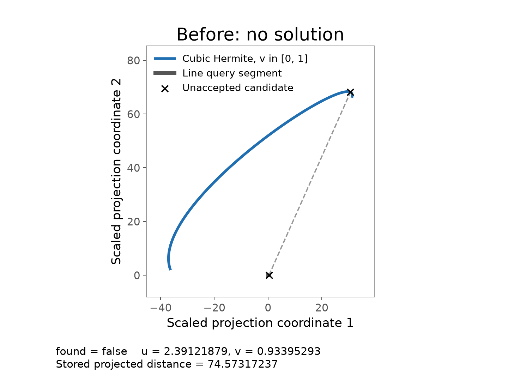
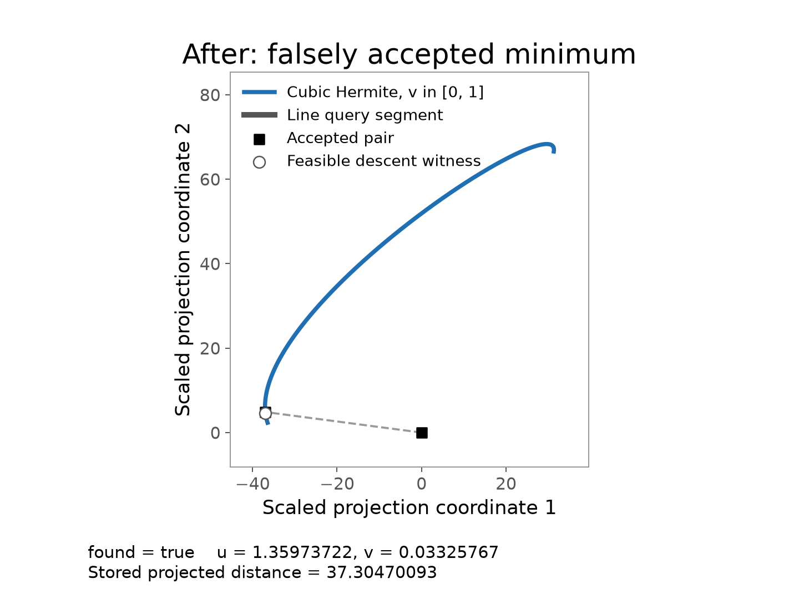
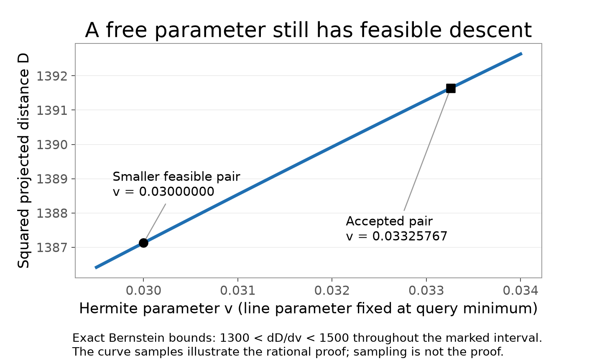

# curve.curve_p3: gen0607 is not a constrained projected minimum (2026-11-09)

Unit: `curve.curve_p3`. Review: [SolidCraft PR #14102, comment 4513288394](https://github.com/tangency-labs/solidcraft/pull/14102#discussion_r4513288394).

The newly accepted pair is **not a local projected minimum**. Its parameters are admissible and
its stored distance is accurate, but the free Hermite parameter has a feasible descent direction.
The result must be repaired or recorded as known wrong, rather than blessed as correct.
The old opt-in control proves attribution only; it is not used as a geometric oracle here.

## Operation and input domains

The canonical generated case has seed `7577097223519259670`. The complete input is retained in
[input.json](curve.curve_p3--gen0607-projected-boundary-2026-11-09/input.json).
Both existing raw-main and current runners reconstruct this exact same input.
The operation is `Curve::local_curve_solve`, code 14, `ProjectedMinimize`.

| Input | Value |
|---|---|
| Line query parameter `u` | `[1.3597372198696087, 2.391218787861883]` |
| Hermite query parameter `v` | `[0, 1]` |
| Initial guess | `(2.1025034730843366, 0.6837768800876959)` |
| Caller distance tolerance | `0.001` |
| Projection normal `n` | `(0.6139417578811035, -0.713668622995308, 0.6394295041361375)` |
| Optional target | `3.784714362911953`; unused by operation 14 |

The line is `L(u) = p + u d`, with scale 1 and `inside_out = false`:

```text
p = (-8.356294646946175, 6.073670570583197, 5.375145477937098)
input vector = (-1.800624803138434, 1.3741364024479923, -0.9374112670063575)
d = unit(input vector)
  = (-0.7345365965050684, 0.5605573545519283, -0.3824021974995622)
```

`Line::bounded` unitizes its vector and makes matching analytic/NURBS parameter intervals.
Its natural interval is `[2.1025034730843366, 8.750317844859742]`. The caller deliberately extends
below that interval. This is allowed: the runner's line contract and the analytic evaluator permit
extrapolation. Comparing the result only with the natural interval would test the wrong domain.

The other curve is the exact cubic Hermite definition on `[0,1]`:

```text
H(v) = (2v³ - 3v² + 1) P0 + (v³ - 2v² + v) T0
     + (-2v³ + 3v²) P1 + (v³ - v²) T1
P0 = (8.804484894900554, 14.25998311991414, -16.541438669985098)
T0 = (5.578578538812096, -47.67176355732562, -37.71126899304132)
P1 = (-43.00198945413962, -36.00493518410791, -11.211768672934085)
T1 = (31.792444943596635, -1.9192989195836532, 34.77829660609257)
```

The projected objective follows the documented evaluator and `proj_dist` definition:

```text
Q(x) = (n × x) × n = (n · n) x - n(n · x)
D(u,v) = |Q(L(u) - H(v))|²
reported distance = sqrt(D(u,v))
```

Here `n · n = 1.2951174762779452`. Thus `Q` is `|n|²` times physical orthogonal projection.
The recorded scalar and the figures use these scaled projection units. Positive constant scaling
does not change which parameter pairs minimize the objective.

## Raw before and after

The before library is raw SolidCraft main `f9ed9a90b453517d83e787169887c180e17656fd`, with no flag
changed. The existing current library reproduces the output reviewed at
`94ae5e1806a59af4322ec50fd81af232161a363f`. No Cargo build or C++ run was needed.
Both operation status integers are zero. The first value in `values.out` is the found flag,
not the status. The next five fields are solution metadata; fields 6, 7 and 8 are distance, `u`, `v`.
The historical `num_variables = 0` metadata does not mean that the caller has no parameters.

| Measurement | Raw main | Current |
|---|---:|---:|
| Found flag | false | true |
| Distance | `74.5731723699363` | `37.30470092694143` |
| `u` | `2.391218787861883` | `1.3597372198696087` |
| `v` | `0.933952927910277` | `0.0332576668152633` |
| Underlying N-D found flag | false | false |
| N-D termination | `UnableToConverge` | `OutOfBounds` |
| N-D iterations | 6 | 5 |
| Final evaluator found flag | false | false |
| Final evaluator equations | `(-30.332654840990234, 3.5490511909357103)` | `(36.98538247541774, -8.527790731124293)` |

An additional attribution control on raw main sets only
`Kernel.fixes.oscillating_skips_failed_guesses = true`, matching the historical app setting.
It returns exactly the current caller result: `found = true`, distance
`37.30470092694143`, parameters `(1.3597372198696087, 0.0332576668152633)`.
The underlying N-D result is still `found = false`, `OutOfBounds`, after 5 iterations,
with the same two equations and false evaluator-found flag. This confirms an existing caller
defect on the historical opt-in path. Raw main with the flag off still refuses: retiring the flag
newly exposes this wrong result through the default. Attribution does not prove correctness.

The before output pair is only an unaccepted candidate. Its distance is not claimed as a minimum.
The raw arrays, definitions, measured points and termination state are in
[observations.json](curve.curve_p3--gen0607-projected-boundary-2026-11-09/observations.json).


Look at the unaccepted pair; main reports no solution.


The geometry is unchanged. The accepted pair is at the lower line bound, with the Hermite parameter still free.

## Independent geometric disproof

Set `u = 1.3597372198696087`, the accepted lower line bound. Direct evaluation of the line and
Hermite formulas gives:

| Pair | `v` | Distance | Squared distance |
|---|---:|---:|---:|
| Accepted | `0.0332576668152633` | `37.304700926941436` | `1391.6407112485451` |
| Nearby feasible witness | `0.03` | `37.24417446150419` | `1387.1285313189608` |
| Endpoint witness | `0` | `36.52485311516647` | `1334.064895084486` |

The accepted stored distance agrees with its independent remeasurement to floating-point
rounding. That consistency alone does not make it a minimum.

At the accepted pair the squared-distance gradient is approximately
`(25.935769752795686, 1349.3486076139557)`. The positive first component is compatible with the
lower `u` bound. The second component is nonzero at an interior `v`, so a decrease in `v` is feasible
and decreases the objective. This violates the necessary free-variable stationarity condition.

This is also checked without sampling or approximate root finding. At fixed `u`, `D` is a degree-six
polynomial. Exact rational arithmetic on the binary64 inputs and the kernel's constructed line
direction gives its degree-five derivative in Bernstein form on
`[0.03, 0.0332576668152633]`. All six exact Bernstein coefficients are strictly between 1300 and
1500; their numerical range is approximately `[1349.3486076139557, 1421.040200696263]`.
The coefficient fractions are archived in `observations.json`, together with the exact power
coefficients and interval endpoints. The convex-hull property therefore proves `D' > 1300`
throughout this interval. There are feasible smaller values arbitrarily close to the accepted pair:
it is not even a local minimum. The exact squared-distance decrease to the nearby witness exceeds 4.


Look at the free parameter's positive slope. The rendered samples illustrate the exact coefficient proof.

No global minimum, global completeness or successful body construction is claimed.

## Acceptance mechanism and scope

`geom::local_solve_nd` honestly returns `found = false` with `OutOfBounds` on current.
The existing final block in `curve::curve::p3::local_curve_solve` treats this termination as an
accepted answer for minimum/maximum queries. It exempts normalization, at-distance, tangency and
surface-projected-intersection operations, but does not check the remaining free parameter.
This is why a changed N-D termination exposes a false success in this caller.
The evaluator and its equations independently confirm that no stationary root was found.

The new test `review_projected_minimum_requires_stationarity_or_a_known_failure` is in the existing
runner test module. It evaluates the curve definitions independently and requires the first-order
bound/free-variable conditions, within the caller's distance tolerance, or a named known failure.
It does not preserve the wrong found flag or pin the wrong pair. Stationarity alone is not
treated as proof of a minimum and cannot justify removing a known-failure entry. The temporary
raw-main harness passes because that control accepts no pair. The actual compiled Rust test was
also checked with only `gen0607` temporarily removed from the known-failure map: it fails with
`violates constrained stationarity`. Restoring that file byte for byte makes the test pass.
The case remains executed, with no wrong golden. This is honest classification, not geometric repair.
The focused regression passed in the compiled crate run
`cargo test --profile goldens -p goldens --lib review_` (13/13 review tests).

The review removes only the incorrect `gen0607` golden line and keeps this case executed in
`expected/known_failing.json`, tracked by
[#14238](https://github.com/tangency-labs/solidcraft/issues/14238).
No wrong result is blessed. There is no production repair or tolerance change. Correct handling needs a
construction-level boundary decision or a named refusal; another seed or fallback would not
establish a constrained minimum.

The relevant first-order conditions are described in the institutional
[NEOS bound-constrained optimization guide](https://neos-guide.org/guide/types/bound/): free
coordinates require zero derivative; a lower-bound coordinate may have a positive derivative.
Its [gradient-projection discussion](https://neos-guide.org/guide/algorithms/gradient-projection/)
explains why a boundary's reduced problem still needs to be solved. These are necessary conditions,
not a claim that arbitrary stationary points are minima.

Read-only searches on 2026-11-09 found no duplicate issue or PR for this specific false projected
minimum before #14238 was filed. Related work has different scope:

- [#13698](https://github.com/tangency-labs/solidcraft/issues/13698): global curve-pair maxima and
  `All` enumeration, assigned to ChrisNourse; this record does not change that construction.
- [#13658](https://github.com/tangency-labs/solidcraft/issues/13658): missing projected-minimum
  endpoint answers in the topology solver; it concerns completeness, not this false acceptance.
- [#13684](https://github.com/tangency-labs/solidcraft/issues/13684): nonmaximal surface-point
  candidates; a different operand pair and solver.
- [#13780](https://github.com/tangency-labs/solidcraft/issues/13780): direction-dependent 1-D
  minimum-radius searches at a singular end.

The case remains known failing under #14238. This review does not claim any of those other
contributors' work or repair the constrained construction.

## Post-rebase replay (2026-11-09)

Fresh kernel and golden-runner builds after rebasing onto `b0fba036` reproduce the false
acceptance. The final caller reports `found = true`, `ints.status = [0]`, distance
`37.30470092694143`, and parameters
`(1.3597372198696087, 0.0332576668152633)`. All nine output values match the archived
current replay bit for bit; the inputs and integer status also match. The old capture did
not record error, deferred, topology or diagnostics metadata, so no historical equality is
claimed for those fields.

The separate fresh N-D probe reports `found = false`, evaluator `found = false`, and
`OutOfBounds` after five iterations at the same parameters. Independent recomputation gives
`grad D = (25.935769752795686, 1349.3486076139557)`. Rebuilding the exact rational certificate
at those fresh parameters reproduces every archived coefficient: all six Bernstein
coefficients of `D'` on `[0.03, 0.0332576668152633]` remain strictly between 1300 and 1500.
Thus the actual caller-accepted point still admits arbitrarily small feasible descent in
the free Hermite parameter and is not a local minimum. The classification under
[#14238](https://github.com/tangency-labs/solidcraft/issues/14238) remains justified.

The [fresh raw capture](curve.curve_p3--gen0607-projected-boundary-2026-11-09/rebased-after-raw.json) retains the complete runner result.

The [recomputed derivative certificate and controls](curve.curve_p3--gen0607-projected-boundary-2026-11-09/rebase-check.json) record the fresh accepted pair.
