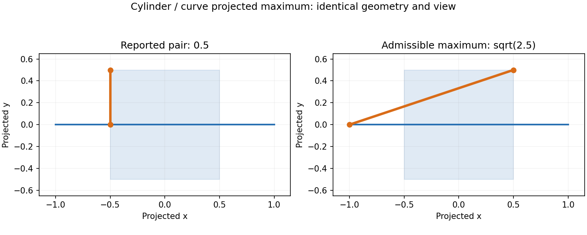
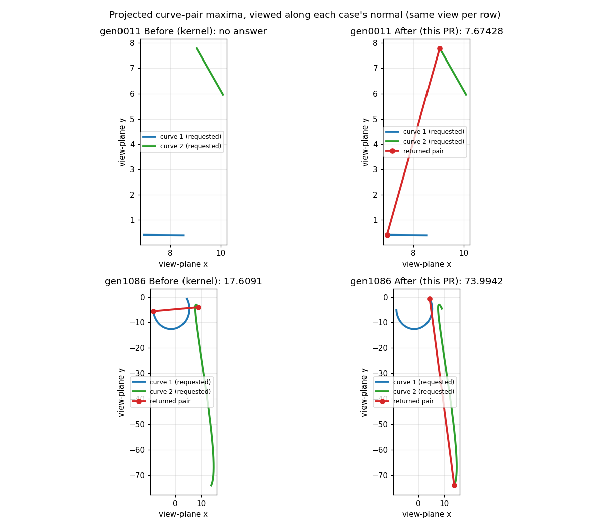

# Projected curve-pair maxima on the kernel baseline

Issue #13698 reports successful projected maxima below admissible witnesses.
The four cylinder/half-cylinder curve/edge-face queries return 0.5 instead of
sqrt(2.5). Their projected surface is [-0.5,0.5]^2 and query line is
[-1,1] x {0}. Squared distance is convex separately in each coordinate;
opposite x endpoints with |y|=0.5 attain sqrt(2.5).

## Construction and dependencies

This work is based on `kernel` `8f13e948a` (ported from solidcore main `78d1eb12d`). It carries the existing reviewed
curve-pair construction without the tangency-labs/solidcore#2840 or tangency-labs/solidcore#2968 point-query solvers.
The only topology change forwards outer ProjectedMaximize/Single to the
curve-pair Single construction; other requests still ask for All.

`projected_pair` partitions both native domains at knots, evaluates feasible
candidates, and encloses every parameter rectangle. A returned candidate must
contain the global upper bound in its own arithmetic enclosure. Retention slack
never supplies solve accuracy. Work is bounded to a budget of 32,768 boxes (a work limit whose exhaustion
refuses, not a derived bound), depth 128 and degree 18; cancellation and unresolved proof errors propagate.

The native analytic Line map comes from shared `curve::native_affine` support:
its start/end definition and interval jet preserve the original arithmetic,
including bounded STEP mapping and inside-out direction. No parent point-query
selection or join policy is required. The existing NURBS interval helpers,
Hermite power coefficients and global accumulator are reused. Ellipse forms
are checked against analytic support by the existing quadric identity machinery.

All is not replaced with Single. One-span affine pairs and identical native
NURBS with certified coordinate monotonicity use finite candidate constructions;
retention and ordered deduplication use the existing accumulator. Other curved
All classes retain their existing path. Uncertainty inside a selected class
refuses rather than falling back.

The enclosure/branch-and-bound construction follows Neumaier, sections 11–12,
[Complete Search in Continuous Global Optimization and Constraint Satisfaction](https://arnold-neumaier.at/glopt/mss/Neu04.pdf).
Interval arithmetic is described in
[Patrikalakis, Maekawa and Cho, section 4.7](https://web.mit.edu/hyperbook/Patrikalakis-Maekawa-Cho/node45.html).

## Golden changes against `kernel`

Measured on Linux with fresh goldens-profile builds of `kernel` `8f13e948a` and this branch. Both pass all 283 units. Against `kernel`, this branch changes 35 `curve.curve_p9` records and 14 `intersect.topology_solver_p2` records: 12 new maxima and the 2 full-torus refusals below. Nothing is added, removed or broken.

Two changed curve pairs, before and after, in the same view per row: gen0011 (two lines; `kernel` returned no answer) and gen1086 (a rational B-spline and a Hermite curve). Every drawn pair re-measures exactly to its golden value.

**Why each new value is right.** The construction returns a candidate only when the global upper bound over every parameter rectangle fits inside that candidate's own arithmetic enclosure. So for a Single request the value below is a certified maximum of the native curve pair over the requested domains. For an All request the largest answer is that certified maximum. The other answers are the further points the All request keeps, such as gen2585's second corner at 0.983409688864426; each is admissible and re-measured, but none is claimed to be a maximum. Each row also carries its witness: the returned parameter pair, checked to lie in both admissible domains (the requested interval intersected with the natural one), and the value re-measured by evaluating the two native curves there with `Curve::evaluate_point` and taking |N x (C1(s) - C2(t)) x N|. All 37 answers of the 35 rows (gen2050 and gen2585 have two each) are admissible and re-measure exactly their reported value, so each new value is attained, not only bounded. The witnesses are in the table and, with their domains, in `diagnostics/projected_pair_native_witnesses_3060.jsonl`. Where `kernel` returned an empty success or a smaller value, the witness is an admissible pair at the new value, so `kernel`'s answer was wrong.

**Reading the golden file.** A stored array longer than 16 entries is kept as `{"n", "blocks"}`: per 256-entry block, the sum, absolute sum and index-weighted sum of every output entry (counts, types, object ids, values and parameters). The block numbers are therefore not maxima. The values below are decoded from the full output arrays.

### `intersect.topology_solver_p2` analytic face pairs (entries 6/7, tolerance 1e-5)

| Cases | `kernel` | This branch | Closed form |
|---|---|---|---|
| `analytic_face_{cyl_x,halfcyl_x}_{6,7}_15` | 0.5 | 1.5811388300841898 | sqrt(1.5² + 0.5²) = sqrt(2.5), at opposite projected endpoints |
| `analytic_face_cone_x_{6,7}_15` | no answer | 1.7320508075688772 | sqrt(3) |
| `analytic_face_sphere_{band,quarter}_{6,7}_15` | 0.5000394345169934 | 1.5 | 1.5 |
| `analytic_face_torus_half_x_{6,7}_15` | 1.25 | 1.664213562373095 | sqrt(2) + 1/4 (to the last digit) |

**What a face answer proves.** A face enters these queries through its traced silhouette curves, so the construction certifies a maximum over a traced curve, not over the face. A face answer is therefore kept only when the face point it names, evaluated on the face's own surface at the returned UV, measures the reported value to rounding of that measurement (8 ulps of the coordinates' scale); otherwise the solve refuses with `Unsupported` ("silhouette point does not measure its value on the surface"). That check proves the returned value is attained on the surface. It does not prove that no other surface point projects farther, and no silhouette here is claimed exact. For every blessed face row the returned point measures the reported value bit for bit on the native surface (22 answers: cylinder, half cylinder, cone, sphere band and quarter, half torus), and that value equals the closed-form maximum over the surface in the table above; the two facts together are why each row is right.

**Refused: `analytic_face_torus_x_{6,7}_15`** (`kernel` 1.25). The full torus's traced silhouette lies slightly off the torus: its certified curve maximum is 1.6642154866673036, and the returned point measures 1.6642135459403802 on the surface, 1.94e-6 lower, while the surface maximum is sqrt(2) + 1/4 = 1.6642135623730951. Both cases now record the typed refusal instead of a value above the surface's own bound, and `known_failing.json` no longer lists them. The test `projected_face_maximum_refuses_a_silhouette_off_the_surface` (goldens unit `intersect.topology_solver_p2`) checks the refusal and that the half torus still answers sqrt(2) + 1/4. Certifying a face maximum against the surface itself, which would turn the refusal into an answer, remains open under #13678.

### `curve.curve_p9`: 35 records, largest reported value

On `kernel`, 8 cases return an empty success. 25 report a smaller maximum than the certified one. gen0421 keeps its value with a different answer record, and gen0880 moves by one rounding step.

| Case | `kernel` | This branch | Request | Witness (s, t), native re-measure |
|---|---|---|---|---|
| `gen0011` | empty (0 answers) | 7.674280832269905 | All | (3.4137101350862267, 0.9013875730496315) = 7.674280832269905 |
| `gen0131` | 27.292406300295426 | 38.353130876659016 | Single | (-0.11849886622359196, 0.046565037009064406) = 38.353130876659016 |
| `gen0144` | 70.88929067495704 | 90.48291006330427 | Single | (0.9329865490888002, 0.9329865490888002) = 90.48291006330427 |
| `gen0155` | 37.87672736773793 | 41.69836616313635 | Single | (0.8851054802058389, -1.3074357914105628) = 41.69836616313635 |
| `gen0302` | empty (0 answers) | 4.217760138079574 | Single | (0.4577196769417574, 1.942714653455955) = 4.217760138079574 |
| `gen0313` | 3.5885710823184898 | 3.677522280315252 | Single | (5.695910381385998, 1.0) = 3.677522280315252 |
| `gen0373` | 6.113465906772089 | 8.284826190867808 | Single | (0.7853189398092999, 0.47307756797361633) = 8.284826190867808 |
| `gen0421` | 17.11468532354081 | 17.11468532354081 | Single | (0.09224761525789896, 0.8323447902997334) = 17.11468532354081 |
| `gen0445` | 2.1774745915837537 | 10.052741867014833 | Single | (4.470939169968707, 0.0) = 10.052741867014833 |
| `gen0743` | 83.90388228273946 | 87.12927044222975 | Single | (2.977660165358519, 6.3805790423927) = 87.12927044222975 |
| `gen0844` | 0.0 | 10.979584714079621 | Single | (-2.44896896704292, 3.043140518489156) = 10.979584714079621 |
| `gen0880` | 10.50084800781891 | 10.500848007818902 | Single | (0.19438652112148702, 0.7726755840703845) = 10.500848007818902 |
| `gen1086` | 17.609097780432535 | 73.99422438322947 | Single | (1.0, 1.0) = 73.99422438322947 |
| `gen1116` | 9.918860532286931 | 10.3994004442039 | Single | (2.728005179537246, 0.009278111159801483) = 10.3994004442039 |
| `gen1458` | 1.1799020931977433 | 1.7704231028846957 | Single | (0.0, 0.44765448236361893) = 1.7704231028846957 |
| `gen1658` | empty (0 answers) | 8.001863852854438 | Single | (0.36164915060065483, 0.06248865022830497) = 8.001863852854438 |
| `gen1744` | empty (0 answers) | 9.878574576753216 | Single | (1.0, -4.426294561706289) = 9.878574576753216 |
| `gen1839` | 0.0 | 4.408015599603469 | All | (0.43561427937496744, 0.03474215986040488) = 4.408015599603469 |
| `gen1860` | empty (0 answers) | 1.5824476883128602 | All | (4.269286159954653, 0.0) = 1.5824476883128602 |
| `gen2016` | 2.2711480262147923 | 3.4856960129819874 | All | (1.6788356845111934, 0.0) = 3.4856960129819874 |
| `gen2017` | 19.071210555301338 | 21.504888840235413 | Single | (5.470818143932536, 0.18412703420252916) = 21.504888840235413 |
| `gen2050` | 6.137136311338198e-08 | 40.001231972795864 (2 answers) | All | (0.42689846142600174, 0.30573599521598394) = 40.001231972795864; (0.30573599521598394, 0.42689846142600174) = 40.00123193297711 |
| `gen2131` | 65.62255209558627 | 94.33068554634433 | Single | (0.0, 0.00529855489730835) = 94.33068554634433 |
| `gen2187` | 0.09955759757712898 | 6.310837322899526 | All | (3.254294670614625, -3.304387257364806) = 6.310837322899526 |
| `gen2189` | 0.09248840291760957 | 4.5154998991468 | Single | (5.9306916826559375, 0.9659266537201529) = 4.5154998991468 |
| `gen2325` | 0.8055899438915088 | 0.9235168507522138 | Single | (0.9382172971963882, 0.0) = 0.9235168507522138 |
| `gen2440` | 2.44769534587924 | 8.615017213875161 | Single | (0.0, 7.7642720171089135) = 8.615017213875161 |
| `gen2501` | 0.6112768486652884 | 1.2800395290048499 | All | (-3.467889269322713, 0.0) = 1.2800395290048499 |
| `gen2585` | 0.0001286767978681419 | 0.9962268759220879 (2 answers) | All | (0.6795950883084139, 1.0610357492278748) = 0.9962268759220879; (0.15819072816225468, 3.977500125051104) = 0.983409688864426 |
| `gen2603` | empty (0 answers) | 7.017259757475725 | Single | (-1.375041925546531, 0.04787722138993311) = 7.017259757475725 |
| `gen2768` | 6.160254511384329 | 8.199199517002864 | Single | (0.018864385783672333, 12.109620798975035) = 8.199199517002864 |
| `gen2771` | 12.110728525770247 | 18.087676035977736 | Single | (1.0, 0.414161253419022) = 18.087676035977736 |
| `gen2962` | 82.52299106097162 | 107.26946892615773 | Single | (0.4219507556408644, 0.01505628767602804) = 107.26946892615773 |
| `gen2969` | empty (0 answers) | 55.95810876408308 | Single | (3.783274535923566, 0.9950641868639907) = 55.95810876408308 |
| `gen2976` | 5.583408252286654 | 9.516387163397034 | Single | (-1.2932933139564118, -0.7559782236789483) = 9.516387163397034 |

## Work deliberately kept separate

The original ellipse All case gen0472 remains open under tangency-labs/solidcore#3081. The other #13698 All-request cases keep their `kernel` values: general All enumeration and continuum answers remain open. This is not a claim that every All maximum is fixed.

Point-face native proposals, residual certificates and vertex-face incumbent ownership belong to tangency-labs/solidcore#2968. A maximum on a silhouette curve alone does not prove a maximum over the whole native face; that obligation stays open under #13678.
