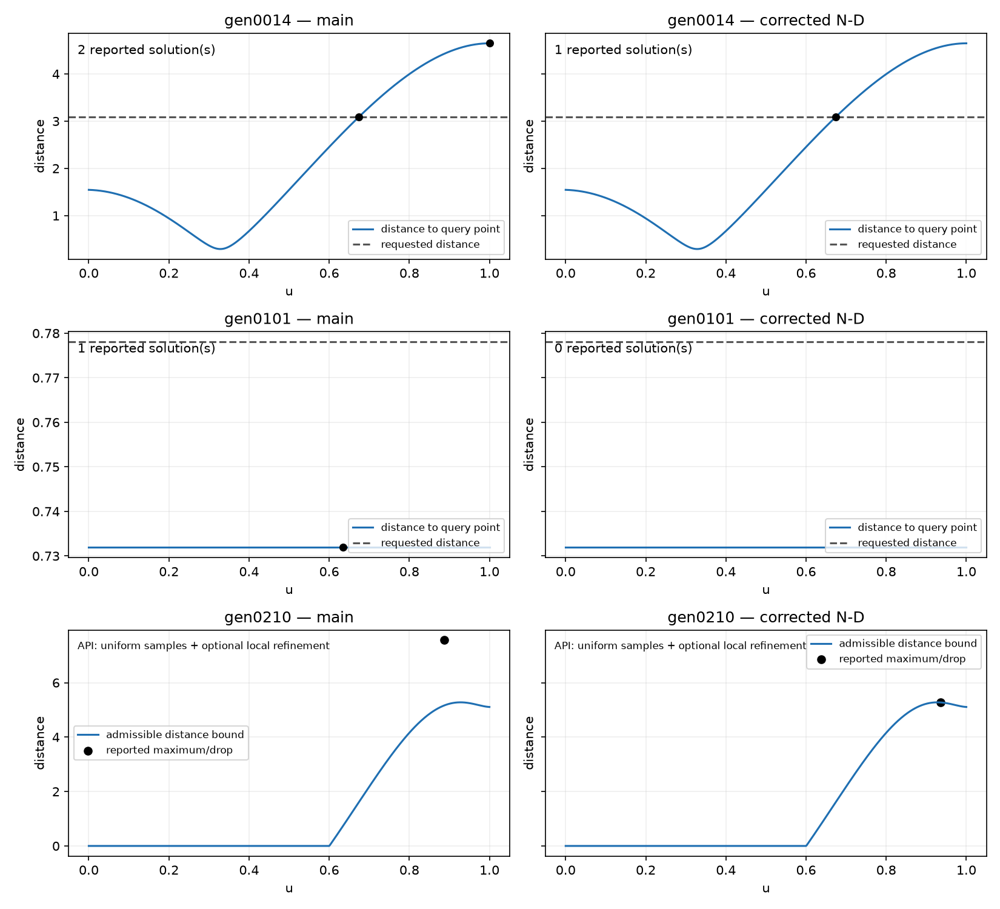
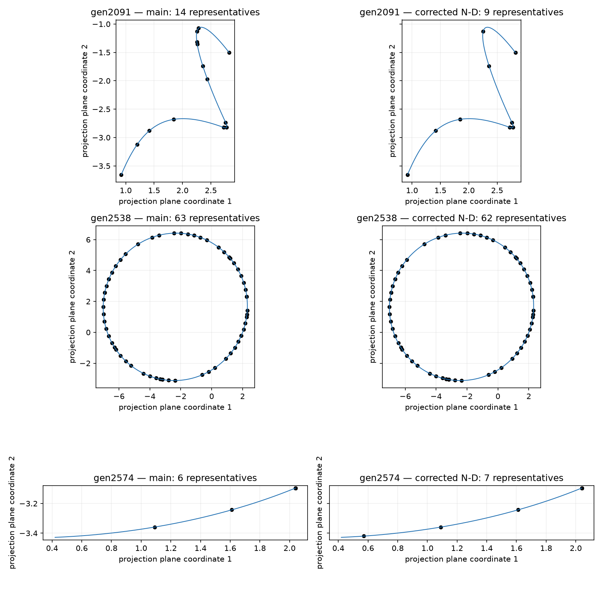
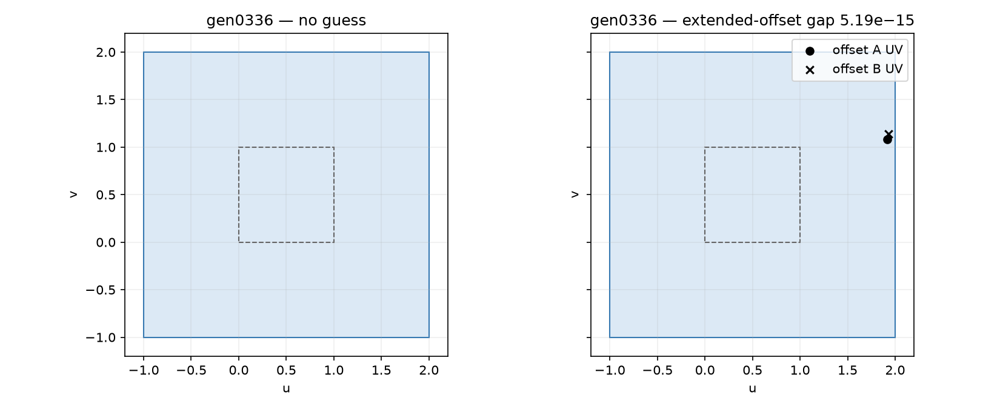
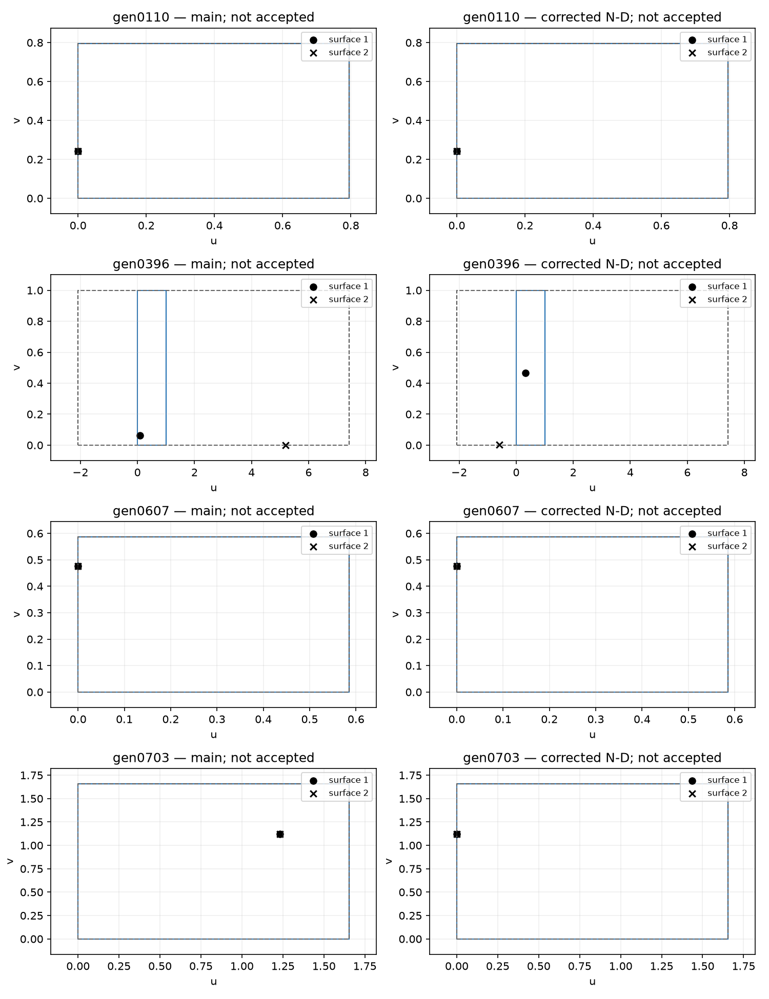
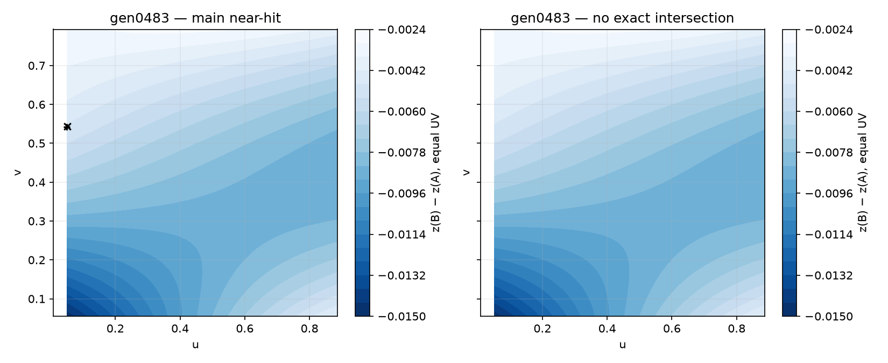
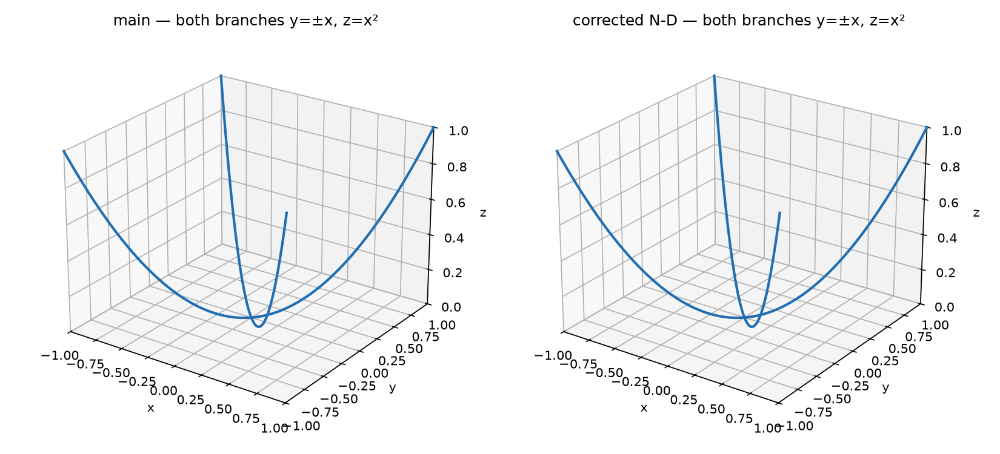
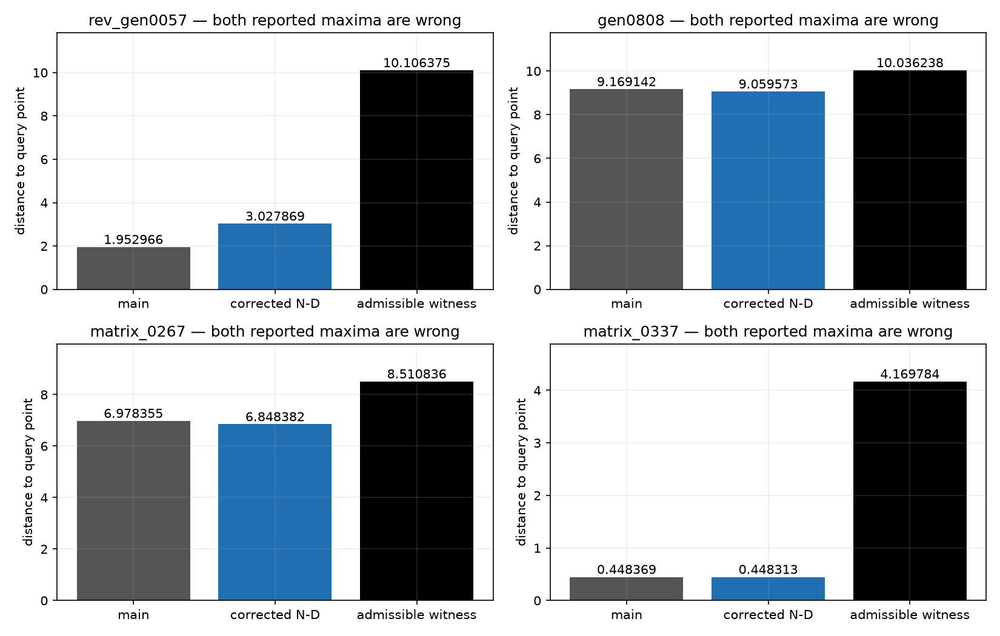

# geom.local_solve_nd: geometric review of changed callers (2026-11-07)

Updates: `geom.local_solve_nd--goldens-default-2026-11-06.md`.

Also follows the November 7 rebase addendum.

PR: #2791. Units: the eleven caller units below. Inputs: the canonical fixtures / seeded cases
reconstructed with `CaseContext { seeds: 16 }`, captured verbatim together with raw before/after
outputs in [observations.json](geom.local_solve_nd--review-geometry-2026-11-07/observations.json).
The before side is unmodified main `f4f70127afee1640c43d9f61e035baddd6dc271b`; the after side is
`22eb5b93b94465831ffa53d4472b2f27b8151e95`. The review adds tests and failure classification,
not another change to the kernel construction. No C++ was built or run.

The final branch is rebased onto main `52095456b8037f4b28111069a92be4c3d817d5df`.
A fresh replay using the rebuilt library confirms all 18 inputs and raw output arrays
identical to the captured after side. Main's intervening changes add no golden changes.
The exact golden comparator counts 1,394 blessed serialized updates across 31 units,
1,328 significant changes across 30 units, and five removed golden lines that remain
executed as known failures (#2956 and the four #3096 cases).

The earlier opt-in control establishes attribution to the N-D change. It does not establish
geometric correctness. The following independent checks replace that explanation for all
18 cases questioned in review. The old ledger remains a historical measurement, including
four surface-point outputs that must no longer be blessed.

## Distance queries

- `curve.curve_p1/gen0014`: the degree-six Bernstein coefficients of the cubic Hermite
  curve's squared distance minus the requested squared distance have one sign variation,
  and endpoint signs differ. There is exactly one root on [0,1]. Its returned parameter is
  0.6734291977916785 and distance residual is below 1e-12. The removed endpoint u=1 has
  distance 4.648425416328397 instead of 3.083982101448969. This is removal of a false root,
  not lost coverage.
- `curve.curve_p3/gen0101`: identical endpoints and zero endpoint derivatives make the curve
  constant. Its distance is 0.7318943148562402, whereas the requested distance is
  0.7780805939992086. There is no solution; the previous successful status was false.
- `curve.curve_p6/gen0210`: the API explicitly computes a sampled distance with optional local
  refinement, not a certified continuous directed Hausdorff maximum. It uses 32 uniform samples
  here. For every sample, the clipped matching parameter on curve 1 provides an admissible
  distance no greater than 5.274195530886221 (roundoff below 1e-12). At sample 29/31,
  degree-eight Bernstein bounds on every trimmed quartic Bezier span prove that the endpoint
  drop is nearest within arithmetic error; the smallest coefficient enclosure is -1.42e-14, within the explicit
  arithmetic error bound. These upper and lower bounds certify the reported sampled maximum.
  The old pair reported 7.560343721403504, but an admissible drop for that very query point
  has distance 5.163266660892317: the old drop was not nearest. No continuous maximum claim
  is made.

Same axes show the false endpoint, the constant curve's impossible request and the sampled
maximum with its admissible distance bound. The plotted samples illustrate the analytic tests;
the plots are not the proofs.

Tests: `review_at_distance_returns_the_only_root`,
`review_constant_curve_cannot_satisfy_another_distance`,
`review_reduced_gap_has_a_nearest_point_and_sampling_proof` in their respective runner modules.

## Projected curve intersections

`curve.curve_p7/gen2091`, `gen2538`, `gen2574` are `cci_solve`, with no comb payload. Each record
contains three header fields, then 13 fields per point: type, variable/object counts, object
and node ids, metric, two parameters, endpoint value and endpoint parameters. Counts change
14→9, 63→62 and 6→7. Node identifiers are metadata, not geometric components.

Equal positive weights and equal knots make the matching-parameter difference a convex
combination of control-point differences. Its norm is at most 1.000001e-9 over the common
natural domain: these curves lie in the same tolerance tube, rather than having a finite set
of well-separated roots. The test checks every returned pair's query domains and independently
computes the actual projection. Rotation here is the linear orthogonal projection onto the
plane spanned by the given axis and x-axis; perspective is the ray/plane intersection from
the eye. Maximum projected residuals are respectively 7.841017060157699e-10,
1.118585943387028e-9 and 5.079017612344805e-5, below caller tolerances 1e-6, 1e-6 and 0.01.
Stored metrics agree within the arithmetic error allowance. This proves point validity and
explains changed representatives; it does not claim finite-root completeness for a tolerance
overlap. The matching-parameter hull claim is confined to the natural domain; gen2574's
slightly extended query interval is checked individually at every returned point.

Identical projection frames show that these are representatives of almost coincident curves.

Test: `curve_curve_p7::tests::review_projected_intersections_satisfy_their_geometry`.

## Extended blend guess

`blend.fillet_standard_solver_p2/gen0336`: 13→17 raw values means that a found flag now carries
four UV values before the existing twelve offset-state values. The new UVs lie inside the
caller's [-1,2]² domains; reevaluating the actual extended offset surfaces gives separation
5.193482808785869e-15, below 1e-6. Evaluating extrapolations of the unextended original surfaces
would check different geometry and is not used. This routine's existing plane-adjustment
contract moves and rotates the guess plane; the final point need not satisfy the initial
fixed plane (its distance from that plane is -5.349879468840067). The test establishes an
offset-surface guess, not completion of a blend body or a root of the initial fixed-plane system.

The dashed square is the original natural domain; the larger square is the caller's domain.

Test: `review_guess_is_on_both_extended_offset_surfaces`.

## Intersector programs: decode the changed operation

`intersect.surface_intersector_p1/gen1226`: the first difference is operation 5, `Refine`,
singularity type 5, against the same surface object. Its payload changes from
`[13, 1007]` (operation code, invalid-input status) to `[13, 0, 0]` (operation code, success
status, `None`). This accounts for the raw length 701→702. No UV solution is added, and the
entire point/intersection state is unchanged by the operation. This is an ordinary no-result
refinement of an underdetermined same-carrier query, not a newly successful SSI construction.
Test: `review_same_surface_refinement_does_not_invent_a_solution`.

For `intersect.surface_intersector_p3`, the first changed operation is `Next`:

| Case | Operation (1-based) | Prior / next point | After surface gap | Stored half-gap |
|---|---:|---|---:|---:|
| gen0110 | 1 | 7 / 2 | 5.721958498152797e-17 | 2.8609792490763984e-17 |
| gen0396 | 5 | 1 / 0 | 1.319559120307248e-16 | 6.59779560153624e-17 |
| gen0607 | 2 | 3 / 5 | 2.2887833992611187e-16 | 1.1443916996305594e-16 |
| gen0703 | 2 | 1 / 0 | 1.6537195873410946e-13 | 8.268597936705473e-14 |

All four have status 0 and `found_good_point=false` both before and after. Candidate UVs,
positions and bookkeeping can change without accepting an intersection point. In gen0396,
the angle becomes unset (`None`, represented by the input sentinel -8), rather than reusing
1.1914407010778256. The deviation out-parameter is unset in all four; the point's own
`deviation` field is a separate field. It is half the surface separation, since the 3D curve
point is their midpoint. The test independently evaluates both surfaces, checks UV domains,
checks the stored surface positions, midpoint and half-gap, and asserts the refusal flag.
It does not interpret block sums, point types or list ids as coordinates or successful traces.

Each marker pair is a candidate on the two parameter domains; every row remains unaccepted.

Test: `review_next_candidates_preserve_geometry_and_refusal`.

## A lost near-hit without an exact intersection

`surface.surface_p11/gen0483`: both biquadratic patches have identical XY control coordinates.
Derivative coefficient hulls make the symmetric XY Jacobian positive definite on [0,1]²
(the diagonal-dominance margin is 0.8908854751569512). Integrating along a line segment proves
strong monotonicity, hence injectivity: equal XY requires equal UV. Restricting the Bernstein
coefficients of z(B)-z(A) to the query domain bounds it above by -0.0021947545038643926,
strictly negative. Thus there is no exact surface intersection in that trimmed query.
The old different-UV near-hit has separation 0.005622704180666707, which *does* meet the loose
caller tolerance 0.01670979532796255. Losing it is a local solver's changed convergence
outcome, not a proof that it violated that tolerance. The new `None` is consistent with no
exact root. The routine is local and does not promise to enumerate all within-tolerance
pairs; no global completeness claim is made.

The old near-hit markers use different UVs; equal UV never closes the Z gap.

Test: `review_lost_hit_is_not_an_intersection_of_the_trimmed_patches`.

## Crossing node: complete and distinct branches

`surface.surface_p2/tc_parabolic_cylinders_crossing_node`: the exact intersection is
z=x²=y², hence y=x and y=-x. Both returned cubics cover x from 1 to -1. Every Bezier span's
x controls decrease strictly, ruling out reversal, missing subintervals and duplicate coverage.
The y controls equal either +x or -x, with exactly one curve of each sign, proving the
branches are distinct. Degree-six Bernstein bounds for z-x² and z-y² on every span, with
an explicit arithmetic error allowance, give worst residual 9.82212288575565e-7 ≤ 1e-6.
This is a hull/subdivision enclosure of whole spans, not just a finite sample residual.
The complete branches and their common node are retained; their fitted parameterization moves.

The exact dashed branches lie under both returned curves at this scale.

Test: `review_crossing_node_has_both_complete_branches`.

## Four pre-existing nonmaxima must not be blessed

Tracked by [#3096](https://github.com/tangency-labs/solidcore/issues/3096). All are solver code 4,
`Maximize`. An admissible farther point disproves a maximum; no global maximum certificate is
needed to establish the counterexample.

| Unit / case | Main distance | Corrected N-D distance | In-domain witness UV | Witness distance |
|---|---:|---:|---|---:|
| surface_point_solve_p2 / rev_gen0057 | 1.9529663001246003 | 3.027869047705328 | (0.6, 0) | 10.106374942763338 |
| surface_point_solve_p2 / gen0808 | 9.169142033546262 | 9.059573038386699 | (1, 2.6941425697089785) | 10.036238095784272 |
| surface_point_solve_p3 / matrix_0267 | 6.978354978629408 | 6.848382229992056 | (-0.7767981984343537, 1) | 8.510836007198144 |
| surface_point_solve_p3 / matrix_0337 | 0.4483685594987209 | 0.44831251217740314 | (0.5, 2.342948734736579) | 4.1697843031871535 |

Each distance is reevaluated on the actual returned geometry, including genuine revolutions.
The tolerances are respectively 0.034655121486846505, 4.1795397219384255e-8, 5e-6 and 1e-6.
Every witness exceeds both outputs by much more than tolerance. `matrix_0337` requests Nodes;
the existing global path ignores that request, another limitation recorded in the issue.
`SurfPtGlobalSolver::solve` selects local candidates without certifying the global maximum.
That separate construction needs correction or a named refusal, not a per-case retry.
The four cases are removed from their golden files and added to `known_failing.json`; all
remain executed. No tolerance or floor changes. These two regression tests fail before the
classification and pass after it; they also permit a future genuinely corrected maximum.

The witness bars disprove both baselines; the tiny old/new shifts are not the main defect.

Tests: `review_maximum_outputs_have_geometric_evidence`,
`review_global_maximum_outputs_have_geometric_evidence`.

## Reproduction and scope

Run `nice -n 10 cargo test --profile goldens -p goldens --lib review_ -- --nocapture` with
`CARGO_BUILD_JOBS=2 RUSTC_WRAPPER=sccache`. All eleven tests reconstruct the exact named cases.
The captured observations preserve raw records independently of the current generators.
The plotting source is in the PR description; it uses Matplotlib and direct de Boor evaluation,
not the golden checksums or C++ state. Identical before/after framing is used throughout.

These checks prove the stated invariants and classify the demonstrated defects. They do not
certify every caller of the N-D solver, the full continuous maximum of a sampled-distance API,
completeness of a near-coincident CCI point list, a successful trace from a rejected Next
candidate, or a global intersection from a local no-result. The prior full golden sweep and
kernel-case replay remain regression evidence, not geometric correctness proofs.
