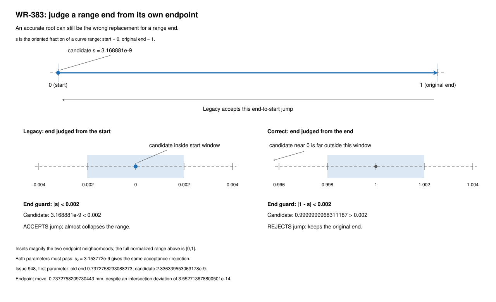

# geom.local_solve_nd: current-main integration and WR-383 retirement (2026-11-15)

Updates: `geom.local_solve_nd--goldens-default-2026-11-06.md` and its November 9 addenda.

Units: `geom.local_solve_nd`, `curve.curve_p1`, and their measured callers.
Issue: tangency-labs/solidcraft#13764. PR: tangency-labs/solidcraft#14102.

The fresh control is main `be6ecb06420d501a8362d6de3d0de7ef324dafb9`, built separately with Rust 1.99.1.
Integrated main `c71236a40de9f36713194df624663a252d0f71a3` changes catalogues only; its kernel subtree is identical.
The branch preserves published history, including ten imported commits and parent `94ae5e1806a59af4322ec50fd81af232161a363f`.
The maintainer requested main integration; current contribution rules permit merging main.
The fixture pin is NVIDIA usd-brep v1.0.1, `3fd5b9548d19aa8c12c29bc9637a96d42a06f8a5`.
Only permitted public fixture data is used; no reference C++ is built or executed.

## Construction and integration boundary

The N-D solver rejects failed evaluations instead of using their candidate, residual or derivatives.
Each accepted clamped or scaled candidate retains its own equations, Jacobian and answer flag.
This retires the remaining N-D half of `oscillating_skips_failed_guesses`.
It also retires `refine_cc_range_ends`, making its existing endpoint-relative shift check unconditional.
SolidCraft's preset already enabled both options; their assignments and obsolete forwarding sites disappear.
`Kernel::default()` now uses both corrections, without a compatibility preference or fallback.

Conflict resolution preserves main's independent retirements, typed errors, exact-circle values and newer query constructions.
Golden conflicts were merged by CaseID, preserving main-only changes and removals.
Both `curve.curve_p9` overlaps retain main's newer maxima.
The three existing `blend.fillet_geom_p2` rows match fresh encoded output exactly.
No input, physical tolerance, comparison threshold or compression rule was changed.

PR #16957 owns nearby query-status propagation.
The WR-383 change preserves those status decisions, missing-inversion guards and the shared signature.
The unrelated proto-edge splitter is unchanged.

## Why the two corrections travel together

The N-D-only integration exposed two ruled-skin Boolean failures from unchanged issue-948 tests.
Clean main passes those tests; enabling only its historical N-D option reproduces the zero-volume result.
Both operand snapshots remain identical.
The accurate intersection is wrongly accepted as a replacement for a different overlap endpoint.

One traced range starts at `(0, 0.7632131633423296)` and ends at `(0.7372758233088273, 0.7617633973585559)`.
The end's deviation is `1.5721731499031345e-5`.
The refined root is `(2.336339553063178e-9, 0.7632131633377573)`, with deviation `3.552713678800501e-14`.
That root is correct, but about `0.7372758209730443` millimetres from the endpoint being refined.

The legacy fractions, approximately `(3.1688813e-9, 3.1537721e-9)`, measure from the start and wrongly permit the jump.
WR-383 measures the end from one: `(0.9999999968311187, 0.9999999968462279)` rejects it.
The start rule, arithmetic order, `1e-10` precision and `0.002` shift limit remain unchanged.
This retires an existing correction rather than inventing another construction or special case.

Three unchanged analytic regression bodies fail before this pair and pass after it.
They cover all four parameter directions and rejection of an end-to-start jump.
The complete WR-614 module also passes in all four historical option combinations: 12 tests × 4 = 48 passes.
The old WR-614 hold predates main's newer crossing construction and no longer describes that test's expected result.
The original issue-948 tests pass with both corrections.

The adjacent `.vectorcraft` file preserves the diagram source; the SVG retains live Helvetica text.
The diagram explains the endpoint rule; the measured model tests supply the operation-level evidence.

## Changed WR-383 callers

Seven curve golden changes have direct support.
Four helper cases now reach both exact line/quadratic intersections in every parameter direction.
The fifth rejects a collapse from parameter `0.9` to approximately `5.55e-16`.
These helper tests check endpoint policy, not whole-range coincidence.

P8's saved tail and `gen2160` are duplicate inputs with identical outputs.
The old two solution payloads remain unchanged; a third approximate range survives.
Its line interval is `[6.11037890900769, 6.344696713196761]`.
Its B-spline interval is `[0.4336618890164721, 0.5053108900962493]`, inside one quadratic knot span.
Exact-rational Bernstein bounds, including line-normalization rounding, prove deviation below `0.333` throughout the tail.
The requested tolerance is `0.5`; eleven samples are not used as a uniform proof.

`surface.plane_p2/gen0599` returns six pieces instead of four.
Exact dyadic clipping and full-span convexity certify the pieces against the source curve and requested rectangle.
The bound including binary64 evaluation error is `0.4923024273024897`, below the unchanged `0.5` request.
This is tolerance-qualified clipping, not a claim of an exact rectangle boundary.

### A transformed body remains wrong: #17271

`topology.brep_mirror/mat0076` starts with a valid read of `Solids/revolution.smb`.
The exact near-singular affine transform returns `Ok(())`, but its output fails Level2.
Main and N-D-only have 16 physical failed assertions; the paired result has 17.
Formatted failure counts are 17/18 because they include a synthetic skipped-AssertValid line.

The shared 3D loop gap is `3.419267465560401`, against `2.1633192809335735e-5`.
The paired result adds a UV V gap `4.309257867596689`, against `3.4474062940770893`.
Edge 2 and its two UV trim domains move together; no parameter-interval mismatch is claimed.
The support curves, surfaces and vertices remain identical between the measured configurations.
SVD and tolerance handling have not been established as the cause.

The incorrect expected row is removed, while the case still executes under tangency-labs/solidcraft#17271.
An independent typed guard requires a valid input and either valid output, refusal, or explicit wrong-result classification.
It fails without that classification and requires its removal when the case is repaired.
The public-API reproducer compiles and runs twice with byte-identical output.

The actual-body pictures retain their measured labels: baseline CI defaults and both historical options enabled.
Their complete typed geometry/check records exactly match the corresponding goldens-profile configurations.
Both bodies mesh, but that does not certify validity.
The camera is chosen from the matrix's flattened plane, not from a generic angle.

## Rechecked review cases

Fresh main, N-D-only and paired controls preserve the three reviewed cases' recorded before/after bits.
Historical figures retain their November 9 provenance.

| Case | Independent check and limit |
| --- | --- |
| `curve.crv_on_surf/gen0344` | The drop remains unsuccessful at parameter `3.243688129013577`, distance `3.1935980469430203`. Cache changes occur outside the queried interval. Both query-interval polynomials coincide and have bound `4.9558355951395086e-6 < 5e-6`. The whole-cache bound remains `0.009877649569016454`; no whole-cache accuracy claim follows. |
| `curve.curve_p3/gen0607` | The accepted pair fails stationarity: free-parameter derivative `1349.3486076139557`. Feasible `v=0.03` lowers distance `37.30470092694143 → 37.24417446150419`; exact Bernstein bounds certify descent. The wrong golden stays removed and the case executes under #14238. The constrained construction remains a follow-up. |
| `surface.surf_of_extrusion_p2/gen1140` | Main returns status `1001`; the corrected caller returns a coarse `Touching` point. Its 32 `out` values, plus the unchanged build scalar, are finite. The point is the support midpoint; deviation is `0.45775726612524936`. The implicit infinite-extrusion tolerance is `2,469,134.0`. Independent typed checks catch status/point mutations hidden by sentinel-overflowed compressed sums. No exact contact or completeness is claimed. |

The historical opt-in controls establish attribution, not correctness.
The independent surface-point maximum construction remains tangency-labs/solidcraft#13684.

## Existing body limits and two diagnostic updates

Both tabbed-plate controls pass Level2 with 14 vertices, 21 edges and nine faces.
Only its zx product changes beyond the existing rule: `-0.002825799627495796 → -0.0028257996317939318`.

The bench-tube union retains volume `1032433.31907531`, counts, vertices and surface supports.
Its minimum recorded face area changes by `9.605618319659783e-19 mm²`.
A conservative arc-retrim motion bound is `7.328781952982884e-11 mm`; this is not an area-error certificate.
Both bodies still have the same four coincident-edge failures recorded by WR-580.
Only the diagnostic scalar changes; its companion validity golden stays unchanged.
The open shell remains invalid under #13733, with nine reports and maximum gap `3.019034068882236e-5`.
The degenerate fillet still has an internal-pole report.
None is presented as a newly valid body.

## Golden accounting and validation

Against current main, 1,396 existing rows change across 32 units.
Of those, 1,332 exceed the unchanged comparison rule, across 31 units.
Seven incorrect expected rows are removed; their cases remain executed as known failures.
All 242 main known-failure reasons remain verbatim, giving 249 final classifications.
Known cases are not counted as geometrically correct results.

The paired full sweep passes 279 of 283 units and identifies exactly nine cases in four units.
The certified curve/plane changes and tracked invalid transform account for those nine cases.
Three rerun commands cover all four affected units and pass.
Together they cover all 283 units and 592,175 cases, including 249 known failures.

Completed paired checks:

- Kernel workspace nextest: 8,390 passed, zero failed, 100 skipped.
- Kernel fmt, strict workspace Clippy, wasm, doctests and panic checks pass.
- The panic check uses CI's synthetic kernel-only base, whose tree matches current main.
- All three ignored rig tests pass with the current CPU-time protocol; no timeout override is used.
- After the final harness guard, the goldens library has 436 passed and 29 ignored; goldens Clippy passes.
- The earlier focused runs have 13 review tests and 16 N-D tests passing.

The earlier N-D-only application CI is a historical control: its classifier accepts 13 registered failures with zero regressions.
A fresh main replay independently reproduces all five failed naming-corpus designs and their complete error payloads.
This does not establish that every unrelated registered failure was replayed independently.

**The paired application gate is not green locally:** raw `cargo xtask ci` exits 1.
Its classifier grades 16,515 tests: 16,501 pass, 13 are registered failures, and GPU blur is one unexpected failure.
A separately compiled, unmodified main `be6` reproduces the exact `gpu.rs:1406` assertion: resting source passes `1 → 2`.
The relevant UI/cache source is byte-identical in main `c712` and this contribution.
This is tracked in [#17280](https://github.com/tangency-labs/solidcraft/issues/17280).
Two isolated PR executions also fail; an earlier full run passed on the same UI code.
Disabling the existing optional display-refinement pipeline makes the exact fixture pass, as a diagnostic control only.
The likely asynchronous-refinement/cache-key race is an inference; no frame-key instrumentation is claimed.
No UI code, assertion, known-failure list, quarantine or gate environment is changed.
The final raw native CI and official classifier remain exit 1; this baseline reproduction does not turn them green.
The application's wasm check covers 30 crates and its doctests pass.
The optional local browser check is unavailable because Chrome is absent.

The contributor leaves queueing and merging to maintainers and the merge shepherd after CI and review.
Historical November 6/9 counts and measurements are retained only in their dated records.

## Archived evidence

The [artifact index](geom.local_solve_nd--solidcraft-integration-2026-11-15/README.md) links the endpoint trace,
P1/P8 rational certificates, plane clipping certificate, actual geometry plots and VectorCraft source.
The [manifest](geom.local_solve_nd--solidcraft-integration-2026-11-15/manifest.json) preserves hashes and provenance.
