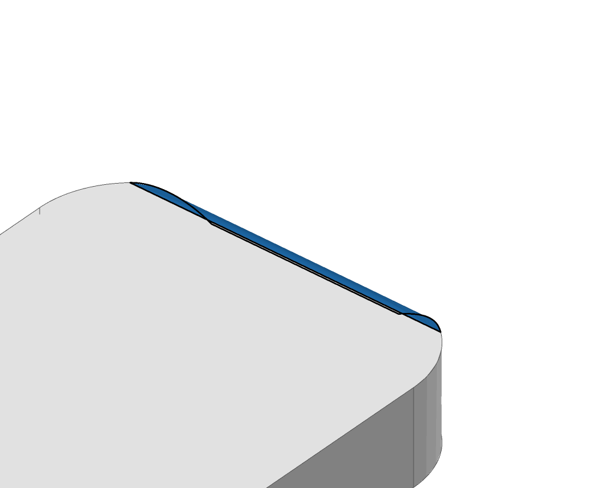
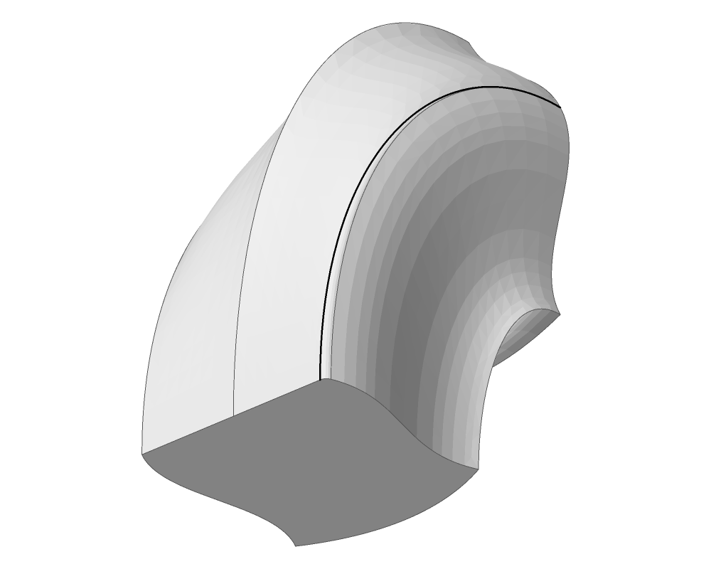
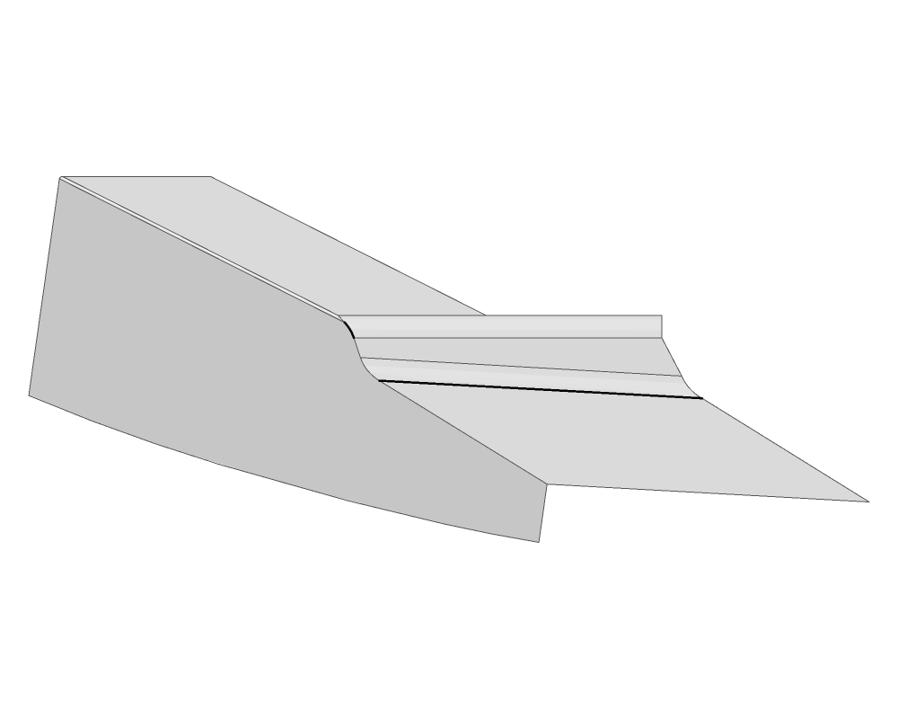

# geom.local_solve_nd: unconditional correction and current-main goldens (2026-11-06)

- Issue / PR: #2782 / #2791; migration requested in #2816.
- Base: `1483513fe`; measured production: unchanged at `1d9d097dd` (rebased correction). Only the N-D default and its forwarding change production behaviour.
- Complete initial check: 283 units, 251 pass / 32 changed, no added/removed/broken case. The main golden is the old value, not the C++ reference.
- 1332 cases exceed their unchanged comparison threshold. Whole-unit `--bless` also records 66 sub-threshold serialized changes. One additional sub-threshold case is wrong already on main and becomes known failing (#2956), with its golden removed.
- Every moved case is listed below, including sub-threshold changes. Arrays over 16 entries are the runner's 256-entry block sums, absolute sums and index-weighted sums; these are records of state, not geometric coordinates. The complete old/new values remain in the golden's git diff.
- No tolerance, floor, generator, guard or case set is loosened. No C++ is built, linked or run.

## Why these are the correct default

A failed evaluation provides neither equations nor a Jacobian or a solution. At an accepted
point B, Newton solves with F(B) and J(B), not J(A) from a rejected clamped point. This is the
current-point linear model of [Kelley, *Iterative Methods for Linear and Nonlinear Equations*,
§5.1, equation 5.1](https://epubs.siam.org/doi/abs/10.1137/1.9781611970944.ch5).
The existing test `scaled_step_uses_the_jacobian_at_its_own_point` makes this independent of
any stored result: F=(x²−1,y−4), accepted B=(11/16,1), next x=(11/16+16/11)/2.
The root y=4 is outside the bounds, so this is not a found solution. Failed first, clamped,
scaled and best-point evaluations have default-path regressions in the same solver file.

An isolated main build enables the pre-existing N-D correction at every constructor/setter
(the temporary setter ignores an off argument, so explicit caller fix overrides do not mask
the control). All caller outputs in these 32 units are byte-identical to that control except
`curve.curve_p3/gen2400`. That one is unchanged from main in the PR: old opt-in alone invents
an at-distance solution at parameter -4.585825635123736 outside [0,1], while the corrected
outer-iteration exit returns no solution. The Hermite curve's Bernstein control hull is at
most 4.1 from the test point, less than target 7.067911212988999, so no such root exists.
The control differs on 117 direct N-D traces/states because the old opt-in could leave only
the inner line search after a failed candidate, then use cached/partially written state.
The PR leaves the outer iteration at its last evaluated point instead. This is required by
the same no-failed-values contract, not a second geometric construction.

The 324 first-evaluation N-D changes are WR-20. The other direct cases concern iteration,
accepted-point state or sub-threshold trace arithmetic (WR-253). All 604 changed volume
calls return no point/solution after a failed base/B-spline evaluator; none is evidence of
a successful volume inverse. Other callers retain their operations and differ through the
same corrected local solves; byte equality to the isolated old-fix control establishes that
no independent caller algorithm has been changed.

`offset.offset_geometry_creation/gen0495` and `gen0696` record 81,982 and 128,002 raw state
values: every raw value is finite (zero NaNs/infinities). Some compressed block sums overflow
because the state deliberately records finite undefined sentinels near f64::MAX. Those encoded
infinities are not new infinite geometric coordinates or proof of a successful offset body.

## Geometry, inspected independently

Renders use `diagnostics`/`solidcore-tess`, the same view, size and framing before and after.
The images archive the selected runner's exact result after its measurements.
Rendering and measurement commands belong in the PR description; this record keeps the
view, measured outputs and validation data.
`validation.json` records the Level-2 reports. `checker-control.txt` also compares the default
checker with the existing #1515 repeated-knot pole correction.

| Case / camera (azimuth,elevation) | Before | After | Geometric evidence |
| --- | --- | --- | --- |
| tabbed plate, (-40,-35), selected edge close up |  |  | Both Level-2 valid; centroid y changes -5.519696972583106e-7 → -5.519696964318523e-7. The whole-part views are also saved beside the close ups. |
| brepForFillet2 edge 9, (-130,30) |  |  | Default checker changes invalid → valid. With #1515's corrected row test both pass: do not claim the N-D correction fixed a physical pole. Area changes 1440.2671115013059 → 1440.2674841111223. |
| open shell edge 5, (-50,-25) |  |  | Nine identical gaps remain, including 3.019034068882236e-5 > 2.32093747577046e-5. This is #2956, listed as known failing and not blessed. |

## Units and case counts

| Unit | Beyond comparison threshold | Serialized updates blessed |
| --- | ---: | ---: |
| `blend.fillet_custom_solver` | 2 | 2 |
| `blend.fillet_executive_p3` | 2 | 2 |
| `blend.fillet_geom_p2` | 1 | 3 |
| `blend.fillet_intersector` | 1 | 1 |
| `blend.fillet_solver_p1` | 1 | 1 |
| `blend.fillet_solver_p4` | 2 | 2 |
| `blend.fillet_standard_solver_p2` | 7 | 10 |
| `boolean.api_brep` | 1 | 3 |
| `curve.crv_on_surf` | 1 | 1 |
| `curve.curve_p1` | 2 | 2 |
| `curve.curve_p3` | 22 | 26 |
| `curve.curve_p6` | 1 | 1 |
| `curve.curve_p7` | 10 | 19 |
| `curve.curve_p8` | 4 | 8 |
| `curve.curve_p9` | 68 | 87 |
| `geom.local_solve_nd` | 461 | 464 |
| `intersect.api_intersectors` | 2 | 4 |
| `intersect.surface_intersector_p1` | 2 | 2 |
| `intersect.surface_intersector_p3` | 4 | 6 |
| `intersect.surface_intersector_p4` | 1 | 1 |
| `intersect.surface_intersector_p5` | 1 | 1 |
| `offset.offset_geometry_creation` | 2 | 2 |
| `surface.surf_of_extrusion_p2` | 1 | 1 |
| `surface.surface_p11` | 18 | 20 |
| `surface.surface_p2` | 5 | 7 |
| `surface.surface_p3` | 46 | 46 |
| `surface.surface_p5` | 17 | 22 |
| `surface.surface_p6` | 34 | 39 |
| `surface.surface_p7` | 5 | 6 |
| `surface.surface_point_solve_p2` | 2 | 2 |
| `surface.surface_point_solve_p3` | 2 | 3 |
| `surface.volume_p2` | 604 | 604 |

## Validation

Post-bless complete check: **283 units passed, 0 failed**, `--all --goldens --jobs 4` (default per-unit seeds), including both known failures. Strict workspace clippy and wasm pass. Full kernel suite: **5088 passed, 1 failed, 44 existing ignored** across 438 result targets (including doctests). Goldens library: **399 passed, 29 existing ignored**. The operations case target passes 29 tests (1 corpus test normally ignored). Each of the five RC cases added by the final `2d469d13f` rebase was also replayed through that corpus test, with its existing pass/known-failure grading; all five replays pass. Kernel source, golden runners and baseline are unchanged by that data-only main rebase. The exact nodal-quartic accuracy assertion still exposes #2508 at 1.2302516783080364e-9 against the unchanged 1e-9 bound; no ignore or tolerance change is included.

## `blend.fillet_custom_solver`

2 cases exceed the golden comparison threshold; 2 serialized outputs move (including the known failure where applicable).

| Case | Change | Why / control | Old → new recorded numbers |
| --- | --- | --- | --- |
| `gen0135` | golden change | Exactly the old corrected N-D construction in the isolated control; accepted-point state stays coherent | `values.guess[0]`: `0.3977465057450805` → `0.3976730128408779` `values.guess[1]`: `0.0015190176987551086` → `0.0015287122706333254` `values.guess[2]`: `0.38034940044323434` → `0.3802584251556077` `values.guess[3]`: `-0.17222742694931514` → `-0.17222388562852842` |
| `gen0174` | golden change | Exactly the old corrected N-D construction in the isolated control; accepted-point state stays coherent | `values.guess[0]`: `0.5961131462365918` → `0.5956931087118231` `values.guess[1]`: `0.08216676476513805` → `0.0821443614343544` `values.guess[2]`: `0.6087507101231425` → `0.6081822508999537` `values.guess[3]`: `0.04625663809596156` → `0.04621427066244574` |

## `blend.fillet_executive_p3`

2 cases exceed the golden comparison threshold; 3 serialized outputs move (including the known failure where applicable).

| Case | Change | Why / control | Old → new recorded numbers |
| --- | --- | --- | --- |
| `issue_2176_tabbed_plate_tab_top_r0_5` | golden change | Exactly the old corrected N-D construction in the isolated control; accepted-point state stays coherent; Level-2 valid before and after | `values.mass_properties[0]`: `4398.24789430247` → `4398.247894302472` `values.mass_properties[1]`: `4054.7700191549548` → `4054.770019154957` `values.mass_properties[2]`: `4054.7700191549548` → `4054.770019154957` `values.mass_properties[3]`: `-5.519696972583106e-07` → `-5.519696964318523e-07` `values.mass_properties[4]`: `0.9105559203160607` → `0.9105559203160869` `values.mass_properties[5]`: `0.9999386973404744` → `0.9999386973404746` `values.mass_properties[6]`: `726367.8278701666` → `726367.8278701702` `values.mass_properties[7]`: `619662.5859111449` → `619662.5859111444` (20 changed scalar/length fields; first 8 shown; full values in the golden diff) |
| `stubs4-degenerate-brepForFillet2-e9-r0.5` | golden change | Exactly the old corrected N-D construction in the isolated control; accepted-point state stays coherent; Level-2 valid after; before also valid with the #1515 checker correction | `values.mass_properties[0]`: `1440.2671115013059` → `1440.2674841111223` `values.mass_properties[1]`: `3616.2323751508984` → `3616.231853060171` `values.mass_properties[2]`: `3616.2323751508984` → `3616.231853060171` `values.mass_properties[3]`: `3.4572615358535645` → `3.457262543812621` `values.mass_properties[4]`: `6.968145280660813` → `6.968144265649183` `values.mass_properties[5]`: `11.462733703496507` → `11.462732760982624` `values.mass_properties[6]`: `855582.2394479593` → `855581.9653946246` `values.mass_properties[7]`: `741302.3756518327` → `741302.1973964924` (18 changed scalar/length fields; first 8 shown; full values in the golden diff) |
| `stubs4-open_shell-e5-r0.5` | known failing; no golden | #2956: the same nine gaps remain before/after; not blessed | `values.result_geometry.blocks[0][0]`: `-864.3564813200322` → `-864.3564813200327` `values.result_geometry.blocks[1][0]`: `723.2226425349643` → `723.2226425349668` `values.result_geometry.blocks[1][1]`: `17264.932632287437` → `17264.932632287433` `values.result_geometry.blocks[1][2]`: `-1723.289599615673` → `-1723.2895996151783` `values.result_geometry.blocks[2][0]`: `17.17198454715698` → `17.171984547152945` `values.result_geometry.blocks[2][1]`: `8601.974044519407` → `8601.97404451938` `values.result_geometry.blocks[2][2]`: `921.0235462851215` → `921.0235462846522` |

## `blend.fillet_geom_p2`

1 cases exceed the golden comparison threshold; 3 serialized outputs move (including the known failure where applicable).

| Case | Change | Why / control | Old → new recorded numbers |
| --- | --- | --- | --- |
| `gen0132` | within comparison tolerance | Exactly the old corrected N-D construction in the isolated control; accepted-point state stays coherent | `values.c3d_knots.blocks[0][0]`: `21.259874106366283` → `21.259874106366258` `values.c3d_knots.blocks[0][1]`: `21.259874106366283` → `21.259874106366258` `values.c3d_knots.blocks[0][2]`: `646.574243937295` → `646.5742439372945` `values.uv1_knots.blocks[0][0]`: `21.259874106366283` → `21.259874106366258` `values.uv1_knots.blocks[0][1]`: `21.259874106366283` → `21.259874106366258` `values.uv1_knots.blocks[0][2]`: `646.574243937295` → `646.5742439372945` `values.uv2_knots.blocks[0][0]`: `21.259874106366283` → `21.259874106366258` `values.uv2_knots.blocks[0][1]`: `21.259874106366283` → `21.259874106366258` (9 changed scalar/length fields; first 8 shown; full values in the golden diff) |
| `gen0153` | golden change | Exactly the old corrected N-D construction in the isolated control; accepted-point state stays coherent | `values.dir[0]`: `0.08420815743306953` → `0.12638005691291632` `values.dir[1]`: `0.9459509974025604` → `0.9573570264025646` `values.dir[2]`: `0.31318636102938513` → `0.25979916322483954` |
| `gen0165` | within comparison tolerance | Exactly the old corrected N-D construction in the isolated control; accepted-point state stays coherent | `values.c3d_knots[7]`: `1.0079681339860698` → `1.0079681339860695` `values.c3d_knots[8]`: `1.0079681339860698` → `1.0079681339860695` `values.c3d_knots[9]`: `1.0079681339860698` → `1.0079681339860695` `values.c3d_knots[10]`: `1.0079681339860698` → `1.0079681339860695` `values.uv1_knots[7]`: `1.0079681339860698` → `1.0079681339860695` `values.uv1_knots[8]`: `1.0079681339860698` → `1.0079681339860695` `values.uv1_knots[9]`: `1.0079681339860698` → `1.0079681339860695` `values.uv1_knots[10]`: `1.0079681339860698` → `1.0079681339860695` (12 changed scalar/length fields; first 8 shown; full values in the golden diff) |

## `blend.fillet_intersector`

1 cases exceed the golden comparison threshold; 1 serialized outputs move (including the known failure where applicable).

| Case | Change | Why / control | Old → new recorded numbers |
| --- | --- | --- | --- |
| `gen0131` | golden change | Exactly the old corrected N-D construction in the isolated control; accepted-point state stays coherent | `values.rec.blocks[0][0]`: `49.13933933328755` → `49.7785556106257` `values.rec.blocks[0][1]`: `100.26959402644391` → `105.34684502965288` `values.rec.blocks[0][2]`: `3017.7546181355365` → `3027.5117049460596` |

## `blend.fillet_solver_p1`

1 cases exceed the golden comparison threshold; 1 serialized outputs move (including the known failure where applicable).

| Case | Change | Why / control | Old → new recorded numbers |
| --- | --- | --- | --- |
| `gen0077` | golden change | Exactly the old corrected N-D construction in the isolated control; accepted-point state stays coherent | `values.flat.blocks[0][0]`: `1009.0518790466202` → `8.904163635398737` `values.flat.blocks[0][1]`: `1009.0518790466202` → `8.912451461291628` `values.flat.blocks[0][2]`: `18094.139277791568` → `92.14517908106774` |

## `blend.fillet_solver_p4`

2 cases exceed the golden comparison threshold; 2 serialized outputs move (including the known failure where applicable).

| Case | Change | Why / control | Old → new recorded numbers |
| --- | --- | --- | --- |
| `gen0147` | golden change | Exactly the old corrected N-D construction in the isolated control; accepted-point state stays coherent | `values.point.blocks[0][0]`: `-11.089612005042396` → `-10.949995137315241` `values.point.blocks[0][1]`: `83.00348382732005` → `83.10481080687845` `values.point.blocks[0][2]`: `-1107.851933239604` → `-1101.5847957442966` |
| `gen0407` | golden change | Exactly the old corrected N-D construction in the isolated control; accepted-point state stays coherent | `ints.status[0]`: `0` → `1001` `values.point.blocks[0][0]`: `-2440886.869941656` → `-2440888.4361643796` `values.point.blocks[0][1]`: `20716022.663207274` → `20716023.456823476` `values.point.blocks[0][2]`: `-219381380.23510113` → `-219381320.85181177` |

## `blend.fillet_standard_solver_p2`

7 cases exceed the golden comparison threshold; 10 serialized outputs move (including the known failure where applicable).

| Case | Change | Why / control | Old → new recorded numbers |
| --- | --- | --- | --- |
| `gen0104` | within comparison tolerance | Exactly the old corrected N-D construction in the isolated control; accepted-point state stays coherent | `values.out.blocks[0][0]`: `2.1931418146550157` → `2.1931418146550152` `values.out.blocks[0][1]`: `13.34902169131675` → `13.349021691316752` |
| `gen0131` | golden change | Exactly the old corrected N-D construction in the isolated control; accepted-point state stays coherent | `values.out.len`: `12` → `13` `values.out[0]`: `0.05440202191013422` → `0.0` `values.out[1]`: `0.0` → `0.05440202191013422` `values.out[3]`: `1.0` → `0.0` `values.out[4]`: `1.1233608929452705` → `1.0` `values.out[5]`: `1.0` → `1.1233608929452705` `values.out[6]`: `-0.11373064034141558` → `1.0` `values.out[7]`: `0.0` → `-0.11373064034141558` (11 changed scalar/length fields; first 8 shown; full values in the golden diff) |
| `gen0155` | golden change | Exactly the old corrected N-D construction in the isolated control; accepted-point state stays coherent | `values.out.blocks[0][0]`: `14.192267719432731` → `14.218311130667745` `values.out.blocks[0][1]`: `35.03702461759312` → `35.063068028828134` `values.out.blocks[0][2]`: `138.67476862147487` → `138.71383498377975` |
| `gen0176` | golden change | Exactly the old corrected N-D construction in the isolated control; accepted-point state stays coherent | `values.out.blocks[0][0]`: `5.872278487771931` → `8.851609618627348` `values.out.blocks[0][1]`: `13.382986460426412` → `17.200975218083357` `values.out.blocks[0][2]`: `56.893017517432455` → `88.98080721580611` |
| `gen0181` | golden change | Exactly the old corrected N-D construction in the isolated control; accepted-point state stays coherent | `values.out.blocks[0][0]`: `7.620637051161631` → `5.888554922410481` `values.out.blocks[0][1]`: `12.148714879492623` → `10.197166703047186` `values.out.blocks[0][2]`: `152.17526184002924` → `142.155012779117` |
| `gen0282` | golden change | Exactly the old corrected N-D construction in the isolated control; accepted-point state stays coherent | `values.out.blocks[0][0]`: `7.8192282699526485` → `8.819228269952657` `values.out.blocks[0][1]`: `13.856066525559168` → `14.856066525559172` `values.out.blocks[0][2]`: `92.82438316592597` → `96.82438316592602` |
| `gen0336` | golden change | Exactly the old corrected N-D construction in the isolated control; accepted-point state stays coherent | `values.out`: `[0.0,0.17599525633678664,-2.7040364981225773,-2.0,2.161943030495406,5.0,1.0,-0.17599525633678664,-2.740772650093119,-2.0,2.207512499001237,5.0,1.0]` → `{"blocks":[[19.707400696864973,36.059391209538546,198.1351976813674]],"n":17}` |
| `gen0349` | golden change | Exactly the old corrected N-D construction in the isolated control; accepted-point state stays coherent | `values.out.blocks[0][0]`: `8664241.910768405` → `7220558.848678737` `values.out.blocks[0][1]`: `9575618.48632921` → `8203561.369333831` `values.out.blocks[0][2]`: `145077187.07924742` → `102068794.82090826` |
| `gen0350` | within comparison tolerance | Exactly the old corrected N-D construction in the isolated control; accepted-point state stays coherent | `values.out[2]`: `-1.9717289243423197` → `-1.97172892434232` |
| `gen0367` | within comparison tolerance | Exactly the old corrected N-D construction in the isolated control; accepted-point state stays coherent | `values.out.blocks[0][0]`: `48.037975456963736` → `48.03797545696369` `values.out.blocks[0][1]`: `54.23820031459552` → `54.2382003145955` `values.out.blocks[0][2]`: `1019.5292645309779` → `1019.5292645309773` |

## `boolean.api_brep`

1 cases exceed the golden comparison threshold; 3 serialized outputs move (including the known failure where applicable).

| Case | Change | Why / control | Old → new recorded numbers |
| --- | --- | --- | --- |
| `issue1519_bench_tubes_union_measured` | golden change | Exactly the old corrected N-D construction in the isolated control; accepted-point state stays coherent | `values.measures[3]`: `3.051613264191845e-13` → `3.0516228698101646e-13` |
| `torus_guard_huge_scale_box_difference` | within comparison tolerance | Exactly the old corrected N-D construction in the isolated control; accepted-point state stays coherent | `values.measures[1]`: `1.7025167812977083e+18` → `1.7025167812977088e+18` `values.measures[3]`: `995770846153.8558` → `995770846153.8529` `values.measures[7]`: `1668521304856.8164` → `1668521304856.8152` |
| `torus_guard_huge_scale_box_intersection` | within comparison tolerance | Exactly the old corrected N-D construction in the isolated control; accepted-point state stays coherent | `values.measures[1]`: `2.9748321870087366e+17` → `2.9748321870087315e+17` `values.measures[4]`: `875516575.3973864` → `875516575.3973844` `values.measures[7]`: `995770846153.8558` → `995770846153.8529` |

## `curve.crv_on_surf`

1 cases exceed the golden comparison threshold; 1 serialized outputs move (including the known failure where applicable).

| Case | Change | Why / control | Old → new recorded numbers |
| --- | --- | --- | --- |
| `gen0344` | golden change | Exactly the old corrected N-D construction in the isolated control; accepted-point state stays coherent | `values.out.blocks[7][0]`: `814.2102564812513` → `784.1893758468191` `values.out.blocks[7][1]`: `814.2102564812513` → `784.1893758468191` `values.out.blocks[7][2]`: `119361.42391163588` → `116876.03621309683` `values.out.n`: `2268` → `2283` |

## `curve.curve_p1`

2 cases exceed the golden comparison threshold; 2 serialized outputs move (including the known failure where applicable).

| Case | Change | Why / control | Old → new recorded numbers |
| --- | --- | --- | --- |
| `gen0014` | golden change | Exactly the old corrected N-D construction in the isolated control; accepted-point state stays coherent | `values.out.len`: `13` → `7` `values.out[0]`: `2.0` → `1.0` |
| `gen0225` | golden change | Exactly the old corrected N-D construction in the isolated control; accepted-point state stays coherent | `values.out[5]`: `0.95989024432779` → `0.44042924970303704` `values.out[6]`: `0.0` → `0.22730813821822282` |

## `curve.curve_p3`

22 cases exceed the golden comparison threshold; 26 serialized outputs move (including the known failure where applicable).

| Case | Change | Why / control | Old → new recorded numbers |
| --- | --- | --- | --- |
| `gen0035` | golden change | Exactly the old corrected N-D construction in the isolated control; accepted-point state stays coherent | `values.out[6]`: `1.647124499571269` → `4.6808531432105225` `values.out[7]`: `1.0` → `0.433055373558486` |
| `gen0101` | golden change | Exactly the old corrected N-D construction in the isolated control; accepted-point state stays coherent | `values.out[0]`: `1.0` → `0.0` `values.out[1]`: `1.0` → `4.0` `values.out[6]`: `0.7318943148562402` → `0.0` `values.out[7]`: `0.6339092091688694` → `0.0` |
| `gen0122` | golden change | Exactly the old corrected N-D construction in the isolated control; accepted-point state stays coherent | `values.out[6]`: `56.80872955103041` → `56.8087276863841` `values.out[8]`: `-1.5754880307607155` → `-1.5755070966668245` |
| `gen0232` | golden change | Exactly the old corrected N-D construction in the isolated control; accepted-point state stays coherent | `values.out[0]`: `1.0` → `0.0` `values.out[1]`: `1.0` → `4.0` `values.out[6]`: `29.610201335343934` → `0.0` `values.out[7]`: `0.17776440997827264` → `0.0` |
| `gen0377` | golden change | Exactly the old corrected N-D construction in the isolated control; accepted-point state stays coherent | `values.out[0]`: `1.0` → `0.0` `values.out[1]`: `1.0` → `4.0` `values.out[7]`: `0.18137101296232572` → `0.0` |
| `gen0607` | golden change | Exactly the old corrected N-D construction in the isolated control; accepted-point state stays coherent | `values.out[0]`: `0.0` → `1.0` `values.out[6]`: `74.5731723699363` → `37.30470092694143` `values.out[7]`: `2.391218787861883` → `1.3597372198696087` `values.out[8]`: `0.933952927910277` → `0.0332576668152633` |
| `gen0832` | golden change | Exactly the old corrected N-D construction in the isolated control; accepted-point state stays coherent | `values.out[0]`: `1.0` → `0.0` `values.out[1]`: `1.0` → `4.0` `values.out[6]`: `0.7842188873320997` → `0.0` `values.out[7]`: `0.6154596758158912` → `0.0` |
| `gen0973` | golden change | Exactly the old corrected N-D construction in the isolated control; accepted-point state stays coherent | `values.out[6]`: `32.21368401797963` → `32.22100673808823` `values.out[7]`: `1.8819199330365641` → `1.8753308685384005` |
| `gen1021` | golden change | Exactly the old corrected N-D construction in the isolated control; accepted-point state stays coherent | `values.out[0]`: `1.0` → `0.0` `values.out[6]`: `74.53307131610714` → `74.52424484600994` `values.out[7]`: `3.6965431062124074` → `3.701036947383295` |
| `gen1131` | within comparison tolerance | Exactly the old corrected N-D construction in the isolated control; accepted-point state stays coherent | `values.out[8]`: `0.577981767712119` → `0.5779817677121191` |
| `gen1242` | golden change | Exactly the old corrected N-D construction in the isolated control; accepted-point state stays coherent | `values.out[8]`: `6.383389158161605` → `4.322802466163666` |
| `gen1293` | within comparison tolerance | Exactly the old corrected N-D construction in the isolated control; accepted-point state stays coherent | `values.out[8]`: `0.9109229628071456` → `0.9109229628071457` |
| `gen1373` | golden change | Exactly the old corrected N-D construction in the isolated control; accepted-point state stays coherent | `values.out[6]`: `128.44810954295747` → `128.5925345416739` `values.out[7]`: `-0.032932798792861595` → `-0.03293279879286165` `values.out[8]`: `5.057396047071207` → `5.28238707046077` |
| `gen1377` | golden change | Exactly the old corrected N-D construction in the isolated control; accepted-point state stays coherent | `values.out[6]`: `3.337866475408351` → `3.9271005603251457` `values.out[7]`: `1.0` → `0.40467448756585483` `values.out[8]`: `6.8005310929986305` → `5.361415687415462` |
| `gen1586` | within comparison tolerance | Exactly the old corrected N-D construction in the isolated control; accepted-point state stays coherent | `values.out[6]`: `70.65043469031029` → `70.65043469031028` `values.out[8]`: `0.04411895544097857` → `0.04411895544097856` |
| `gen1714` | golden change | Exactly the old corrected N-D construction in the isolated control; accepted-point state stays coherent | `values.out[0]`: `1.0` → `0.0` `values.out[1]`: `1.0` → `4.0` `values.out[7]`: `0.6556472229097893` → `0.0` |
| `gen1790` | golden change | Exactly the old corrected N-D construction in the isolated control; accepted-point state stays coherent | `values.out[0]`: `1.0` → `0.0` `values.out[6]`: `0.08187615815594357` → `0.14595810894905314` `values.out[8]`: `0.8097989667198274` → `0.014646189189709695` |
| `gen1810` | golden change | Exactly the old corrected N-D construction in the isolated control; accepted-point state stays coherent | `values.out[6]`: `47.37016069479249` → `46.28205123792603` `values.out[7]`: `2.979949793020751` → `3.6054221972165057` `values.out[8]`: `1.0` → `0.0` |
| `gen1824` | golden change | Exactly the old corrected N-D construction in the isolated control; accepted-point state stays coherent | `values.out[6]`: `6.858194606797532` → `6.845450468851272` `values.out[8]`: `0.15726088839827573` → `0.1705705876464281` |
| `gen2101` | golden change | Exactly the old corrected N-D construction in the isolated control; accepted-point state stays coherent | `values.out[0]`: `1.0` → `0.0` `values.out[1]`: `1.0` → `4.0` `values.out[6]`: `19.279409132262526` → `0.0` `values.out[7]`: `1.058921995146972` → `0.0` |
| `gen2201` | golden change | Exactly the old corrected N-D construction in the isolated control; accepted-point state stays coherent | `values.out[0]`: `0.0` → `1.0` `values.out[6]`: `40.130399282028` → `40.90929759112409` `values.out[7]`: `0.016578021729663515` → `0.01630787271705418` `values.out[8]`: `-2.4554989680120474` → `-3.736608525090088` |
| `gen2207` | golden change | Exactly the old corrected N-D construction in the isolated control; accepted-point state stays coherent | `values.out[0]`: `1.0` → `0.0` `values.out[1]`: `1.0` → `4.0` `values.out[6]`: `3.2402828190683377` → `0.0` `values.out[7]`: `0.6398767247923317` → `0.0` |
| `gen2249` | golden change | Exactly the old corrected N-D construction in the isolated control; accepted-point state stays coherent | `values.out[0]`: `1.0` → `0.0` `values.out[1]`: `1.0` → `4.0` `values.out[6]`: `4.691675879617401` → `0.0` `values.out[7]`: `1.0` → `0.0` |
| `gen2254` | golden change | Exactly the old corrected N-D construction in the isolated control; accepted-point state stays coherent | `values.out[6]`: `13.305886654257248` → `13.305930979929148` `values.out[8]`: `0.22401669830204798` → `0.22750588194555577` |
| `gen2771` | within comparison tolerance | Exactly the old corrected N-D construction in the isolated control; accepted-point state stays coherent | `values.out[7]`: `0.011733126436474825` → `0.01173312643647483` |
| `gen2989` | golden change | Exactly the old corrected N-D construction in the isolated control; accepted-point state stays coherent | `values.out[0]`: `1.0` → `0.0` `values.out[1]`: `1.0` → `4.0` `values.out[7]`: `0.12740601627715714` → `0.0` |

## `curve.curve_p6`

1 cases exceed the golden comparison threshold; 1 serialized outputs move (including the known failure where applicable).

| Case | Change | Why / control | Old → new recorded numbers |
| --- | --- | --- | --- |
| `gen0210` | golden change | Exactly the old corrected N-D construction in the isolated control; accepted-point state stays coherent | `values.out[0]`: `7.560343721403504` → `5.274195530886221` `values.out[1]`: `0.058895516544628046` → `0.6004311777012843` `values.out[2]`: `0.8871097642341919` → `0.9354838709677419` |

## `curve.curve_p7`

10 cases exceed the golden comparison threshold; 19 serialized outputs move (including the known failure where applicable).

| Case | Change | Why / control | Old → new recorded numbers |
| --- | --- | --- | --- |
| `gen0027` | within comparison tolerance | Exactly the old corrected N-D construction in the isolated control; accepted-point state stays coherent | `values.out.blocks[3][0]`: `2670.44349000052` → `2670.4434900005326` `values.out.blocks[3][1]`: `2913.55650999948` → `2913.5565099994674` `values.out.blocks[3][2]`: `367762.64694226126` → `367762.64694226254` |
| `gen0210` | golden change | Exactly the old corrected N-D construction in the isolated control; accepted-point state stays coherent | `values.out[10]`: `1.7763568394002505e-15` → `5.329070518200751e-15` `values.out[11]`: `0.027402987582465406` → `0.027402987582465576` `values.out[12]`: `0.5045636394008967` → `0.5045636394008988` |
| `gen0405` | within comparison tolerance | Exactly the old corrected N-D construction in the isolated control; accepted-point state stays coherent | `values.out.blocks[0][2]`: `236.87098913536389` → `236.87098913536386` |
| `gen0964` | golden change | Exactly the old corrected N-D construction in the isolated control; accepted-point state stays coherent | `values.out[10]`: `8.005932084973442e-16` → `6.661338147750939e-16` `values.out[12]`: `0.5479626161660097` → `0.54796261616601` |
| `gen1069` | within comparison tolerance | Exactly the old corrected N-D construction in the isolated control; accepted-point state stays coherent | `values.out.blocks[0][0]`: `59.00451479916284` → `59.004514799162855` `values.out.blocks[0][1]`: `59.00451479916284` → `59.004514799162855` `values.out.blocks[0][2]`: `422.64049638653614` → `422.6404963865362` |
| `gen1087` | golden change | Exactly the old corrected N-D construction in the isolated control; accepted-point state stays coherent | `values.out[10]`: `2.4936311045149852e-14` → `2.7288911567313107e-14` `values.out[11]`: `1.8209702047739402` → `1.82097020477395` `values.out[12]`: `2.0402273685448716e-15` → `1.3271356505143303e-15` |
| `gen1153` | golden change | Exactly the old corrected N-D construction in the isolated control; accepted-point state stays coherent | `values.out[10]`: `1.6011864169946884e-15` → `1.4895204919483639e-15` `values.out[11]`: `0.7904719433494215` → `0.7904719433494216` `values.out[12]`: `1.0658381458376676e-15` → `7.274464145376802e-16` |
| `gen1213` | within comparison tolerance | Exactly the old corrected N-D construction in the isolated control; accepted-point state stays coherent | `values.out.blocks[0][1]`: `266.6511241773987` → `266.65112417739874` `values.out.blocks[0][2]`: `3924.8697716775455` → `3924.8697716775464` |
| `gen1256` | within comparison tolerance | Exactly the old corrected N-D construction in the isolated control; accepted-point state stays coherent | `values.out.blocks[0][2]`: `787.7312973931469` → `787.731297393147` |
| `gen1263` | within comparison tolerance | Exactly the old corrected N-D construction in the isolated control; accepted-point state stays coherent | `values.out.blocks[0][0]`: `98.68975202737347` → `98.68975202736699` `values.out.blocks[0][1]`: `98.68975202737347` → `98.68975202736699` `values.out.blocks[0][2]`: `763.3462801507972` → `763.3462801507061` |
| `gen1759` | within comparison tolerance | Exactly the old corrected N-D construction in the isolated control; accepted-point state stays coherent | `values.out[10]`: `0.056377750756731085` → `0.05637775075673117` `values.out[11]`: `0.29476266335008733` → `0.2947626633500873` |
| `gen1763` | within comparison tolerance | Exactly the old corrected N-D construction in the isolated control; accepted-point state stays coherent | `values.out.blocks[0][2]`: `127.94074425486741` → `127.94074425486744` |
| `gen2091` | golden change | Exactly the old corrected N-D construction in the isolated control; accepted-point state stays coherent | `values.out.blocks[0][0]`: `912.5053075353728` → `531.043840635903` `values.out.blocks[0][1]`: `912.9863402120428` → `531.5248733125729` `values.out.blocks[0][2]`: `108719.35374552342` → `42088.04558080249` `values.out.n`: `185` → `120` |
| `gen2538` | golden change | Exactly the old corrected N-D construction in the isolated control; accepted-point state stays coherent | `values.out.blocks[0][0]`: `730.668361890382` → `729.6683513877698` `values.out.blocks[0][1]`: `730.668361890382` → `729.6683513877698` `values.out.blocks[0][2]`: `97194.87125917396` → `97191.86962601777` `values.out.blocks[1][0]`: `1347.2327901286574` → `1342.2319345302947` `values.out.blocks[1][1]`: `1347.2327901286574` → `1342.2319345302947` `values.out.blocks[1][2]`: `186015.22167004505` → `185230.1729989933` `values.out.blocks[2][0]`: `2202.4438619588004` → `2243.131524941062` `values.out.blocks[2][1]`: `2202.4438619588004` → `2243.131524941062` (13 changed scalar/length fields; first 8 shown; full values in the golden diff) |
| `gen2574` | golden change | Exactly the old corrected N-D construction in the isolated control; accepted-point state stays coherent | `values.out.blocks[0][0]`: `89.80603365109603` → `102.80603382711716` `values.out.blocks[0][1]`: `89.80603365109603` → `102.80603382711716` `values.out.blocks[0][2]`: `3479.928068289008` → `4663.406508439556` `values.out.n`: `81` → `94` |
| `gen2740` | within comparison tolerance | Exactly the old corrected N-D construction in the isolated control; accepted-point state stays coherent | `values.out.blocks[0][0]`: `80.06609753223768` → `80.06609753223776` `values.out.blocks[0][1]`: `80.06609753223768` → `80.06609753223776` `values.out.blocks[0][2]`: `1105.4209747171544` → `1105.4209747171558` |
| `gen2748` | golden change | Exactly the old corrected N-D construction in the isolated control; accepted-point state stays coherent | `values.out[10]`: `4.002966042486721e-16` → `0.0` `values.out[11]`: `0.42434007364996223` → `0.4243400736499623` |
| `gen2760` | golden change | Exactly the old corrected N-D construction in the isolated control; accepted-point state stays coherent | `values.out.blocks[0][0]`: `206.96458042395773` → `206.9645814668765` `values.out.blocks[0][1]`: `206.96458042395773` → `206.9645814668765` `values.out.blocks[0][2]`: `6274.682254031495` → `6274.682266406661` |
| `gen2923` | golden change | Exactly the old corrected N-D construction in the isolated control; accepted-point state stays coherent | `values.out[10]`: `1.1857187100668868e-16` → `6.620654340948884e-14` `values.out[11]`: `3.1096857268530296` → `3.109685726852988` `values.out[12]`: `2.0572640168120352e-16` → `0.0` |

## `curve.curve_p8`

4 cases exceed the golden comparison threshold; 8 serialized outputs move (including the known failure where applicable).

| Case | Change | Why / control | Old → new recorded numbers |
| --- | --- | --- | --- |
| `gen0084` | golden change | Exactly the old corrected N-D construction in the isolated control; accepted-point state stays coherent | `values.out[6]`: `4.523146186327028e-10` → `4.523132936211952e-10` `values.out[7]`: `0.8745909788597148` → `0.8745909788597208` `values.out[8]`: `0.6299897256605888` → `0.6299897256605737` |
| `gen0586` | within comparison tolerance | Exactly the old corrected N-D construction in the isolated control; accepted-point state stays coherent | `values.out[6]`: `5.456210731955452e-07` → `5.456210731955453e-07` `values.out[7]`: `0.06920826590243968` → `0.0692082659024428` `values.out[8]`: `0.5617212652578574` → `0.5617212652579257` |
| `gen0726` | golden change | Exactly the old corrected N-D construction in the isolated control; accepted-point state stays coherent | `values.out[6]`: `9.222205069512407e-16` → `1.318316798730503e-15` `values.out[7]`: `0.09660446867402575` → `0.09660446867402618` `values.out[8]`: `0.8265106503855579` → `0.8265106503855582` |
| `gen0884` | golden change | Exactly the old corrected N-D construction in the isolated control; accepted-point state stays coherent | `values.out[6]`: `6.934532597294335e-08` → `6.934532478778367e-08` `values.out[7]`: `0.8664188815824988` → `0.8664188815825008` |
| `gen0902` | within comparison tolerance | Exactly the old corrected N-D construction in the isolated control; accepted-point state stays coherent | `values.out[6]`: `0.0076165049382712815` → `0.007616504938271646` `values.out[7]`: `1.641957054742631` → `1.6419570547426316` `values.out[8]`: `2.1499723529498826` → `2.149972352949882` |
| `gen2222` | within comparison tolerance | Exactly the old corrected N-D construction in the isolated control; accepted-point state stays coherent | `values.out.blocks[0][0]`: `17.439819430686573` → `17.439819430686583` `values.out.blocks[0][1]`: `17.439819430686573` → `17.439819430686583` `values.out.blocks[0][2]`: `139.3413263501269` → `139.34132635012696` |
| `gen2257` | golden change | Exactly the old corrected N-D construction in the isolated control; accepted-point state stays coherent | `values.out.blocks[0][0]`: `41.780096156234386` → `41.7845872068505` `values.out.blocks[0][1]`: `41.780096156234386` → `41.7845872068505` `values.out.blocks[0][2]`: `593.3825223357076` → `593.4137321298699` |
| `gen2792` | within comparison tolerance | Exactly the old corrected N-D construction in the isolated control; accepted-point state stays coherent | `values.out[6]`: `3.800684080956258e-06` → `3.8006840809694607e-06` `values.out[7]`: `0.49511069577181` → `0.49511069577180966` |

## `curve.curve_p9`

68 cases exceed the golden comparison threshold; 87 serialized outputs move (including the known failure where applicable).

| Case | Change | Why / control | Old → new recorded numbers |
| --- | --- | --- | --- |
| `gen0021` | golden change | Exactly the old corrected N-D construction in the isolated control; accepted-point state stays coherent | `values.out[6]`: `1.9159798647940771` → `5.899659797276906` `values.out[7]`: `0.8758654221560943` → `0.8138401827802382` |
| `gen0024` | golden change | Exactly the old corrected N-D construction in the isolated control; accepted-point state stays coherent | `values.out.blocks.len`: `1` → `2` `values.out.blocks[0][0]`: `0.01875439808241941` → `3.673961961049913` `values.out.blocks[0][1]`: `433.9812456156035` → `444.32603805779115` `values.out.blocks[0][2]`: `-4549.713854734719` → `-3931.4858705601628` `values.out.n`: `249` → `257` |
| `gen0033` | golden change | Exactly the old corrected N-D construction in the isolated control; accepted-point state stays coherent | `values.out[6]`: `40.93264228338535` → `40.93267939150344` `values.out[8]`: `1.1023917095405982` → `1.1023261225331749` |
| `gen0039` | within comparison tolerance | Exactly the old corrected N-D construction in the isolated control; accepted-point state stays coherent | `values.out.blocks[0][0]`: `13.500494983500744` → `13.500494983500737` `values.out.blocks[0][1]`: `17.560845117449738` → `17.56084511744974` `values.out.blocks[0][2]`: `87.79920277405861` → `87.79920277405851` |
| `gen0048` | golden change | Exactly the old corrected N-D construction in the isolated control; accepted-point state stays coherent | `values.out.blocks[0][0]`: `260.61265190754233` → `260.61265584282205` `values.out.blocks[0][1]`: `260.61265190754233` → `260.61265584282205` `values.out.blocks[0][2]`: `27881.12149222993` → `27922.86071698744` |
| `gen0055` | golden change | Exactly the old corrected N-D construction in the isolated control; accepted-point state stays coherent | `values.out.blocks[0][0]`: `239.09046959269148` → `239.0904684373688` `values.out.blocks[0][1]`: `239.09046959269148` → `239.0904684373688` `values.out.blocks[0][2]`: `23209.245032787505` → `23209.244783237882` |
| `gen0058` | golden change | Exactly the old corrected N-D construction in the isolated control; accepted-point state stays coherent | `values.out.blocks[0][0]`: `227.97302264827994` → `243.8214689141035` `values.out.blocks[0][1]`: `261.74546779655117` → `277.5939140623747` `values.out.blocks[0][2]`: `14332.922777174283` → `16261.945622794114` `values.out.n`: `129` → `137` |
| `gen0094` | golden change | Exactly the old corrected N-D construction in the isolated control; accepted-point state stays coherent | `values.out.blocks[0][0]`: `287.25959204588287` → `288.23873674056625` `values.out.blocks[0][1]`: `287.25959204588287` → `288.23873674056625` `values.out.blocks[0][2]`: `26695.86821172491` → `26622.711320261937` `values.out.blocks[1][0]`: `236.5344114839226` → `235.47936934986922` `values.out.blocks[1][1]`: `236.5344114839226` → `235.47936934986922` `values.out.blocks[1][2]`: `30896.995789249784` → `30798.371362733884` `values.out.blocks[2][0]`: `149.93901843476493` → `157.697854122795` `values.out.blocks[2][1]`: `149.93901843476493` → `157.697854122795` (10 changed scalar/length fields; first 8 shown; full values in the golden diff) |
| `gen0103` | within comparison tolerance | Exactly the old corrected N-D construction in the isolated control; accepted-point state stays coherent | `values.out.blocks[0][0]`: `31.64295387133269` → `31.642953871332686` `values.out.blocks[0][1]`: `31.64295387133269` → `31.642953871332686` |
| `gen0108` | golden change | Exactly the old corrected N-D construction in the isolated control; accepted-point state stays coherent | `values.out.blocks[0][0]`: `69.94885772140198` → `78.89440666312711` `values.out.blocks[0][1]`: `69.94885772140198` → `78.89440666312711` `values.out.blocks[0][2]`: `2038.6378763141324` → `2584.1443194891644` `values.out.n`: `65` → `73` |
| `gen0131` | golden change | Exactly the old corrected N-D construction in the isolated control; accepted-point state stays coherent | `values.out[6]`: `27.292406300295426` → `27.308155053512824` `values.out[7]`: `-0.11845605056171965` → `-0.11845232911433412` `values.out[8]`: `-0.05113599961277984` → `-0.0510595292428895` |
| `gen0161` | golden change | Exactly the old corrected N-D construction in the isolated control; accepted-point state stays coherent | `values.out[6]`: `50.07358746446319` → `50.151690293674996` `values.out[7]`: `4.394625075521325` → `4.432069966923847` |
| `gen0188` | golden change | Exactly the old corrected N-D construction in the isolated control; accepted-point state stays coherent | `values.out[8]`: `0.4602121013610275` → `0.5494032767843393` |
| `gen0199` | golden change | Exactly the old corrected N-D construction in the isolated control; accepted-point state stays coherent | `values.out.blocks[0][0]`: `293.050306531677` → `304.05210319352256` `values.out.blocks[0][1]`: `293.050306531677` → `304.05210319352256` `values.out.blocks[0][2]`: `31284.360710940364` → `33597.52843481947` `values.out.n`: `225` → `233` |
| `gen0219` | within comparison tolerance | Exactly the old corrected N-D construction in the isolated control; accepted-point state stays coherent | `values.out.blocks[0][0]`: `115.98003267306115` → `115.98003273674455` `values.out.blocks[0][1]`: `115.98003267306115` → `115.98003273674455` `values.out.blocks[0][2]`: `4113.706136753093` → `4113.706140821804` |
| `gen0235` | golden change | Exactly the old corrected N-D construction in the isolated control; accepted-point state stays coherent | `values.out.blocks[0][0]`: `144.7499999272185` → `144.74999992573564` `values.out.blocks[0][1]`: `144.7499999272185` → `144.74999992573564` `values.out.blocks[0][2]`: `9379.374989049293` → `9391.37498873814` |
| `gen0245` | within comparison tolerance | Exactly the old corrected N-D construction in the isolated control; accepted-point state stays coherent | `values.out[6]`: `3.7449888589307188` → `3.744988858930719` `values.out[8]`: `4.889894501250054` → `4.889894501250055` |
| `gen0326` | golden change | Exactly the old corrected N-D construction in the isolated control; accepted-point state stays coherent | `values.out.blocks[0][0]`: `17.294339343821417` → `17.33794559399647` `values.out.blocks[0][1]`: `17.294339343821417` → `17.33794559399647` `values.out.blocks[0][2]`: `137.0808340344541` → `137.55697031222005` |
| `gen0385` | golden change | Exactly the old corrected N-D construction in the isolated control; accepted-point state stays coherent | `values.out.blocks[1][0]`: `175.32167846463537` → `175.3174936907488` `values.out.blocks[1][1]`: `175.32167846463537` → `175.3174936907488` `values.out.blocks[1][2]`: `17737.194587145073` → `17618.76386081725` |
| `gen0395` | within comparison tolerance | Exactly the old corrected N-D construction in the isolated control; accepted-point state stays coherent | `values.out.blocks[0][0]`: `16.034732235303053` → `16.034732235303046` `values.out.blocks[0][1]`: `16.034732235303053` → `16.034732235303046` `values.out.blocks[0][2]`: `118.9491203319106` → `118.94912033191055` |
| `gen0402` | golden change | Exactly the old corrected N-D construction in the isolated control; accepted-point state stays coherent | `values.out[6]`: `1.7855612706803323` → `1.3705456803638056` `values.out[7]`: `1.0` → `0.5` `values.out[8]`: `0.5` → `0.0` |
| `gen0467` | golden change | Exactly the old corrected N-D construction in the isolated control; accepted-point state stays coherent | `values.out[6]`: `24.249232695461036` → `24.59110357922606` `values.out[7]`: `-1.1043518846220146` → `-0.8777688215417936` |
| `gen0535` | golden change | Exactly the old corrected N-D construction in the isolated control; accepted-point state stays coherent | `values.out[6]`: `2.7056661287843684e-14` → `2.7465400791133424e-14` `values.out[7]`: `0.9999999999999991` → `0.9999999999999996` `values.out[8]`: `0.6081993568460091` → `0.6081993568460092` |
| `gen0545` | within comparison tolerance | Exactly the old corrected N-D construction in the isolated control; accepted-point state stays coherent | `values.out.blocks[0][0]`: `104.02795604913678` → `104.02795604915218` `values.out.blocks[0][1]`: `104.02795604913678` → `104.02795604915218` `values.out.blocks[0][2]`: `3935.675758505963` → `3935.6757585065793` |
| `gen0647` | golden change | Exactly the old corrected N-D construction in the isolated control; accepted-point state stays coherent | `values.out[6]`: `5.715182189511548` → `5.795029126130586` `values.out[7]`: `8.141569157289311` → `8.072744380233013` `values.out[8]`: `-0.9698736302409736` → `-2.1412333978268743` |
| `gen0670` | golden change | Exactly the old corrected N-D construction in the isolated control; accepted-point state stays coherent | `values.out[6]`: `15.108494117871489` → `34.812800051174285` `values.out[7]`: `0.25` → `0.84375` `values.out[8]`: `-3.7478652881484877` → `-4.164314678778526` |
| `gen0671` | golden change | Exactly the old corrected N-D construction in the isolated control; accepted-point state stays coherent | `values.out.blocks[0][0]`: `264.01176882124105` → `264.9981158358413` `values.out.blocks[0][1]`: `268.56908792918404` → `269.55316601065033` `values.out.blocks[0][2]`: `28137.902945500307` → `28137.894850320088` `values.out.blocks[1][0]`: `88.86314003236868` → `95.71548697212086` `values.out.blocks[1][1]`: `91.0008505159788` → `98.00357535715001` `values.out.blocks[1][2]`: `4626.802952377573` → `5366.345890533302` `values.out.n`: `361` → `369` |
| `gen0687` | golden change | Exactly the old corrected N-D construction in the isolated control; accepted-point state stays coherent | `values.out[6]`: `0.0` → `0.0027304070447510265` `values.out[7]`: `0.3125` → `0.5` `values.out[8]`: `0.3125` → `0.5002843731084283` |
| `gen0698` | golden change | Exactly the old corrected N-D construction in the isolated control; accepted-point state stays coherent | `values.out[6]`: `150.22289731815547` → `150.61540696446443` `values.out[7]`: `5.266084654367933` → `5.324748035586282` |
| `gen0720` | golden change | Exactly the old corrected N-D construction in the isolated control; accepted-point state stays coherent | `values.out.blocks[0][0]`: `116.59103289046344` → `116.6257183665512` `values.out.blocks[0][1]`: `116.59103289046344` → `116.6257183665512` `values.out.blocks[0][2]`: `6254.806941226709` → `6257.213780521913` |
| `gen0776` | golden change | Exactly the old corrected N-D construction in the isolated control; accepted-point state stays coherent | `values.out[6]`: `3.7199073790304498` → `3.7344719956544368` `values.out[8]`: `0.13431117266645645` → `0.13567518173287124` |
| `gen0791` | within comparison tolerance | Exactly the old corrected N-D construction in the isolated control; accepted-point state stays coherent | `values.out[6]`: `0.0542974446450888` → `0.05429744464508937` `values.out[8]`: `0.28084188398560456` → `0.28084188398560406` |
| `gen0799` | golden change | Exactly the old corrected N-D construction in the isolated control; accepted-point state stays coherent | `values.out.blocks[0][0]`: `215.26495861195963` → `231.51395174879514` `values.out.blocks[0][1]`: `215.26495861195963` → `231.51395174879514` `values.out.blocks[0][2]`: `20081.49467277908` → `23111.488674098433` `values.out.n`: `209` → `225` |
| `gen0810` | within comparison tolerance | Exactly the old corrected N-D construction in the isolated control; accepted-point state stays coherent | `values.out.blocks[0][0]`: `38.0860616062243` → `38.086061606224455` `values.out.blocks[0][1]`: `38.0860616062243` → `38.086061606224455` `values.out.blocks[0][2]`: `398.7533025669976` → `398.7533025669988` |
| `gen0839` | within comparison tolerance | Exactly the old corrected N-D construction in the isolated control; accepted-point state stays coherent | `values.out.blocks[0][2]`: `538.7207104365438` → `538.720710436544` |
| `gen0862` | golden change | Exactly the old corrected N-D construction in the isolated control; accepted-point state stays coherent | `values.out.blocks[0][0]`: `44.06943600135215` → `44.066248454459235` `values.out.blocks[0][1]`: `44.06943600135215` → `44.066248454459235` `values.out.blocks[0][2]`: `684.451293749266` → `684.3434191589813` |
| `gen0909` | within comparison tolerance | Exactly the old corrected N-D construction in the isolated control; accepted-point state stays coherent | `values.out.blocks[0][0]`: `296.78133532198905` → `296.78133532198717` `values.out.blocks[0][1]`: `296.78133532198905` → `296.78133532198717` `values.out.blocks[0][2]`: `28040.881706005715` → `28040.881706009917` `values.out.blocks[1][0]`: `222.49992600701594` → `222.4999260069437` `values.out.blocks[1][1]`: `222.49992600701594` → `222.4999260069437` `values.out.blocks[1][2]`: `28663.797722721756` → `28663.797722710737` |
| `gen0914` | within comparison tolerance | Exactly the old corrected N-D construction in the isolated control; accepted-point state stays coherent | `values.out[6]`: `1.0265301035900427e-05` → `1.0265301035277122e-05` `values.out[7]`: `0.5528581150819168` → `0.5528581150819162` `values.out[8]`: `0.9999990827715606` → `0.9999990827715605` |
| `gen0959` | within comparison tolerance | Exactly the old corrected N-D construction in the isolated control; accepted-point state stays coherent | `values.out[6]`: `4.778752537734033` → `4.778752537734037` `values.out[7]`: `0.31039611307294873` → `0.31039611307294823` `values.out[8]`: `0.9973297550949404` → `0.9973297550949408` |
| `gen0968` | golden change | Exactly the old corrected N-D construction in the isolated control; accepted-point state stays coherent | `values.out.blocks[0][0]`: `149.30145214582447` → `132.67680854358676` `values.out.blocks[0][1]`: `149.30237656124802` → `132.67680975159377` `values.out.blocks[0][2]`: `9536.14954916804` → `7538.904334430344` `values.out.n`: `145` → `129` |
| `gen0999` | golden change | Exactly the old corrected N-D construction in the isolated control; accepted-point state stays coherent | `values.out.blocks[0][0]`: `49.28728906924648` → `49.28733719188866` `values.out.blocks[0][1]`: `52.824726134755146` → `52.82477425739733` `values.out.blocks[0][2]`: `482.6318027676454` → `482.6335679769962` |
| `gen1012` | golden change | Exactly the old corrected N-D construction in the isolated control; accepted-point state stays coherent | `values.out.blocks[0][0]`: `159.68764775460477` → `170.6026053950234` `values.out.blocks[0][1]`: `159.68764775460477` → `170.6026053950234` `values.out.blocks[0][2]`: `8932.34460831988` → `10171.211912150156` `values.out.n`: `121` → `129` |
| `gen1023` | golden change | Exactly the old corrected N-D construction in the isolated control; accepted-point state stays coherent | `values.out.blocks[0][0]`: `237.259947224266` → `252.86033445701412` `values.out.blocks[0][1]`: `237.259947224266` → `252.86033445701412` `values.out.blocks[0][2]`: `14098.830841386934` → `15984.880646710013` `values.out.n`: `121` → `129` |
| `gen1171` | golden change | Exactly the old corrected N-D construction in the isolated control; accepted-point state stays coherent | `values.out[6]`: `-1.3845327931890024e-10` → `-2.2536292763303446e-09` `values.out[7]`: `5.334758294486575` → `5.36256878646927` `values.out[8]`: `5.334758294508827` → `5.36256878678467` |
| `gen1254` | golden change | Exactly the old corrected N-D construction in the isolated control; accepted-point state stays coherent | `values.out.blocks[0][0]`: `170.80387921099987` → `170.81701130892654` `values.out.blocks[0][1]`: `170.80387921099987` → `170.81701130892654` `values.out.blocks[0][2]`: `4365.3627209729275` → `4365.874819763813` |
| `gen1320` | golden change | Exactly the old corrected N-D construction in the isolated control; accepted-point state stays coherent | `values.out[8]`: `5.551115123125783e-17` → `6.842277657836021e-49` |
| `gen1326` | golden change | Exactly the old corrected N-D construction in the isolated control; accepted-point state stays coherent | `values.out[6]`: `3.098317787137711` → `3.462174139622145` `values.out[7]`: `0.68402070168171` → `0.6875` `values.out[8]`: `-1.6867277144324184` → `-1.893306636458786` |
| `gen1385` | golden change | Exactly the old corrected N-D construction in the isolated control; accepted-point state stays coherent | `values.out.blocks[0][0]`: `40.75532803983759` → `32.505328039837586` `values.out.blocks[0][1]`: `40.75532803983759` → `32.505328039837586` `values.out.blocks[0][2]`: `732.7725851175732` → `465.7214367281195` `values.out.n`: `41` → `33` |
| `gen1464` | golden change | Exactly the old corrected N-D construction in the isolated control; accepted-point state stays coherent | `values.out.blocks[0][0]`: `93.49349651727621` → `93.54711851114737` `values.out.blocks[0][1]`: `93.49349651727621` → `93.54711851114737` `values.out.blocks[0][2]`: `2266.470431668826` → `2268.985083314122` |
| `gen1477` | golden change | Exactly the old corrected N-D construction in the isolated control; accepted-point state stays coherent | `values.out.blocks[0][0]`: `20.688869093066607` → `9.962215800271553` `values.out.blocks[0][1]`: `42.52940708971147` → `21.653957544284474` `values.out.blocks[0][2]`: `262.7003333551422` → `57.25403384291989` `values.out.n`: `33` → `17` |
| `gen1525` | golden change | Exactly the old corrected N-D construction in the isolated control; accepted-point state stays coherent | `values.out[6]`: `4.440892098500626e-16` → `2.886579864025407e-15` `values.out[7]`: `0.11756716095517541` → `0.11756716095517752` `values.out[8]`: `-0.5646304884554916` → `-0.5646304884554908` |
| `gen1572` | golden change | Exactly the old corrected N-D construction in the isolated control; accepted-point state stays coherent | `values.out[6]`: `2.8449435693794426e-10` → `2.8449446086443914e-10` `values.out[7]`: `0.9999999999942076` → `0.9999999999942079` `values.out[8]`: `0.17535193583516753` → `0.17535193583516764` |
| `gen1599` | within comparison tolerance | Exactly the old corrected N-D construction in the isolated control; accepted-point state stays coherent | `values.out.blocks[0][0]`: `239.6288972542527` → `239.62889725425273` `values.out.blocks[0][1]`: `239.6288972542527` → `239.62889725425273` |
| `gen1743` | within comparison tolerance | Exactly the old corrected N-D construction in the isolated control; accepted-point state stays coherent | `values.out.blocks[0][0]`: `20.945668675378005` → `20.945668675378013` `values.out.blocks[0][1]`: `20.945668675378005` → `20.945668675378013` `values.out.blocks[0][2]`: `193.90034381008442` → `193.9003438100845` |
| `gen1760` | golden change | Exactly the old corrected N-D construction in the isolated control; accepted-point state stays coherent | `values.out[6]`: `1.0286801974589201e-14` → `2.223219874253422e-14` `values.out[7]`: `0.32811881447244395` → `0.3281188144724457` |
| `gen1871` | golden change | Exactly the old corrected N-D construction in the isolated control; accepted-point state stays coherent | `values.out[6]`: `28.93406143468198` → `28.94871084003286` `values.out[7]`: `6.749047959696465` → `6.751214724326891` |
| `gen1932` | golden change | Exactly the old corrected N-D construction in the isolated control; accepted-point state stays coherent | `values.out.blocks[0][0]`: `40.0` → `32.0` `values.out.blocks[0][1]`: `40.0` → `32.0` `values.out.blocks[0][2]`: `741.5` → `478.0` `values.out.n`: `41` → `33` |
| `gen1933` | golden change | Exactly the old corrected N-D construction in the isolated control; accepted-point state stays coherent | `values.out.blocks[0][0]`: `22.595995388125136` → `22.56660241051379` `values.out.blocks[0][1]`: `22.595995388125136` → `22.56660241051379` `values.out.blocks[0][2]`: `192.53739608538555` → `191.9907715582179` |
| `gen1936` | within comparison tolerance | Exactly the old corrected N-D construction in the isolated control; accepted-point state stays coherent | `values.out.blocks[0][0]`: `25.40583064133879` → `25.405830641338778` `values.out.blocks[0][1]`: `25.40583064133879` → `25.405830641338778` `values.out.blocks[0][2]`: `239.29528157074407` → `239.29528157074387` |
| `gen1987` | golden change | Exactly the old corrected N-D construction in the isolated control; accepted-point state stays coherent | `values.out.blocks[0][0]`: `1774.5537787601245` → `1974.8617849488658` `values.out.blocks[0][1]`: `1774.5537787601245` → `1974.8617849488658` `values.out.blocks[0][2]`: `156218.49817493782` → `183542.82324039438` `values.out.n`: `129` → `137` |
| `gen2017` | golden change | Exactly the old corrected N-D construction in the isolated control; accepted-point state stays coherent | `values.out[6]`: `19.071210555301338` → `19.025352376704856` `values.out[7]`: `4.502785472358599` → `4.462408330031932` |
| `gen2025` | golden change | Exactly the old corrected N-D construction in the isolated control; accepted-point state stays coherent | `values.out.blocks[0][0]`: `24.542666735341776` → `15.591941219482754` `values.out.blocks[0][1]`: `24.542666735341776` → `15.591941219482754` `values.out.blocks[0][2]`: `280.2968430169916` → `113.54555088365329` `values.out.n`: `25` → `17` |
| `gen2100` | golden change | Exactly the old corrected N-D construction in the isolated control; accepted-point state stays coherent | `values.out.blocks[0][0]`: `67.85208236841984` → `76.29630475224606` `values.out.blocks[0][1]`: `67.85208236841984` → `76.29630475224606` `values.out.blocks[0][2]`: `2077.474876756426` → `2614.997315861372` `values.out.n`: `68` → `76` |
| `gen2186` | golden change | Exactly the old corrected N-D construction in the isolated control; accepted-point state stays coherent | `values.out[6]`: `5.235294247528181` → `4.887670911038962` `values.out[8]`: `5.0306926967713705` → `6.276658913137468` |
| `gen2211` | golden change | Exactly the old corrected N-D construction in the isolated control; accepted-point state stays coherent | `values.out.blocks[0][0]`: `282.28125000005303` → `280.187500000319` `values.out.blocks[0][1]`: `282.28125000005303` → `280.187500000319` `values.out.blocks[0][2]`: `29791.812500013184` → `29427.21875007919` `values.out.blocks[1][0]`: `189.34375001202213` → `181.6250000160379` `values.out.blocks[1][1]`: `189.34375001202213` → `181.6250000160379` `values.out.blocks[1][2]`: `20350.000001873188` → `18854.18750234272` `values.out.n`: `473` → `465` |
| `gen2385` | golden change | Exactly the old corrected N-D construction in the isolated control; accepted-point state stays coherent | `values.out.blocks[0][0]`: `573.6577044389128` → `573.6577240833115` `values.out.blocks[0][1]`: `573.6577044389128` → `573.6577240833115` `values.out.blocks[0][2]`: `48510.26935283724` → `48510.272662918425` |
| `gen2508` | golden change | Exactly the old corrected N-D construction in the isolated control; accepted-point state stays coherent | `values.out[6]`: `1.0900916460143666` → `0.5258798322431125` `values.out[7]`: `0.6343860531006821` → `1.0` `values.out[8]`: `0.125` → `0.2351190384118657` |
| `gen2511` | within comparison tolerance | Exactly the old corrected N-D construction in the isolated control; accepted-point state stays coherent | `values.out.blocks[0][0]`: `15.524372354024063` → `15.524372354024056` `values.out.blocks[0][1]`: `15.524372354024063` → `15.524372354024056` `values.out.blocks[0][2]`: `112.1229793151596` → `112.12297931515948` |
| `gen2540` | golden change | Exactly the old corrected N-D construction in the isolated control; accepted-point state stays coherent | `values.out[6]`: `0.16481797246615704` → `-0.807254359403382` `values.out[8]`: `0.36786613847698446` → `0.3094848117795124` |
| `gen2544` | golden change | Exactly the old corrected N-D construction in the isolated control; accepted-point state stays coherent | `values.out.blocks[0][0]`: `103.72639279007676` → `103.72743267011889` `values.out.blocks[0][1]`: `103.72639279007676` → `103.72743267011889` `values.out.blocks[0][2]`: `4473.448812728508` → `4473.460610632883` |
| `gen2547` | golden change | Exactly the old corrected N-D construction in the isolated control; accepted-point state stays coherent | `values.out[6]`: `4.079045370728533e-10` → `4.0790461706330246e-10` `values.out[7]`: `-1.4691626782245142` → `-1.4691626782245157` `values.out[8]`: `0.8643509347736269` → `0.8643509347736268` |
| `gen2608` | golden change | Exactly the old corrected N-D construction in the isolated control; accepted-point state stays coherent | `values.out[6]`: `0.3244755112757606` → `0.3301469257936702` `values.out[7]`: `0.3114405362729226` → `0.3114167300532928` |
| `gen2612` | golden change | Exactly the old corrected N-D construction in the isolated control; accepted-point state stays coherent | `values.out`: `{"blocks":[[80.0,80.0,2953.0]],"n":81}` → `[0.0]` |
| `gen2632` | golden change | Exactly the old corrected N-D construction in the isolated control; accepted-point state stays coherent | `values.out[6]`: `3.2185853919401945e-07` → `3.2191806967631774e-07` `values.out[7]`: `0.7457850010067172` → `0.7457850010905501` `values.out[8]`: `0.640380099605768` → `0.6403800998519852` |
| `gen2699` | golden change | Exactly the old corrected N-D construction in the isolated control; accepted-point state stays coherent | `values.out[6]`: `7.281846410389869` → `7.301779549959785` `values.out[8]`: `0.9841146322474954` → `0.9844170870788321` |
| `gen2708` | golden change | Exactly the old corrected N-D construction in the isolated control; accepted-point state stays coherent | `values.out[6]`: `7.944109290391274e-15` → `5.197930934883577e-15` `values.out[7]`: `1.680646943253974e-16` → `1.7654595874271185e-16` `values.out[8]`: `0.3377703951865436` → `0.33777039518654217` |
| `gen2736` | golden change | Exactly the old corrected N-D construction in the isolated control; accepted-point state stays coherent | `values.out.blocks[0][0]`: `314.8385645262927` → `314.7965780619365` `values.out.blocks[0][1]`: `314.8385645262927` → `314.7965780619365` `values.out.blocks[0][2]`: `37159.785350790764` → `37137.369859836916` |
| `gen2747` | golden change | Exactly the old corrected N-D construction in the isolated control; accepted-point state stays coherent | `values.out.blocks[0][0]`: `264.83333333355534` → `265.2500000042576` `values.out.blocks[0][1]`: `264.83333333355534` → `265.2500000042576` `values.out.blocks[0][2]`: `29834.041666721514` → `29686.041667710066` `values.out.blocks[1][0]`: `70.25000003976466` → `77.58333337996287` `values.out.blocks[1][1]`: `70.25000003976466` → `77.58333337996287` `values.out.blocks[1][2]`: `2767.500002325548` → `3364.2083360192114` `values.out.n`: `337` → `345` |
| `gen2756` | golden change | Exactly the old corrected N-D construction in the isolated control; accepted-point state stays coherent | `values.out.blocks[0][0]`: `366.91406916502484` → `376.3562128901221` `values.out.blocks[0][1]`: `366.914747212717` → `376.3568909378165` `values.out.blocks[0][2]`: `27990.416156882675` → `30117.179520946756` `values.out.blocks[1][0]`: `219.01465803184422` → `210.90228953524908` `values.out.blocks[1][1]`: `219.01465803184433` → `210.90228953525258` `values.out.blocks[1][2]`: `28779.486837846205` → `27411.85644888531` `values.out.blocks[2][0]`: `238.27170458752792` → `236.9408428875518` `values.out.blocks[2][1]`: `238.27170458753662` → `236.94084288755846` (9 changed scalar/length fields; first 8 shown; full values in the golden diff) |
| `gen2779` | within comparison tolerance | Exactly the old corrected N-D construction in the isolated control; accepted-point state stays coherent | `values.out[6]`: `8.483376416319347` → `8.483376416319343` `values.out[7]`: `0.7554124022330173` → `0.7554124022330159` `values.out[8]`: `3.0105354093000973` → `3.0105354093000884` |
| `gen2818` | golden change | Exactly the old corrected N-D construction in the isolated control; accepted-point state stays coherent | `values.out.blocks[0][0]`: `34.132381349786954` → `34.132380538223785` `values.out.blocks[0][1]`: `36.58825471421825` → `36.58825390265508` `values.out.blocks[0][2]`: `309.13037151306213` → `309.1308648175823` |
| `gen2833` | golden change | Exactly the old corrected N-D construction in the isolated control; accepted-point state stays coherent | `values.out[6]`: `64.10167555160514` → `74.61664675629389` `values.out[7]`: `0.3221038770960963` → `0.31358565272770994` |
| `gen2868` | golden change | Exactly the old corrected N-D construction in the isolated control; accepted-point state stays coherent | `values.out.blocks[3][0]`: `-55.51549636064503` → `-55.32316469903928` `values.out.blocks[3][1]`: `367.4451422296583` → `367.6399267516984` `values.out.blocks[3][2]`: `-7529.308869074039` → `-7482.574114949167` |
| `gen2890` | within comparison tolerance | Exactly the old corrected N-D construction in the isolated control; accepted-point state stays coherent | `values.out[6]`: `3.222489611917565` → `3.2224896119175654` `values.out[7]`: `0.9368031583141156` → `0.9368031583141159` `values.out[8]`: `3.9054643502380824` → `3.905464350238082` |
| `gen2901` | golden change | Exactly the old corrected N-D construction in the isolated control; accepted-point state stays coherent | `values.out.len`: `9` → `1` `values.out[0]`: `1.0` → `0.0` |
| `gen2979` | within comparison tolerance | Exactly the old corrected N-D construction in the isolated control; accepted-point state stays coherent | `values.out.blocks[0][0]`: `58.88141521004429` → `58.881415210044274` `values.out.blocks[0][1]`: `58.88141521004429` → `58.881415210044274` `values.out.blocks[0][2]`: `1489.8694734398762` → `1489.869473439876` |
| `signed_pivot_min_circle1_circle2` | golden change | Exactly the old corrected N-D construction in the isolated control; accepted-point state stays coherent | `values.out[6]`: `-0.6569930988436264` → `-0.6565131315910484` `values.out[8]`: `0.6938596112770414` → `0.7122368960506563` |

## `geom.local_solve_nd`

461 cases exceed the golden comparison threshold; 464 serialized outputs move (including the known failure where applicable).

| Case | Change | Why / control | Old → new recorded numbers |
| --- | --- | --- | --- |
| `clamped_both_evaluates_fail` | golden change | No candidate evaluated: preserve the last evaluated iterate and residual (WR-253) | `ints.calls[0]`: `7` → `3` `ints.flags.len`: `7` → `3` `ints.iteration[0]`: `3` → `0` `values.trace.len`: `14` → `6` `values.x[0]`: `0.05` → `0.0` `values.x[1]`: `0.7127727272727271` → `0.0` |
| `fail_radius_divergence` | golden change | No candidate evaluated: preserve the last evaluated iterate and residual (WR-253) | `ints.calls[0]`: `6` → `2` `ints.flags.len`: `6` → `2` `ints.found[0]`: `1` → `0` `ints.iteration[0]`: `3` → `0` `ints.reason[0]`: `1` → `5` `values.trace.len`: `12` → `4` `values.x[0]`: `4.809615384615384` → `0.1` `values.x[1]`: `4.809615384615384` → `0.1` |
| `fillet_sphere_solve_fd_jacobian_bounded` | golden change | Failed first evaluation supplies no root (WR-20) | `ints.found[0]`: `1` → `0` |
| `first_evaluate_fails` | golden change | Failed first evaluation supplies no root (WR-20) | `ints.found[0]`: `1` → `0` |
| `gen0000` | golden change | Failed first evaluation supplies no root (WR-20) | `ints.found[0]`: `1` → `0` |
| `gen0004` | golden change | Failed first evaluation supplies no root (WR-20) | `ints.found[0]`: `1` → `0` |
| `gen0005` | golden change | No candidate evaluated: preserve the last evaluated iterate and residual (WR-253) | `ints.calls[0]`: `17` → `4` `ints.flags`: `{"blocks":[[13,98]],"n":17}` → `[1,0,0,3]` `ints.found[0]`: `1` → `0` `ints.iteration[0]`: `4` → `0` `ints.reason[0]`: `1` → `5` `values.trace`: `{"blocks":[[-0.03251410473225649,0.03251410473225649,-0.2995369954378668]],"n":17}` → `[-0.001701074849747558,-0.0017020765508224077,-0.0017000731486727083,-0.0019776772840178723]` `values.x[0]`: `-0.0019776772840178723` → `-0.001701074849747558` |
| `gen0006` | golden change | No candidate evaluated: preserve the last evaluated iterate and residual (WR-253) | `ints.found[0]`: `1` → `0` `ints.iteration[0]`: `1` → `0` `ints.reason[0]`: `1` → `5` `values.x[0]`: `-7.390348471073214` → `-0.6217017942092231` `values.x[1]`: `-3.153770993356123` → `0.49287302846241543` `values.x[2]`: `-2.460702658612934` → `0.9055843020136667` `values.x[3]`: `-1.8862352403544769` → `-3.3603509472838184` `values.x[4]`: `-0.9728661166177357` → `2.0287756780749002` (11 changed scalar/length fields; first 8 shown; full values in the golden diff) |
| `gen0026` | golden change | Failed first evaluation supplies no root (WR-20) | `ints.found[0]`: `1` → `0` |
| `gen0035` | golden change | Failed first evaluation supplies no root (WR-20) | `ints.found[0]`: `1` → `0` |
| `gen0036` | golden change | Failed first evaluation supplies no root (WR-20) | `ints.found[0]`: `1` → `0` |
| `gen0042` | golden change | Failed first evaluation supplies no root (WR-20) | `ints.found[0]`: `1` → `0` |
| `gen0043` | golden change | Failed first evaluation supplies no root (WR-20) | `ints.found[0]`: `1` → `0` |
| `gen0044` | golden change | Failed first evaluation supplies no root (WR-20) | `ints.found[0]`: `1` → `0` |
| `gen0049` | golden change | No candidate evaluated: preserve the last evaluated iterate and residual (WR-253) | `ints.calls[0]`: `35` → `10` `ints.flags`: `{"blocks":[[9,132]],"n":35}` → `[1,0,0,0,0,1,0,0,0,2]` `ints.found[0]`: `1` → `0` `ints.iteration[0]`: `5` → `0` `ints.reason[0]`: `1` → `5` `values.trace.blocks[0][0]`: `0.40658361598194914` → `-0.10930971584224958` `values.trace.blocks[0][1]`: `94.85586880574304` → `27.900185228132777` `values.trace.blocks[0][2]`: `-23.95990794985967` → `-14.021871840060934` (11 changed scalar/length fields; first 8 shown; full values in the golden diff) |
| `gen0052` | golden change | Failed first evaluation supplies no root (WR-20) | `ints.found[0]`: `1` → `0` |
| `gen0061` | golden change | No candidate evaluated: preserve the last evaluated iterate and residual (WR-253) | `ints.calls[0]`: `31` → `12` `ints.flags`: `{"blocks":[[37,596]],"n":31}` → `[1,1,1,1,1,1,1,1,1,1,1,3]` `ints.iteration[0]`: `30` → `10` `values.trace.n`: `155` → `60` |
| `gen0063` | golden change | Accepted point retains its own equations, Jacobian and found flag; failed reevaluation is no root (WR-253) | `values.trace.blocks[0][0]`: `2.9242511014701313` → `2.924321662760734` `values.trace.blocks[0][1]`: `31.464159937601632` → `31.46408937934798` `values.trace.blocks[0][2]`: `148.1841502616722` → `148.18666668083364` |
| `gen0068` | golden change | Failed first evaluation supplies no root (WR-20) | `ints.found[0]`: `1` → `0` |
| `gen0072` | golden change | Failed first evaluation supplies no root (WR-20) | `ints.found[0]`: `1` → `0` |
| `gen0078` | golden change | Failed first evaluation supplies no root (WR-20) | `ints.found[0]`: `1` → `0` |
| `gen0085` | golden change | Failed first evaluation supplies no root (WR-20) | `ints.found[0]`: `1` → `0` |
| `gen0086` | golden change | Failed first evaluation supplies no root (WR-20) | `ints.found[0]`: `1` → `0` |
| `gen0088` | within comparison tolerance | Accepted point retains its own equations, Jacobian and found flag; failed reevaluation is no root (WR-253) | `values.trace.blocks[0][0]`: `-44.295669205881154` → `-44.2956692058868` `values.trace.blocks[0][1]`: `78.3851216039569` → `78.38512160396256` `values.trace.blocks[0][2]`: `-1778.709095308461` → `-1778.7090953086645` |
| `gen0100` | golden change | Failed first evaluation supplies no root (WR-20) | `ints.found[0]`: `1` → `0` |
| `gen0105` | golden change | Failed first evaluation supplies no root (WR-20) | `ints.found[0]`: `1` → `0` |
| `gen0111` | golden change | Failed first evaluation supplies no root (WR-20) | `ints.found[0]`: `1` → `0` |
| `gen0114` | golden change | Failed first evaluation supplies no root (WR-20) | `ints.found[0]`: `1` → `0` |
| `gen0122` | golden change | Failed first evaluation supplies no root (WR-20) | `ints.found[0]`: `1` → `0` |
| `gen0130` | golden change | Accepted point retains its own equations, Jacobian and found flag; failed reevaluation is no root (WR-253) | `values.trace.blocks[0][0]`: `94.638185208307` → `94.71133630626089` `values.trace.blocks[0][1]`: `149.32865659260926` → `149.37521894346125` `values.trace.blocks[0][2]`: `7865.075105298899` → `7873.600171058248` `values.x[0]`: `1.4704635429822488` → `1.4704635429822557` `values.x[1]`: `0.09819274670946875` → `0.09819274670947824` `values.x[2]`: `-0.15151930744286068` → `-0.15151930744285247` |
| `gen0137` | golden change | Failed first evaluation supplies no root (WR-20) | `ints.found[0]`: `1` → `0` |
| `gen0139` | golden change | Failed first evaluation supplies no root (WR-20) | `ints.found[0]`: `1` → `0` |
| `gen0146` | golden change | Failed first evaluation supplies no root (WR-20) | `ints.found[0]`: `1` → `0` |
| `gen0148` | golden change | Failed first evaluation supplies no root (WR-20) | `ints.found[0]`: `1` → `0` |
| `gen0156` | within comparison tolerance | Accepted point retains its own equations, Jacobian and found flag; failed reevaluation is no root (WR-253) | `values.trace[6]`: `-158.5776568709192` → `-158.5776568665936` `values.trace[8]`: `-158.57765687091972` → `-158.57765687091975` `values.trace[10]`: `-158.5776568709193` → `-158.57765687091972` |
| `gen0174` | golden change | No candidate evaluated: preserve the last evaluated iterate and residual (WR-253) | `ints.calls[0]`: `55` → `27` `ints.flags.blocks[0][0]`: `10` → `6` `ints.flags.blocks[0][1]`: `254` → `100` `ints.flags.n`: `55` → `27` `ints.found[0]`: `1` → `0` `ints.iteration[0]`: `5` → `1` `ints.reason[0]`: `1` → `5` `values.trace.blocks[0][0]`: `241.27125776975538` → `126.99956513737139` (14 changed scalar/length fields; first 8 shown; full values in the golden diff) |
| `gen0189` | golden change | Failed first evaluation supplies no root (WR-20) | `ints.found[0]`: `1` → `0` |
| `gen0193` | golden change | Failed first evaluation supplies no root (WR-20) | `ints.found[0]`: `1` → `0` |
| `gen0205` | golden change | Failed first evaluation supplies no root (WR-20) | `ints.found[0]`: `1` → `0` |
| `gen0236` | golden change | Failed first evaluation supplies no root (WR-20) | `ints.found[0]`: `1` → `0` |
| `gen0250` | golden change | Failed first evaluation supplies no root (WR-20) | `ints.found[0]`: `1` → `0` |
| `gen0256` | golden change | Failed first evaluation supplies no root (WR-20) | `ints.found[0]`: `1` → `0` |
| `gen0260` | golden change | Failed first evaluation supplies no root (WR-20) | `ints.found[0]`: `1` → `0` |
| `gen0263` | golden change | No candidate evaluated: preserve the last evaluated iterate and residual (WR-253) | `ints.calls[0]`: `6` → `3` `ints.flags.len`: `6` → `3` `ints.iteration[0]`: `3` → `1` `values.trace.len`: `6` → `3` `values.x[0]`: `-0.8343289305304955` → `-0.8343287975659387` |
| `gen0271` | golden change | Failed first evaluation supplies no root (WR-20) | `ints.found[0]`: `1` → `0` |
| `gen0283` | golden change | Failed first evaluation supplies no root (WR-20) | `ints.found[0]`: `1` → `0` |
| `gen0285` | golden change | Failed first evaluation supplies no root (WR-20) | `ints.found[0]`: `1` → `0` |
| `gen0288` | golden change | Failed first evaluation supplies no root (WR-20) | `ints.found[0]`: `1` → `0` |
| `gen0289` | golden change | Failed first evaluation supplies no root (WR-20) | `ints.found[0]`: `1` → `0` |
| `gen0295` | golden change | Failed first evaluation supplies no root (WR-20) | `ints.found[0]`: `1` → `0` |
| `gen0296` | golden change | Failed first evaluation supplies no root (WR-20) | `ints.found[0]`: `1` → `0` |
| `gen0305` | golden change | No candidate evaluated: preserve the last evaluated iterate and residual (WR-253) | `ints.calls[0]`: `52` → `12` `ints.flags`: `{"blocks":[[12,256]],"n":52}` → `[1,0,0,0,0,0,0,1,0,0,0,2]` `ints.found[0]`: `1` → `0` `ints.iteration[0]`: `5` → `0` `ints.reason[0]`: `1` → `5` `values.trace.blocks[0][0]`: `64.51126113190978` → `13.95651728365695` `values.trace.blocks[0][1]`: `83.45380125263767` → `16.493477035051413` `values.trace.blocks[0][2]`: `5221.9248959308425` → `281.914577323986` (12 changed scalar/length fields; first 8 shown; full values in the golden diff) |
| `gen0306` | golden change | Failed first evaluation supplies no root (WR-20) | `ints.found[0]`: `1` → `0` |
| `gen0316` | golden change | Failed first evaluation supplies no root (WR-20) | `ints.found[0]`: `1` → `0` |
| `gen0324` | golden change | Failed first evaluation supplies no root (WR-20) | `ints.found[0]`: `1` → `0` |
| `gen0328` | golden change | Failed first evaluation supplies no root (WR-20) | `ints.found[0]`: `1` → `0` |
| `gen0333` | golden change | No candidate evaluated: preserve the last evaluated iterate and residual (WR-253) | `ints.calls[0]`: `101` → `3` `ints.flags`: `{"blocks":[[107,5225]],"n":101}` → `[1,1,3]` `ints.iteration[0]`: `100` → `1` `values.trace.blocks.len`: `4` → `1` `values.trace.n`: `808` → `24` |
| `gen0346` | golden change | Failed first evaluation supplies no root (WR-20) | `ints.found[0]`: `1` → `0` |
| `gen0350` | golden change | Failed first evaluation supplies no root (WR-20) | `ints.found[0]`: `1` → `0` |
| `gen0353` | golden change | Failed first evaluation supplies no root (WR-20) | `ints.found[0]`: `1` → `0` |
| `gen0357` | golden change | Failed first evaluation supplies no root (WR-20) | `ints.found[0]`: `1` → `0` |
| `gen0376` | golden change | Failed first evaluation supplies no root (WR-20) | `ints.found[0]`: `1` → `0` |
| `gen0381` | golden change | Failed first evaluation supplies no root (WR-20) | `ints.found[0]`: `1` → `0` |
| `gen0393` | golden change | Failed first evaluation supplies no root (WR-20) | `ints.found[0]`: `1` → `0` |
| `gen0397` | golden change | Failed first evaluation supplies no root (WR-20) | `ints.found[0]`: `1` → `0` |
| `gen0398` | golden change | Failed first evaluation supplies no root (WR-20) | `ints.found[0]`: `1` → `0` |
| `gen0411` | golden change | Accepted point retains its own equations, Jacobian and found flag; failed reevaluation is no root (WR-253) | `ints.reason[0]`: `3` → `5` |
| `gen0413` | golden change | Failed first evaluation supplies no root (WR-20) | `ints.found[0]`: `1` → `0` |
| `gen0427` | golden change | No candidate evaluated: preserve the last evaluated iterate and residual (WR-253) | `ints.calls[0]`: `26` → `3` `ints.flags`: `{"blocks":[[32,449]],"n":26}` → `[1,1,3]` `ints.iteration[0]`: `11` → `0` `values.trace`: `{"blocks":[[-2740.7632656566147,23719.93595988904,11914.9867412524]],"n":52}` → `[-0.3988795532819574,-1.498408167597705,152.8362786843454,1668.0982418969518,14.924636270480775,165.46125683885725]` `values.x[0]`: `-3.244770438723547` → `-0.3988795532819574` `values.x[1]`: `9.210584985793835` → `-1.498408167597705` |
| `gen0435` | golden change | No candidate evaluated: preserve the last evaluated iterate and residual (WR-253) | `ints.calls[0]`: `5` → `4` `ints.flags.len`: `5` → `4` `ints.iteration[0]`: `3` → `2` `values.trace.len`: `5` → `4` `values.x[0]`: `7.397876941920045` → `7.397877188332457` |
| `gen0450` | golden change | Failed first evaluation supplies no root (WR-20) | `ints.found[0]`: `1` → `0` |
| `gen0460` | golden change | Failed first evaluation supplies no root (WR-20) | `ints.found[0]`: `1` → `0` |
| `gen0469` | golden change | Failed first evaluation supplies no root (WR-20) | `ints.found[0]`: `1` → `0` |
| `gen0472` | golden change | No candidate evaluated: preserve the last evaluated iterate and residual (WR-253) | `ints.calls[0]`: `9` → `6` `ints.flags.len`: `9` → `6` `ints.iteration[0]`: `1` → `0` `ints.reason[0]`: `1` → `2` `values.trace.len`: `9` → `6` `values.x[0]`: `-0.6332600811856688` → `-0.6332600803501205` |
| `gen0492` | golden change | Failed first evaluation supplies no root (WR-20) | `ints.found[0]`: `1` → `0` |
| `gen0494` | golden change | No candidate evaluated: preserve the last evaluated iterate and residual (WR-253) | `ints.calls[0]`: `7` → `2` `ints.flags.len`: `7` → `2` `ints.iteration[0]`: `4` → `0` `ints.reason[0]`: `1` → `2` `values.trace`: `{"blocks":[[0.9474462013757117,21.026965871892486,-0.02619128198620757]],"n":35}` → `[-0.12402682570090873,0.32179902557563533,1.2478018368006638,-0.25416268902453476,-1.0560618903114682,-0.12402682570090873,0.32179902557563533,1.2478018368006636,-0.25416268902453476,-1.056061890311468]` `values.x[2]`: `1.2478018368006636` → `1.2478018368006638` `values.x[4]`: `-1.056061890311468` → `-1.0560618903114682` |
| `gen0496` | golden change | Failed first evaluation supplies no root (WR-20) | `ints.found[0]`: `1` → `0` |
| `gen0501` | golden change | No candidate evaluated: preserve the last evaluated iterate and residual (WR-253) | `ints.calls[0]`: `101` → `9` `ints.flags`: `{"blocks":[[103,5169]],"n":101}` → `[1,1,1,1,1,1,1,1,3]` `ints.iteration[0]`: `100` → `7` `values.trace.blocks.len`: `3` → `1` `values.trace.n`: `707` → `63` |
| `gen0514` | golden change | Failed first evaluation supplies no root (WR-20) | `ints.found[0]`: `1` → `0` |
| `gen0533` | golden change | Failed first evaluation supplies no root (WR-20) | `ints.found[0]`: `1` → `0` |
| `gen0537` | golden change | Failed first evaluation supplies no root (WR-20) | `ints.found[0]`: `1` → `0` |
| `gen0554` | golden change | No candidate evaluated: preserve the last evaluated iterate and residual (WR-253) | `ints.calls[0]`: `6` → `3` `ints.flags.len`: `6` → `3` `ints.iteration[0]`: `4` → `1` `ints.reason[0]`: `1` → `2` `values.trace.len`: `6` → `3` `values.x[0]`: `0.14459745874902546` → `0.1898374581588842` |
| `gen0559` | golden change | No candidate evaluated: preserve the last evaluated iterate and residual (WR-253) | `ints.calls[0]`: `19` → `14` `ints.flags`: `{"blocks":[[9,81]],"n":19}` → `[1,0,0,0,0,3,1,0,0,0,0,1,0,2]` `ints.iteration[0]`: `2` → `1` `values.trace.blocks[0][0]`: `19.495737395879733` → `15.600983630554072` `values.trace.blocks[0][1]`: `19.701665394284202` → `15.806911628958542` `values.trace.blocks[0][2]`: `323.1704803002103` → `193.22399303128134` `values.trace.n`: `38` → `28` `values.x[0]`: `0.49502926200903064` → `0.7386781704340233` |
| `gen0562` | golden change | Failed first evaluation supplies no root (WR-20) | `ints.found[0]`: `1` → `0` |
| `gen0574` | golden change | Failed first evaluation supplies no root (WR-20) | `ints.found[0]`: `1` → `0` |
| `gen0576` | golden change | Failed first evaluation supplies no root (WR-20) | `ints.found[0]`: `1` → `0` |
| `gen0584` | golden change | No candidate evaluated: preserve the last evaluated iterate and residual (WR-253) | `ints.calls[0]`: `6` → `4` `ints.flags.len`: `6` → `4` `ints.iteration[0]`: `3` → `1` `values.trace.len`: `12` → `8` `values.trace[6]`: `0.44424796657593096` → `0.4442479667191236` |
| `gen0586` | golden change | Failed first evaluation supplies no root (WR-20) | `ints.found[0]`: `1` → `0` |
| `gen0591` | golden change | Failed first evaluation supplies no root (WR-20) | `ints.found[0]`: `1` → `0` |
| `gen0593` | golden change | Failed first evaluation supplies no root (WR-20) | `ints.found[0]`: `1` → `0` |
| `gen0596` | golden change | Failed first evaluation supplies no root (WR-20) | `ints.found[0]`: `1` → `0` |
| `gen0600` | golden change | No candidate evaluated: preserve the last evaluated iterate and residual (WR-253) | `ints.calls[0]`: `2710` → `9` `ints.flags`: `{"blocks":[[57,6758],[51,6630],[51,6579],[51,6528],[51,6477],[52,6682],[51,6630],[51,6579],[51,6528],[51,6477],[30,2205]],"n":2710}` → `[1,0,0,0,0,1,0,0,2]` `ints.iteration[0]`: `100` → `0` `values.trace.blocks.len`: `22` → `1` `values.trace.blocks[0][0]`: `-8.532716552591683` → `-2.039212893996578` `values.trace.blocks[0][1]`: `68.3232060823009` → `3.8149318551273708` `values.trace.blocks[0][2]`: `-976.2107601941728` → `-9.889814802752905` `values.trace.n`: `5420` → `18` |
| `gen0605` | golden change | No candidate evaluated: preserve the last evaluated iterate and residual (WR-253) | `ints.calls[0]`: `7` → `2` `ints.flags.len`: `7` → `2` `ints.found[0]`: `1` → `0` `ints.iteration[0]`: `4` → `0` `ints.reason[0]`: `1` → `5` `values.trace.len`: `14` → `4` `values.x[0]`: `-0.3775339394462538` → `-0.3775996849846434` `values.x[1]`: `0.13369544858772553` → `0.13459898309154536` |
| `gen0622` | golden change | Failed first evaluation supplies no root (WR-20) | `ints.found[0]`: `1` → `0` |
| `gen0636` | golden change | Failed first evaluation supplies no root (WR-20) | `ints.found[0]`: `1` → `0` |
| `gen0647` | golden change | Accepted point retains its own equations, Jacobian and found flag; failed reevaluation is no root (WR-253) | `ints.calls[0]`: `36` → `39` `ints.flags.blocks[0][0]`: `36` → `39` `ints.flags.blocks[0][1]`: `666` → `780` `ints.flags.n`: `36` → `39` `values.trace.blocks[0][0]`: `-106.2598748385207` → `-285.0908285582416` `values.trace.blocks[0][1]`: `1351.1676290369232` → `1545.4213549182728` `values.trace.blocks[0][2]`: `-7132.24765763598` → `-47294.518751509895` `values.trace.n`: `216` → `234` |
| `gen0652` | golden change | Accepted point retains its own equations, Jacobian and found flag; failed reevaluation is no root (WR-253) | `ints.calls[0]`: `70` → `63` `ints.flags.blocks[0][0]`: `10` → `9` `ints.flags.blocks[0][1]`: `325` → `261` `ints.flags.n`: `70` → `63` `values.trace.blocks[0][0]`: `-48.071341144469905` → `12.98196844117684` `values.trace.blocks[0][1]`: `223.51165437979134` → `230.07479243513006` `values.trace.blocks[0][2]`: `-4500.5649705038695` → `1627.2875723714135` `values.trace.n`: `210` → `189` (11 changed scalar/length fields; first 8 shown; full values in the golden diff) |
| `gen0655` | golden change | Failed first evaluation supplies no root (WR-20) | `ints.found[0]`: `1` → `0` |
| `gen0656` | golden change | Failed first evaluation supplies no root (WR-20) | `ints.found[0]`: `1` → `0` |
| `gen0668` | golden change | No candidate evaluated: preserve the last evaluated iterate and residual (WR-253) | `ints.calls[0]`: `42` → `22` `ints.flags.blocks[0][0]`: `11` → `4` `ints.flags.blocks[0][1]`: `235` → `63` `ints.flags.n`: `42` → `22` `ints.found[0]`: `1` → `0` `ints.iteration[0]`: `3` → `0` `ints.reason[0]`: `1` → `5` `values.trace.blocks.len`: `2` → `1` (20 changed scalar/length fields; first 8 shown; full values in the golden diff) |
| `gen0672` | golden change | Failed first evaluation supplies no root (WR-20) | `ints.found[0]`: `1` → `0` |
| `gen0675` | golden change | Failed first evaluation supplies no root (WR-20) | `ints.found[0]`: `1` → `0` |
| `gen0694` | golden change | Failed first evaluation supplies no root (WR-20) | `ints.found[0]`: `1` → `0` |
| `gen0704` | golden change | Failed first evaluation supplies no root (WR-20) | `ints.found[0]`: `1` → `0` |
| `gen0710` | golden change | Failed first evaluation supplies no root (WR-20) | `ints.found[0]`: `1` → `0` |
| `gen0713` | golden change | Failed first evaluation supplies no root (WR-20) | `ints.found[0]`: `1` → `0` |
| `gen0714` | golden change | Failed first evaluation supplies no root (WR-20) | `ints.found[0]`: `1` → `0` |
| `gen0715` | golden change | No candidate evaluated: preserve the last evaluated iterate and residual (WR-253) | `ints.iteration[0]`: `2` → `1` `values.x[0]`: `-1.8478549874833519` → `-1.8478550049506584` `values.x[1]`: `0.8259116151196255` → `0.8259115156540542` |
| `gen0719` | golden change | Failed first evaluation supplies no root (WR-20) | `ints.found[0]`: `1` → `0` |
| `gen0734` | golden change | No candidate evaluated: preserve the last evaluated iterate and residual (WR-253) | `ints.calls[0]`: `6` → `3` `ints.flags.len`: `6` → `3` `ints.found[0]`: `1` → `0` `ints.iteration[0]`: `3` → `1` `ints.reason[0]`: `1` → `5` `values.trace`: `{"blocks":[[15.657915665122715,34.644025126300015,200.46586004291038]],"n":24}` → `[1.6550292615921223,-1.581515304019941,1.322133008259593,1.213551288460186,1.6556423540378729,-1.5823078868438434,1.3229329890826322,1.2134760328761909,1.655642338619066,-1.582307884205738,1.3229329898768785,1.2134760328166092]` `values.x[0]`: `1.655642338619066` → `1.6556423540378729` `values.x[1]`: `-1.582307884205738` → `-1.5823078868438434` (10 changed scalar/length fields; first 8 shown; full values in the golden diff) |
| `gen0736` | golden change | No candidate evaluated: preserve the last evaluated iterate and residual (WR-253) | `ints.calls[0]`: `24` → `3` `ints.flags`: `{"blocks":[[28,354]],"n":24}` → `[1,1,3]` `ints.iteration[0]`: `22` → `1` `values.trace`: `{"blocks":[[-62.32498625001714,111.83097427108675,-2947.4981763564083]],"n":96}` → `[-1.8512165639489555,-1.2545111980155497,1.0313747497206718,-0.5225214150708241,-1.8512165643629739,-1.2545111976083292,1.0313747501262873,-0.5225214153394152,-1.851216564569983,-1.254511197404719,1.031374750329095,-0.5225214154737109]` `values.x[0]`: `-1.8512165647769914` → `-1.8512165643629739` `values.x[1]`: `-1.2545111972011094` → `-1.2545111976083292` `values.x[2]`: `1.0313747505319024` → `1.0313747501262873` `values.x[3]`: `-0.522521415608006` → `-0.5225214153394152` |
| `gen0747` | golden change | Failed first evaluation supplies no root (WR-20) | `ints.found[0]`: `1` → `0` |
| `gen0756` | golden change | Failed first evaluation supplies no root (WR-20) | `ints.found[0]`: `1` → `0` |
| `gen0759` | golden change | No candidate evaluated: preserve the last evaluated iterate and residual (WR-253) | `ints.calls[0]`: `6` → `2` `ints.flags.len`: `6` → `2` `ints.found[0]`: `1` → `0` `ints.iteration[0]`: `3` → `0` `ints.reason[0]`: `1` → `5` `values.trace.len`: `12` → `4` `values.x[0]`: `9.432420348209671` → `0.8309563316094248` `values.x[1]`: `-1.5232648570362721` → `-1.8278968833030658` |
| `gen0768` | golden change | Failed first evaluation supplies no root (WR-20) | `ints.found[0]`: `1` → `0` |
| `gen0772` | golden change | Failed first evaluation supplies no root (WR-20) | `ints.found[0]`: `1` → `0` |
| `gen0777` | golden change | Failed first evaluation supplies no root (WR-20) | `ints.found[0]`: `1` → `0` |
| `gen0781` | golden change | No candidate evaluated: preserve the last evaluated iterate and residual (WR-253) | `ints.calls[0]`: `3` → `9` `ints.flags.len`: `3` → `9` `ints.found[0]`: `1` → `0` `ints.iteration[0]`: `0` → `3` `ints.reason[0]`: `1` → `5` `values.trace`: `[1.213773901599534,-1.72237113763302,1.3433783795228496,-0.72237113763302,1.315912898081034,-0.72237113763302]` → `{"blocks":[[4.439870167486982,19.442550644881344,41.627814586854925]],"n":18}` `values.x[0]`: `1.315912898081034` → `1.3446908951471224` |
| `gen0782` | golden change | No candidate evaluated: preserve the last evaluated iterate and residual (WR-253) | `ints.calls[0]`: `8` → `2` `ints.flags.len`: `8` → `2` `ints.found[0]`: `1` → `0` `ints.iteration[0]`: `5` → `0` `ints.reason[0]`: `1` → `5` `values.trace.len`: `16` → `4` `values.x[0]`: `15.362838075493086` → `-0.11357800601104999` `values.x[1]`: `-17.744791467749963` → `1.9716434968916612` |
| `gen0784` | golden change | Failed first evaluation supplies no root (WR-20) | `ints.found[0]`: `1` → `0` |
| `gen0796` | golden change | Failed first evaluation supplies no root (WR-20) | `ints.found[0]`: `1` → `0` |
| `gen0799` | golden change | Failed first evaluation supplies no root (WR-20) | `ints.found[0]`: `1` → `0` |
| `gen0820` | golden change | No candidate evaluated: preserve the last evaluated iterate and residual (WR-253) | `ints.calls[0]`: `4` → `2` `ints.flags.len`: `4` → `2` `ints.found[0]`: `1` → `0` `ints.iteration[0]`: `2` → `0` `ints.reason[0]`: `1` → `5` `values.trace.len`: `4` → `2` `values.x[0]`: `0.0011827444057779246` → `0.6673546364840997` |
| `gen0827` | golden change | Failed first evaluation supplies no root (WR-20) | `ints.found[0]`: `1` → `0` |
| `gen0829` | golden change | Failed first evaluation supplies no root (WR-20) | `ints.found[0]`: `1` → `0` |
| `gen0833` | golden change | Failed first evaluation supplies no root (WR-20) | `ints.found[0]`: `1` → `0` |
| `gen0837` | golden change | Failed first evaluation supplies no root (WR-20) | `ints.found[0]`: `1` → `0` |
| `gen0841` | golden change | Failed first evaluation supplies no root (WR-20) | `ints.found[0]`: `1` → `0` |
| `gen0844` | golden change | No candidate evaluated: preserve the last evaluated iterate and residual (WR-253) | `ints.calls[0]`: `24` → `6` `ints.flags`: `{"blocks":[[10,113]],"n":24}` → `[1,0,0,0,0,3]` `ints.found[0]`: `1` → `0` `ints.iteration[0]`: `3` → `0` `ints.reason[0]`: `1` → `5` `values.trace`: `{"blocks":[[65.36367291557636,65.36367291557636,1496.981942180088]],"n":48}` → `[0.56537409556018,2.5976151635316933,0.5653725301860845,2.5976151635316933,0.5653756609342756,2.5976151635316933,0.56537409556018,2.5976115659165298,0.56537409556018,2.597618761146857,0.5520207079745788,1.5227080065362621]` `values.x[0]`: `0.5520207145390504` → `0.56537409556018` `values.x[1]`: `1.5227080018442756` → `2.5976151635316933` |
| `gen0846` | golden change | Failed first evaluation supplies no root (WR-20) | `ints.found[0]`: `1` → `0` |
| `gen0855` | golden change | No candidate evaluated: preserve the last evaluated iterate and residual (WR-253) | `ints.iteration[0]`: `2` → `1` `values.x[0]`: `-1.6193956350405119` → `-1.5767393096219586` `values.x[1]`: `-1.7678429266569826` → `-1.7585676334416331` |
| `gen0870` | golden change | No candidate evaluated: preserve the last evaluated iterate and residual (WR-253) | `ints.calls[0]`: `28` → `15` `ints.flags`: `{"blocks":[[9,149]],"n":28}` → `[1,0,0,0,0,0,0,1,0,0,0,0,0,0,3]` `ints.iteration[0]`: `3` → `1` `values.trace.blocks[0][0]`: `612.500222001527` → `415.39328276696153` `values.trace.blocks[0][1]`: `628.2985293142929` → `417.65171209700986` `values.trace.blocks[0][2]`: `20176.621972725232` → `7610.2888441834975` `values.trace.n`: `84` → `45` |
| `gen0875` | golden change | Failed first evaluation supplies no root (WR-20) | `ints.found[0]`: `1` → `0` |
| `gen0883` | within comparison tolerance | Accepted point retains its own equations, Jacobian and found flag; failed reevaluation is no root (WR-253) | `values.trace.blocks[0][0]`: `-43.37312444401993` → `-43.37312444399543` `values.trace.blocks[0][1]`: `187.7402040068279` → `187.74020400680288` `values.trace.blocks[0][2]`: `-5740.224938698005` → `-5740.224938693368` `values.trace.blocks[1][0]`: `-44.55532751106266` → `-44.55532751108941` `values.trace.blocks[1][1]`: `188.80765501301659` → `188.80765501303082` `values.trace.blocks[1][2]`: `-5667.436412175116` → `-5667.436412177971` `values.trace.blocks[2][0]`: `-45.61348342095121` → `-45.61348342095684` `values.trace.blocks[2][1]`: `186.36090003429135` → `186.36090003429` (48 changed scalar/length fields; first 8 shown; full values in the golden diff) |
| `gen0885` | golden change | Failed first evaluation supplies no root (WR-20) | `ints.found[0]`: `1` → `0` |
| `gen0896` | golden change | Failed first evaluation supplies no root (WR-20) | `ints.found[0]`: `1` → `0` |
| `gen0900` | golden change | Failed first evaluation supplies no root (WR-20) | `ints.found[0]`: `1` → `0` |
| `gen0910` | golden change | Accepted point retains its own equations, Jacobian and found flag; failed reevaluation is no root (WR-253) | `ints.calls[0]`: `5` → `4` `ints.flags.len`: `5` → `4` `ints.iteration[0]`: `2` → `1` `values.trace.len`: `15` → `12` `values.trace[9]`: `0.9729536334841067` → `0.972953633484106` `values.trace[11]`: `-0.7548742741196515` → `-0.7548742741555078` `values.x[2]`: `-0.7548742741555055` → `-0.7548742741555078` |
| `gen0920` | golden change | Failed first evaluation supplies no root (WR-20) | `ints.found[0]`: `1` → `0` |
| `gen0949` | golden change | Failed first evaluation supplies no root (WR-20) | `ints.found[0]`: `1` → `0` |
| `gen0952` | golden change | Accepted point retains its own equations, Jacobian and found flag; failed reevaluation is no root (WR-253) | `values.trace[7]`: `1.1553644627618638` → `2.8073626744560665` `values.x[1]`: `1.1553644627618638` → `2.8073626744560665` |
| `gen0955` | golden change | Failed first evaluation supplies no root (WR-20) | `ints.found[0]`: `1` → `0` |
| `gen0956` | golden change | Failed first evaluation supplies no root (WR-20) | `ints.found[0]`: `1` → `0` |
| `gen0965` | golden change | Failed first evaluation supplies no root (WR-20) | `ints.found[0]`: `1` → `0` |
| `gen0967` | golden change | Failed first evaluation supplies no root (WR-20) | `ints.found[0]`: `1` → `0` |
| `gen0993` | golden change | No candidate evaluated: preserve the last evaluated iterate and residual (WR-253) | `ints.calls[0]`: `9` → `2` `ints.flags.len`: `9` → `2` `ints.iteration[0]`: `6` → `0` `values.trace`: `{"blocks":[[-1.2194243979635557,22.09477035169506,-18.410340965464748]],"n":18}` → `[1.1597414418739724,-1.5312584131413483,1.1597414418739724,-1.2640487220993972]` `values.x[1]`: `-1.2131787628184985` → `-1.5312584131413483` |
| `gen0998` | golden change | No candidate evaluated: preserve the last evaluated iterate and residual (WR-253) | `ints.calls[0]`: `7` → `4` `ints.flags.len`: `7` → `4` `ints.found[0]`: `1` → `0` `ints.iteration[0]`: `4` → `2` `ints.reason[0]`: `1` → `5` `values.trace.blocks[0][0]`: `-10.099995451500071` → `-5.4983540573333745` `values.trace.blocks[0][1]`: `30.561299055063426` → `17.30890786392161` `values.trace.blocks[0][2]`: `-163.14473731061454` → `-46.40639201177872` (14 changed scalar/length fields; first 8 shown; full values in the golden diff) |
| `gen1005` | golden change | No candidate evaluated: preserve the last evaluated iterate and residual (WR-253) | `ints.iteration[0]`: `2` → `1` `values.x[0]`: `-0.4712069580827496` → `-0.4712069580827512` `values.x[1]`: `-0.05290231754624302` → `-0.05290231754629035` |
| `gen1009` | golden change | Failed first evaluation supplies no root (WR-20) | `ints.found[0]`: `1` → `0` |
| `gen1013` | golden change | Failed first evaluation supplies no root (WR-20) | `ints.found[0]`: `1` → `0` |
| `gen1028` | golden change | Failed first evaluation supplies no root (WR-20) | `ints.found[0]`: `1` → `0` |
| `gen1039` | golden change | Failed first evaluation supplies no root (WR-20) | `ints.found[0]`: `1` → `0` |
| `gen1052` | golden change | Failed first evaluation supplies no root (WR-20) | `ints.found[0]`: `1` → `0` |
| `gen1055` | golden change | Accepted point retains its own equations, Jacobian and found flag; failed reevaluation is no root (WR-253) | `ints.calls[0]`: `129` → `213` `ints.flags.blocks[0][0]`: `129` → `213` `ints.flags.blocks[0][1]`: `8385` → `22791` `ints.flags.n`: `129` → `213` `values.trace.blocks[0][0]`: `-189.75325941809976` → `-89.20635366178787` `values.trace.blocks[0][1]`: `1684.5738642551296` → `6122.467316191899` `values.trace.blocks[0][2]`: `6739.562782740444` → `-35685.10219186013` `values.trace.blocks[1][0]`: `2.7621052054877495` → `220.44755126108157` (12 changed scalar/length fields; first 8 shown; full values in the golden diff) |
| `gen1072` | golden change | Failed first evaluation supplies no root (WR-20) | `ints.found[0]`: `1` → `0` |
| `gen1075` | golden change | No candidate evaluated: preserve the last evaluated iterate and residual (WR-253) | `ints.calls[0]`: `13` → `8` `ints.flags.len`: `13` → `8` `ints.found[0]`: `1` → `0` `ints.iteration[0]`: `1` → `0` `ints.reason[0]`: `1` → `5` `values.trace`: `{"blocks":[[-28.321466238299806,28.321466238299806,-392.57473017734293]],"n":26}` → `[-0.13210110696224575,-1.9658859664601145,-0.13210223906335272,-1.9658859664601145,-0.13209997486113878,-1.9658859664601145,-0.13210110696224575,-1.9658889323460809,-0.13210110696224575,-1.965883000574148,-1.0629302830528515,-1.1660110757880715,-1.0629323459831346,-1.1660110757880715,-1.0629282201225685,-1.1660110757880715]` `values.x[0]`: `-1.0629302831189422` → `-0.13210110696224575` `values.x[1]`: `-1.1660110758141058` → `-1.9658859664601145` |
| `gen1078` | golden change | Accepted point retains its own equations, Jacobian and found flag; failed reevaluation is no root (WR-253) | `ints.calls[0]`: `255` → `240` `ints.flags.blocks[0][0]`: `17` → `16` `ints.flags.blocks[0][1]`: `2057` → `1816` `ints.flags.n`: `255` → `240` `values.trace.blocks[6][0]`: `-31.317625450529636` → `-22.092337310019666` `values.trace.blocks[6][1]`: `179.49103484295338` → `107.12938120729501` `values.trace.blocks[6][2]`: `-4511.740263158748` → `-1787.1980720625977` `values.trace.n`: `1785` → `1680` |
| `gen1079` | golden change | Failed first evaluation supplies no root (WR-20) | `ints.found[0]`: `1` → `0` |
| `gen1082` | golden change | Failed first evaluation supplies no root (WR-20) | `ints.found[0]`: `1` → `0` |
| `gen1089` | golden change | No candidate evaluated: preserve the last evaluated iterate and residual (WR-253) | `ints.calls[0]`: `32` → `11` `ints.flags`: `{"blocks":[[12,199]],"n":32}` → `[1,0,0,0,0,0,0,1,0,0,2]` `ints.found[0]`: `1` → `0` `ints.iteration[0]`: `3` → `0` `ints.reason[0]`: `1` → `5` `values.trace.blocks[0][0]`: `7.598031083837725` → `15.769580191088298` `values.trace.blocks[0][1]`: `99.01818179397033` → `37.55254080254087` `values.trace.blocks[0][2]`: `678.4094085087336` → `327.6248993966674` (12 changed scalar/length fields; first 8 shown; full values in the golden diff) |
| `gen1096` | golden change | No candidate evaluated: preserve the last evaluated iterate and residual (WR-253) | `ints.calls[0]`: `6` → `2` `ints.flags.len`: `6` → `2` `ints.found[0]`: `1` → `0` `ints.iteration[0]`: `3` → `0` `ints.reason[0]`: `1` → `5` `values.trace.len`: `6` → `2` `values.x[0]`: `-1289.5764230390673` → `-0.2080653346799116` |
| `gen1101` | golden change | Failed first evaluation supplies no root (WR-20) | `ints.found[0]`: `1` → `0` |
| `gen1103` | golden change | No candidate evaluated: preserve the last evaluated iterate and residual (WR-253) | `ints.calls[0]`: `20` → `4` `ints.flags`: `{"blocks":[[28,296]],"n":20}` → `[1,1,1,3]` `ints.iteration[0]`: `1` → `0` `ints.reason[0]`: `3` → `5` `values.trace`: `{"blocks":[[-29.859483747375982,47.30101758823945,-960.4622298442297]],"n":60}` → `[0.41469073243918886,0.21347613582396807,-1.8815594304959904,0.41469073243918886,-0.037293847481299824,-1.882291082882697,0.41469073243918886,-0.037293847481299824,-1.8816325957346611,0.41469073243918886,-0.037293847481299824,-1.8815667470198574]` |
| `gen1107` | golden change | No candidate evaluated: preserve the last evaluated iterate and residual (WR-253) | `ints.calls[0]`: `11` → `6` `ints.flags.len`: `11` → `6` `ints.iteration[0]`: `2` → `0` `ints.reason[0]`: `1` → `2` `values.trace.len`: `11` → `6` `values.x[0]`: `-1.1669700510108454` → `-1.1663869829203481` |
| `gen1115` | golden change | Failed first evaluation supplies no root (WR-20) | `ints.found[0]`: `1` → `0` |
| `gen1119` | golden change | Failed first evaluation supplies no root (WR-20) | `ints.found[0]`: `1` → `0` |
| `gen1127` | golden change | Failed first evaluation supplies no root (WR-20) | `ints.found[0]`: `1` → `0` |
| `gen1128` | golden change | No candidate evaluated: preserve the last evaluated iterate and residual (WR-253) | `ints.calls[0]`: `29` → `8` `ints.flags`: `{"blocks":[[12,207]],"n":29}` → `[1,0,0,0,0,0,0,3]` `ints.found[0]`: `1` → `0` `ints.iteration[0]`: `3` → `0` `ints.reason[0]`: `1` → `5` `values.trace.blocks[0][0]`: `2.7637540820261104` → `1.394683327026689` `values.trace.blocks[0][1]`: `106.63502089886573` → `29.222055178229844` `values.trace.blocks[0][2]`: `76.69210210249403` → `19.05947446693853` (12 changed scalar/length fields; first 8 shown; full values in the golden diff) |
| `gen1137` | golden change | Failed first evaluation supplies no root (WR-20) | `ints.found[0]`: `1` → `0` |
| `gen1142` | golden change | Failed first evaluation supplies no root (WR-20) | `ints.found[0]`: `1` → `0` |
| `gen1146` | golden change | Accepted point retains its own equations, Jacobian and found flag; failed reevaluation is no root (WR-253) | `values.trace.blocks[0][0]`: `-32.48635714886086` → `-6.038208430871374` `values.trace.blocks[0][1]`: `167.85778747052623` → `128.6996431658353` `values.trace.blocks[0][2]`: `-224.00229128027507` → `1210.0302245121047` `values.x[1]`: `-0.9787071227230509` → `-1.0608945652905042` |
| `gen1147` | golden change | Failed first evaluation supplies no root (WR-20) | `ints.found[0]`: `1` → `0` |
| `gen1149` | golden change | Failed first evaluation supplies no root (WR-20) | `ints.found[0]`: `1` → `0` |
| `gen1151` | golden change | Failed first evaluation supplies no root (WR-20) | `ints.found[0]`: `1` → `0` |
| `gen1157` | golden change | Accepted point retains its own equations, Jacobian and found flag; failed reevaluation is no root (WR-253) | `values.trace.blocks[0][0]`: `433.22219725200756` → `432.54375304738693` `values.trace.blocks[0][1]`: `478.5835643224747` → `478.3516599117479` `values.trace.blocks[0][2]`: `58711.79651093687` → `58579.385086356044` `values.trace.blocks[1][0]`: `442.84152192846267` → `442.60980959306414` `values.trace.blocks[1][1]`: `488.80870633220525` → `489.879996894616` `values.trace.blocks[1][2]`: `57228.42283444929` → `57182.585790670186` `values.trace.blocks[2][0]`: `447.9481087477051` → `447.52993043143636` `values.trace.blocks[2][1]`: `490.2285530379742` → `490.74004870050135` (67 changed scalar/length fields; first 8 shown; full values in the golden diff) |
| `gen1158` | golden change | Failed first evaluation supplies no root (WR-20) | `ints.found[0]`: `1` → `0` |
| `gen1163` | golden change | Failed first evaluation supplies no root (WR-20) | `ints.found[0]`: `1` → `0` |
| `gen1173` | golden change | Failed first evaluation supplies no root (WR-20) | `ints.found[0]`: `1` → `0` |
| `gen1174` | golden change | Failed first evaluation supplies no root (WR-20) | `ints.found[0]`: `1` → `0` |
| `gen1176` | golden change | No candidate evaluated: preserve the last evaluated iterate and residual (WR-253) | `ints.calls[0]`: `15` → `6` `ints.flags.len`: `15` → `6` `ints.found[0]`: `1` → `0` `ints.iteration[0]`: `3` → `0` `ints.reason[0]`: `1` → `5` `values.trace.len`: `15` → `6` `values.x[0]`: `8051864.378501574` → `0.7912293931068713` |
| `gen1187` | golden change | Failed first evaluation supplies no root (WR-20) | `ints.found[0]`: `1` → `0` |
| `gen1188` | golden change | Failed first evaluation supplies no root (WR-20) | `ints.found[0]`: `1` → `0` |
| `gen1190` | golden change | No candidate evaluated: preserve the last evaluated iterate and residual (WR-253) | `ints.calls[0]`: `9` → `2` `ints.flags.len`: `9` → `2` `ints.found[0]`: `1` → `0` `ints.iteration[0]`: `7` → `0` `ints.reason[0]`: `1` → `5` `values.trace`: `{"blocks":[[21.105185174455045,21.6437376246065,206.85825883750115]],"n":18}` → `[2.3295676936927117,-0.13463811253786417,0.8491489151540372,1.2972636176444043]` `values.x[0]`: `0.8434310980161808` → `2.3295676936927117` `values.x[1]`: `1.6525499442721172` → `-0.13463811253786417` |
| `gen1202` | golden change | Failed first evaluation supplies no root (WR-20) | `ints.found[0]`: `1` → `0` |
| `gen1206` | golden change | Failed first evaluation supplies no root (WR-20) | `ints.found[0]`: `1` → `0` |
| `gen1220` | golden change | Failed first evaluation supplies no root (WR-20) | `ints.found[0]`: `1` → `0` |
| `gen1223` | golden change | Failed first evaluation supplies no root (WR-20) | `ints.found[0]`: `1` → `0` |
| `gen1234` | golden change | Failed first evaluation supplies no root (WR-20) | `ints.found[0]`: `1` → `0` |
| `gen1238` | golden change | Failed first evaluation supplies no root (WR-20) | `ints.found[0]`: `1` → `0` |
| `gen1243` | golden change | Failed first evaluation supplies no root (WR-20) | `ints.found[0]`: `1` → `0` |
| `gen1249` | golden change | Failed first evaluation supplies no root (WR-20) | `ints.found[0]`: `1` → `0` |
| `gen1260` | golden change | No candidate evaluated: preserve the last evaluated iterate and residual (WR-253) | `ints.calls[0]`: `201` → `9` `ints.flags`: `{"blocks":[[34,2869]],"n":201}` → `[1,0,0,0,0,0,0,1,2]` `ints.found[0]`: `1` → `0` `ints.iteration[0]`: `27` → `0` `ints.reason[0]`: `1` → `5` `values.trace.blocks.len`: `3` → `1` `values.trace.blocks[0][0]`: `1952.3814399079217` → `232.464205496597` `values.trace.blocks[0][1]`: `3261.8399620605546` → `236.54400850843425` (13 changed scalar/length fields; first 8 shown; full values in the golden diff) |
| `gen1267` | golden change | Failed first evaluation supplies no root (WR-20) | `ints.found[0]`: `1` → `0` |
| `gen1270` | golden change | Failed first evaluation supplies no root (WR-20) | `ints.found[0]`: `1` → `0` |
| `gen1278` | golden change | Failed first evaluation supplies no root (WR-20) | `ints.found[0]`: `1` → `0` |
| `gen1295` | golden change | Accepted point retains its own equations, Jacobian and found flag; failed reevaluation is no root (WR-253) | `ints.calls[0]`: `607` → `661` `ints.flags.blocks[2][0]`: `95` → `149` `ints.flags.blocks[2][1]`: `4560` → `11175` `ints.flags.n`: `607` → `661` `values.trace.blocks.len`: `5` → `6` `values.trace.blocks[0][0]`: `126.60607057621655` → `331.94622230576726` `values.trace.blocks[0][1]`: `2120.012864884075` → `2721.1812867131407` `values.trace.blocks[0][2]`: `14464.953346706357` → `50565.119690090985` (21 changed scalar/length fields; first 8 shown; full values in the golden diff) |
| `gen1300` | golden change | Failed first evaluation supplies no root (WR-20) | `ints.found[0]`: `1` → `0` |
| `gen1305` | golden change | Failed first evaluation supplies no root (WR-20) | `ints.found[0]`: `1` → `0` |
| `gen1306` | golden change | Failed first evaluation supplies no root (WR-20) | `ints.found[0]`: `1` → `0` |
| `gen1334` | golden change | Failed first evaluation supplies no root (WR-20) | `ints.found[0]`: `1` → `0` |
| `gen1339` | golden change | Failed first evaluation supplies no root (WR-20) | `ints.found[0]`: `1` → `0` |
| `gen1347` | golden change | Accepted point retains its own equations, Jacobian and found flag; failed reevaluation is no root (WR-253) | `values.trace.blocks[4][0]`: `11.3426843211852` → `11.342753064443105` `values.trace.blocks[4][1]`: `107.73906608038682` → `107.73913482364473` `values.trace.blocks[4][2]`: `1883.102531684796` → `1883.1191286996484` `values.trace.blocks[5][0]`: `10.499083016257954` → `10.498735450401343` `values.trace.blocks[5][1]`: `119.70902238043318` → `119.7084113679974` `values.trace.blocks[5][2]`: `1092.1965030185765` → `1092.142958709878` `values.trace.blocks[6][0]`: `14.939017043697135` → `14.939157484684323` `values.trace.blocks[6][1]`: `101.84315388210676` → `101.84328337359834` (204 changed scalar/length fields; first 8 shown; full values in the golden diff) |
| `gen1349` | golden change | Failed first evaluation supplies no root (WR-20) | `ints.found[0]`: `1` → `0` |
| `gen1351` | golden change | Accepted point retains its own equations, Jacobian and found flag; failed reevaluation is no root (WR-253) | `values.trace.blocks[0][0]`: `-190.9173375274391` → `-190.92002623593999` `values.trace.blocks[0][1]`: `190.9173375274391` → `190.92002623593999` `values.trace.blocks[0][2]`: `-24731.17744014773` → `-24731.563387031252` `values.trace.blocks[1][0]`: `-193.54256821918034` → `-193.53982597310053` `values.trace.blocks[1][1]`: `193.54256821918034` → `193.53982597310053` `values.trace.blocks[1][2]`: `-24908.58625132202` → `-24908.109307476032` `values.trace.blocks[2][0]`: `-192.32005826877474` → `-192.32442870029882` `values.trace.blocks[2][1]`: `192.32005826877474` → `192.32442870029882` (48 changed scalar/length fields; first 8 shown; full values in the golden diff) |
| `gen1355` | golden change | Failed first evaluation supplies no root (WR-20) | `ints.found[0]`: `1` → `0` |
| `gen1357` | golden change | No candidate evaluated: preserve the last evaluated iterate and residual (WR-253) | `ints.calls[0]`: `6` → `2` `ints.flags.len`: `6` → `2` `ints.iteration[0]`: `3` → `0` `values.trace`: `{"blocks":[[20.879329668367518,22.212396568717775,186.7683890714714]],"n":18}` → `[1.819784888108795,1.4378589652509217,-0.11108890836252092,1.8197848875702436,1.9378589652509217,-0.11108890836252092]` |
| `gen1363` | golden change | Failed first evaluation supplies no root (WR-20) | `ints.found[0]`: `1` → `0` |
| `gen1366` | golden change | No candidate evaluated: preserve the last evaluated iterate and residual (WR-253) | `ints.calls[0]`: `13` → `7` `ints.flags.len`: `13` → `7` `ints.iteration[0]`: `3` → `1` `ints.reason[0]`: `1` → `2` `values.trace.len`: `13` → `7` `values.x[0]`: `-0.19015374724578527` → `-0.19015374724644676` |
| `gen1370` | golden change | No candidate evaluated: preserve the last evaluated iterate and residual (WR-253) | `ints.calls[0]`: `13` → `4` `ints.flags.len`: `13` → `4` `ints.iteration[0]`: `3` → `0` `ints.reason[0]`: `1` → `2` `values.trace.len`: `13` → `4` `values.x[0]`: `-0.08426425628490453` → `0.0437424916212259` |
| `gen1373` | golden change | No candidate evaluated: preserve the last evaluated iterate and residual (WR-253) | `ints.calls[0]`: `17` → `8` `ints.flags`: `{"blocks":[[5,43]],"n":17}` → `[1,0,0,0,0,1,0,0]` `ints.found[0]`: `1` → `0` `ints.iteration[0]`: `3` → `0` `ints.reason[0]`: `1` → `5` `values.trace`: `{"blocks":[[-5.248555893418112e+212,5.248555893418112e+212,-1.6789868193862514e+214]],"n":34}` → `[0.030121791718910718,-1.6424090720720619,0.030120761597119,-1.6424090720720619,0.030122821840702436,-1.6424090720720619,0.030121791718910718,-1.6424117144811339,0.030121791718910718,-1.6424064296629899,-335561516.47735524,198978796.6545647,-0.5155588067441195,198978796.6545647,-0.5155588067441195,198978796.6545647]` `values.x[0]`: `1.183203629623083e+69` → `0.030121791718910718` `values.x[1]`: `1.12298173975739e+71` → `-1.6424090720720619` |
| `gen1392` | golden change | No candidate evaluated: preserve the last evaluated iterate and residual (WR-253) | `ints.calls[0]`: `59` → `12` `ints.flags`: `{"blocks":[[11,240]],"n":59}` → `[1,0,0,0,0,0,0,0,0,0,0,3]` `ints.found[0]`: `1` → `0` `ints.iteration[0]`: `5` → `0` `ints.reason[0]`: `1` → `5` `values.trace.blocks.len`: `2` → `1` `values.trace.blocks[0][0]`: `147.08458298156006` → `38.72723911795408` `values.trace.blocks[0][1]`: `274.6915255881208` → `69.42285239227868` (15 changed scalar/length fields; first 8 shown; full values in the golden diff) |
| `gen1401` | golden change | Failed first evaluation supplies no root (WR-20) | `ints.found[0]`: `1` → `0` |
| `gen1402` | golden change | Failed first evaluation supplies no root (WR-20) | `ints.found[0]`: `1` → `0` |
| `gen1425` | golden change | No candidate evaluated: preserve the last evaluated iterate and residual (WR-253) | `ints.calls[0]`: `31` → `9` `ints.flags`: `{"blocks":[[14,253]],"n":31}` → `[1,0,0,0,0,0,0,1,2]` `ints.found[0]`: `1` → `0` `ints.iteration[0]`: `3` → `0` `ints.reason[0]`: `1` → `5` `values.trace.blocks[0][0]`: `150092.2051202887` → `7.913467105720402` `values.trace.blocks[0][1]`: `274615.2270082971` → `155.77627874602072` `values.trace.blocks[0][2]`: `8346756.393917044` → `259.3614711381922` (12 changed scalar/length fields; first 8 shown; full values in the golden diff) |
| `gen1436` | golden change | Failed first evaluation supplies no root (WR-20) | `ints.found[0]`: `1` → `0` |
| `gen1438` | golden change | Failed first evaluation supplies no root (WR-20) | `ints.found[0]`: `1` → `0` |
| `gen1463` | golden change | No candidate evaluated: preserve the last evaluated iterate and residual (WR-253) | `ints.calls[0]`: `31` → `10` `ints.flags`: `{"blocks":[[15,252]],"n":31}` → `[1,0,0,0,0,1,0,0,0,2]` `ints.found[0]`: `1` → `0` `ints.iteration[0]`: `4` → `0` `ints.reason[0]`: `1` → `5` `values.trace.blocks[0][0]`: `50.972718249402035` → `16.74272095446642` `values.trace.blocks[0][1]`: `64.55916615482667` → `22.107420653343674` `values.trace.blocks[0][2]`: `1562.3600909303273` → `162.90167092286256` (11 changed scalar/length fields; first 8 shown; full values in the golden diff) |
| `gen1467` | golden change | No candidate evaluated: preserve the last evaluated iterate and residual (WR-253) | `ints.calls[0]`: `9` → `4` `ints.flags.len`: `9` → `4` `ints.iteration[0]`: `6` → `1` `values.trace`: `{"blocks":[[17164.38885576041,89438.78399925638,427363.31464247365]],"n":27}` → `[0.5483161552122559,-0.7645132595932969,0.13625704246840692,-4.5435195037505975,7.5270817319676215,0.039011572035820535,41.40598663647811,-67.52674095039791,0.04342761642113414,0.5483161552122559,-0.7645132595932969,0.13625704246840692]` |
| `gen1473` | golden change | Failed first evaluation supplies no root (WR-20) | `ints.found[0]`: `1` → `0` |
| `gen1479` | golden change | No candidate evaluated: preserve the last evaluated iterate and residual (WR-253) | `ints.calls[0]`: `6` → `4` `ints.flags.len`: `6` → `4` `ints.iteration[0]`: `3` → `1` `values.trace.len`: `12` → `8` `values.trace[6]`: `0.37897347850743257` → `0.3789734786972572` `values.trace[7]`: `1.546268703305576` → `1.046268702496396` |
| `gen1486` | golden change | Failed first evaluation supplies no root (WR-20) | `ints.found[0]`: `1` → `0` |
| `gen1490` | golden change | Failed first evaluation supplies no root (WR-20) | `ints.found[0]`: `1` → `0` |
| `gen1491` | golden change | Failed first evaluation supplies no root (WR-20) | `ints.found[0]`: `1` → `0` |
| `gen1492` | golden change | No candidate evaluated: preserve the last evaluated iterate and residual (WR-253) | `ints.calls[0]`: `5` → `4` `ints.flags.len`: `5` → `4` `ints.iteration[0]`: `3` → `2` `values.trace.len`: `5` → `4` `values.x[0]`: `-1.776375809984144` → `-1.7784768487637341` |
| `gen1501` | golden change | Failed first evaluation supplies no root (WR-20) | `ints.found[0]`: `1` → `0` |
| `gen1502` | golden change | No candidate evaluated: preserve the last evaluated iterate and residual (WR-253) | `ints.calls[0]`: `20` → `10` `ints.flags`: `{"blocks":[[4,34]],"n":20}` → `[1,0,0,0,0,1,0,0,0,0]` `ints.found[0]`: `1` → `0` `ints.iteration[0]`: `2` → `0` `ints.reason[0]`: `1` → `5` `values.trace.blocks[0][0]`: `-37.00538004738695` → `-19.212456492460685` `values.trace.blocks[0][1]`: `37.00538004738695` → `19.212456492460685` `values.trace.blocks[0][2]`: `-732.2617530067201` → `-192.0662363482335` (11 changed scalar/length fields; first 8 shown; full values in the golden diff) |
| `gen1510` | golden change | Failed first evaluation supplies no root (WR-20) | `ints.found[0]`: `1` → `0` |
| `gen1513` | golden change | Failed first evaluation supplies no root (WR-20) | `ints.found[0]`: `1` → `0` |
| `gen1523` | golden change | Failed first evaluation supplies no root (WR-20) | `ints.found[0]`: `1` → `0` |
| `gen1525` | golden change | Failed first evaluation supplies no root (WR-20) | `ints.found[0]`: `1` → `0` |
| `gen1529` | golden change | Failed first evaluation supplies no root (WR-20) | `ints.found[0]`: `1` → `0` |
| `gen1530` | golden change | Failed first evaluation supplies no root (WR-20) | `ints.found[0]`: `1` → `0` |
| `gen1535` | golden change | Accepted point retains its own equations, Jacobian and found flag; failed reevaluation is no root (WR-253) | `values.trace.blocks[0][0]`: `-21.29564080920762` → `-5.689508158863003` `values.trace.blocks[0][1]`: `28.58265539842555` → `19.71092235495407` `values.trace.blocks[0][2]`: `-700.2204271755852` → `-99.97961330497284` `values.x[0]`: `-1.6806500848888484` → `-0.6775108014428837` `values.x[1]`: `-0.3861559424005605` → `0.33671998034365686` |
| `gen1538` | golden change | Failed first evaluation supplies no root (WR-20) | `ints.found[0]`: `1` → `0` |
| `gen1548` | golden change | Failed first evaluation supplies no root (WR-20) | `ints.found[0]`: `1` → `0` |
| `gen1571` | golden change | Failed first evaluation supplies no root (WR-20) | `ints.found[0]`: `1` → `0` |
| `gen1574` | golden change | No candidate evaluated: preserve the last evaluated iterate and residual (WR-253) | `ints.calls[0]`: `740` → `5` `ints.flags`: `{"blocks":[[262,32978],[256,32896],[228,26106]],"n":740}` → `[1,1,1,1,3]` `ints.iteration[0]`: `100` → `2` `values.trace.blocks.len`: `21` → `1` `values.trace.blocks[0][0]`: `130.8743538751971` → `19.141419365671453` `values.trace.blocks[0][1]`: `271.6643122904467` → `37.97317173187014` `values.trace.blocks[0][2]`: `16702.04550954371` → `358.1646019386977` `values.trace.n`: `5180` → `35` (13 changed scalar/length fields; first 8 shown; full values in the golden diff) |
| `gen1577` | golden change | No candidate evaluated: preserve the last evaluated iterate and residual (WR-253) | `ints.calls[0]`: `1952` → `13` `ints.flags`: `{"blocks":[[95,11122],[85,10880],[86,11051],[85,10965],[85,10880],[86,11051],[85,10965],[53,4240]],"n":1952}` → `[1,0,0,3,1,0,0,1,0,0,1,0,2]` `ints.iteration[0]`: `100` → `1` `values.trace`: `{"blocks":[[59.823006879711805,59.823006879711805,7686.904600246243],[60.07132305920062,60.07132305920062,7700.242265862256],[60.2408458191526,60.2408458191526,7768.375483331012],[59.61022622615669,59.61022622615669,7660.988031889207],[60.52180372894898,60.52180372894898,7798.53461588356],[59.329269519625846,59.329269519625846,7623.859443757896],[60.53209565758579,60.53209565758579,7758.711555947152],[37.37792263156952,37.37792263156952,3029.2428297776196]],"n":1952}` → `[0.28046179729696785,0.28046051683517054,0.28046307775876517,0.20326553095382022,0.20326553095382022,0.20326553095382022,0.20326673421935118,0.20326553095382022,0.20326553095382022,0.20326673421935118,0.20326553095382022,0.20326553095382022,0.20326673421935118]` |
| `gen1579` | golden change | Failed first evaluation supplies no root (WR-20) | `ints.found[0]`: `1` → `0` |
| `gen1580` | golden change | Failed first evaluation supplies no root (WR-20) | `ints.found[0]`: `1` → `0` |
| `gen1586` | golden change | Failed first evaluation supplies no root (WR-20) | `ints.found[0]`: `1` → `0` |
| `gen1587` | golden change | Failed first evaluation supplies no root (WR-20) | `ints.found[0]`: `1` → `0` |
| `gen1588` | golden change | No candidate evaluated: preserve the last evaluated iterate and residual (WR-253) | `ints.calls[0]`: `8` → `4` `ints.flags.len`: `8` → `4` `ints.iteration[0]`: `4` → `1` `values.trace`: `{"blocks":[[35.4240551355013,35.4240551355013,448.4150090698818]],"n":24}` → `[1.2121413087341402,1.7863092893345964,1.6483062926863759,0.9621413089047297,1.7863092898205455,1.6483062936065715,0.9621413089047297,1.7863092898205455,1.6483062936065713,1.2121413087341402,1.7863092893345964,1.6483062926863759]` |
| `gen1598` | golden change | No candidate evaluated: preserve the last evaluated iterate and residual (WR-253) | `ints.calls[0]`: `31` → `12` `ints.flags`: `{"blocks":[[35,582]],"n":31}` → `[1,1,1,1,1,1,1,1,1,1,1,3]` `ints.iteration[0]`: `30` → `10` `values.trace.n`: `217` → `84` |
| `gen1599` | golden change | Accepted point retains its own equations, Jacobian and found flag; failed reevaluation is no root (WR-253) | `ints.calls[0]`: `63` → `56` `ints.flags.blocks[0][0]`: `9` → `8` `ints.flags.blocks[0][1]`: `261` → `204` `ints.flags.n`: `63` → `56` `ints.iteration[0]`: `4` → `3` `values.trace.blocks[0][0]`: `-41.91550248105871` → `-39.15847976025224` `values.trace.blocks[0][1]`: `188.7930055895885` → `165.9365809035041` `values.trace.blocks[0][2]`: `-3983.691147179807` → `-3510.7854724617728` (9 changed scalar/length fields; first 8 shown; full values in the golden diff) |
| `gen1602` | golden change | Failed first evaluation supplies no root (WR-20) | `ints.found[0]`: `1` → `0` |
| `gen1608` | golden change | No candidate evaluated: preserve the last evaluated iterate and residual (WR-253) | `ints.calls[0]`: `31` → `10` `ints.flags`: `{"blocks":[[7,83]],"n":31}` → `[1,0,0,0,0,0,0,1,0,2]` `ints.found[0]`: `1` → `0` `ints.iteration[0]`: `3` → `0` `ints.reason[0]`: `1` → `5` `values.trace.blocks[0][0]`: `-27.522760372210005` → `-15.093601954508484` `values.trace.blocks[0][1]`: `80.54484989103959` → `34.992319690634986` `values.trace.blocks[0][2]`: `-1027.8280399509244` → `-223.79001286681282` (12 changed scalar/length fields; first 8 shown; full values in the golden diff) |
| `gen1615` | golden change | Failed first evaluation supplies no root (WR-20) | `ints.found[0]`: `1` → `0` |
| `gen1620` | golden change | No candidate evaluated: preserve the last evaluated iterate and residual (WR-253) | `ints.calls[0]`: `84` → `24` `ints.flags.blocks[0][0]`: `8` → `4` `ints.flags.blocks[0][1]`: `255` → `65` `ints.flags.n`: `84` → `24` `ints.found[0]`: `1` → `0` `ints.iteration[0]`: `3` → `0` `ints.reason[0]`: `1` → `5` `values.trace.blocks.len`: `3` → `1` (19 changed scalar/length fields; first 8 shown; full values in the golden diff) |
| `gen1641` | golden change | Failed first evaluation supplies no root (WR-20) | `ints.found[0]`: `1` → `0` |
| `gen1649` | golden change | Failed first evaluation supplies no root (WR-20) | `ints.found[0]`: `1` → `0` |
| `gen1650` | golden change | Failed first evaluation supplies no root (WR-20) | `ints.found[0]`: `1` → `0` |
| `gen1653` | golden change | Failed first evaluation supplies no root (WR-20) | `ints.found[0]`: `1` → `0` |
| `gen1664` | golden change | Failed first evaluation supplies no root (WR-20) | `ints.found[0]`: `1` → `0` |
| `gen1669` | golden change | Failed first evaluation supplies no root (WR-20) | `ints.found[0]`: `1` → `0` |
| `gen1672` | golden change | Failed first evaluation supplies no root (WR-20) | `ints.found[0]`: `1` → `0` |
| `gen1675` | golden change | Failed first evaluation supplies no root (WR-20) | `ints.found[0]`: `1` → `0` |
| `gen1700` | golden change | Failed first evaluation supplies no root (WR-20) | `ints.found[0]`: `1` → `0` |
| `gen1704` | golden change | Failed first evaluation supplies no root (WR-20) | `ints.found[0]`: `1` → `0` |
| `gen1706` | golden change | No candidate evaluated: preserve the last evaluated iterate and residual (WR-253) | `ints.calls[0]`: `33` → `27` `ints.flags.blocks[0][0]`: `13` → `11` `ints.flags.blocks[0][1]`: `230` → `171` `ints.flags.n`: `33` → `27` `ints.iteration[0]`: `2` → `1` `ints.reason[0]`: `3` → `5` `values.trace.blocks[0][0]`: `-20.422194802533696` → `-16.620700319224348` `values.trace.blocks[0][1]`: `20.422194802533696` → `16.620700319224348` (10 changed scalar/length fields; first 8 shown; full values in the golden diff) |
| `gen1711` | golden change | Failed first evaluation supplies no root (WR-20) | `ints.found[0]`: `1` → `0` |
| `gen1730` | golden change | Failed first evaluation supplies no root (WR-20) | `ints.found[0]`: `1` → `0` |
| `gen1737` | golden change | Failed first evaluation supplies no root (WR-20) | `ints.found[0]`: `1` → `0` |
| `gen1740` | golden change | Failed first evaluation supplies no root (WR-20) | `ints.found[0]`: `1` → `0` |
| `gen1745` | golden change | Failed first evaluation supplies no root (WR-20) | `ints.found[0]`: `1` → `0` |
| `gen1747` | golden change | No candidate evaluated: preserve the last evaluated iterate and residual (WR-253) | `ints.calls[0]`: `27` → `14` `ints.flags`: `{"blocks":[[13,231]],"n":27}` → `[1,0,0,0,0,0,0,0,0,0,0,0,0,3]` `ints.found[0]`: `1` → `0` `ints.iteration[0]`: `3` → `0` `ints.reason[0]`: `1` → `5` `values.trace.blocks[0][0]`: `40.67570877621944` → `21.87047510413178` `values.trace.blocks[0][1]`: `210.38164489490958` → `115.93771396549708` `values.trace.blocks[0][2]`: `3176.3104945056602` → `890.0236193749565` (15 changed scalar/length fields; first 8 shown; full values in the golden diff) |
| `gen1752` | golden change | Failed first evaluation supplies no root (WR-20) | `ints.found[0]`: `1` → `0` |
| `gen1753` | golden change | Failed first evaluation supplies no root (WR-20) | `ints.found[0]`: `1` → `0` |
| `gen1754` | golden change | Failed first evaluation supplies no root (WR-20) | `ints.found[0]`: `1` → `0` |
| `gen1759` | golden change | Failed first evaluation supplies no root (WR-20) | `ints.found[0]`: `1` → `0` |
| `gen1763` | golden change | Failed first evaluation supplies no root (WR-20) | `ints.found[0]`: `1` → `0` |
| `gen1782` | golden change | No candidate evaluated: preserve the last evaluated iterate and residual (WR-253) | `ints.calls[0]`: `25` → `10` `ints.flags`: `{"blocks":[[5,55]],"n":25}` → `[1,0,0,0,0,1,0,0,0,0]` `ints.found[0]`: `1` → `0` `ints.iteration[0]`: `3` → `0` `ints.reason[0]`: `1` → `5` `values.trace.blocks[0][0]`: `-129.22219856155695` → `-14.930070012301233` `values.trace.blocks[0][1]`: `305.9114013424945` → `40.72485319795386` `values.trace.blocks[0][2]`: `-4433.7218860817275` → `-195.29376217600634` (11 changed scalar/length fields; first 8 shown; full values in the golden diff) |
| `gen1785` | golden change | Failed first evaluation supplies no root (WR-20) | `ints.found[0]`: `1` → `0` |
| `gen1788` | golden change | Failed first evaluation supplies no root (WR-20) | `ints.found[0]`: `1` → `0` |
| `gen1789` | golden change | Failed first evaluation supplies no root (WR-20) | `ints.found[0]`: `1` → `0` |
| `gen1791` | golden change | Failed first evaluation supplies no root (WR-20) | `ints.found[0]`: `1` → `0` |
| `gen1796` | golden change | Failed first evaluation supplies no root (WR-20) | `ints.found[0]`: `1` → `0` |
| `gen1800` | golden change | No candidate evaluated: preserve the last evaluated iterate and residual (WR-253) | `ints.calls[0]`: `30` → `21` `ints.flags.blocks[0][0]`: `11` → `8` `ints.flags.blocks[0][1]`: `215` → `133` `ints.flags.n`: `30` → `21` `ints.iteration[0]`: `2` → `1` `ints.reason[0]`: `3` → `5` `values.trace.blocks[0][0]`: `88.28250629688364` → `63.09775074609793` `values.trace.blocks[0][1]`: `123.56792630695557` → `87.79754570600245` (10 changed scalar/length fields; first 8 shown; full values in the golden diff) |
| `gen1802` | golden change | Failed first evaluation supplies no root (WR-20) | `ints.found[0]`: `1` → `0` |
| `gen1812` | golden change | Failed first evaluation supplies no root (WR-20) | `ints.found[0]`: `1` → `0` |
| `gen1828` | golden change | Failed first evaluation supplies no root (WR-20) | `ints.found[0]`: `1` → `0` |
| `gen1835` | golden change | Failed first evaluation supplies no root (WR-20) | `ints.found[0]`: `1` → `0` |
| `gen1838` | golden change | No candidate evaluated: preserve the last evaluated iterate and residual (WR-253) | `ints.calls[0]`: `267` → `8` `ints.flags`: `{"blocks":[[40,4759],[1,5]],"n":267}` → `[1,0,0,0,0,0,0,3]` `ints.iteration[0]`: `34` → `0` `values.trace.blocks.len`: `4` → `1` `values.trace.blocks[0][0]`: `-213.9143668995225` → `-27.516148293143026` `values.trace.blocks[0][1]`: `363.9737141967304` → `42.42762215487014` `values.trace.blocks[0][2]`: `-26129.886132611664` → `-304.93705458422403` `values.trace.n`: `801` → `24` (11 changed scalar/length fields; first 8 shown; full values in the golden diff) |
| `gen1852` | golden change | Failed first evaluation supplies no root (WR-20) | `ints.found[0]`: `1` → `0` |
| `gen1862` | golden change | Failed first evaluation supplies no root (WR-20) | `ints.found[0]`: `1` → `0` |
| `gen1866` | golden change | Failed first evaluation supplies no root (WR-20) | `ints.found[0]`: `1` → `0` |
| `gen1872` | golden change | Failed first evaluation supplies no root (WR-20) | `ints.found[0]`: `1` → `0` |
| `gen1878` | golden change | Failed first evaluation supplies no root (WR-20) | `ints.found[0]`: `1` → `0` |
| `gen1879` | golden change | Failed first evaluation supplies no root (WR-20) | `ints.found[0]`: `1` → `0` |
| `gen1880` | golden change | No candidate evaluated: preserve the last evaluated iterate and residual (WR-253) | `ints.calls[0]`: `27` → `12` `ints.flags`: `{"blocks":[[31,456]],"n":27}` → `[1,1,1,1,1,1,1,1,1,1,1,3]` `ints.iteration[0]`: `5` → `2` `values.trace.blocks[0][0]`: `10.172856184861153` → `10.560039510249016` `values.trace.blocks[0][1]`: `30.62957322677087` → `18.08353720422715` `values.trace.blocks[0][2]`: `46.4512965831341` → `55.348542542914664` `values.trace.n`: `54` → `24` `values.x[0]`: `-0.16385653853992205` → `-0.24264516585174273` (9 changed scalar/length fields; first 8 shown; full values in the golden diff) |
| `gen1881` | golden change | Failed first evaluation supplies no root (WR-20) | `ints.found[0]`: `1` → `0` |
| `gen1885` | golden change | Failed first evaluation supplies no root (WR-20) | `ints.found[0]`: `1` → `0` |
| `gen1897` | golden change | Failed first evaluation supplies no root (WR-20) | `ints.found[0]`: `1` → `0` |
| `gen1898` | golden change | Failed first evaluation supplies no root (WR-20) | `ints.found[0]`: `1` → `0` |
| `gen1911` | golden change | Failed first evaluation supplies no root (WR-20) | `ints.found[0]`: `1` → `0` |
| `gen1915` | golden change | Failed first evaluation supplies no root (WR-20) | `ints.found[0]`: `1` → `0` |
| `gen1919` | golden change | Accepted point retains its own equations, Jacobian and found flag; failed reevaluation is no root (WR-253) | `ints.calls[0]`: `107` → `105` `ints.flags.blocks[0][0]`: `107` → `105` `ints.flags.blocks[0][1]`: `5778` → `5565` `ints.flags.n`: `107` → `105` `values.trace.blocks[0][0]`: `-638243759452984.2` → `1647676698594869.0` `values.trace.blocks[0][1]`: `638243759462329.6` → `1647676698604737.2` `values.trace.blocks[0][2]`: `-1.3147821444742981e+17` → `3.3283069312514054e+17` `values.trace.n`: `214` → `210` |
| `gen1922` | golden change | Failed first evaluation supplies no root (WR-20) | `ints.found[0]`: `1` → `0` |
| `gen1925` | golden change | Failed first evaluation supplies no root (WR-20) | `ints.found[0]`: `1` → `0` |
| `gen1929` | golden change | No candidate evaluated: preserve the last evaluated iterate and residual (WR-253) | `ints.found[0]`: `1` → `0` `ints.iteration[0]`: `1` → `0` `ints.reason[0]`: `2` → `5` `values.x[0]`: `-15.488128709121174` → `-1.2896941704992315` |
| `gen1932` | golden change | Failed first evaluation supplies no root (WR-20) | `ints.found[0]`: `1` → `0` |
| `gen1937` | golden change | No candidate evaluated: preserve the last evaluated iterate and residual (WR-253) | `ints.calls[0]`: `52` → `22` `ints.flags.blocks[0][0]`: `9` → `7` `ints.flags.blocks[0][1]`: `171` → `110` `ints.flags.n`: `52` → `22` `ints.iteration[0]`: `1` → `0` `ints.reason[0]`: `3` → `5` `values.trace.blocks.len`: `2` → `1` `values.trace.blocks[0][0]`: `23.453241368801578` → `1.9765027910615784` (18 changed scalar/length fields; first 8 shown; full values in the golden diff) |
| `gen1939` | golden change | Failed first evaluation supplies no root (WR-20) | `ints.found[0]`: `1` → `0` |
| `gen1941` | golden change | Failed first evaluation supplies no root (WR-20) | `ints.found[0]`: `1` → `0` |
| `gen1948` | golden change | Failed first evaluation supplies no root (WR-20) | `ints.found[0]`: `1` → `0` |
| `gen1950` | golden change | Failed first evaluation supplies no root (WR-20) | `ints.found[0]`: `1` → `0` |
| `gen1952` | golden change | Failed first evaluation supplies no root (WR-20) | `ints.found[0]`: `1` → `0` |
| `gen1961` | golden change | No candidate evaluated: preserve the last evaluated iterate and residual (WR-253) | `ints.calls[0]`: `30` → `6` `ints.flags`: `{"blocks":[[11,153]],"n":30}` → `[1,0,0,0,0,3]` `ints.found[0]`: `1` → `0` `ints.iteration[0]`: `4` → `0` `ints.reason[0]`: `1` → `5` `values.trace`: `{"blocks":[[-40.55401140190158,48.9541597461066,-1286.705488912692]],"n":60}` → `[-1.4285985279181512,0.33727946923235136,-1.428600956516679,0.33727946923235136,-1.4285960993196234,0.33727946923235136,-1.4285985279181512,0.33727813195288214,-1.4285985279181512,0.3372808065118206,-1.5231756310782847,0.042737133165304364]` `values.x[0]`: `-1.5231756310782847` → `-1.4285985279181512` `values.x[1]`: `0.042737133165304364` → `0.33727946923235136` |
| `gen1968` | golden change | No candidate evaluated: preserve the last evaluated iterate and residual (WR-253) | `ints.calls[0]`: `6` → `3` `ints.flags.len`: `6` → `3` `ints.iteration[0]`: `3` → `1` `values.trace`: `{"blocks":[[-26.551448186153003,37.309519580703366,-260.90149793834695]],"n":18}` → `[-1.938978643083526,0.8965059499918553,-3.3827686711446976,-1.9389786430017912,0.8965059496877701,-3.382768671005846,-1.9389786429200564,0.8965059493836849,-3.3827686708669944]` `values.x[0]`: `-1.9389786429282299` → `-1.9389786430017912` `values.x[1]`: `0.8965059494140935` → `0.8965059496877701` `values.x[2]`: `-3.3827686708808797` → `-3.382768671005846` |
| `gen1970` | golden change | Failed first evaluation supplies no root (WR-20) | `ints.found[0]`: `1` → `0` |
| `gen1994` | golden change | Failed first evaluation supplies no root (WR-20) | `ints.found[0]`: `1` → `0` |
| `gen1995` | golden change | Failed first evaluation supplies no root (WR-20) | `ints.found[0]`: `1` → `0` |
| `gen2001` | golden change | No candidate evaluated: preserve the last evaluated iterate and residual (WR-253) | `ints.calls[0]`: `101` → `4` `ints.flags`: `{"blocks":[[107,5265]],"n":101}` → `[1,1,1,3]` `ints.iteration[0]`: `100` → `2` `values.trace.blocks.len`: `4` → `1` `values.trace.n`: `808` → `32` |
| `gen2002` | golden change | No candidate evaluated: preserve the last evaluated iterate and residual (WR-253) | `ints.calls[0]`: `21` → `4` `ints.flags`: `{"blocks":[[25,257]],"n":21}` → `[1,1,1,3]` `ints.iteration[0]`: `2` → `0` `values.trace`: `{"blocks":[[10.884899782025245,10.884899782025245,124.68304186929164]],"n":21}` → `[0.014828506474176772,0.5148285064741768,0.5148285064741768,0.5148285064741768]` |
| `gen2040` | golden change | Failed first evaluation supplies no root (WR-20) | `ints.found[0]`: `1` → `0` |
| `gen2045` | golden change | Failed first evaluation supplies no root (WR-20) | `ints.found[0]`: `1` → `0` |
| `gen2049` | golden change | Failed first evaluation supplies no root (WR-20) | `ints.found[0]`: `1` → `0` |
| `gen2053` | golden change | Failed first evaluation supplies no root (WR-20) | `ints.found[0]`: `1` → `0` |
| `gen2057` | golden change | Failed first evaluation supplies no root (WR-20) | `ints.found[0]`: `1` → `0` |
| `gen2071` | golden change | Failed first evaluation supplies no root (WR-20) | `ints.found[0]`: `1` → `0` |
| `gen2073` | golden change | Failed first evaluation supplies no root (WR-20) | `ints.found[0]`: `1` → `0` |
| `gen2079` | golden change | No candidate evaluated: preserve the last evaluated iterate and residual (WR-253) | `ints.calls[0]`: `6` → `4` `ints.flags.len`: `6` → `4` `ints.iteration[0]`: `3` → `1` `values.trace.len`: `6` → `4` `values.trace[3]`: `-0.49930061859945957` → `-0.499446748310212` |
| `gen2087` | golden change | Failed first evaluation supplies no root (WR-20) | `ints.found[0]`: `1` → `0` |
| `gen2088` | golden change | No candidate evaluated: preserve the last evaluated iterate and residual (WR-253) | `ints.calls[0]`: `45` → `23` `ints.flags.blocks[0][0]`: `11` → `4` `ints.flags.blocks[0][1]`: `260` → `63` `ints.flags.n`: `45` → `23` `ints.found[0]`: `1` → `0` `ints.iteration[0]`: `3` → `0` `ints.reason[0]`: `1` → `5` `values.trace.blocks.len`: `2` → `1` (19 changed scalar/length fields; first 8 shown; full values in the golden diff) |
| `gen2091` | golden change | Failed first evaluation supplies no root (WR-20) | `ints.found[0]`: `1` → `0` |
| `gen2099` | golden change | Failed first evaluation supplies no root (WR-20) | `ints.found[0]`: `1` → `0` |
| `gen2109` | golden change | Failed first evaluation supplies no root (WR-20) | `ints.found[0]`: `1` → `0` |
| `gen2114` | golden change | Failed first evaluation supplies no root (WR-20) | `ints.found[0]`: `1` → `0` |
| `gen2115` | golden change | No candidate evaluated: preserve the last evaluated iterate and residual (WR-253) | `ints.calls[0]`: `1793` → `26` `ints.flags.blocks.len`: `8` → `1` `ints.flags.blocks[0][0]`: `90` → `13` `ints.flags.blocks[0][1]`: `11074` → `217` `ints.flags.n`: `1793` → `26` `ints.iteration[0]`: `100` → `1` `values.trace.blocks.len`: `8` → `1` `values.trace.blocks[0][0]`: `-4673.5313572945915` → `-476.45774744247694` (11 changed scalar/length fields; first 8 shown; full values in the golden diff) |
| `gen2117` | golden change | Failed first evaluation supplies no root (WR-20) | `ints.found[0]`: `1` → `0` |
| `gen2119` | golden change | No candidate evaluated: preserve the last evaluated iterate and residual (WR-253) | `ints.calls[0]`: `101` → `26` `ints.flags.blocks[0][0]`: `105` → `28` `ints.flags.blocks[0][1]`: `5263` → `403` `ints.flags.n`: `101` → `26` `ints.iteration[0]`: `100` → `24` `values.trace.blocks.len`: `4` → `1` `values.trace.n`: `808` → `208` |
| `gen2125` | golden change | Failed first evaluation supplies no root (WR-20) | `ints.found[0]`: `1` → `0` |
| `gen2134` | golden change | Failed first evaluation supplies no root (WR-20) | `ints.found[0]`: `1` → `0` |
| `gen2160` | golden change | Failed first evaluation supplies no root (WR-20) | `ints.found[0]`: `1` → `0` |
| `gen2161` | golden change | Failed first evaluation supplies no root (WR-20) | `ints.found[0]`: `1` → `0` |
| `gen2168` | golden change | Failed first evaluation supplies no root (WR-20) | `ints.found[0]`: `1` → `0` |
| `gen2174` | golden change | Failed first evaluation supplies no root (WR-20) | `ints.found[0]`: `1` → `0` |
| `gen2176` | golden change | Failed first evaluation supplies no root (WR-20) | `ints.found[0]`: `1` → `0` |
| `gen2181` | golden change | Failed first evaluation supplies no root (WR-20) | `ints.found[0]`: `1` → `0` |
| `gen2183` | golden change | Failed first evaluation supplies no root (WR-20) | `ints.found[0]`: `1` → `0` |
| `gen2204` | golden change | Failed first evaluation supplies no root (WR-20) | `ints.found[0]`: `1` → `0` |
| `gen2209` | golden change | No candidate evaluated: preserve the last evaluated iterate and residual (WR-253) | `ints.calls[0]`: `15` → `6` `ints.flags.len`: `15` → `6` `ints.found[0]`: `1` → `0` `ints.iteration[0]`: `3` → `0` `ints.reason[0]`: `1` → `5` `values.trace.len`: `15` → `6` `values.x[0]`: `1.255864560848606` → `7.454787095768715` |
| `gen2225` | golden change | Failed first evaluation supplies no root (WR-20) | `ints.found[0]`: `1` → `0` |
| `gen2226` | golden change | No candidate evaluated: preserve the last evaluated iterate and residual (WR-253) | `ints.calls[0]`: `21` → `11` `ints.flags`: `{"blocks":[[25,277]],"n":21}` → `[1,1,1,1,1,1,1,1,1,1,3]` `ints.iteration[0]`: `20` → `9` `values.trace.n`: `147` → `77` |
| `gen2236` | golden change | Accepted point retains its own equations, Jacobian and found flag; failed reevaluation is no root (WR-253) | `values.trace.blocks[0][0]`: `5.842913266937888` → `5.842913739483941` `values.trace.blocks[0][1]`: `240.33278674741413` → `240.3327872200669` `values.trace.blocks[0][2]`: `615.4291038154008` → `615.429174547058` `values.trace.blocks[1][0]`: `5.776128323245508` → `5.776128810321074` `values.trace.blocks[1][1]`: `240.26621579881677` → `240.26621627345418` `values.trace.blocks[1][2]`: `836.4512386208011` → `836.4513010539908` `values.trace.blocks[2][0]`: `3.434903894145334` → `3.43490443203419` `values.trace.blocks[2][1]`: `240.683563400451` → `240.68356394136472` (21 changed scalar/length fields; first 8 shown; full values in the golden diff) |
| `gen2238` | golden change | Failed first evaluation supplies no root (WR-20) | `ints.found[0]`: `1` → `0` |
| `gen2242` | golden change | Failed first evaluation supplies no root (WR-20) | `ints.found[0]`: `1` → `0` |
| `gen2252` | golden change | No candidate evaluated: preserve the last evaluated iterate and residual (WR-253) | `ints.calls[0]`: `36` → `13` `ints.flags`: `{"blocks":[[10,148]],"n":36}` → `[1,0,0,0,0,0,0,1,0,0,0,0,2]` `ints.found[0]`: `1` → `0` `ints.iteration[0]`: `3` → `0` `ints.reason[0]`: `1` → `5` `values.trace.blocks[0][0]`: `78.89048086571042` → `24.574148397162613` `values.trace.blocks[0][1]`: `93.3052062603039` → `28.050600371414877` `values.trace.blocks[0][2]`: `4567.087555925526` → `550.5746822394149` (12 changed scalar/length fields; first 8 shown; full values in the golden diff) |
| `gen2267` | golden change | Failed first evaluation supplies no root (WR-20) | `ints.found[0]`: `1` → `0` |
| `gen2282` | golden change | Failed first evaluation supplies no root (WR-20) | `ints.found[0]`: `1` → `0` |
| `gen2284` | golden change | Failed first evaluation supplies no root (WR-20) | `ints.found[0]`: `1` → `0` |
| `gen2286` | golden change | No candidate evaluated: preserve the last evaluated iterate and residual (WR-253) | `ints.calls[0]`: `5` → `3` `ints.flags.len`: `5` → `3` `ints.iteration[0]`: `3` → `1` `values.trace.len`: `5` → `3` |
| `gen2313` | golden change | Failed first evaluation supplies no root (WR-20) | `ints.found[0]`: `1` → `0` |
| `gen2337` | golden change | Failed first evaluation supplies no root (WR-20) | `ints.found[0]`: `1` → `0` |
| `gen2342` | golden change | Failed first evaluation supplies no root (WR-20) | `ints.found[0]`: `1` → `0` |
| `gen2345` | golden change | Accepted point retains its own equations, Jacobian and found flag; failed reevaluation is no root (WR-253) | `values.trace.blocks[0][0]`: `-26.732967377660877` → `-26.732972697652077` `values.trace.blocks[0][1]`: `45.364302962315406` → `45.36430828230664` `values.trace.blocks[0][2]`: `-3205.539530892244` → `-3205.5402280371595` |
| `gen2350` | golden change | Failed first evaluation supplies no root (WR-20) | `ints.found[0]`: `1` → `0` |
| `gen2351` | golden change | Failed first evaluation supplies no root (WR-20) | `ints.found[0]`: `1` → `0` |
| `gen2369` | golden change | Failed first evaluation supplies no root (WR-20) | `ints.found[0]`: `1` → `0` |
| `gen2374` | golden change | No candidate evaluated: preserve the last evaluated iterate and residual (WR-253) | `ints.calls[0]`: `5` → `4` `ints.flags.len`: `5` → `4` `ints.iteration[0]`: `3` → `2` `values.trace.len`: `5` → `4` `values.x[0]`: `0.8656630597196914` → `0.8656632260773747` |
| `gen2376` | golden change | Failed first evaluation supplies no root (WR-20) | `ints.found[0]`: `1` → `0` |
| `gen2377` | golden change | No candidate evaluated: preserve the last evaluated iterate and residual (WR-253) | `ints.calls[0]`: `5` → `4` `ints.flags.len`: `5` → `4` `ints.iteration[0]`: `3` → `2` `values.trace.len`: `10` → `8` `values.x[0]`: `1.2192662193029908` → `1.219265906561162` `values.x[1]`: `0.03198045290951427` → `0.03198048293140122` |
| `gen2385` | golden change | No candidate evaluated: preserve the last evaluated iterate and residual (WR-253) | `ints.calls[0]`: `6` → `2` `ints.flags.len`: `6` → `2` `ints.found[0]`: `1` → `0` `ints.iteration[0]`: `3` → `0` `ints.reason[0]`: `1` → `5` `values.trace`: `{"blocks":[[10.929821274889528,27.635566045080406,129.5854122989714]],"n":18}` → `[-1.0842435647053277,-0.5626313521885722,0.7393392481952104,0.2896478491298258,5.398577456003286,-1.1374158781379127]` `values.x[0]`: `0.2896478491298258` → `-1.0842435647053277` `values.x[1]`: `5.398577456003286` → `-0.5626313521885722` (9 changed scalar/length fields; first 8 shown; full values in the golden diff) |
| `gen2388` | golden change | Accepted point retains its own equations, Jacobian and found flag; failed reevaluation is no root (WR-253) | `ints.calls[0]`: `122` → `103` `ints.flags.blocks[0][0]`: `122` → `103` `ints.flags.blocks[0][1]`: `7503` → `5356` `ints.flags.n`: `122` → `103` `values.trace.blocks[0][0]`: `127.7894080121802` → `108.2559569228513` `values.trace.blocks[0][1]`: `288.9294987622132` → `242.48203250055596` `values.trace.blocks[0][2]`: `15726.468920639543` → `11303.760212532137` `values.trace.n`: `244` → `206` (10 changed scalar/length fields; first 8 shown; full values in the golden diff) |
| `gen2389` | golden change | Failed first evaluation supplies no root (WR-20) | `ints.found[0]`: `1` → `0` |
| `gen2392` | golden change | Failed first evaluation supplies no root (WR-20) | `ints.found[0]`: `1` → `0` |
| `gen2402` | golden change | No candidate evaluated: preserve the last evaluated iterate and residual (WR-253) | `ints.calls[0]`: `17` → `8` `ints.flags`: `{"blocks":[[8,64]],"n":17}` → `[1,0,0,1,0,0,1,2]` `ints.found[0]`: `1` → `0` `ints.iteration[0]`: `4` → `1` `ints.reason[0]`: `1` → `5` `values.trace`: `{"blocks":[[-20.075845802415742,23.54090677016923,-220.1109420426339]],"n":17}` → `[0.5775101612922477,0.5775085837820865,0.577511738802409,-1.81284362051109,-1.8128464333547105,-1.8128408076674696,-1.4929712859169078,-1.4929737788881936]` `values.x[0]`: `-1.4870284332659103` → `-1.81284362051109` |
| `gen2407` | golden change | No candidate evaluated: preserve the last evaluated iterate and residual (WR-253) | `ints.calls[0]`: `25` → `12` `ints.flags`: `{"blocks":[[11,197]],"n":25}` → `[1,0,0,0,0,0,0,0,0,0,0,3]` `ints.found[0]`: `1` → `0` `ints.iteration[0]`: `3` → `0` `ints.reason[0]`: `1` → `5` `values.trace.blocks[0][0]`: `6.193268785817379` → `8.094109985362474` `values.trace.blocks[0][1]`: `255.24058225793996` → `104.17381007469358` `values.trace.blocks[0][2]`: `-898.0699967873883` → `-96.08905032129104` (14 changed scalar/length fields; first 8 shown; full values in the golden diff) |
| `gen2409` | golden change | No candidate evaluated: preserve the last evaluated iterate and residual (WR-253) | `ints.calls[0]`: `30` → `6` `ints.flags`: `{"blocks":[[13,186]],"n":30}` → `[1,0,0,0,0,3]` `ints.iteration[0]`: `4` → `0` `ints.reason[0]`: `1` → `2` `values.trace`: `{"blocks":[[67.52885721629346,67.52885721629346,2042.5165907115459]],"n":60}` → `[1.6959328599730874,0.5550290990709987,1.6959301640402273,0.5550290990709987,1.6959355559059475,0.5550290990709987,1.6959328599730874,0.5550275440418997,1.6959328599730874,0.5550306541000978,1.6959328599730858,0.5550290990709987]` `values.x[0]`: `1.6959328599730858` → `1.6959328599730874` |
| `gen2412` | golden change | Failed first evaluation supplies no root (WR-20) | `ints.found[0]`: `1` → `0` |
| `gen2427` | golden change | Failed first evaluation supplies no root (WR-20) | `ints.found[0]`: `1` → `0` |
| `gen2440` | golden change | No candidate evaluated: preserve the last evaluated iterate and residual (WR-253) | `ints.calls[0]`: `5` → `2` `ints.flags.len`: `5` → `2` `ints.iteration[0]`: `3` → `0` `values.trace.len`: `10` → `4` `values.x[0]`: `-2.362477796035455` → `-2.112477796035455` `values.x[1]`: `1.9917108674339077` → `1.45074674074072` |
| `gen2460` | golden change | No candidate evaluated: preserve the last evaluated iterate and residual (WR-253) | `ints.calls[0]`: `101` → `8` `ints.flags`: `{"blocks":[[109,5291]],"n":101}` → `[1,1,1,1,1,1,1,3]` `ints.iteration[0]`: `100` → `6` `values.trace.blocks.len`: `3` → `1` `values.trace.n`: `707` → `56` |
| `gen2468` | golden change | Accepted point retains its own equations, Jacobian and found flag; failed reevaluation is no root (WR-253) | `ints.calls[0]`: `103` → `133` `ints.flags.blocks[0][0]`: `103` → `133` `ints.flags.blocks[0][1]`: `5356` → `8911` `ints.flags.n`: `103` → `133` `values.trace.blocks.len`: `1` → `2` `values.trace.blocks[0][0]`: `400.51170232637884` → `39.791981231967384` `values.trace.blocks[0][1]`: `28917.1090567002` → `46206.35465713688` `values.trace.blocks[0][2]`: `42404.660648684185` → `-61313.90258983534` (10 changed scalar/length fields; first 8 shown; full values in the golden diff) |
| `gen2469` | golden change | Failed first evaluation supplies no root (WR-20) | `ints.found[0]`: `1` → `0` |
| `gen2479` | golden change | Failed first evaluation supplies no root (WR-20) | `ints.found[0]`: `1` → `0` |
| `gen2489` | golden change | Failed first evaluation supplies no root (WR-20) | `ints.found[0]`: `1` → `0` |
| `gen2505` | golden change | No candidate evaluated: preserve the last evaluated iterate and residual (WR-253) | `ints.calls[0]`: `101` → `8` `ints.flags`: `{"blocks":[[105,5195]],"n":101}` → `[1,1,1,1,1,1,1,3]` `ints.iteration[0]`: `100` → `6` `values.trace.blocks.len`: `2` → `1` `values.trace.n`: `505` → `40` |
| `gen2508` | golden change | No candidate evaluated: preserve the last evaluated iterate and residual (WR-253) | `ints.calls[0]`: `6` → `2` `ints.flags.len`: `6` → `2` `ints.found[0]`: `1` → `0` `ints.iteration[0]`: `3` → `0` `ints.reason[0]`: `1` → `5` `values.trace.len`: `12` → `4` `values.x[0]`: `-2.3881515880366724` → `-0.4155349989113324` `values.x[1]`: `11.930617079336866` → `-2.4619995348538337` |
| `gen2512` | golden change | Accepted point retains its own equations, Jacobian and found flag; failed reevaluation is no root (WR-253) | `ints.calls[0]`: `8` → `103` `ints.flags`: `[1,3,1,3,1,3,3,3]` → `{"blocks":[[105,5360]],"n":103}` `ints.iteration[0]`: `3` → `100` `values.trace.blocks.len`: `1` → `2` `values.trace.blocks[0][0]`: `35.547674649833326` → `231.2742528553978` `values.trace.blocks[0][1]`: `35.547674649833326` → `231.2742528553978` `values.trace.blocks[0][2]`: `591.0759625192784` → `29415.229861743846` `values.trace.n`: `32` → `412` (12 changed scalar/length fields; first 8 shown; full values in the golden diff) |
| `gen2514` | golden change | Failed first evaluation supplies no root (WR-20) | `ints.found[0]`: `1` → `0` |
| `gen2519` | golden change | No candidate evaluated: preserve the last evaluated iterate and residual (WR-253) | `ints.calls[0]`: `5` → `3` `ints.flags.len`: `5` → `3` `ints.found[0]`: `1` → `0` `ints.iteration[0]`: `2` → `1` `ints.reason[0]`: `1` → `5` `values.trace.blocks[0][0]`: `-28.54467879824493` → `-15.806295062171547` `values.trace.blocks[0][1]`: `53.41544160370437` → `31.01533682484139` `values.trace.blocks[0][2]`: `-491.78074102746405` → `-181.92097187611972` (15 changed scalar/length fields; first 8 shown; full values in the golden diff) |
| `gen2533` | golden change | Failed first evaluation supplies no root (WR-20) | `ints.found[0]`: `1` → `0` |
| `gen2534` | golden change | No candidate evaluated: preserve the last evaluated iterate and residual (WR-253) | `ints.calls[0]`: `29` → `13` `ints.flags`: `{"blocks":[[8,112]],"n":29}` → `[1,0,0,0,0,0,0,0,0,1,0,0,2]` `ints.iteration[0]`: `2` → `0` `ints.reason[0]`: `1` → `2` `values.trace.blocks[0][0]`: `-91.7569032029861` → `-41.13169043021078` `values.trace.blocks[0][1]`: `94.92475355040335` → `42.55920274134044` `values.trace.blocks[0][2]`: `-5463.133824531447` → `-1132.7143062541877` `values.trace.n`: `116` → `52` (12 changed scalar/length fields; first 8 shown; full values in the golden diff) |
| `gen2542` | golden change | Failed first evaluation supplies no root (WR-20) | `ints.found[0]`: `1` → `0` |
| `gen2549` | golden change | Failed first evaluation supplies no root (WR-20) | `ints.found[0]`: `1` → `0` |
| `gen2556` | golden change | Failed first evaluation supplies no root (WR-20) | `ints.found[0]`: `1` → `0` |
| `gen2565` | golden change | Failed first evaluation supplies no root (WR-20) | `ints.found[0]`: `1` → `0` |
| `gen2568` | golden change | Failed first evaluation supplies no root (WR-20) | `ints.found[0]`: `1` → `0` |
| `gen2574` | golden change | Failed first evaluation supplies no root (WR-20) | `ints.found[0]`: `1` → `0` |
| `gen2576` | golden change | No candidate evaluated: preserve the last evaluated iterate and residual (WR-253) | `ints.calls[0]`: `20` → `17` `ints.flags.blocks[0][0]`: `14` → `8` `ints.flags.blocks[0][1]`: `205` → `92` `ints.flags.n`: `20` → `17` `ints.iteration[0]`: `3` → `1` `values.trace.blocks[0][0]`: `38.728693549909345` → `32.91923343722336` `values.trace.blocks[0][1]`: `38.728693549909345` → `32.91923343722336` `values.trace.blocks[0][2]`: `809.394689583206` → `589.2233806237765` (9 changed scalar/length fields; first 8 shown; full values in the golden diff) |
| `gen2579` | golden change | Failed first evaluation supplies no root (WR-20) | `ints.found[0]`: `1` → `0` |
| `gen2581` | golden change | Failed first evaluation supplies no root (WR-20) | `ints.found[0]`: `1` → `0` |
| `gen2590` | golden change | Failed first evaluation supplies no root (WR-20) | `ints.found[0]`: `1` → `0` |
| `gen2591` | golden change | Failed first evaluation supplies no root (WR-20) | `ints.found[0]`: `1` → `0` |
| `gen2592` | golden change | No candidate evaluated: preserve the last evaluated iterate and residual (WR-253) | `ints.iteration[0]`: `20` → `19` |
| `gen2618` | golden change | No candidate evaluated: preserve the last evaluated iterate and residual (WR-253) | `ints.calls[0]`: `27` → `25` `ints.flags.blocks[0][0]`: `15` → `12` `ints.flags.blocks[0][1]`: `254` → `174` `ints.flags.n`: `27` → `25` `ints.iteration[0]`: `3` → `2` `values.trace.blocks[0][0]`: `-15.614395599891571` → `-14.142204497082684` `values.trace.blocks[0][1]`: `93.32470566605114` → `86.18680055181501` `values.trace.blocks[0][2]`: `-411.616282547131` → `-338.63040147955064` (9 changed scalar/length fields; first 8 shown; full values in the golden diff) |
| `gen2630` | golden change | Failed first evaluation supplies no root (WR-20) | `ints.found[0]`: `1` → `0` |
| `gen2637` | golden change | Accepted point retains its own equations, Jacobian and found flag; failed reevaluation is no root (WR-253) | `values.trace.blocks[0][0]`: `-98.09962991204895` → `-98.09959479056116` `values.trace.blocks[0][1]`: `151.49670025935143` → `151.49673612853377` `values.trace.blocks[0][2]`: `-10865.752297127161` → `-10865.74875577154` |
| `gen2639` | golden change | Failed first evaluation supplies no root (WR-20) | `ints.found[0]`: `1` → `0` |
| `gen2644` | golden change | Failed first evaluation supplies no root (WR-20) | `ints.found[0]`: `1` → `0` |
| `gen2650` | golden change | Failed first evaluation supplies no root (WR-20) | `ints.found[0]`: `1` → `0` |
| `gen2654` | golden change | Failed first evaluation supplies no root (WR-20) | `ints.found[0]`: `1` → `0` |
| `gen2663` | golden change | Failed first evaluation supplies no root (WR-20) | `ints.found[0]`: `1` → `0` |
| `gen2671` | golden change | Failed first evaluation supplies no root (WR-20) | `ints.found[0]`: `1` → `0` |
| `gen2688` | golden change | Failed first evaluation supplies no root (WR-20) | `ints.found[0]`: `1` → `0` |
| `gen2693` | golden change | Failed first evaluation supplies no root (WR-20) | `ints.found[0]`: `1` → `0` |
| `gen2696` | golden change | Failed first evaluation supplies no root (WR-20) | `ints.found[0]`: `1` → `0` |
| `gen2704` | golden change | Failed first evaluation supplies no root (WR-20) | `ints.found[0]`: `1` → `0` |
| `gen2706` | golden change | No candidate evaluated: preserve the last evaluated iterate and residual (WR-253) | `ints.calls[0]`: `5` → `3` `ints.flags.len`: `5` → `3` `ints.iteration[0]`: `3` → `1` `values.trace.len`: `5` → `3` |
| `gen2709` | golden change | No candidate evaluated: preserve the last evaluated iterate and residual (WR-253) | `ints.calls[0]`: `101` → `8` `ints.flags`: `{"blocks":[[109,5289]],"n":101}` → `[1,1,1,1,1,1,1,3]` `ints.iteration[0]`: `100` → `6` `values.trace.blocks.len`: `3` → `1` `values.trace.n`: `707` → `56` |
| `gen2719` | golden change | Failed first evaluation supplies no root (WR-20) | `ints.found[0]`: `1` → `0` |
| `gen2724` | golden change | Failed first evaluation supplies no root (WR-20) | `ints.found[0]`: `1` → `0` |
| `gen2728` | golden change | No candidate evaluated: preserve the last evaluated iterate and residual (WR-253) | `ints.calls[0]`: `109` → `32` `ints.flags.blocks[0][0]`: `111` → `34` `ints.flags.blocks[0][1]`: `6057` → `590` `ints.flags.n`: `109` → `32` `ints.iteration[0]`: `20` → `5` `values.trace.blocks[0][0]`: `122.26543362646524` → `36.22997628190863` `values.trace.blocks[0][1]`: `124.86683151323123` → `37.01040062102749` `values.trace.blocks[0][2]`: `13437.139537896608` → `1189.3772493330605` (9 changed scalar/length fields; first 8 shown; full values in the golden diff) |
| `gen2730` | golden change | Failed first evaluation supplies no root (WR-20) | `ints.found[0]`: `1` → `0` |
| `gen2734` | golden change | No candidate evaluated: preserve the last evaluated iterate and residual (WR-253) | `ints.found[0]`: `1` → `0` `ints.iteration[0]`: `1` → `0` `ints.reason[0]`: `2` → `5` `values.x[0]`: `1.096753717153943` → `1.1714089106043746` `values.x[1]`: `-0.047719139993256` → `-0.20961348039394642` `values.x[2]`: `1.125987219381842` → `0.9375199932295388` `values.x[3]`: `0.06523642653207011` → `-0.00967345207342013` `values.x[4]`: `-0.9479588514384463` → `-1.1967597289314045` (10 changed scalar/length fields; first 8 shown; full values in the golden diff) |
| `gen2741` | golden change | Failed first evaluation supplies no root (WR-20) | `ints.found[0]`: `1` → `0` |
| `gen2747` | golden change | Failed first evaluation supplies no root (WR-20) | `ints.found[0]`: `1` → `0` |
| `gen2748` | golden change | Failed first evaluation supplies no root (WR-20) | `ints.found[0]`: `1` → `0` |
| `gen2755` | golden change | Accepted point retains its own equations, Jacobian and found flag; failed reevaluation is no root (WR-253) | `values.trace.blocks[0][0]`: `169.99458191775935` → `172.4482336385703` `values.trace.blocks[0][1]`: `262.5319089495379` → `262.1574849330446` `values.trace.blocks[0][2]`: `18905.791904949634` → `19137.038546226242` `values.trace.blocks[1][0]`: `149.19363387849626` → `148.88046847075597` `values.trace.blocks[1][1]`: `243.28198047074133` → `240.2626316765166` `values.trace.blocks[1][2]`: `15545.768743043793` → `16036.956426058969` `values.trace.blocks[2][0]`: `162.73685433373512` → `160.69997031552919` `values.trace.blocks[2][1]`: `249.428443756635` → `241.36470009640271` (342 changed scalar/length fields; first 8 shown; full values in the golden diff) |
| `gen2760` | golden change | No candidate evaluated: preserve the last evaluated iterate and residual (WR-253) | `ints.calls[0]`: `49` → `29` `ints.flags.blocks[0][0]`: `12` → `8` `ints.flags.blocks[0][1]`: `278` → `128` `ints.flags.n`: `49` → `29` `ints.iteration[0]`: `7` → `3` `values.trace.blocks[0][0]`: `29.908051667484013` → `19.417606054638597` `values.trace.blocks[0][1]`: `84.27049397296581` → `55.59915477810183` `values.trace.blocks[0][2]`: `1256.240286370134` → `453.34900760172513` (9 changed scalar/length fields; first 8 shown; full values in the golden diff) |
| `gen2764` | golden change | Failed first evaluation supplies no root (WR-20) | `ints.found[0]`: `1` → `0` |
| `gen2776` | golden change | No candidate evaluated: preserve the last evaluated iterate and residual (WR-253) | `ints.found[0]`: `1` → `0` `ints.iteration[0]`: `1` → `0` `ints.reason[0]`: `1` → `5` `values.x[0]`: `-0.5111109406350097` → `-0.5111109412540374` `values.x[1]`: `1.4987157520701004` → `1.498715751199706` |
| `gen2777` | golden change | Failed first evaluation supplies no root (WR-20) | `ints.found[0]`: `1` → `0` |
| `gen2781` | golden change | No candidate evaluated: preserve the last evaluated iterate and residual (WR-253) | `ints.calls[0]`: `27` → `12` `ints.flags`: `{"blocks":[[5,63]],"n":27}` → `[1,0,0,0,0,0,0,1,0,0,0,0]` `ints.found[0]`: `1` → `0` `ints.iteration[0]`: `3` → `0` `ints.reason[0]`: `1` → `5` `values.trace.blocks[0][0]`: `15497420152.845528` → `70.43009085303473` `values.trace.blocks[0][1]`: `30031967153.57483` → `231.0904942683876` `values.trace.blocks[0][2]`: `1071252081871.7177` → `1286.3601473523104` (12 changed scalar/length fields; first 8 shown; full values in the golden diff) |
| `gen2791` | golden change | No candidate evaluated: preserve the last evaluated iterate and residual (WR-253) | `ints.calls[0]`: `15` → `12` `ints.flags.len`: `15` → `12` `ints.iteration[0]`: `3` → `2` `ints.reason[0]`: `1` → `2` `values.trace.len`: `15` → `12` `values.x[0]`: `0.7110197019253564` → `0.7110197033226352` |
| `gen2796` | golden change | Failed first evaluation supplies no root (WR-20) | `ints.found[0]`: `1` → `0` |
| `gen2822` | golden change | Failed first evaluation supplies no root (WR-20) | `ints.found[0]`: `1` → `0` |
| `gen2824` | golden change | Failed first evaluation supplies no root (WR-20) | `ints.found[0]`: `1` → `0` |
| `gen2825` | golden change | Failed first evaluation supplies no root (WR-20) | `ints.found[0]`: `1` → `0` |
| `gen2828` | golden change | No candidate evaluated: preserve the last evaluated iterate and residual (WR-253) | `ints.calls[0]`: `24` → `8` `ints.flags`: `{"blocks":[[12,171]],"n":24}` → `[1,0,0,0,0,0,0,3]` `ints.found[0]`: `1` → `0` `ints.iteration[0]`: `3` → `0` `ints.reason[0]`: `1` → `5` `values.trace.blocks[0][0]`: `49.75800246962729` → `16.586000823098498` `values.trace.blocks[0][1]`: `70.40673088987438` → `23.468910296497622` `values.trace.blocks[0][2]`: `1670.5367470913554` → `158.78156260434946` (12 changed scalar/length fields; first 8 shown; full values in the golden diff) |
| `gen2831` | golden change | No candidate evaluated: preserve the last evaluated iterate and residual (WR-253) | `ints.calls[0]`: `24` → `19` `ints.flags.blocks[0][0]`: `7` → `6` `ints.flags.blocks[0][1]`: `92` → `72` `ints.flags.n`: `24` → `19` `ints.iteration[0]`: `3` → `2` `ints.reason[0]`: `1` → `2` `values.trace.blocks[0][0]`: `82.11048606566672` → `65.005434572202` `values.trace.blocks[0][1]`: `82.11048606566672` → `65.005434572202` (12 changed scalar/length fields; first 8 shown; full values in the golden diff) |
| `gen2838` | golden change | Failed first evaluation supplies no root (WR-20) | `ints.found[0]`: `1` → `0` |
| `gen2840` | golden change | No candidate evaluated: preserve the last evaluated iterate and residual (WR-253) | `ints.calls[0]`: `14` → `2` `ints.flags.len`: `14` → `2` `ints.iteration[0]`: `11` → `0` `values.trace`: `{"blocks":[[-9.869898519357703,36.07088692453606,-127.17176063598095]],"n":28}` → `[-1.6242018792806387,0.9357495858992271,-1.6243158065446122,0.9357495858992271]` |
| `gen2842` | golden change | Failed first evaluation supplies no root (WR-20) | `ints.found[0]`: `1` → `0` |
| `gen2843` | golden change | Failed first evaluation supplies no root (WR-20) | `ints.found[0]`: `1` → `0` |
| `gen2845` | golden change | Failed first evaluation supplies no root (WR-20) | `ints.found[0]`: `1` → `0` |
| `gen2846` | golden change | Failed first evaluation supplies no root (WR-20) | `ints.found[0]`: `1` → `0` |
| `gen2848` | golden change | Failed first evaluation supplies no root (WR-20) | `ints.found[0]`: `1` → `0` |
| `gen2850` | golden change | Failed first evaluation supplies no root (WR-20) | `ints.found[0]`: `1` → `0` |
| `gen2852` | golden change | Failed first evaluation supplies no root (WR-20) | `ints.found[0]`: `1` → `0` |
| `gen2881` | golden change | Accepted point retains its own equations, Jacobian and found flag; failed reevaluation is no root (WR-253) | `values.trace.blocks[0][0]`: `-25.82924486357601` → `-25.822312089238494` `values.trace.blocks[0][1]`: `238.35759110608362` → `238.36414520037445` `values.trace.blocks[0][2]`: `-2822.1498928539586` → `-2820.8638008879584` `values.trace.blocks[1][0]`: `-20.90005713892036` → `-20.889615355658098` `values.trace.blocks[1][1]`: `240.017952529045` → `240.02778756531552` `values.trace.blocks[1][2]`: `-2527.1296809095434` → `-2525.672300907002` `values.trace.blocks[2][0]`: `-24.709634025038525` → `-24.699142754585523` `values.trace.blocks[2][1]`: `238.862006219114` → `238.87184628352134` (15 changed scalar/length fields; first 8 shown; full values in the golden diff) |
| `gen2882` | golden change | Failed first evaluation supplies no root (WR-20) | `ints.found[0]`: `1` → `0` |
| `gen2883` | golden change | Failed first evaluation supplies no root (WR-20) | `ints.found[0]`: `1` → `0` |
| `gen2885` | golden change | Failed first evaluation supplies no root (WR-20) | `ints.found[0]`: `1` → `0` |
| `gen2886` | golden change | Failed first evaluation supplies no root (WR-20) | `ints.found[0]`: `1` → `0` |
| `gen2887` | golden change | No candidate evaluated: preserve the last evaluated iterate and residual (WR-253) | `ints.calls[0]`: `20` → `7` `ints.flags`: `{"blocks":[[14,177]],"n":20}` → `[1,0,0,0,0,1,2]` `ints.found[0]`: `1` → `0` `ints.iteration[0]`: `3` → `0` `ints.reason[0]`: `1` → `5` `values.trace`: `{"blocks":[[0.21083550150281605,42.22471387910259,-16.743839532472503]],"n":40}` → `[1.0610289787091092,-1.0509508944344113,1.0610269176801304,-1.0509508944344113,1.061031039738088,-1.0509508944344113,1.0610289787091092,-1.0509529453853057,1.0610289787091092,-1.0509488434835168,1.0608422696350992,-1.0501456944011867,1.0608402087928295,-1.0501456944011867]` `values.x[0]`: `1.0608422696350992` → `1.0610289787091092` `values.x[1]`: `-1.0501456944011867` → `-1.0509508944344113` |
| `gen2897` | golden change | Failed first evaluation supplies no root (WR-20) | `ints.found[0]`: `1` → `0` |
| `gen2900` | golden change | Failed first evaluation supplies no root (WR-20) | `ints.found[0]`: `1` → `0` |
| `gen2901` | golden change | Failed first evaluation supplies no root (WR-20) | `ints.found[0]`: `1` → `0` |
| `gen2907` | golden change | Failed first evaluation supplies no root (WR-20) | `ints.found[0]`: `1` → `0` |
| `gen2924` | golden change | No candidate evaluated: preserve the last evaluated iterate and residual (WR-253) | `ints.calls[0]`: `18` → `8` `ints.flags`: `{"blocks":[[8,68]],"n":18}` → `[1,0,0,0,0,0,0,3]` `ints.found[0]`: `1` → `0` `ints.iteration[0]`: `2` → `0` `ints.reason[0]`: `1` → `5` `values.trace.blocks[0][0]`: `39.05160602121612` → `17.3562693405098` `values.trace.blocks[0][1]`: `62.5924401657848` → `27.818862298355906` `values.trace.blocks[0][2]`: `1103.972666965431` → `230.31047840538318` (12 changed scalar/length fields; first 8 shown; full values in the golden diff) |
| `gen2926` | golden change | Failed first evaluation supplies no root (WR-20) | `ints.found[0]`: `1` → `0` |
| `gen2931` | golden change | Failed first evaluation supplies no root (WR-20) | `ints.found[0]`: `1` → `0` |
| `gen2933` | golden change | Accepted point retains its own equations, Jacobian and found flag; failed reevaluation is no root (WR-253) | `values.trace.blocks[0][0]`: `227.92610947521752` → `227.92604634885853` `values.trace.blocks[0][1]`: `227.97051078398647` → `227.9704476576275` `values.trace.blocks[0][2]`: `29070.671946243205` → `29070.667105298813` `values.trace.blocks[1][0]`: `226.9222710153893` → `226.9221965160236` `values.trace.blocks[1][1]`: `226.96889238959668` → `226.96881789023098` `values.trace.blocks[1][2]`: `29162.89502955444` → `29162.890788254765` `values.trace.blocks[2][0]`: `226.64494731045173` → `226.64481928116348` `values.trace.blocks[2][1]`: `226.6915686846591` → `226.69144065537083` (15 changed scalar/length fields; first 8 shown; full values in the golden diff) |
| `gen2942` | golden change | Failed first evaluation supplies no root (WR-20) | `ints.found[0]`: `1` → `0` |
| `gen2947` | golden change | Failed first evaluation supplies no root (WR-20) | `ints.found[0]`: `1` → `0` |
| `gen2949` | golden change | No candidate evaluated: preserve the last evaluated iterate and residual (WR-253) | `ints.calls[0]`: `179` → `22` `ints.flags.blocks[0][0]`: `16` → `4` `ints.flags.blocks[0][1]`: `993` → `63` `ints.flags.n`: `179` → `22` `ints.iteration[0]`: `9` → `0` `values.trace.blocks.len`: `6` → `1` `values.trace.blocks[0][0]`: `109.24880815886146` → `71.97122211651896` `values.trace.blocks[0][1]`: `215.6915155214053` → `139.43369961516063` (18 changed scalar/length fields; first 8 shown; full values in the golden diff) |
| `gen2951` | golden change | Failed first evaluation supplies no root (WR-20) | `ints.found[0]`: `1` → `0` |
| `gen2956` | golden change | No candidate evaluated: preserve the last evaluated iterate and residual (WR-253) | `ints.calls[0]`: `15` → `6` `ints.flags.len`: `15` → `6` `ints.found[0]`: `1` → `0` `ints.iteration[0]`: `3` → `0` `ints.reason[0]`: `1` → `5` `values.trace.len`: `15` → `6` `values.x[0]`: `-11804.630800438836` → `7.8500815216556505` |
| `gen2965` | golden change | Failed first evaluation supplies no root (WR-20) | `ints.found[0]`: `1` → `0` |
| `gen2967` | golden change | Failed first evaluation supplies no root (WR-20) | `ints.found[0]`: `1` → `0` |
| `gen2971` | golden change | Failed first evaluation supplies no root (WR-20) | `ints.found[0]`: `1` → `0` |
| `unclamped_evaluate_fails` | golden change | No candidate evaluated: preserve the last evaluated iterate and residual (WR-253) | `ints.calls[0]`: `7` → `3` `ints.flags.len`: `7` → `3` `ints.found[0]`: `1` → `0` `ints.iteration[0]`: `5` → `1` `ints.reason[0]`: `1` → `5` `values.trace.len`: `14` → `6` `values.x[0]`: `0.30872133869275187` → `0.3054318181818182` `values.x[1]`: `0.6849027050384683` → `0.7127727272727271` |

## `intersect.api_intersectors`

2 cases exceed the golden comparison threshold; 4 serialized outputs move (including the known failure where applicable).

| Case | Change | Why / control | Old → new recorded numbers |
| --- | --- | --- | --- |
| `gen0021` | golden change | Exactly the old corrected N-D construction in the isolated control; accepted-point state stays coherent | `values.record.blocks[0][0]`: `42104.90169256339` → `42104.90162984934` `values.record.blocks[0][1]`: `42114.14418322962` → `42114.144239031004` `values.record.blocks[0][2]`: `1052596.0424562672` → `1052596.0385191683` |
| `hit0046` | within comparison tolerance | Exactly the old corrected N-D construction in the isolated control; accepted-point state stays coherent | `values.record[2]`: `-0.062219623582000935` → `-0.06221962358200093` `values.record[3]`: `-0.02725806419686731` → `-0.027258064196867316` `values.record[4]`: `0.016080532081063192` → `0.01608053208106319` |
| `ssi0021` | within comparison tolerance | Exactly the old corrected N-D construction in the isolated control; accepted-point state stays coherent | `values.record.blocks[0][0]`: `28071.75286612212` → `28071.752866122068` `values.record.blocks[0][1]`: `28085.203182336252` → `28085.203182336303` `values.record.blocks[0][2]`: `378846.59496578976` → `378846.59496578836` |
| `ssi0048` | golden change | Exactly the old corrected N-D construction in the isolated control; accepted-point state stays coherent | `values.record.blocks[0][0]`: `14039.54512945128` → `14038.636793854585` `values.record.blocks[0][1]`: `14041.573780188946` → `14041.23494483274` `values.record.blocks[0][2]`: `28138.584326481825` → `28124.50156677702` |

## `intersect.surface_intersector_p1`

2 cases exceed the golden comparison threshold; 2 serialized outputs move (including the known failure where applicable).

| Case | Change | Why / control | Old → new recorded numbers |
| --- | --- | --- | --- |
| `gen1226` | golden change | Exactly the old corrected N-D construction in the isolated control; accepted-point state stays coherent | `values.rec.blocks[0][0]`: `400.32246961856856` → `-607.528095891791` `values.rec.blocks[0][1]`: `2019.9377974675642` → `1012.0872319572031` `values.rec.blocks[0][2]`: `26585.454143443938` → `4300.976557385265` `values.rec.blocks[1][0]`: `43.884835803706764` → `44.576668455749775` `values.rec.blocks[1][1]`: `106.50816592719168` → `107.1999985792347` `values.rec.blocks[1][2]`: `6343.78649585734` → `6347.727552584381` `values.rec.blocks[2][0]`: `43.12984049410271` → `43.28857335241797` `values.rec.blocks[2][1]`: `99.468771090861` → `99.62750394917627` (10 changed scalar/length fields; first 8 shown; full values in the golden diff) |
| `gen1299` | golden change | Exactly the old corrected N-D construction in the isolated control; accepted-point state stays coherent | `values.rec.blocks[0][0]`: `1194.7567883708589` → `1194.7415075142012` `values.rec.blocks[0][1]`: `1319.1850301726931` → `1319.1697493160354` `values.rec.blocks[0][2]`: `19603.469591386845` → `19603.246695199443` |

## `intersect.surface_intersector_p3`

4 cases exceed the golden comparison threshold; 6 serialized outputs move (including the known failure where applicable).

| Case | Change | Why / control | Old → new recorded numbers |
| --- | --- | --- | --- |
| `gen0110` | golden change | Exactly the old corrected N-D construction in the isolated control; accepted-point state stays coherent | `values.rec.blocks[0][0]`: `19.056498946627148` → `19.05637911447111` `values.rec.blocks[0][1]`: `134.44074618618393` → `134.4405884625838` `values.rec.blocks[0][2]`: `2930.2200814778894` → `2930.218488824366` `values.rec.blocks[1][0]`: `33.965694371942405` → `33.96557453978637` `values.rec.blocks[1][1]`: `109.64492463516343` → `109.64476691156331` `values.rec.blocks[1][2]`: `5523.370142792808` → `5523.368190642817` `values.rec.blocks[3][0]`: `27.81406063577988` → `27.813921857901803` `values.rec.blocks[3][1]`: `115.50361840519787` → `115.50347962731979` (27 changed scalar/length fields; first 8 shown; full values in the golden diff) |
| `gen0284` | within comparison tolerance | Exactly the old corrected N-D construction in the isolated control; accepted-point state stays coherent | `values.rec.blocks[0][2]`: `8896.192796993879` → `8896.192796993882` |
| `gen0396` | golden change | Exactly the old corrected N-D construction in the isolated control; accepted-point state stays coherent | `values.rec.blocks[1][0]`: `53.0006256590262` → `38.531169327711666` `values.rec.blocks[1][1]`: `141.97966257387534` → `143.3068299197181` `values.rec.blocks[1][2]`: `7540.070864122338` → `5031.113739360097` `values.rec.blocks[3][0]`: `85.9059967085415` → `88.34787121598612` `values.rec.blocks[3][1]`: `168.31373932397034` → `170.75561383141496` `values.rec.blocks[3][2]`: `10384.252393018423` → `10778.208146886156` `values.rec.blocks[4][0]`: `75.06973079958323` → `76.69764713787964` `values.rec.blocks[4][1]`: `138.90519318930987` → `140.53310952760623` (9 changed scalar/length fields; first 8 shown; full values in the golden diff) |
| `gen0419` | within comparison tolerance | Exactly the old corrected N-D construction in the isolated control; accepted-point state stays coherent | `values.rec.blocks[0][0]`: `94.38604551229147` → `94.38604551229173` `values.rec.blocks[0][1]`: `328.46912247941316` → `328.4691224794128` `values.rec.blocks[0][2]`: `10571.700241922821` → `10571.700241922832` `values.rec.blocks[1][0]`: `45.75211942181234` → `45.752119421812594` `values.rec.blocks[1][1]`: `278.98662630073505` → `278.98662630073477` `values.rec.blocks[1][2]`: `8922.3457276432` → `8922.345727643235` `values.rec.blocks[3][0]`: `53.8290066787601` → `53.82900667876037` `values.rec.blocks[3][1]`: `194.27895489188344` → `194.2789548918831` (9 changed scalar/length fields; first 8 shown; full values in the golden diff) |
| `gen0607` | golden change | Exactly the old corrected N-D construction in the isolated control; accepted-point state stays coherent | `values.rec.blocks[0][0]`: `55.32917637518659` → `55.329193434798455` `values.rec.blocks[0][1]`: `153.66627992668026` → `153.66589897559066` `values.rec.blocks[0][2]`: `6130.040339032437` → `6130.043690881561` `values.rec.blocks[3][0]`: `34.74439260117384` → `34.74440966078572` `values.rec.blocks[3][1]`: `104.46675597850506` → `104.46637502741548` `values.rec.blocks[3][2]`: `4358.93116520922` → `4358.934670594851` |
| `gen0703` | golden change | Exactly the old corrected N-D construction in the isolated control; accepted-point state stays coherent | `values.rec.blocks[0][0]`: `2072.9557248924916` → `2067.1258541195575` `values.rec.blocks[0][1]`: `2223.1617591403474` → `2217.927399360466` `values.rec.blocks[0][2]`: `440688.3449720613` → `440077.16172804334` |

## `intersect.surface_intersector_p4`

1 cases exceed the golden comparison threshold; 1 serialized outputs move (including the known failure where applicable).

| Case | Change | Why / control | Old → new recorded numbers |
| --- | --- | --- | --- |
| `gen0578` | golden change | Exactly the old corrected N-D construction in the isolated control; accepted-point state stays coherent | `values.rec.blocks[2][0]`: `66.51355606796703` → `66.513556067967` `values.rec.blocks[2][1]`: `107.6664593146267` → `107.66645931462672` `values.rec.blocks[2][2]`: `8113.251668665983` → `10030.002203359787` `values.rec.blocks[3][0]`: `36.39697641306492` → `52.231488130665014` `values.rec.blocks[3][1]`: `46.70394458102031` → `80.9027910626935` `values.rec.blocks[3][2]`: `2410.3061161073338` → `6610.611051629567` `values.rec.n`: `899` → `989` |

## `intersect.surface_intersector_p5`

1 cases exceed the golden comparison threshold; 1 serialized outputs move (including the known failure where applicable).

| Case | Change | Why / control | Old → new recorded numbers |
| --- | --- | --- | --- |
| `gen0814` | golden change | Exactly the old corrected N-D construction in the isolated control; accepted-point state stays coherent | `values.rec.n`: `123` → `168` |

## `offset.offset_geometry_creation`

2 cases exceed the golden comparison threshold; 2 serialized outputs move (including the known failure where applicable).

| Case | Change | Why / control | Old → new recorded numbers |
| --- | --- | --- | --- |
| `gen0495` | golden change | Exactly the old corrected N-D construction in the isolated control; accepted-point state stays coherent | `values.state.blocks.len`: `357` → `321` `values.state.blocks[148][0]`: `"-inf"` → `35153.43402387269` `values.state.blocks[148][1]`: `"inf"` → `35153.43402387269` `values.state.blocks[148][2]`: `"-inf"` → `7014830.070452039` `values.state.blocks[149][0]`: `18643.47146458506` → `"-inf"` `values.state.blocks[149][1]`: `18643.47146458506` → `"inf"` `values.state.blocks[149][2]`: `3145297.6791596655` → `"-inf"` `values.state.blocks[159][0]`: `"-inf"` → `35704.66693859213` (391 changed scalar/length fields; first 8 shown; full values in the golden diff) |
| `gen0696` | golden change | Exactly the old corrected N-D construction in the isolated control; accepted-point state stays coherent | `values.state.blocks[343][0]`: `7769.73544137733` → `7787.685139774061` `values.state.blocks[343][1]`: `7769.73544137733` → `7787.685139774061` `values.state.blocks[343][2]`: `1222550.98165727` → `1222870.9508482795` `values.state.blocks[351][0]`: `6868.775792230446` → `6896.972378148203` `values.state.blocks[351][1]`: `6868.775792230446` → `6896.972378148203` `values.state.blocks[351][2]`: `1106083.0748014234` → `1106929.645464108` `values.state.blocks[359][0]`: `5963.016433821601` → `6001.586499792334` `values.state.blocks[359][1]`: `5963.016433821601` → `6001.586499792334` (9 changed scalar/length fields; first 8 shown; full values in the golden diff) |

## `surface.surf_of_extrusion_p2`

1 cases exceed the golden comparison threshold; 1 serialized outputs move (including the known failure where applicable).

| Case | Change | Why / control | Old → new recorded numbers |
| --- | --- | --- | --- |
| `gen1140` | golden change | Exactly the old corrected N-D construction in the isolated control; accepted-point state stays coherent | `values.out`: `[0.0,1001.0]` → `{"blocks":[["-inf","inf","-inf"]],"n":32}` |

## `surface.surface_p11`

18 cases exceed the golden comparison threshold; 20 serialized outputs move (including the known failure where applicable).

| Case | Change | Why / control | Old → new recorded numbers |
| --- | --- | --- | --- |
| `gen0031` | golden change | Exactly the old corrected N-D construction in the isolated control; accepted-point state stays coherent | `values.deviation[0]`: `0.014973400776178905` → `0.014987381121984894` `values.uv[0]`: `0.5144085234240318` → `0.5144933840009002` `values.uv[1]`: `0.46806998668923927` → `0.4680645997296744` `values.uv[2]`: `0.570620336862582` → `0.5706920167746268` |
| `gen0052` | golden change | Exactly the old corrected N-D construction in the isolated control; accepted-point state stays coherent | `values.deviation[0]`: `0.0014762364834459538` → `0.0013388866256625045` `values.uv[0]`: `0.22857347424081914` → `0.2284062434566095` `values.uv[3]`: `0.24883565370784283` → `0.24876750610325338` |
| `gen0074` | within comparison tolerance | Exactly the old corrected N-D construction in the isolated control; accepted-point state stays coherent | `values.data.blocks[0][0]`: `31.378139769157652` → `31.378139769157638` `values.data.blocks[0][1]`: `31.59437829982448` → `31.594378299824474` `values.data.blocks[0][2]`: `707.5939673142951` → `707.5939673142949` |
| `gen0169` | golden change | Exactly the old corrected N-D construction in the isolated control; accepted-point state stays coherent | `values.deviation[0]`: `1.2228591306686066e-14` → `1.4651999856159976e-14` `values.uv[0]`: `0.26012833467553886` → `0.25604530949672755` `values.uv[1]`: `0.235108285523222` → `0.24118724756137905` `values.uv[2]`: `0.26012833467553875` → `0.2560453094967275` `values.uv[3]`: `0.23510828552322202` → `0.241187247561379` |
| `gen0209` | golden change | Exactly the old corrected N-D construction in the isolated control; accepted-point state stays coherent | `values.deviation[0]`: `1.7253305394310741e-16` → `7.152448122690996e-17` `values.uv[0]`: `0.2843869139141858` → `0.2843869139141859` `values.uv[1]`: `0.19101948756377393` → `0.1910194875637739` `values.uv[2]`: `0.29864433310915944` → `0.2986443331091595` |
| `gen0224` | golden change | Exactly the old corrected N-D construction in the isolated control; accepted-point state stays coherent | `values.deviation[0]`: `4.943275824729523e-15` → `5.254002708797019e-15` `values.uv[0]`: `0.1527430212677811` → `0.1525113591546662` `values.uv[1]`: `0.3747916496693895` → `0.3746601603200173` `values.uv[2]`: `0.18892723425337102` → `0.18869599956033317` `values.uv[3]`: `0.38627584515739394` → `0.38629890222252344` |
| `gen0245` | golden change | Exactly the old corrected N-D construction in the isolated control; accepted-point state stays coherent | `values.deviation[0]`: `0.0` → `1.1188630228279524e-16` `values.uv[1]`: `0.7252131862157721` → `0.7252131862157688` `values.uv[2]`: `0.13298408613698856` → `0.1329840861369886` `values.uv[3]`: `0.7252131862157721` → `0.7252131862157689` |
| `gen0261` | golden change | Exactly the old corrected N-D construction in the isolated control; accepted-point state stays coherent | `values.deviation[0]`: `9.933997851452441e-15` → `5.1207351180927676e-15` `values.uv[0]`: `0.18039902715211448` → `0.1806256817517998` `values.uv[1]`: `0.6062633138437097` → `0.6062544111443189` `values.uv[2]`: `0.18273889487402428` → `0.18297216526316415` `values.uv[3]`: `0.29948650148208716` → `0.29948088182976695` |
| `gen0304` | golden change | Exactly the old corrected N-D construction in the isolated control; accepted-point state stays coherent | `values.deviation[0]`: `0.007634738873720386` → `0.007669950508429455` `values.uv[0]`: `0.6135521671373797` → `0.6159868857453422` `values.uv[1]`: `0.3841740632582131` → `0.38460458968524197` `values.uv[2]`: `0.6129062732443589` → `0.6153387922703863` `values.uv[3]`: `0.3846532156592437` → `0.385085213069238` |
| `gen0389` | golden change | Exactly the old corrected N-D construction in the isolated control; accepted-point state stays coherent | `values.deviation[0]`: `0.002636113443503917` → `0.0026551494439952424` `values.uv[1]`: `0.34677211778137074` → `0.3467746221695541` `values.uv[2]`: `0.2764939767180673` → `0.2764613837017852` `values.uv[3]`: `0.17452398552928317` → `0.17452597069848264` |
| `gen0399` | golden change | Exactly the old corrected N-D construction in the isolated control; accepted-point state stays coherent | `values.deviation[0]`: `1.2456232622454378e-16` → `1.7557595556438868e-16` `values.uv[0]`: `0.3653925739129402` → `0.3653925739129401` `values.uv[1]`: `0.27058540225376465` → `0.2705854022537645` `values.uv[2]`: `0.36661236733121305` → `0.3666123673312129` |
| `gen0417` | golden change | Exactly the old corrected N-D construction in the isolated control; accepted-point state stays coherent | `values.deviation[0]`: `0.00010313702711117505` → `0.00010327955392624374` `values.uv[0]`: `0.43871429742722756` → `0.4387191461741565` `values.uv[2]`: `0.007068851991011612` → `0.007068995920444839` `values.uv[3]`: `0.0006751399251841468` → `0.0006751970249487088` |
| `gen0424` | golden change | Exactly the old corrected N-D construction in the isolated control; accepted-point state stays coherent | `values.deviation[0]`: `7.850291956165298e-13` → `1.2412670766236366e-16` `values.uv[0]`: `0.26221818371854333` → `0.25859408293753966` `values.uv[1]`: `0.21034978349640546` → `0.23948681152703094` `values.uv[2]`: `0.26221818371854666` → `0.2585940829375396` `values.uv[3]`: `0.21034978349640304` → `0.2394868115270309` |
| `gen0440` | golden change | Exactly the old corrected N-D construction in the isolated control; accepted-point state stays coherent | `values.deviation[0]`: `0.002323097673822224` → `0.0015018472246915162` `values.uv[0]`: `0.5509213684082505` → `0.43802494150121263` `values.uv[1]`: `0.7413373646438813` → `0.5493116239300262` `values.uv[2]`: `0.5507038380208279` → `0.4381598455096237` `values.uv[3]`: `0.7424645579047076` → `0.5492723397330816` |
| `gen0447` | golden change | Exactly the old corrected N-D construction in the isolated control; accepted-point state stays coherent | `values.deviation[0]`: `0.0010771711463922293` → `0.003076518088615157` `values.uv[0]`: `0.1461161526639245` → `0.14498570349592266` `values.uv[1]`: `0.29614740433479736` → `0.6972024625386345` `values.uv[2]`: `0.14622017931312137` → `0.14621332541198645` `values.uv[3]`: `0.2963447700625354` → `0.6992807394475931` |
| `gen0483` | golden change | Exactly the old corrected N-D construction in the isolated control; accepted-point state stays coherent | `ints.found[0]`: `1` → `0` `values.deviation`: `[0.005622704180666707]` → `null` `values.uv`: `[0.05113430312658039,0.5433039577037712,0.050544615256296214,0.5421488725961695]` → `null` |
| `gen0506` | golden change | Exactly the old corrected N-D construction in the isolated control; accepted-point state stays coherent | `values.deviation[0]`: `0.017482816195312976` → `5.2385373112930926e-05` `values.uv[0]`: `0.5129244967205436` → `0.5129159031761468` `values.uv[1]`: `0.0` → `0.13699507588824134` `values.uv[2]`: `0.512827880261946` → `0.5129057711554357` `values.uv[3]`: `0.02338943460421423` → `0.1369269885111143` |
| `gen0511` | golden change | Exactly the old corrected N-D construction in the isolated control; accepted-point state stays coherent | `values.deviation[0]`: `1.0839941478042151e-13` → `7.301351988545593e-16` `values.uv[0]`: `0.19474571058681356` → `0.2988007299702222` `values.uv[1]`: `0.3509579533344975` → `0.35072690463280976` `values.uv[2]`: `0.19474571058681353` → `0.2988007299702222` `values.uv[3]`: `0.3509579533344975` → `0.3507269046328097` |
| `gen0543` | within comparison tolerance | Exactly the old corrected N-D construction in the isolated control; accepted-point state stays coherent | `values.deviation[0]`: `6.83669945375151e-05` → `6.836699453750964e-05` `values.uv[0]`: `0.05986332495871025` → `0.05986332495871027` `values.uv[1]`: `0.18252296439639187` → `0.18252296439639304` `values.uv[3]`: `0.18252106214361696` → `0.18252106214361816` |
| `gen0565` | golden change | Exactly the old corrected N-D construction in the isolated control; accepted-point state stays coherent | `values.deviation[0]`: `6.211787775057362e-17` → `2.7755575615628914e-17` `values.uv[1]`: `0.04886193297873775` → `0.048861932978737734` `values.uv[2]`: `9.06261344601114e-19` → `0.0` `values.uv[3]`: `0.048861932978737754` → `0.048861932978737734` |

## `surface.surface_p2`

5 cases exceed the golden comparison threshold; 7 serialized outputs move (including the known failure where applicable).

| Case | Change | Why / control | Old → new recorded numbers |
| --- | --- | --- | --- |
| `gen0018` | within comparison tolerance | Exactly the old corrected N-D construction in the isolated control; accepted-point state stays coherent | `values.out.blocks[0][0]`: `36.04009902937944` → `36.04009902937936` `values.out.blocks[0][1]`: `41.78570971138136` → `41.785709711381436` `values.out.blocks[0][2]`: `365.96787288127763` → `365.9678728812757` |
| `gen0205` | golden change | Exactly the old corrected N-D construction in the isolated control; accepted-point state stays coherent | `values.out.blocks[0][0]`: `36.94690331725817` → `36.94610330034121` `values.out.blocks[0][1]`: `38.013356974384635` → `38.01255695746767` `values.out.blocks[0][2]`: `461.1449617927724` → `461.12480733621624` |
| `gen0320` | golden change | Exactly the old corrected N-D construction in the isolated control; accepted-point state stays coherent | `values.out`: `[3.0,2.0,1.0,1.148241737502956,0.3404996019082898,0.14166340429158536,2.0,1.0,1.2602484725339018,0.7618766685556891,0.2568205659421088,2.0,1.0,1.4206622069309527,0.3404996019082898,0.0]` → `{"blocks":[[24.51847686221651,24.51847686221651,231.78062333023075]],"n":21}` |
| `gen0402` | within comparison tolerance | Exactly the old corrected N-D construction in the isolated control; accepted-point state stays coherent | `values.out[13]`: `0.21717033165767796` → `0.21717033165767785` `values.out[14]`: `-0.40926507291684794` → `-0.40926507291684877` `values.out[15]`: `0.10201996267105239` → `0.10201996267105208` |
| `gen0427` | golden change | Exactly the old corrected N-D construction in the isolated control; accepted-point state stays coherent | `values.out.blocks[0][0]`: `22.513127789335556` → `22.48311818941589` `values.out.blocks[0][1]`: `25.877968106862138` → `25.716618792032936` `values.out.blocks[0][2]`: `204.81430441607745` → `204.30099283435285` |
| `ssi_adv_ssi_tor_sph_tan2_f0_f0` | golden change | Exactly the old corrected N-D construction in the isolated control; accepted-point state stays coherent | `values.out.blocks[11][0]`: `593.7799400180096` → `594.6576574219445` `values.out.blocks[11][1]`: `593.7799400180096` → `594.6576574219445` `values.out.blocks[11][2]`: `7317.453327603346` → `7326.20734674587` |
| `tc_parabolic_cylinders_crossing_node` | golden change | Exactly the old corrected N-D construction in the isolated control; accepted-point state stays coherent | `values.out.blocks.len`: `12` → `13` `values.out.n`: `3021` → `3156` |

## `surface.surface_p3`

46 cases exceed the golden comparison threshold; 46 serialized outputs move (including the known failure where applicable).

| Case | Change | Why / control | Old → new recorded numbers |
| --- | --- | --- | --- |
| `gen0020` | golden change | Exactly the old corrected N-D construction in the isolated control; accepted-point state stays coherent | `values.out[2]`: `6.124420553401681` → `5.454761187820813` `values.out[3]`: `0.7032797092223236` → `-0.2183890348001037` `values.out[4]`: `0.266946647841925` → `0.04691973065802229` `values.out[6]`: `2.406361244870201` → `-0.24513219637624095` |
| `gen0113` | golden change | Exactly the old corrected N-D construction in the isolated control; accepted-point state stays coherent | `values.out.len`: `2` → `7` `values.out[1]`: `0.0` → `1.0` |
| `gen0196` | golden change | Exactly the old corrected N-D construction in the isolated control; accepted-point state stays coherent | `values.out[2]`: `2.678908984551732e-08` → `6.314927766923773e-10` `values.out[3]`: `2.079039794487835` → `2.0790274573877623` `values.out[4]`: `5.918961035151167e-05` → `9.092608633843923e-06` `values.out[5]`: `2.0790397799645226` → `2.0790274570454366` `values.out[6]`: `5.9190539588601876e-05` → `9.092630581849033e-06` |
| `gen0263` | golden change | Exactly the old corrected N-D construction in the isolated control; accepted-point state stays coherent | `values.out[2]`: `5.916772040347348` → `5.8902344808713405` `values.out[4]`: `0.6888898596720089` → `0.6783842435328756` |
| `gen0355` | golden change | Exactly the old corrected N-D construction in the isolated control; accepted-point state stays coherent | `values.out[4]`: `0.6962966416809608` → `0.4376890766880982` |
| `gen0468` | golden change | Exactly the old corrected N-D construction in the isolated control; accepted-point state stays coherent | `values.out.len`: `2` → `7` `values.out[1]`: `0.0` → `1.0` |
| `gen0491` | golden change | Exactly the old corrected N-D construction in the isolated control; accepted-point state stays coherent | `values.out[2]`: `3.3817762580276907` → `4.370530483033504` `values.out[3]`: `0.0` → `0.6661517848932711` `values.out[5]`: `1.2682088136732734` → `0.6967970639236426` `values.out[6]`: `0.5876212510673922` → `0.09106930326519316` |
| `gen0547` | golden change | Exactly the old corrected N-D construction in the isolated control; accepted-point state stays coherent | `values.out.len`: `7` → `2` `values.out[1]`: `1.0` → `0.0` |
| `gen0566` | golden change | Exactly the old corrected N-D construction in the isolated control; accepted-point state stays coherent | `values.out[2]`: `2.102130119048608` → `2.2983478314061765` `values.out[4]`: `0.3686991324926572` → `0.28688077361110326` `values.out[5]`: `-2.909995027605813` → `-1.1294009399753828` `values.out[6]`: `-0.30546557575426103` → `0.029368808693105958` |
| `gen0628` | golden change | Exactly the old corrected N-D construction in the isolated control; accepted-point state stays coherent | `values.out[2]`: `2.6001461916922537` → `3.3080312025657252` `values.out[4]`: `2.674773148057264` → `1.6772987331523437` `values.out[6]`: `-1.3185972607136653` → `-0.6265382804986275` |
| `gen0756` | golden change | Exactly the old corrected N-D construction in the isolated control; accepted-point state stays coherent | `values.out.len`: `2` → `7` `values.out[1]`: `0.0` → `1.0` |
| `gen0764` | golden change | Exactly the old corrected N-D construction in the isolated control; accepted-point state stays coherent | `values.out.len`: `7` → `2` `values.out[1]`: `1.0` → `0.0` |
| `gen0772` | golden change | Exactly the old corrected N-D construction in the isolated control; accepted-point state stays coherent | `values.out.len`: `7` → `2` `values.out[1]`: `1.0` → `0.0` |
| `gen0818` | golden change | Exactly the old corrected N-D construction in the isolated control; accepted-point state stays coherent | `values.out[2]`: `3.4912219684580172` → `5.1227923735485685` `values.out[3]`: `0.5200480948824782` → `0.9865024248945617` `values.out[4]`: `1.2283050009268912` → `2.5793906630129357` `values.out[5]`: `-3.2055512781851965` → `-0.8175748096863973` |
| `gen0841` | golden change | Exactly the old corrected N-D construction in the isolated control; accepted-point state stays coherent | `values.out[2]`: `1.2560739669470201e-15` → `4.418631847554177e-15` `values.out[3]`: `-0.5297202495818347` → `-0.5243472072001704` `values.out[4]`: `1.5400098530227149` → `1.5311982433609657` `values.out[5]`: `-0.5297202495818351` → `-0.5243472072001708` `values.out[6]`: `1.5400098530227149` → `1.5311982433609654` |
| `gen0915` | golden change | Exactly the old corrected N-D construction in the isolated control; accepted-point state stays coherent | `values.out[2]`: `4.757960992312348e-05` → `0.03882523308870494` `values.out[3]`: `0.5180174503632424` → `0.2156158043329643` `values.out[4]`: `0.060676846157370096` → `0.23511221741380672` `values.out[5]`: `0.43190324030845095` → `0.25550923657059005` `values.out[6]`: `-1.8845208960427244` → `-1.063672662592192` |
| `gen0981` | golden change | Exactly the old corrected N-D construction in the isolated control; accepted-point state stays coherent | `values.out[2]`: `0.6355076987957646` → `0.006098393631510782` `values.out[3]`: `0.7200597047509286` → `0.8570084132235254` `values.out[4]`: `0.15308642199948472` → `0.2074055464576547` `values.out[5]`: `-0.7004589431083583` → `-0.29104832376516276` `values.out[6]`: `0.40410859407145466` → `-0.014206625038739998` |
| `gen0997` | golden change | Exactly the old corrected N-D construction in the isolated control; accepted-point state stays coherent | `values.out[2]`: `4.765427582588387` → `3.6018507198158427` `values.out[3]`: `1.277990515220296` → `2.8823684281810986` `values.out[4]`: `0.835253733988037` → `0.0` |
| `gen1044` | golden change | Exactly the old corrected N-D construction in the isolated control; accepted-point state stays coherent | `values.out.len`: `7` → `2` `values.out[1]`: `1.0` → `0.0` |
| `gen1061` | golden change | Exactly the old corrected N-D construction in the isolated control; accepted-point state stays coherent | `values.out.len`: `7` → `2` `values.out[1]`: `1.0` → `0.0` |
| `gen1069` | golden change | Exactly the old corrected N-D construction in the isolated control; accepted-point state stays coherent | `values.out[2]`: `0.41641641284512426` → `0.39881383006589266` `values.out[3]`: `-0.08153591966705051` → `-0.08902291387971442` `values.out[5]`: `0.3471852284774241` → `0.3461655083390442` `values.out[6]`: `0.7386334955536288` → `0.7309047491060273` |
| `gen1105` | golden change | Exactly the old corrected N-D construction in the isolated control; accepted-point state stays coherent | `values.out[2]`: `6.351412959444434` → `6.515808904394867` `values.out[4]`: `1.781735081362392` → `1.7738226698571258` `values.out[5]`: `-0.703479223018852` → `-1.1185657738660302` |
| `gen1151` | golden change | Exactly the old corrected N-D construction in the isolated control; accepted-point state stays coherent | `values.out.len`: `2` → `7` `values.out[1]`: `0.0` → `1.0` |
| `gen1152` | golden change | Exactly the old corrected N-D construction in the isolated control; accepted-point state stays coherent | `values.out.len`: `2` → `7` `values.out[1]`: `0.0` → `1.0` |
| `gen1157` | golden change | Exactly the old corrected N-D construction in the isolated control; accepted-point state stays coherent | `values.out[2]`: `5.312275645883643` → `5.330477602284524` `values.out[5]`: `0.6856511665279115` → `0.7124755679139059` |
| `gen1269` | golden change | Exactly the old corrected N-D construction in the isolated control; accepted-point state stays coherent | `values.out.len`: `2` → `7` `values.out[1]`: `0.0` → `1.0` |
| `gen1270` | golden change | Exactly the old corrected N-D construction in the isolated control; accepted-point state stays coherent | `values.out[2]`: `5.962218089060634e-15` → `6.661338147750939e-16` `values.out[3]`: `-0.9319036818251702` → `-0.9319045624396175` `values.out[4]`: `-2.9937936125692928` → `-2.9937936125692968` `values.out[5]`: `-0.9319036818251735` → `-0.9319045624396162` |
| `gen1403` | golden change | Exactly the old corrected N-D construction in the isolated control; accepted-point state stays coherent | `values.out[2]`: `3.5852070609343953` → `3.241904462108016` `values.out[4]`: `0.24313960291635694` → `0.8330462139816579` `values.out[5]`: `-2.324035377017081` → `-1.9005074814202891` |
| `gen1477` | golden change | Exactly the old corrected N-D construction in the isolated control; accepted-point state stays coherent | `values.out[2]`: `0.0` → `2.1317438523750435e-14` `values.out[3]`: `0.5468334618649526` → `0.5489067091535546` `values.out[4]`: `0.0` → `0.9002913939309135` `values.out[5]`: `0.5468334618649526` → `0.5489067091535544` `values.out[6]`: `0.0` → `0.9002913939309135` |
| `gen1592` | golden change | Exactly the old corrected N-D construction in the isolated control; accepted-point state stays coherent | `values.out[2]`: `0.2946201068853635` → `1.593685883491009` `values.out[4]`: `0.19927222050289384` → `0.8819967708503043` `values.out[5]`: `0.05894971882114847` → `0.058949718821145074` `values.out[6]`: `0.930270027489347` → `1.1755646506603648` |
| `gen1611` | golden change | Exactly the old corrected N-D construction in the isolated control; accepted-point state stays coherent | `values.out.len`: `7` → `2` `values.out[1]`: `1.0` → `0.0` |
| `gen1649` | golden change | Exactly the old corrected N-D construction in the isolated control; accepted-point state stays coherent | `values.out[2]`: `0.0004018196919664184` → `0.00039892592746782146` `values.out[3]`: `0.65340487305567` → `0.66125316412256` `values.out[4]`: `0.5609606024034202` → `0.5593698024153115` `values.out[5]`: `0.8387802559021176` → `0.8473762306354132` `values.out[6]`: `-0.3874131201233881` → `-0.3924446379964956` |
| `gen1700` | golden change | Exactly the old corrected N-D construction in the isolated control; accepted-point state stays coherent | `values.out[2]`: `38.50210661110651` → `49.887315434584984` `values.out[3]`: `0.6059858049612259` → `0.891455085110556` `values.out[4]`: `3.1635620631761987` → `3.509744166857201` |
| `gen1880` | golden change | Exactly the old corrected N-D construction in the isolated control; accepted-point state stays coherent | `values.out.len`: `2` → `7` `values.out[1]`: `0.0` → `1.0` |
| `gen1938` | golden change | Exactly the old corrected N-D construction in the isolated control; accepted-point state stays coherent | `values.out.len`: `2` → `7` `values.out[1]`: `0.0` → `1.0` |
| `gen2039` | golden change | Exactly the old corrected N-D construction in the isolated control; accepted-point state stays coherent | `values.out[2]`: `0.42338659553213576` → `0.42271317809974956` `values.out[3]`: `0.38755126130306033` → `0.7384419458403377` `values.out[4]`: `1.7382871014482015` → `-0.35471449364334795` `values.out[5]`: `-0.44706141366368257` → `-0.45376034571407686` |
| `gen2058` | golden change | Exactly the old corrected N-D construction in the isolated control; accepted-point state stays coherent | `values.out[3]`: `-0.5286164975506353` → `-0.5775769279424967` `values.out[4]`: `0.9384916240886287` → `0.0` `values.out[5]`: `-0.5286164975506353` → `-0.5775769279424967` `values.out[6]`: `0.9384916240886287` → `0.0` |
| `gen2069` | golden change | Exactly the old corrected N-D construction in the isolated control; accepted-point state stays coherent | `values.out[2]`: `40.88851664889228` → `16.37753132414223` `values.out[4]`: `0.6035240935479576` → `0.10511712949620172` `values.out[5]`: `-2.8110652715783697` → `-3.7166668596986123` `values.out[6]`: `-1.7936369295222803` → `0.3203534009015292` |
| `gen2070` | golden change | Exactly the old corrected N-D construction in the isolated control; accepted-point state stays coherent | `values.out.len`: `7` → `2` `values.out[1]`: `1.0` → `0.0` |
| `gen2085` | golden change | Exactly the old corrected N-D construction in the isolated control; accepted-point state stays coherent | `values.out[2]`: `0.0064728451675042445` → `0.41015798967596717` `values.out[3]`: `0.569554411297311` → `0.5354580998964121` `values.out[4]`: `2.7324155329187474` → `3.1126797889259716` `values.out[5]`: `0.6924832211616309` → `0.765866310275829` `values.out[6]`: `0.3566310105049091` → `0.6402867760384949` |
| `gen2161` | golden change | Exactly the old corrected N-D construction in the isolated control; accepted-point state stays coherent | `values.out[2]`: `2.4361376325957065` → `1.4974877093006707` `values.out[3]`: `-1.1191008767780928` → `-1.3384016890253814` `values.out[4]`: `0.0` → `1.0` `values.out[5]`: `-1.5688819540539922` → `-0.5635120996321852` `values.out[6]`: `-1.5924105617606872` → `-3.042534976781157` |
| `gen2217` | golden change | Exactly the old corrected N-D construction in the isolated control; accepted-point state stays coherent | `values.out[2]`: `0.7802796879918787` → `1.2261376111223334` `values.out[3]`: `0.6823020519708005` → `0.3971917304652983` `values.out[4]`: `0.10387232100237201` → `-0.3304916483493856` `values.out[5]`: `1.5533467764898492` → `0.09217427022791225` |
| `gen2226` | golden change | Exactly the old corrected N-D construction in the isolated control; accepted-point state stays coherent | `values.out.len`: `2` → `7` `values.out[1]`: `0.0` → `1.0` |
| `gen2356` | golden change | Exactly the old corrected N-D construction in the isolated control; accepted-point state stays coherent | `values.out[2]`: `7.737378636101959e-05` → `0.0008858528276221167` `values.out[3]`: `0.3863404193921118` → `0.38399482445048977` `values.out[4]`: `0.8662801480380027` → `0.8669572731097916` `values.out[5]`: `0.8686961499933712` → `0.8669439172698592` `values.out[6]`: `0.9522663270373058` → `0.9526592522018751` |
| `gen2401` | golden change | Exactly the old corrected N-D construction in the isolated control; accepted-point state stays coherent | `values.out[2]`: `7.065416064076988e-16` → `9.773746735086136e-16` `values.out[3]`: `-3.05090609898983` → `-2.9510177733951246` `values.out[4]`: `0.03442536822861548` → `0.03434791836371395` `values.out[5]`: `-3.0509060989898376` → `-2.9510177733951326` `values.out[6]`: `0.03442536822861527` → `0.03434791836371369` |
| `gen2447` | golden change | Exactly the old corrected N-D construction in the isolated control; accepted-point state stays coherent | `values.out[2]`: `1.1289858077145147` → `0.1856083580169615` `values.out[3]`: `2.0526240766992276` → `2.0109427881839994` `values.out[4]`: `0.0` → `0.05425961715060309` `values.out[5]`: `1.8905113930150588` → `1.885757069102894` `values.out[6]`: `0.178450571666585` → `0.8684694790470092` |

## `surface.surface_p5`

17 cases exceed the golden comparison threshold; 22 serialized outputs move (including the known failure where applicable).

| Case | Change | Why / control | Old → new recorded numbers |
| --- | --- | --- | --- |
| `gen0072` | golden change | Exactly the old corrected N-D construction in the isolated control; accepted-point state stays coherent | `values.out[2]`: `1.2085177509950797e-09` → `1.20851770949995e-09` `values.out[3]`: `0.3763580218952697` → `0.37635802189535206` |
| `gen0339` | golden change | Exactly the old corrected N-D construction in the isolated control; accepted-point state stays coherent | `values.out[2]`: `6.407923342839495e-05` → `6.407923342836559e-05` `values.out[3]`: `0.33540756034461605` → `0.33540756034513786` `values.out[4]`: `-0.9671292825205439` → `-0.9671292825197744` `values.out[6]`: `5.0` → `6.0` |
| `gen0379` | golden change | Exactly the old corrected N-D construction in the isolated control; accepted-point state stays coherent | `values.out[2]`: `0.13477984841162147` → `0.1347929088040271` `values.out[4]`: `0.9926873693938632` → `0.9926282691157101` |
| `gen0695` | golden change | Exactly the old corrected N-D construction in the isolated control; accepted-point state stays coherent | `values.out[2]`: `0.48283453934533455` → `0.4828328751326639` `values.out[3]`: `0.20808015339211777` → `0.2080381630815033` |
| `gen0818` | golden change | Exactly the old corrected N-D construction in the isolated control; accepted-point state stays coherent | `values.out[2]`: `3.598587385311602e-17` → `9.954698054391265e-18` `values.out[3]`: `3.3509848461189616e-07` → `3.3509863443115533e-07` `values.out[4]`: `0.2832019873359872` → `0.28320198733592006` `values.out[6]`: `4.0` → `3.0` |
| `gen1022` | within comparison tolerance | Exactly the old corrected N-D construction in the isolated control; accepted-point state stays coherent | `values.out[2]`: `0.0929185349778387` → `0.0929185349780046` `values.out[3]`: `0.6240567549225666` → `0.6240567549189239` |
| `gen1099` | within comparison tolerance | Exactly the old corrected N-D construction in the isolated control; accepted-point state stays coherent | `values.out[2]`: `7.872608972786937e-05` → `7.872608972788821e-05` `values.out[3]`: `0.6302026736608268` → `0.6302026736608267` |
| `gen1119` | golden change | Exactly the old corrected N-D construction in the isolated control; accepted-point state stays coherent | `values.out[2]`: `0.009799422601345422` → `0.009799422545715204` `values.out[3]`: `2.1706883276162436` → `2.170688328162125` |
| `gen1129` | golden change | Exactly the old corrected N-D construction in the isolated control; accepted-point state stays coherent | `values.out[2]`: `3.950104344906468` → `3.9527501816749195` `values.out[3]`: `0.1592971476767857` → `0.15315194766007012` |
| `gen1136` | golden change | Exactly the old corrected N-D construction in the isolated control; accepted-point state stays coherent | `values.out[2]`: `7.493737772754887e-10` → `7.493737351190429e-10` `values.out[3]`: `0.9999999997202539` → `0.9999999997202541` `values.out[4]`: `0.18691172001163686` → `0.18691172001163675` |
| `gen1237` | golden change | Exactly the old corrected N-D construction in the isolated control; accepted-point state stays coherent | `values.out[2]`: `4.4643332254318275e-10` → `4.4643299041976413e-10` `values.out[4]`: `0.9826037963177817` → `0.9826037963177818` |
| `gen1331` | golden change | Exactly the old corrected N-D construction in the isolated control; accepted-point state stays coherent | `values.out[2]`: `0.00010535774372859504` → `0.00010535766330819331` `values.out[4]`: `0.8202783938711418` → `0.8202783938637336` |
| `gen1627` | golden change | Exactly the old corrected N-D construction in the isolated control; accepted-point state stays coherent | `values.out[2]`: `1.1857187100668868e-16` → `1.2719202621569003e-16` `values.out[3]`: `-0.14555707954539304` → `-0.14555707954539313` |
| `gen1800` | within comparison tolerance | Exactly the old corrected N-D construction in the isolated control; accepted-point state stays coherent | `values.out[2]`: `0.1961737799784662` → `0.19617377997846608` `values.out[3]`: `1.0668464371429558` → `1.0668464371419737` `values.out[4]`: `0.8035650414854665` → `0.8035650414847317` |
| `gen2055` | golden change | Exactly the old corrected N-D construction in the isolated control; accepted-point state stays coherent | `values.out[2]`: `2.236108234012485` → `2.2371210228663863` `values.out[3]`: `0.9288213224238077` → `0.9282941312466813` `values.out[4]`: `0.9768697656474574` → `0.9793652652046627` |
| `gen2130` | within comparison tolerance | Exactly the old corrected N-D construction in the isolated control; accepted-point state stays coherent | `values.out[2]`: `0.5115977234251011` → `0.511597723425101` `values.out[3]`: `0.342538027608444` → `0.34253802760844404` `values.out[4]`: `3.0646605868203536` → `3.0646605868203545` |
| `gen2168` | golden change | Exactly the old corrected N-D construction in the isolated control; accepted-point state stays coherent | `values.out[2]`: `5.111896553247785` → `5.196707408140451` `values.out[4]`: `0.7723566893049565` → `0.7339542076815548` |
| `gen2318` | within comparison tolerance | Exactly the old corrected N-D construction in the isolated control; accepted-point state stays coherent | `values.out[2]`: `0.004452519841434144` → `0.004452519841434125` `values.out[3]`: `1.0257878468147175` → `1.0257878468147177` `values.out[4]`: `-1.2295131348930246` → `-1.2295131348930315` |
| `gen2380` | golden change | Exactly the old corrected N-D construction in the isolated control; accepted-point state stays coherent | `values.out[2]`: `4.734995407734499` → `4.739447842906412` `values.out[3]`: `3.229817883616288` → `3.1515346953457386` `values.out[4]`: `0.9508901776185311` → `1.0` `values.out[6]`: `3.0` → `4.0` |
| `gen2672` | golden change | Exactly the old corrected N-D construction in the isolated control; accepted-point state stays coherent | `values.out[2]`: `0.48286312783608315` → `0.4829310358020895` `values.out[4]`: `0.3429873144276373` → `0.3452084798313364` |
| `gen2883` | golden change | Exactly the old corrected N-D construction in the isolated control; accepted-point state stays coherent | `values.out[2]`: `1.9130694207836592` → `1.9131470544404463` `values.out[4]`: `-0.9590396253989026` → `-0.9591492585845977` |
| `gen2954` | golden change | Exactly the old corrected N-D construction in the isolated control; accepted-point state stays coherent | `values.out[2]`: `2.936707445637516e-12` → `1.2529821086615849e-14` `values.out[3]`: `0.2810812767273089` → `0.2810812767263311` `values.out[4]`: `1.330372981531322` → `1.330372981530273` `values.out[6]`: `7.0` → `6.0` |

## `surface.surface_p6`

34 cases exceed the golden comparison threshold; 39 serialized outputs move (including the known failure where applicable).

| Case | Change | Why / control | Old → new recorded numbers |
| --- | --- | --- | --- |
| `adv_scls_subdom` | golden change | Exactly the old corrected N-D construction in the isolated control; accepted-point state stays coherent | `values.out.blocks[0][0]`: `351.1003423240683` → `271.34674051558096` `values.out.blocks[0][1]`: `351.1003423240683` → `271.34674051558096` `values.out.blocks[0][2]`: `12070.34312050238` → `7506.049320450427` `values.out.n`: `62` → `50` |
| `gen0009` | golden change | Exactly the old corrected N-D construction in the isolated control; accepted-point state stays coherent | `values.out.blocks[0][0]`: `23.780792467562172` → `23.780724766771264` `values.out.blocks[0][1]`: `29.489137413632992` → `29.4890420276277` `values.out.blocks[0][2]`: `249.54415478492143` → `249.5426115093378` |
| `gen0022` | golden change | Exactly the old corrected N-D construction in the isolated control; accepted-point state stays coherent | `values.out`: `[0.0,2.0,1.0,3.0,2.8506956166765214,0.0,0.2730649492783318,-0.8641630943894958,1.0,3.0,2.8506956166765214,0.0,0.2730649492783318,-0.8641630943894958]` → `{"blocks":[[21.30158675303391,26.48656531937089,184.22975442787566]],"n":20}` |
| `gen0081` | within comparison tolerance | Exactly the old corrected N-D construction in the isolated control; accepted-point state stays coherent | `values.out.blocks[0][0]`: `55.22562713603832` → `55.225627136038355` `values.out.blocks[0][1]`: `64.00167302514885` → `64.00167302514886` `values.out.blocks[0][2]`: `908.1385017242934` → `908.1385017242945` |
| `gen0099` | golden change | Exactly the old corrected N-D construction in the isolated control; accepted-point state stays coherent | `values.out.blocks[0][0]`: `66.63085789972205` → `66.63083958922734` `values.out.blocks[0][1]`: `69.91881819165582` → `69.9187998811611` `values.out.blocks[0][2]`: `1450.8171625497328` → `1450.8163951916933` |
| `gen0208` | golden change | Exactly the old corrected N-D construction in the isolated control; accepted-point state stays coherent | `values.out.blocks[0][0]`: `136.17249963405436` → `118.69961533482366` `values.out.blocks[0][1]`: `152.00947838956984` → `130.0117430173347` `values.out.blocks[0][2]`: `5011.738667942587` → `3718.6959084634004` `values.out.n`: `74` → `62` |
| `gen0263` | within comparison tolerance | Exactly the old corrected N-D construction in the isolated control; accepted-point state stays coherent | `values.out[10]`: `0.23119100680143573` → `0.2311910068014357` `values.out[11]`: `-0.29640906934702865` → `-0.29640906934702904` `values.out[13]`: `0.6333170147588297` → `0.6333170147588296` |
| `gen0275` | golden change | Exactly the old corrected N-D construction in the isolated control; accepted-point state stays coherent | `values.out.blocks[0][0]`: `93.8941228933265` → `93.80743270915885` `values.out.blocks[0][1]`: `99.31908160095826` → `99.2323914167906` `values.out.blocks[0][2]`: `2401.3681959094743` → `2397.1440940466186` |
| `gen0308` | golden change | Exactly the old corrected N-D construction in the isolated control; accepted-point state stays coherent | `values.out.blocks[0][0]`: `620.1296321327495` → `621.6562753449673` `values.out.blocks[0][1]`: `620.1785713503295` → `621.6804370479156` `values.out.blocks[0][2]`: `14663.47613099752` → `14727.124589369518` |
| `gen0474` | golden change | Exactly the old corrected N-D construction in the isolated control; accepted-point state stays coherent | `values.out.blocks[0][0]`: `43.89334501582288` → `44.2214883523802` `values.out.blocks[0][1]`: `43.89334501582288` → `44.2214883523802` `values.out.blocks[0][2]`: `575.2395623112383` → `580.2253747988241` |
| `gen0497` | golden change | Exactly the old corrected N-D construction in the isolated control; accepted-point state stays coherent | `values.out.blocks[0][0]`: `46.01106849681615` → `45.93855714083075` `values.out.blocks[0][1]`: `46.776400844601184` → `46.448778706020775` `values.out.blocks[0][2]`: `710.2194853924073` → `708.2557700117483` |
| `gen0587` | golden change | Exactly the old corrected N-D construction in the isolated control; accepted-point state stays coherent | `values.out[10]`: `21714.162456226513` → `21792.11987200689` `values.out[12]`: `0.8597332100447678` → `0.8664506683748431` |
| `gen0597` | golden change | Exactly the old corrected N-D construction in the isolated control; accepted-point state stays coherent | `values.out[10]`: `0.7502149812721276` → `24.278927897971904` `values.out[11]`: `-0.47983313272204015` → `-0.6523030012965669` `values.out[12]`: `1.4823873330884778` → `1.8298589984515723` |
| `gen0652` | golden change | Exactly the old corrected N-D construction in the isolated control; accepted-point state stays coherent | `values.out.blocks[0][0]`: `97.41845357816231` → `80.41105265961778` `values.out.blocks[0][1]`: `97.41845357816231` → `80.41105265961778` `values.out.blocks[0][2]`: `3090.402061555975` → `2189.934232972169` `values.out.n`: `62` → `56` |
| `gen0693` | golden change | Exactly the old corrected N-D construction in the isolated control; accepted-point state stays coherent | `values.out.blocks[0][0]`: `40.947281472230216` → `49.78461034078124` `values.out.blocks[0][1]`: `40.947281472230216` → `49.78461034078124` `values.out.blocks[0][2]`: `741.2705963806242` → `1062.9697843545446` `values.out.n`: `38` → `44` |
| `gen0707` | within comparison tolerance | Exactly the old corrected N-D construction in the isolated control; accepted-point state stays coherent | `values.out.blocks[0][0]`: `28.050547287443223` → `28.05054732105532` `values.out.blocks[0][1]`: `40.31958489923885` → `40.31958493285094` `values.out.blocks[0][2]`: `379.95498133791693` → `379.9549823462807` |
| `gen0731` | golden change | Exactly the old corrected N-D construction in the isolated control; accepted-point state stays coherent | `values.out.blocks[0][0]`: `90.27174289694106` → `90.23171868016227` `values.out.blocks[0][1]`: `93.90655177341019` → `93.86652755663142` `values.out.blocks[0][2]`: `2547.446824130103` → `2545.2190180533007` |
| `gen0869` | golden change | Exactly the old corrected N-D construction in the isolated control; accepted-point state stays coherent | `values.out[4]`: `2.0475886729166524` → `2.04794159978311` `values.out[7]`: `0.5671401497582537` → `0.5680255309410552` |
| `gen0970` | golden change | Exactly the old corrected N-D construction in the isolated control; accepted-point state stays coherent | `values.out.len`: `14` → `8` `values.out[1]`: `2.0` → `1.0` |
| `gen1018` | golden change | Exactly the old corrected N-D construction in the isolated control; accepted-point state stays coherent | `values.out.blocks[0][0]`: `192.98592919106613` → `105.78235216166942` `values.out.blocks[0][1]`: `192.98592919106613` → `105.78235216166942` `values.out.blocks[0][2]`: `6030.09612426943` → `2265.3026341487675` `values.out.n`: `50` → `32` |
| `gen1046` | golden change | Exactly the old corrected N-D construction in the isolated control; accepted-point state stays coherent | `values.out[4]`: `2.1724692178585503` → `1.994743791893571` `values.out[5]`: `-0.633995032413887` → `-1.0357258008943129` |
| `gen1080` | golden change | Exactly the old corrected N-D construction in the isolated control; accepted-point state stays coherent | `values.out.len`: `8` → `2` `values.out[1]`: `1.0` → `0.0` |
| `gen1293` | golden change | Exactly the old corrected N-D construction in the isolated control; accepted-point state stays coherent | `values.out.blocks[0][0]`: `42.51229664847244` → `42.51257236639385` `values.out.blocks[0][1]`: `45.47678105899845` → `45.47705677691986` `values.out.blocks[0][2]`: `714.5125419804609` → `714.5208113654553` |
| `gen1348` | within comparison tolerance | Exactly the old corrected N-D construction in the isolated control; accepted-point state stays coherent | `values.out[7]`: `-0.19024738518635145` → `-0.19024738518635137` |
| `gen1364` | golden change | Exactly the old corrected N-D construction in the isolated control; accepted-point state stays coherent | `values.out.blocks[0][0]`: `59.7973305452173` → `60.06634779653372` `values.out.blocks[0][1]`: `62.993359360369666` → `62.952482484874345` `values.out.blocks[0][2]`: `952.3769900367618` → `960.3562821203058` |
| `gen1373` | golden change | Exactly the old corrected N-D construction in the isolated control; accepted-point state stays coherent | `values.out.blocks[0][0]`: `23.496944584607153` → `23.496962786826835` `values.out.blocks[0][1]`: `35.59750767798402` → `35.5975258802037` `values.out.blocks[0][2]`: `273.9543107838091` → `273.95452828392916` |
| `gen1386` | golden change | Exactly the old corrected N-D construction in the isolated control; accepted-point state stays coherent | `values.out.blocks[0][0]`: `56.322584123958556` → `56.950574377681185` `values.out.blocks[0][1]`: `56.322584123958556` → `56.950574377681185` `values.out.blocks[0][2]`: `598.7366629712234` → `609.758553286452` |
| `gen1427` | golden change | Exactly the old corrected N-D construction in the isolated control; accepted-point state stays coherent | `values.out.blocks[0][0]`: `1378.8736726236098` → `1378.8792365540376` `values.out.blocks[0][1]`: `1387.6875528187493` → `1387.693116749177` `values.out.blocks[0][2]`: `63579.671297064146` → `63579.9694421775` |
| `gen1517` | golden change | Exactly the old corrected N-D construction in the isolated control; accepted-point state stays coherent | `values.out.blocks[0][0]`: `400.58252018834617` → `299.29173448443845` `values.out.blocks[0][1]`: `401.4250440697898` → `300.13425836588215` `values.out.blocks[0][2]`: `5400.716610006774` → `3271.4331103523677` `values.out.n`: `26` → `20` |
| `gen1537` | golden change | Exactly the old corrected N-D construction in the isolated control; accepted-point state stays coherent | `values.out.blocks[0][0]`: `86.80044951798065` → `86.80631271869811` `values.out.blocks[0][1]`: `86.80044951798065` → `86.80631271869811` `values.out.blocks[0][2]`: `2784.592447093899` → `2784.869907987243` |
| `gen1563` | golden change | Exactly the old corrected N-D construction in the isolated control; accepted-point state stays coherent | `values.out.blocks[0][0]`: `33.82774146292266` → `25.652192420716567` `values.out.blocks[0][1]`: `33.82774146292266` → `25.652192420716567` `values.out.blocks[0][2]`: `418.89812462364546` → `253.26202185920317` `values.out.n`: `26` → `20` |
| `gen1656` | golden change | Exactly the old corrected N-D construction in the isolated control; accepted-point state stays coherent | `values.out.len`: `6` → `2` `values.out[1]`: `1.0` → `0.0` |
| `gen1745` | within comparison tolerance | Exactly the old corrected N-D construction in the isolated control; accepted-point state stays coherent | `values.out.blocks[0][0]`: `21.73402974523738` → `21.73402974523763` `values.out.blocks[0][1]`: `22.79821448347103` → `22.79821448347128` `values.out.blocks[0][2]`: `182.98884372367684` → `182.98884372368164` |
| `gen1798` | golden change | Exactly the old corrected N-D construction in the isolated control; accepted-point state stays coherent | `values.out.blocks[0][0]`: `53.25874657479472` → `53.365246182804746` `values.out.blocks[0][1]`: `53.25874657479472` → `53.365246182804746` `values.out.blocks[0][2]`: `986.3425946277185` → `987.5669996055777` |
| `gen1825` | golden change | Exactly the old corrected N-D construction in the isolated control; accepted-point state stays coherent | `values.out.blocks[0][0]`: `136.33266056764853` → `137.01359768992052` `values.out.blocks[0][1]`: `136.33266056764853` → `137.01359768992052` `values.out.blocks[0][2]`: `4648.338353518044` → `4667.144073803972` |
| `gen1835` | golden change | Exactly the old corrected N-D construction in the isolated control; accepted-point state stays coherent | `values.out.blocks[0][0]`: `100.82283531063908` → `100.81765881754465` `values.out.blocks[0][1]`: `100.95566415330279` → `100.95048766020837` `values.out.blocks[0][2]`: `2999.1501047690404` → `2999.049726137305` |
| `gen1885` | golden change | Exactly the old corrected N-D construction in the isolated control; accepted-point state stays coherent | `values.out[2]`: `3.023560187007363` → `3.0235601870073507` `values.out[3]`: `0.41789074086255756` → `0.41789074086255057` `values.out[4]`: `0.8240255021202971` → `0.8240255021202926` `values.out[5]`: `2.1964465560291354e-14` → `9.485749680535094e-16` |
| `scls_offset_nurb_boundaries_max` | golden change | Exactly the old corrected N-D construction in the isolated control; accepted-point state stays coherent | `values.out.blocks[0][0]`: `111.73397577318494` → `111.69844429054316` `values.out.blocks[0][1]`: `146.96986502295945` → `147.00392936115952` `values.out.blocks[0][2]`: `2413.4009303385706` → `2412.2972649164262` |
| `scls_offset_nurb_boundaries_min` | golden change | Exactly the old corrected N-D construction in the isolated control; accepted-point state stays coherent | `values.out.blocks[0][0]`: `228.95698815293545` → `228.92145667029368` `values.out.blocks[0][1]`: `286.09407713115377` → `286.1281414693538` `values.out.blocks[0][2]`: `8375.066531947592` → `8373.749677629596` |

## `surface.surface_p7`

5 cases exceed the golden comparison threshold; 6 serialized outputs move (including the known failure where applicable).

| Case | Change | Why / control | Old → new recorded numbers |
| --- | --- | --- | --- |
| `gen0395` | golden change | Exactly the old corrected N-D construction in the isolated control; accepted-point state stays coherent | `values.out[3]`: `2.19536777917256e-16` → `3.4338762476989256e-16` `values.out[5]`: `0.10862376484311578` → `0.10862376484311577` `values.out[7]`: `0.11122055563440013` → `0.1112205556344001` |
| `gen0478` | golden change | Exactly the old corrected N-D construction in the isolated control; accepted-point state stays coherent | `values.out.len`: `6` → `2` `values.out[1]`: `1.0` → `0.0` |
| `gen0545` | golden change | Exactly the old corrected N-D construction in the isolated control; accepted-point state stays coherent | `values.out.len`: `2` → `6` `values.out[1]`: `0.0` → `1.0` |
| `gen1352` | golden change | Exactly the old corrected N-D construction in the isolated control; accepted-point state stays coherent | `values.out.len`: `6` → `2` `values.out[1]`: `1.0` → `0.0` |
| `gen2545` | golden change | Exactly the old corrected N-D construction in the isolated control; accepted-point state stays coherent | `values.out.len`: `16` → `9` `values.out[1]`: `2.0` → `1.0` |
| `gen2784` | within comparison tolerance | Exactly the old corrected N-D construction in the isolated control; accepted-point state stays coherent | `values.out[3]`: `0.6341321490890247` → `0.6341321490890248` `values.out[5]`: `0.06170222906607386` → `0.06170222906607428` `values.out[6]`: `1.4644677587898565` → `1.4644677587898596` `values.out[7]`: `0.009788496579115331` → `0.009788496579113255` |

## `surface.surface_point_solve_p2`

2 cases exceed the golden comparison threshold; 2 serialized outputs move (including the known failure where applicable).

| Case | Change | Why / control | Old → new recorded numbers |
| --- | --- | --- | --- |
| `gen0808` | golden change | Exactly the old corrected N-D construction in the isolated control; accepted-point state stays coherent | `values.out[1]`: `0.704826804076108` → `0.9408578285757351` `values.out[2]`: `2.6941425697089785` → `1.8572282538781146` `values.out[3]`: `9.169142033546262` → `9.059573038386699` |
| `rev_gen0057` | golden change | Exactly the old corrected N-D construction in the isolated control; accepted-point state stays coherent | `values.out.len`: `7` → `13` `values.out[0]`: `1.0` → `2.0` `values.out[1]`: `0.07319877658291848` → `0.0` `values.out[2]`: `0.7763170739506567` → `0.0` `values.out[3]`: `1.9529663001246003` → `3.027869047705328` |

## `surface.surface_point_solve_p3`

2 cases exceed the golden comparison threshold; 3 serialized outputs move (including the known failure where applicable).

| Case | Change | Why / control | Old → new recorded numbers |
| --- | --- | --- | --- |
| `matrix_0267` | golden change | Exactly the old corrected N-D construction in the isolated control; accepted-point state stays coherent | `values.out[2]`: `-0.7767981984343537` → `0.12121779515463871` `values.out[3]`: `0.12290439938698587` → `0.06802779864540107` `values.out[4]`: `6.978354978629408` → `6.848382229992056` |
| `matrix_0337` | golden change | Exactly the old corrected N-D construction in the isolated control; accepted-point state stays coherent | `values.out[2]`: `0.01506701312722271` → `0.014656977748535078` `values.out[4]`: `0.4483685594987209` → `0.44831251217740314` |
| `matrix_0705` | within comparison tolerance | Exactly the old corrected N-D construction in the isolated control; accepted-point state stays coherent | `values.out[2]`: `0.4212413466325005` → `0.4212413466324931` `values.out[3]`: `0.9218680119803876` → `0.9218680119803991` |

## `surface.volume_p2`

604 cases exceed the golden comparison threshold; 604 serialized outputs move (including the known failure where applicable).

| Case | Change | Why / control | Old → new recorded numbers |
| --- | --- | --- | --- |
| `adv_ls_base_[0, 0, 0]_True_None_tiny` | golden change | Failed base/B-spline first evaluation propagates absence; no inverse point is claimed (WR-20) | `ints.status[0]`: `1001` → `0` `values.out.len`: `0` → `8` |
| `bspline_global_simple` | golden change | Failed base/B-spline first evaluation propagates absence; no inverse point is claimed (WR-20) | `ints.status[0]`: `1001` → `0` `values.out.len`: `0` → `2` |
| `bspline_local_newton_fails` | golden change | Failed base/B-spline first evaluation propagates absence; no inverse point is claimed (WR-20) | `ints.status[0]`: `1001` → `0` `values.out.len`: `0` → `8` |
| `gen0004` | golden change | Failed base/B-spline first evaluation propagates absence; no inverse point is claimed (WR-20) | `ints.status[0]`: `1001` → `0` `values.out.len`: `0` → `3` |
| `gen0016` | golden change | Failed base/B-spline first evaluation propagates absence; no inverse point is claimed (WR-20) | `ints.status[0]`: `1001` → `0` `values.out.len`: `0` → `3` |
| `gen0023` | golden change | Failed base/B-spline first evaluation propagates absence; no inverse point is claimed (WR-20) | `ints.status[0]`: `1001` → `0` `values.out.len`: `0` → `2` |
| `gen0050` | golden change | Failed base/B-spline first evaluation propagates absence; no inverse point is claimed (WR-20) | `ints.status[0]`: `1001` → `0` `values.out.len`: `0` → `3` |
| `gen0053` | golden change | Failed base/B-spline first evaluation propagates absence; no inverse point is claimed (WR-20) | `ints.status[0]`: `1001` → `0` `values.out.len`: `0` → `3` |
| `gen0060` | golden change | Failed base/B-spline first evaluation propagates absence; no inverse point is claimed (WR-20) | `ints.status[0]`: `1001` → `0` `values.out.len`: `0` → `3` |
| `gen0061` | golden change | Failed base/B-spline first evaluation propagates absence; no inverse point is claimed (WR-20) | `ints.status[0]`: `1001` → `0` `values.out.len`: `0` → `8` |
| `gen0122` | golden change | Failed base/B-spline first evaluation propagates absence; no inverse point is claimed (WR-20) | `ints.status[0]`: `1001` → `0` `values.out.len`: `0` → `3` |
| `gen0174` | golden change | Failed base/B-spline first evaluation propagates absence; no inverse point is claimed (WR-20) | `ints.status[0]`: `1001` → `0` `values.out.len`: `0` → `2` |
| `gen0181` | golden change | Failed base/B-spline first evaluation propagates absence; no inverse point is claimed (WR-20) | `ints.status[0]`: `1001` → `0` `values.out.len`: `0` → `8` |
| `gen0241` | golden change | Failed base/B-spline first evaluation propagates absence; no inverse point is claimed (WR-20) | `ints.status[0]`: `1001` → `0` `values.out.len`: `0` → `3` |
| `gen0242` | golden change | Failed base/B-spline first evaluation propagates absence; no inverse point is claimed (WR-20) | `ints.status[0]`: `1001` → `0` `values.out.len`: `0` → `3` |
| `gen0254` | golden change | Failed base/B-spline first evaluation propagates absence; no inverse point is claimed (WR-20) | `ints.status[0]`: `1001` → `0` `values.out.len`: `0` → `3` |
| `gen0281` | golden change | Failed base/B-spline first evaluation propagates absence; no inverse point is claimed (WR-20) | `ints.status[0]`: `1001` → `0` `values.out.len`: `0` → `3` |
| `gen0296` | golden change | Failed base/B-spline first evaluation propagates absence; no inverse point is claimed (WR-20) | `ints.status[0]`: `1001` → `0` `values.out.len`: `0` → `2` |
| `gen0298` | golden change | Failed base/B-spline first evaluation propagates absence; no inverse point is claimed (WR-20) | `ints.status[0]`: `1001` → `0` `values.out.len`: `0` → `3` |
| `gen0327` | golden change | Failed base/B-spline first evaluation propagates absence; no inverse point is claimed (WR-20) | `ints.status[0]`: `1001` → `0` `values.out.len`: `0` → `8` |
| `gen0346` | golden change | Failed base/B-spline first evaluation propagates absence; no inverse point is claimed (WR-20) | `ints.status[0]`: `1001` → `0` `values.out.len`: `0` → `2` |
| `gen0383` | golden change | Failed base/B-spline first evaluation propagates absence; no inverse point is claimed (WR-20) | `ints.status[0]`: `1001` → `0` `values.out.len`: `0` → `8` |
| `gen0411` | golden change | Failed base/B-spline first evaluation propagates absence; no inverse point is claimed (WR-20) | `ints.status[0]`: `1001` → `0` `values.out.len`: `0` → `8` |
| `gen0414` | golden change | Failed base/B-spline first evaluation propagates absence; no inverse point is claimed (WR-20) | `ints.status[0]`: `1001` → `0` `values.out.len`: `0` → `8` |
| `gen0430` | golden change | Failed base/B-spline first evaluation propagates absence; no inverse point is claimed (WR-20) | `ints.status[0]`: `1001` → `0` `values.out.len`: `0` → `2` |
| `gen0441` | golden change | Failed base/B-spline first evaluation propagates absence; no inverse point is claimed (WR-20) | `ints.status[0]`: `1001` → `0` `values.out.len`: `0` → `8` |
| `gen0454` | golden change | Failed base/B-spline first evaluation propagates absence; no inverse point is claimed (WR-20) | `ints.status[0]`: `1001` → `0` `values.out.len`: `0` → `3` |
| `gen0457` | golden change | Failed base/B-spline first evaluation propagates absence; no inverse point is claimed (WR-20) | `ints.status[0]`: `1001` → `0` `values.out.len`: `0` → `8` |
| `gen0458` | golden change | Failed base/B-spline first evaluation propagates absence; no inverse point is claimed (WR-20) | `ints.status[0]`: `1001` → `0` `values.out.len`: `0` → `3` |
| `gen0485` | golden change | Failed base/B-spline first evaluation propagates absence; no inverse point is claimed (WR-20) | `ints.status[0]`: `1001` → `0` `values.out.len`: `0` → `2` |
| `gen0499` | golden change | Failed base/B-spline first evaluation propagates absence; no inverse point is claimed (WR-20) | `ints.status[0]`: `1001` → `0` `values.out.len`: `0` → `2` |
| `gen0506` | golden change | Failed base/B-spline first evaluation propagates absence; no inverse point is claimed (WR-20) | `ints.status[0]`: `1001` → `0` `values.out.len`: `0` → `3` |
| `gen0512` | golden change | Failed base/B-spline first evaluation propagates absence; no inverse point is claimed (WR-20) | `ints.status[0]`: `1001` → `0` `values.out.len`: `0` → `3` |
| `gen0522` | golden change | Failed base/B-spline first evaluation propagates absence; no inverse point is claimed (WR-20) | `ints.status[0]`: `1001` → `0` `values.out.len`: `0` → `3` |
| `gen0523` | golden change | Failed base/B-spline first evaluation propagates absence; no inverse point is claimed (WR-20) | `ints.status[0]`: `1001` → `0` `values.out.len`: `0` → `8` |
| `gen0525` | golden change | Failed base/B-spline first evaluation propagates absence; no inverse point is claimed (WR-20) | `ints.status[0]`: `1001` → `0` `values.out.len`: `0` → `2` |
| `gen0542` | golden change | Failed base/B-spline first evaluation propagates absence; no inverse point is claimed (WR-20) | `ints.status[0]`: `1001` → `0` `values.out.len`: `0` → `2` |
| `gen0556` | golden change | Failed base/B-spline first evaluation propagates absence; no inverse point is claimed (WR-20) | `ints.status[0]`: `1001` → `0` `values.out.len`: `0` → `3` |
| `gen0562` | golden change | Failed base/B-spline first evaluation propagates absence; no inverse point is claimed (WR-20) | `ints.status[0]`: `1001` → `0` `values.out.len`: `0` → `3` |
| `gen0594` | golden change | Failed base/B-spline first evaluation propagates absence; no inverse point is claimed (WR-20) | `ints.status[0]`: `1001` → `0` `values.out.len`: `0` → `8` |
| `gen0644` | golden change | Failed base/B-spline first evaluation propagates absence; no inverse point is claimed (WR-20) | `ints.status[0]`: `1001` → `0` `values.out.len`: `0` → `3` |
| `gen0650` | golden change | Failed base/B-spline first evaluation propagates absence; no inverse point is claimed (WR-20) | `ints.status[0]`: `1001` → `0` `values.out.len`: `0` → `2` |
| `gen0652` | golden change | Failed base/B-spline first evaluation propagates absence; no inverse point is claimed (WR-20) | `ints.status[0]`: `1001` → `0` `values.out.len`: `0` → `8` |
| `gen0698` | golden change | Failed base/B-spline first evaluation propagates absence; no inverse point is claimed (WR-20) | `ints.status[0]`: `1001` → `0` `values.out.len`: `0` → `2` |
| `gen0714` | golden change | Failed base/B-spline first evaluation propagates absence; no inverse point is claimed (WR-20) | `ints.status[0]`: `1001` → `0` `values.out.len`: `0` → `3` |
| `gen0717` | golden change | Failed base/B-spline first evaluation propagates absence; no inverse point is claimed (WR-20) | `ints.status[0]`: `1001` → `0` `values.out.len`: `0` → `8` |
| `gen0783` | golden change | Failed base/B-spline first evaluation propagates absence; no inverse point is claimed (WR-20) | `ints.status[0]`: `1001` → `0` `values.out.len`: `0` → `3` |
| `gen0785` | golden change | Failed base/B-spline first evaluation propagates absence; no inverse point is claimed (WR-20) | `ints.status[0]`: `1001` → `0` `values.out.len`: `0` → `3` |
| `gen0788` | golden change | Failed base/B-spline first evaluation propagates absence; no inverse point is claimed (WR-20) | `ints.status[0]`: `1001` → `0` `values.out.len`: `0` → `3` |
| `gen0791` | golden change | Failed base/B-spline first evaluation propagates absence; no inverse point is claimed (WR-20) | `ints.status[0]`: `1001` → `0` `values.out.len`: `0` → `3` |
| `gen0795` | golden change | Failed base/B-spline first evaluation propagates absence; no inverse point is claimed (WR-20) | `ints.status[0]`: `1001` → `0` `values.out.len`: `0` → `2` |
| `gen0800` | golden change | Failed base/B-spline first evaluation propagates absence; no inverse point is claimed (WR-20) | `ints.status[0]`: `1001` → `0` `values.out.len`: `0` → `2` |
| `gen0869` | golden change | Failed base/B-spline first evaluation propagates absence; no inverse point is claimed (WR-20) | `ints.status[0]`: `1001` → `0` `values.out.len`: `0` → `3` |
| `gen0896` | golden change | Failed base/B-spline first evaluation propagates absence; no inverse point is claimed (WR-20) | `ints.status[0]`: `1001` → `0` `values.out.len`: `0` → `2` |
| `gen0898` | golden change | Failed base/B-spline first evaluation propagates absence; no inverse point is claimed (WR-20) | `ints.status[0]`: `1001` → `0` `values.out.len`: `0` → `2` |
| `gen0903` | golden change | Failed base/B-spline first evaluation propagates absence; no inverse point is claimed (WR-20) | `ints.status[0]`: `1001` → `0` `values.out.len`: `0` → `3` |
| `gen0904` | golden change | Failed base/B-spline first evaluation propagates absence; no inverse point is claimed (WR-20) | `ints.status[0]`: `1001` → `0` `values.out.len`: `0` → `3` |
| `gen0905` | golden change | Failed base/B-spline first evaluation propagates absence; no inverse point is claimed (WR-20) | `ints.status[0]`: `1001` → `0` `values.out.len`: `0` → `3` |
| `gen0920` | golden change | Failed base/B-spline first evaluation propagates absence; no inverse point is claimed (WR-20) | `ints.status[0]`: `1001` → `0` `values.out.len`: `0` → `8` |
| `gen0972` | golden change | Failed base/B-spline first evaluation propagates absence; no inverse point is claimed (WR-20) | `ints.status[0]`: `1001` → `0` `values.out.len`: `0` → `8` |
| `gen0980` | golden change | Failed base/B-spline first evaluation propagates absence; no inverse point is claimed (WR-20) | `ints.status[0]`: `1001` → `0` `values.out.len`: `0` → `3` |
| `gen0984` | golden change | Failed base/B-spline first evaluation propagates absence; no inverse point is claimed (WR-20) | `ints.status[0]`: `1001` → `0` `values.out.len`: `0` → `2` |
| `gen0990` | golden change | Failed base/B-spline first evaluation propagates absence; no inverse point is claimed (WR-20) | `ints.status[0]`: `1001` → `0` `values.out.len`: `0` → `3` |
| `gen1010` | golden change | Failed base/B-spline first evaluation propagates absence; no inverse point is claimed (WR-20) | `ints.status[0]`: `1001` → `0` `values.out.len`: `0` → `3` |
| `gen1013` | golden change | Failed base/B-spline first evaluation propagates absence; no inverse point is claimed (WR-20) | `ints.status[0]`: `1001` → `0` `values.out.len`: `0` → `8` |
| `gen1014` | golden change | Failed base/B-spline first evaluation propagates absence; no inverse point is claimed (WR-20) | `ints.status[0]`: `1001` → `0` `values.out.len`: `0` → `8` |
| `gen1021` | golden change | Failed base/B-spline first evaluation propagates absence; no inverse point is claimed (WR-20) | `ints.status[0]`: `1001` → `0` `values.out.len`: `0` → `2` |
| `gen1033` | golden change | Failed base/B-spline first evaluation propagates absence; no inverse point is claimed (WR-20) | `ints.status[0]`: `1001` → `0` `values.out.len`: `0` → `8` |
| `gen1062` | golden change | Failed base/B-spline first evaluation propagates absence; no inverse point is claimed (WR-20) | `ints.status[0]`: `1001` → `0` `values.out.len`: `0` → `8` |
| `gen1073` | golden change | Failed base/B-spline first evaluation propagates absence; no inverse point is claimed (WR-20) | `ints.status[0]`: `1001` → `0` `values.out.len`: `0` → `2` |
| `gen1089` | golden change | Failed base/B-spline first evaluation propagates absence; no inverse point is claimed (WR-20) | `ints.status[0]`: `1001` → `0` `values.out.len`: `0` → `3` |
| `gen1095` | golden change | Failed base/B-spline first evaluation propagates absence; no inverse point is claimed (WR-20) | `ints.status[0]`: `1001` → `0` `values.out.len`: `0` → `3` |
| `gen1106` | golden change | Failed base/B-spline first evaluation propagates absence; no inverse point is claimed (WR-20) | `ints.status[0]`: `1001` → `0` `values.out.len`: `0` → `3` |
| `gen1144` | golden change | Failed base/B-spline first evaluation propagates absence; no inverse point is claimed (WR-20) | `ints.status[0]`: `1001` → `0` `values.out.len`: `0` → `3` |
| `gen1199` | golden change | Failed base/B-spline first evaluation propagates absence; no inverse point is claimed (WR-20) | `ints.status[0]`: `1001` → `0` `values.out.len`: `0` → `2` |
| `gen1201` | golden change | Failed base/B-spline first evaluation propagates absence; no inverse point is claimed (WR-20) | `ints.status[0]`: `1001` → `0` `values.out.len`: `0` → `3` |
| `gen1209` | golden change | Failed base/B-spline first evaluation propagates absence; no inverse point is claimed (WR-20) | `ints.status[0]`: `1001` → `0` `values.out.len`: `0` → `3` |
| `gen1211` | golden change | Failed base/B-spline first evaluation propagates absence; no inverse point is claimed (WR-20) | `ints.status[0]`: `1001` → `0` `values.out.len`: `0` → `3` |
| `gen1235` | golden change | Failed base/B-spline first evaluation propagates absence; no inverse point is claimed (WR-20) | `ints.status[0]`: `1001` → `0` `values.out.len`: `0` → `3` |
| `gen1249` | golden change | Failed base/B-spline first evaluation propagates absence; no inverse point is claimed (WR-20) | `ints.status[0]`: `1001` → `0` `values.out.len`: `0` → `3` |
| `gen1251` | golden change | Failed base/B-spline first evaluation propagates absence; no inverse point is claimed (WR-20) | `ints.status[0]`: `1001` → `0` `values.out.len`: `0` → `3` |
| `gen1261` | golden change | Failed base/B-spline first evaluation propagates absence; no inverse point is claimed (WR-20) | `ints.status[0]`: `1001` → `0` `values.out.len`: `0` → `8` |
| `gen1281` | golden change | Failed base/B-spline first evaluation propagates absence; no inverse point is claimed (WR-20) | `ints.status[0]`: `1001` → `0` `values.out.len`: `0` → `3` |
| `gen1341` | golden change | Failed base/B-spline first evaluation propagates absence; no inverse point is claimed (WR-20) | `ints.status[0]`: `1001` → `0` `values.out.len`: `0` → `3` |
| `gen1342` | golden change | Failed base/B-spline first evaluation propagates absence; no inverse point is claimed (WR-20) | `ints.status[0]`: `1001` → `0` `values.out.len`: `0` → `8` |
| `gen1369` | golden change | Failed base/B-spline first evaluation propagates absence; no inverse point is claimed (WR-20) | `ints.status[0]`: `1001` → `0` `values.out.len`: `0` → `3` |
| `gen1382` | golden change | Failed base/B-spline first evaluation propagates absence; no inverse point is claimed (WR-20) | `ints.status[0]`: `1001` → `0` `values.out.len`: `0` → `3` |
| `gen1389` | golden change | Failed base/B-spline first evaluation propagates absence; no inverse point is claimed (WR-20) | `ints.status[0]`: `1001` → `0` `values.out.len`: `0` → `3` |
| `gen1391` | golden change | Failed base/B-spline first evaluation propagates absence; no inverse point is claimed (WR-20) | `ints.status[0]`: `1001` → `0` `values.out.len`: `0` → `2` |
| `gen1392` | golden change | Failed base/B-spline first evaluation propagates absence; no inverse point is claimed (WR-20) | `ints.status[0]`: `1001` → `0` `values.out.len`: `0` → `8` |
| `gen1394` | golden change | Failed base/B-spline first evaluation propagates absence; no inverse point is claimed (WR-20) | `ints.status[0]`: `1001` → `0` `values.out.len`: `0` → `2` |
| `gen1426` | golden change | Failed base/B-spline first evaluation propagates absence; no inverse point is claimed (WR-20) | `ints.status[0]`: `1001` → `0` `values.out.len`: `0` → `8` |
| `gen1434` | golden change | Failed base/B-spline first evaluation propagates absence; no inverse point is claimed (WR-20) | `ints.status[0]`: `1001` → `0` `values.out.len`: `0` → `3` |
| `gen1442` | golden change | Failed base/B-spline first evaluation propagates absence; no inverse point is claimed (WR-20) | `ints.status[0]`: `1001` → `0` `values.out.len`: `0` → `3` |
| `gen1460` | golden change | Failed base/B-spline first evaluation propagates absence; no inverse point is claimed (WR-20) | `ints.status[0]`: `1001` → `0` `values.out.len`: `0` → `3` |
| `gen1473` | golden change | Failed base/B-spline first evaluation propagates absence; no inverse point is claimed (WR-20) | `ints.status[0]`: `1001` → `0` `values.out.len`: `0` → `3` |
| `gen1477` | golden change | Failed base/B-spline first evaluation propagates absence; no inverse point is claimed (WR-20) | `ints.status[0]`: `1001` → `0` `values.out.len`: `0` → `2` |
| `gen1499` | golden change | Failed base/B-spline first evaluation propagates absence; no inverse point is claimed (WR-20) | `ints.status[0]`: `1001` → `0` `values.out.len`: `0` → `3` |
| `gen1516` | golden change | Failed base/B-spline first evaluation propagates absence; no inverse point is claimed (WR-20) | `ints.status[0]`: `1001` → `0` `values.out.len`: `0` → `3` |
| `gen1525` | golden change | Failed base/B-spline first evaluation propagates absence; no inverse point is claimed (WR-20) | `ints.status[0]`: `1001` → `0` `values.out.len`: `0` → `3` |
| `gen1538` | golden change | Failed base/B-spline first evaluation propagates absence; no inverse point is claimed (WR-20) | `ints.status[0]`: `1001` → `0` `values.out.len`: `0` → `3` |
| `gen1565` | golden change | Failed base/B-spline first evaluation propagates absence; no inverse point is claimed (WR-20) | `ints.status[0]`: `1001` → `0` `values.out.len`: `0` → `2` |
| `gen1573` | golden change | Failed base/B-spline first evaluation propagates absence; no inverse point is claimed (WR-20) | `ints.status[0]`: `1001` → `0` `values.out.len`: `0` → `8` |
| `gen1588` | golden change | Failed base/B-spline first evaluation propagates absence; no inverse point is claimed (WR-20) | `ints.status[0]`: `1001` → `0` `values.out.len`: `0` → `2` |
| `gen1622` | golden change | Failed base/B-spline first evaluation propagates absence; no inverse point is claimed (WR-20) | `ints.status[0]`: `1001` → `0` `values.out.len`: `0` → `3` |
| `gen1626` | golden change | Failed base/B-spline first evaluation propagates absence; no inverse point is claimed (WR-20) | `ints.status[0]`: `1001` → `0` `values.out.len`: `0` → `2` |
| `gen1633` | golden change | Failed base/B-spline first evaluation propagates absence; no inverse point is claimed (WR-20) | `ints.status[0]`: `1001` → `0` `values.out.len`: `0` → `3` |
| `gen1634` | golden change | Failed base/B-spline first evaluation propagates absence; no inverse point is claimed (WR-20) | `ints.status[0]`: `1001` → `0` `values.out.len`: `0` → `3` |
| `gen1645` | golden change | Failed base/B-spline first evaluation propagates absence; no inverse point is claimed (WR-20) | `ints.status[0]`: `1001` → `0` `values.out.len`: `0` → `3` |
| `gen1665` | golden change | Failed base/B-spline first evaluation propagates absence; no inverse point is claimed (WR-20) | `ints.status[0]`: `1001` → `0` `values.out.len`: `0` → `3` |
| `gen1667` | golden change | Failed base/B-spline first evaluation propagates absence; no inverse point is claimed (WR-20) | `ints.status[0]`: `1001` → `0` `values.out.len`: `0` → `8` |
| `gen1674` | golden change | Failed base/B-spline first evaluation propagates absence; no inverse point is claimed (WR-20) | `ints.status[0]`: `1001` → `0` `values.out.len`: `0` → `8` |
| `gen1686` | golden change | Failed base/B-spline first evaluation propagates absence; no inverse point is claimed (WR-20) | `ints.status[0]`: `1001` → `0` `values.out.len`: `0` → `8` |
| `gen1689` | golden change | Failed base/B-spline first evaluation propagates absence; no inverse point is claimed (WR-20) | `ints.status[0]`: `1001` → `0` `values.out.len`: `0` → `3` |
| `gen1699` | golden change | Failed base/B-spline first evaluation propagates absence; no inverse point is claimed (WR-20) | `ints.status[0]`: `1001` → `0` `values.out.len`: `0` → `2` |
| `gen1717` | golden change | Failed base/B-spline first evaluation propagates absence; no inverse point is claimed (WR-20) | `ints.status[0]`: `1001` → `0` `values.out.len`: `0` → `3` |
| `gen1728` | golden change | Failed base/B-spline first evaluation propagates absence; no inverse point is claimed (WR-20) | `ints.status[0]`: `1001` → `0` `values.out.len`: `0` → `2` |
| `gen1738` | golden change | Failed base/B-spline first evaluation propagates absence; no inverse point is claimed (WR-20) | `ints.status[0]`: `1001` → `0` `values.out.len`: `0` → `8` |
| `gen1763` | golden change | Failed base/B-spline first evaluation propagates absence; no inverse point is claimed (WR-20) | `ints.status[0]`: `1001` → `0` `values.out.len`: `0` → `2` |
| `gen1808` | golden change | Failed base/B-spline first evaluation propagates absence; no inverse point is claimed (WR-20) | `ints.status[0]`: `1001` → `0` `values.out.len`: `0` → `8` |
| `gen1832` | golden change | Failed base/B-spline first evaluation propagates absence; no inverse point is claimed (WR-20) | `ints.status[0]`: `1001` → `0` `values.out.len`: `0` → `2` |
| `gen1844` | golden change | Failed base/B-spline first evaluation propagates absence; no inverse point is claimed (WR-20) | `ints.status[0]`: `1001` → `0` `values.out.len`: `0` → `2` |
| `gen1864` | golden change | Failed base/B-spline first evaluation propagates absence; no inverse point is claimed (WR-20) | `ints.status[0]`: `1001` → `0` `values.out.len`: `0` → `2` |
| `gen1872` | golden change | Failed base/B-spline first evaluation propagates absence; no inverse point is claimed (WR-20) | `ints.status[0]`: `1001` → `0` `values.out.len`: `0` → `3` |
| `gen1876` | golden change | Failed base/B-spline first evaluation propagates absence; no inverse point is claimed (WR-20) | `ints.status[0]`: `1001` → `0` `values.out.len`: `0` → `8` |
| `gen1895` | golden change | Failed base/B-spline first evaluation propagates absence; no inverse point is claimed (WR-20) | `ints.status[0]`: `1001` → `0` `values.out.len`: `0` → `3` |
| `gen1907` | golden change | Failed base/B-spline first evaluation propagates absence; no inverse point is claimed (WR-20) | `ints.status[0]`: `1001` → `0` `values.out.len`: `0` → `2` |
| `gen1921` | golden change | Failed base/B-spline first evaluation propagates absence; no inverse point is claimed (WR-20) | `ints.status[0]`: `1001` → `0` `values.out.len`: `0` → `8` |
| `gen1924` | golden change | Failed base/B-spline first evaluation propagates absence; no inverse point is claimed (WR-20) | `ints.status[0]`: `1001` → `0` `values.out.len`: `0` → `3` |
| `gen1951` | golden change | Failed base/B-spline first evaluation propagates absence; no inverse point is claimed (WR-20) | `ints.status[0]`: `1001` → `0` `values.out.len`: `0` → `8` |
| `r2_gl_bs111_0` | golden change | Failed base/B-spline first evaluation propagates absence; no inverse point is claimed (WR-20) | `ints.status[0]`: `1001` → `0` `values.out.len`: `0` → `2` |
| `r2_gl_bs111_1` | golden change | Failed base/B-spline first evaluation propagates absence; no inverse point is claimed (WR-20) | `ints.status[0]`: `1001` → `0` `values.out.len`: `0` → `2` |
| `r2_gl_bs111_2` | golden change | Failed base/B-spline first evaluation propagates absence; no inverse point is claimed (WR-20) | `ints.status[0]`: `1001` → `0` `values.out.len`: `0` → `2` |
| `r2_gl_bs111_3` | golden change | Failed base/B-spline first evaluation propagates absence; no inverse point is claimed (WR-20) | `ints.status[0]`: `1001` → `0` `values.out.len`: `0` → `2` |
| `r2_gl_bs111_4` | golden change | Failed base/B-spline first evaluation propagates absence; no inverse point is claimed (WR-20) | `ints.status[0]`: `1001` → `0` `values.out.len`: `0` → `2` |
| `r2_gl_bs222r_0` | golden change | Failed base/B-spline first evaluation propagates absence; no inverse point is claimed (WR-20) | `ints.status[0]`: `1001` → `0` `values.out.len`: `0` → `2` |
| `r2_gl_bs222r_1` | golden change | Failed base/B-spline first evaluation propagates absence; no inverse point is claimed (WR-20) | `ints.status[0]`: `1001` → `0` `values.out.len`: `0` → `2` |
| `r2_gl_bs222r_2` | golden change | Failed base/B-spline first evaluation propagates absence; no inverse point is claimed (WR-20) | `ints.status[0]`: `1001` → `0` `values.out.len`: `0` → `2` |
| `r2_gl_bs222r_3` | golden change | Failed base/B-spline first evaluation propagates absence; no inverse point is claimed (WR-20) | `ints.status[0]`: `1001` → `0` `values.out.len`: `0` → `2` |
| `r2_gl_bs222r_4` | golden change | Failed base/B-spline first evaluation propagates absence; no inverse point is claimed (WR-20) | `ints.status[0]`: `1001` → `0` `values.out.len`: `0` → `2` |
| `r2_gl_bs321_0` | golden change | Failed base/B-spline first evaluation propagates absence; no inverse point is claimed (WR-20) | `ints.status[0]`: `1001` → `0` `values.out.len`: `0` → `2` |
| `r2_gl_bs321_1` | golden change | Failed base/B-spline first evaluation propagates absence; no inverse point is claimed (WR-20) | `ints.status[0]`: `1001` → `0` `values.out.len`: `0` → `2` |
| `r2_gl_bs321_2` | golden change | Failed base/B-spline first evaluation propagates absence; no inverse point is claimed (WR-20) | `ints.status[0]`: `1001` → `0` `values.out.len`: `0` → `2` |
| `r2_gl_bs321_3` | golden change | Failed base/B-spline first evaluation propagates absence; no inverse point is claimed (WR-20) | `ints.status[0]`: `1001` → `0` `values.out.len`: `0` → `2` |
| `r2_gl_bs321_4` | golden change | Failed base/B-spline first evaluation propagates absence; no inverse point is claimed (WR-20) | `ints.status[0]`: `1001` → `0` `values.out.len`: `0` → `2` |
| `r2_gl_bs_deg_gt_hi_0` | golden change | Failed base/B-spline first evaluation propagates absence; no inverse point is claimed (WR-20) | `ints.status[0]`: `1001` → `0` `values.out.len`: `0` → `2` |
| `r2_gl_bs_deg_gt_hi_1` | golden change | Failed base/B-spline first evaluation propagates absence; no inverse point is claimed (WR-20) | `ints.status[0]`: `1001` → `0` `values.out.len`: `0` → `2` |
| `r2_gl_bs_deg_gt_hi_2` | golden change | Failed base/B-spline first evaluation propagates absence; no inverse point is claimed (WR-20) | `ints.status[0]`: `1001` → `0` `values.out.len`: `0` → `2` |
| `r2_gl_bs_deg_gt_hi_3` | golden change | Failed base/B-spline first evaluation propagates absence; no inverse point is claimed (WR-20) | `ints.status[0]`: `1001` → `0` `values.out.len`: `0` → `2` |
| `r2_gl_bs_deg_gt_hi_4` | golden change | Failed base/B-spline first evaluation propagates absence; no inverse point is claimed (WR-20) | `ints.status[0]`: `1001` → `0` `values.out.len`: `0` → `2` |
| `r2_gl_bs_flatknot_0` | golden change | Failed base/B-spline first evaluation propagates absence; no inverse point is claimed (WR-20) | `ints.status[0]`: `1001` → `0` `values.out.len`: `0` → `2` |
| `r2_gl_bs_flatknot_1` | golden change | Failed base/B-spline first evaluation propagates absence; no inverse point is claimed (WR-20) | `ints.status[0]`: `1001` → `0` `values.out.len`: `0` → `2` |
| `r2_gl_bs_flatknot_2` | golden change | Failed base/B-spline first evaluation propagates absence; no inverse point is claimed (WR-20) | `ints.status[0]`: `1001` → `0` `values.out.len`: `0` → `2` |
| `r2_gl_bs_flatknot_3` | golden change | Failed base/B-spline first evaluation propagates absence; no inverse point is claimed (WR-20) | `ints.status[0]`: `1001` → `0` `values.out.len`: `0` → `2` |
| `r2_gl_bs_flatknot_4` | golden change | Failed base/B-spline first evaluation propagates absence; no inverse point is claimed (WR-20) | `ints.status[0]`: `1001` → `0` `values.out.len`: `0` → `2` |
| `r2_gl_bs_huge_0` | golden change | Failed base/B-spline first evaluation propagates absence; no inverse point is claimed (WR-20) | `ints.status[0]`: `1001` → `0` `values.out.len`: `0` → `2` |
| `r2_gl_bs_huge_1` | golden change | Failed base/B-spline first evaluation propagates absence; no inverse point is claimed (WR-20) | `ints.status[0]`: `1001` → `0` `values.out.len`: `0` → `2` |
| `r2_gl_bs_huge_2` | golden change | Failed base/B-spline first evaluation propagates absence; no inverse point is claimed (WR-20) | `ints.status[0]`: `1001` → `0` `values.out.len`: `0` → `2` |
| `r2_gl_bs_huge_3` | golden change | Failed base/B-spline first evaluation propagates absence; no inverse point is claimed (WR-20) | `ints.status[0]`: `1001` → `0` `values.out.len`: `0` → `2` |
| `r2_gl_bs_huge_4` | golden change | Failed base/B-spline first evaluation propagates absence; no inverse point is claimed (WR-20) | `ints.status[0]`: `1001` → `0` `values.out.len`: `0` → `2` |
| `r2_gl_bs_inner_mult_0` | golden change | Failed base/B-spline first evaluation propagates absence; no inverse point is claimed (WR-20) | `ints.status[0]`: `1001` → `0` `values.out.len`: `0` → `2` |
| `r2_gl_bs_inner_mult_1` | golden change | Failed base/B-spline first evaluation propagates absence; no inverse point is claimed (WR-20) | `ints.status[0]`: `1001` → `0` `values.out.len`: `0` → `2` |
| `r2_gl_bs_inner_mult_2` | golden change | Failed base/B-spline first evaluation propagates absence; no inverse point is claimed (WR-20) | `ints.status[0]`: `1001` → `0` `values.out.len`: `0` → `2` |
| `r2_gl_bs_inner_mult_3` | golden change | Failed base/B-spline first evaluation propagates absence; no inverse point is claimed (WR-20) | `ints.status[0]`: `1001` → `0` `values.out.len`: `0` → `2` |
| `r2_gl_bs_inner_mult_4` | golden change | Failed base/B-spline first evaluation propagates absence; no inverse point is claimed (WR-20) | `ints.status[0]`: `1001` → `0` `values.out.len`: `0` → `2` |
| `r2_gl_bs_o_0` | golden change | Failed base/B-spline first evaluation propagates absence; no inverse point is claimed (WR-20) | `ints.status[0]`: `1001` → `0` `values.out.len`: `0` → `2` |
| `r2_gl_bs_o_1` | golden change | Failed base/B-spline first evaluation propagates absence; no inverse point is claimed (WR-20) | `ints.status[0]`: `1001` → `0` `values.out.len`: `0` → `2` |
| `r2_gl_bs_o_2` | golden change | Failed base/B-spline first evaluation propagates absence; no inverse point is claimed (WR-20) | `ints.status[0]`: `1001` → `0` `values.out.len`: `0` → `2` |
| `r2_gl_bs_o_3` | golden change | Failed base/B-spline first evaluation propagates absence; no inverse point is claimed (WR-20) | `ints.status[0]`: `1001` → `0` `values.out.len`: `0` → `2` |
| `r2_gl_bs_o_4` | golden change | Failed base/B-spline first evaluation propagates absence; no inverse point is claimed (WR-20) | `ints.status[0]`: `1001` → `0` `values.out.len`: `0` → `2` |
| `r2_gl_bs_tiny_0` | golden change | Failed base/B-spline first evaluation propagates absence; no inverse point is claimed (WR-20) | `ints.status[0]`: `1001` → `0` `values.out.len`: `0` → `2` |
| `r2_gl_bs_tiny_1` | golden change | Failed base/B-spline first evaluation propagates absence; no inverse point is claimed (WR-20) | `ints.status[0]`: `1001` → `0` `values.out.len`: `0` → `2` |
| `r2_gl_bs_tiny_2` | golden change | Failed base/B-spline first evaluation propagates absence; no inverse point is claimed (WR-20) | `ints.status[0]`: `1001` → `0` `values.out.len`: `0` → `2` |
| `r2_gl_bs_tiny_3` | golden change | Failed base/B-spline first evaluation propagates absence; no inverse point is claimed (WR-20) | `ints.status[0]`: `1001` → `0` `values.out.len`: `0` → `2` |
| `r2_gl_bs_tiny_4` | golden change | Failed base/B-spline first evaluation propagates absence; no inverse point is claimed (WR-20) | `ints.status[0]`: `1001` → `0` `values.out.len`: `0` → `2` |
| `r2_gl_bs_tr_0` | golden change | Failed base/B-spline first evaluation propagates absence; no inverse point is claimed (WR-20) | `ints.status[0]`: `1001` → `0` `values.out.len`: `0` → `2` |
| `r2_gl_bs_tr_1` | golden change | Failed base/B-spline first evaluation propagates absence; no inverse point is claimed (WR-20) | `ints.status[0]`: `1001` → `0` `values.out.len`: `0` → `2` |
| `r2_gl_bs_tr_2` | golden change | Failed base/B-spline first evaluation propagates absence; no inverse point is claimed (WR-20) | `ints.status[0]`: `1001` → `0` `values.out.len`: `0` → `2` |
| `r2_gl_bs_tr_3` | golden change | Failed base/B-spline first evaluation propagates absence; no inverse point is claimed (WR-20) | `ints.status[0]`: `1001` → `0` `values.out.len`: `0` → `2` |
| `r2_gl_bs_tr_4` | golden change | Failed base/B-spline first evaluation propagates absence; no inverse point is claimed (WR-20) | `ints.status[0]`: `1001` → `0` `values.out.len`: `0` → `2` |
| `r2_gl_bs_tw_0` | golden change | Failed base/B-spline first evaluation propagates absence; no inverse point is claimed (WR-20) | `ints.status[0]`: `1001` → `0` `values.out.len`: `0` → `2` |
| `r2_gl_bs_tw_1` | golden change | Failed base/B-spline first evaluation propagates absence; no inverse point is claimed (WR-20) | `ints.status[0]`: `1001` → `0` `values.out.len`: `0` → `2` |
| `r2_gl_bs_tw_2` | golden change | Failed base/B-spline first evaluation propagates absence; no inverse point is claimed (WR-20) | `ints.status[0]`: `1001` → `0` `values.out.len`: `0` → `2` |
| `r2_gl_bs_tw_3` | golden change | Failed base/B-spline first evaluation propagates absence; no inverse point is claimed (WR-20) | `ints.status[0]`: `1001` → `0` `values.out.len`: `0` → `2` |
| `r2_gl_bs_tw_4` | golden change | Failed base/B-spline first evaluation propagates absence; no inverse point is claimed (WR-20) | `ints.status[0]`: `1001` → `0` `values.out.len`: `0` → `2` |
| `r2_gls_bs111_0` | golden change | Failed base/B-spline first evaluation propagates absence; no inverse point is claimed (WR-20) | `ints.status[0]`: `1001` → `0` `values.out.len`: `0` → `2` |
| `r2_gls_bs111_1` | golden change | Failed base/B-spline first evaluation propagates absence; no inverse point is claimed (WR-20) | `ints.status[0]`: `1001` → `0` `values.out.len`: `0` → `2` |
| `r2_gls_bs111_2` | golden change | Failed base/B-spline first evaluation propagates absence; no inverse point is claimed (WR-20) | `ints.status[0]`: `1001` → `0` `values.out.len`: `0` → `2` |
| `r2_gls_bs111_3` | golden change | Failed base/B-spline first evaluation propagates absence; no inverse point is claimed (WR-20) | `ints.status[0]`: `1001` → `0` `values.out.len`: `0` → `2` |
| `r2_gls_bs111_4` | golden change | Failed base/B-spline first evaluation propagates absence; no inverse point is claimed (WR-20) | `ints.status[0]`: `1001` → `0` `values.out.len`: `0` → `2` |
| `r2_gls_bs222r_0` | golden change | Failed base/B-spline first evaluation propagates absence; no inverse point is claimed (WR-20) | `ints.status[0]`: `1001` → `0` `values.out.len`: `0` → `2` |
| `r2_gls_bs222r_1` | golden change | Failed base/B-spline first evaluation propagates absence; no inverse point is claimed (WR-20) | `ints.status[0]`: `1001` → `0` `values.out.len`: `0` → `2` |
| `r2_gls_bs222r_2` | golden change | Failed base/B-spline first evaluation propagates absence; no inverse point is claimed (WR-20) | `ints.status[0]`: `1001` → `0` `values.out.len`: `0` → `2` |
| `r2_gls_bs222r_3` | golden change | Failed base/B-spline first evaluation propagates absence; no inverse point is claimed (WR-20) | `ints.status[0]`: `1001` → `0` `values.out.len`: `0` → `2` |
| `r2_gls_bs222r_4` | golden change | Failed base/B-spline first evaluation propagates absence; no inverse point is claimed (WR-20) | `ints.status[0]`: `1001` → `0` `values.out.len`: `0` → `2` |
| `r2_gls_bs321_0` | golden change | Failed base/B-spline first evaluation propagates absence; no inverse point is claimed (WR-20) | `ints.status[0]`: `1001` → `0` `values.out.len`: `0` → `2` |
| `r2_gls_bs321_1` | golden change | Failed base/B-spline first evaluation propagates absence; no inverse point is claimed (WR-20) | `ints.status[0]`: `1001` → `0` `values.out.len`: `0` → `2` |
| `r2_gls_bs321_2` | golden change | Failed base/B-spline first evaluation propagates absence; no inverse point is claimed (WR-20) | `ints.status[0]`: `1001` → `0` `values.out.len`: `0` → `2` |
| `r2_gls_bs321_3` | golden change | Failed base/B-spline first evaluation propagates absence; no inverse point is claimed (WR-20) | `ints.status[0]`: `1001` → `0` `values.out.len`: `0` → `2` |
| `r2_gls_bs321_4` | golden change | Failed base/B-spline first evaluation propagates absence; no inverse point is claimed (WR-20) | `ints.status[0]`: `1001` → `0` `values.out.len`: `0` → `2` |
| `r2_gls_bs_deg_gt_hi_0` | golden change | Failed base/B-spline first evaluation propagates absence; no inverse point is claimed (WR-20) | `ints.status[0]`: `1001` → `0` `values.out.len`: `0` → `2` |
| `r2_gls_bs_deg_gt_hi_1` | golden change | Failed base/B-spline first evaluation propagates absence; no inverse point is claimed (WR-20) | `ints.status[0]`: `1001` → `0` `values.out.len`: `0` → `2` |
| `r2_gls_bs_deg_gt_hi_2` | golden change | Failed base/B-spline first evaluation propagates absence; no inverse point is claimed (WR-20) | `ints.status[0]`: `1001` → `0` `values.out.len`: `0` → `2` |
| `r2_gls_bs_deg_gt_hi_3` | golden change | Failed base/B-spline first evaluation propagates absence; no inverse point is claimed (WR-20) | `ints.status[0]`: `1001` → `0` `values.out.len`: `0` → `2` |
| `r2_gls_bs_deg_gt_hi_4` | golden change | Failed base/B-spline first evaluation propagates absence; no inverse point is claimed (WR-20) | `ints.status[0]`: `1001` → `0` `values.out.len`: `0` → `2` |
| `r2_gls_bs_flatknot_0` | golden change | Failed base/B-spline first evaluation propagates absence; no inverse point is claimed (WR-20) | `ints.status[0]`: `1001` → `0` `values.out.len`: `0` → `2` |
| `r2_gls_bs_flatknot_1` | golden change | Failed base/B-spline first evaluation propagates absence; no inverse point is claimed (WR-20) | `ints.status[0]`: `1001` → `0` `values.out.len`: `0` → `2` |
| `r2_gls_bs_flatknot_2` | golden change | Failed base/B-spline first evaluation propagates absence; no inverse point is claimed (WR-20) | `ints.status[0]`: `1001` → `0` `values.out.len`: `0` → `2` |
| `r2_gls_bs_flatknot_3` | golden change | Failed base/B-spline first evaluation propagates absence; no inverse point is claimed (WR-20) | `ints.status[0]`: `1001` → `0` `values.out.len`: `0` → `2` |
| `r2_gls_bs_flatknot_4` | golden change | Failed base/B-spline first evaluation propagates absence; no inverse point is claimed (WR-20) | `ints.status[0]`: `1001` → `0` `values.out.len`: `0` → `2` |
| `r2_gls_bs_huge_0` | golden change | Failed base/B-spline first evaluation propagates absence; no inverse point is claimed (WR-20) | `ints.status[0]`: `1001` → `0` `values.out.len`: `0` → `2` |
| `r2_gls_bs_huge_1` | golden change | Failed base/B-spline first evaluation propagates absence; no inverse point is claimed (WR-20) | `ints.status[0]`: `1001` → `0` `values.out.len`: `0` → `2` |
| `r2_gls_bs_huge_2` | golden change | Failed base/B-spline first evaluation propagates absence; no inverse point is claimed (WR-20) | `ints.status[0]`: `1001` → `0` `values.out.len`: `0` → `2` |
| `r2_gls_bs_huge_3` | golden change | Failed base/B-spline first evaluation propagates absence; no inverse point is claimed (WR-20) | `ints.status[0]`: `1001` → `0` `values.out.len`: `0` → `2` |
| `r2_gls_bs_huge_4` | golden change | Failed base/B-spline first evaluation propagates absence; no inverse point is claimed (WR-20) | `ints.status[0]`: `1001` → `0` `values.out.len`: `0` → `2` |
| `r2_gls_bs_inner_mult_0` | golden change | Failed base/B-spline first evaluation propagates absence; no inverse point is claimed (WR-20) | `ints.status[0]`: `1001` → `0` `values.out.len`: `0` → `2` |
| `r2_gls_bs_inner_mult_1` | golden change | Failed base/B-spline first evaluation propagates absence; no inverse point is claimed (WR-20) | `ints.status[0]`: `1001` → `0` `values.out.len`: `0` → `2` |
| `r2_gls_bs_inner_mult_2` | golden change | Failed base/B-spline first evaluation propagates absence; no inverse point is claimed (WR-20) | `ints.status[0]`: `1001` → `0` `values.out.len`: `0` → `2` |
| `r2_gls_bs_inner_mult_3` | golden change | Failed base/B-spline first evaluation propagates absence; no inverse point is claimed (WR-20) | `ints.status[0]`: `1001` → `0` `values.out.len`: `0` → `2` |
| `r2_gls_bs_inner_mult_4` | golden change | Failed base/B-spline first evaluation propagates absence; no inverse point is claimed (WR-20) | `ints.status[0]`: `1001` → `0` `values.out.len`: `0` → `2` |
| `r2_gls_bs_o_0` | golden change | Failed base/B-spline first evaluation propagates absence; no inverse point is claimed (WR-20) | `ints.status[0]`: `1001` → `0` `values.out.len`: `0` → `2` |
| `r2_gls_bs_o_1` | golden change | Failed base/B-spline first evaluation propagates absence; no inverse point is claimed (WR-20) | `ints.status[0]`: `1001` → `0` `values.out.len`: `0` → `2` |
| `r2_gls_bs_o_2` | golden change | Failed base/B-spline first evaluation propagates absence; no inverse point is claimed (WR-20) | `ints.status[0]`: `1001` → `0` `values.out.len`: `0` → `2` |
| `r2_gls_bs_o_3` | golden change | Failed base/B-spline first evaluation propagates absence; no inverse point is claimed (WR-20) | `ints.status[0]`: `1001` → `0` `values.out.len`: `0` → `2` |
| `r2_gls_bs_o_4` | golden change | Failed base/B-spline first evaluation propagates absence; no inverse point is claimed (WR-20) | `ints.status[0]`: `1001` → `0` `values.out.len`: `0` → `2` |
| `r2_gls_bs_tiny_0` | golden change | Failed base/B-spline first evaluation propagates absence; no inverse point is claimed (WR-20) | `ints.status[0]`: `1001` → `0` `values.out.len`: `0` → `2` |
| `r2_gls_bs_tiny_1` | golden change | Failed base/B-spline first evaluation propagates absence; no inverse point is claimed (WR-20) | `ints.status[0]`: `1001` → `0` `values.out.len`: `0` → `2` |
| `r2_gls_bs_tiny_2` | golden change | Failed base/B-spline first evaluation propagates absence; no inverse point is claimed (WR-20) | `ints.status[0]`: `1001` → `0` `values.out.len`: `0` → `2` |
| `r2_gls_bs_tiny_3` | golden change | Failed base/B-spline first evaluation propagates absence; no inverse point is claimed (WR-20) | `ints.status[0]`: `1001` → `0` `values.out.len`: `0` → `2` |
| `r2_gls_bs_tiny_4` | golden change | Failed base/B-spline first evaluation propagates absence; no inverse point is claimed (WR-20) | `ints.status[0]`: `1001` → `0` `values.out.len`: `0` → `2` |
| `r2_gls_bs_tr_0` | golden change | Failed base/B-spline first evaluation propagates absence; no inverse point is claimed (WR-20) | `ints.status[0]`: `1001` → `0` `values.out.len`: `0` → `2` |
| `r2_gls_bs_tr_1` | golden change | Failed base/B-spline first evaluation propagates absence; no inverse point is claimed (WR-20) | `ints.status[0]`: `1001` → `0` `values.out.len`: `0` → `2` |
| `r2_gls_bs_tr_2` | golden change | Failed base/B-spline first evaluation propagates absence; no inverse point is claimed (WR-20) | `ints.status[0]`: `1001` → `0` `values.out.len`: `0` → `2` |
| `r2_gls_bs_tr_3` | golden change | Failed base/B-spline first evaluation propagates absence; no inverse point is claimed (WR-20) | `ints.status[0]`: `1001` → `0` `values.out.len`: `0` → `2` |
| `r2_gls_bs_tr_4` | golden change | Failed base/B-spline first evaluation propagates absence; no inverse point is claimed (WR-20) | `ints.status[0]`: `1001` → `0` `values.out.len`: `0` → `2` |
| `r2_gls_bs_tw_0` | golden change | Failed base/B-spline first evaluation propagates absence; no inverse point is claimed (WR-20) | `ints.status[0]`: `1001` → `0` `values.out.len`: `0` → `2` |
| `r2_gls_bs_tw_1` | golden change | Failed base/B-spline first evaluation propagates absence; no inverse point is claimed (WR-20) | `ints.status[0]`: `1001` → `0` `values.out.len`: `0` → `2` |
| `r2_gls_bs_tw_2` | golden change | Failed base/B-spline first evaluation propagates absence; no inverse point is claimed (WR-20) | `ints.status[0]`: `1001` → `0` `values.out.len`: `0` → `2` |
| `r2_gls_bs_tw_3` | golden change | Failed base/B-spline first evaluation propagates absence; no inverse point is claimed (WR-20) | `ints.status[0]`: `1001` → `0` `values.out.len`: `0` → `2` |
| `r2_gls_bs_tw_4` | golden change | Failed base/B-spline first evaluation propagates absence; no inverse point is claimed (WR-20) | `ints.status[0]`: `1001` → `0` `values.out.len`: `0` → `2` |
| `r2_ie_bs111_0` | golden change | Failed base/B-spline first evaluation propagates absence; no inverse point is claimed (WR-20) | `ints.status[0]`: `1001` → `0` `values.out.len`: `0` → `3` |
| `r2_ie_bs111_1` | golden change | Failed base/B-spline first evaluation propagates absence; no inverse point is claimed (WR-20) | `ints.status[0]`: `1001` → `0` `values.out.len`: `0` → `3` |
| `r2_ie_bs111_2` | golden change | Failed base/B-spline first evaluation propagates absence; no inverse point is claimed (WR-20) | `ints.status[0]`: `1001` → `0` `values.out.len`: `0` → `3` |
| `r2_ie_bs111_3` | golden change | Failed base/B-spline first evaluation propagates absence; no inverse point is claimed (WR-20) | `ints.status[0]`: `1001` → `0` `values.out.len`: `0` → `3` |
| `r2_ie_bs111_4` | golden change | Failed base/B-spline first evaluation propagates absence; no inverse point is claimed (WR-20) | `ints.status[0]`: `1001` → `0` `values.out.len`: `0` → `3` |
| `r2_ie_bs111_5` | golden change | Failed base/B-spline first evaluation propagates absence; no inverse point is claimed (WR-20) | `ints.status[0]`: `1001` → `0` `values.out.len`: `0` → `3` |
| `r2_ie_bs222r_0` | golden change | Failed base/B-spline first evaluation propagates absence; no inverse point is claimed (WR-20) | `ints.status[0]`: `1001` → `0` `values.out.len`: `0` → `3` |
| `r2_ie_bs222r_1` | golden change | Failed base/B-spline first evaluation propagates absence; no inverse point is claimed (WR-20) | `ints.status[0]`: `1001` → `0` `values.out.len`: `0` → `3` |
| `r2_ie_bs222r_2` | golden change | Failed base/B-spline first evaluation propagates absence; no inverse point is claimed (WR-20) | `ints.status[0]`: `1001` → `0` `values.out.len`: `0` → `3` |
| `r2_ie_bs222r_3` | golden change | Failed base/B-spline first evaluation propagates absence; no inverse point is claimed (WR-20) | `ints.status[0]`: `1001` → `0` `values.out.len`: `0` → `3` |
| `r2_ie_bs222r_4` | golden change | Failed base/B-spline first evaluation propagates absence; no inverse point is claimed (WR-20) | `ints.status[0]`: `1001` → `0` `values.out.len`: `0` → `3` |
| `r2_ie_bs222r_5` | golden change | Failed base/B-spline first evaluation propagates absence; no inverse point is claimed (WR-20) | `ints.status[0]`: `1001` → `0` `values.out.len`: `0` → `3` |
| `r2_ie_bs321_0` | golden change | Failed base/B-spline first evaluation propagates absence; no inverse point is claimed (WR-20) | `ints.status[0]`: `1001` → `0` `values.out.len`: `0` → `3` |
| `r2_ie_bs321_1` | golden change | Failed base/B-spline first evaluation propagates absence; no inverse point is claimed (WR-20) | `ints.status[0]`: `1001` → `0` `values.out.len`: `0` → `3` |
| `r2_ie_bs321_2` | golden change | Failed base/B-spline first evaluation propagates absence; no inverse point is claimed (WR-20) | `ints.status[0]`: `1001` → `0` `values.out.len`: `0` → `3` |
| `r2_ie_bs321_3` | golden change | Failed base/B-spline first evaluation propagates absence; no inverse point is claimed (WR-20) | `ints.status[0]`: `1001` → `0` `values.out.len`: `0` → `3` |
| `r2_ie_bs321_4` | golden change | Failed base/B-spline first evaluation propagates absence; no inverse point is claimed (WR-20) | `ints.status[0]`: `1001` → `0` `values.out.len`: `0` → `3` |
| `r2_ie_bs321_5` | golden change | Failed base/B-spline first evaluation propagates absence; no inverse point is claimed (WR-20) | `ints.status[0]`: `1001` → `0` `values.out.len`: `0` → `3` |
| `r2_ie_bs_deg_gt_hi_0` | golden change | Failed base/B-spline first evaluation propagates absence; no inverse point is claimed (WR-20) | `ints.status[0]`: `1001` → `0` `values.out.len`: `0` → `3` |
| `r2_ie_bs_deg_gt_hi_1` | golden change | Failed base/B-spline first evaluation propagates absence; no inverse point is claimed (WR-20) | `ints.status[0]`: `1001` → `0` `values.out.len`: `0` → `3` |
| `r2_ie_bs_deg_gt_hi_2` | golden change | Failed base/B-spline first evaluation propagates absence; no inverse point is claimed (WR-20) | `ints.status[0]`: `1001` → `0` `values.out.len`: `0` → `3` |
| `r2_ie_bs_deg_gt_hi_3` | golden change | Failed base/B-spline first evaluation propagates absence; no inverse point is claimed (WR-20) | `ints.status[0]`: `1001` → `0` `values.out.len`: `0` → `3` |
| `r2_ie_bs_deg_gt_hi_4` | golden change | Failed base/B-spline first evaluation propagates absence; no inverse point is claimed (WR-20) | `ints.status[0]`: `1001` → `0` `values.out.len`: `0` → `3` |
| `r2_ie_bs_deg_gt_hi_5` | golden change | Failed base/B-spline first evaluation propagates absence; no inverse point is claimed (WR-20) | `ints.status[0]`: `1001` → `0` `values.out.len`: `0` → `3` |
| `r2_ie_bs_flatknot_0` | golden change | Failed base/B-spline first evaluation propagates absence; no inverse point is claimed (WR-20) | `ints.status[0]`: `1001` → `0` `values.out.len`: `0` → `3` |
| `r2_ie_bs_flatknot_1` | golden change | Failed base/B-spline first evaluation propagates absence; no inverse point is claimed (WR-20) | `ints.status[0]`: `1001` → `0` `values.out.len`: `0` → `3` |
| `r2_ie_bs_flatknot_2` | golden change | Failed base/B-spline first evaluation propagates absence; no inverse point is claimed (WR-20) | `ints.status[0]`: `1001` → `0` `values.out.len`: `0` → `3` |
| `r2_ie_bs_flatknot_3` | golden change | Failed base/B-spline first evaluation propagates absence; no inverse point is claimed (WR-20) | `ints.status[0]`: `1001` → `0` `values.out.len`: `0` → `3` |
| `r2_ie_bs_flatknot_4` | golden change | Failed base/B-spline first evaluation propagates absence; no inverse point is claimed (WR-20) | `ints.status[0]`: `1001` → `0` `values.out.len`: `0` → `3` |
| `r2_ie_bs_flatknot_5` | golden change | Failed base/B-spline first evaluation propagates absence; no inverse point is claimed (WR-20) | `ints.status[0]`: `1001` → `0` `values.out.len`: `0` → `3` |
| `r2_ie_bs_huge_0` | golden change | Failed base/B-spline first evaluation propagates absence; no inverse point is claimed (WR-20) | `ints.status[0]`: `1001` → `0` `values.out.len`: `0` → `3` |
| `r2_ie_bs_huge_1` | golden change | Failed base/B-spline first evaluation propagates absence; no inverse point is claimed (WR-20) | `ints.status[0]`: `1001` → `0` `values.out.len`: `0` → `3` |
| `r2_ie_bs_huge_2` | golden change | Failed base/B-spline first evaluation propagates absence; no inverse point is claimed (WR-20) | `ints.status[0]`: `1001` → `0` `values.out.len`: `0` → `3` |
| `r2_ie_bs_huge_3` | golden change | Failed base/B-spline first evaluation propagates absence; no inverse point is claimed (WR-20) | `ints.status[0]`: `1001` → `0` `values.out.len`: `0` → `3` |
| `r2_ie_bs_huge_4` | golden change | Failed base/B-spline first evaluation propagates absence; no inverse point is claimed (WR-20) | `ints.status[0]`: `1001` → `0` `values.out.len`: `0` → `3` |
| `r2_ie_bs_huge_5` | golden change | Failed base/B-spline first evaluation propagates absence; no inverse point is claimed (WR-20) | `ints.status[0]`: `1001` → `0` `values.out.len`: `0` → `3` |
| `r2_ie_bs_inner_mult_0` | golden change | Failed base/B-spline first evaluation propagates absence; no inverse point is claimed (WR-20) | `ints.status[0]`: `1001` → `0` `values.out.len`: `0` → `3` |
| `r2_ie_bs_inner_mult_1` | golden change | Failed base/B-spline first evaluation propagates absence; no inverse point is claimed (WR-20) | `ints.status[0]`: `1001` → `0` `values.out.len`: `0` → `3` |
| `r2_ie_bs_inner_mult_2` | golden change | Failed base/B-spline first evaluation propagates absence; no inverse point is claimed (WR-20) | `ints.status[0]`: `1001` → `0` `values.out.len`: `0` → `3` |
| `r2_ie_bs_inner_mult_3` | golden change | Failed base/B-spline first evaluation propagates absence; no inverse point is claimed (WR-20) | `ints.status[0]`: `1001` → `0` `values.out.len`: `0` → `3` |
| `r2_ie_bs_inner_mult_4` | golden change | Failed base/B-spline first evaluation propagates absence; no inverse point is claimed (WR-20) | `ints.status[0]`: `1001` → `0` `values.out.len`: `0` → `3` |
| `r2_ie_bs_inner_mult_5` | golden change | Failed base/B-spline first evaluation propagates absence; no inverse point is claimed (WR-20) | `ints.status[0]`: `1001` → `0` `values.out.len`: `0` → `3` |
| `r2_ie_bs_o_0` | golden change | Failed base/B-spline first evaluation propagates absence; no inverse point is claimed (WR-20) | `ints.status[0]`: `1001` → `0` `values.out.len`: `0` → `3` |
| `r2_ie_bs_o_1` | golden change | Failed base/B-spline first evaluation propagates absence; no inverse point is claimed (WR-20) | `ints.status[0]`: `1001` → `0` `values.out.len`: `0` → `3` |
| `r2_ie_bs_o_2` | golden change | Failed base/B-spline first evaluation propagates absence; no inverse point is claimed (WR-20) | `ints.status[0]`: `1001` → `0` `values.out.len`: `0` → `3` |
| `r2_ie_bs_o_3` | golden change | Failed base/B-spline first evaluation propagates absence; no inverse point is claimed (WR-20) | `ints.status[0]`: `1001` → `0` `values.out.len`: `0` → `3` |
| `r2_ie_bs_o_4` | golden change | Failed base/B-spline first evaluation propagates absence; no inverse point is claimed (WR-20) | `ints.status[0]`: `1001` → `0` `values.out.len`: `0` → `3` |
| `r2_ie_bs_o_5` | golden change | Failed base/B-spline first evaluation propagates absence; no inverse point is claimed (WR-20) | `ints.status[0]`: `1001` → `0` `values.out.len`: `0` → `3` |
| `r2_ie_bs_tiny_0` | golden change | Failed base/B-spline first evaluation propagates absence; no inverse point is claimed (WR-20) | `ints.status[0]`: `1001` → `0` `values.out.len`: `0` → `3` |
| `r2_ie_bs_tiny_1` | golden change | Failed base/B-spline first evaluation propagates absence; no inverse point is claimed (WR-20) | `ints.status[0]`: `1001` → `0` `values.out.len`: `0` → `3` |
| `r2_ie_bs_tiny_2` | golden change | Failed base/B-spline first evaluation propagates absence; no inverse point is claimed (WR-20) | `ints.status[0]`: `1001` → `0` `values.out.len`: `0` → `3` |
| `r2_ie_bs_tiny_3` | golden change | Failed base/B-spline first evaluation propagates absence; no inverse point is claimed (WR-20) | `ints.status[0]`: `1001` → `0` `values.out.len`: `0` → `3` |
| `r2_ie_bs_tiny_4` | golden change | Failed base/B-spline first evaluation propagates absence; no inverse point is claimed (WR-20) | `ints.status[0]`: `1001` → `0` `values.out.len`: `0` → `3` |
| `r2_ie_bs_tiny_5` | golden change | Failed base/B-spline first evaluation propagates absence; no inverse point is claimed (WR-20) | `ints.status[0]`: `1001` → `0` `values.out.len`: `0` → `3` |
| `r2_ie_bs_tr_0` | golden change | Failed base/B-spline first evaluation propagates absence; no inverse point is claimed (WR-20) | `ints.status[0]`: `1001` → `0` `values.out.len`: `0` → `3` |
| `r2_ie_bs_tr_1` | golden change | Failed base/B-spline first evaluation propagates absence; no inverse point is claimed (WR-20) | `ints.status[0]`: `1001` → `0` `values.out.len`: `0` → `3` |
| `r2_ie_bs_tr_2` | golden change | Failed base/B-spline first evaluation propagates absence; no inverse point is claimed (WR-20) | `ints.status[0]`: `1001` → `0` `values.out.len`: `0` → `3` |
| `r2_ie_bs_tr_3` | golden change | Failed base/B-spline first evaluation propagates absence; no inverse point is claimed (WR-20) | `ints.status[0]`: `1001` → `0` `values.out.len`: `0` → `3` |
| `r2_ie_bs_tr_4` | golden change | Failed base/B-spline first evaluation propagates absence; no inverse point is claimed (WR-20) | `ints.status[0]`: `1001` → `0` `values.out.len`: `0` → `3` |
| `r2_ie_bs_tr_5` | golden change | Failed base/B-spline first evaluation propagates absence; no inverse point is claimed (WR-20) | `ints.status[0]`: `1001` → `0` `values.out.len`: `0` → `3` |
| `r2_ie_bs_tw_0` | golden change | Failed base/B-spline first evaluation propagates absence; no inverse point is claimed (WR-20) | `ints.status[0]`: `1001` → `0` `values.out.len`: `0` → `3` |
| `r2_ie_bs_tw_1` | golden change | Failed base/B-spline first evaluation propagates absence; no inverse point is claimed (WR-20) | `ints.status[0]`: `1001` → `0` `values.out.len`: `0` → `3` |
| `r2_ie_bs_tw_2` | golden change | Failed base/B-spline first evaluation propagates absence; no inverse point is claimed (WR-20) | `ints.status[0]`: `1001` → `0` `values.out.len`: `0` → `3` |
| `r2_ie_bs_tw_3` | golden change | Failed base/B-spline first evaluation propagates absence; no inverse point is claimed (WR-20) | `ints.status[0]`: `1001` → `0` `values.out.len`: `0` → `3` |
| `r2_ie_bs_tw_4` | golden change | Failed base/B-spline first evaluation propagates absence; no inverse point is claimed (WR-20) | `ints.status[0]`: `1001` → `0` `values.out.len`: `0` → `3` |
| `r2_ie_bs_tw_5` | golden change | Failed base/B-spline first evaluation propagates absence; no inverse point is claimed (WR-20) | `ints.status[0]`: `1001` → `0` `values.out.len`: `0` → `3` |
| `r2_ie_dom_bs111_0` | golden change | Failed base/B-spline first evaluation propagates absence; no inverse point is claimed (WR-20) | `ints.status[0]`: `1001` → `0` `values.out.len`: `0` → `3` |
| `r2_ie_dom_bs111_1` | golden change | Failed base/B-spline first evaluation propagates absence; no inverse point is claimed (WR-20) | `ints.status[0]`: `1001` → `0` `values.out.len`: `0` → `3` |
| `r2_ie_dom_bs111_2` | golden change | Failed base/B-spline first evaluation propagates absence; no inverse point is claimed (WR-20) | `ints.status[0]`: `1001` → `0` `values.out.len`: `0` → `3` |
| `r2_ie_dom_bs111_3` | golden change | Failed base/B-spline first evaluation propagates absence; no inverse point is claimed (WR-20) | `ints.status[0]`: `1001` → `0` `values.out.len`: `0` → `3` |
| `r2_ie_dom_bs111_4` | golden change | Failed base/B-spline first evaluation propagates absence; no inverse point is claimed (WR-20) | `ints.status[0]`: `1001` → `0` `values.out.len`: `0` → `3` |
| `r2_ie_dom_bs222r_0` | golden change | Failed base/B-spline first evaluation propagates absence; no inverse point is claimed (WR-20) | `ints.status[0]`: `1001` → `0` `values.out.len`: `0` → `3` |
| `r2_ie_dom_bs222r_1` | golden change | Failed base/B-spline first evaluation propagates absence; no inverse point is claimed (WR-20) | `ints.status[0]`: `1001` → `0` `values.out.len`: `0` → `3` |
| `r2_ie_dom_bs222r_2` | golden change | Failed base/B-spline first evaluation propagates absence; no inverse point is claimed (WR-20) | `ints.status[0]`: `1001` → `0` `values.out.len`: `0` → `3` |
| `r2_ie_dom_bs222r_3` | golden change | Failed base/B-spline first evaluation propagates absence; no inverse point is claimed (WR-20) | `ints.status[0]`: `1001` → `0` `values.out.len`: `0` → `3` |
| `r2_ie_dom_bs222r_4` | golden change | Failed base/B-spline first evaluation propagates absence; no inverse point is claimed (WR-20) | `ints.status[0]`: `1001` → `0` `values.out.len`: `0` → `3` |
| `r2_ie_dom_bs321_0` | golden change | Failed base/B-spline first evaluation propagates absence; no inverse point is claimed (WR-20) | `ints.status[0]`: `1001` → `0` `values.out.len`: `0` → `3` |
| `r2_ie_dom_bs321_1` | golden change | Failed base/B-spline first evaluation propagates absence; no inverse point is claimed (WR-20) | `ints.status[0]`: `1001` → `0` `values.out.len`: `0` → `3` |
| `r2_ie_dom_bs321_2` | golden change | Failed base/B-spline first evaluation propagates absence; no inverse point is claimed (WR-20) | `ints.status[0]`: `1001` → `0` `values.out.len`: `0` → `3` |
| `r2_ie_dom_bs321_3` | golden change | Failed base/B-spline first evaluation propagates absence; no inverse point is claimed (WR-20) | `ints.status[0]`: `1001` → `0` `values.out.len`: `0` → `3` |
| `r2_ie_dom_bs321_4` | golden change | Failed base/B-spline first evaluation propagates absence; no inverse point is claimed (WR-20) | `ints.status[0]`: `1001` → `0` `values.out.len`: `0` → `3` |
| `r2_ie_dom_bs_deg_gt_hi_0` | golden change | Failed base/B-spline first evaluation propagates absence; no inverse point is claimed (WR-20) | `ints.status[0]`: `1001` → `0` `values.out.len`: `0` → `3` |
| `r2_ie_dom_bs_deg_gt_hi_1` | golden change | Failed base/B-spline first evaluation propagates absence; no inverse point is claimed (WR-20) | `ints.status[0]`: `1001` → `0` `values.out.len`: `0` → `3` |
| `r2_ie_dom_bs_deg_gt_hi_2` | golden change | Failed base/B-spline first evaluation propagates absence; no inverse point is claimed (WR-20) | `ints.status[0]`: `1001` → `0` `values.out.len`: `0` → `3` |
| `r2_ie_dom_bs_deg_gt_hi_3` | golden change | Failed base/B-spline first evaluation propagates absence; no inverse point is claimed (WR-20) | `ints.status[0]`: `1001` → `0` `values.out.len`: `0` → `3` |
| `r2_ie_dom_bs_deg_gt_hi_4` | golden change | Failed base/B-spline first evaluation propagates absence; no inverse point is claimed (WR-20) | `ints.status[0]`: `1001` → `0` `values.out.len`: `0` → `3` |
| `r2_ie_dom_bs_flatknot_0` | golden change | Failed base/B-spline first evaluation propagates absence; no inverse point is claimed (WR-20) | `ints.status[0]`: `1001` → `0` `values.out.len`: `0` → `3` |
| `r2_ie_dom_bs_flatknot_1` | golden change | Failed base/B-spline first evaluation propagates absence; no inverse point is claimed (WR-20) | `ints.status[0]`: `1001` → `0` `values.out.len`: `0` → `3` |
| `r2_ie_dom_bs_flatknot_2` | golden change | Failed base/B-spline first evaluation propagates absence; no inverse point is claimed (WR-20) | `ints.status[0]`: `1001` → `0` `values.out.len`: `0` → `3` |
| `r2_ie_dom_bs_flatknot_3` | golden change | Failed base/B-spline first evaluation propagates absence; no inverse point is claimed (WR-20) | `ints.status[0]`: `1001` → `0` `values.out.len`: `0` → `3` |
| `r2_ie_dom_bs_flatknot_4` | golden change | Failed base/B-spline first evaluation propagates absence; no inverse point is claimed (WR-20) | `ints.status[0]`: `1001` → `0` `values.out.len`: `0` → `3` |
| `r2_ie_dom_bs_huge_0` | golden change | Failed base/B-spline first evaluation propagates absence; no inverse point is claimed (WR-20) | `ints.status[0]`: `1001` → `0` `values.out.len`: `0` → `3` |
| `r2_ie_dom_bs_huge_1` | golden change | Failed base/B-spline first evaluation propagates absence; no inverse point is claimed (WR-20) | `ints.status[0]`: `1001` → `0` `values.out.len`: `0` → `3` |
| `r2_ie_dom_bs_huge_2` | golden change | Failed base/B-spline first evaluation propagates absence; no inverse point is claimed (WR-20) | `ints.status[0]`: `1001` → `0` `values.out.len`: `0` → `3` |
| `r2_ie_dom_bs_huge_3` | golden change | Failed base/B-spline first evaluation propagates absence; no inverse point is claimed (WR-20) | `ints.status[0]`: `1001` → `0` `values.out.len`: `0` → `3` |
| `r2_ie_dom_bs_huge_4` | golden change | Failed base/B-spline first evaluation propagates absence; no inverse point is claimed (WR-20) | `ints.status[0]`: `1001` → `0` `values.out.len`: `0` → `3` |
| `r2_ie_dom_bs_inner_mult_0` | golden change | Failed base/B-spline first evaluation propagates absence; no inverse point is claimed (WR-20) | `ints.status[0]`: `1001` → `0` `values.out.len`: `0` → `3` |
| `r2_ie_dom_bs_inner_mult_1` | golden change | Failed base/B-spline first evaluation propagates absence; no inverse point is claimed (WR-20) | `ints.status[0]`: `1001` → `0` `values.out.len`: `0` → `3` |
| `r2_ie_dom_bs_inner_mult_2` | golden change | Failed base/B-spline first evaluation propagates absence; no inverse point is claimed (WR-20) | `ints.status[0]`: `1001` → `0` `values.out.len`: `0` → `3` |
| `r2_ie_dom_bs_inner_mult_3` | golden change | Failed base/B-spline first evaluation propagates absence; no inverse point is claimed (WR-20) | `ints.status[0]`: `1001` → `0` `values.out.len`: `0` → `3` |
| `r2_ie_dom_bs_inner_mult_4` | golden change | Failed base/B-spline first evaluation propagates absence; no inverse point is claimed (WR-20) | `ints.status[0]`: `1001` → `0` `values.out.len`: `0` → `3` |
| `r2_ie_dom_bs_o_0` | golden change | Failed base/B-spline first evaluation propagates absence; no inverse point is claimed (WR-20) | `ints.status[0]`: `1001` → `0` `values.out.len`: `0` → `3` |
| `r2_ie_dom_bs_o_1` | golden change | Failed base/B-spline first evaluation propagates absence; no inverse point is claimed (WR-20) | `ints.status[0]`: `1001` → `0` `values.out.len`: `0` → `3` |
| `r2_ie_dom_bs_o_2` | golden change | Failed base/B-spline first evaluation propagates absence; no inverse point is claimed (WR-20) | `ints.status[0]`: `1001` → `0` `values.out.len`: `0` → `3` |
| `r2_ie_dom_bs_o_3` | golden change | Failed base/B-spline first evaluation propagates absence; no inverse point is claimed (WR-20) | `ints.status[0]`: `1001` → `0` `values.out.len`: `0` → `3` |
| `r2_ie_dom_bs_o_4` | golden change | Failed base/B-spline first evaluation propagates absence; no inverse point is claimed (WR-20) | `ints.status[0]`: `1001` → `0` `values.out.len`: `0` → `3` |
| `r2_ie_dom_bs_tiny_0` | golden change | Failed base/B-spline first evaluation propagates absence; no inverse point is claimed (WR-20) | `ints.status[0]`: `1001` → `0` `values.out.len`: `0` → `3` |
| `r2_ie_dom_bs_tiny_1` | golden change | Failed base/B-spline first evaluation propagates absence; no inverse point is claimed (WR-20) | `ints.status[0]`: `1001` → `0` `values.out.len`: `0` → `3` |
| `r2_ie_dom_bs_tiny_2` | golden change | Failed base/B-spline first evaluation propagates absence; no inverse point is claimed (WR-20) | `ints.status[0]`: `1001` → `0` `values.out.len`: `0` → `3` |
| `r2_ie_dom_bs_tiny_3` | golden change | Failed base/B-spline first evaluation propagates absence; no inverse point is claimed (WR-20) | `ints.status[0]`: `1001` → `0` `values.out.len`: `0` → `3` |
| `r2_ie_dom_bs_tiny_4` | golden change | Failed base/B-spline first evaluation propagates absence; no inverse point is claimed (WR-20) | `ints.status[0]`: `1001` → `0` `values.out.len`: `0` → `3` |
| `r2_ie_dom_bs_tr_0` | golden change | Failed base/B-spline first evaluation propagates absence; no inverse point is claimed (WR-20) | `ints.status[0]`: `1001` → `0` `values.out.len`: `0` → `3` |
| `r2_ie_dom_bs_tr_1` | golden change | Failed base/B-spline first evaluation propagates absence; no inverse point is claimed (WR-20) | `ints.status[0]`: `1001` → `0` `values.out.len`: `0` → `3` |
| `r2_ie_dom_bs_tr_2` | golden change | Failed base/B-spline first evaluation propagates absence; no inverse point is claimed (WR-20) | `ints.status[0]`: `1001` → `0` `values.out.len`: `0` → `3` |
| `r2_ie_dom_bs_tr_3` | golden change | Failed base/B-spline first evaluation propagates absence; no inverse point is claimed (WR-20) | `ints.status[0]`: `1001` → `0` `values.out.len`: `0` → `3` |
| `r2_ie_dom_bs_tr_4` | golden change | Failed base/B-spline first evaluation propagates absence; no inverse point is claimed (WR-20) | `ints.status[0]`: `1001` → `0` `values.out.len`: `0` → `3` |
| `r2_ie_dom_bs_tw_0` | golden change | Failed base/B-spline first evaluation propagates absence; no inverse point is claimed (WR-20) | `ints.status[0]`: `1001` → `0` `values.out.len`: `0` → `3` |
| `r2_ie_dom_bs_tw_1` | golden change | Failed base/B-spline first evaluation propagates absence; no inverse point is claimed (WR-20) | `ints.status[0]`: `1001` → `0` `values.out.len`: `0` → `3` |
| `r2_ie_dom_bs_tw_2` | golden change | Failed base/B-spline first evaluation propagates absence; no inverse point is claimed (WR-20) | `ints.status[0]`: `1001` → `0` `values.out.len`: `0` → `3` |
| `r2_ie_dom_bs_tw_3` | golden change | Failed base/B-spline first evaluation propagates absence; no inverse point is claimed (WR-20) | `ints.status[0]`: `1001` → `0` `values.out.len`: `0` → `3` |
| `r2_ie_dom_bs_tw_4` | golden change | Failed base/B-spline first evaluation propagates absence; no inverse point is claimed (WR-20) | `ints.status[0]`: `1001` → `0` `values.out.len`: `0` → `3` |
| `r2_ie_tr_bs_0` | golden change | Failed base/B-spline first evaluation propagates absence; no inverse point is claimed (WR-20) | `ints.status[0]`: `1001` → `0` `values.out.len`: `0` → `3` |
| `r2_ie_tr_bs_1` | golden change | Failed base/B-spline first evaluation propagates absence; no inverse point is claimed (WR-20) | `ints.status[0]`: `1001` → `0` `values.out.len`: `0` → `3` |
| `r2_ie_tr_bs_2` | golden change | Failed base/B-spline first evaluation propagates absence; no inverse point is claimed (WR-20) | `ints.status[0]`: `1001` → `0` `values.out.len`: `0` → `3` |
| `r2_ie_tr_bs_3` | golden change | Failed base/B-spline first evaluation propagates absence; no inverse point is claimed (WR-20) | `ints.status[0]`: `1001` → `0` `values.out.len`: `0` → `3` |
| `r2_ie_tr_bs_4` | golden change | Failed base/B-spline first evaluation propagates absence; no inverse point is claimed (WR-20) | `ints.status[0]`: `1001` → `0` `values.out.len`: `0` → `3` |
| `r2_ie_tr_bs_5` | golden change | Failed base/B-spline first evaluation propagates absence; no inverse point is claimed (WR-20) | `ints.status[0]`: `1001` → `0` `values.out.len`: `0` → `3` |
| `r2_ies_bs111_0` | golden change | Failed base/B-spline first evaluation propagates absence; no inverse point is claimed (WR-20) | `ints.status[0]`: `1001` → `0` `values.out.len`: `0` → `3` |
| `r2_ies_bs111_1` | golden change | Failed base/B-spline first evaluation propagates absence; no inverse point is claimed (WR-20) | `ints.status[0]`: `1001` → `0` `values.out.len`: `0` → `3` |
| `r2_ies_bs111_2` | golden change | Failed base/B-spline first evaluation propagates absence; no inverse point is claimed (WR-20) | `ints.status[0]`: `1001` → `0` `values.out.len`: `0` → `3` |
| `r2_ies_bs111_3` | golden change | Failed base/B-spline first evaluation propagates absence; no inverse point is claimed (WR-20) | `ints.status[0]`: `1001` → `0` `values.out.len`: `0` → `3` |
| `r2_ies_bs111_4` | golden change | Failed base/B-spline first evaluation propagates absence; no inverse point is claimed (WR-20) | `ints.status[0]`: `1001` → `0` `values.out.len`: `0` → `3` |
| `r2_ies_bs111_5` | golden change | Failed base/B-spline first evaluation propagates absence; no inverse point is claimed (WR-20) | `ints.status[0]`: `1001` → `0` `values.out.len`: `0` → `3` |
| `r2_ies_bs222r_0` | golden change | Failed base/B-spline first evaluation propagates absence; no inverse point is claimed (WR-20) | `ints.status[0]`: `1001` → `0` `values.out.len`: `0` → `3` |
| `r2_ies_bs222r_1` | golden change | Failed base/B-spline first evaluation propagates absence; no inverse point is claimed (WR-20) | `ints.status[0]`: `1001` → `0` `values.out.len`: `0` → `3` |
| `r2_ies_bs222r_2` | golden change | Failed base/B-spline first evaluation propagates absence; no inverse point is claimed (WR-20) | `ints.status[0]`: `1001` → `0` `values.out.len`: `0` → `3` |
| `r2_ies_bs222r_3` | golden change | Failed base/B-spline first evaluation propagates absence; no inverse point is claimed (WR-20) | `ints.status[0]`: `1001` → `0` `values.out.len`: `0` → `3` |
| `r2_ies_bs222r_4` | golden change | Failed base/B-spline first evaluation propagates absence; no inverse point is claimed (WR-20) | `ints.status[0]`: `1001` → `0` `values.out.len`: `0` → `3` |
| `r2_ies_bs222r_5` | golden change | Failed base/B-spline first evaluation propagates absence; no inverse point is claimed (WR-20) | `ints.status[0]`: `1001` → `0` `values.out.len`: `0` → `3` |
| `r2_ies_bs321_0` | golden change | Failed base/B-spline first evaluation propagates absence; no inverse point is claimed (WR-20) | `ints.status[0]`: `1001` → `0` `values.out.len`: `0` → `3` |
| `r2_ies_bs321_1` | golden change | Failed base/B-spline first evaluation propagates absence; no inverse point is claimed (WR-20) | `ints.status[0]`: `1001` → `0` `values.out.len`: `0` → `3` |
| `r2_ies_bs321_2` | golden change | Failed base/B-spline first evaluation propagates absence; no inverse point is claimed (WR-20) | `ints.status[0]`: `1001` → `0` `values.out.len`: `0` → `3` |
| `r2_ies_bs321_3` | golden change | Failed base/B-spline first evaluation propagates absence; no inverse point is claimed (WR-20) | `ints.status[0]`: `1001` → `0` `values.out.len`: `0` → `3` |
| `r2_ies_bs321_4` | golden change | Failed base/B-spline first evaluation propagates absence; no inverse point is claimed (WR-20) | `ints.status[0]`: `1001` → `0` `values.out.len`: `0` → `3` |
| `r2_ies_bs321_5` | golden change | Failed base/B-spline first evaluation propagates absence; no inverse point is claimed (WR-20) | `ints.status[0]`: `1001` → `0` `values.out.len`: `0` → `3` |
| `r2_ies_bs_deg_gt_hi_0` | golden change | Failed base/B-spline first evaluation propagates absence; no inverse point is claimed (WR-20) | `ints.status[0]`: `1001` → `0` `values.out.len`: `0` → `3` |
| `r2_ies_bs_deg_gt_hi_1` | golden change | Failed base/B-spline first evaluation propagates absence; no inverse point is claimed (WR-20) | `ints.status[0]`: `1001` → `0` `values.out.len`: `0` → `3` |
| `r2_ies_bs_deg_gt_hi_2` | golden change | Failed base/B-spline first evaluation propagates absence; no inverse point is claimed (WR-20) | `ints.status[0]`: `1001` → `0` `values.out.len`: `0` → `3` |
| `r2_ies_bs_deg_gt_hi_3` | golden change | Failed base/B-spline first evaluation propagates absence; no inverse point is claimed (WR-20) | `ints.status[0]`: `1001` → `0` `values.out.len`: `0` → `3` |
| `r2_ies_bs_deg_gt_hi_4` | golden change | Failed base/B-spline first evaluation propagates absence; no inverse point is claimed (WR-20) | `ints.status[0]`: `1001` → `0` `values.out.len`: `0` → `3` |
| `r2_ies_bs_deg_gt_hi_5` | golden change | Failed base/B-spline first evaluation propagates absence; no inverse point is claimed (WR-20) | `ints.status[0]`: `1001` → `0` `values.out.len`: `0` → `3` |
| `r2_ies_bs_flatknot_0` | golden change | Failed base/B-spline first evaluation propagates absence; no inverse point is claimed (WR-20) | `ints.status[0]`: `1001` → `0` `values.out.len`: `0` → `3` |
| `r2_ies_bs_flatknot_1` | golden change | Failed base/B-spline first evaluation propagates absence; no inverse point is claimed (WR-20) | `ints.status[0]`: `1001` → `0` `values.out.len`: `0` → `3` |
| `r2_ies_bs_flatknot_2` | golden change | Failed base/B-spline first evaluation propagates absence; no inverse point is claimed (WR-20) | `ints.status[0]`: `1001` → `0` `values.out.len`: `0` → `3` |
| `r2_ies_bs_flatknot_3` | golden change | Failed base/B-spline first evaluation propagates absence; no inverse point is claimed (WR-20) | `ints.status[0]`: `1001` → `0` `values.out.len`: `0` → `3` |
| `r2_ies_bs_flatknot_4` | golden change | Failed base/B-spline first evaluation propagates absence; no inverse point is claimed (WR-20) | `ints.status[0]`: `1001` → `0` `values.out.len`: `0` → `3` |
| `r2_ies_bs_flatknot_5` | golden change | Failed base/B-spline first evaluation propagates absence; no inverse point is claimed (WR-20) | `ints.status[0]`: `1001` → `0` `values.out.len`: `0` → `3` |
| `r2_ies_bs_huge_0` | golden change | Failed base/B-spline first evaluation propagates absence; no inverse point is claimed (WR-20) | `ints.status[0]`: `1001` → `0` `values.out.len`: `0` → `3` |
| `r2_ies_bs_huge_1` | golden change | Failed base/B-spline first evaluation propagates absence; no inverse point is claimed (WR-20) | `ints.status[0]`: `1001` → `0` `values.out.len`: `0` → `3` |
| `r2_ies_bs_huge_2` | golden change | Failed base/B-spline first evaluation propagates absence; no inverse point is claimed (WR-20) | `ints.status[0]`: `1001` → `0` `values.out.len`: `0` → `3` |
| `r2_ies_bs_huge_3` | golden change | Failed base/B-spline first evaluation propagates absence; no inverse point is claimed (WR-20) | `ints.status[0]`: `1001` → `0` `values.out.len`: `0` → `3` |
| `r2_ies_bs_huge_4` | golden change | Failed base/B-spline first evaluation propagates absence; no inverse point is claimed (WR-20) | `ints.status[0]`: `1001` → `0` `values.out.len`: `0` → `3` |
| `r2_ies_bs_huge_5` | golden change | Failed base/B-spline first evaluation propagates absence; no inverse point is claimed (WR-20) | `ints.status[0]`: `1001` → `0` `values.out.len`: `0` → `3` |
| `r2_ies_bs_inner_mult_0` | golden change | Failed base/B-spline first evaluation propagates absence; no inverse point is claimed (WR-20) | `ints.status[0]`: `1001` → `0` `values.out.len`: `0` → `3` |
| `r2_ies_bs_inner_mult_1` | golden change | Failed base/B-spline first evaluation propagates absence; no inverse point is claimed (WR-20) | `ints.status[0]`: `1001` → `0` `values.out.len`: `0` → `3` |
| `r2_ies_bs_inner_mult_2` | golden change | Failed base/B-spline first evaluation propagates absence; no inverse point is claimed (WR-20) | `ints.status[0]`: `1001` → `0` `values.out.len`: `0` → `3` |
| `r2_ies_bs_inner_mult_3` | golden change | Failed base/B-spline first evaluation propagates absence; no inverse point is claimed (WR-20) | `ints.status[0]`: `1001` → `0` `values.out.len`: `0` → `3` |
| `r2_ies_bs_inner_mult_4` | golden change | Failed base/B-spline first evaluation propagates absence; no inverse point is claimed (WR-20) | `ints.status[0]`: `1001` → `0` `values.out.len`: `0` → `3` |
| `r2_ies_bs_inner_mult_5` | golden change | Failed base/B-spline first evaluation propagates absence; no inverse point is claimed (WR-20) | `ints.status[0]`: `1001` → `0` `values.out.len`: `0` → `3` |
| `r2_ies_bs_o_0` | golden change | Failed base/B-spline first evaluation propagates absence; no inverse point is claimed (WR-20) | `ints.status[0]`: `1001` → `0` `values.out.len`: `0` → `3` |
| `r2_ies_bs_o_1` | golden change | Failed base/B-spline first evaluation propagates absence; no inverse point is claimed (WR-20) | `ints.status[0]`: `1001` → `0` `values.out.len`: `0` → `3` |
| `r2_ies_bs_o_2` | golden change | Failed base/B-spline first evaluation propagates absence; no inverse point is claimed (WR-20) | `ints.status[0]`: `1001` → `0` `values.out.len`: `0` → `3` |
| `r2_ies_bs_o_3` | golden change | Failed base/B-spline first evaluation propagates absence; no inverse point is claimed (WR-20) | `ints.status[0]`: `1001` → `0` `values.out.len`: `0` → `3` |
| `r2_ies_bs_o_4` | golden change | Failed base/B-spline first evaluation propagates absence; no inverse point is claimed (WR-20) | `ints.status[0]`: `1001` → `0` `values.out.len`: `0` → `3` |
| `r2_ies_bs_o_5` | golden change | Failed base/B-spline first evaluation propagates absence; no inverse point is claimed (WR-20) | `ints.status[0]`: `1001` → `0` `values.out.len`: `0` → `3` |
| `r2_ies_bs_tiny_0` | golden change | Failed base/B-spline first evaluation propagates absence; no inverse point is claimed (WR-20) | `ints.status[0]`: `1001` → `0` `values.out.len`: `0` → `3` |
| `r2_ies_bs_tiny_1` | golden change | Failed base/B-spline first evaluation propagates absence; no inverse point is claimed (WR-20) | `ints.status[0]`: `1001` → `0` `values.out.len`: `0` → `3` |
| `r2_ies_bs_tiny_2` | golden change | Failed base/B-spline first evaluation propagates absence; no inverse point is claimed (WR-20) | `ints.status[0]`: `1001` → `0` `values.out.len`: `0` → `3` |
| `r2_ies_bs_tiny_3` | golden change | Failed base/B-spline first evaluation propagates absence; no inverse point is claimed (WR-20) | `ints.status[0]`: `1001` → `0` `values.out.len`: `0` → `3` |
| `r2_ies_bs_tiny_4` | golden change | Failed base/B-spline first evaluation propagates absence; no inverse point is claimed (WR-20) | `ints.status[0]`: `1001` → `0` `values.out.len`: `0` → `3` |
| `r2_ies_bs_tiny_5` | golden change | Failed base/B-spline first evaluation propagates absence; no inverse point is claimed (WR-20) | `ints.status[0]`: `1001` → `0` `values.out.len`: `0` → `3` |
| `r2_ies_bs_tr_0` | golden change | Failed base/B-spline first evaluation propagates absence; no inverse point is claimed (WR-20) | `ints.status[0]`: `1001` → `0` `values.out.len`: `0` → `3` |
| `r2_ies_bs_tr_1` | golden change | Failed base/B-spline first evaluation propagates absence; no inverse point is claimed (WR-20) | `ints.status[0]`: `1001` → `0` `values.out.len`: `0` → `3` |
| `r2_ies_bs_tr_2` | golden change | Failed base/B-spline first evaluation propagates absence; no inverse point is claimed (WR-20) | `ints.status[0]`: `1001` → `0` `values.out.len`: `0` → `3` |
| `r2_ies_bs_tr_3` | golden change | Failed base/B-spline first evaluation propagates absence; no inverse point is claimed (WR-20) | `ints.status[0]`: `1001` → `0` `values.out.len`: `0` → `3` |
| `r2_ies_bs_tr_4` | golden change | Failed base/B-spline first evaluation propagates absence; no inverse point is claimed (WR-20) | `ints.status[0]`: `1001` → `0` `values.out.len`: `0` → `3` |
| `r2_ies_bs_tr_5` | golden change | Failed base/B-spline first evaluation propagates absence; no inverse point is claimed (WR-20) | `ints.status[0]`: `1001` → `0` `values.out.len`: `0` → `3` |
| `r2_ies_bs_tw_0` | golden change | Failed base/B-spline first evaluation propagates absence; no inverse point is claimed (WR-20) | `ints.status[0]`: `1001` → `0` `values.out.len`: `0` → `3` |
| `r2_ies_bs_tw_1` | golden change | Failed base/B-spline first evaluation propagates absence; no inverse point is claimed (WR-20) | `ints.status[0]`: `1001` → `0` `values.out.len`: `0` → `3` |
| `r2_ies_bs_tw_2` | golden change | Failed base/B-spline first evaluation propagates absence; no inverse point is claimed (WR-20) | `ints.status[0]`: `1001` → `0` `values.out.len`: `0` → `3` |
| `r2_ies_bs_tw_3` | golden change | Failed base/B-spline first evaluation propagates absence; no inverse point is claimed (WR-20) | `ints.status[0]`: `1001` → `0` `values.out.len`: `0` → `3` |
| `r2_ies_bs_tw_4` | golden change | Failed base/B-spline first evaluation propagates absence; no inverse point is claimed (WR-20) | `ints.status[0]`: `1001` → `0` `values.out.len`: `0` → `3` |
| `r2_ies_bs_tw_5` | golden change | Failed base/B-spline first evaluation propagates absence; no inverse point is claimed (WR-20) | `ints.status[0]`: `1001` → `0` `values.out.len`: `0` → `3` |
| `r2_im_bs111_0` | golden change | Failed base/B-spline first evaluation propagates absence; no inverse point is claimed (WR-20) | `ints.status[0]`: `1001` → `0` `values.out.len`: `0` → `3` |
| `r2_im_bs111_1` | golden change | Failed base/B-spline first evaluation propagates absence; no inverse point is claimed (WR-20) | `ints.status[0]`: `1001` → `0` `values.out.len`: `0` → `3` |
| `r2_im_bs111_2` | golden change | Failed base/B-spline first evaluation propagates absence; no inverse point is claimed (WR-20) | `ints.status[0]`: `1001` → `0` `values.out.len`: `0` → `3` |
| `r2_im_bs111_3` | golden change | Failed base/B-spline first evaluation propagates absence; no inverse point is claimed (WR-20) | `ints.status[0]`: `1001` → `0` `values.out.len`: `0` → `3` |
| `r2_im_bs111_4` | golden change | Failed base/B-spline first evaluation propagates absence; no inverse point is claimed (WR-20) | `ints.status[0]`: `1001` → `0` `values.out.len`: `0` → `3` |
| `r2_im_bs111_5` | golden change | Failed base/B-spline first evaluation propagates absence; no inverse point is claimed (WR-20) | `ints.status[0]`: `1001` → `0` `values.out.len`: `0` → `3` |
| `r2_im_bs222r_0` | golden change | Failed base/B-spline first evaluation propagates absence; no inverse point is claimed (WR-20) | `ints.status[0]`: `1001` → `0` `values.out.len`: `0` → `3` |
| `r2_im_bs222r_1` | golden change | Failed base/B-spline first evaluation propagates absence; no inverse point is claimed (WR-20) | `ints.status[0]`: `1001` → `0` `values.out.len`: `0` → `3` |
| `r2_im_bs222r_2` | golden change | Failed base/B-spline first evaluation propagates absence; no inverse point is claimed (WR-20) | `ints.status[0]`: `1001` → `0` `values.out.len`: `0` → `3` |
| `r2_im_bs222r_3` | golden change | Failed base/B-spline first evaluation propagates absence; no inverse point is claimed (WR-20) | `ints.status[0]`: `1001` → `0` `values.out.len`: `0` → `3` |
| `r2_im_bs222r_4` | golden change | Failed base/B-spline first evaluation propagates absence; no inverse point is claimed (WR-20) | `ints.status[0]`: `1001` → `0` `values.out.len`: `0` → `3` |
| `r2_im_bs222r_5` | golden change | Failed base/B-spline first evaluation propagates absence; no inverse point is claimed (WR-20) | `ints.status[0]`: `1001` → `0` `values.out.len`: `0` → `3` |
| `r2_im_bs321_0` | golden change | Failed base/B-spline first evaluation propagates absence; no inverse point is claimed (WR-20) | `ints.status[0]`: `1001` → `0` `values.out.len`: `0` → `3` |
| `r2_im_bs321_1` | golden change | Failed base/B-spline first evaluation propagates absence; no inverse point is claimed (WR-20) | `ints.status[0]`: `1001` → `0` `values.out.len`: `0` → `3` |
| `r2_im_bs321_2` | golden change | Failed base/B-spline first evaluation propagates absence; no inverse point is claimed (WR-20) | `ints.status[0]`: `1001` → `0` `values.out.len`: `0` → `3` |
| `r2_im_bs321_3` | golden change | Failed base/B-spline first evaluation propagates absence; no inverse point is claimed (WR-20) | `ints.status[0]`: `1001` → `0` `values.out.len`: `0` → `3` |
| `r2_im_bs321_4` | golden change | Failed base/B-spline first evaluation propagates absence; no inverse point is claimed (WR-20) | `ints.status[0]`: `1001` → `0` `values.out.len`: `0` → `3` |
| `r2_im_bs321_5` | golden change | Failed base/B-spline first evaluation propagates absence; no inverse point is claimed (WR-20) | `ints.status[0]`: `1001` → `0` `values.out.len`: `0` → `3` |
| `r2_im_bs_deg_gt_hi_0` | golden change | Failed base/B-spline first evaluation propagates absence; no inverse point is claimed (WR-20) | `ints.status[0]`: `1001` → `0` `values.out.len`: `0` → `3` |
| `r2_im_bs_deg_gt_hi_1` | golden change | Failed base/B-spline first evaluation propagates absence; no inverse point is claimed (WR-20) | `ints.status[0]`: `1001` → `0` `values.out.len`: `0` → `3` |
| `r2_im_bs_deg_gt_hi_2` | golden change | Failed base/B-spline first evaluation propagates absence; no inverse point is claimed (WR-20) | `ints.status[0]`: `1001` → `0` `values.out.len`: `0` → `3` |
| `r2_im_bs_deg_gt_hi_3` | golden change | Failed base/B-spline first evaluation propagates absence; no inverse point is claimed (WR-20) | `ints.status[0]`: `1001` → `0` `values.out.len`: `0` → `3` |
| `r2_im_bs_deg_gt_hi_4` | golden change | Failed base/B-spline first evaluation propagates absence; no inverse point is claimed (WR-20) | `ints.status[0]`: `1001` → `0` `values.out.len`: `0` → `3` |
| `r2_im_bs_deg_gt_hi_5` | golden change | Failed base/B-spline first evaluation propagates absence; no inverse point is claimed (WR-20) | `ints.status[0]`: `1001` → `0` `values.out.len`: `0` → `3` |
| `r2_im_bs_flatknot_0` | golden change | Failed base/B-spline first evaluation propagates absence; no inverse point is claimed (WR-20) | `ints.status[0]`: `1001` → `0` `values.out.len`: `0` → `3` |
| `r2_im_bs_flatknot_1` | golden change | Failed base/B-spline first evaluation propagates absence; no inverse point is claimed (WR-20) | `ints.status[0]`: `1001` → `0` `values.out.len`: `0` → `3` |
| `r2_im_bs_flatknot_2` | golden change | Failed base/B-spline first evaluation propagates absence; no inverse point is claimed (WR-20) | `ints.status[0]`: `1001` → `0` `values.out.len`: `0` → `3` |
| `r2_im_bs_flatknot_3` | golden change | Failed base/B-spline first evaluation propagates absence; no inverse point is claimed (WR-20) | `ints.status[0]`: `1001` → `0` `values.out.len`: `0` → `3` |
| `r2_im_bs_flatknot_4` | golden change | Failed base/B-spline first evaluation propagates absence; no inverse point is claimed (WR-20) | `ints.status[0]`: `1001` → `0` `values.out.len`: `0` → `3` |
| `r2_im_bs_flatknot_5` | golden change | Failed base/B-spline first evaluation propagates absence; no inverse point is claimed (WR-20) | `ints.status[0]`: `1001` → `0` `values.out.len`: `0` → `3` |
| `r2_im_bs_huge_0` | golden change | Failed base/B-spline first evaluation propagates absence; no inverse point is claimed (WR-20) | `ints.status[0]`: `1001` → `0` `values.out.len`: `0` → `3` |
| `r2_im_bs_huge_1` | golden change | Failed base/B-spline first evaluation propagates absence; no inverse point is claimed (WR-20) | `ints.status[0]`: `1001` → `0` `values.out.len`: `0` → `3` |
| `r2_im_bs_huge_2` | golden change | Failed base/B-spline first evaluation propagates absence; no inverse point is claimed (WR-20) | `ints.status[0]`: `1001` → `0` `values.out.len`: `0` → `3` |
| `r2_im_bs_huge_3` | golden change | Failed base/B-spline first evaluation propagates absence; no inverse point is claimed (WR-20) | `ints.status[0]`: `1001` → `0` `values.out.len`: `0` → `3` |
| `r2_im_bs_huge_4` | golden change | Failed base/B-spline first evaluation propagates absence; no inverse point is claimed (WR-20) | `ints.status[0]`: `1001` → `0` `values.out.len`: `0` → `3` |
| `r2_im_bs_huge_5` | golden change | Failed base/B-spline first evaluation propagates absence; no inverse point is claimed (WR-20) | `ints.status[0]`: `1001` → `0` `values.out.len`: `0` → `3` |
| `r2_im_bs_inner_mult_0` | golden change | Failed base/B-spline first evaluation propagates absence; no inverse point is claimed (WR-20) | `ints.status[0]`: `1001` → `0` `values.out.len`: `0` → `3` |
| `r2_im_bs_inner_mult_1` | golden change | Failed base/B-spline first evaluation propagates absence; no inverse point is claimed (WR-20) | `ints.status[0]`: `1001` → `0` `values.out.len`: `0` → `3` |
| `r2_im_bs_inner_mult_2` | golden change | Failed base/B-spline first evaluation propagates absence; no inverse point is claimed (WR-20) | `ints.status[0]`: `1001` → `0` `values.out.len`: `0` → `3` |
| `r2_im_bs_inner_mult_3` | golden change | Failed base/B-spline first evaluation propagates absence; no inverse point is claimed (WR-20) | `ints.status[0]`: `1001` → `0` `values.out.len`: `0` → `3` |
| `r2_im_bs_inner_mult_4` | golden change | Failed base/B-spline first evaluation propagates absence; no inverse point is claimed (WR-20) | `ints.status[0]`: `1001` → `0` `values.out.len`: `0` → `3` |
| `r2_im_bs_inner_mult_5` | golden change | Failed base/B-spline first evaluation propagates absence; no inverse point is claimed (WR-20) | `ints.status[0]`: `1001` → `0` `values.out.len`: `0` → `3` |
| `r2_im_bs_o_0` | golden change | Failed base/B-spline first evaluation propagates absence; no inverse point is claimed (WR-20) | `ints.status[0]`: `1001` → `0` `values.out.len`: `0` → `3` |
| `r2_im_bs_o_1` | golden change | Failed base/B-spline first evaluation propagates absence; no inverse point is claimed (WR-20) | `ints.status[0]`: `1001` → `0` `values.out.len`: `0` → `3` |
| `r2_im_bs_o_2` | golden change | Failed base/B-spline first evaluation propagates absence; no inverse point is claimed (WR-20) | `ints.status[0]`: `1001` → `0` `values.out.len`: `0` → `3` |
| `r2_im_bs_o_3` | golden change | Failed base/B-spline first evaluation propagates absence; no inverse point is claimed (WR-20) | `ints.status[0]`: `1001` → `0` `values.out.len`: `0` → `3` |
| `r2_im_bs_o_4` | golden change | Failed base/B-spline first evaluation propagates absence; no inverse point is claimed (WR-20) | `ints.status[0]`: `1001` → `0` `values.out.len`: `0` → `3` |
| `r2_im_bs_o_5` | golden change | Failed base/B-spline first evaluation propagates absence; no inverse point is claimed (WR-20) | `ints.status[0]`: `1001` → `0` `values.out.len`: `0` → `3` |
| `r2_im_bs_tiny_0` | golden change | Failed base/B-spline first evaluation propagates absence; no inverse point is claimed (WR-20) | `ints.status[0]`: `1001` → `0` `values.out.len`: `0` → `3` |
| `r2_im_bs_tiny_1` | golden change | Failed base/B-spline first evaluation propagates absence; no inverse point is claimed (WR-20) | `ints.status[0]`: `1001` → `0` `values.out.len`: `0` → `3` |
| `r2_im_bs_tiny_2` | golden change | Failed base/B-spline first evaluation propagates absence; no inverse point is claimed (WR-20) | `ints.status[0]`: `1001` → `0` `values.out.len`: `0` → `3` |
| `r2_im_bs_tiny_3` | golden change | Failed base/B-spline first evaluation propagates absence; no inverse point is claimed (WR-20) | `ints.status[0]`: `1001` → `0` `values.out.len`: `0` → `3` |
| `r2_im_bs_tiny_4` | golden change | Failed base/B-spline first evaluation propagates absence; no inverse point is claimed (WR-20) | `ints.status[0]`: `1001` → `0` `values.out.len`: `0` → `3` |
| `r2_im_bs_tiny_5` | golden change | Failed base/B-spline first evaluation propagates absence; no inverse point is claimed (WR-20) | `ints.status[0]`: `1001` → `0` `values.out.len`: `0` → `3` |
| `r2_im_bs_tr_0` | golden change | Failed base/B-spline first evaluation propagates absence; no inverse point is claimed (WR-20) | `ints.status[0]`: `1001` → `0` `values.out.len`: `0` → `3` |
| `r2_im_bs_tr_1` | golden change | Failed base/B-spline first evaluation propagates absence; no inverse point is claimed (WR-20) | `ints.status[0]`: `1001` → `0` `values.out.len`: `0` → `3` |
| `r2_im_bs_tr_2` | golden change | Failed base/B-spline first evaluation propagates absence; no inverse point is claimed (WR-20) | `ints.status[0]`: `1001` → `0` `values.out.len`: `0` → `3` |
| `r2_im_bs_tr_3` | golden change | Failed base/B-spline first evaluation propagates absence; no inverse point is claimed (WR-20) | `ints.status[0]`: `1001` → `0` `values.out.len`: `0` → `3` |
| `r2_im_bs_tr_4` | golden change | Failed base/B-spline first evaluation propagates absence; no inverse point is claimed (WR-20) | `ints.status[0]`: `1001` → `0` `values.out.len`: `0` → `3` |
| `r2_im_bs_tr_5` | golden change | Failed base/B-spline first evaluation propagates absence; no inverse point is claimed (WR-20) | `ints.status[0]`: `1001` → `0` `values.out.len`: `0` → `3` |
| `r2_im_bs_tw_0` | golden change | Failed base/B-spline first evaluation propagates absence; no inverse point is claimed (WR-20) | `ints.status[0]`: `1001` → `0` `values.out.len`: `0` → `3` |
| `r2_im_bs_tw_1` | golden change | Failed base/B-spline first evaluation propagates absence; no inverse point is claimed (WR-20) | `ints.status[0]`: `1001` → `0` `values.out.len`: `0` → `3` |
| `r2_im_bs_tw_2` | golden change | Failed base/B-spline first evaluation propagates absence; no inverse point is claimed (WR-20) | `ints.status[0]`: `1001` → `0` `values.out.len`: `0` → `3` |
| `r2_im_bs_tw_3` | golden change | Failed base/B-spline first evaluation propagates absence; no inverse point is claimed (WR-20) | `ints.status[0]`: `1001` → `0` `values.out.len`: `0` → `3` |
| `r2_im_bs_tw_4` | golden change | Failed base/B-spline first evaluation propagates absence; no inverse point is claimed (WR-20) | `ints.status[0]`: `1001` → `0` `values.out.len`: `0` → `3` |
| `r2_im_bs_tw_5` | golden change | Failed base/B-spline first evaluation propagates absence; no inverse point is claimed (WR-20) | `ints.status[0]`: `1001` → `0` `values.out.len`: `0` → `3` |
| `r2_im_tr_bs_0` | golden change | Failed base/B-spline first evaluation propagates absence; no inverse point is claimed (WR-20) | `ints.status[0]`: `1001` → `0` `values.out.len`: `0` → `3` |
| `r2_im_tr_bs_1` | golden change | Failed base/B-spline first evaluation propagates absence; no inverse point is claimed (WR-20) | `ints.status[0]`: `1001` → `0` `values.out.len`: `0` → `3` |
| `r2_im_tr_bs_2` | golden change | Failed base/B-spline first evaluation propagates absence; no inverse point is claimed (WR-20) | `ints.status[0]`: `1001` → `0` `values.out.len`: `0` → `3` |
| `r2_im_tr_bs_3` | golden change | Failed base/B-spline first evaluation propagates absence; no inverse point is claimed (WR-20) | `ints.status[0]`: `1001` → `0` `values.out.len`: `0` → `3` |
| `r2_im_tr_bs_4` | golden change | Failed base/B-spline first evaluation propagates absence; no inverse point is claimed (WR-20) | `ints.status[0]`: `1001` → `0` `values.out.len`: `0` → `3` |
| `r2_im_tr_bs_5` | golden change | Failed base/B-spline first evaluation propagates absence; no inverse point is claimed (WR-20) | `ints.status[0]`: `1001` → `0` `values.out.len`: `0` → `3` |
| `r2_imd_bs111_0` | golden change | Failed base/B-spline first evaluation propagates absence; no inverse point is claimed (WR-20) | `ints.status[0]`: `1001` → `0` `values.out.len`: `0` → `3` |
| `r2_imd_bs111_1` | golden change | Failed base/B-spline first evaluation propagates absence; no inverse point is claimed (WR-20) | `ints.status[0]`: `1001` → `0` `values.out.len`: `0` → `3` |
| `r2_imd_bs111_2` | golden change | Failed base/B-spline first evaluation propagates absence; no inverse point is claimed (WR-20) | `ints.status[0]`: `1001` → `0` `values.out.len`: `0` → `3` |
| `r2_imd_bs222r_0` | golden change | Failed base/B-spline first evaluation propagates absence; no inverse point is claimed (WR-20) | `ints.status[0]`: `1001` → `0` `values.out.len`: `0` → `3` |
| `r2_imd_bs222r_1` | golden change | Failed base/B-spline first evaluation propagates absence; no inverse point is claimed (WR-20) | `ints.status[0]`: `1001` → `0` `values.out.len`: `0` → `3` |
| `r2_imd_bs222r_2` | golden change | Failed base/B-spline first evaluation propagates absence; no inverse point is claimed (WR-20) | `ints.status[0]`: `1001` → `0` `values.out.len`: `0` → `3` |
| `r2_imd_bs321_0` | golden change | Failed base/B-spline first evaluation propagates absence; no inverse point is claimed (WR-20) | `ints.status[0]`: `1001` → `0` `values.out.len`: `0` → `3` |
| `r2_imd_bs321_1` | golden change | Failed base/B-spline first evaluation propagates absence; no inverse point is claimed (WR-20) | `ints.status[0]`: `1001` → `0` `values.out.len`: `0` → `3` |
| `r2_imd_bs321_2` | golden change | Failed base/B-spline first evaluation propagates absence; no inverse point is claimed (WR-20) | `ints.status[0]`: `1001` → `0` `values.out.len`: `0` → `3` |
| `r2_imd_bs_deg_gt_hi_0` | golden change | Failed base/B-spline first evaluation propagates absence; no inverse point is claimed (WR-20) | `ints.status[0]`: `1001` → `0` `values.out.len`: `0` → `3` |
| `r2_imd_bs_deg_gt_hi_1` | golden change | Failed base/B-spline first evaluation propagates absence; no inverse point is claimed (WR-20) | `ints.status[0]`: `1001` → `0` `values.out.len`: `0` → `3` |
| `r2_imd_bs_deg_gt_hi_2` | golden change | Failed base/B-spline first evaluation propagates absence; no inverse point is claimed (WR-20) | `ints.status[0]`: `1001` → `0` `values.out.len`: `0` → `3` |
| `r2_imd_bs_flatknot_0` | golden change | Failed base/B-spline first evaluation propagates absence; no inverse point is claimed (WR-20) | `ints.status[0]`: `1001` → `0` `values.out.len`: `0` → `3` |
| `r2_imd_bs_flatknot_1` | golden change | Failed base/B-spline first evaluation propagates absence; no inverse point is claimed (WR-20) | `ints.status[0]`: `1001` → `0` `values.out.len`: `0` → `3` |
| `r2_imd_bs_flatknot_2` | golden change | Failed base/B-spline first evaluation propagates absence; no inverse point is claimed (WR-20) | `ints.status[0]`: `1001` → `0` `values.out.len`: `0` → `3` |
| `r2_imd_bs_huge_0` | golden change | Failed base/B-spline first evaluation propagates absence; no inverse point is claimed (WR-20) | `ints.status[0]`: `1001` → `0` `values.out.len`: `0` → `3` |
| `r2_imd_bs_huge_1` | golden change | Failed base/B-spline first evaluation propagates absence; no inverse point is claimed (WR-20) | `ints.status[0]`: `1001` → `0` `values.out.len`: `0` → `3` |
| `r2_imd_bs_huge_2` | golden change | Failed base/B-spline first evaluation propagates absence; no inverse point is claimed (WR-20) | `ints.status[0]`: `1001` → `0` `values.out.len`: `0` → `3` |
| `r2_imd_bs_inner_mult_0` | golden change | Failed base/B-spline first evaluation propagates absence; no inverse point is claimed (WR-20) | `ints.status[0]`: `1001` → `0` `values.out.len`: `0` → `3` |
| `r2_imd_bs_inner_mult_1` | golden change | Failed base/B-spline first evaluation propagates absence; no inverse point is claimed (WR-20) | `ints.status[0]`: `1001` → `0` `values.out.len`: `0` → `3` |
| `r2_imd_bs_inner_mult_2` | golden change | Failed base/B-spline first evaluation propagates absence; no inverse point is claimed (WR-20) | `ints.status[0]`: `1001` → `0` `values.out.len`: `0` → `3` |
| `r2_imd_bs_o_0` | golden change | Failed base/B-spline first evaluation propagates absence; no inverse point is claimed (WR-20) | `ints.status[0]`: `1001` → `0` `values.out.len`: `0` → `3` |
| `r2_imd_bs_o_1` | golden change | Failed base/B-spline first evaluation propagates absence; no inverse point is claimed (WR-20) | `ints.status[0]`: `1001` → `0` `values.out.len`: `0` → `3` |
| `r2_imd_bs_o_2` | golden change | Failed base/B-spline first evaluation propagates absence; no inverse point is claimed (WR-20) | `ints.status[0]`: `1001` → `0` `values.out.len`: `0` → `3` |
| `r2_imd_bs_tiny_0` | golden change | Failed base/B-spline first evaluation propagates absence; no inverse point is claimed (WR-20) | `ints.status[0]`: `1001` → `0` `values.out.len`: `0` → `3` |
| `r2_imd_bs_tiny_1` | golden change | Failed base/B-spline first evaluation propagates absence; no inverse point is claimed (WR-20) | `ints.status[0]`: `1001` → `0` `values.out.len`: `0` → `3` |
| `r2_imd_bs_tiny_2` | golden change | Failed base/B-spline first evaluation propagates absence; no inverse point is claimed (WR-20) | `ints.status[0]`: `1001` → `0` `values.out.len`: `0` → `3` |
| `r2_imd_bs_tr_0` | golden change | Failed base/B-spline first evaluation propagates absence; no inverse point is claimed (WR-20) | `ints.status[0]`: `1001` → `0` `values.out.len`: `0` → `3` |
| `r2_imd_bs_tr_1` | golden change | Failed base/B-spline first evaluation propagates absence; no inverse point is claimed (WR-20) | `ints.status[0]`: `1001` → `0` `values.out.len`: `0` → `3` |
| `r2_imd_bs_tr_2` | golden change | Failed base/B-spline first evaluation propagates absence; no inverse point is claimed (WR-20) | `ints.status[0]`: `1001` → `0` `values.out.len`: `0` → `3` |
| `r2_imd_bs_tw_0` | golden change | Failed base/B-spline first evaluation propagates absence; no inverse point is claimed (WR-20) | `ints.status[0]`: `1001` → `0` `values.out.len`: `0` → `3` |
| `r2_imd_bs_tw_1` | golden change | Failed base/B-spline first evaluation propagates absence; no inverse point is claimed (WR-20) | `ints.status[0]`: `1001` → `0` `values.out.len`: `0` → `3` |
| `r2_imd_bs_tw_2` | golden change | Failed base/B-spline first evaluation propagates absence; no inverse point is claimed (WR-20) | `ints.status[0]`: `1001` → `0` `values.out.len`: `0` → `3` |
| `r2_ls_bs111_0` | golden change | Failed base/B-spline first evaluation propagates absence; no inverse point is claimed (WR-20) | `ints.status[0]`: `1001` → `0` `values.out.len`: `0` → `8` |
| `r2_ls_bs111_1` | golden change | Failed base/B-spline first evaluation propagates absence; no inverse point is claimed (WR-20) | `ints.status[0]`: `1001` → `0` `values.out.len`: `0` → `8` |
| `r2_ls_bs111_2` | golden change | Failed base/B-spline first evaluation propagates absence; no inverse point is claimed (WR-20) | `ints.status[0]`: `1001` → `0` `values.out.len`: `0` → `8` |
| `r2_ls_bs111_3` | golden change | Failed base/B-spline first evaluation propagates absence; no inverse point is claimed (WR-20) | `ints.status[0]`: `1001` → `0` `values.out.len`: `0` → `8` |
| `r2_ls_bs111_4` | golden change | Failed base/B-spline first evaluation propagates absence; no inverse point is claimed (WR-20) | `ints.status[0]`: `1001` → `0` `values.out.len`: `0` → `8` |
| `r2_ls_bs111_5` | golden change | Failed base/B-spline first evaluation propagates absence; no inverse point is claimed (WR-20) | `ints.status[0]`: `1001` → `0` `values.out.len`: `0` → `8` |
| `r2_ls_bs222r_0` | golden change | Failed base/B-spline first evaluation propagates absence; no inverse point is claimed (WR-20) | `ints.status[0]`: `1001` → `0` `values.out.len`: `0` → `8` |
| `r2_ls_bs222r_1` | golden change | Failed base/B-spline first evaluation propagates absence; no inverse point is claimed (WR-20) | `ints.status[0]`: `1001` → `0` `values.out.len`: `0` → `8` |
| `r2_ls_bs222r_2` | golden change | Failed base/B-spline first evaluation propagates absence; no inverse point is claimed (WR-20) | `ints.status[0]`: `1001` → `0` `values.out.len`: `0` → `8` |
| `r2_ls_bs222r_3` | golden change | Failed base/B-spline first evaluation propagates absence; no inverse point is claimed (WR-20) | `ints.status[0]`: `1001` → `0` `values.out.len`: `0` → `8` |
| `r2_ls_bs222r_4` | golden change | Failed base/B-spline first evaluation propagates absence; no inverse point is claimed (WR-20) | `ints.status[0]`: `1001` → `0` `values.out.len`: `0` → `8` |
| `r2_ls_bs222r_5` | golden change | Failed base/B-spline first evaluation propagates absence; no inverse point is claimed (WR-20) | `ints.status[0]`: `1001` → `0` `values.out.len`: `0` → `8` |
| `r2_ls_bs321_0` | golden change | Failed base/B-spline first evaluation propagates absence; no inverse point is claimed (WR-20) | `ints.status[0]`: `1001` → `0` `values.out.len`: `0` → `8` |
| `r2_ls_bs321_1` | golden change | Failed base/B-spline first evaluation propagates absence; no inverse point is claimed (WR-20) | `ints.status[0]`: `1001` → `0` `values.out.len`: `0` → `8` |
| `r2_ls_bs321_2` | golden change | Failed base/B-spline first evaluation propagates absence; no inverse point is claimed (WR-20) | `ints.status[0]`: `1001` → `0` `values.out.len`: `0` → `8` |
| `r2_ls_bs321_3` | golden change | Failed base/B-spline first evaluation propagates absence; no inverse point is claimed (WR-20) | `ints.status[0]`: `1001` → `0` `values.out.len`: `0` → `8` |
| `r2_ls_bs321_4` | golden change | Failed base/B-spline first evaluation propagates absence; no inverse point is claimed (WR-20) | `ints.status[0]`: `1001` → `0` `values.out.len`: `0` → `8` |
| `r2_ls_bs321_5` | golden change | Failed base/B-spline first evaluation propagates absence; no inverse point is claimed (WR-20) | `ints.status[0]`: `1001` → `0` `values.out.len`: `0` → `8` |
| `r2_ls_bs_deg_gt_hi_0` | golden change | Failed base/B-spline first evaluation propagates absence; no inverse point is claimed (WR-20) | `ints.status[0]`: `1001` → `0` `values.out.len`: `0` → `8` |
| `r2_ls_bs_deg_gt_hi_1` | golden change | Failed base/B-spline first evaluation propagates absence; no inverse point is claimed (WR-20) | `ints.status[0]`: `1001` → `0` `values.out.len`: `0` → `8` |
| `r2_ls_bs_deg_gt_hi_2` | golden change | Failed base/B-spline first evaluation propagates absence; no inverse point is claimed (WR-20) | `ints.status[0]`: `1001` → `0` `values.out.len`: `0` → `8` |
| `r2_ls_bs_deg_gt_hi_3` | golden change | Failed base/B-spline first evaluation propagates absence; no inverse point is claimed (WR-20) | `ints.status[0]`: `1001` → `0` `values.out.len`: `0` → `8` |
| `r2_ls_bs_deg_gt_hi_4` | golden change | Failed base/B-spline first evaluation propagates absence; no inverse point is claimed (WR-20) | `ints.status[0]`: `1001` → `0` `values.out.len`: `0` → `8` |
| `r2_ls_bs_deg_gt_hi_5` | golden change | Failed base/B-spline first evaluation propagates absence; no inverse point is claimed (WR-20) | `ints.status[0]`: `1001` → `0` `values.out.len`: `0` → `8` |
| `r2_ls_bs_flatknot_0` | golden change | Failed base/B-spline first evaluation propagates absence; no inverse point is claimed (WR-20) | `ints.status[0]`: `1001` → `0` `values.out.len`: `0` → `8` |
| `r2_ls_bs_flatknot_1` | golden change | Failed base/B-spline first evaluation propagates absence; no inverse point is claimed (WR-20) | `ints.status[0]`: `1001` → `0` `values.out.len`: `0` → `8` |
| `r2_ls_bs_flatknot_2` | golden change | Failed base/B-spline first evaluation propagates absence; no inverse point is claimed (WR-20) | `ints.status[0]`: `1001` → `0` `values.out.len`: `0` → `8` |
| `r2_ls_bs_flatknot_3` | golden change | Failed base/B-spline first evaluation propagates absence; no inverse point is claimed (WR-20) | `ints.status[0]`: `1001` → `0` `values.out.len`: `0` → `8` |
| `r2_ls_bs_flatknot_4` | golden change | Failed base/B-spline first evaluation propagates absence; no inverse point is claimed (WR-20) | `ints.status[0]`: `1001` → `0` `values.out.len`: `0` → `8` |
| `r2_ls_bs_flatknot_5` | golden change | Failed base/B-spline first evaluation propagates absence; no inverse point is claimed (WR-20) | `ints.status[0]`: `1001` → `0` `values.out.len`: `0` → `8` |
| `r2_ls_bs_huge_0` | golden change | Failed base/B-spline first evaluation propagates absence; no inverse point is claimed (WR-20) | `ints.status[0]`: `1001` → `0` `values.out.len`: `0` → `8` |
| `r2_ls_bs_huge_1` | golden change | Failed base/B-spline first evaluation propagates absence; no inverse point is claimed (WR-20) | `ints.status[0]`: `1001` → `0` `values.out.len`: `0` → `8` |
| `r2_ls_bs_huge_2` | golden change | Failed base/B-spline first evaluation propagates absence; no inverse point is claimed (WR-20) | `ints.status[0]`: `1001` → `0` `values.out.len`: `0` → `8` |
| `r2_ls_bs_huge_3` | golden change | Failed base/B-spline first evaluation propagates absence; no inverse point is claimed (WR-20) | `ints.status[0]`: `1001` → `0` `values.out.len`: `0` → `8` |
| `r2_ls_bs_huge_4` | golden change | Failed base/B-spline first evaluation propagates absence; no inverse point is claimed (WR-20) | `ints.status[0]`: `1001` → `0` `values.out.len`: `0` → `8` |
| `r2_ls_bs_huge_5` | golden change | Failed base/B-spline first evaluation propagates absence; no inverse point is claimed (WR-20) | `ints.status[0]`: `1001` → `0` `values.out.len`: `0` → `8` |
| `r2_ls_bs_inner_mult_0` | golden change | Failed base/B-spline first evaluation propagates absence; no inverse point is claimed (WR-20) | `ints.status[0]`: `1001` → `0` `values.out.len`: `0` → `8` |
| `r2_ls_bs_inner_mult_1` | golden change | Failed base/B-spline first evaluation propagates absence; no inverse point is claimed (WR-20) | `ints.status[0]`: `1001` → `0` `values.out.len`: `0` → `8` |
| `r2_ls_bs_inner_mult_2` | golden change | Failed base/B-spline first evaluation propagates absence; no inverse point is claimed (WR-20) | `ints.status[0]`: `1001` → `0` `values.out.len`: `0` → `8` |
| `r2_ls_bs_inner_mult_3` | golden change | Failed base/B-spline first evaluation propagates absence; no inverse point is claimed (WR-20) | `ints.status[0]`: `1001` → `0` `values.out.len`: `0` → `8` |
| `r2_ls_bs_inner_mult_4` | golden change | Failed base/B-spline first evaluation propagates absence; no inverse point is claimed (WR-20) | `ints.status[0]`: `1001` → `0` `values.out.len`: `0` → `8` |
| `r2_ls_bs_inner_mult_5` | golden change | Failed base/B-spline first evaluation propagates absence; no inverse point is claimed (WR-20) | `ints.status[0]`: `1001` → `0` `values.out.len`: `0` → `8` |
| `r2_ls_bs_o_0` | golden change | Failed base/B-spline first evaluation propagates absence; no inverse point is claimed (WR-20) | `ints.status[0]`: `1001` → `0` `values.out.len`: `0` → `8` |
| `r2_ls_bs_o_1` | golden change | Failed base/B-spline first evaluation propagates absence; no inverse point is claimed (WR-20) | `ints.status[0]`: `1001` → `0` `values.out.len`: `0` → `8` |
| `r2_ls_bs_o_2` | golden change | Failed base/B-spline first evaluation propagates absence; no inverse point is claimed (WR-20) | `ints.status[0]`: `1001` → `0` `values.out.len`: `0` → `8` |
| `r2_ls_bs_o_3` | golden change | Failed base/B-spline first evaluation propagates absence; no inverse point is claimed (WR-20) | `ints.status[0]`: `1001` → `0` `values.out.len`: `0` → `8` |
| `r2_ls_bs_o_4` | golden change | Failed base/B-spline first evaluation propagates absence; no inverse point is claimed (WR-20) | `ints.status[0]`: `1001` → `0` `values.out.len`: `0` → `8` |
| `r2_ls_bs_o_5` | golden change | Failed base/B-spline first evaluation propagates absence; no inverse point is claimed (WR-20) | `ints.status[0]`: `1001` → `0` `values.out.len`: `0` → `8` |
| `r2_ls_bs_tiny_0` | golden change | Failed base/B-spline first evaluation propagates absence; no inverse point is claimed (WR-20) | `ints.status[0]`: `1001` → `0` `values.out.len`: `0` → `8` |
| `r2_ls_bs_tiny_1` | golden change | Failed base/B-spline first evaluation propagates absence; no inverse point is claimed (WR-20) | `ints.status[0]`: `1001` → `0` `values.out.len`: `0` → `8` |
| `r2_ls_bs_tiny_2` | golden change | Failed base/B-spline first evaluation propagates absence; no inverse point is claimed (WR-20) | `ints.status[0]`: `1001` → `0` `values.out.len`: `0` → `8` |
| `r2_ls_bs_tiny_3` | golden change | Failed base/B-spline first evaluation propagates absence; no inverse point is claimed (WR-20) | `ints.status[0]`: `1001` → `0` `values.out.len`: `0` → `8` |
| `r2_ls_bs_tiny_4` | golden change | Failed base/B-spline first evaluation propagates absence; no inverse point is claimed (WR-20) | `ints.status[0]`: `1001` → `0` `values.out.len`: `0` → `8` |
| `r2_ls_bs_tiny_5` | golden change | Failed base/B-spline first evaluation propagates absence; no inverse point is claimed (WR-20) | `ints.status[0]`: `1001` → `0` `values.out.len`: `0` → `8` |
| `r2_ls_bs_tr_0` | golden change | Failed base/B-spline first evaluation propagates absence; no inverse point is claimed (WR-20) | `ints.status[0]`: `1001` → `0` `values.out.len`: `0` → `8` |
| `r2_ls_bs_tr_1` | golden change | Failed base/B-spline first evaluation propagates absence; no inverse point is claimed (WR-20) | `ints.status[0]`: `1001` → `0` `values.out.len`: `0` → `8` |
| `r2_ls_bs_tr_2` | golden change | Failed base/B-spline first evaluation propagates absence; no inverse point is claimed (WR-20) | `ints.status[0]`: `1001` → `0` `values.out.len`: `0` → `8` |
| `r2_ls_bs_tr_3` | golden change | Failed base/B-spline first evaluation propagates absence; no inverse point is claimed (WR-20) | `ints.status[0]`: `1001` → `0` `values.out.len`: `0` → `8` |
| `r2_ls_bs_tr_4` | golden change | Failed base/B-spline first evaluation propagates absence; no inverse point is claimed (WR-20) | `ints.status[0]`: `1001` → `0` `values.out.len`: `0` → `8` |
| `r2_ls_bs_tr_5` | golden change | Failed base/B-spline first evaluation propagates absence; no inverse point is claimed (WR-20) | `ints.status[0]`: `1001` → `0` `values.out.len`: `0` → `8` |
| `r2_ls_bs_tw_0` | golden change | Failed base/B-spline first evaluation propagates absence; no inverse point is claimed (WR-20) | `ints.status[0]`: `1001` → `0` `values.out.len`: `0` → `8` |
| `r2_ls_bs_tw_1` | golden change | Failed base/B-spline first evaluation propagates absence; no inverse point is claimed (WR-20) | `ints.status[0]`: `1001` → `0` `values.out.len`: `0` → `8` |
| `r2_ls_bs_tw_2` | golden change | Failed base/B-spline first evaluation propagates absence; no inverse point is claimed (WR-20) | `ints.status[0]`: `1001` → `0` `values.out.len`: `0` → `8` |
| `r2_ls_bs_tw_3` | golden change | Failed base/B-spline first evaluation propagates absence; no inverse point is claimed (WR-20) | `ints.status[0]`: `1001` → `0` `values.out.len`: `0` → `8` |
| `r2_ls_bs_tw_4` | golden change | Failed base/B-spline first evaluation propagates absence; no inverse point is claimed (WR-20) | `ints.status[0]`: `1001` → `0` `values.out.len`: `0` → `8` |
| `r2_ls_bs_tw_5` | golden change | Failed base/B-spline first evaluation propagates absence; no inverse point is claimed (WR-20) | `ints.status[0]`: `1001` → `0` `values.out.len`: `0` → `8` |
