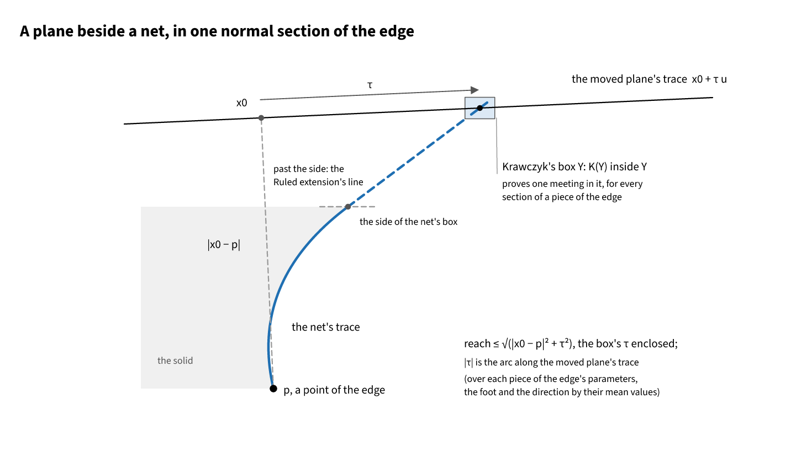
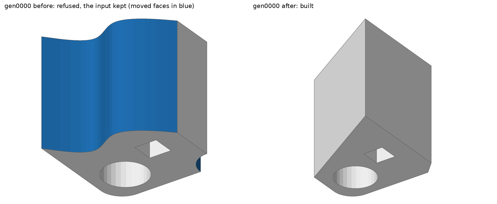
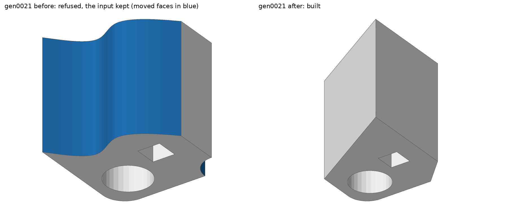
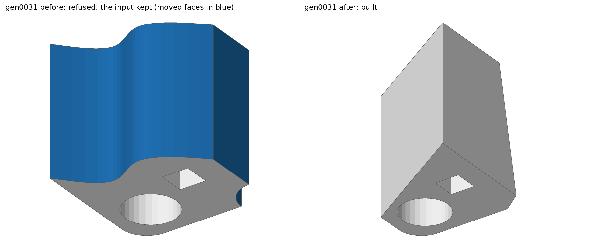
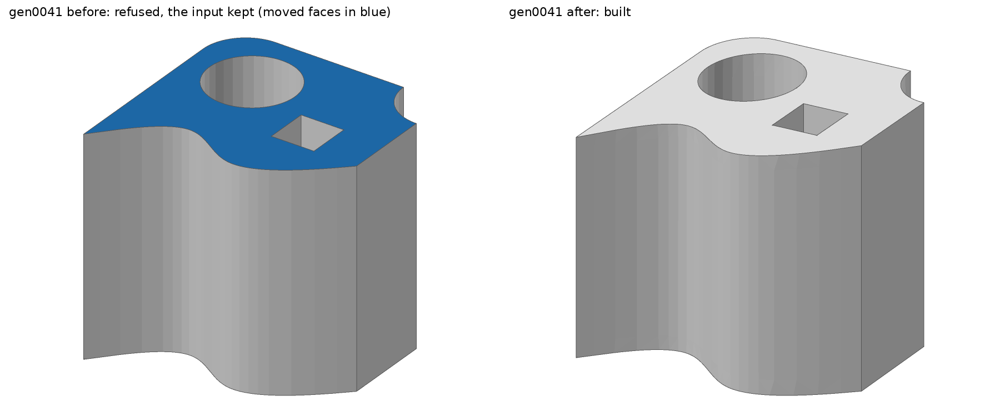
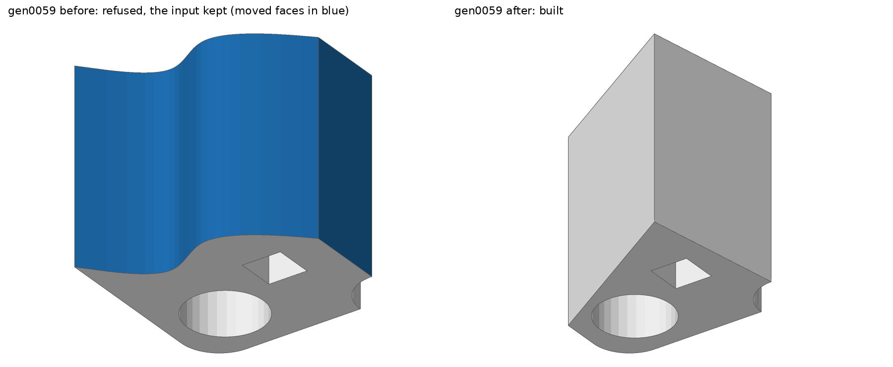
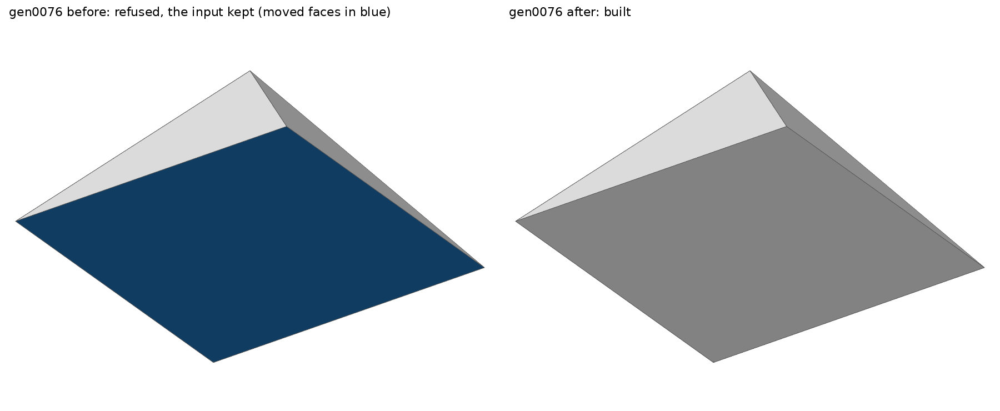

# offset.offset_executive: a local operation's reach beside a bare B-spline net (2026-11-08)

Unit: `offset.offset_executive` (`local_extension_reach` in `offset_executive/reach.rs`, the
net in `reach/net.rs`), seen through `topology.brep_local_operation`.

**Cause.** The local operation's reach bounded a plane only against a plane, cylinder, cone or
sphere with an analytic label. A neighbour stored as a bare B-spline net (no label, no
definition) had no class, so the operation was refused as `ReachUncertified`. In
`Solids/extrusion.smb` two walls are extrusions with no label (of a cubic B-spline and of a
rational curve of lines and an arc). The four sides of `Solids/pyramid.smb` are bicubic nets
with a pole at the apex: faces 3 and 4 lie on a plane to 7.1e-15, faces 1 and 2 only to 1.9e-6
(their points are stored in single precision; the B-rep tolerance is 1.0e-3).

**The bound.** In each normal section of an edge, the plane's trace `x0 + τ u` meets the net
at a `(u, v, τ)`. Krawczyk's operator proves that meeting for every section of a piece of the
edge's parameters [Krawczyk 1969; Moore 1977], and the reach is `√(|x0 − p|² + τ²)`. Past a side,
the net is the extension the executive builds (`Ruled`): `H + s′ H_v` in homogeneous
coordinates, and `H + s′ H_u + t′ H_v + s′ t′ H_uv` past a corner, where both sides' rows end
in one weight ratio. A test checks this model against the built extension.

*The meeting past the net's side, `τ` along the moved plane's trace from the foot `x0`.*

**Cases.** Seven cases of `topology.brep_local_operation` are built now, and each was refused
before: `gen0000`, `gen0021`, `gen0031`, `gen0041`, `gen0048` and `gen0059` (extrusion), and
`gen0076` (pyramid). Below, each is shown before (the input kept, the moved faces in blue) and
after, from the same view.

**Still refused.** On the pyramid, eight cases move a side whose net ends in the apex pole.
They are still `ReachUncertified`, and the meeting left unproved there is not traced yet.
`tests/issue_2978_local_reach_beside_nets.rs` carries the closed-form volumes.
