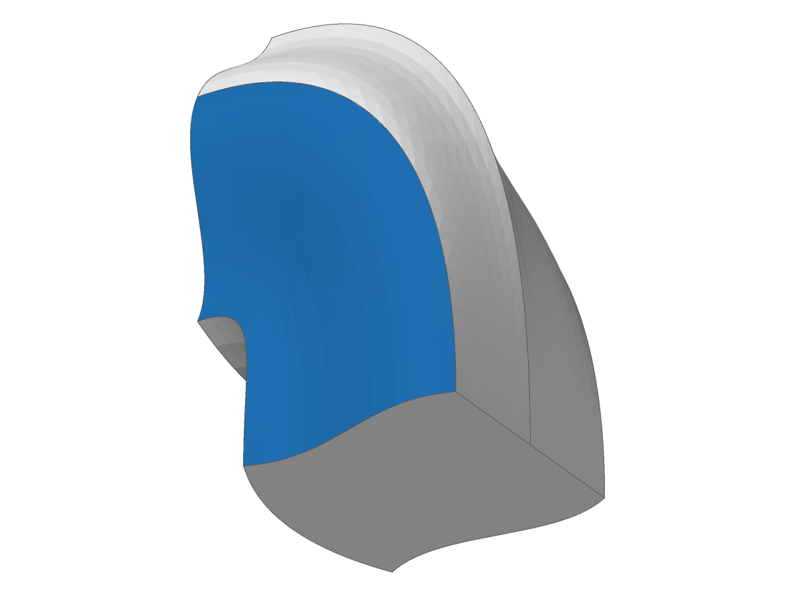
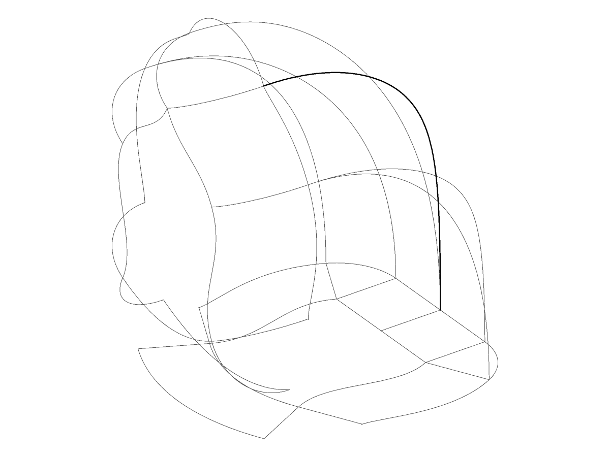
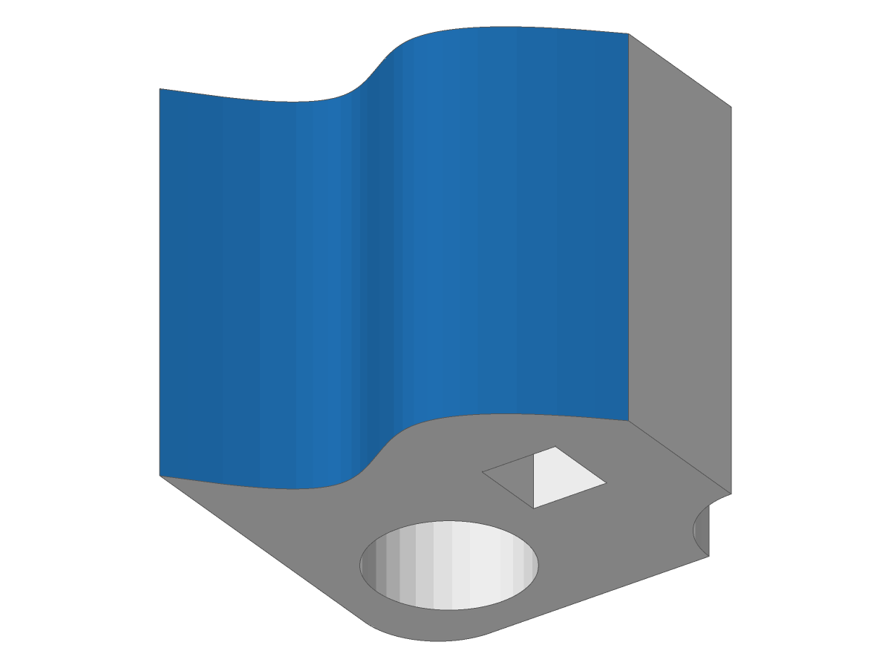
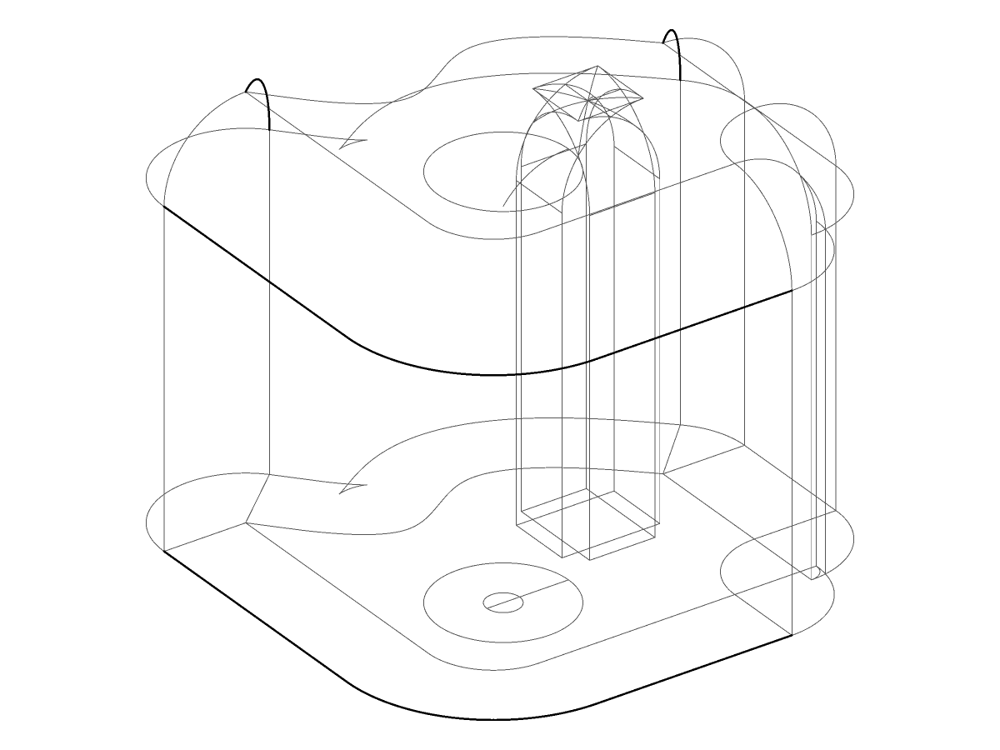

# Offsets that fold are refused by default; the bodies SMLib built by deleting the face

- **Unit:** `offset.offset_executive_p2`, the 20 cases of `fillet2_lamina_face_delete.json`
  and `rounded_lamina_face_delete.json` whose offset folds: `Fillet/brepForFillet2.smb` face 2
  (least radius 3.958 outset, 5.074 inset) and face 3, offset 5.6 and 11.2;
  `Defeature/extrusion.smb` face 2 (1.126 outset, 1.533 inset), offset 2.0 and 2.5. Face 0 is
  the shell face in each.
- **Before (main at 6d80b31ee, `UpstreamFixes::default()`):** the folding face's offset is
  built inside out and `BuildOffsetOfFaceuse`'s lamina-edge test deletes it, as upstream does;
  the rest is merged. 16 cases built a body this way (status 1000); 4 failed later in the
  executive (1001). Written as `.smb` by a scratch test and drawn with `solidcore-diag`
  (`--highlight 2` for the input; `--wireframe` for the result, whose faces keep implicit
  offset surfaces that have no record):
  - `fillet2_f0_d0_out_rnd` (outset 5.6): 20 faces, 46 edges, 27 vertices, the C++ reference's
    face count.
  - `fillet2_f0_d0_in_rnd` (inset 5.6): 5 faces, 24 edges, 23 vertices.
  - `defeature_extrusion_face0_outset2_5_rounded` (outset 2.5): 64 faces, 133 edges, 67
    vertices.
- **After (S1 by default):** `refuse_folding_offset` refuses each before any face is built,
  with `OffsetFailure::Folds` naming the face, the distance and the least radius on the
  displaced side (status 1001, no body). `docs/offset-and-shell.md` §8, invariant 3: a face
  whose offset folds is never built and trimmed. A body for these inputs is the arrangement's
  (S3 to S5, open): the offsets cut into cells and the cells kept by winding number.

