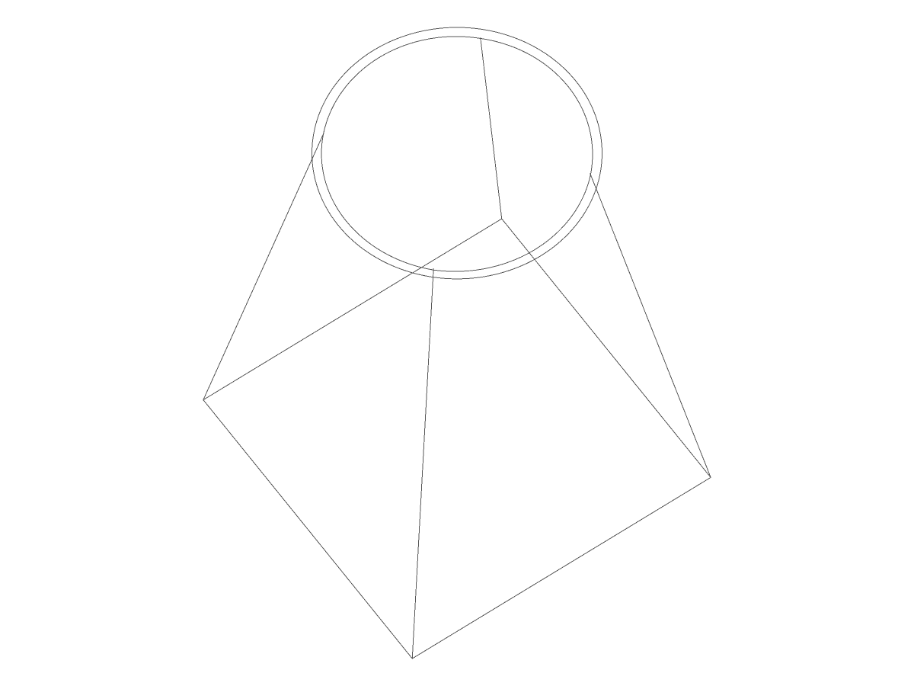
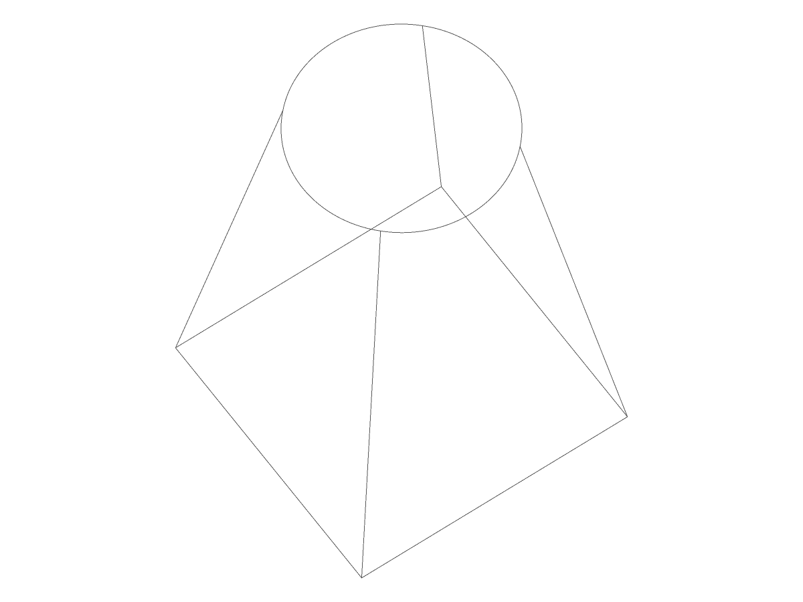
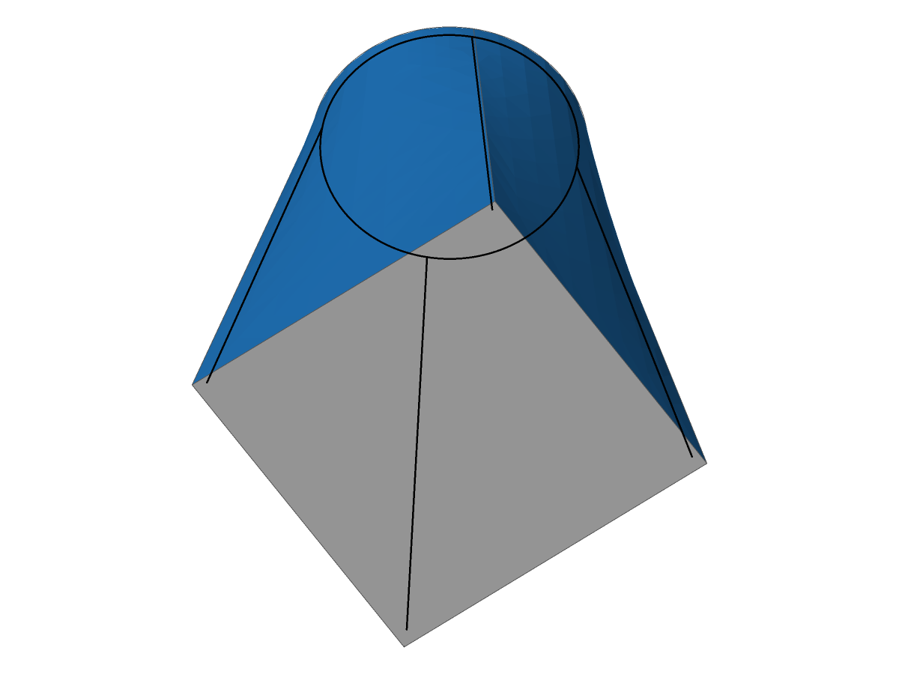

# The crossing classifier requested derivatives it never consumes

- **Units:** `offset.offset_geometry_creation`, `offset.offset_executive_p2`.
- **Reported case:** #1818, the square-to-circle loft shelled inward by 1, open at
  its top. This is a correction within #3056, not a new construction or flag.
- **Measured predecessor:** `0c53c6e0ebac6cd3eedcfa7416750c14b706b72c`, based on
  `b13f07fbdd7fe298f923911af88e266bb9fe4ea2`.

## Cause and bounded correction

An isolated diagnostic snapshot records four `MateEdges` failures at
`offset_geometry_creation::passes_through`. Every backtrace reaches
`OffsetSurface::evaluate` with `hu=2`, `hv=2`, `only_upper_half=false`. That is a
fourth-total-order request, correctly refused by the implicit offset's existing
maximum total order of three. The crossing formula reads only `Su`, `Sv`, `Suu`,
`Suv` and `Svv`, so it needs only the second-order triangular jet.

The correction requests that jet with `only_upper_half=true`. It changes no
formula, derivative limit, normal treatment, tolerance or requested-grid contract.
The equal `(2,2)` triangular grid is not an unequal-grid alias workaround. No pole
patch, retry or fallback is added.

The earlier stale-mating-bookkeeping hypothesis was refuted: original rim edges
2, 6, 10 and 14 were already unmated before loop closure, and SSI remained enabled
for both incident faces. No speculative invalidation was added. After the caller
correction, the diagnostic #1818 selection has no derivative refusal and no
gap-closing split; all four active tests pass (one generator stays ignored).

## Regression and verification

The new regression offsets the plane `z=-0.5` by `0.5`, independently confirming
that its point is on `z=0`. It preserves the full `(2,2)` refusal and checks a
within-tolerance touch, a lifted quadratic crossing and a shallow straight
crossing against the existing geometric rule. With the production caller
unchanged, the plane control passes and this regression fails on the unsupported
request. With only the triangular caller correction, both pass.

The uncommitted source measured in the primary worktree has SHA-256
`2713a22ea271eb08487333a7693794da0d57abbb5a073bd55ea41668772170e9`.
Rust 1.98.0, `CARGO_BUILD_JOBS=2`, commands under `nice -n 10`:

- Both crossing regressions and all seven creator-module tests pass.
- All four active #1818 tests pass, including the unchanged Level-0/1/2 validity,
  outward-solid, eleven-face and independent cavity-slab-volume assertions.
- The 17-binary integration selection records 56 passed, 5 failed, 9 ignored;
  the predecessor records 53 passed, 8 failed, 9 ignored. The three repaired
  failures are #1818. The other failures are not waived.
- Local-operation tests remain 28 passed, 7 failed, 2 ignored. No helper,
  reason assertion, rollback assertion or soundness-gate implementation changes.
- Workspace fmt, workspace/all-target clippy (`-D warnings`), wasm32 and panic
  inventory pass.
- All 2,745 cases of the four affected golden units remain selected, including
  121 existing known failures; none is added, removed or broken. The real gate
  still has 43 p2, 1 geometry-creation and 13 local-operation differences.

A complete ordinary-record comparison against the predecessor finds exactly one
caller-induced change: `issue1818_square_to_circle_loft_api_shell_1_top`, from
status 1001/no body to status 1000/ownership transferred and result counts
`[2,2,11,12,24,96,16]` (regions, shells, faces, loops, edges, edgeuses, vertices),
with bbox `[-20,-20,0,20,20,60]`. It was already an unapproved changed case; no
previously matching ordinary case moves. All other ordinary encodings agree.
The temporary raw-capture directory has no failure registry and preserves all
known-case outputs too; it is not a second successful gate or an approval to
bless them. Repository goldens and failure entries remain untouched.

## Native views and limitations

The same public-stage builder, view `-35,60` and image size `1200x900` are used.
The before offset has 6 faces / 20 edges / 16 vertices and is non-manifold; the
corrected merged offset has 6 / 12 / 8 and is manifold. The two offset images are
explicitly native-edge wireframes: shaded intermediate rendering is unsupported
because a face has no exact record. No intermediate meshing success is claimed.

| Before caller correction, native edges only | After caller correction, native edges only |
|---|---|
|  |  |

The corrected shell is 11 / 24 / 16 and manifold on both default and mated paths.
Its native shaded render succeeds with 2,368 triangles and no refused face:

These images come from the diagnostic snapshot plus the single caller correction;
the direct, uninstrumented primary-worktree tests supply the validity and volume
evidence. The independently measured old-main control remains attributed to
`6432dafe7d716a973a653fca72d5d4c7cd7002c8`, not to the newer integrated base.
This record claims neither a full-suite/all-unit-goldens pass nor canonical CI
success. The remaining #3056 construction and expectation blockers remain open.
