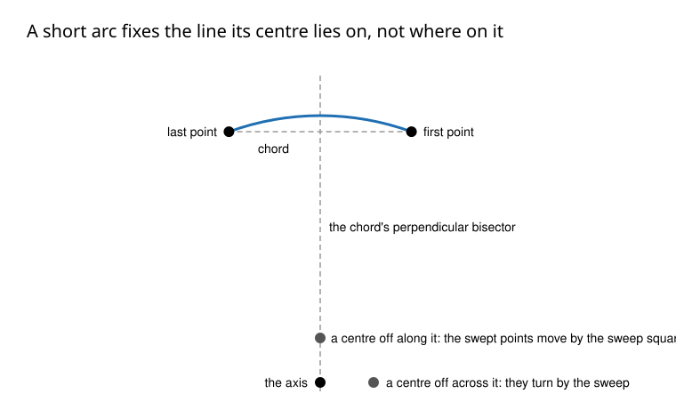

# surface.implicit: a surface of revolution swept under a degree is derived about an axis off sideways (2026-11-15)

Unit: `surface/implicit.rs`, `AnalyticSupport::derive_revolution`, reached when a body is read
back into the kernel (`adopt_definitions` → `exact_from_record`). Issue:
tangency-labs/solidcraft#17004, from the design in tangency-labs/solidcraft#16948.

**Inputs.** The two nets in `crates/solidcore/tests/data/short_swept_revolution_nets.jsonl`:
plane-to-cone round pieces, a 2 mm arc revolved 0.4466 degrees about the world z axis at a
radius of about 15.6 mm, mirror images of each other in y = 0. And the net in
`long_swept_revolution_net.jsonl`, the same round's piece on the cone's lower rim, swept
286.26 degrees in four spans.

**Values.** The recogniser (`is_nurb_surface_surf_of_revolution`) takes the axis from the circle
through the first sweep's points at 0, 0.45 and 0.9 of it (`is_arc`). Its centre lay 3.8e-11 mm
from the axis on the second net. The worst point of the derived surface was 4.2e-13 mm off the
form, against a certified rounding bound of 3.8e-13 (`evaluation_margin` 1.097), so the net was
refused. The first net passed at 0.79. Taking the centre from a sweep row's control triangle as
is gives 1.055. Projected onto the chord's perpendicular bisector it gives 0.59 and 0.51. With
the exact z axis it would be 0.31 and 0.35.

*A short arc fixes the line its centre lies on well, but not the centre's place on that line. A
centre off across the bisector turns the swept points by the sweep; a centre off along it moves
them only by the sweep squared.*

**Cause.** A short arc's control points fix the centre's distance along the bisector only to
their rounding over the arc's angle squared, about 1e-10 mm here. The bisector itself is fixed to
that rounding over the angle. Only the error across the bisector turns the swept points far
enough to fail the bound.

**The x axis.** The surface's polar converter measures the NURB's angles from the x axis on
one sweep circle, the sweep iso at the generator's start (`RebuildPolarConverter`). On the long
net the generator's two ends, the rows of radius 14.17 and 15.59 mm, start 5e-14 radians apart.
With the x axis on the outer row, every converted angle was 2.9e-12 degrees short and the
swept points 7.5e-13 mm off, margin 1.68; the recogniser's frame gave 0.014. With the x axis
and the sweep's end on the converter's circle, the net evaluates as its form within 64 ulps of
its size (`a_revolution_net_swept_past_half_a_turn_derives_about_its_own_axis`).

**Change.** `derive_revolution` reads the axis and centre off the form's control structure,
as the cylinder, cone and torus derivations do. The centre is the largest control
triangle's, projected onto the chord's perpendicular bisector. The x axis and the sweep come
from the polar converter's sweep circle. The recogniser gives the conventions only. The
comparison and its bound are unchanged.

**Not changed.** `torus_from_net` and `revolved_from_rows` take the triangle's centre as it is. A
torus or cone swept as briefly may be refused the same way; no such case is known yet.
