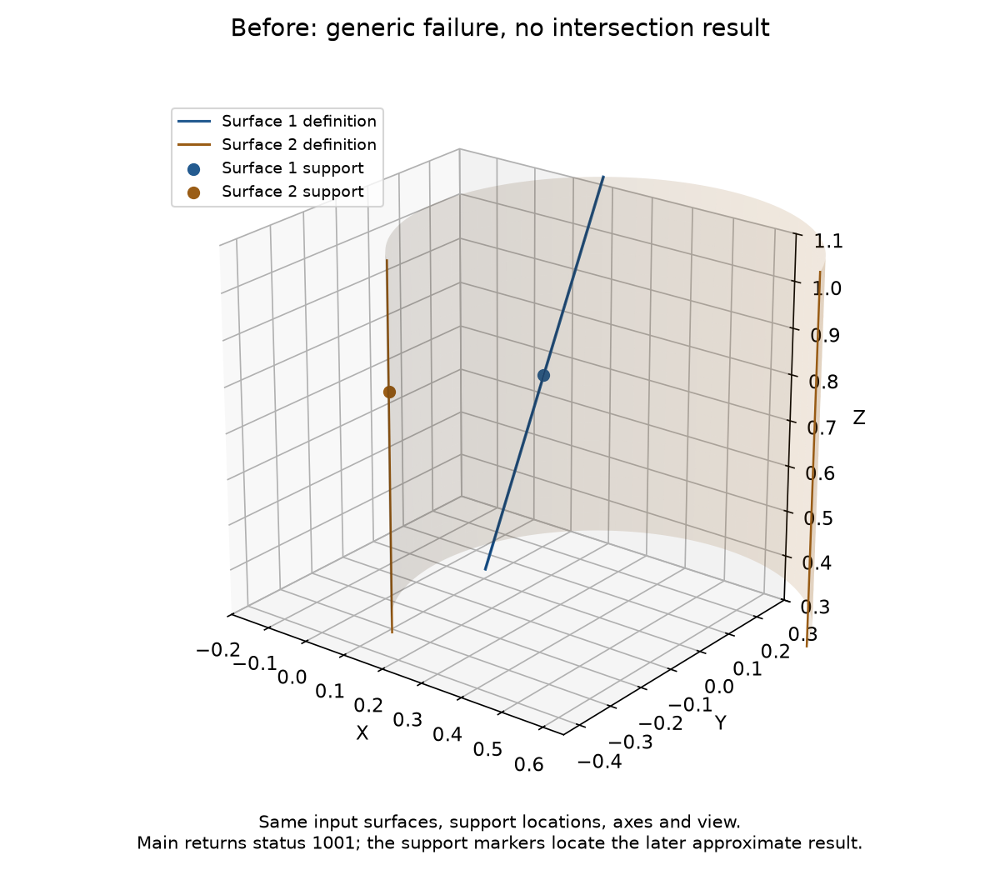
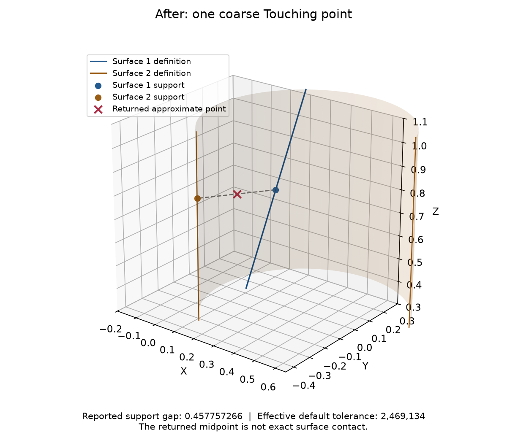

# surface.surf_of_extrusion_p2: gen1140 has finite geometry hidden by infinite summaries (2026-11-09)

Unit: `surface.surf_of_extrusion_p2`, generated case `gen1140`, seed
`488064524036223709`. Review: [SolidCraft PR #14102, comment 4513288400](https://github.com/tangency-labs/solidcraft/pull/14102#discussion_r4513288400).
Before is main `f9ed9a90b453517d83e787169887c180e17656fd`; after is PR head
`94ae5e1806a59af4322ec50fd81af232161a363f`. This review adds evidence and a test,
without changing production code, tolerances or the golden for this case.

## Input and operation

The [complete input](surface.surf_of_extrusion_p2--gen1140-finite-touching-2026-11-09/inputs.json)
calls `GlobalSurfaceIntersect` on two canonical circular extrusions. Each has natural
domain `u=[0,1]`, `v=[-1234567,1234567]`. No subdomains or distance tolerance are supplied.
The angular tolerance is `0.8597847535718885` radians. The runner's canonical construction
does not apply the optional `swap` flag; both controls use that same documented contract.

The first generator has radius `0.0011017719029684117`, angle interval
`[-10.363218241188292,173.45375574785606]` degrees, and sweep vector
`(203.84970807254348,171.23280058037045,963.9111082066343)`, of length 1000.
The second has radius `0.42834665127211624`, angle interval
`[20.55517033136752,226.74404969538529]` degrees, and unit Z sweep.
Centers and generator axes are retained in the input file.

## Decoding the result

| Field | Before | After |
| --- | --- | --- |
| source build status | 0 | 0 |
| target build status | 0 | 0 |
| operation status | 1001, generic failure | 0 |
| needs more work | no result | false |
| curve count | no result | 1 |
| intersection type | no result | `Touching` |
| 3D representation | no result | degree-1 B-spline, two identical control points |
| curve interval and knots | no result | `[0,1]`, `[0,0,1,1]` |
| returned point | no result | `(0.13108241094191694,-0.08920738291450833,0.7767906510271132)` |
| surface 1 UV point | no result | `(0,0.0007553266208439213)` |
| surface 2 UV point | no result | `(1,0.8252226756415861)` |
| reported deviation | no result | `0.45775726612524936` |

Both UV coordinates are inside the supplied natural domains. The raw output has 32 finite
values. The two unweighted control points carry finite `NOW=-f64::MAX` weight sentinels.
Adding these sentinels overflows the golden encoder's sums to `[-inf,+inf,-inf]`.
Those summaries therefore conceal finite status and coordinate changes.
The [raw outputs](surface.surf_of_extrusion_p2--gen1140-finite-touching-2026-11-09/after-raw.json)
retain every value and its binary64 bits; the archived before output retains the original refusal.

## Independent geometric check and its limit

The omitted distance tolerance does **not** select the kernel's `5e-6` approximation tolerance.
The existing intersector instead derives a default from the surface's extent:
the sum of its two diagonal half-lengths, divided by 1000. For this nearly infinite extrusion,
the effective value is **2,469,134.0**. The test independently checks that scale against the
first sweep's length times the V interval length, divided by 1000.

At the returned generator endpoints, each surface's defining point is directly
`center + radius*(x*cos(angle)+y*sin(angle)) + height*sweep`.
No fitted spline supplies these reference points. Direct evaluation gives approximately:

```text
S1 = (0.1515496571916875, 0.13355002222430418, 0.7283587064043187)
S2 = (0.11061516966501522,-0.31196478390114496, 0.8252226756415861)
|S1-S2| = 0.45775725366450076
|P-S1| = 0.22887862061182393
|P-S2| = 0.22887863305268372
|P-(S1+S2)/2| = 4.012679466715975e-8
```

The returned point is the midpoint of the two spline support evaluations, within rounding,
and approximates the midpoint of the independent definitions. Its deviation bounds its distance
to both supports and is far below the effective caller tolerance. This establishes the
reported **coarse approximate** result under this API's default. It does not establish exact
physical contact, `5e-6` accuracy, intersection completeness or a valid body construction.
The huge inherited default is explicitly a limitation, not evidence of high accuracy.

The test bounds rounding with `gamma(128)` times the maximum positive-weight control-net
coordinate scale. This covers the two degree-(2,1) tensor evaluations, their rational divisions,
the direct endpoint formulas and midpoint. Sweep endpoints near `1e9` explain the cancellation
floor; no golden comparison tolerance or geometric tolerance is enlarged.
The [measurements](surface.surf_of_extrusion_p2--gen1140-finite-touching-2026-11-09/measurements.json)
and [typed probe](surface.surf_of_extrusion_p2--gen1140-finite-touching-2026-11-09/typed-probe.json)
separate the independent definitions from spline support evaluation and STEP parameter conversion.

## Regression and mutation controls

`review_global_touching_point_is_checked_outside_infinite_sums` lives in the existing runner
test module. It checks the operation status, finite raw coordinates, representation, UV domains,
the support midpoint, deviation, and the actual implicit tolerance. It passes on the reviewed result.

The test also corrupts the operation status and separately moves the X coordinate by one unit.
Both mutations leave the existing compressed golden unchanged. The independent checks reject
both mutations. This specifically covers the information lost in the infinite block sums.

These plots render the actual surface definitions near the returned supports with the same
axes and view. The before markers locate the later supports; main returned no point.





## Post-rebase control (2026-11-09)

The typed replay on rebased head `b1153884028b8168d43af6411c1fb9bc5c1cacca`, based on
main `b0fba036bdc4d34335ed72b2b32d617f838094c4`, reproduces every field and binary64
observation in the archived typed probe. Both UV points remain inside the same
natural domains. The returned point is still the midpoint of the two stored
support evaluations, and deviation remains `0.45775726612524936`.

Independent evaluation of the circular endpoints plus their sweeps again gives
support distances about `0.22887862` and `0.22887863`, bounded by that deviation.
The independent midpoint differs by `4.012679466715975e-8`, within the already
documented large-coordinate rounding allowance. The effective default is still
`2,469,134.0`; this verifies the same coarse approximate result, not exact contact,
`5e-6` accuracy or completeness.

The fresh normal-runner replay also reproduces all 32 raw output values and the
separate build output bit for bit. Source build, target build and operation status
are all zero; `needs_more_work` is false and the curve count is one. Every value is
finite, including both `NOW` weights. The point and deviation also match the fresh
typed probe bit for bit. The original before status `1001` remains an observation
of `f9ed...`; no new clean-main before control on `b0fba...` was run.

The [fresh raw capture](surface.surf_of_extrusion_p2--gen1140-finite-touching-2026-11-09/rebased-after-raw.json) retains the complete runner result.

The [fresh typed probe](surface.surf_of_extrusion_p2--gen1140-finite-touching-2026-11-09/rebased-typed-probe.json) and [independent rechecks](surface.surf_of_extrusion_p2--gen1140-finite-touching-2026-11-09/rebase-check.json) retain the post-rebase evidence.
