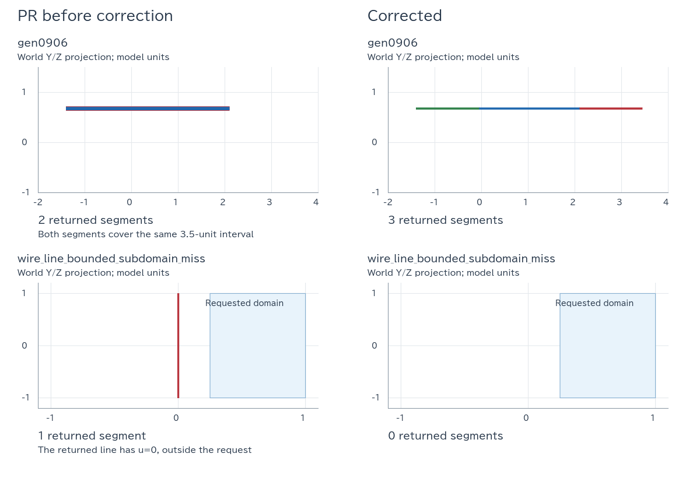

# surface.surf_of_extrusion_p2: plane-route golden audit (2026-11-18)

Unit: `surface.surf_of_extrusion_p2`. Issue #18863, PR #18870.
The reviewed starting point is `7af30cb49`; the committed golden predates the
plane-parallel dispatch and sweep-deviation changes. This record follows
`crates/goldens/README.md` (Checking and blessing) and `plan/findings/README.md`.

## Independent reference

An extrusion is `S(t,v) = C(t) + v E`. For a plane with unit normal `n` and
origin `O`, its signed distance is

```
n · (S(t,v) − O) = n · (C(t) − O) + v (n · E).
```

For `n · E = 0`, each generator root gives a directrix; a generator interval
in the plane gives a coincident patch. Every directrix must also intersect
the requested plane domain. For a nonzero normal component, the maximum
additional plane displacement over an interval is `max(|vmin|,|vmax|)|n·E|`,
including when neither endpoint is near zero. A special case that cannot
meet its tolerance must request the general intersection.

The implementation encloses the dot product with `gamma(5) sum |ni Ei|`
and the subsequent multiplication with `1 + gamma(2)`. This is an enclosure
of sweep drift, rather than a sampled estimate. Golden agreement is not a
correctness argument; the derivations below use the defining geometry.

## Fixture verdicts

### `wire_line_bounded_far_tol`: accept empty

`S(s,v)=(s,0,v)`, `0≤s≤1`. The bounded plane is
`P(u,w)=(0,0.01+u,w)`, `0≤u≤1`, `−1≤w≤1`. Equality requires
`s=0`, `u=−0.01`, outside the plane domain. There is no intersection.
The previous line was outside the bounded plane. The caller's `tol=0.1`
is capped at `1e-6` by this special case; the gap is larger than that cap.

### `wire_line_bounded_subdomain_miss`: regression; restore empty

`S(s,v)=(s,0,v)`. The plane is `P(u,w)=(0.5,u,w)`, with requested
domain `0.25≤u≤1`, `−1≤w≤1`. Equality requires `s=0.5`, `u=0`,
outside the requested domain. The new directrix route incorrectly used
the plane's natural domain `−1≤u≤1`, producing a false positive.
Clip to `other_uv_domain` instead. The regression test also checks an
included directrix whose endpoints must be clipped to the requested
plane coordinate interval `[0.25,0.75]`.

### `adv_tilt_1e-09`: accept special-case deferral

`C(θ)=(cos θ,sin θ,0)`, `E=(0,0,2)`, `|v|≤1234567`. The plane is
`x+εz=0.3`, `ε=1e-9`. Its exact intersection is

```
S±(v) = (0.3−2εv, ±sqrt(1−(0.3−2εv)^2), 2v).
```

The old two vertical lines held `x=0.3`, `y=±sqrt(0.91)` and claimed
zero deviation. Their maximum plane distance is
`2 ε 1234567 / sqrt(1+ε²) = 0.002469134`, exceeding `1e-6`.
Requesting the general solver is correct; it does not assert an empty
intersection.

## Overlapping directrices: reject the initial changes

`gen0193`, `gen0786`, `gen0906`, `gen0944`, and `gen1099` return two
overlapping directrices after the broad dispatch change. This is not a
closed-boundary improvement. Two distinct planes containing `E` intersect
in one line parallel to `E`. All generator roots in the target plane lie
on that line. Their swept intervals must be classified as a union; emitting
each root's full directrix duplicates their overlap. Re-solving the second
directrix origin selects the first generator root again: four rows also lose
a valid tail. Restoring the previous classifier alone is insufficient: in three rows its
normal-projection fill also labels exterior intervals as `Surface`. Its attempted
`Nothing` marker is immediately converted to `Unknown` by `set_class_object` when
no object is supplied, so testing the returned class cannot recover this fact.
For each candidate interval midpoint `P`, test bounded sweep membership directly.
First find every requested-generator root on the common line, independently of
the sweep caps. The query line uses a unit direction and a finite interval
containing the generator's entire certified positive-weight control hull. Its
origin is recentered near a hull point using fused affine coordinates; the query
tolerance encloses origin, direction and line-representation rounding, including
the recentering shift. With that nearby origin,
`R > max_i (|H_i−O|_1 + 3 error_i)`, widened for arithmetic error, gives
`O + q D`, `−R≤q≤R`. Every generator point is in that hull, so this bounds the
complete root search while keeping its coordinates near the profile.

For each resulting generator point `C_i`, compute
`v_i = clamp((P−C_i)·E/(E·E), vmin, vmax)` on the intersection of the analytic
and requested sweep intervals. Accept a source witness only if
`|P−(C_i+v_i E)|` is within the capped tolerance plus certified evaluation and
arithmetic error. Every chosen `v_i` is inside the real bounded source. The
whole-output source-distance certificate below bounds all emitted points. An
interval without a valid source witness is exterior. This local check leaves
the shared classifier unchanged. A `RangeOfValues` root represents a continuum
of source fibers and therefore requests the general solver; keeping one endpoint
would incorrectly discard the continuum's middle. A regression test uses
`C=(-1,0,0)→(0,0,0)→(0,10,0)→(1,10,0)`, `E=Y`, `V=[0,1]`,
and target `x=0`, whose attained intersection is `Y=[0,11]`.

A first implementation queried each far-away midpoint with a sweep-length
bounded line. In `gen1099` that numerical query missed the second generator
root and dropped the upper tail `[777806.3559364231,777807.4182424814]`.
The independent union derivation rejected that intermediate result. Searching
on the common line within the generator hull avoids both the distant origin
and the sweep-cap root filter; source bounds are checked separately. The
`parallel_rational_sweep_keeps_both_far_tails` regression test requires the
independently derived full union and checks adjacency without duplicate overlap.

For example, the degree-one generator through `(-1,-1,0)`, `(1,0,0)`,
and `(-1,1,0)`, swept along `Y`, crosses `x=0` at `(0,-0.5,0)` and
`(0,0.5,0)`. An effectively infinite sweep clipped to `-2≤y≤2` gives
the same segment twice with the initial dispatch. Its exact intersection
is the one segment `[(0,-2,0),(0,2,0)]`. The regression test checks its
union and endpoints directly. A finite variant with `E=2Y` and `0≤v≤1`
checks `[-0.5,1.5] ∪ [0.5,2.5] = [-0.5,2.5]`, allowing a partition
but no interior overlap. A further finite variant adds a normal sweep
component `2^-44` and requires every returned deviation to include at least
that full drift. This exercises the restored classification route, even when
its constructed output lies exactly on the supplied plane. Every parallel-sweep route now starts with the sweep bound.

A certified generator in the supplied plane may bypass planar interval
classification to construct a coincident patch. A transverse planar
generator must keep interval classification. Reuse the existing positive
weight control-net certificate against the supplied plane, rather than
making this choice from the inferred normal of a thin generator triangle.

## Profile residual and drift must add

Let `r=2^-44`, `C(t)=(r,-1+2t,0)`, `E=(r,0,1)`, `0≤v≤1`, with
target plane `x=0`. Then `S.x=r(1+v)` and the far boundary has distance
`2r`. The initial sweep-only deviation is about `r` and does not bound it.
The source profile's certified residual and the sweep displacement add.

With the same profile, `E=Z`, `-1≤v≤1`, and a target rectangle strictly
inside the patch, clipping constructs all four sides on `x=0`. Their
target-plane residual is zero, but the source extrusion lies on `x=r`.
Their deviation must retain at least `r`. The regression test checks
both configurations on degree-one control segments, covering every point
rather than selected samples.

## Reading the stored values

For the per-row table, `E` denotes the complete plane-operation output
`[0,0,0,0,0,0,0]` (success, no handoff, no curves); `D` denotes
`[0,1,0,0,0,0,0]` (success, handoff required, no special-case curves).
`GE` is the corresponding global-operation empty output with an additional
leading success entry: `[0,0,0,0,0,0,0,0]`. `F` is the complete global
record `[0,1001]`: successful fixture construction followed by an explicit
unresolved surface failure, with no successful-empty payload.

`K(n)` denotes the **complete stored** long-array value
`{"blocks":[["-inf","inf","-inf"]],"n":n}`. All these rows have
`build=[0]`. For these degree-one segments, `n=31,55,79,103,127` means
one, two, three, four, five returned segments respectively; the global
operation adds one entry (`n=32` for one segment).

The stored block sums overflow because the non-rational weight marker is
`NOW=-f64::MAX`. Those infinite moments conceal coordinate and deviation
changes at an unchanged array length. They cannot be inverted to recover
old coordinates. The audit therefore preserves the full stored values,
the original PR's raw outputs and the corrected raw outputs, and checks
their geometry independently. An unchanged stored line is not evidence
that its coordinates are unchanged. In particular, `gen0029` changes
only the handoff flag from zero to one; the reported 100% movement is not
a 100% displacement of geometry.

## The other three empty results are regressions

### `gen0317`: a line endpoint gives a complete directrix

The generator is the line from
`A=(1.6424282115340212,4.191812055542643,-4.002740938533824)` to
`B=(1.6424282115340212,5.734466112976998,-4.320040760290739)`.
The sweep is `E=(0.001,0,0)`, `V=[2.736341766260848,8.229820056406474]`.
The target normal is `(0,-0.8238675923367362,-0.5667823129714524)`
and its origin has `y=B.y,z=B.z`. Substitution gives
`n·(C(t)−O)=1.0911027572261252(1−t)` and `n·E=0`.
Thus `t=1` gives the whole directrix. Its ideal X endpoints are
`1.645164553300282` and `1.6506580315904276`, with constant `y=B.y,z=B.z`.
The original PR's empty answer loses this line. Restored planar classification
returns it. Its initial reconstructed X endpoints were
`1.645164553336038` and `1.6506580319527375`: the latter exceeds the
bounded source by about `3.6231e-10`. Exact target-plane incidence (`n.x=0`)
therefore does not justify deviation zero. Out-of-bounds evaluation permits
evaluation, not enlargement of the requested source domain.

For every accepted midpoint root, the correction retains a certified generator
point and its evaluation error. That point defines a genuine bounded source
segment `C(t)+vE`. Distance to this fixed convex segment is a convex function:
its maximum over the output curve’s positive-weight control hull is bounded
by the hull vertices. The implementation encloses vertex distance with the
L1 norm, both point-error bounds, and outward arithmetic error. Each complete
segment certificate bounds the whole curve; their minimum is still a bound.
The reported deviation includes this source-distance bound in addition to
target-plane residual and sweep drift. A regression test checks both finite
X endpoints against the independently calculated source caps.

### `gen0825`: an attained circle root gives a finite line

The circle has constant `x=-0.1640196490825696`, center
`(y,z)=(-3.725807343855145,4.000719425972502)`, radius
`1.114285647355192`, and angular interval
`[86.56100285398867°,147.72500632304042°]`.
The target plane has normal
`(0.537743252141752,0,-0.8431086494491753)` and origin
`(-0.1640196483242401,-9.249707008108787,4.686599780394647)`.
At this X its plane equation fixes `z=4.686599779910977`.
The attained root is `θ=142.00929075389274°`, with
`y=-4.603987646516854`. Adding
`v E`, `E=(0,0.5888845988206622,0)`,
`v∈[-9.36523537787511,-5.424093171706742]`, gives
`Y=[-10.11903052487791,-7.798152577903273]`.
Its target UV endpoints are approximately
`(-0.49422618433880366,-0.71516701232771)` and
`(0.8252350192758114,1.1941513416690983)`, both inside the requested
rectangle. The false-empty global result is a regression; restore this line.

### `gen1113`: unresolved at zero tolerance must be an explicit failure

The generator is a rotated parabola
`C(s)=f(s²X+2sY)`, `f=0.23681154935845689`, where

```
X=(-0.5222483795623447,-0.5164133560594942,0.6786559332444352)
Y=(0.7920279342718203,-0.588734748734649,0.16150277695898263)
s∈[0.8356207714308481,4.420145634594439]
E=(-0.3291151918968259,-0.6473691290951337,-0.7458712366999675)
v∈[0,1]
```

Substituting the stored plane origin/normal from `initial-35.json` into
`n·(S−O)` gives `A s²+B s+C+D v`, with
`A≈0.23662131702788397`, `B≈0.018980225240233777`,
`C≈−2.7809268661502835`, and `D≈5.043336298116597e−17`.
The positive root is approximately `s=3.388341260970495`, inside the
interval. Directly from the constructed quadratic control net, let
`q=(s−smin)/(smax−smin)`. Its signed plane residual is

```
3.0403043544534674 q² + 1.485540374939795 q − 2.599842904196208
    + 5.043336298116597e-17 v.
```

The attained endpoint residuals are below `−2` and above `1` for both
`v=0` and `v=1`; its interior root at `v=0` maps to
`s=3.3883412609704948`. The continuous positive-weight control net
therefore certifies a crossing. Its three control-point distances from the
plane origin are approximately `2.762`, `1.862`, `2.016`. Each plane UV
coordinate is bounded by that distance, far inside the natural marker
rectangle `[-1234567,1234567]²`. Thus the whole UV hull is inside the
requested target domain, and the source includes `v=0`.

The caller requires zero tolerance. The special case correctly declines the
nonzero drift, but the general solver then returned successful empty. That
loses a certified intersection. The correction reports an explicit unresolved
surface failure for this certified situation; it does not fabricate an exact
floating-point curve or bless empty. The error guard requires the full requested
generator interval, clamped attained endpoints, continuity at every interior
knot, positive weights, opposite residual signs beyond rounding errors, the
entire projected control hull inside the target domain, and `v=0` inside the
requested sweep. A discontinuous generator jumping across the plane cannot
satisfy this proof. Tests cover that counterexample, all three global dispatch
forms, and a genuinely disjoint translated plane that must remain empty.

## Supporting calculations

All 25 accepted handoffs have physical normal sweep drift above the effective
requested tolerance, even before adding the rounding certificate. The complete
per-row substitutions, dot products, interval extents, tolerances and bounds are
in [handoff-bounds.md](surface.surf_of_extrusion_p2--plane-route-golden-audit-2026-11-18/handoff-bounds.md).
This proves that the special construction cannot certify those sweeps. It does
not assert that each previous empty result was wrong, or that every bounded
piece of an old line exceeded tolerance after clipping.

The five duplicate/missing-coverage cases are solved from their generator
polynomials or circle equations in
[interval-unions.md](surface.surf_of_extrusion_p2--plane-route-golden-audit-2026-11-18/interval-unions.md).
The exact unions, rather than old counts, determine the corrected answer.

## Original comparison and provenance

The preserved executable built from PR head `7af30cb49` reports 1,528 cases,
exactly 35 changed rows, zero added, removed or broken rows and zero known failures.
Its SHA-256 is
`7d6270de160d47f8523dafcd5bf9926965ab333b432ba0a26f39e9c52658c20b`.
The capture includes each case's complete input, actual constructed generator
control net, plane normal, sweep vector and interval, tolerance, old stored
output, initial changed output and uncompressed initial raw output in
[initial-35.json](surface.surf_of_extrusion_p2--plane-route-golden-audit-2026-11-18/initial-35.json).
These are measurements of this worktree, not reconstructed old coordinates.

The first run could not load two SMLib fixture data files. The missing
`TestFiles/pt_TestFiles/Fillet/eg1_srf1.smb` and `blade_fillet_fails.smb`
were copied from an existing checkout on this same machine into the ignored
upstream data tree. Their respective SHA-256 values are
`a857058cbe08e450c4eac5b2212dcf5d275475a12a47d4170ce88cce4530a91d`
and `eeffa6f735c14216d9af2326317b115348de4f09e16676580be825301f420959`.
No external CAD implementation was read or run. The complete rerun includes
those fixtures; neither data file is part of this change.

## Exhaustive original 35-row comparison

The values below are the complete stored values under the notation above;
raw inputs and original PR outputs are preserved in
[initial-35.json](surface.surf_of_extrusion_p2--plane-route-golden-audit-2026-11-18/initial-35.json).
The corrected run has 30 changed rows. Complete corrected raw outputs for
these original 35 are in [corrected-35.json](surface.surf_of_extrusion_p2--plane-route-golden-audit-2026-11-18/corrected-35.json),
and every remaining golden difference is in
[corrected-changes.json](surface.surf_of_extrusion_p2--plane-route-golden-audit-2026-11-18/corrected-changes.json).

| Case | Stored before PR | Original PR | Corrected | Original-change verdict |
| --- | --- | --- | --- | --- |
| `adv_tilt_1e-09` | K(55) | D | D | Accept: drift exceeds tolerance; request general solver |
| `gen0005` | E | D | D | Accept: drift exceeds tolerance; request general solver |
| `gen0008` | E | D | D | Accept: drift exceeds tolerance; request general solver |
| `gen0029` | E | D | D | Accept: drift exceeds tolerance; request general solver |
| `gen0049` | K(31) | D | D | Accept: drift exceeds tolerance; request general solver |
| `gen0176` | K(55) | D | D | Accept: drift exceeds tolerance; request general solver |
| `gen0179` | K(31) | D | D | Accept: drift exceeds tolerance; request general solver |
| `gen0193` | K(31) | K(55) | K(31) | Regression: duplicate bounded line |
| `gen0317` | K(31) | E | K(31) | Regression: lost endpoint directrix |
| `gen0344` | K(31) | D | D | Accept: drift exceeds tolerance; request general solver |
| `gen0350` | E | D | D | Accept: drift exceeds tolerance; request general solver |
| `gen0377` | E | D | D | Accept: drift exceeds tolerance; request general solver |
| `gen0429` | E | D | D | Accept: drift exceeds tolerance; request general solver |
| `gen0484` | K(79) | D | D | Accept: drift exceeds tolerance; request general solver |
| `gen0554` | K(31) | D | D | Accept: drift exceeds tolerance; request general solver |
| `gen0594` | K(31) | D | D | Accept: drift exceeds tolerance; request general solver |
| `gen0614` | E | D | D | Accept: drift exceeds tolerance; request general solver |
| `gen0617` | K(55) | D | D | Accept: drift exceeds tolerance; request general solver |
| `gen0622` | K(31) | D | D | Accept: drift exceeds tolerance; request general solver |
| `gen0709` | E | D | D | Accept: drift exceeds tolerance; request general solver |
| `gen0786` | K(127) | K(55) | K(79) | Regression: duplicate and missing other-root tail |
| `gen0789` | E | D | D | Accept: drift exceeds tolerance; request general solver |
| `gen0822` | K(103) | D | D | Accept: drift exceeds tolerance; request general solver |
| `gen0825` | K(32) | GE | K(32) | Regression: lost circle-root directrix |
| `gen0869` | E | D | D | Accept: drift exceeds tolerance; request general solver |
| `gen0906` | K(103) | K(55) | K(79) | Regression: duplicate and missing other-root tail |
| `gen0924` | K(55) | D | D | Accept: drift exceeds tolerance; request general solver |
| `gen0944` | K(127) | K(55) | K(79) | Regression: duplicate and missing other-root tail |
| `gen1071` | E | D | D | Accept: drift exceeds tolerance; request general solver |
| `gen1099` | K(79) | K(55) | K(79) | Regression: duplicate and missing other-root tail |
| `gen1113` | K(32) | GE | F | Regression: lost certified crossing |
| `gen1117` | K(55) | D | D | Accept: drift exceeds tolerance; request general solver |
| `gen1161` | K(31) | D | D | Accept: drift exceeds tolerance; request general solver |
| `wire_line_bounded_far_tol` | K(31) | E | E | Accept: empty bounded-domain intersection |
| `wire_line_bounded_subdomain_miss` | E | K(31) | E | Regression: requested-domain exclusion |


## Matching-view comparison

The same world Y/Z projections show `gen0906` retaining the complete union
without duplicate overlap, and the requested-domain miss returning empty.
The plot is rendered directly from the two captured raw-output artifacts.



## Independent bounded-plane distance certificate

For each returned positive-weight control vertex `Q`, form the target plane's
stored frame axes `X,Y`, affine basis `A=scale.x*X`, `B=scale.y*Y`, and origin `O`.
Solve its two-by-two Gram system for the projection parameters, then clamp both
parameters to the requested rectangle. The resulting `W=O+u A+v B` is a point
on the real requested patch. Exact rational arithmetic on the stored binary64
inputs checks `|Q−W|²≤reported_deviation²`. This does not assume the stored
basis is perfectly orthonormal and includes tangential boundary error.

The patch is convex. Its Minkowski sum with a radius-deviation ball is convex,
so enclosing every positive-weight control vertex encloses the entire rational
curve. A separate exact-rational normal-plane residual check also verifies the
stored-normal interpretation. These checks bound whole curves, independently
of the production certificate, rather than testing a few sampled points.

## Targeted validation before the far-tail query correction

All commands ran from the worktree root through the queue on Aurora, with
`RUST_BACKTRACE=1` to keep these jobs local. Scratch uses the ignored writable
lane directory because the requested sibling scratch path is read-only in this
sandbox. No full suite was run locally; that remains for CI after the owner pushes.

- `buildq run solidcraft . -- cargo test --manifest-path solidcore/Cargo.toml -p solidcore surf_of_extrusion`:
  exit 0; 54 passed, 0 failed, 5,240 filtered out. This includes
  `parallel_directrix_respects_the_requested_plane_domain`,
  `parallel_coplanar_sweep_intersection_is_not_duplicated`,
  `parallel_coplanar_sweep_respects_reparameterized_source_domain`,
  `parallel_line_deviation_covers_bounded_source_endpoints`,
  `parallel_patch_deviation_covers_profile_and_sweep`,
  `zero_tolerance_plane_fallback_does_not_claim_empty`, and
  `discontinuous_generator_does_not_certify_a_plane_crossing`.
- `buildq run solidcraft . -- cargo fmt --manifest-path solidcore/Cargo.toml -p solidcore -- --check`:
  exit 0.
- `buildq run solidcraft . -- cargo clippy --manifest-path solidcore/Cargo.toml -p solidcore --all-targets -- -D warnings`:
  exit 0, no warnings.

## Corrected capture and independent checks

The final pre-bless queued command was the documented unit-only `--goldens`
command, with a temporary capture hook that was removed afterward. It reproduced
the original executable's 35 changes and compared the corrected source:
1,528 cases, 30 changes, no additions, removals, broken cases or known failures.
Its exit 1 is the expected pre-bless mismatch, not a harness setup failure.

The independent scalar-equation audit passed all five complete interval unions,
including both far tails of `gen1099`. Exact-rational whole-curve checks passed
for all 15 returned curves against both the stored normal plane and the actual
requested bounded patch. The endpoint-cap error in `gen0317` is enclosed by
its reported `3.6236714213502387e-10` deviation. The `gen0825` endpoints agree
with the independent circle equation. The original 35 inputs and geometry match;
all 25 justified handoffs remain unchanged; the final difference set contains
exactly the 30 reviewed rows and no extras.

The final formatting retry passed with exit 0. Its earlier exit 2 was a queue-cap
refusal while two jobs were waiting, and was retried as soon as a slot opened.

## Validation of the corrected source

`RUST_BACKTRACE=1 buildq run solidcraft . -- cargo test --manifest-path solidcore/Cargo.toml -p solidcore --lib surf_of_extrusion`
passed with exit 0: 56 passed, 0 failed, 0 ignored, 5,240 filtered out.
The final query correction adds
`parallel_rational_sweep_keeps_both_far_tails` and
`parallel_flat_generator_range_declines_without_partial_coverage` to the
previous 54 focused tests. Both passed. The final formatting check also passed.

<details>
<summary>All 56 focused test names and results</summary>

```text
test surface::surf_of_extrusion::p1::tests::canonical_extrusion_makes_a_lazy_line_nurb ... ok
test surface::surf_of_extrusion::p1::tests::canonical_perpendicular_extrusion ... ok
test surface::surf_of_extrusion::p1::tests::conversions_need_the_nurb ... ok
test surface::surf_of_extrusion::p1::tests::conversions_round_trip ... ok
test surface::surf_of_extrusion::p1::tests::directrix_spans_the_extrusion ... ok
test surface::surf_of_extrusion::p1::tests::empty_surface_has_no_generator ... ok
test surface::surf_of_extrusion::p1::tests::kept_made_nurb_is_bit_identical_to_a_fresh_one ... ok
test surface::surf_of_extrusion::p1::tests::lazy_extrusion_degree_callers_see_the_made_nurb ... ok
test surface::surf_of_extrusion::p1::tests::lazy_extrusion_knot_callers_make_the_nurb ... ok
test surface::surf_of_extrusion::p1::tests::lazy_extrusion_knots_read_the_made_nurb ... ok
test surface::surf_of_extrusion::p1::tests::lazy_transform_matches_materialized_transform ... ok
test surface::surf_of_extrusion::p1::tests::seam_drop_keeps_the_inward_end ... ok
test surface::surf_of_extrusion::p1::tests::seam_inversion_follows_the_guess ... ok
test surface::surf_of_extrusion::p1::tests::step_clamp_overrides_the_generator_flag ... ok
test surface::surf_of_extrusion::p1::tests::step_clamp_reads_the_analytic_domain_with_out_of_bounds_off ... ok
test surface::surf_of_extrusion::p1::tests::step_evaluators_clamp_to_the_surface_domain ... ok
test surface::surf_of_extrusion::p2::tests::below_threshold_sweep_reports_plane_deviation ... ok
test surface::surf_of_extrusion::p2::tests::copies_on_the_domain_sides_are_not_repeated ... ok
test surface::surf_of_extrusion::p2::tests::crossing_directrix_through_the_region_declines ... ok
test surface::surf_of_extrusion::p2::tests::discontinuous_generator_does_not_certify_a_plane_crossing ... ok
test surface::surf_of_extrusion::p2::tests::extrusion_in_a_bounded_plane_gives_the_clipped_patch ... ok
test surface::surf_of_extrusion::p2::tests::far_origin_corner_slab_has_a_closed_boundary ... ok
test surface::surf_of_extrusion::p2::tests::far_rotated_regions_are_whole ... ok
test surface::surf_of_extrusion::p2::tests::flat_stretch_longer_than_the_sweep_declines ... ok
test surface::surf_of_extrusion::p2::tests::flat_stretch_shorter_than_the_sweep_gives_its_copies ... ok
test surface::surf_of_extrusion::p2::tests::folded_generator_gives_its_strip ... ok
test surface::surf_of_extrusion::p2::tests::folded_generator_with_a_short_sweep_declines ... ok
test surface::surf_of_extrusion::p2::tests::linear_generator_and_missed_bounded_plane_give_nothing ... ok
test surface::surf_of_extrusion::p2::tests::linear_generator_line_is_classified_on_the_surface ... ok
test surface::surf_of_extrusion::p2::tests::nearly_parallel_long_sweep_respects_reported_plane_deviation ... ok
test surface::surf_of_extrusion::p2::tests::non_parallel_extrusions_need_more ... ok
test surface::surf_of_extrusion::p2::tests::nurb_of_an_extrusion_is_recognised ... ok
test surface::surf_of_extrusion::p2::tests::oblique_plane_needs_more ... ok
test surface::surf_of_extrusion::p2::tests::orientation_codes ... ok
test surface::surf_of_extrusion::p2::tests::parallel_coplanar_sweep_intersection_is_not_duplicated ... ok
test surface::surf_of_extrusion::p2::tests::parallel_coplanar_sweep_respects_reparameterized_source_domain ... ok
test surface::surf_of_extrusion::p2::tests::parallel_directrix_respects_the_requested_plane_domain ... ok
test surface::surf_of_extrusion::p2::tests::parallel_flat_generator_range_declines_without_partial_coverage ... ok
test surface::surf_of_extrusion::p2::tests::parallel_line_deviation_covers_bounded_source_endpoints ... ok
test surface::surf_of_extrusion::p2::tests::parallel_patch_deviation_covers_profile_and_sweep ... ok
test surface::surf_of_extrusion::p2::tests::parallel_rational_sweep_keeps_both_far_tails ... ok
test surface::surf_of_extrusion::p2::tests::partly_coincident_generator_keeps_its_crossing_directrix ... ok
test surface::surf_of_extrusion::p2::tests::plane_parallel_to_the_extrusion_gives_directrices ... ok
test surface::surf_of_extrusion::p2::tests::point_solutions_in_a_departure_zone_decline ... ok
test surface::surf_of_extrusion::p2::tests::rational_profile_in_the_plane_gives_its_patch ... ok
test surface::surf_of_extrusion::p2::tests::side_at_a_range_end_keeps_its_edge ... ok
test surface::surf_of_extrusion::p2::tests::slow_departure_extends_the_range_or_declines ... ok
test surface::surf_of_extrusion::p2::tests::surface_wrapped_cone_takes_the_cone_special_case ... ok
test surface::surf_of_extrusion::p2::tests::tangential_departure_declines ... ok
test surface::surf_of_extrusion::p2::tests::tiny_regions_are_exact ... ok
test surface::surf_of_extrusion::p2::tests::touching_directrix_on_the_region_edge_declines ... ok
test surface::surf_of_extrusion::p2::tests::trim_rejects_a_larger_domain ... ok
test surface::surf_of_extrusion::p2::tests::truncated_binary_record_fails ... ok
test surface::surf_of_extrusion::p2::tests::two_ranges_give_two_regions ... ok
test surface::surf_of_extrusion::p2::tests::uncertified_range_falls_back_to_the_general_intersection ... ok
test surface::surf_of_extrusion::p2::tests::zero_tolerance_plane_fallback_does_not_claim_empty ... ok
```

</details>

`RUST_BACKTRACE=1 buildq run solidcraft . -- cargo clippy --manifest-path solidcore/Cargo.toml -p solidcore --all-targets -- -D warnings`
passed with exit 0 and no warnings on the corrected source (122-second queued
job). This includes both newly added regression tests and all other crate targets.

## Unit-only bless and fresh confirmation

`RUST_BACKTRACE=1 buildq run solidcraft . -- cargo run --manifest-path solidcore/Cargo.toml --profile goldens -p goldens -- --unit surface.surf_of_extrusion_p2 --bless`
completed with exit 0. It blessed exactly 30 reviewed rows among 1,528 cases:
no additions, removals, broken cases or known failures.

A temporary hook then launched the just-built executable in a **fresh process**
with `--unit surface.surf_of_extrusion_p2 --goldens`, within the same queued
Aurora job. Confirmation passed: 1,528 cases, zero changes, additions, removals,
broken cases or known failures. The queued job completed in 202 seconds.
Both invocations used the normal checking/blessing implementation.

The temporary hook and forced scratch environment were removed afterward.
The golden runner's Rust sources and the workspace Cargo configuration are
restored exactly; only this unit's golden data is blessed. All changes remain
unstaged. The full suite is left for CI after the owner pushes.

Final scope verification passed: exactly the 30 reviewed golden records changed;
the other 1,498 records and the header are retained byte-for-byte. All 35
corrected encoded records match the reviewed raw-output artifacts. Only the two
kernel source files and this unit's golden have tracked changes. The index is
empty, and no temporary runner or Cargo-configuration changes remain.
