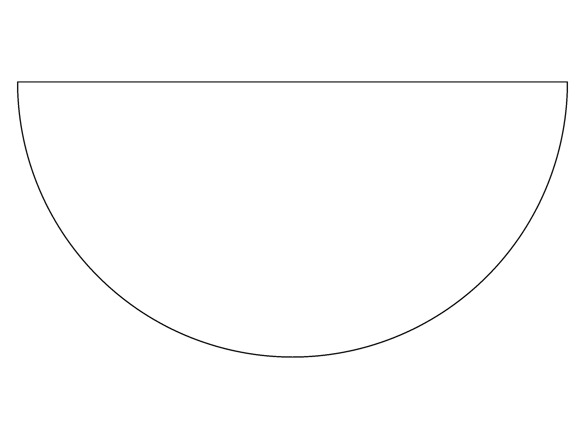
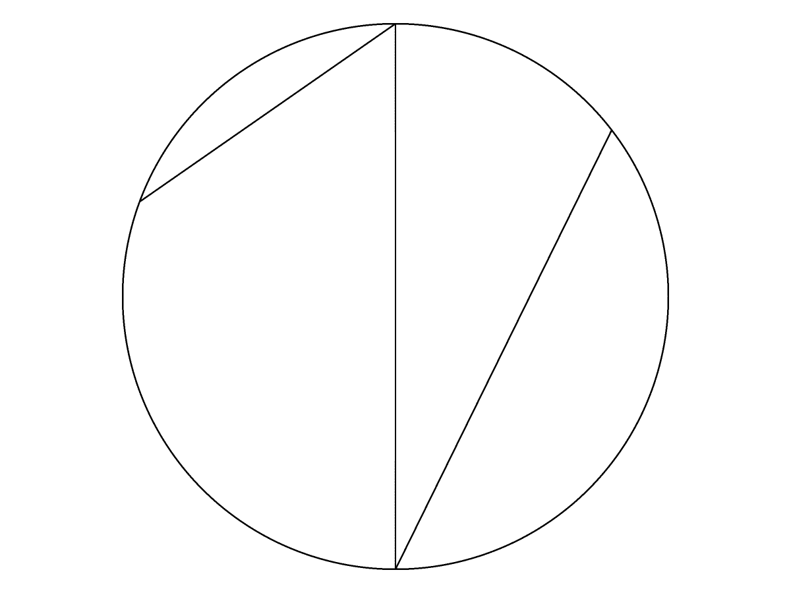

# Disk results: repeated validation and a boundary-preservation hold (2026-11-08)

Evidence-only continuation of #3056. This reconciles the earlier soundness-only
probe with the direct checks recorded beside the two justified pyramid results.
It does not bless a disk, change a failure entry, implement a gate, or take
#3084's per-entity matching work. The eleven disk rows remain unapproved.

## Four fresh sequences per exact retained case

Measured at published source head
`ec0f6558107e36c48e7f9063b9ebfc05a2c3fe5f`. For each case, the public
`topology_brep_local_operation::result_breps` reconstructs a new body and kernel
independently for each sequence:

1. `validation::soundness`, three times on the same body;
2. direct `check_brep(Level2)`, three times;
3. `validation::standing`, three times;
4. relabel this private diagnostic body's geometry with `use_arena_naming`, then
   `soundness`, three times.

There are 52 fresh constructions and 156 checks. No rename occurs in sequences
1–3. All four sequences agree case by case:

| Case | First / second / third check | Stored UV trims before / after first check |
|---|---|---|
| `gen0001` | pass / fail / fail | 0 / 4 |
| `gen0014` | pass / pass / pass | 0 / 4 |
| `gen0019` | pass / pass / pass | 0 / 4 |
| `gen0020` | pass / fail / fail | 0 / 4 |
| `gen0023` | pass / fail / fail | 0 / 4 |
| `gen0029` | pass / fail / fail | 0 / 4 |
| `gen0049` | pass / fail / fail | 0 / 4 |
| `gen0056` | pass / fail / fail | 0 / 4 |
| `gen0073` | pass / fail / fail | 0 / 4 |
| `gen0078` | pass / fail / fail | 0 / 4 |
| `gen0086` | pass / fail / fail | 0 / 4 |
| `gen0040` (pyramid control) | pass / pass / pass | 0 / 18 |
| `gen0068` (pyramid control) | pass / pass / pass | 0 / 18 |

Every failing later pass reports:

```text
SmTrimmingTools::Test #3 Loop Orientation: Face Loop has bad orientation [owner SmFace]
AssertValid skipped: ValidatePointers failed
```

Topology counts and all body/face/edge/vertex tolerances stay unchanged across
the first check in every sequence. The disk results have eight edge uses; the
first check materializes four UV trims. The pyramid controls have 36 edge uses
and materialize 18. This refutes a naming-only explanation for the discrepancy:
the unchanged `soundness` function itself returns pass then fail, without any
relabeling. It does not prove that every internal cache or derived curve stays
unchanged; the UV curves expressly do not.

The source explains the relevant ordering: `trimming_tools::check_face` returns
without checking a loop when a stored UV curve is missing. Other checking paths
can create those curves (`face::p3::compute_loop_orientation`, for example).
The next pointer-validation pass then has curves to grade. These measurements
do not choose a repair to that shared checking pipeline. Repeating a check in a
new production gate merely to obtain a different verdict would not repair the
construction. No such retry or gate change is added here.

## A separate original-input boundary witness: gen0001

The unchanged case replaces the one face of `disk.smb` with a parallel plane:
offset `0.9196834024495337`, tilt `[0,0,0]`. Its original boundary is a rational
quadratic upper semicircle and its diameter. The original 3D homogeneous control
points are read directly from the retained file, not from kernel derivatives,
sampled edges, a result, or a golden. All weights are positive. Therefore each
curve, and the intended parallel translation of its bounded face, lies within
the Euclidean control-coordinate bounds:

```text
x in [-5, 5], y in [0, 5], z = 0.9196834024495337
```

The proof uses exact rational arithmetic on the binary64 file inputs. In
particular, `y <= 5` is a whole-curve positive-weight convex-hull bound, not a
sampled estimate. The freshly returned result, captured before any check or
owner rebinding, has a vertex at
`[1.7535453870102995,7.5,0.9196834024495337]`: its y coordinate is **exactly 2.5**
outside that bound. Another is at y `-2.4999999999999996`. This demonstrates a
tangential boundary change, not just a different edge split of the original
parallel-moved boundary. The result body tolerance is `1e-5`, not remotely that
gap. No tolerance comparison is loosened.

The witness vertex's exact binary64 bits are
`[4610576085524163749,4620130267728707584,4606458991202417516]`.
The original `.smb` SHA-256 is
`9b0c3f1aa62d191364c484f2a3ad23ee6e902e93c94759d5d8aab4392bc5202f`.
All four input-hull controls pass: exact weighted bounds and z-only translation;
nonpositive-weight rejection; the actual separation witness; and tampered-bit or
tilted-case rejection. This is a negative preservation witness, not a complete
boundary certificate for either result or the two tilted disk cases whose
repeated checks stay clean. Those two are not blessed either.

## Native views

These are native `solidcore-diag` edge renders at the same `--view 0,90`, size
`1200x900`; each image is independently framed by the renderer. The first is the
original input, the second the exact generated result, not a hand-authored
schematic or an invented before-result. Looking down z, the expected z-only
translation keeps the input outline.





## Evidence and scope

The 27-member executable/raw/native-picture archive was read back and
hash-verified, SHA-256
`170977910ee4732b3421637ccfbdcff33f8c8923506f2424774d4eedc3cdd7d8`.
It retains every sequence's before/after states and verdicts, the original
inputs, exact output bits, artifact identities, the input-hull model and controls,
the original input and native result `.smb`, and both pictures. Local path:
`~/.local/share/opencode/solidcore-cleanup-evidence/pr3056-disk-check-order-20261108-ec0f65581/`.

No production, case input, assertion, golden, known-failure registry, tolerance,
floor or gate changes accompany this record. All 54 ordinary differences and
the six failing local-operation tests remain open. This evidence does not
implement #3073's tangent-round construction, #3084's gate, #3124's kept-edge
restoration, #3174's manifold-result refusal, #3015's shell work, or the excluded
pole-patch construction. The draft hold remains in force.
