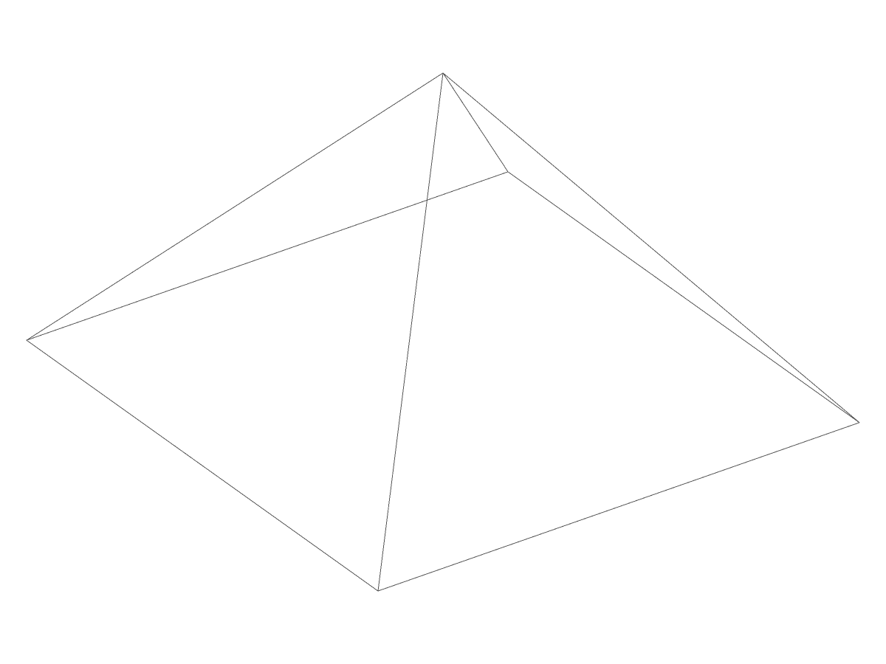
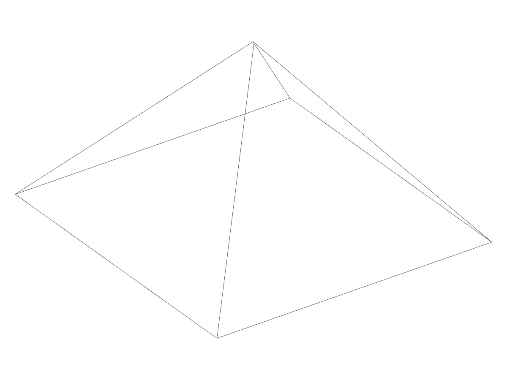
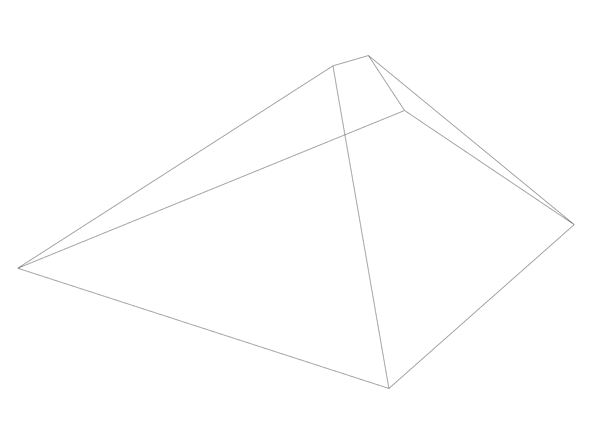

# Two generated pyramid results meet their five-plane solids (2026-11-08)

Continues #3056 / #2981. Only `gen0040` and `gen0068` in
`topology.brep_local_operation` are justified here. No production code, tolerance,
failure registry, case input, gate or excluded pole-patch construction changes.
The other eleven local-operation golden differences remain unresolved.

## Exact cases and independent construction

Both cases read `upstream/TestFiles/pt_TestFiles/Solids/pyramid.smb`, without
rebuilding its trims. Their original input body has 5 faces / 8 edges / 5 vertices.
The cases replace three faces with explicit planes:

- `gen0040`: face 0 unchanged; face 1 offset by `-0.7722087962601212`, no tilt;
  face 2 unchanged.
- `gen0068`: face 2 unchanged; face 1 offset by `-0.7342210955636247`, tilt
  `[-0.18041196740136894,0.1762487457010129,-0.20331349053160247]`; face 0
  offset 0, tilt `[-0.1304434045850086,-0.1498474917575508,-0.007725377686032431]`.

The runner's actual plane data is `p + offset*n`, normal `n + tilt`, from each
original face's middle point and normal, not from the result. The independent
Python calculation orients those five planes outward, enumerates all triples'
closed-form intersections by Cramer's rule, and retains points in all five
halfspaces. It builds each convex facet from those intersections and sums its
oriented tetrahedra. No result vertex or kernel volume enters that calculation.
It evaluates at 80 and 160 decimal digits, converting binary64 inputs exactly.

The two kept patches' complete homogeneous input nets lie on their planes to a
maximum coefficient-distance residual of `6.075e-15`; this is below their plane
dot-product rounding guard (`gamma_32` times the coordinate magnitude). The
rounded patches with residual `1.447e-6` are **replaced** by explicit planes,
not continued through uncertified poles. That distinction is essential: this
proof does not certify the excluded curved/nonplanar pole construction.

## Measured geometry, topology and validity

Measured at exact source head `134a7186f1a14abf84ee4d0115c8cc6c302b6001`, before
these expectation-only edits. The source body volume measured in this run is
`983422.1665753094`; that is not relabelled as a historical old-result volume.

| Case | New F/E/V | Kernel volume | Independent five-plane volume | Relative error | Maximum two-way vertex distance |
|---|---|---|---|---|---|
| `gen0040` | 5/9/6 | `992044.1995192543` | `992044.1995195164535906177425004735` | `2.643e-13` | `8.152e-11` |
| `gen0068` | 5/9/6 | `1093044.507611554` | `1093044.507611594137640470483235565` | `3.662e-14` | `9.620e-11` |

Both are manifold solids and all direct Level-0/1/2 checks are clean. Each has
exactly the six independent intersections, checked in both directions at the
existing `1e-9` part-scale vertex rule. Volumes satisfy the unchanged `1e-9`
relative rule, with no new floor. Relative 80/160-digit volume drift is below
`1e-79`. All six oracle controls pass: exact cube corners/volume; translated cube
and reordered planes; the actual pyramid; wrong volume and vertex rejection;
nonplanar kept-patch/invalid-body rejection; and the distinction between an
explicitly replaced rounded patch and a kept patch.

## Native pictures

The existing `case_smb` example rebuilt the exact generated cases; the native
`solidcore-diag` renderer drew their edges, not a hand-authored schematic. All
three views use `--wireframe --view -35,30 --size 1200x900 --edges-above 0.001`.
The small `gen0040` split is barely resolved in the whole-part view; its numeric
vertex and edge checks above, not visual similarity, establish the split.



Original input: four sides meet at one apex.



`gen0040`: the short split is measured as six vertices and nine edges.



`gen0068`: the two top intersections and the edge between them are visible.

## Complete old and new golden encodings

The old encoding did not contain a volume field; the source-volume observation
above is kept separate from it. Every replacement below equals the retained
actual runner encoding. All other rows and every known-failure entry stay
byte-unchanged.

`gen0040`, old:
```json
{"case":"gen0040","deferred":null,"error":null,"ints":{"graph":{"blocks":[[1172,159991],[1948,311927],[978,28202]],"n":573}},"topology":null,"values":{"edge_curve_owners":[0.0,1.0,2.0,3.0,4.0,5.0,6.0,7.0],"geometry":{"blocks":[[6.4e+21,6.4e+21,2.0799999999999997e+23]],"n":133},"record":{"blocks":[[156360.52780532837,158006.30563557148,19068776.25026989],[153903.1388885975,156472.02783429623,20181493.582973957],[104892.00006401539,108480.00015670061,12407745.286694974],[258.6666741371155,509.33334589004517,2804.4445185661316]],"n":784},"surface_owners":[1.0,1.0,1.0,1.0,1.0],"uv_curve_owners":{"blocks":[[360.0,392.0,9416.0]],"n":32}}}
```

`gen0040`, new:
```json
{"case":"gen0040","deferred":null,"error":null,"ints":{"graph":{"blocks":[[1360,199480],[1748,274861],[1932,107271]],"n":623}},"topology":null,"values":{"edge_curve_owners":[0.0,1.0,2.0,3.0,4.0,5.0,6.0,7.0,8.0],"geometry":{"blocks":[[7.2e+21,7.200000000000017e+21,2.628e+23]],"n":148},"record":{"blocks":[[143904.70981994172,148850.83660596592,18749454.884977996],[60967.80078066501,91192355.46067868,416542727.02352035]],"n":460},"surface_owners":[1.0,1.0,1.0,1.0,1.0],"uv_curve_owners":{"blocks":[[-36.0,36.0,-666.0]],"n":36}}}
```

`gen0068`, old:
```json
{"case":"gen0068","deferred":null,"error":null,"ints":{"graph":{"blocks":[[1172,159991],[1948,311927],[978,28202]],"n":573}},"topology":null,"values":{"edge_curve_owners":[0.0,1.0,2.0,3.0,4.0,5.0,6.0,7.0],"geometry":{"blocks":[[6.4e+21,6.4e+21,2.0799999999999997e+23]],"n":133},"record":{"blocks":[[156360.52780532837,158006.30563557148,19068776.25026989],[153903.1388885975,156472.02783429623,20181493.582973957],[104892.00006401539,108480.00015670061,12407745.286694974],[258.6666741371155,509.33334589004517,2804.4445185661316]],"n":784},"surface_owners":[1.0,1.0,1.0,1.0,1.0],"uv_curve_owners":{"blocks":[[360.0,392.0,9416.0]],"n":32}}}
```

`gen0068`, new:
```json
{"case":"gen0068","deferred":null,"error":null,"ints":{"graph":{"blocks":[[1360,199542],[1745,274520],[1935,107845]],"n":623}},"topology":null,"values":{"edge_curve_owners":[0.0,1.0,2.0,3.0,4.0,5.0,6.0,7.0,8.0],"geometry":{"blocks":[[7.2e+21,7.200000000000021e+21,2.628e+23]],"n":148},"record":{"blocks":[[142267.17126916934,149545.78124175625,18538871.935180865],[60965.31864733237,112625909.83332224,505787772.57405066]],"n":460},"surface_owners":[1.0,1.0,1.0,1.0,1.0],"uv_curve_owners":{"blocks":[[-36.0,36.0,-666.0]],"n":36}}}
```

## Preserved evidence and remaining holds

The 41-member archive was read back and hash-verified, SHA-256
`a7a2c79290b672472bf6661707c68c3399bb1e91f75db426d44e28f12b47c049`.
It retains the exact input/result data, original nets, executable convex model,
controls, native `.smb` captures/images and all probe versions. Local path:
`~/.local/share/opencode/solidcore-cleanup-evidence/pr3056-pyramid-input-planes-20261108-134a7186f/`.

The first probe did not reconcile the runner's notification identities with
direct checks; its raw results remain retained, without attributing new failures.
The later diagnostic gives its private bodies arena identities before direct checks. The eleven disk
cases remain unapproved: their changed boundary geometry and discrepancies
between the earlier custom-key soundness probe and direct checks require
separate reconciliation. No result is blessed just because that earlier probe
called it sound.

The PR remains draft: six local-operation test failures, other invalid/ungraded
results, unresolved golden differences and canonical approval holds remain.
No #3073, #3084 or #3124 implementation is taken here.
