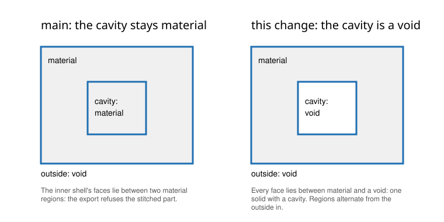

#### WR-21540. DoStitching's region nesting leaves the region inside a nested closed shell solid
- **Severity:** Wrong result (a cavity counted as material; SolidCraft's export then refuses the stitched part, a face between two material regions)
- **Area:** Healing / stitching
- **Location:** `source/SMLib/src/SmStitch.cpp`, `SmStitch::DoStitching` (def. `:1086`), its region nesting (`:2311`): `FindAndSetInfiniteRegion()` with its default `SM_VS_INFINITEREGION_SWAP`.
- **What happens:** each shell the gluing closes splits off a new region, solid (`TestClosureSplitRegion`). The region nesting then only finds the infinite region and swaps its flag. When the faces close into a shell nested inside another, the region inside the inner shell stays solid, so the faces of the inner shell lie between two material regions. `SmBrep::StitchFaces` (`m_bDoRegionNesting` set) reaches it. This is WR-569 for the stitch `StitchIntoSolid` does not run.
- **Trigger:** `StitchFaces` on the loose faces of a closed body with a closed cavity: a cube's faces with those of a smaller cube inside it, or a part read from STEP as a `BREP_WITH_VOIDS`, unstitched and stitched again (SolidCraft issue #21540).
- **How found:** SolidCraft issue #21540: Stitch refused a part with a cavity.
- **Confirmed:** in the port, which follows `DoStitching` and `TestClosureSplitRegion` here: `stitch_faces_leaves_a_closed_cavity_void` (`crates/solidcore/src/heal/stitch/p2.rs`) fails without the port's deviation. The C++ was not run on these faces.
- **Rust port:** where the stitch leaves every shell closed and more than two regions, `Stitch::do_stitching` (`heal/stitch/p2.rs`) sets the void flags by nesting (`SetRegionVoidType::NestedSolid`), as `stitch_into_solid` does for WR-569. With open shells, or two regions, it keeps upstream's swap.

The regions after the stitch: on the left the cavity stays material, so the inner shell's faces lie between two material regions; on the right the regions alternate from the outside in.
